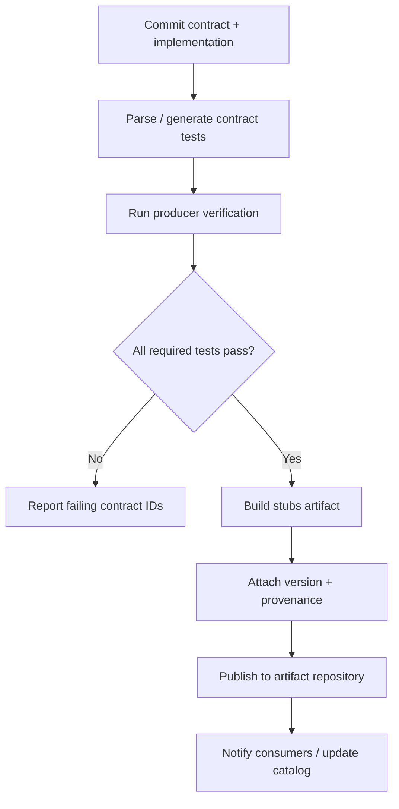

# Evaluating Coordination and Contract Maintenance Costs

## 1. Why calculate costs before scaling contract testing?

**Spring Cloud Contract (SCC)** helps producer and consumer teams agree on HTTP or messaging behavior using Groovy/YAML DSL. From contracts, teams can generate **producer verification tests**, package and publish **stub artifacts**, use **Stub Runner** in consumer tests, and integrate these steps into CI to detect incompatible API changes.

When there is only one producer and one consumer, the workflow is usually straightforward: two teams agree on a contract, the producer verifies its implementation, and the consumer uses stubs to develop independently. However, once a system grows to dozens of producers, hundreds of consumers, and many independently releasing teams, costs no longer lie primarily in writing a few lines of Groovy/YAML. The real costs lie in:

- **Coordination:** who proposes, reviews, approves, and owns changes when contracts evolve?
- **Maintenance:** do contracts still reflect the real API across many releases?
- **Integration:** do producer verification, stub publishing, and consumer tests run reliably?
- **Version governance:** which consumers still rely on old contracts, and when may a producer drop old behavior?
- **Diagnosis:** when CI turns red, can teams tell whether the issue is implementation, contract, artifact, or environment?

An organization can achieve a very high contract test percentage while still wasting substantial effort if it creates too many low-value contracts, synchronizes manually across teams, or constantly fixes tests over unstable internal details.

**Goal of this article:** establish a method to evaluate coordination and contract maintenance costs, choose a contract strategy suited to risk and dependency levels, estimate lifecycle effort, and design an SCC workflow that is just enough to control API changes without creating unnecessary operational overhead.

## 2. Distinguish contract creation cost from contract ownership cost

Contract testing costs fall into at least two buckets:

1. **Initial cost:** API discovery, writing contracts, creating producer base classes, configuring the verifier, setting up consumer tests, and integrating registries.
2. **Recurring cost:** reviewing changes, running pipelines, publishing stubs, supporting consumer migrations, handling test flakiness, retiring old contracts, and upgrading dependencies/tooling.

A contract may take very little time to write yet become very expensive to maintain if it covers a constantly changing response, serves many dependent consumers, or acts as a release boundary across many teams.

### Lifecycle and cost-bearing actors


| Stage | Primary cost | Who typically participates? |
| --- | --- | --- |
| Need discovery | Identify fields, statuses, and events consumers actually use | Consumer, product/domain owner |
| Contract proposal | Write DSL, examples, matchers, error cases | Consumer or producer |
| Review | Align on semantics, security, compatibility, approvals | Both teams |
| Producer verification | Base classes, generated tests, fixing implementation | Producer |
| Publish stubs | Build, versioning, registry, provenance | Producer/platform |
| Consumer verification | Stub Runner setup, client assertions, test fixtures | Consumer |
| Adoption | Version tracking, migrations, compatibility windows | Consumer + producer |
| Retirement | Remove old contracts/mappings and verify no consumers remain | Producer/platform |

**Never measure effort solely by counting Groovy or YAML files.** A small contract with 15 consumers and two transports can take far more coordination effort than ten internal contracts serving a single consumer.

## 3. Contract management strategies

SCC is a tool for executing contract tests; **the ownership and coordination strategy** must be chosen by the organization. The following approaches can be combined:

| Strategy | Who initiates? | Pros | Costs/risks |
| --- | --- | --- | --- |
| **Consumer-driven contracts (CDC)** | Consumers describe what they need | Curbs over-contracting; producer sees real needs | Many consumers can create overlapping or conflicting demands |
| **Producer/provider-owned contracts** | Producer publishes supported behavior | Focused ownership, easy to control API surface | Risk of describing what producer wants to provide rather than what consumers use |
| **Jointly-owned contracts** | Producer and consumer review/agree together | Improves semantic quality, reduces misunderstandings | Reviews can slow down when syncing many teams |
| **Contract catalog/central governance** | Platform/API governance maintains conventions and catalog | System-wide visibility into versions and ownership | Easily becomes a bottleneck if every change needs central team sign-off |
| **Hybrid** | Consumers propose, producer confirms; platform automates rules | Balances ownership and standardization | Requires clear boundaries of accountability |

### Consumer-driven does not mean consumers unilaterally dictate APIs

Consumers can write contracts describing **requests/responses they actually depend on**. The producer remains responsible for confirming that behavior fits the domain, security, performance, and API roadmap. Contracts must not turn into mandates forcing producers to preserve every unreasonable client assumption.

### Producer-owned does not mean the producer verifies every consumer

Producer verification proves the implementation matches contracts managed by the producer. It does not prove every consumer can deserialize responses, handle errors properly, or avoid depending on out-of-contract fields. Consumer tests are still needed to confirm how clients use stubs.

### Choose hybrid when many independent teams exist

A typically balanced model:

1. Consumers document the requests/responses/events they genuinely use.
2. Producer reviews semantics and confirms feasibility.
3. Producer runs Contract Verifier against its implementation.
4. Producer publishes immutable stub artifacts.
5. Consumers pin the exact stub version in tests.
6. Platform team supplies BOMs, plugin templates, registries, CI conventions, and dashboards.

The platform team **supports the paved road**, without manually approving every business contract change once policies are clear and automation provides sufficient evidence.

## 4. Coordination cost grows with relationships, not just service count

Suppose there are P producers and C consumers. If every consumer could depend on every producer, the maximum number of relationships is:

\[
R_{\max}=P\times C
\]

In real systems, only a subset of pairs connect. Let E be the number of existing producer–consumer relationships; E is usually a more useful indicator than total service count.

For example:

| Scale | Producers | Consumers | Actual relationships | Notes |
| --- | ---: | ---: | ---: | --- |
| Small | 2 | 3 | 3 | Easy to coordinate directly |
| Medium | 8 | 12 | 20 | Requires clear ownership and artifact versioning |
| Large | 20 | 50 | 140 | Requires catalog, automation, and adoption tracking |
| Dense | 20 | 50 | 600 | Cross-team change costs are very high if heavily coupled |

These numbers are **hypothetical examples**, not universal benchmarks. Two systems with 20 producers and 50 consumers each can have vastly different effort if one has 140 relationships and the other has 600.

### One producer change can ripple to many consumers

If a producer changes a response field or event schema, coordination cost depends on:

- How many consumers use that field/event?
- Which consumers are running older versions?
- Is the change backward-compatible?
- Are there consumers outside the catalog or external partners?
- Can old and new versions be published concurrently?
- How long is old-version support committed?

**The number of affected consumers** usually predicts migration effort better than the producer's contract file count.

## 5. Factors driving maintenance costs

| Factor | Cost rises when | How to control |
| --- | --- | --- |
| **API change frequency** | Fields/statuses/events change often | Separate stable contracts from experiments; versioning |
| **Consumer count** | Many differing teams/release cycles | Consumer inventory, compatibility windows |
| **Degree of coupling** | Consumers rely on internal fields or uncommitted ordering | Contract semantics, schema discipline |
| **Matcher complexity** | Overly broad or overly complex regex/JSONPath | Match only what consumers need; review examples |
| **Transport count** | HTTP, Kafka, AMQP/JMS all need adapters | Split ownership and test matrices by transport |
| **Toolchain diversity** | Many Boot/Cloud/JDK/SCC/WireMock versions | BOMs, platform templates, compatibility matrices |
| **Artifact lifecycle** | Mutable versions, registries lacking retention/provenance | Pin versions/digests, deprecation policies |
| **Test runtime** | Many stubs, fixed ports, shared mutable state | Random ports, isolation, clear lifecycles |
| **Data fixtures** | Long, sensitive, hard-to-reproduce payloads | Synthetic fixtures, controlled helpers/builders |
| **Ownership** | Unclear who fixes contracts or handles consumer breaks | CODEOWNERS/owner metadata/catalogs |

### Contract churn vs. contract value

A frequently changing contract is not automatically bad. If it protects a high-risk payment flow, maintenance effort may be well worth it. Conversely, a rarely changing contract that tests internal implementation details consumers do not care about can be pure waste.

Evaluate together:

- **Change frequency:** how often did the contract change in the period?
- **Consumer reach:** how many consumers use it?
- **Business criticality:** if broken, what is the impact on money, data, security, or operations?
- **Detection value:** what bugs do contract tests catch that unit/integration/E2E tests miss?
- **Maintenance effort:** how many hours does the team spend reviewing, updating fixtures, upgrading tooling, and migrating?

## 6. Total Cost of Ownership (TCO) estimation model

Monthly/quarterly effort can be estimated by summing core activities:

\[
TCO = C_{\text{design}} + C_{\text{review}} + C_{\text{verify}} +
C_{\text{publish}} + C_{\text{consumer}} + C_{\text{maintain}} +
C_{\text{retire}}
\]

Where:

| Component | Scope |
| --- | --- |
| C_design | Discovering behavior, writing/adjusting DSL and examples |
| C_review | Discussing semantics, security, compatibility, approvals |
| C_verify | Producer test base, generated tests, CI runs/failure triage |
| C_publish | Builds, versioning, registry, provenance, and retention |
| C_consumer | Stub Runner setup, consumer tests, migration/adoption |
| C_maintain | Fixing contracts, dependency upgrades, flaky tests, fixture drift |
| C_retire | Deprecation, confirming zero remaining consumers, removing old versions |

### Practical effort formula

To estimate by change count:

\[
TCO_{\text{period}} =
N_{\text{changes}}\times
(t_{\text{design}}+t_{\text{review}}+t_{\text{verify}}+
t_{\text{publish}}+t_{\text{consumer}})
+ t_{\text{maintenance}} + t_{\text{retirement}}
\]

Each t is **average labor hours** per activity, and N_changes is the number of contract changes in the period. Calculate in person-hours; if financial cost conversion is needed, multiply by an internal cost rate. Do not use this formula to feign precision: actual effort varies sharply between a minor additive change and a multi-consumer breaking change.

### Example estimate for a single change

Suppose an optional `deliveryWindow` field is added to a response:

| Activity | Hypothetical effort |
| --- | ---: |
| Clarify semantics and consumer needs | 1.0 hour |
| Update DSL + examples | 0.5 hour |
| Producer review and implementation | 1.0 hour |
| Generated verification + CI triage | 0.5 hour |
| Publish stubs | 0.25 hour |
| Consumer update and tests | 1.0 hour |
| **Total** | **4.25 hours** |

If there are 8 consumers and each team spends 0.5 hour updating/testing, consumer cost becomes 4 hours; the total rises to 7.25 hours. This is **an illustrative quantitative example**, not a universal benchmark. A consumer that does not use the new field may need no changes.

### Do not overlook platform operating costs

Beyond individual contract changes, organizations also incur effort for:

- Upgrading the SCC plugin, Spring Cloud BOM, WireMock, JDK, and build images.
- Maintaining artifact repositories, retention, permissions, and credentials.
- Updating templates, examples, and documentation.
- Supporting services across multiple release trains.
- Investigating slow pipelines, flakiness, or generated tests not running.

These costs belong under **platform enablement**, rather than being pushed entirely onto individual producer/consumer teams.

## 7. Choosing which contracts are worth maintaining

Not every endpoint or message needs the same level of contract testing. Evaluate by **change risk and defect-detection value**, not raw contract count targets.

### Value vs. effort matrix

| | Low maintenance effort | High maintenance effort |
| --- | --- | --- |
| **High risk/detection value** | Prioritize automation and expansion | Invest deliberately; reduce complexity, split contracts |
| **Low risk/detection value** | Use simple tests or smoke checks | Consider not contracting; re-examine assumptions |

### Evaluating an API before writing a contract

Score each criterion from 1 to 5:

| Criterion | High score means |
| --- | --- |
| Business impact | Incorrect behavior causes major financial, data, operational, or reputational harm |
| Consumer reach | Many consumers or many independent teams depend on it |
| Change risk | API changes frequently or has a history of breaking changes |
| Release independence | Producer/consumer release independently, hard to test synchronously |
| Detection gap | Current unit/integration/E2E tests struggle to catch mismatches between the two services |

A composite score can help **prioritize**, but must not become a rigid automated rule for every service. For example:

\[
Priority = BusinessImpact + ConsumerReach + ChangeRisk + ReleaseIndependence + DetectionGap
\]

High scores prioritize contract tests. After scoring, factor in practical effort: a low-churn endpoint on a payment boundary may still need a contract; a temporary internal endpoint may only need a simple integration test.

### Scope selection examples

| API/event | Risk | Consumers | Recommendation |
| --- | --- | ---: | --- |
| Payment fee calculation | Very high | 4 | Request/response + error case contracts; producer verification and consumer tests |
| Internal configuration lookup | Low | 1 | Minimal contract or integration test |
| OrderConfirmed event | High | 12 | Message contract, headers, payload/schema, and consumer compatibility |
| Local-only debug endpoint | Low | 0 production | No need to publish stubs like a public API |
| External partner API | High | Many partners | Explicit contract/version policy, sandbox testing, and consumer-specific cases |

## 8. Choosing contract detail: protect enough without locking implementation

A major source of maintenance cost is **over-detailed contracts**. If a consumer only needs `orderId` and `status`, the contract does not need to assert every audit field, internal timestamp, JSON key order, or implementation metadata.

### Right-sized contract

```groovy
Contract.make {
    description 'Consumer needs order status'
    request {
        method GET()
        url '/api/orders/42'
    }
    response {
        status OK()
        headers {
            contentType(applicationJson())
        }
        body([
            orderId: 'ord-42',
            status: 'CONFIRMED'
        ])
    }
}
```

This contract only guarantees the response includes the important fields according to configured generators and matchers. Adding extra fields outside consumer needs creates an unnecessarily rigid contract, preventing the producer from refactoring or adding/removing internal data without fixing many tests.

### Avoid two extremes

| Extreme | Consequence |
| --- | --- |
| **Overly narrow contract** — asserts only status 200 without checking key schemas | Producer can alter fields/types and consumers only discover it at runtime |
| **Overly broad contract** — checks every internal field, every technical header, ordering, or volatile values | Every minor refactor breaks tests, driving up coordination costs |

The sweet spot is a contract **strict enough on behavior consumers rely on**, yet **silent on details the producer does not guarantee**.

### Use matchers for variable data

For example:

- IDs must match a format yet vary per creation.
- Timestamps must match a format/type without pinning a fixed wall-clock instant.
- Collections can contain varying numbers of items while consumers only need each item's schema.
- Correlation ID headers must exist without matching the same literal in every test.

Overly loose matchers like `.*` reduce test-fixing effort at the expense of defect detection. Overly tight matchers increase churn. Pick patterns expressing **meaningful invariants**.

## 9. Choosing granularity: by endpoint, use case, or consumer?

Contract count is not a goal; how contracts are grouped determines reviewability and reuse.

| Granularity | Pros | Cons | Best when |
| --- | --- | --- | --- |
| One contract per endpoint | Easy to find, small scope | Can create too many tiny files and duplicate fixtures | APIs with many independent endpoints |
| One contract per use case | Tied to business workflows and consumer flows | Can repeat endpoint behavior across use cases | Consumers follow clear business flows |
| One contract per consumer | Captures exact needs of each client | Multiple consumers may duplicate identical behavior | Consumers have distinct semantics/permissions |
| One large contract for whole service | Easy to see API surface in one place | Hard to review, merge conflicts, large blast radius | Only small, stable services |
| Contract per message/event | Distinguishes event semantics and consumers | Must manage schema/versions and delivery semantics | Event-driven systems |

### Do not use one giant file to hold all consumer assumptions

When a producer has 20 consumers, one monolithic contract file becomes a contention hotspot. Conversely, creating separate contracts per consumer when request/response behavior is identical creates duplication and review overhead.

Group by **meaningful behavior/consumer need**, use controlled shared helpers/fixtures, and keep ownership clear. When consumers genuinely need divergent behavior, split scenarios so CI identifies exactly which team is impacted.

## 10. Evaluating CDC, provider-owned, and hybrid by context

No single model fits every organization. Use this matrix to choose:

| Context | Strategy to consider | Reason |
| --- | --- | --- |
| One producer, one consumer, same team | Simple provider-owned or jointly-owned | Low coordination cost |
| One producer, many independent consumers | CDC with producer review, catalog tracking | Diverse consumer needs |
| Producer is a platform API used by many domains | Provider-owned core + CDC for consumer-specific behavior | Producer keeps API stable; consumers validate specific assumptions |
| Many teams releasing independently | Hybrid with immutable stub artifacts | Reduces release-schedule coupling |
| Legacy system, hard to run tests | Start with contracts for critical flows, grow incrementally | Avoids big-bang migration |
| Partner/external consumers | Producer-owned published contracts + consumer conformance tests | Requires clear compatibility window management |
| Event-driven with many subscribers | Producer schema/event contracts + consumer-specific verification | One event has multiple consumers and delivery assumptions |

### Choosing by maturity stage

**Stage 1 — Small teams, shared release cadence**

- Agree on contracts directly between the two teams.
- Producer verifier and consumer stub tests can run in the same pipeline.
- Clear ownership and local artifacts suffice.

**Stage 2 — Independent teams, separate releases**

- Separate producer/consumer pipelines.
- Publish stubs to a Maven-compatible registry.
- Pin versions, record provenance, and support migrations.
- Establish a breaking-change process.

**Stage 3 — Many domains and platform scale**

- Contract catalog, owner metadata, dependency graph.
- Automated CI policies checking contract compatibility.
- Track consumers on older versions and deprecation deadlines.
- Platform provides templates/tooling; domain teams retain semantic accountability.

Do not build a heavy catalog when the system has only a handful of relationships. Expand governance only when the cost of finding owners, tracking adoption, and coordinating changes exceeds catalog operating costs.

## 11. Designing for backward compatibility to lower coordination costs

A **backward-compatible** change usually lets the producer deploy first and consumers upgrade later. This eliminates synchronized release locks.

| Change | Compatibility likelihood | Notes |
| --- | --- | --- |
| Add optional response field | Usually compatible | Strict consumer deserializers may be an exception |
| Add enum value | Potentially breaking | Consumers with exhaustive switches/strict enum parsing may fail |
| Remove field used by consumers | Breaking | Requires migration/deprecation |
| Change field type | Usually breaking | E.g., number to string |
| Change HTTP method/path | Breaking for old clients | May require parallel routes/versions |
| Change status code | Potentially breaking | Clients may branch specifically on 200/201/204 |
| Add required request field | Breaking for old consumers | Producer needs defaults/optionality or a new version |
| Add non-required technical header | Usually compatible | Check proxy/security behavior |
| Change event destination | Breaking | Subscribers may stop receiving events |
| Change message schema/semantics | Potentially breaking | Check more than JSON shape |

### Adding fields is not always safe

A Java consumer using strict DTOs or enum deserializers can fail when a producer adds an enum value. Never infer compatibility solely because existing JSON fields remain. Check **real consumer behavior** and deserialization rules.

### Expand–migrate–contract strategy

1. **Expand:** producer adds new fields/endpoints/events while preserving old behavior.
2. **Migrate:** consumers update and test against new stub versions.
3. **Observe:** monitor adoption, production usage, and consumers still using old paths.
4. **Contract:** remove old behavior only once supported consumers have migrated and the deprecation window has passed.

SCC helps verify each step with producer tests and stub artifacts. However, SCC **does not automatically know every external consumer** if they are unlisted in a catalog or do not run consumer verification.

## 12. Separating coordination costs from technical costs

When CI turns red, teams often waste time figuring out whom to contact. A minimal ownership model:

| Task | Accountable | Responsible | Consulted |
| --- | --- | --- | --- |
| Propose consumer need | Consumer owner | Consumer developer | Producer owner |
| Confirm semantics | Producer API owner | Producer developer | Consumer/domain owner |
| Generated producer verification | Producer owner | Producer team | Platform on toolchain failures |
| Publish stubs | Producer owner | Producer CI | Platform registry |
| Consumer Stub Runner tests | Consumer owner | Consumer team | Producer when behavior is unclear |
| Breaking changes/deprecation | Producer API owner | Producer team | All affected consumers |
| BOM/plugin templates | Platform owner | Platform team | Service teams |

This is a reference responsibility table; organizations may adapt roles, yet need **one ultimately accountable person/team** for each contract and deprecation workflow.

### Working agreement

A working agreement should answer:

- Who is allowed to propose contracts?
- Within what timeframe does the producer respond to reviews?
- Who decides whether matchers are too broad or too strict?
- Who handles failing producer verification?
- Who owns consumer adoption?
- When is a contract/version marked deprecated?
- Who confirms zero remaining consumers before deleting behavior?

If the answer is “every team is jointly responsible,” usually nobody steps up when a breaking change hits.

## 13. Using SCC to automate repetitive work

Coordination costs drop when teams can answer most questions through pipelines and artifact metadata instead of manual meetings or chat messages.

### Producer pipeline



High-value automation steps:

- Generate producer tests from contract sources.
- Run tests against real implementation with proper base classes/test modes.
- Block stub publication if producer verification fails.
- Package mappings and response resources into an immutable artifact.
- Record version, commit, build URL, and checksum/provenance.
- Detect which contracts changed and surface diffs in reviews.

### Consumer pipeline

Consumer pipelines should:

1. Resolve the exact configured or candidate stubs version.
2. Start Stub Runner in test scope.
3. Run consumer client tests against stub behavior.
4. Clearly report the producer artifact and executed contract scenarios.
5. Distinguish artifact resolution failures, stub startup failures, unmatched mappings, and business assertion failures.

A generic log like `BUILD FAILED` is useless for coordination. Reports must identify **service, artifact coordinates, contract ID, request/response scenario, and test owner**.

### Separating fast CI from full CI

Not every test needs to run for every small change:

| Pipeline | When it runs | Scope |
| --- | --- | --- |
| Fast feedback | Every pull request | Parse/generate, relevant producer tests, consumer smoke scenarios |
| Full contract suite | Merge/release or schedule | All required producer/consumer scenarios |
| Compatibility matrix | BOM/SCC/WireMock or major runtime changes | Supported consumer platforms and versions |
| Deprecation gate | Before retiring old APIs/events | Adoption evidence and consumer inventory |

Test selection should rely on dependency graphs and contract ownership. Without a reliable graph, running a broader suite is safer than missing an impacted consumer.

## 14. Reducing duplication without creating overly tight shared contracts

One producer may have many consumers using similar behavior. You can reuse:

- Groovy helper methods or DSL fragments.
- Test data builders and fixture factories.
- Common headers/schema definitions.
- CI templates and Maven/Gradle conventions.
- Consumer contract examples and assertion helpers.

However, avoid a **shared contract module** holding every assumption of every consumer, forcing everyone to upgrade whenever one client adds a field.

### When should things be shared?

Share when consumers genuinely depend on **the same stable behavior** and want to review it as one unit. Never share simply because two JSON payloads look alike; semantics and compatibility expectations may differ.

| Reuse mechanism | Value | Risk to control |
| --- | --- | --- |
| Request/body builders | Reduces DSL duplication | Helpers obscure semantics or make matchers hard to read |
| Common response fixtures | Reuses stable data | Changing a fixture affects many contracts |
| Shared schemas | Standardizes fields/types | Schemas can bloat into giant APIs hard to version |
| Parent build/plugin config | Reduces toolchain drift | Upgrading parent affects many services |
| Central test library | Standardizes assertions | Couples test framework versions |

### A review rule

Reviewers must be able to understand **what a specific contract guarantees** without jumping through layers of helpers or hidden build-plugin logic. If helpers hurt readability, keep critical behavior inline in the DSL and abstract only repetitive data.

## 15. Managing artifacts and versions to avoid surprise migration costs

The stubs artifact is the producer's deliverable to consumers. Sound versioning lets teams know exactly which contract version each test ran against.

### Minimum artifact policy

| Rule | Benefit |
| --- | --- |
| Use immutable versions | Identical coordinates always point to identical content |
| Publish after producer verification | Stubs carry proof of matching producer implementation |
| Record commit/build provenance | Can trace back to contract source |
| Store digests/checksums | Detects unintended artifact replacement |
| Clear retention | Preserves versions still used by consumers |
| Never publish mutable `latest` for release gates | Builds remain reproducible |
| Separate publish/read permissions | Consumers cannot overwrite producer artifacts |

### Stubs version is not API version

A producer can publish many stubs artifact versions across releases while the wire API version stays unchanged. Conversely, an API may version to v2 while artifact versions increment per build/release policy. Establish clear conventions:

- Artifact version is used to **resolve the exact stubs build**.
- API version is used to **express contract compatibility** when wire versioning exists.
- Git revision/build ID is used to **trace source and provenance**.

Never overload a single version string to mean all three if it cannot accurately represent them.

### Local cache is not a source of truth

Stub Runner in LOCAL mode can read stubs from the Maven local repository. While convenient for development, it easily causes consumer tests to run against stale artifacts if a developer forgets to reinstall. Release CI should use published artifacts or ensure the local repository was populated by the exact build within the same job.

## 16. Tracking adoption and deprecation so contracts do not live forever

An old contract/version can only be retired safely when you know **who still uses it**.

### Consumer inventory

A catalog or manifest can track:

| Field | Meaning |
| --- | --- |
| Producer service | Service publishing the contract/stubs |
| Consumer service | Dependent service |
| Contract ID | Scenario or contract identity |
| Stubs coordinates | Artifact version currently resolved |
| Consumer owner | Team accountable for migration |
| Last verified revision | Most recent consumer revision tested |
| Deprecation deadline | Cutoff date for supporting old behavior |
| Status | Active / migrating / deprecated / retired |

This information can come from build manifests, registry metadata, dependency files, or CI results. **Never infer a consumer has migrated just because a new artifact was published**; require consumer test evidence or production adoption metrics per policy.

### Retirement workflow

1. Producer announces deprecation and rationale.
2. Identify all consumers using the old contract/version.
3. Provide deadlines and migration guidance.
4. Consumers update dependencies and run tests against new stubs.
5. Monitor consumer CI and production usage where available.
6. Confirm zero supported consumers remain on the old behavior.
7. Delete old contracts/mappings in a controlled release.

### Time-bounded retention

You do not need to keep every stubs version forever. You can apply:

- Longer retention for actively supported releases.
- Keep several recent builds for debugging/rollback.
- Retain artifacts for audited/regulated releases per policy.
- Purge snapshot/temporary builds after a short retention window.

Retention must align with rollback policies and consumer release cadences. Purging artifacts too early prevents consumers from reproducing older tests; keeping every artifact forever clutters registries and catalogs.

## 17. Measuring contract testing effectiveness with meaningful metrics

Do not measure only contract count or green build percentage. A balanced scorecard might include:

| Category | Metric | Question answered |
| --- | --- | --- |
| Adoption | Producers/consumers running contract tests in CI | How widely has the workflow been adopted? |
| Coverage | Critical relationships with both producer verification and consumer tests | Which risky boundaries remain uncovered? |
| Quality | Share of contract failures catching real incompatibilities | Are tests catching valuable defects? |
| Noise | Failure rate from flakiness/tooling/misconfiguration | How much effort is wasted on false alarms? |
| Lead time | Time from contract proposal to consumer adoption | Is coordination slowing down releases? |
| Maintenance | Person-hours spent fixing contracts/tooling/fixtures | Is maintenance cost rising or falling? |
| Deprecation | Consumers still on deprecated behaviors | Is it safe to retire old versions yet? |
| Reproducibility | Percentage of tests using pinned artifacts and provenance | Can results be reproduced? |

### Distinguish valuable failures from noisy failures

A contract test failing because the producer removed a field a consumer uses is **detection value**. A test failing because a fixed WireMock port collided or a local cache pulled the wrong JAR is **tooling noise**. When both report identically, teams gradually lose faith in the pipeline.

Tag failure categories:

- Contract mismatch.
- Producer implementation failure.
- Consumer behavior failure.
- Stub artifact resolution/provenance failure.
- Toolchain/runtime incompatibility.
- Infrastructure/flakiness.

The goal is reducing noise without loosening matchers to the point incompatibilities slip through.

## 18. Case study: one producer with 12 consumers

### Context

`order-service` exposes an order-lookup API to 12 consumers across 7 teams. Consumers release independently; some use Spring Boot 2, others Boot 3, and one integrates via message events. The producer frequently adds fields and modifies error handling.

Before contract testing:

- Teams communicated API changes via docs and chat.
- Producer occasionally changed status codes unaware of consumer logic depending on them.
- Consumer tests mocked the HTTP client directly, missing wire-format checks.
- When deserialization broke in production, finding who owned the behavior took hours.

### Strategy choice

The teams chose **hybrid**:

1. Each consumer describes the key behaviors it genuinely uses.
2. The producer API owner reviews and consolidates identical behaviors into sensible contract scenarios.
3. Producer runs Contract Verifier and publishes stub artifacts.
4. Each consumer runs Stub Runner with pinned artifact versions.
5. Platform team maintains BOM/plugin templates, artifact registry, and catalog.

Do not create a separate contract for every HTTP request when behavior is identical; equally, do not lump all 12 consumers into one contract when semantics diverge.

### Illustrative effort estimate

Suppose in one month:

| Activity | Effort |
| --- | ---: |
| 4 contract changes × 2.0 hours design/review/producer verification | 8 hours |
| Consumer adoption: 5 teams × 1.5 hours | 7.5 hours |
| Platform CI/registry maintenance | 3 hours |
| Investigating failures and fixing flaky tests | 2.5 hours |
| Deprecation/consumer inventory | 1 hour |
| **Total** | **22 hours/month** |

These are **hypothetical numbers to practice the model**, not an SCC benchmark. Teams should measure actual effort over several cycles and calibrate.

### Comparing against manual coordination

Suppose previously each API change caused 3 hours of discussions/manual checks per impacted team across 4 teams on average:

\[
4\ \text{changes}\times4\ \text{teams}\times3\ \text{hours}=48\ \text{hours}
\]

If contract testing cuts repetitive back-and-forth while adding 22 operational hours/month, it can yield a net benefit. Still, never assume the **old 48 hours vanish completely**: semantic reviews, migrations, and release coordination still require human involvement.

A fair evaluation should measure:

- Person-hours before/after.
- Incompatibilities caught before production.
- False-positive/flakiness rates.
- Time from producer change to consumer adoption.
- Rollbacks/hotfixes caused by contract mismatches.

### Lessons from the case study

Contract testing yields the highest return when **manual coordination costs are high and compatibility failures carry significant impact**. Adding pipelines without ownership, artifact versioning, and consumer adoption tracking merely converts chat overhead into red-CI triage overhead.

## 19. Decision process during a design review

Before adopting SCC for a new API/event, walk through 8 questions:

1. **Who is the producer and who are the consumers?** Are there external/unknown consumers?
2. **Which behaviors do consumers actually use?** Request fields, response fields, statuses, headers, destinations, event schemas?
3. **What is the risk if behavior changes?** Could it impact money, data, security, or availability?
4. **Do producer and consumer release independently?** Are stubs needed so teams avoid blocking each other?
5. **Who owns the contract?** Who reviews and manages deprecations?
6. **Which tests are needed?** Producer verifier, consumer Stub Runner, messaging tests, security/integration/E2E?
7. **How will artifacts be versioned and distributed?** LOCAL or REMOTE, version pinning, retention?
8. **Does expected maintenance cost justify the detection value?** Who will measure after rollout?

### Sample decision record

```yaml
service: order-service
contractScope:
  transport: HTTP
  scenarios:
    - get-order-success
    - get-order-not-found
ownership:
  contractOwner: orders-platform
  consumerReviewRequired: true
verification:
  producer: spring-cloud-contract-verifier
  consumer: stub-runner
distribution:
  repository: internal-maven
  versionPolicy: immutable
  retention: supported-release-window
priority:
  businessImpact: 5
  consumerReach: 4
  releaseIndependence: 5
  detectionGap: 4
decision: adopt-hybrid-contract-testing
```

This is **an organization-defined decision record**, not a default Spring Cloud Contract schema. Store it in ADRs/catalogs if helpful for tracking decisions; avoid adding a separate governance file for every contract when administrative overhead outweighs value.

## 20. Anti-patterns that inflate contract costs

| Anti-pattern | Why it is costly | Replacement |
| --- | --- | --- |
| Contracting every endpoint without assessing risk | Many files and reviews with low detection value | Prioritize critical boundaries |
| Producer inventing all consumer assumptions | Misses client-specific needs | Let consumers propose, producer review |
| Consumers publishing stubs on producer's behalf | Loses proof stubs match implementation | Producer verification before publishing |
| One massive contract file shared across many teams | Merge conflicts and wide blast radius | Split by behavior/scenario/owner |
| Each consumer copying identical contracts | Duplication and repeated migrations | Share stable behavior under control |
| Overly broad matchers so tests always pass | Misses schema incompatibilities | Match meaningful invariants |
| Asserting every internal field | Minor refactors break tests | Assert only behavior consumers depend on |
| Publishing mutable stub versions | Non-reproducible consumer tests | Immutable versions and digests |
| Ignoring consumer adoption | Producer deletes behavior still in use | Inventory and deprecation gates |
| Platform team manually approving every change | Governance becomes a bottleneck | Automated policies, ownership in domain teams |
| Not classifying CI failures | Teams lose trust in tests | Separate contract, tooling, and infrastructure failures |
| Measuring only contract count | Encourages low-value tests | Measure detection value, maintenance effort, and lead time |

## 21. Strategy and cost evaluation checklist

### Scope and value

- [ ] Identified producer, consumers, and actual dependencies.
- [ ] Ranked APIs/events by business impact, consumer reach, and change risk.
- [ ] Contracts protect behavior consumers genuinely rely on.
- [ ] Decided which contracts need producer verification and consumer Stub Runner tests.
- [ ] Never use contract count as the sole KPI.

### Ownership and coordination

- [ ] Clear contract owner and consumer owners exist.
- [ ] Agreed on who proposes, reviews, approves, and handles breaking changes.
- [ ] Producer reviews semantics, security, and backward compatibility.
- [ ] Platform team provides tooling/standards without becoming a bottleneck.
- [ ] Reliable consumer inventory or dependency graph exists.

### Design and maintenance

- [ ] Contracts have appropriate granularity by endpoint/use case/consumer.
- [ ] Matchers are strict enough to catch bugs without locking implementation details.
- [ ] Fixtures are synthetic, concise, and reproducible.
- [ ] Shared helpers are used only when semantics truly match.
- [ ] Versioning, artifact immutability, provenance, and retention policies exist.
- [ ] Expand–migrate–contract workflow and deprecation deadlines exist.

### CI and effectiveness

- [ ] Producer tests actually run before publishing stubs.
- [ ] Consumer tests use exact artifact versions/digests.
- [ ] CI distinguishes contract mismatch, toolchain, artifact, and infrastructure failures.
- [ ] Test selection uses a dependency graph or runs a sufficiently broad suite.
- [ ] Lead time, detection value, false positives, and maintenance hours are tracked.
- [ ] Periodically review costs and retire contracts that no longer add value.

## 22. References and conclusion

To select and implement your strategy, consult:

- [Spring Cloud Contract Reference](https://docs.spring.io/spring-cloud-contract/reference/): DSL, Contract Verifier, Stub Runner, messaging, and build integration.
- [Spring Cloud Contract — Stub Runner](https://docs.spring.io/spring-cloud-contract/reference/project-features-stubrunner/stub-runner.html): how consumers fetch and run stubs.
- [Spring Cloud](https://spring.io/projects/spring-cloud/): release trains and compatibility with Spring Boot.
- [Pact — Consumer-driven contract testing](https://docs.pact.io/): additional reference for CDC models, provider verification, and managing consumer contracts; this is a different tool from SCC, not a required dependency.

**Key takeaway:** Contract testing costs do not scale linearly with DSL file count. They depend on the number of producer–consumer relationships, release independence, business risk, ownership quality, artifact management, and old-version support windows. Start with high-risk boundaries, let consumers describe real needs, let producers verify behavior and publish immutable stubs, and use CI/catalogs to track adoption. Scale governance only when relationship counts and coordination costs genuinely warrant it; measure both detection value and maintenance effort to ensure the strategy reduces risk rather than merely adding busywork.
