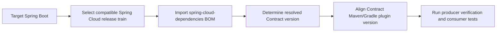
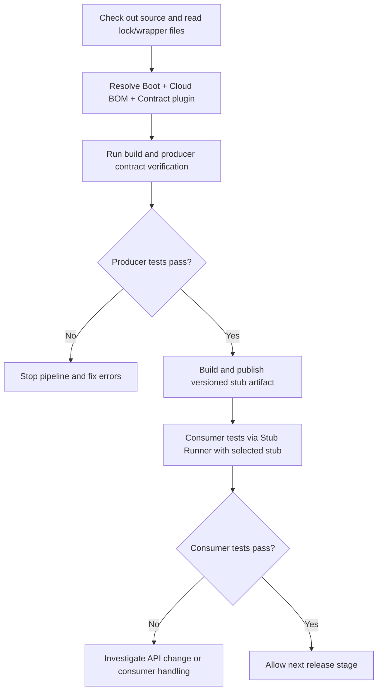

# Managing Versions with a BOM and Matching Plugin

## 1. Why Does Spring Cloud Contract Need a Version Management Strategy?

Spring Cloud Contract is a contract testing tool between a **producer** (a service exposing HTTP APIs or publishing messages) and a **consumer** (a service calling APIs or consuming messages). Teams can author contracts in Groovy/YAML DSL, generate producer tests, produce stubs, run consumer tests with Stub Runner, and integrate these steps into CI.

The components involved span multiple technology layers:

- **Spring Boot** provides the application foundation, packaging plugin, and Boot testing libraries.
- **Spring Cloud release train** bundles Spring Cloud versions tested together, including Spring Cloud Contract modules.
- **Spring Cloud Contract Verifier** provides the libraries for generating and executing producer-side contract tests.
- **Spring Cloud Contract Stub Runner** handles locating, downloading, and running stubs during consumer tests.
- **Spring Cloud Contract Maven/Gradle plugin** participates in the build lifecycle, such as generating test sources and packaging stub artifacts.

Using incompatible versions can cause compilation errors, `NoSuchMethodError` during test execution, unrecognized plugin configurations, or stubs that consumers fail to run. Editing the contract DSL at that point will not fix the root cause: **build and runtime components are out of sync**.

This lesson aims to manage versions via a **BOM (Bill of Materials)** and select the **matching plugin**, giving both producer and consumer a reproducible testing workflow.

## 2. What Is a BOM and What Does It Manage?

A BOM is a POM that aggregates a set of compatible dependency versions. In Maven, a BOM is `import`ed inside `dependencyManagement`. Once a dependency is included in the managed set, the project typically omits `<version>` on each individual dependency declaration.

Role breakdown:

| Component | Management Mechanism | Purpose |
| --- | --- | --- |
| Spring Boot dependencies | `spring-boot-dependencies` (often managed via `spring-boot-starter-parent`) | Aligns the Boot foundation, test starters, and related libraries |
| Spring Cloud dependencies | `org.springframework.cloud:spring-cloud-dependencies` | Aligns Spring Cloud modules belonging to a **release train** |
| Spring Cloud Contract dependencies | Versions managed by the matching Spring Cloud BOM | Adds Verifier/Stub Runner without specifying individual dependency versions |
| Spring Cloud Contract Maven plugin | **Plugin** version declared in `build/plugins` or `pluginManagement` | Generates contract tests/stubs during the Maven lifecycle |
| Spring Cloud Contract Gradle plugin | Version declared in `plugins { ... }` | Registers contract test/stub generation tasks in Gradle |

**Important BOM limitation:** Maven `dependencyManagement` manages **dependencies**, not **build plugin** versions. Likewise, importing a BOM in Gradle does not automatically change plugin versions declared inside the `plugins` block.

In addition, properties defined inside an imported BOM POM do not automatically become properties usable directly in your project's POM. If your Maven plugin configuration uses `${spring-cloud-contract.version}`, your project or its parent POM must define that property.

### How Does a BOM Differ from a Starter?

- A BOM **does not add libraries to the classpath by itself**: it only selects versions when the project declares a dependency.
- A starter such as `spring-cloud-starter-contract-verifier` or `spring-cloud-starter-contract-stub-runner` **adds a curated group of required dependencies** to enable a feature.
- A build plugin performs build-time tasks; it does not replace the test dependencies your application needs.

Consequently, a real producer setup typically requires **all three**: the BOM, the Verifier test dependency, and the Spring Cloud Contract plugin.

## 3. Determine a Compatible Version Set Before Configuring

Do not independently pick the latest versions of Spring Boot, Spring Cloud Contract, and the plugin. Instead, follow this order:

1. **Choose the Spring Boot version** currently used by the project or targeted for the upgrade.
2. **Consult Spring's Spring Cloud–Spring Boot compatibility table** to pick the matching Spring Cloud release train. Release trains usually use dotted numbers such as `202x.y.z`; this is the **Cloud BOM** version, not the version of individual Contract libraries.
3. **Identify the Spring Cloud Contract version managed by that release train** from the BOM or dependency resolution.
4. **Select the Spring Cloud Contract Maven/Gradle plugin at the same Contract version** as the Contract libraries managed by the BOM. If release documentation specifies a different plugin version rule, follow that guidance.
5. **Check Java, Maven/Gradle, and Spring Boot plugin requirements**, because Spring Cloud compatibility does not waive JDK or build-tool version requirements.

Decision flow:



This document uses the placeholders **`BOOT_VERSION`**, **`CLOUD_TRAIN_VERSION`**, **`CONTRACT_VERSION`**, and **`DEPENDENCY_MANAGEMENT_PLUGIN_VERSION`** in examples. Before running any commands, **replace every placeholder with real, verified compatible versions** according to the documentation for your chosen release train. Do not treat placeholders as valid Maven coordinates.

An internal version-tracking table should record at least:

| Parameter | Example Project Entry | Rule |
| --- | --- | --- |
| Spring Boot | `BOOT_VERSION` | Based on the approved Boot version |
| Spring Cloud BOM | `CLOUD_TRAIN_VERSION` | Release train supporting that Boot version |
| Spring Cloud Contract library | `CONTRACT_VERSION` | Version managed by the Cloud BOM |
| Spring Cloud Contract plugin | `CONTRACT_VERSION` | Matches the Contract library or follows release notes |
| Java / Maven / Gradle | CI and wrapper versions | Meets requirements of the toolchain and Boot/Cloud stack |

When performing an upgrade, review and update the **entire version set** rather than bumping a single dependency line.

## 4. Maven Configuration for the Producer

Suppose `payment-service` exposes `GET /api/payments/{id}`, and consumer `order-service` relies on the `paymentId` and `status` fields. The producer wants to author contracts in `src/test/resources/contracts`, generate tests verifying the live API, and publish stubs for the consumer.

An illustrative Maven configuration:

```xml
<project xmlns="http://maven.apache.org/POM/4.0.0"
         xmlns:xsi="http://www.w3.org/2001/XMLSchema-instance"
         xsi:schemaLocation="http://maven.apache.org/POM/4.0.0
                             https://maven.apache.org/xsd/maven-4.0.0.xsd">
    <modelVersion>4.0.0</modelVersion>

    <parent>
        <groupId>org.springframework.boot</groupId>
        <artifactId>spring-boot-starter-parent</artifactId>
        <version>BOOT_VERSION</version>
        <relativePath/>
    </parent>

    <groupId>com.example</groupId>
    <artifactId>payment-service</artifactId>
    <version>1.0.0</version>

    <properties>
        <java.version>17</java.version>
        <spring-cloud.version>CLOUD_TRAIN_VERSION</spring-cloud.version>
        <spring-cloud-contract.version>CONTRACT_VERSION</spring-cloud-contract.version>
    </properties>

    <dependencyManagement>
        <dependencies>
            <dependency>
                <groupId>org.springframework.cloud</groupId>
                <artifactId>spring-cloud-dependencies</artifactId>
                <version>${spring-cloud.version}</version>
                <type>pom</type>
                <scope>import</scope>
            </dependency>
        </dependencies>
    </dependencyManagement>

    <dependencies>
        <dependency>
            <groupId>org.springframework.boot</groupId>
            <artifactId>spring-boot-starter-web</artifactId>
        </dependency>
        <dependency>
            <groupId>org.springframework.boot</groupId>
            <artifactId>spring-boot-starter-test</artifactId>
            <scope>test</scope>
        </dependency>
        <dependency>
            <groupId>org.springframework.cloud</groupId>
            <artifactId>spring-cloud-starter-contract-verifier</artifactId>
            <scope>test</scope>
        </dependency>
    </dependencies>

    <build>
        <plugins>
            <plugin>
                <groupId>org.springframework.cloud</groupId>
                <artifactId>spring-cloud-contract-maven-plugin</artifactId>
                <version>${spring-cloud-contract.version}</version>
                <extensions>true</extensions>
                <configuration>
                    <testFramework>JUNIT5</testFramework>
                    <testMode>MOCKMVC</testMode>
                    <baseClassForTests>com.example.payment.BaseContractTest</baseClassForTests>
                </configuration>
            </plugin>
        </plugins>
    </build>
</project>
```

In this example:

- `spring-boot-starter-parent` manages the Boot foundation. Java `17` is only an example; adjust it according to the requirements of your chosen Boot/Cloud combination.
- `spring-cloud-dependencies` is imported with `type=pom` and `scope=import` under `dependencyManagement`.
- `spring-cloud-starter-contract-verifier` **omits `<version>`** so it inherits the version managed by the BOM.
- `spring-cloud-contract-maven-plugin` **declares an explicit version** via a project property. That value must match the Contract dependency version resolved by the BOM.
- `extensions=true` and the plugin configuration integrate test/stub generation into the Maven build lifecycle as supported by the plugin.
- `baseClassForTests` points to a test base class provided by the producer; that base class must configure the actual test environment, such as MockMvc. Declaring the class name does not generate the class itself.

For projects not using `spring-boot-starter-parent`, you can import the Boot BOM in `dependencyManagement` and configure related Maven plugin versions separately. Pay close attention when doing so, because many defaults from the Boot parent will not be inherited automatically.

### Commands to Verify Maven Configuration

After replacing the version placeholders, use the project's Maven wrapper if available:

```bash
./mvnw help:effective-pom
./mvnw dependency:tree -Dincludes=org.springframework.cloud
./mvnw clean verify
```

On Windows, use `mvnw.cmd` accordingly.

Read `effective-pom` to inspect final dependencies, plugins, and configurations after parent/management merging. Read `dependency:tree` to verify the actual Contract library version selected. `verify` helps catch compilation or test-execution errors caused by version mismatches.

**Note:** Maven plugins have their own classpath and resolution mechanism; seeing the right dependency tree is **not sufficient** to prove the plugin version is also aligned. You must inspect the plugin section in the effective POM as well.

## 5. Maven Configuration for the Consumer

`order-service` normally **does not need the producer test-generation plugin** if it only consumes stubs. This module needs Stub Runner on the test classpath:

```xml
<dependency>
    <groupId>org.springframework.cloud</groupId>
    <artifactId>spring-cloud-starter-contract-stub-runner</artifactId>
    <scope>test</scope>
</dependency>
```

The snippet above assumes the consumer has also imported a **Spring Cloud BOM compatible with the consumer's own Spring Boot version**, following the same dependency management pattern as section 4.

The consumer can fetch or start the producer's stub using an artifact identifier, for example:

```java
@SpringBootTest
@AutoConfigureStubRunner(
    ids = "com.example:payment-service:1.0.0:stubs:8085",
    stubsMode = StubRunnerProperties.StubsMode.LOCAL
)
class PaymentConsumerTest {
    // Call the HTTP client against the stub on port 8085 and verify the result.
}
```

`com.example:payment-service:1.0.0:stubs:8085` specifies, in order, group ID, artifact ID, **producer artifact version**, classifier `stubs`, and the port on which to run the stub. `LOCAL` requires the stub artifact to already exist in the local Maven repository; in CI, it is typically configured to fetch stubs from a remote repository with authentication and an explicit candidate version.

**Do not confuse the two version numbers:**

- `CONTRACT_VERSION` is the **Spring Cloud Contract tooling/library version** that the BOM and plugin must agree on.
- `1.0.0` in the Stub Runner example is the **Payment Service artifact version**, tied to the API/stub the consumer targets.

These two versions do not need to—and usually should not—have the same value. A new API release may bump the producer's stub version without changing Spring Cloud Contract, and vice versa.

## 6. Gradle Configuration: BOM Manages Dependencies, Plugin Manages Build Tasks

An equivalent Groovy DSL `build.gradle` configuration can be written as:

```groovy
plugins {
    id 'java'
    id 'org.springframework.boot' version 'BOOT_VERSION'
    id 'io.spring.dependency-management' version 'DEPENDENCY_MANAGEMENT_PLUGIN_VERSION'
    id 'org.springframework.cloud.contract' version 'CONTRACT_VERSION'
}

group = 'com.example'
version = '1.0.0'

ext {
    springCloudVersion = 'CLOUD_TRAIN_VERSION'
}

dependencyManagement {
    imports {
        mavenBom "org.springframework.cloud:spring-cloud-dependencies:${springCloudVersion}"
    }
}

dependencies {
    implementation 'org.springframework.boot:spring-boot-starter-web'
    testImplementation 'org.springframework.boot:spring-boot-starter-test'
    testImplementation 'org.springframework.cloud:spring-cloud-starter-contract-verifier'
}

contracts {
    baseClassForTests = 'com.example.payment.BaseContractTest'
}

tasks.named('test') {
    useJUnitPlatform()
}
```

Here, `io.spring.dependency-management` imports the Spring Cloud BOM for dependencies; the Spring Boot plugin coordinates Boot platform dependency management; and `org.springframework.cloud.contract` adds Spring Cloud Contract build capabilities. `CONTRACT_VERSION` must be selected to match the Verifier library from the BOM and your project's Gradle version.

If the project uses Gradle Kotlin DSL (`build.gradle.kts`), the syntax differs; do not copy the Groovy snippet verbatim. In a multi-module Gradle build, apply the Contract plugin only to modules that **actually generate producer tests/stubs**, while consumer modules may only need the Stub Runner test dependency.

To inspect resolved dependencies and available tasks:

```bash
./gradlew dependencyInsight --dependency spring-cloud-contract-verifier --configuration testRuntimeClasspath
./gradlew dependencies --configuration testRuntimeClasspath
./gradlew tasks --all
./gradlew test
```

`dependencyInsight` shows the final resolved version of a library and the dependency path leading to it. `tasks --all` reveals the Contract tasks provided by the plugin in the active version; check exact task names against your project's plugin. If the plugin itself fails to resolve, Gradle may fail **before** running dependency inspection commands.

### Can Gradle Use `platform(...)` Instead of the dependency-management Plugin?

Yes. Gradle natively supports importing Maven BOMs via `platform("group:artifact:version")`. However, you must apply `platform` to all relevant configurations (`implementation`, `testImplementation`, etc.) or use shared conventions so test dependencies receive the version constraints. Pick **one consistent dependency management strategy** to avoid accidentally introducing conflicting BOMs or scattered version overrides.

Using native `platform` also **does not automatically select the build plugin version**. Plugins in `plugins { ... }` still need to be aligned for compatibility.

## 7. Where Do the Maven and Gradle Plugins Differ?

| Task | Maven | Gradle |
| --- | --- | --- |
| Manage Contract dependencies | Import Cloud BOM in `dependencyManagement` | Import BOM via dependency-management plugin or `platform` |
| Enable test/stub generation | `spring-cloud-contract-maven-plugin` | `org.springframework.cloud.contract` plugin |
| Declare plugin version | `build/plugins`, or `pluginManagement` in parent then activate plugin | `plugins { id ... version ... }` or appropriate convention/plugin management |
| Align versions | Match the Contract version resolved by Maven | Match the Contract version resolved by Gradle |
| Verify resolved libraries | `dependency:tree`, `help:effective-pom` | `dependencies`, `dependencyInsight` |
| Verify build steps | Maven lifecycle/goals and `verify` output | Contract task list and test run output |

In multi-module Maven builds, place BOM/property versions and plugin configurations in the parent POM so submodules share consistent values. If the plugin is declared only in `pluginManagement`, producer modules must still **declare the plugin** under `plugins` to activate it. Do not apply the test-generation plugin to modules that do not own producer contracts.

In multi-project Gradle builds, use convention plugins or shared configuration to keep versions consistent. Ensure plugin repositories allow Gradle to download the Contract plugin and dependency repositories allow downloading Spring Cloud libraries.

## 8. Why a "Green Build" Is Not Enough to Confirm Correct Version Management

A project might pass a handful of unit tests without actually running producer verification or generating stubs. Distinguish between these states:

| State | What Can You Conclude? | What Remains Unproven? |
| --- | --- | --- |
| Dependencies resolve | Requested artifacts can be downloaded | Runtime compatibility; whether the plugin executed |
| Unit tests pass | Tested logic behaves as written | Whether API contracts between producer and consumer are protected |
| Producer contract tests pass | Producer satisfies the executed contracts | Whether consumers use the right stub and handle all scenarios |
| Stub generated | An artifact simulating interactions exists | Whether the stub is actually verified and published with the right version |
| Consumer tests with Stub Runner pass | Consumer works with the selected stubs | Whether the full production environment or E2E flow is guaranteed |

The logical workflow is: **verify dependencies/plugin → run producer contract tests → generate and publish verified stub → consumer pulls exact stub version and runs tests**. Each step should have explicit outputs and clear failure conditions in CI.

### Conceptual CI Flow Example



How artifacts are published and how producer/consumer pipelines trigger one another depend on your CI system. The diagram highlights verification order and does not assume every repository shares a single pipeline.

## 9. Common Version Errors and How to Diagnose Them

### Case A: BOM Is Present, Yet Maven Reports a Missing Plugin Version

**Cause:** `spring-cloud-dependencies` sits inside `dependencyManagement`, which does not manage Maven plugins. Alternatively, the plugin configuration references `${spring-cloud-contract.version}` without that property being defined in the project or parent POM.

**Fix:** Explicitly define `spring-cloud-contract.version` with the value matching the Contract version resolved by the BOM. Inspect the plugin section via `help:effective-pom`.

### Case B: `ClassNotFoundException` or `NoSuchMethodError` During Tests

**Possible causes:** Two different versions of the same library exist on the test classpath; a dependency overrides the BOM version; the code-generating plugin mismatches the verifier library at runtime; or Boot and Cloud are incompatible.

**Fix:** Use `dependency:tree` or `dependencyInsight` to find the actual resolved versions; check the plugin version; consult the Boot/Cloud compatibility table. Do not mask symptoms by randomly adding an explicit dependency with another version.

### Case C: Gradle Cannot Find the Spring Cloud Contract Plugin

**Possible causes:** Wrong plugin ID/version declared, plugin repository not configured properly, or the plugin version does not support the running Gradle version.

**Fix:** Verify the exact plugin ID `org.springframework.cloud.contract`, official version, `pluginManagement.repositories` in `settings.gradle` if needed, and the Gradle wrapper version. A BOM cannot fix plugin download errors.

### Case D: Producer Tests Run, Yet Consumer Reports Stub Not Found

**Possible causes:** Stub was not packaged/published, wrong `groupId:artifactId:version:classifier`, wrong `LOCAL`/`REMOTE` mode, or consumer points to an artifact version that does not exist yet.

**Fix:** Verify that the producer build creates an artifact with the `stubs` classifier, that the repository hosts the target version, and check credentials and Stub Runner configuration. This issue does not necessarily involve the Spring Cloud Contract library version.

### Case E: Build Keeps Passing After API Changes Without Catching Contract Breaks

**Possible causes:** The plugin is not actually generating or running contract tests, no matching contracts exist, the test base class is misconfigured, or the pipeline only runs unit tests and skips contract verification.

**Fix:** Inspect logs, generated test sources, test results, and DSL directory paths. Track executed test counts in reports to detect a "green" pipeline where all contract tests were skipped.

### Case F: Upgrading the Release Train While Leaving the Old Plugin

**Consequence:** Generated tests may rely on APIs or libraries incompatible with the Contract verifier brought in by the new BOM.

**Fix:** Upgrade the plugin and verifier together, verify test-generation goals/tasks, and re-run both producer and consumer contract tests before releasing. If a repository hosts multiple services on different release trains, manage compatibility per service and verify that stubs remain usable by target consumers.

## 10. Safe Upgrade Process

When upgrading Spring Boot or Spring Cloud Contract:

1. **Record currently running versions:** Boot, Cloud BOM, Contract dependency, Maven/Gradle plugin, JDK, and wrapper; inspect resolved dependencies rather than just reading versions typed in build files.
2. **Pick the target stack from compatibility info:** start with Boot, choose a supported Cloud release train, then choose the matching Contract/plugin version.
3. **Update centrally:** change the version set in the parent POM, version catalog, or convention plugin; avoid scattered per-module overrides.
4. **Re-resolve dependencies and plugins:** inspect `effective-pom`/`dependency:tree` or `dependencyInsight`/`tasks`.
5. **Run full producer contract tests and generate stubs:** review matchers and generated code if the plugin changed test generation behavior.
6. **Run consumer tests with the new stub:** test active consumers of the API, especially required fields, error codes, and message formats.
7. **Release in a controlled manner:** record the stub artifact version tied to the producer; if breaking changes are required, coordinate with consumers or introduce a new API version.

In CI, pin build tool versions via Maven/Gradle wrappers, store dependency/plugin versions in Git-tracked files, and avoid dynamic versions such as `latest.release` for steps that must be reproducible.

## 11. Self-Check Exercise

Consider a project with the following decisions:

- Spring Boot was upgraded to a newer release.
- The Spring Cloud BOM still points to the release train for the old Boot version.
- `spring-cloud-starter-contract-verifier` omits `<version>`, relying on the BOM.
- The `spring-cloud-contract-maven-plugin` is pinned to an older version.
- The consumer uses Stub Runner to fetch `payment-service:2.3.0:stubs`.

Answer the following:

1. Why is upgrading only Spring Boot while keeping an old Cloud BOM risky?
2. Does the BOM automatically update the Spring Cloud Contract Maven plugin?
3. Is `2.3.0` in the stub artifact the version of Spring Cloud Contract?
4. Which tools should be used to inspect actual dependency versions and the Maven plugin version?
5. Before publishing a new stub, what must the producer and consumer verify?

**Suggested answers:** (1) A release train has a specific Boot compatibility range; you must pick a matching train. (2) No—plugins must be managed separately via build/plugin management configuration. (3) No—that is the Payment Service artifact version. (4) Use `dependency:tree` and `help:effective-pom`. (5) Confirm that producer contract tests actually run and pass, that the stub is generated/published with the right version, and that the consumer tests pass via Stub Runner using that exact stub.

**Remember:** **A BOM selects dependency versions; build plugins have their own version management lifecycle.** In Spring Cloud Contract, pick a Spring Cloud release train compatible with Boot, verify the actual Contract version, align the matching Maven/Gradle plugin version, and verify both producer and consumer in CI. Always distinguish the **Contract tooling version** from the **service stub artifact version**.
