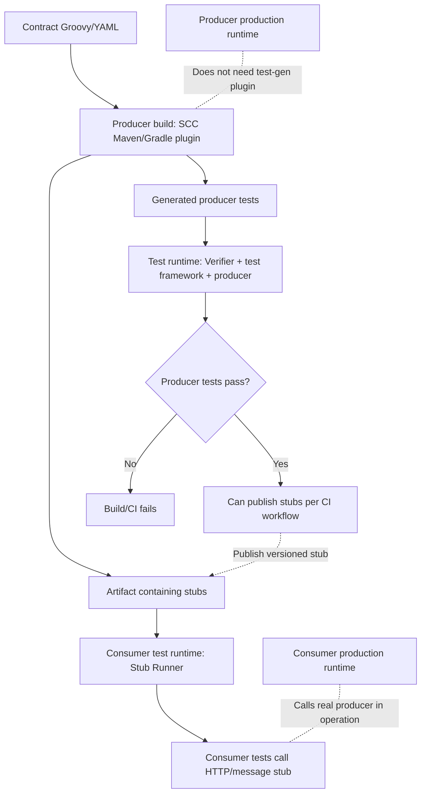
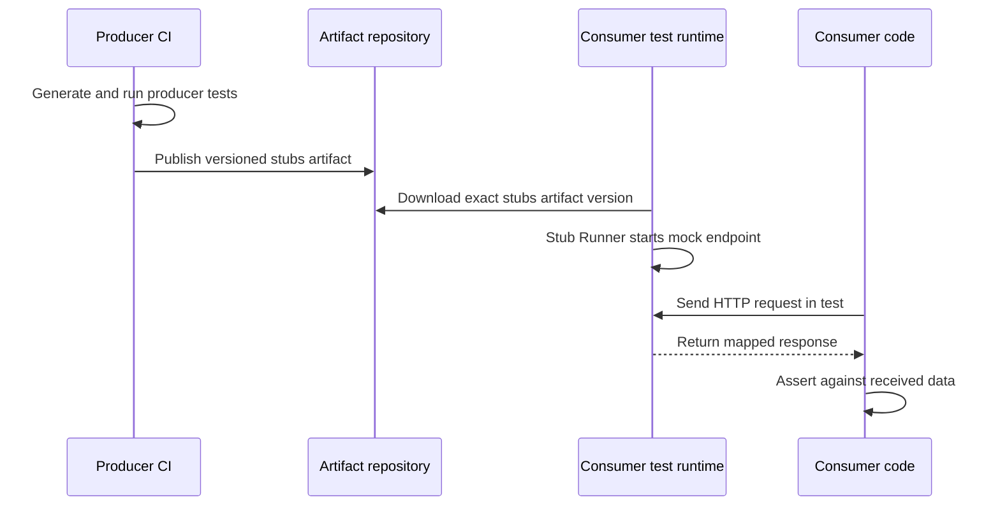

# Distinguishing Runtime Libraries from Test-Generation Tooling

## 1. Why Must This Distinction Be Clear from Project Setup?

When starting with **Spring Cloud Contract (SCC)**, learners often encounter three groups of components at once: application libraries used while serving traffic, tooling that **generates test code** during the build, and libraries that support **running tests or stubs**. Placing everything into the same dependency group leads to bloated configurations, shipping test-only libraries into production releases, or mistakenly thinking that adding a single dependency is enough for the producer to automatically verify contracts.

In this model, the **producer** exposes HTTP APIs or publishes messages, while the **consumer** calls APIs or consumes messages. Spring Cloud Contract lets both sides agree on communication behavior using **Groovy DSL or YAML DSL**; the tooling generates **producer verification tests** and **stubs** from the contracts, lets consumers run tests via **Stub Runner**, and wires those steps into **CI** to catch incompatible API changes.

The core idea of this lesson is identifying **which component runs at which stage**. Do not conflate these three senses of "runtime":

- **Production runtime:** code and libraries required when the application runs to serve users.
- **Build time:** plugins and tasks executed by Maven or Gradle to read contracts, generate test sources, and package stubs.
- **Test runtime:** libraries, generated tests, the test-mode application, and stub servers running while the test suite executes.

**Learning goals:** After this lesson, you will be able to select the right dependencies/plugins for producer and consumer; explain why generated tests need test libraries rather than production dependencies; distinguish a stub artifact from a running stub server; and verify how Maven/Gradle separate classpaths before introducing contract testing to CI.

## 2. The Three Execution Moments Model

Suppose a producer exposes an order lookup API and a consumer is a shopping cart app. A YAML contract might describe the following behavior:

```yaml
description: "Fetch a paid order"
request:
  method: GET
  url: /api/orders/42
response:
  status: 200
  headers:
    Content-Type: application/json
  body:
    id: 42
    status: PAID
```

From such a contract, different components participate at different times:



This diagram highlights two principles:

1. **The test/stub generation plugin** runs during the build; it is not the component serving HTTP requests for the producer when deployed.
2. **Verifier and Stub Runner** execute code when running the test suite. That is *test runtime*, which does not mean they belong in *production runtime*.

A Spring Boot application using SCC still needs normal operational libraries such as Spring MVC/WebFlux, HTTP clients, messaging clients, or business dependencies depending on its architecture. Spring Cloud Contract **does not replace** the libraries responsible for serving requests or sending/receiving messages in production.

## 3. Classification Table of Common Components

| Component | Primary Function | Typical Configuration Location | Required in Production Runtime? |
|---|---|---|---|
| Spring Boot Web, WebFlux, or messaging starter | Producer handles real HTTP/messages; consumer performs real calls/sends/receives | `implementation`/`compile` dependency, per app | **Yes**, if the app uses them |
| Groovy/YAML Contract | Specification of behavior to verify | Contract files in repo or shared contract repo | **No**; input to build/test pipeline |
| `spring-cloud-contract-maven-plugin` | Reads contracts, generates producer tests and outputs for packaging stubs in Maven | `<build><plugins>` | **No**; it is a Maven build plugin |
| Gradle plugin `org.springframework.cloud.contract` | Integrates test/stub generation tasks with Gradle | `plugins { ... }` | **No**; it is a Gradle build plugin |
| `spring-cloud-starter-contract-verifier` | Provides support for running/asserting contract-generated producer tests | Producer **test** dependency | **No**, if used only for contract tests |
| Generated producer tests | Sends/triggers interactions and verifies producer compliance | Generated test sources; executed in test phase | **No** |
| Stub artifact, typically classifier `stubs` | Holds simulated interactions generated from contracts for consumer use | Published versioned artifact | **No**; not a real service |
| `spring-cloud-starter-contract-stub-runner` | Locates/downloads and runs stubs for consumer tests | Consumer **test** dependency | **No**, in standard test setups |
| Stub server (often backed by WireMock for HTTP) | Receives requests and returns simulated responses per stub | Started during test execution | **No**, unless intentionally deploying a standalone mock server |
| CI pipeline | Runs producer tests, packages/publishes stubs, runs consumer tests | Maven/Gradle tasks, CI workflows | Not an application JVM dependency |

**Be careful with the word "library":** `spring-cloud-starter-contract-verifier` and `spring-cloud-starter-contract-stub-runner` are indeed JVM libraries loaded when running tests. They are **not** code-generation plugins. Meanwhile, the Maven/Gradle plugin is the tool invoked by Maven/Gradle to **generate** tests; those generated tests in turn need a test environment and test libraries to **run**. Therefore, you cannot simply split "Spring Cloud Contract" into "runtime" and "non-runtime" without specifying *which runtime*.

## 4. Producer Illustration: Test-Generation Plugin vs. Test-Execution Dependency

Suppose `order-service` is a Spring Boot producer. It already needs `spring-boot-starter-web` to serve HTTP; that is a production dependency. To verify contracts, we add a **build plugin** and a **test library** for two separate jobs.

### 4.1. Maven Example (Key Configuration Snippets)

In `pom.xml`, the dependencies section may look like:

```xml
<dependencies>
    <!-- Production application needs to handle HTTP -->
    <dependency>
        <groupId>org.springframework.boot</groupId>
        <artifactId>spring-boot-starter-web</artifactId>
    </dependency>

    <!-- Used only when running producer contract tests -->
    <dependency>
        <groupId>org.springframework.cloud</groupId>
        <artifactId>spring-cloud-starter-contract-verifier</artifactId>
        <scope>test</scope>
    </dependency>
</dependencies>
```

The plugin section is a **separate** configuration:

```xml
<build>
    <plugins>
        <plugin>
            <groupId>org.springframework.cloud</groupId>
            <artifactId>spring-cloud-contract-maven-plugin</artifactId>
            <version>${spring-cloud-contract.version}</version>
            <extensions>true</extensions>
            <configuration>
                <baseClassForTests>com.example.orders.ContractTestBase</baseClassForTests>
            </configuration>
        </plugin>
    </plugins>
</build>
```

These two snippets are **illustrative POM excerpts**, not a complete runnable project. The project needs a parent/BOM and **compatible** Spring Boot–Spring Cloud–Spring Cloud Contract versions, along with the `ContractTestBase` class and matching test environment setup. The `spring-cloud-contract.version` property must be declared with your selected version; do not assume the BOM automatically sets the Maven plugin version. Test framework and base class configuration options may vary across SCC versions.

Why are both required?

- The **Maven plugin** integrates contract parsing and test generation into the build lifecycle. It executes under Maven's orchestration.
- The **Verifier test dependency** supports compiling and running generated tests. This library belongs on the **test classpath**.
- **`ContractTestBase`** is written by the team to boot the app, set up required fixtures/mocks, and configure how HTTP/messages are tested. YAML alone does not prepare databases, brokers, or order states.

When running plugin goals, the typical flow is reading contracts, generating tests, compiling/running tests, generating/packaging stubs, and publishing artifacts per configuration. Check your project's **lifecycle bindings** and CI; merely declaring the plugin does not prove every step actually executed and succeeded.

### 4.2. Gradle Example (Groovy DSL, Core Pieces)

```groovy
plugins {
    id 'java'
    id 'org.springframework.boot' version '<boot-version>'
    id 'org.springframework.cloud.contract' version '<contract-plugin-version>'
}

dependencies {
    implementation 'org.springframework.boot:spring-boot-starter-web'
    testImplementation 'org.springframework.boot:spring-boot-starter-test'
    testImplementation 'org.springframework.cloud:spring-cloud-starter-contract-verifier'
}

contracts {
    baseClassForTests = 'com.example.orders.ContractTestBase'
}
```

This is a **structural skeleton to distinguish roles**, not a ready-to-run build script: replace placeholders with compatible versions, declare repositories, and set up dependency management/BOM for Spring Cloud dependencies per project conventions. The plugin applies at the Gradle level; `testImplementation` places the Verifier library on the test dependency layer, while `implementation` puts the Web starter on the application classpath.

In projects using **Gradle Kotlin DSL**, the syntax differs (such as `testImplementation(...)` and extension configuration syntax). Do not copy Groovy syntax verbatim into `build.gradle.kts`.

### 4.3. Where Do Contracts and the Test Base Class Live?

In a standard layout, HTTP contracts are stored at:

```text
order-service/
  src/
    main/
      java/...              # Producer code used when the app runs
    test/
      java/.../ContractTestBase.java
    test/
      resources/
        contracts/
          order-paid.yml
```

Default contract paths and generated source directories **can vary by plugin and configuration**. In a real project, check where the plugin reads contracts from, where tests are generated, and where the test task looks for generated tests. Never manually copy generated tests into `src/main/java`: generated tests are **test code**, not production business code.

The example above omits `ContractTestBase` because its exact setup depends on the test approach: MockMvc, Rest Assured, running a server on a real port, or messaging verification. Whichever you choose, the base class must ensure repeatable data and configuration so generated tests can reliably verify producer behavior.

## 5. When Does the Consumer Need Stub Runner?

The consumer wants to test how its client responds to the agreed interface **without spinning up a real producer** on every test run. At this stage, the consumer uses a **stub artifact** containing mappings generated from contracts and **Stub Runner** to launch a simulated endpoint.

On the producer, stubs are **generated and packaged**. On the consumer, stubs are **loaded and started**. These two tasks happen at different times:



A Maven consumer can add in **test scope**:

```xml
<dependency>
    <groupId>org.springframework.cloud</groupId>
    <artifactId>spring-cloud-starter-contract-stub-runner</artifactId>
    <scope>test</scope>
</dependency>
```

Or in Gradle Groovy DSL:

```groovy
dependencies {
    testImplementation 'org.springframework.cloud:spring-cloud-starter-contract-stub-runner'
}
```

Next, the consumer must configure the **stub coordinates** (group, artifact, version, classifier), the stub source (such as local Maven repository or remote repository), and the endpoint the test client should call. Depending on version and setup, use `@AutoConfigureStubRunner` or the corresponding Stub Runner configuration options.

Example representing a published stub artifact with coordinates:

```text
com.example:order-service:1.2.0:stubs
```

This is an **artifact containing mappings**, not a URL of a live service. Only once Stub Runner loads and starts it do those mappings serve requests at an address in the test environment. Consumer tests must point their HTTP client to that stub address/port and verify response-handling logic; merely resolving the artifact does not mean the client was actually tested.

**Do not use floating stub versions in CI when reproducible results are required.** If a pipeline resolves "latest" at different times, two runs may silently test two different interfaces. Pin or explicitly manage stub versions and ensure they align with producer/consumer version support policies.

## 6. Stub Artifact, Stub Server, and Real Producer Are Three Different Things

Suppose a contract states `GET /api/orders/42` returns `status: PAID`.

| Component | When Does It Exist? | What Question Does It Answer? |
|---|---|---|
| Contract file | When the team writes/agrees on expectations | "What behavior do both sides agree upon?" |
| Generated producer test | When the plugin generates and the test suite runs | "Does the producer in the test environment satisfy this expectation?" |
| Stub artifact | After stub generation/packaging | "What interaction definitions exist for the consumer to simulate?" |
| Stub server | When Stub Runner or stub tooling starts | "Can the consumer call a simulated endpoint matching the contract?" |
| Real producer | When the producer application runs | "What does the current implementation actually return?" |

A noteworthy scenario: the producer renames `status` to `state`. If the consumer still runs against an **old stub** containing `status`, consumer tests can remain green; **producer contract tests** against the new code will fail if the old contract still requires `status` and tests actually run. That is why the two test branches reinforce each other. A stub does not by itself prove that a running production producer behaves identically to the stub.

Similarly, the plugin succeeding at test generation only confirms **output files were produced**. That is not proof the producer passed the tests. CI must run the generated tests and fail on errors; skipping tests or excluding them from the test task renders generation alone insufficient.

## 7. Classpath and Dependency Scopes: How to Read Configurations

Ask three questions for every component:

1. **Who invokes it?** Maven/Gradle during the build, JUnit during tests, or the JVM when serving application requests?
2. **When must it exist?** During source generation, during test initialization, or during application execution?
3. **Where will it be packaged?** Only in the build environment, the test classpath, the stub artifact, or the application artifact?

In Gradle, common categories are:

| Gradle Configuration | High-Level Meaning | Examples |
|---|---|---|
| `plugins { ... }` | Loads plugins to add/integrate build tasks | SCC plugin `org.springframework.cloud.contract` |
| `implementation` | Application code dependencies | Spring Boot web starter, HTTP client |
| `testImplementation` | Dependencies needed to compile/run tests | Verifier, Stub Runner, JUnit support |
| `testRuntimeOnly` | Dependencies needed at test execution time, not directly at test compile time | Certain test engines or drivers by design |

In Maven, there are two distinct places:

- `<build><plugins>` is for **Maven plugins** orchestrating build tasks.
- `<dependencies>` with `<scope>test</scope>` is for **libraries used by test code**; dependencies lacking an appropriate test scope may enter the application classpath depending on packaging.

A build-time tool may **pull plugin-specific dependencies** while Maven/Gradle runs, but that does not put those libraries on the application runtime classpath. Conversely, a starter declared under `implementation` generally ends up on the classpath and inside the application package depending on the packager. Always inspect the **actual classpath and built artifact** rather than guessing from library names.

### How to Verify in Your Project

In Gradle, inspect the two configurations separately:

```bash
./gradlew dependencies --configuration runtimeClasspath
./gradlew dependencies --configuration testRuntimeClasspath
```

In Maven, inspect the dependency tree and filter relevant libraries:

```bash
mvn dependency:tree -Dincludes=org.springframework.cloud
```

Note that `dependency:tree` mainly displays **project dependencies** and does not replace checking the list of Maven build plugins. Also inspect `pom.xml` or the effective POM to verify which plugins apply. For a Spring Boot executable JAR, inspect the packaged archive contents to confirm no test-only libraries slipped in.

These commands are shown as **verification method examples for learners**, not commands guaranteed to work unchanged for every multi-module build or OS. Exact task/configuration names depend on project layout and plugin versions.

## 8. Why Adding a Dependency Alone Is Not Enough for Contract Testing

Consider four incomplete configurations:

### A. Adding Only `spring-cloud-starter-contract-verifier` to the Producer

Verifier provides support for **running** tests, but without the plugin or mechanism to generate tests from DSL and wire them into the test lifecycle, **no contract tests may actually run**. Check test generation tasks, generated test output paths, compilation, test base class, and CI results.

### B. Adding Only the SCC Maven/Gradle Plugin

The plugin knows how to generate tests, yet the project still needs appropriate test dependencies, a way to boot the producer, and contract files. Generated tests that are never executed or never wired to the real app prove nothing about the implementation.

### C. Adding Only Stub Runner to the Consumer

The consumer still needs stub coordinates/version, stub source configuration, client redirection to the stub, and assertions protecting expected behavior. Even if Stub Runner starts successfully, tests that do not invoke the client or assert key values provide very little defect detection.

### D. Putting Verifier and Stub Runner in `implementation` Because They "Run at Runtime"

The mistake here is confusing **test runtime** with **production runtime**. If they are used only in tests, their dependency scope should reflect that to avoid shipping test libraries in production artifacts. Intentionally deploying a dedicated standalone stub server for a test environment is a separate architectural case that should be documented explicitly rather than used as a default for production services.

## 9. Organizing Projects and CI by Role

A clean layout across two repositories:

```text
producer-order-service/
  pom.xml or build.gradle
    - Web/messaging dependencies (production)
    - SCC build plugin (generate tests/stubs)
    - Verifier (test dependency)
  src/main/...                  # Producer application
  src/test/...                  # Test base and fixtures
  src/test/resources/contracts/ # Groovy/YAML DSL

consumer-checkout-service/
  pom.xml or build.gradle
    - HTTP/messaging client dependencies (production)
    - Stub Runner (test dependency)
  src/main/...                  # Consumer application
  src/test/...                  # Tests calling client against stub
```

Reference pipeline:

1. **Producer CI:** check out the matching contract version, generate/compile/run producer tests in an appropriate test setup.
2. **Block on mismatch:** let verification failures break CI; do not bypass tests with skip flags or swallow failures.
3. **Publish stubs:** package versioned stub artifacts tied to the verified producer code and contracts.
4. **Consumer CI:** fetch the exact stub version, start Stub Runner, and run tests verifying how the consumer handles realistic cases.
5. **Release:** decide based on test results for the exact commit/artifact and compatibility policies across actively supported versions.

For HTTP contracts, Stub Runner typically runs a mock HTTP server; for messaging contracts, launching and triggering message flows depends on the project's messaging setup. In either case, distinguish **behavior simulated in tests** from production transport reliability, delivery semantics, or retries.

### "What Goes Where?" Matrix

| Need | Producer | Consumer |
|---|---|---|
| Serve/call APIs in production | Appropriate web/messaging libraries | Appropriate HTTP/messaging client |
| Write contract DSL | Store contracts in team-agreed location | Contribute/review expectations; does not need plugin |
| Generate producer verification tests | **SCC Maven/Gradle plugin** | Normally not needed |
| Run producer verification tests | **Verifier in test scope** and test base config | Normally not needed |
| Generate and package stubs | **Plugin and publishing workflow** | Normally not needed |
| Run consumer tests against stubs | Provide matching stub artifact | **Stub Runner in test scope** and test assertions |

A system might host both consumer and producer in one project or manage contracts in a separate repository. Even when plugin/dependency locations shift, the **build time – test runtime – production runtime** classification remains the right basis for decisions.

## 10. Practice Exercise and Self-Check Criteria

**Scenario:** A team builds `payment-service` (producer) with endpoint `GET /api/payments/10`. Service `invoice-service` (consumer) calls this endpoint to check payment status before issuing an invoice. The team wants to adopt Spring Cloud Contract, run producer tests in CI, and use stubs to test the consumer.

Design a four-part configuration table:

1. **Production:** Which libraries do both applications need for normal HTTP work?
2. **Producer build:** Which component reads Groovy/YAML DSL and generates tests; where is it declared in Maven/Gradle?
3. **Producer test:** Which component supports running generated tests; what test base and sample data are needed?
4. **Consumer test:** Which artifact must be published first, where does Stub Runner fetch it from, and what must tests assert?

Compare with the suggested answers:

| Decision | Appropriate Setup |
|---|---|
| HTTP server for `payment-service` | Production web dependency |
| HTTP client for `invoice-service` | Production client dependency |
| Generate tests/stubs from contracts | Maven/Gradle SCC plugin in producer build |
| Execute generated tests | Verifier and test framework in producer test scope |
| Produce `PAID` response for ID `10` | Valid fixture or mock in producer test |
| Supply data for consumer tests | Versioned stub artifact published after verification |
| Let consumer call mock endpoint | Stub Runner and assertions in consumer test scope |

### Checklist Before Opening an SCC Setup Pull Request

- [ ] Contracts live at the path actually read by the plugin, written in valid Groovy/YAML DSL.
- [ ] Test/stub generation plugin matches the build tool and is compatible with Spring Boot/Spring Cloud.
- [ ] Producer has the Verifier dependency in test scope along with required test base/fixtures.
- [ ] Generated tests compile and **execute** in CI; contract mismatches fail the job.
- [ ] Stubs are packaged and published with traceable versions.
- [ ] Consumer uses Stub Runner in test scope, points its client to the started stub, and asserts responses/messages.
- [ ] Test-only dependencies do not accidentally leak into the production classpath/artifact.
- [ ] Producer, contract, stub, and consumer versions are clearly recorded.

## 11. Key Takeaway

In Spring Cloud Contract, **Groovy/YAML DSL is specification data**, the **Maven/Gradle plugin is the build tool that generates tests/stubs**, and **Verifier and Stub Runner are libraries supporting test execution**. Producer and consumer continue using appropriate web/messaging libraries for production; most SCC tooling stays out of production runtime.

Getting dependencies right is only the first step. Contract testing pays off when generated producer tests run under trustworthy test conditions, stubs are published with explicit versions, consumers run real assertions with Stub Runner, and CI blocks unapproved mismatches. Always ask **"at which stage does this component run, and what does it verify?"** before placing it into plugins, test scope, or production dependencies.
