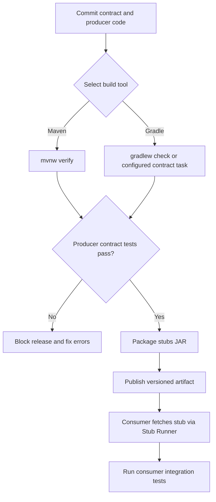

# Choosing Maven or Gradle for Your Hands-On Workflow

## 1. The Build Tool Decision in Spring Cloud Contract

When learning **Spring Cloud Contract**, you need more than a runnable Spring Boot project: you need a workflow that **reads Groovy/YAML DSL contracts**, **generates and runs producer tests**, **generates/packages stubs**, and lets the consumer exercise those stubs via **Stub Runner**. Both Maven and Gradle support this workflow; they differ mainly in how configurations are declared, how tasks are executed, and how builds are managed.

The goal of choosing a tool is to make contract verification repeatable locally and in CI, with clearly versioned stub artifacts and minimal manual steps. If you are working on an existing project, **prefer the build system the project/team already uses**: there is no need to migrate from Maven to Gradle or vice versa just to learn or adopt Spring Cloud Contract.

After this lesson, you will be able to:

1. Compare the benefits and operational costs of Maven versus Gradle for contract testing.
2. Identify the required dependencies/plugins and where they hook into the build lifecycle.
3. Execute the **contract → generated producer tests → stubs JAR → Stub Runner → consumer tests** chain with your chosen build tool.
4. Verify CI reproducibility and troubleshoot common problems such as version mismatches, missing base classes, or missing stubs.

The illustrative configurations below use **placeholder** version strings. When applying them, substitute compatible Spring Boot, Spring Cloud release train, and Spring Cloud Contract versions according to your target release documentation. Do not mix versions arbitrarily just because individual dependencies happen to download.

## 2. Mandatory Components Regardless of Maven or Gradle

A basic HTTP exercise usually involves two applications: a **producer** (e.g., `order-service`) that defines a real endpoint, and a **consumer** (e.g., `checkout-service`) that calls it. Inside the producer:

```text
order-service/
├── src/main/java/...              # Controller and API logic
├── src/test/java/...              # Base class and supporting tests
└── src/test/resources/contracts/
    └── orders/
        └── get-confirmed-order.groovy
```

| Component | Purpose | What Must Be Decided |
| --- | --- | --- |
| Spring Boot | Runs the producer's real API | Team's JDK and Boot version |
| Spring Cloud BOM | Aligns Spring Cloud library versions | Release train compatible with Boot |
| Spring Cloud Contract Verifier | Supports generating and running contract tests | Test dependency and compatible plugin line |
| Groovy/YAML Contract | Defines requests, responses, and matching rules | Contract source location and review workflow |
| Test base class | Configures app, controllers/mocks, and data for generated tests | Test mode, JUnit, web setup |
| Stubs JAR | Packages simulated mappings and responses | Version, classifier, artifact repository |
| Stub Runner on consumer | Starts stub by artifact coordinates | Repository source, port, version under test |

A single contract works across both build systems; when switching build tools, **the DSL content itself does not need to change** in principle. What changes is how the plugin reads files, generates code, wires generated tests into the lifecycle, and publishes artifacts.

### Example Contract Used Throughout

Stored in the producer's `src/test/resources/contracts/orders/get-confirmed-order.groovy`:

```groovy
import org.springframework.cloud.contract.spec.Contract

Contract.make {
    description 'Look up a confirmed order'
    request {
        method GET()
        url '/api/orders/42'
        headers {
            accept(applicationJson())
        }
    }
    response {
        status OK()
        headers {
            contentType(applicationJson())
        }
        body([
            orderId: 42,
            status : 'CONFIRMED'
        ])
    }
}
```

This scenario specifies that a `GET /api/orders/42` request with `Accept: application/json` returns HTTP `200` and JSON containing `orderId` and `status`. Values `42` and `CONFIRMED` illustrate a confirmed case; to protect additional statuses, add corresponding contracts. Each plugin version generates producer tests and stub mappings in its own way, yet both outputs must reflect the same behavior.

## 3. Comparing Maven and Gradle for Hands-On Needs

| Criterion | Maven | Gradle |
| --- | --- | --- |
| Build model | Standard lifecycle (`validate`, `test`, `verify`, `install`, `deploy`) | Task graph, task dependencies, and plugin configuration |
| Configuration | XML in `pom.xml` | Groovy DSL (`build.gradle`) or Kotlin DSL (`build.gradle.kts`) |
| How to run | `./mvnw clean verify` | `./gradlew clean check` / corresponding task |
| Contract plugin | `spring-cloud-contract-maven-plugin` | `org.springframework.cloud.contract` Gradle plugin |
| Dependency management | Parent POM and/or BOM in `dependencyManagement` | BOM/platform or dependency-management plugin |
| Custom build adjustments | Goals, phases, profiles, and plugin configuration | Task declaration and wiring; flexible for multi-module |
| Build optimization | Depends on plugin setup, CI caching, and tasks | Can leverage incremental builds/build cache when tasks support it |
| Ease of adoption | Often easier to learn if familiar with Maven conventions | Convenient if the team already uses Gradle and understands task graphs |
| Common pitfalls | Goal/plugin not bound to expected lifecycle, verbose config | Task not wired into `check/build`, configuring tasks too late/early |

**There is no rule that "Gradle is always faster" or "Maven is always more stable."** Actual build times depend on codebase size, plugins, CI caches, network, JDK, and test setup. For a small lab, build-speed differences rarely justify breaking consistency with an existing project.

### When to Choose Maven

- The project is already managed via `pom.xml` and teams are used to `mvn test`/`mvn verify`.
- You want to follow the standard lifecycle to illustrate **generate tests → run tests → package → publish**.
- CI infrastructure and artifact repositories already have Maven configured; phases are easy for newcomers to inspect.

### When to Choose Gradle

- Your team's producer/consumer already use `build.gradle` or `build.gradle.kts`.
- A multi-module project needs tasks and dependencies managed within its existing structure.
- The team already has a Gradle Wrapper, caching setup, and shared conventions.

**Recommended rule:** If starting a standalone hands-on lab with no constraints, pick the tool the learner already knows so focus stays on contract testing. If integrating into an active product, use the product's existing build system.

## 4. Maven-Based Setup

In a Maven-based Spring Boot project, you need the Contract Verifier dependency and the code-generation plugin. The abbreviated configuration below highlights the relevant parts of `pom.xml`; parent, artifact coordinates, Java version, and application dependencies are assumed to already exist.

```xml
<properties>
    <spring-cloud.version>REPLACE_WITH_COMPATIBLE_TRAIN</spring-cloud.version>
    <spring-cloud-contract.version>REPLACE_WITH_COMPATIBLE_VERSION</spring-cloud-contract.version>
</properties>

<dependencyManagement>
    <dependencies>
        <dependency>
            <groupId>org.springframework.cloud</groupId>
            <artifactId>spring-cloud-dependencies</artifactId>
            <version>${spring-cloud.version}</version>
            <type>pom</type>
            <scope>import</scope>
        </dependency>
    </dependencies>
</dependencyManagement>

<dependencies>
    <dependency>
        <groupId>org.springframework.cloud</groupId>
        <artifactId>spring-cloud-starter-contract-verifier</artifactId>
        <scope>test</scope>
    </dependency>
</dependencies>

<build>
    <plugins>
        <plugin>
            <groupId>org.springframework.cloud</groupId>
            <artifactId>spring-cloud-contract-maven-plugin</artifactId>
            <version>${spring-cloud-contract.version}</version>
            <extensions>true</extensions>
            <configuration>
                <baseClassForTests>com.example.orders.ContractTestBase</baseClassForTests>
            </configuration>
        </plugin>
    </plugins>
</build>
```

`spring-cloud-dependencies` manages Spring Cloud library versions; the Maven plugin still needs a matching plugin version. In real projects, centralize versions via the parent/BOM according to team conventions and avoid adding conflicting overrides.

`baseClassForTests` points to a Java class that **must exist** in the producer's test sources. That class sets up the runtime context for generated tests. For example, if testing controllers with MockMvc, the base class configures the app or controller for Rest Assured MockMvc; if running over real HTTP, the setup differs. Never declare only a class name and expect generated tests to figure out how to boot the endpoint on their own.

### Maven Execution Sequence

```bash
# Use the project's own Maven Wrapper (on Windows: mvnw.cmd)
./mvnw clean verify

# Verify artifacts and install into the local Maven repository
./mvnw clean install

# Use only when the project has repository configuration and publishing permissions
./mvnw clean deploy
```

- `verify` runs through Maven's verification phase. When the plugin and test runner are configured properly, generated producer tests are generated, compiled, and executed during this build.
- `install` places build artifacts into the local Maven repository, suitable for testing the consumer with `StubRunnerProperties.StubsMode.LOCAL` once the `stubs` classifier artifact is attached.
- `deploy` publishes artifacts to the configured repository. It does not substitute for proper plugin setup, `distributionManagement`, credentials, or ensuring tests actually pass.

After the build, inspect test generation logs, test reports, and the artifact with the `stubs` classifier. Never rely solely on a zero exit code from `package` without confirming that generated contract tests actually ran.

## 5. Gradle-Based Setup

In Gradle, the equivalent setup is declared via plugins and dependencies. The example below uses **Groovy DSL** in `build.gradle` and assumes Boot, Java, repositories, and the test framework are configured. `BOOT_VERSION`, `CONTRACT_VERSION`, and `DEPENDENCY_MANAGEMENT_PLUGIN_VERSION` are placeholders that must be replaced before building:

```groovy
plugins {
    id 'java'
    id 'org.springframework.boot' version 'BOOT_VERSION'
    id 'io.spring.dependency-management' version 'DEPENDENCY_MANAGEMENT_PLUGIN_VERSION'
    id 'org.springframework.cloud.contract' version 'CONTRACT_VERSION'
}

group = 'com.example'
version = '1.0.0'

ext {
    springCloudVersion = 'REPLACE_WITH_COMPATIBLE_TRAIN'
}

repositories {
    mavenCentral()
}

dependencyManagement {
    imports {
        mavenBom "org.springframework.cloud:spring-cloud-dependencies:${springCloudVersion}"
    }
}

dependencies {
    testImplementation 'org.springframework.cloud:spring-cloud-starter-contract-verifier'
}

contracts {
    baseClassForTests = 'com.example.orders.ContractTestBase'
}
```

This example uses the `dependency-management` plugin because it is familiar to many Spring projects. A modern Gradle project may also use `platform(...)` to import the BOM, depending on team conventions. Avoid combining multiple version management strategies unless you know how they interact.

If the project uses **Kotlin DSL**, `plugins { ... }`, dependency declarations, and the `contracts` block must follow the plugin's Kotlin DSL API; you cannot copy Groovy DSL verbatim into `build.gradle.kts`. Both can serve Spring Cloud Contract well, so pick the configuration language already used by your build.

### Gradle Execution Sequence

```bash
# List tasks registered by plugins
./gradlew tasks --all

# Build and verify the producer following the project's lifecycle
./gradlew clean check

# Inspect tasks related to contracts and stubs
./gradlew tasks --all

# When the project has maven-publish and the stubs artifact configured
./gradlew publish
```

On Windows, use `gradlew.bat`. Tasks registered by the Spring Cloud Contract plugin generally relate to generating contract tests, running contract tests, and creating stubs; **exact task names and whether they hook into `check` or `build` can vary by plugin version and project configuration**. Always inspect `./gradlew tasks --all` and build logs to confirm generated tests actually executed rather than assuming `check` runs everything required.

To publish stubs via Gradle, add appropriate publishing configuration (such as `maven-publish`, repository details, credentials, and the plugin-produced artifact/classifier). Running `publish` without declaring a publication for the stubs JAR may publish only the main artifact or produce unexpected output.

## 6. Structuring the Base Class and Test Data So Both Build Systems Run Cleanly

Maven or Gradle only orchestrates the build. **Generated producer tests need a repeatable verification environment**. Specifically, the `/api/orders/42` contract assumes the producer has data to return order 42.

A simple lab strategy uses MockMvc with a controller or service returning fixed test data. Another strategy boots the Spring Boot test context with a test database and seeds an order record. Either way, maintain these conditions:

1. **Choose an explicit test mode:** MockMvc when verifying the web layer without opening a real HTTP port; HTTP integration tests when executing against a real server, depending on features and plugin version.
2. **Match the base class to the test mode:** configure Rest Assured MockMvc or the corresponding HTTP client; generated tests must extend or use the right base class.
3. **Deterministic data:** record `42` exists in state `CONFIRMED` on every run; avoid relying on shared dev environment data.
4. **No test-order dependencies:** every scenario sets up and cleans up what it needs without relying on a previous test.
5. **Aligned JUnit and dependencies:** the test engine/runner must discover generated tests; generated classes that never execute are a testing gap.

Maven typically configures tests through Surefire/Failsafe and related plugins; Gradle uses `Test` tasks with the JUnit Platform. For JUnit 5 projects, verify the generated contract-test task configuration. A "BUILD SUCCESS" message is **not enough** if logs show 0 contract tests executed.

## 7. Generating and Consuming Stubs JARs: What Must Align Regardless of Tooling

Suppose the producer has Maven coordinates:

```text
group    = com.example
artifact = order-service
version  = 1.0.0
classifier = stubs
```

The artifact is usually named something like `order-service-1.0.0-stubs.jar`. For HTTP contracts, it typically contains WireMock mappings and matching response payloads. Regardless of whether the artifact was built with Maven or Gradle, the consumer needs the **coordinates, repository location, and version** to pull the right stub.

On the consumer side, a Spring Boot test might run Stub Runner like this:

```java
import org.junit.jupiter.api.Test;
import org.springframework.boot.test.context.SpringBootTest;
import org.springframework.cloud.contract.stubrunner.StubRunnerProperties;
import org.springframework.cloud.contract.stubrunner.spring.AutoConfigureStubRunner;

@SpringBootTest(properties = "orders.base-url=http://localhost:9090")
@AutoConfigureStubRunner(
    ids = "com.example:order-service:1.0.0:stubs:9090",
    stubsMode = StubRunnerProperties.StubsMode.LOCAL
)
class OrderClientContractTest {
    @Test
    void shouldHandleConfirmedOrder() {
        // Call the real OrderClient configured to hit orders.base-url.
        // Assert orderId=42 and status=CONFIRMED.
    }
}
```

The snippet above is a **configuration skeleton**, not a complete test: it requires the Stub Runner dependency, the real `OrderClient`, and concrete assertions. `LOCAL` mode requires the stubs JAR to already exist in the local Maven repository. CI or systems with private artifact repositories normally use remote mode with the appropriate repository URL configured. Port `9090` can be replaced with a dynamic port to avoid collisions during parallel runs; the consumer must read the actual port opened by Stub Runner.

From the consumer's perspective, the producer's build tool does not have to match the consumer's build tool. For instance, **Maven producer → stubs JAR → Gradle consumer** works seamlessly as long as both sides agree on artifact identifiers and compatible stub formats.

## 8. Comparing Corresponding CI Workflows



Illustrative pipeline commands (adjust for your team's CI):

| Goal | Maven | Gradle |
| --- | --- | --- |
| Pin build tool version | Commit `mvnw`, `mvnw.cmd`, and Wrapper config | Commit `gradlew`, `gradlew.bat`, and Wrapper config |
| Verify producer | `./mvnw -B clean verify` | `./gradlew clean check` plus required contract tasks |
| Store artifact locally | `./mvnw -B install` | Configured publication/installation task |
| Publish stub | `./mvnw -B deploy` after configuring repository | `./gradlew publish` after configuring stubs publication |
| Debug dependencies | `./mvnw dependency:tree` | `./gradlew dependencies` |
| Debug contract outputs | Inspect test reports, generated tests, and artifacts in `target/` | Inspect test reports, generated tests, and artifacts in `build/` |

Do not run these commands blindly in a pipeline: first confirm the `stubs` artifact is actually attached and producer tests execute. In multi-module builds, target the right producer module (such as Maven `-pl` or module-scoped Gradle tasks) and verify job dependencies.

An effective CI quality gate should verify:

- Contract DSL parses cleanly and generated producer tests compile.
- Producer tests pass when executed against the configured controller/service or real HTTP server.
- The `stubs` artifact for the **exact commit and version** is generated successfully, not replaced by hand-written stub files.
- Consumer tests fetch the exact artifact, call the active stub endpoint, and verify business behavior.
- Breaking API changes (such as changing `status` to `state` in the producer without updating the contract) fail the producer pipeline.
- Build config, dependency locks/versions, and artifact repositories are complete enough to reproduce the pipeline.

If you need to speed up CI, measure each step before caching; never cache generated test results in a way that skips verification when contracts or producer code change.

## 9. Decision Process in a Real Project

Answer these questions in order:

1. **Does the project already use Maven or Gradle?** Yes → keep it and add the Contract plugin to that build.
2. **Has the organization standardized Wrappers, repositories, and CI?** Yes → follow internal standards to avoid creating a one-off release path.
3. **Does the team understand the build lifecycle?** For a brand-new workshop, Maven helps explain phases clearly; if the team knows Gradle, the task graph is just as intuitive.
4. **Are there multiple modules and complex pipelines?** Choose the team's existing system with proven dependency management, caching, and publishing setup.
5. **Must stubs be published to multiple consumers?** Both tools handle this well; decide based on the maturity of your artifact-publishing pipeline rather than the build tool's name.

### Three Typical Scenarios

**Scenario A — Microservice already running Maven:** The producer has `pom.xml` and CI runs `mvnw verify`. Add Contract Verifier dependencies/plugin, a base class, and contracts. Keep the Maven pipeline to avoid unnecessary churn.

**Scenario B — Multi-module Gradle monorepo:** The producer lives in `:services:orders` with shared convention rules. Apply the plugin to the producer module, verify test-generation and artifact tasks, and wire them into the module's verification pipeline. Do not convert that module alone to Maven.

**Scenario C — Standalone training course:** Learners have no prior tool preference and the instructor has a complete Maven starter. Start with Maven so focus stays on DSL, generated tests, and Stub Runner. Once the flow is clear, repeat with Gradle to see that both systems achieve the same goal.

## 10. Common Errors and How to Check Them

| Symptom | Possible Cause | First Check |
| --- | --- | --- |
| No generated contract tests found | Plugin did not run, wrong contracts folder, or task not wired into lifecycle | Check plugin/task logs, path settings, and test output dir |
| Build reports missing base class | Wrong `baseClassForTests`, missing package/class, or source set not recognized | Check fully qualified class name and generated test code |
| Tests run but endpoint does not return expected sample | Missing seed data, wrong MockMvc/HTTP config, request does not match contract | Run individual generated test and inspect actual request |
| Tests do not run even though build is green | Wrong runner/JUnit config or contract task was never invoked | Check count of executed contract tests |
| Consumer cannot find stub | Wrong coordinates, classifier, version, mode, or repository | Confirm stubs JAR exists and Stub Runner uses exact coordinates |
| Consumer hits stub but gets `404` | Wrong path, method, header, query, or port | Compare client request against actual stub mappings |
| Maven and Gradle resolve different dependencies | Different BOM/versions or inconsistent repositories/caching | Compare dependency trees and resolved versions |
| Local build passes, CI fails | Different Wrapper/JDK, environment-dependent test data, missing artifact or credentials | Check JDK, Wrapper, CI config, and stub version |

When diagnosing failures, separate **build configuration errors**, **producer failing the contract**, **stub distribution errors**, and **consumer logic errors**. Switching from Maven to Gradle or vice versa rarely solves an API behavior mismatch.

## 11. Practice: Choose a Build System and Prove a Single Source of Contracts

**Prompt:** There are two Spring Boot services. `order-service` already uses Maven, and `checkout-service` already uses Gradle. The consumer needs to call `GET /api/orders/42` and display `status`.

**Tasks:**

1. Explain why you should keep Maven for the producer and Gradle for the consumer, then select compatible Spring Boot/Spring Cloud/Contract versions.
2. Add the sample contract from section 2 to the producer, create a base class matching your test mode, and run generated producer tests with Maven.
3. Package the stubs JAR with classifier `stubs` and install it locally or publish it to a shared repository.
4. In the Gradle consumer, add the Stub Runner dependency and write an integration test calling the HTTP client against the stub. Assert `orderId = 42` and `status = CONFIRMED`.
5. Change the producer to return `state` instead of `status` while keeping the old contract. Predict and verify whether producer tests catch the change.
6. After restoring the producer, switch the stub version used by the consumer to observe why pinning artifact versions matters.

**Completion criteria:**

- Generated producer tests actually execute and pass against a contract-compliant implementation.
- A stubs JAR contains the right response definition and the consumer resolves it.
- Consumer integration tests run under Gradle without needing the real producer running simultaneously.
- A contract-breaking API change causes producer tests to fail.
- Plugin, JDK, Wrapper, and stubs JAR versions are documented so others can reproduce the run.

**Self-check question:** If a Maven producer and a Gradle consumer already communicate via a valid stubs JAR, is there any technical reason forcing both services to use the same build tool? **No**: compatibility here is governed by the contract, the stub artifact, and the communication protocol. Each side's build tool is an implementation choice.

## 12. Checklist Before Finalizing Maven or Gradle

- [ ] The chosen build system fits the existing repository and team skills.
- [ ] JDK, Spring Boot, Spring Cloud release train, and Contract plugin are compatible.
- [ ] The build tool Wrapper is committed so local and CI run the exact same version.
- [ ] Contracts live at the path read by the plugin, and Groovy/YAML DSL parses cleanly.
- [ ] Generated producer tests have the right base class, test engine, and test data.
- [ ] The pipeline confirms **tests actually executed** and passed, not just a green build.
- [ ] The stubs JAR is generated from the **same contract version**, with verifiable classifier and version.
- [ ] The consumer runs Stub Runner with the right repository/mode/port and asserts real behavior.
- [ ] CI blocks publishing stubs unverified by producer tests and records consumed artifact versions.

**Conclusion:** Both Maven and Gradle support the Spring Cloud Contract workflow cleanly. The sound choice is usually to keep your existing build tool, configure the corresponding plugin, and generate both producer tests and stubs from the same contract source. Compatibility assurance comes from meaningful contracts, tests that actually run, and a reproducible artifact-publishing workflow—not from picking a particular build tool name.
