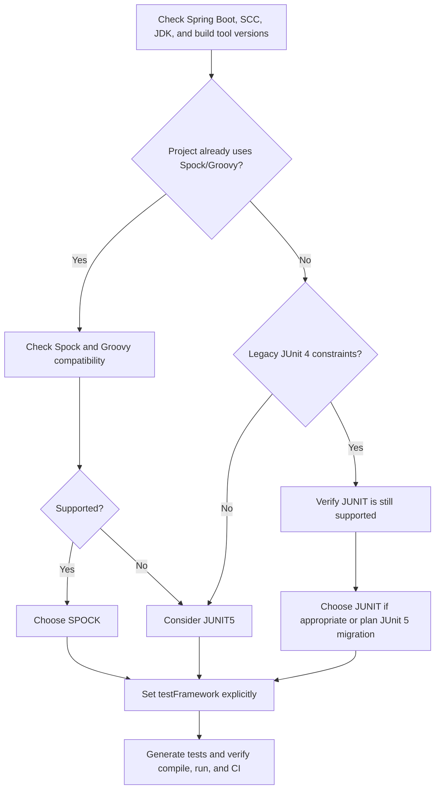
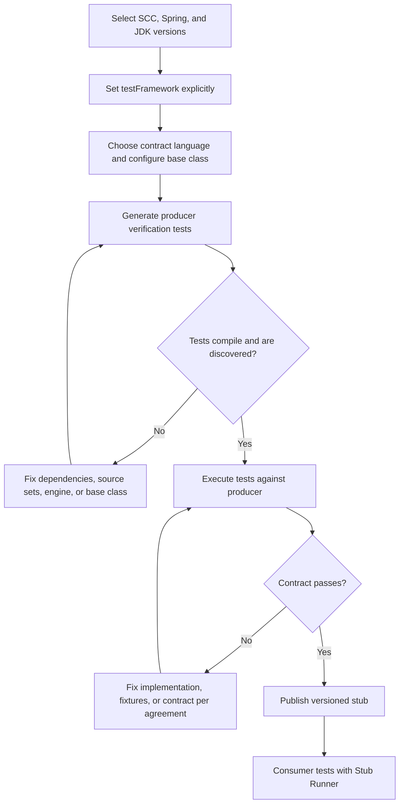

# Choosing JUnit, Spock, and Test Languages Based on Tooling Support

## 1. Why Is Choosing the Test Framework a Project Setup Decision?

In microservices systems, a `producer` exposes HTTP APIs or publishes messages, while a `consumer` relies on the producer's behavior for business processing. **Spring Cloud Contract** lets both sides define behavior in **Groovy DSL/YAML DSL**, generate producer-side tests, package stubs, and let consumers run tests with **Stub Runner** before real integration. Running these steps in CI catches incompatible API changes early.

When configuring producer verification, the team must decide **whether generated tests will use JUnit or Spock**. This choice affects generated test code, required libraries, the test base class, and how the build discovers and executes tests. A wrong choice means valid contracts may produce tests that fail to compile or are skipped by CI.

For example, suppose a team writes production code in Java and already has JUnit Jupiter tests. They want to verify this contract:

```http
GET /api/payments/PAY-1001
Accept: application/json
```

The producer must return:

```json
{
  "paymentId": "PAY-1001",
  "orderId": "ORD-2001",
  "status": "PAID",
  "currency": "VND"
}
```

The team can keep the contract unchanged and generate **JUnit 5 (Java)** tests; another team using Groovy/Spock can use the exact same contract to generate **Spock (Groovy)** tests. Choosing a framework does not alter the business meaning of the contract; it changes **how the producer verifies compliance**.

After this lesson, you should be able to choose between JUnit 5, JUnit 4, and Spock; distinguish the contract authoring language from the generated test language; configure Maven/Gradle as needed; and check common pitfalls before integrating into CI.

## 2. Separating Four Decisions That Are Often Confused

A real Spring Cloud Contract project has at least four independent configuration axes:

| Decision | Examples | Impact |
| --- | --- | --- |
| **Application language** | Java, Kotlin, Groovy | Language in which producer/consumer application code is written. |
| **Contract definition language** | YAML DSL (`.yml`), Groovy DSL (`.groovy`); other DSLs where supported by the release | Syntax used to describe requests/responses or messages. |
| **Generated test framework** | `JUNIT5`, `JUNIT` (JUnit 4 where supported), `SPOCK` | Imports, test annotations/structure, and runtime used to execute producer verification. |
| **HTTP testing mechanism** | MockMvc, WebTestClient, or other HTTP styles per `testMode` | How requests reach the producer during tests; **separate** from choosing JUnit or Spock. |

Examples of completely valid combinations:

- Producer written in **Java**; contract written in **Groovy DSL**; generated tests in **JUnit 5 (Java)** using **MockMvc**.
- Producer written in **Java**; contract written in **YAML DSL**; generated tests in **Spock (Groovy)** using **MockMvc**.
- Producer written in **Kotlin**; contract written in **YAML**; generated tests in **JUnit 5 (Java)**, provided the test generator and build setup in that release support this combination.

**Never assume "Groovy contract means you must choose Spock."** Groovy DSL is the **input** syntax; `testFramework` determines the **output**. Likewise, never assume a Kotlin application automatically receives Kotlin-generated producer verification tests. Verify generator capabilities and set up an appropriate base class.

The sections below focus on common Spring Cloud Contract Verifier options. Capabilities and defaults can vary across Spring Cloud Contract releases, the Maven plugin, and the Gradle plugin; **declaring the framework explicitly** prevents surprises during upgrades.

## 3. JUnit 5: The Common Starting Choice for Java Projects

**JUnit 5** includes JUnit Platform and JUnit Jupiter. For modern Spring Boot projects already using `spring-boot-starter-test` and JUnit Jupiter, this is normally the natural choice for contract-generated producer tests.

Characteristics:

- Tests are usually generated as **Java** classes using `org.junit.jupiter.api.Test`.
- Supports `@BeforeEach`, `@AfterEach`, `@BeforeAll`, and Jupiter extensions.
- Maven/Gradle builds need compatible JUnit Jupiter dependencies and a **test engine configured to discover tests**.
- The base test class can supply Spring context, MockMvc/RestAssuredMockMvc, data fixtures, or messaging setup for generated tests.

Example of a JUnit 5 test *hand-written to illustrate syntax*, not verbatim generator output:

```java
import org.junit.jupiter.api.Test;
import static org.assertj.core.api.Assertions.assertThat;

class PaymentDecisionTest {

    @Test
    void paidPaymentCanConfirmOrder() {
        String paymentStatus = "PAID";
        assertThat(paymentStatus).isEqualTo("PAID");
    }
}
```

Actual tests generated by Spring Cloud Contract Verifier invoke the producer endpoint or verify messages against the contract; the short snippet above only illustrates **JUnit Jupiter syntax** and does not replace a producer verification test.

### When to Choose JUnit 5

Choose `JUNIT5` when the team already uses Java/Jupiter infrastructure, wants to reuse existing Spring Boot test setup, does not need Spock-specific features, and your Spring Cloud Contract version supports JUnit 5 test generation. For new projects, **evaluate JUnit 5 first**, then verify the compatibility matrix for your Spring Boot, JDK, and Spring Cloud Contract versions.

## 4. JUnit 4: Mainly for Systems with Legacy Constraints

Some Spring Cloud Contract Verifier releases allow configuring `JUNIT` to generate **JUnit 4** tests. This fits long-lived projects still relying on `org.junit.Test`, `@Before`, or older runners that have not migrated to Jupiter yet.

| Aspect | JUnit 4 | JUnit 5 (Jupiter) |
| --- | --- | --- |
| Test annotation | `org.junit.Test` | `org.junit.jupiter.api.Test` |
| Per-test setup | `@Before` | `@BeforeEach` |
| Legacy Spring integration | Often uses `@RunWith(SpringRunner.class)` | Typically uses Spring TestContext with Jupiter/`SpringExtension` |
| Execution on JUnit Platform | Needs JUnit 4 runner support, such as Vintage where configured | Jupiter engine |
| Recommendation for new projects | Only when explicit constraints require it | Usually the better starting point |

**Do not confuse `JUNIT` with `JUNIT5`.** These are two distinct configuration values in releases offering both. Do not expect adding JUnit 5 dependencies alone to automatically turn JUnit 4 generated tests into Jupiter tests.

If you must stay on JUnit 4, verify that the plugin version supports `JUNIT`, check matching libraries, confirm Maven Surefire/Gradle test discovery, and verify coexistence with JUnit 5. Do not add Vintage if you have no JUnit 4 tests to run.

## 5. Spock: Groovy-Based Behavior-Driven Choice

**Spock** is a JVM testing framework built on Groovy with `given/when/then` specification blocks. It works well when a team already knows Groovy, prefers behavior-style specs, and has a Spock version compatible with the project's JDK and Spring versions.

A **hand-written Spock example to illustrate language syntax**, not verbatim generated output:

```groovy
import spock.lang.Specification

class PaymentDecisionSpec extends Specification {

    def "order can only be confirmed when payment succeeds"() {
        given:
        def paymentStatus = 'PAID'

        when:
        def allowed = (paymentStatus == 'PAID')

        then:
        allowed
    }
}
```

When configured with `testFramework = 'SPOCK'`, Spring Cloud Contract can generate producer tests using **Spock/Groovy**. You must add `spock-core` (and usually `spock-spring` when Spring TestContext is needed) and ensure the build compiles Groovy test sources. With Spock 2.x, tests run on the **JUnit Platform**, so Gradle typically requires `useJUnitPlatform()`. Select a Spock version compatible with the project's actual **Groovy and JDK** versions, not just Spring Cloud Contract alone.

### When to Choose Spock

Spock fits when a team already maintains Groovy/Spock tests, wants stylistic consistency, and can sustain a Groovy toolchain. In a Java project, **you can still** use Spock to test Java code if dependencies and builds are configured properly; you do not need to rewrite the producer in Groovy.

Costs to weigh: adding the Groovy compiler/runtime, Spock and its version constraints, and added build complexity for Java-only teams. Therefore, do not switch to Spock solely because contracts are authored in Groovy DSL.

## 6. Choosing a Framework Using a Decision Matrix

| Project Context | Starting Recommendation | Conditions to Verify |
| --- | --- | --- |
| New Spring Boot/Java project, existing tests on Jupiter | `JUNIT5` | Plugin generates JUnit 5 tests, build runs Jupiter, and base class matches. |
| Java project using Kotlin in some modules | `JUNIT5` if supported by generator | Generated Java tests compile and can call the base class and Kotlin code. |
| Team actively uses Groovy/Spock 2.x | `SPOCK` | Groovy, Spock, JDK, and Spring versions align; Groovy tests compile and are discovered. |
| Legacy monolith/microservice on JUnit 4 | `JUNIT` **if still supported by plugin** | JUnit 4 runner/engine, Spring test setup, and upgrade roadmap. |
| Consumer using only Stub Runner to test HTTP client | **Consumer's** framework can be independent | Consumer runs the right stub version; does not need to match producer's framework. |
| Messaging contracts instead of HTTP | Match existing test suite's framework | Add messaging integration/test mode and proper base class; switching JUnit to Spock is not enough. |

A concise selection flow:



Do not use "which framework feels most familiar" as the sole criterion. **The test-generation capability of your Spring Cloud Contract version is the primary constraint**, followed by engine, library, test source, and build tool compatibility.

## 7. Example Shared Contract for Both JUnit and Spock

Simple YAML definition for `payment-service`:

```yaml
description: Look up a paid payment
name: should_return_paid_payment
request:
  method: GET
  url: /api/payments/PAY-1001
response:
  status: 200
  headers:
    Content-Type: application/json
  body:
    paymentId: PAY-1001
    orderId: ORD-2001
    status: PAID
    currency: VND
```

From **this exact YAML content**, the generator creates producer tests matching `testFramework`. With JUnit 5, generated code normally contains Jupiter `@Test` methods verifying the HTTP response; with Spock, it uses Groovy specification/feature methods. **Contract content never needs to change just to switch test frameworks.**

Groovy DSL can describe the exact same interaction:

```groovy
import org.springframework.cloud.contract.spec.Contract

Contract.make {
    name 'should_return_paid_payment'
    request {
        method 'GET'
        url '/api/payments/PAY-1001'
    }
    response {
        status 200
        headers {
            contentType(applicationJson())
        }
        body([
            paymentId: 'PAY-1001',
            orderId: 'ORD-2001',
            status: 'PAID',
            currency: 'VND'
        ])
    }
}
```

These two snippets are **alternative representations** of the same scenario; in a real project, do not keep both as duplicate contracts. The contract specification language is neither the language of your hand-written tests nor the determiner of the generated test framework.

## 8. Setting Up JUnit 5 with Maven

For a Maven producer using Spring Boot, you need:

1. Compatible Spring Boot, Spring Cloud Contract, and test library versions managed via your project's release train/dependencies.
2. Test dependencies, typically `spring-boot-starter-test` and `spring-cloud-starter-contract-verifier`.
3. Spring Cloud Contract Maven plugin configured with `testFramework = JUNIT5` and a matching test base class.
4. Maven Surefire/Failsafe (depending on lifecycle) configured to discover and execute generated tests.

Example **configuration fragments to integrate into** an existing project's `pom.xml`:

```xml
<!-- Inside <dependencies>: -->
<dependency>
    <groupId>org.springframework.boot</groupId>
    <artifactId>spring-boot-starter-test</artifactId>
    <scope>test</scope>
</dependency>
<dependency>
    <groupId>org.springframework.cloud</groupId>
    <artifactId>spring-cloud-starter-contract-verifier</artifactId>
    <scope>test</scope>
</dependency>

<!-- Inside <build><plugins>: -->
<plugin>
    <groupId>org.springframework.cloud</groupId>
    <artifactId>spring-cloud-contract-maven-plugin</artifactId>
    <version>REPLACE_WITH_COMPATIBLE_SCC_VERSION</version>
    <extensions>true</extensions>
    <configuration>
        <testFramework>JUNIT5</testFramework>
        <baseClassForTests>com.example.payment.ContractBase</baseClassForTests>
    </configuration>
</plugin>
```

This is an **illustrative configuration snippet**, not a complete POM file. In real use, replace the version placeholder with a compatible version, manage dependency versions via the appropriate BOM/parent, and include other plugins required by your project. Never mix libraries arbitrarily across different Spring Boot/Spring Cloud Contract release lines.

### Base Class for MockMvc HTTP Tests

An illustrative Java base class for a Spring MVC producer:

```java
package com.example.payment;

import io.restassured.module.mockmvc.RestAssuredMockMvc;
import org.junit.jupiter.api.BeforeEach;
import org.springframework.beans.factory.annotation.Autowired;
import org.springframework.boot.test.autoconfigure.web.servlet.AutoConfigureMockMvc;
import org.springframework.boot.test.context.SpringBootTest;
import org.springframework.web.context.WebApplicationContext;

@SpringBootTest
@AutoConfigureMockMvc
public abstract class ContractBase {

    @Autowired
    protected WebApplicationContext context;

    @BeforeEach
    void setUpContractTests() {
        RestAssuredMockMvc.webAppContextSetup(context);
        // Prepare test fixtures if contracts require deterministic data.
    }
}
```

This class demonstrates starting the Spring TestContext and wiring RestAssuredMockMvc to the application. In a real project, you need the controller, beans, and backing data for `PAY-1001`. If the generator uses a different `testMode` (such as WebTestClient), base class setup will differ. Inspect generated test sources before finalizing initialization logic.

In versions using the standard Maven layout, contracts live under `src/test/resources/contracts`. The plugin generates test code into a generated-sources folder under `target/`; this is a **build artifact**, so you should not edit it directly.

## 9. Setting Up JUnit 5 or Spock with Gradle

### 9.1. A JUnit 5 Setup with Gradle Groovy DSL

Example key parts of `build.gradle` (plugin/dependency versions must be managed via a compatible version set):

```groovy
plugins {
    id 'java'
    id 'org.springframework.cloud.contract' version 'REPLACE_WITH_COMPATIBLE_SCC_VERSION'
}

dependencies {
    testImplementation 'org.springframework.boot:spring-boot-starter-test'
    testImplementation 'org.springframework.cloud:spring-cloud-starter-contract-verifier'
}

contracts {
    testFramework = 'JUNIT5'
    baseClassForTests = 'com.example.payment.ContractBase'
}

tasks.withType(Test).configureEach {
    useJUnitPlatform()
}
```

This is also a **configuration fragment** to combine with Spring Boot/Dependency Management plugins, repositories, and an appropriate BOM. Where contracts are placed varies across plugin generations: newer Gradle docs use `src/contractTest/resources/contracts` and `src/contractTest/java` or `groovy` for base classes, whereas older guides may use `src/test/resources/contracts`. Follow your actual plugin version and `contractsDslDir`/source-set configuration instead of assuming Maven and Gradle use identical paths.

### 9.2. What Changes When Switching to Spock?

In a Gradle project with Groovy/Spock, the relevant sections look like:

```groovy
plugins {
    id 'groovy'
    id 'org.springframework.cloud.contract' version 'REPLACE_WITH_COMPATIBLE_SCC_VERSION'
}

dependencies {
    testImplementation 'org.springframework.cloud:spring-cloud-starter-contract-verifier'
    testImplementation 'org.spockframework:spock-core:REPLACE_WITH_COMPATIBLE_SPOCK_VERSION'
    testImplementation 'org.spockframework:spock-spring:REPLACE_WITH_COMPATIBLE_SPOCK_VERSION'
}

contracts {
    testFramework = 'SPOCK'
    baseClassForTests = 'com.example.payment.ContractSpecification'
}

tasks.withType(Test).configureEach {
    useJUnitPlatform() // Required for Spock 2.x running on JUnit Platform.
}
```

Besides these dependencies, the project must have a **Groovy runtime/compiler compatible** with Spock and Spring Cloud Contract; corresponding version management is mandatory. If using Gradle Kotlin DSL (`build.gradle.kts`), build script syntax differs; do not paste Groovy DSL directly into Kotlin DSL.

Illustrative Groovy base specification:

```groovy
package com.example.payment

import io.restassured.module.mockmvc.RestAssuredMockMvc
import org.springframework.beans.factory.annotation.Autowired
import org.springframework.boot.test.autoconfigure.web.servlet.AutoConfigureMockMvc
import org.springframework.boot.test.context.SpringBootTest
import org.springframework.web.context.WebApplicationContext
import spock.lang.Specification

@SpringBootTest
@AutoConfigureMockMvc
abstract class ContractSpecification extends Specification {

    @Autowired
    WebApplicationContext context

    def setup() {
        RestAssuredMockMvc.webAppContextSetup(context)
    }
}
```

Unlike JUnit Jupiter, Spock uses the `setup()` lifecycle method and `Specification` base structure. Pointing to a Java base class using `@BeforeEach` after switching the generator to Spock is not always compatible; review lifecycle hooks, classpath, and how generated tests extend the base class. Conversely, JUnit 5 does not understand Spock's `given/when/then` blocks.

### 9.3. Maven + Spock Also Requires Groovy Compilation

When a Maven producer configures:

```xml
<configuration>
    <testFramework>SPOCK</testFramework>
    <baseClassForTests>com.example.payment.ContractSpecification</baseClassForTests>
</configuration>
```

that alone is not enough. Maven needs compatible Spock/Groovy dependencies, a Groovy test compilation plugin (such as GMavenPlus with the right goals), test source configuration, and a test runner supporting Spock. Verify in the `test` or `verify` lifecycle that generated specifications **actually compile and execute**; seeing `.groovy` files under `target/` does not prove the tests ran.

## 10. How Should Kotlin, Groovy, and Java Projects Organize Tests?

### Java

For Java projects, JUnit 5/Java usually keeps the toolchain simplest. If you prefer Spock, add Groovy/Spock for tests while keeping production code in Java. Contracts can be YAML or Groovy DSL depending on team readability preference and version capabilities.

### Groovy

For Groovy projects, Spock is a natural fit, yet JUnit 5 still works whenever test sources and runtime support it. **There is no mandatory rule saying "Groovy must use Spock."** Base the decision on the installed generator, compiler, and framework.

### Kotlin

Kotlin can use JUnit Jupiter for hand-written tests while Spring Cloud Contract generates **Java** producer verification tests in supported setups. If your app is written in Kotlin and supplies a base class for generated Java tests, verify:

- Can Java extend and access the base class? Kotlin classes are `final` by default; make it an `abstract class` or `open class` when inheritance is required.
- Are methods/beans accessed by generated Java tests `public`/`protected` with compatible types?
- Does the test module compile Java and Kotlin in the right order and source sets?
- Does your Spring Cloud Contract version support your desired input DSL? If you want to author contracts in Kotlin DSL, separate artifacts or plugins may be required depending on the release.

Therefore, **application language**, **contract definition language**, and **generated test language** must be decided separately. Choose the generated test framework from your toolchain's capabilities, not by guessing from `.kt` or `.groovy` file extensions on business code.

## 11. HTTP Test Mode and Messaging Are Separate Choices

Spring Cloud Contract Verifier also has a **test mode** setting, especially for HTTP. For example:

| Test Mode / Purpose | When to Consider |
| --- | --- |
| **MockMvc** | Producer is a Spring MVC app; tests invoke controllers via Spring Test and MockMvc. |
| **WebTestClient** | Producer uses WebFlux/reactive stack and your SCC version supports that mode. |
| **Real HTTP / explicit mode** | You want requests sent to a test app's HTTP port instead of just the MVC layer; requires server/base URL and lifecycle setup. |
| **Messaging verification** | You need to verify messages, triggers, destinations, and payloads; requires test setup integrated with the messaging system. |

**`testFramework = JUNIT5` does not automatically mean `testMode = MOCKMVC`.** They are two separate decisions. For example, a JUnit 5 test can use WebTestClient if the generator/plugin and application are configured accordingly.

For messaging, generated tests may require a base class that boots the Spring context, messaging verifier, triggers, and broker/test binder configuration matching your technology. Choosing Spock or JUnit 5 **does not solve** Kafka/RabbitMQ simulation on its own. Contracts must clearly describe emitted or consumed messages, and test steps must actually observe that behavior.

## 12. Verifying Generated Tests Before Publishing Stubs

After choosing a test framework, verify in this loop:



With Maven, you can run `./mvnw clean verify` (or the appropriate publishing lifecycle) to trigger test generation and execution; with Gradle, typically `./gradlew clean check`. These commands are **practical examples**; exact tasks/goals and generated source directories depend on your plugin version and project setup.

In both cases, confirm **three things**:

1. Tests were actually generated from contracts with imports/syntax matching the selected framework.
2. Tests pass compilation, are discovered by the test engine, and report **a non-zero count of executed tests**. A green build with zero executed tests is a warning sign to investigate.
3. Tests run with valid data and fail meaningfully when the producer alters a response against the contract (such as renaming `status` to `state`).

Only after producer verification passes should a stub be treated as representing a verified producer version. The consumer uses Stub Runner to pull the versioned stub artifact; **the consumer's test framework can differ from the producer's**. For example, a producer generating Spock tests while the consumer tests its client with JUnit 5 is completely valid as long as both execute cleanly.

### Common Errors and How to Narrow Them Down

| Symptom | Causes to Check | How to Fix |
| --- | --- | --- |
| `org.junit.jupiter.api.Test` not found | Selected `JUNIT5` without Jupiter dependencies or with wrong version. | Check test runtime and dependency management. |
| Generated tests use `org.junit.Test` while project only configures Jupiter | Plugin generated JUnit 4 due to another setting or default. | Specify `JUNIT5` if supported, or configure JUnit 4 execution properly. |
| No Spock tests appear to run | Missing Groovy compiler, Spock runtime, or JUnit Platform for Spock 2.x. | Inspect `compileTests`, source sets, Test task/Surefire, and executed test count. |
| Cannot extend `ContractBase` | Wrong FQN, inaccessible class, `final` Kotlin class, or wrong base mapping. | Compare `baseClassForTests`/`packageWithBaseClasses` against the actual class. |
| Generated tests invoke the wrong HTTP client/layer | Mismatched `testMode` and base class setup. | Align MockMvc/WebTestClient/HTTP mode with the application. |
| Tests run but response differs from contract | Fixtures not loaded, wrong endpoint, or producer data mismatches contract. | Inspect generated test request/response and pre-test state. |
| Passes locally, CI finds no tests | Different source sets, include/exclude patterns, test engine, or plugin lifecycle. | Check CI test reports and generate/compile/test task logs. |
| Upgrading Spring Cloud Contract unexpectedly switches test framework | Relied on default values or plugin API changed. | Declare `testFramework` explicitly and review compatibility/version notes. |

Note on **defaults**: some docs/versions describe JUnit 4 as the default, whereas Maven plugin parameter reference pages for another release line document `JUNIT5` as default. Never rely on a tutorial written for a different version; check the exact plugin version you run and **set the value explicitly** in project configuration.

## 13. Scenario Exercise

A company has three producers:

- **Payment API:** Spring Boot/Java, Gradle, all existing tests migrated to JUnit Jupiter.
- **Inventory API:** Spring Boot/Java, Maven, developers regularly write Groovy/Spock specs.
- **Legacy Shipping API:** older Java/Spring, using JUnit 4 and a custom runner; cannot upgrade JDK this quarter.

All three define HTTP interactions using Spring Cloud Contract and publish stubs for other consumers using Stub Runner.

**Practice tasks:**

1. Propose `testFramework` for each producer and state the compatibility conditions to verify before configuring.
2. For Payment API, write the `JUNIT5` configuration, design `ContractBase` so generated tests send requests via MockMvc, and use the YAML contract returning `status: PAID`.
3. For Inventory API, describe the Gradle/Maven configuration or Groovy test compilation plugin needed when choosing `SPOCK`. Explain why the producer can still keep application code in Java.
4. For Legacy Shipping API, outline how to run JUnit 4 if supported by the plugin, plus a migration path to JUnit 5 once compatible.
5. Payment producer generates JUnit 5 tests while Checkout consumer uses Spock: does this prevent Stub Runner from working? Explain how the two test suites remain independent.
6. In CI, add a step confirming tests are generated and discovered, and **intentionally change** the response from `status: PAID` to `status: PENDING` to prove the test fails.

**Self-check hint:** A strong answer clearly separates contract language, generated test framework, application language, HTTP mode, and execution engine. It also verifies version compatibility, includes a valid base class, and refuses to treat a build as passing unless producer tests actually executed.

## 14. Key Takeaways

- **JUnit 5** generally fits modern Java/Spring Boot projects; **Spock** fits teams already invested in Groovy with a compatible toolchain; **JUnit 4** is for systems maintaining legacy constraints if supported by your Spring Cloud Contract release.
- **Groovy/YAML DSL is the contract language**; it does not dictate whether generated tests are Java JUnit or Groovy Spock.
- Declare `testFramework` **explicitly** (`JUNIT5`, `SPOCK`, or `JUNIT` where supported) and verify your active version's documentation because defaults differ across releases.
- Spring Cloud Contract requires a matching **base test class**, dependencies, build source sets, and test engine; `testMode` and messaging integration are separate configurations.
- Only treat stubs as reliable once **producer verification is generated, compiled, and passing**. Consumers may use a different test framework than the producer.

### References

- [Spring Cloud Contract — Maven Project](https://docs.spring.io/spring-cloud-contract/reference/maven-project.html): Maven plugin configuration and generated tests.
- [Spring Cloud Contract — Gradle Project](https://docs.spring.io/spring-cloud-contract/reference/gradle-project.html): Gradle configuration, Spock dependencies, source sets, and testFramework.
- [Spring Cloud Contract Maven Plugin — generateTests](https://docs.spring.io/spring-cloud-contract/docs/current/spring-cloud-contract-maven-plugin/generateTests-mojo.html): parameters for the test-generation goal, including `testFramework` and `testMode` per published plugin version.
- [Spring Cloud Contract — Getting Started](https://docs.spring.io/spring-cloud-contract/reference/getting-started.html): guide to HTTP contracts, producer verification, and stubs.
- [Spock Framework — Documentation](https://spockframework.org/spock/docs/2.4/index.html): Groovy/JDK requirements and running Spock on JUnit Platform.
