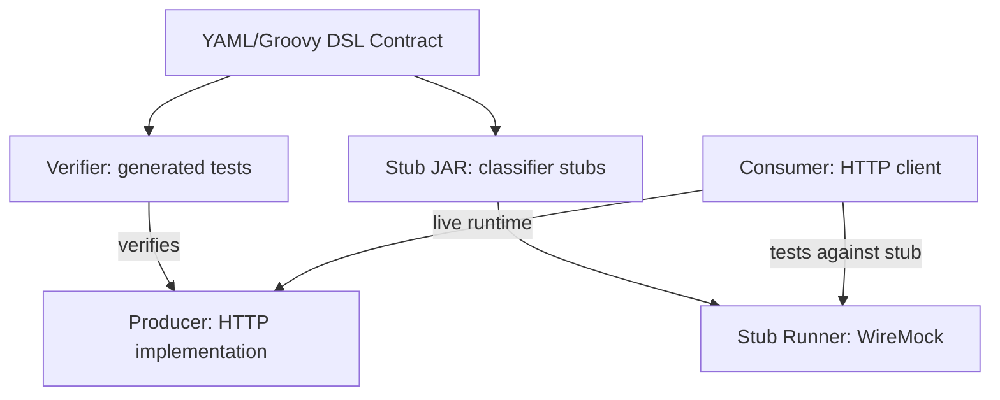
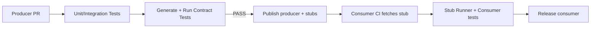

# Creating a Minimal Producer and Consumer

> **Chapter:** Project Setup  
> **Technologies:** Spring Cloud Contract (`SPRING_CLOUD_CONTRACT`), Spring Boot, Maven, JUnit 5, Contract Verifier, and Stub Runner.

## Learning Objectives

This lesson walks you through building **two independent Spring Boot applications** to practice contract testing between a service provider (*producer*) and a service caller (*consumer*). After this lesson, you will be able to:

1. Create an HTTP API on the producer and an HTTP client on the consumer.
2. Describe the interaction with **Spring Cloud Contract YAML DSL** (and recognize its Groovy DSL equivalent).
3. Use **Contract Verifier** to generate and execute producer-side tests.
4. Package a **stub JAR** and install it into the local Maven repository.
5. Use **Stub Runner** to run the stub for consumer tests without starting the real producer.
6. Run both real applications over live HTTP and outline how to integrate these steps into CI.

## 1. Big Picture

Suppose an e-commerce system consists of:

- `inventory-producer`: returns remaining stock availability.
- `checkout-consumer`: asks the producer whether there is enough stock for an order.

The consumer calls:

```http
GET /api/stock/SKU-001 HTTP/1.1
Accept: application/json
```

The producer promises to return:

```http
HTTP/1.1 200 OK
Content-Type: application/json

{"sku":"SKU-001","available":true,"quantity":4}
```

In this contract, `available` is a boolean and `quantity` is an integer. The consumer decides to allow checkout when both `available == true` and `quantity >= requested` hold.



**Key point:** producer tests verify the **implementation** against the contract; consumer tests run against a stub generated from the contract. These two test layers complement each other: consumer tests alone do not prove the latest producer still honors the contract if producer verification is skipped.

## 2. Tools and Directory Structure

Prepare JDK 17 or newer, Maven 3.9 or newer, a Java IDE, and `curl`. You can use the Maven Wrapper (`mvnw`) if each project includes its own wrapper.

**Illustrative version set:** Spring Boot `4.0.0`, Spring Cloud BOM `2025.1.5`, and Spring Cloud Contract Maven plugin `5.0.3`. This is a fixed example set for learners to follow. When using different versions, check the [Spring Cloud – Spring Boot compatibility matrix](https://spring.io/projects/spring-cloud/) and update the plugin accordingly; the Maven plugin version must be declared explicitly and is not managed automatically by the dependency BOM.

Create two Maven projects inside the same directory:

```text
contract-demo/
├── inventory-producer/
│   ├── pom.xml
│   └── src/
│       ├── main/
│       │   ├── java/com/example/inventory/
│       │   │   ├── InventoryApplication.java
│       │   │   └── StockController.java
│       │   └── resources/application.properties
│       └── test/
│           ├── java/com/example/inventory/ContractTestBase.java
│           └── resources/contracts/stock_available.yml
└── checkout-consumer/
    ├── pom.xml
    └── src/
        ├── main/
        │   ├── java/com/example/checkout/
        │   │   ├── CheckoutApplication.java
        │   │   ├── InventoryClient.java
        │   │   └── CheckoutController.java
        │   └── resources/application.properties
        └── test/
            └── java/com/example/checkout/InventoryClientContractTest.java
```

These are two separate Maven projects—no shared parent or aggregator is required. The producer's `artifactId` will appear in the stub coordinates used by the consumer.

## 3. Initializing the Producer

### 3.1. `inventory-producer` Maven Setup

Create `inventory-producer/pom.xml`:

```xml
<?xml version="1.0" encoding="UTF-8"?>
<project xmlns="http://maven.apache.org/POM/4.0.0"
         xmlns:xsi="http://www.w3.org/2001/XMLSchema-instance"
         xsi:schemaLocation="http://maven.apache.org/POM/4.0.0
                             https://maven.apache.org/xsd/maven-4.0.0.xsd">
    <modelVersion>4.0.0</modelVersion>
    <parent>
        <groupId>org.springframework.boot</groupId>
        <artifactId>spring-boot-starter-parent</artifactId>
        <version>4.0.0</version>
        <relativePath/>
    </parent>

    <groupId>com.example</groupId>
    <artifactId>inventory-producer</artifactId>
    <version>1.0.0</version>

    <properties>
        <java.version>17</java.version>
        <spring-cloud.version>2025.1.5</spring-cloud.version>
        <spring-cloud-contract.version>5.0.3</spring-cloud-contract.version>
    </properties>

    <dependencyManagement>
        <dependencies>
            <dependency>
                <groupId>org.springframework.cloud</groupId>
                <artifactId>spring-cloud-dependencies</artifactId>
                <version>${spring-cloud.version}</version>
                <type>pom</type>
                <scope>import</scope>
            </dependency>
        </dependencies>
    </dependencyManagement>

    <dependencies>
        <dependency>
            <groupId>org.springframework.boot</groupId>
            <artifactId>spring-boot-starter-webmvc</artifactId>
        </dependency>
        <dependency>
            <groupId>org.springframework.boot</groupId>
            <artifactId>spring-boot-starter-test</artifactId>
            <scope>test</scope>
        </dependency>
        <dependency>
            <groupId>org.springframework.cloud</groupId>
            <artifactId>spring-cloud-starter-contract-verifier</artifactId>
            <scope>test</scope>
        </dependency>
    </dependencies>

    <build>
        <plugins>
            <plugin>
                <groupId>org.springframework.boot</groupId>
                <artifactId>spring-boot-maven-plugin</artifactId>
            </plugin>
            <plugin>
                <groupId>org.springframework.cloud</groupId>
                <artifactId>spring-cloud-contract-maven-plugin</artifactId>
                <version>${spring-cloud-contract.version}</version>
                <extensions>true</extensions>
                <configuration>
                    <testFramework>JUNIT5</testFramework>
                    <baseClassForTests>com.example.inventory.ContractTestBase</baseClassForTests>
                </configuration>
            </plugin>
        </plugins>
    </build>
</project>
```

Key components:

| Component | Role |
| --- | --- |
| `spring-boot-starter-webmvc` | Exposes HTTP endpoints via Spring MVC (starter name in Boot 4) |
| `spring-cloud-starter-contract-verifier` | Test-scoped dependency for generated tests on the producer |
| `spring-cloud-contract-maven-plugin` | Generates tests and stubs from contract files |
| `testFramework = JUNIT5` | Generates tests using JUnit Jupiter |
| `baseClassForTests` | Specifies the class initializing the HTTP test environment for generated tests |
| `extensions = true` | Hooks the plugin into Maven lifecycle phases |

### 3.2. Creating the Application

File `src/main/java/com/example/inventory/InventoryApplication.java`:

```java
package com.example.inventory;

import org.springframework.boot.SpringApplication;
import org.springframework.boot.autoconfigure.SpringBootApplication;

@SpringBootApplication
public class InventoryApplication {
    public static void main(String[] args) {
        SpringApplication.run(InventoryApplication.class, args);
    }
}
```

File `src/main/java/com/example/inventory/StockController.java`:

```java
package com.example.inventory;

import org.springframework.http.HttpStatus;
import org.springframework.http.MediaType;
import org.springframework.web.bind.annotation.GetMapping;
import org.springframework.web.bind.annotation.PathVariable;
import org.springframework.web.bind.annotation.RequestMapping;
import org.springframework.web.bind.annotation.RestController;
import org.springframework.web.server.ResponseStatusException;

@RestController
@RequestMapping("/api/stock")
public class StockController {

    @GetMapping(value = "/{sku}", produces = MediaType.APPLICATION_JSON_VALUE)
    public StockResponse findStock(@PathVariable String sku) {
        if (!"SKU-001".equals(sku)) {
            throw new ResponseStatusException(
                HttpStatus.NOT_FOUND, "SKU not found"
            );
        }
        return new StockResponse(sku, true, 4);
    }

    public record StockResponse(
        String sku,
        boolean available,
        int quantity
    ) {}
}
```

Stock data is hardcoded to keep focus on the contract flow. For `SKU-001`, the server returns `200` and valid JSON; any other SKU returns `404`. We will write a contract for `200` first, then expand to `404` in the exercises.

File `src/main/resources/application.properties`:

```properties
server.port=8081
```

The real producer listens on `8081` when running the application. Producer tests in the next section use MockMvc, so they do not need to open this port.

## 4. Defining an HTTP Contract in YAML

Create `inventory-producer/src/test/resources/contracts/stock_available.yml`:

```yaml
description: "Consumer reads stock availability for SKU-001"
name: stock_available
request:
  method: GET
  url: /api/stock/SKU-001
  headers:
    Accept: application/json
response:
  status: 200
  headers:
    Content-Type: application/json
  body:
    sku: SKU-001
    available: true
    quantity: 4
```

This is the single input source for both the **producer verification test** and the **HTTP stub**:

- `request.method`, `request.url`, and `request.headers` describe the accepted call.
- `response.status`, `response.headers`, and `response.body` describe the promised reply.
- YAML's type for `true` is boolean; the type for `4` is integer. Preserve exact data types when defining contracts.
- By default, the Maven plugin looks for contracts under `src/test/resources/contracts`.

The contract above is a concrete input example. For varying paths, IDs, or timestamps, Spring Cloud Contract supports **matchers** in Groovy/YAML DSL to assert structure and rules without hardcoding every value.

### Equivalent Groovy DSL Representation

If you want to practice Groovy, the same behavior can be written as:

```groovy
org.springframework.cloud.contract.spec.Contract.make {
    name 'stock_available'

    request {
        method 'GET'
        url '/api/stock/SKU-001'
        headers {
            header 'Accept': 'application/json'
        }
    }

    response {
        status 200
        headers {
            contentType('application/json')
        }
        body(
            sku: 'SKU-001',
            available: true,
            quantity: 4
        )
    }
}
```

**Keep only one definition** (either YAML or Groovy) for the same scenario when running the example. Keeping both easily creates duplicate tests and stubs. The following sections use `stock_available.yml`.

## 5. Generating and Running the Producer Contract Test

Contract Verifier needs to know how to invoke the controller during tests. Create `inventory-producer/src/test/java/com/example/inventory/ContractTestBase.java`:

```java
package com.example.inventory;

import io.restassured.module.mockmvc.RestAssuredMockMvc;
import org.junit.jupiter.api.BeforeEach;

public abstract class ContractTestBase {

    @BeforeEach
    public void setUp() {
        RestAssuredMockMvc.standaloneSetup(new StockController());
    }
}
```

This class is referenced by `baseClassForTests` in the POM. The Java test generated from the DSL extends this base class and sends requests to `StockController` via MockMvc.

In this small example, `standaloneSetup` makes sense because the controller does not depend on repositories, Spring Security, or other beans. When integrating more components, use `@SpringBootTest` with `WebApplicationContext` and configure MockMvc against the full context to verify complete wiring.

From the `contract-demo` directory, run:

```bash
mvn -f inventory-producer/pom.xml clean install
```

The Maven plugin reads the DSL, generates acceptance tests, runs them against the producer, and builds the stub artifact. Files typically found in `target`:

```text
inventory-producer/target/
├── generated-test-sources/contracts/          # Java tests generated from YAML
├── stubs/                                      # WireMock mappings
├── inventory-producer-1.0.0.jar                # Application JAR
└── inventory-producer-1.0.0-stubs.jar          # Stub JAR
```

Intermediate paths can vary slightly by plugin version/configuration. After `install` succeeds, check the local Maven repository:

```text
~/.m2/repository/com/example/inventory-producer/1.0.0/
  inventory-producer-1.0.0.jar
  inventory-producer-1.0.0-stubs.jar
  inventory-producer-1.0.0.pom
```

**Do not use `-DskipTests`** when proving the producer complies with contracts. Skipping producer verification can still produce a stub JAR that does not reflect a verified implementation.

### Intentionally Breaking the Contract to Observe Test Feedback

Temporarily replace the return line in the controller:

```java
return new StockResponse(sku, true, 0); // Mismatches quantity: 4
```

Keep `stock_available.yml` unchanged and run:

```bash
mvn -f inventory-producer/pom.xml clean verify
```

Expected: the contract-generated test **FAILS** because the response differs from `quantity: 4`. Afterwards, restore `quantity = 4` and run `clean install` so the local stub artifact reflects the valid version.

If no tests are generated, check the YAML path, Maven plugin setup, `ContractTestBase` package, class name, and Maven phase. If tests fail on status/header/body, compare the contract's expectations against the actual response.

## 6. Creating a Consumer with an HTTP Client

### 6.1. `checkout-consumer` Maven Setup

File `checkout-consumer/pom.xml`:

```xml
<?xml version="1.0" encoding="UTF-8"?>
<project xmlns="http://maven.apache.org/POM/4.0.0"
         xmlns:xsi="http://www.w3.org/2001/XMLSchema-instance"
         xsi:schemaLocation="http://maven.apache.org/POM/4.0.0
                             https://maven.apache.org/xsd/maven-4.0.0.xsd">
    <modelVersion>4.0.0</modelVersion>
    <parent>
        <groupId>org.springframework.boot</groupId>
        <artifactId>spring-boot-starter-parent</artifactId>
        <version>4.0.0</version>
        <relativePath/>
    </parent>

    <groupId>com.example</groupId>
    <artifactId>checkout-consumer</artifactId>
    <version>1.0.0</version>

    <properties>
        <java.version>17</java.version>
        <spring-cloud.version>2025.1.5</spring-cloud.version>
    </properties>

    <dependencyManagement>
        <dependencies>
            <dependency>
                <groupId>org.springframework.cloud</groupId>
                <artifactId>spring-cloud-dependencies</artifactId>
                <version>${spring-cloud.version}</version>
                <type>pom</type>
                <scope>import</scope>
            </dependency>
        </dependencies>
    </dependencyManagement>

    <dependencies>
        <dependency>
            <groupId>org.springframework.boot</groupId>
            <artifactId>spring-boot-starter-webmvc</artifactId>
        </dependency>
        <dependency>
            <groupId>org.springframework.boot</groupId>
            <artifactId>spring-boot-starter-test</artifactId>
            <scope>test</scope>
        </dependency>
        <dependency>
            <groupId>org.springframework.cloud</groupId>
            <artifactId>spring-cloud-starter-contract-stub-runner</artifactId>
            <scope>test</scope>
        </dependency>
    </dependencies>

    <build>
        <plugins>
            <plugin>
                <groupId>org.springframework.boot</groupId>
                <artifactId>spring-boot-maven-plugin</artifactId>
            </plugin>
        </plugins>
    </build>
</project>
```

The consumer requires `spring-cloud-starter-contract-stub-runner` in test scope. The consumer **does not need the Verifier Maven plugin** to generate producer tests: its job is to load stubs and verify its own HTTP client.

### 6.2. `InventoryClient` Making Real HTTP Calls

File `checkout-consumer/src/main/java/com/example/checkout/InventoryClient.java`:

```java
package com.example.checkout;

import org.springframework.web.client.RestClient;

public class InventoryClient {

    private final RestClient restClient;

    public InventoryClient(RestClient restClient) {
        this.restClient = restClient;
    }

    public boolean hasEnoughStock(String sku, int requested) {
        StockResponse response = restClient.get()
            .uri("/api/stock/{sku}", sku)
            .header("Accept", "application/json")
            .retrieve()
            .body(StockResponse.class);

        return response != null
            && response.available()
            && response.quantity() >= requested;
    }

    public record StockResponse(
        String sku,
        boolean available,
        int quantity
    ) {}
}
```

`RestClient` sends an HTTP request to the configured base URL. Given `available=true, quantity=4`, requesting `2` units returns `true`; requesting `5` units returns `false`.

When the producer returns `404`, `retrieve()` throws an exception by default; production apps typically handle out-of-stock, unknown SKUs, timeouts, and retries per business policy. Those branches are omitted here to keep the first exercise minimal.

### 6.3. Wiring the Consumer Application

File `checkout-consumer/src/main/java/com/example/checkout/CheckoutApplication.java`:

```java
package com.example.checkout;

import org.springframework.beans.factory.annotation.Value;
import org.springframework.boot.SpringApplication;
import org.springframework.boot.autoconfigure.SpringBootApplication;
import org.springframework.context.annotation.Bean;
import org.springframework.web.client.RestClient;

@SpringBootApplication
public class CheckoutApplication {

    public static void main(String[] args) {
        SpringApplication.run(CheckoutApplication.class, args);
    }

    @Bean
    InventoryClient inventoryClient(
            @Value("${inventory.base-url}") String baseUrl) {
        return new InventoryClient(
            RestClient.builder().baseUrl(baseUrl).build()
        );
    }
}
```

File `checkout-consumer/src/main/java/com/example/checkout/CheckoutController.java`:

```java
package com.example.checkout;

import org.springframework.web.bind.annotation.GetMapping;
import org.springframework.web.bind.annotation.PathVariable;
import org.springframework.web.bind.annotation.RequestMapping;
import org.springframework.web.bind.annotation.RequestParam;
import org.springframework.web.bind.annotation.RestController;

@RestController
@RequestMapping("/api/checkout")
public class CheckoutController {

    private final InventoryClient inventoryClient;

    public CheckoutController(InventoryClient inventoryClient) {
        this.inventoryClient = inventoryClient;
    }

    @GetMapping("/{sku}")
    public boolean canCheckout(
            @PathVariable String sku,
            @RequestParam int quantity) {
        return inventoryClient.hasEnoughStock(sku, quantity);
    }
}
```

File `checkout-consumer/src/main/resources/application.properties`:

```properties
server.port=8082
inventory.base-url=http://localhost:8081
```

In live execution, the consumer on `8082` calls the real producer on `8081`. Inside the **consumer test**, we override `inventory.base-url` to point to the stub server.

## 7. Using Stub Runner in Consumer Tests

Create `checkout-consumer/src/test/java/com/example/checkout/InventoryClientContractTest.java`:

```java
package com.example.checkout;

import org.junit.jupiter.api.Test;
import org.springframework.beans.factory.annotation.Autowired;
import org.springframework.boot.test.context.SpringBootTest;
import org.springframework.cloud.contract.stubrunner.spring.AutoConfigureStubRunner;
import org.springframework.cloud.contract.stubrunner.spring.StubRunnerProperties;

import static org.junit.jupiter.api.Assertions.assertFalse;
import static org.junit.jupiter.api.Assertions.assertTrue;

@SpringBootTest(
    webEnvironment = SpringBootTest.WebEnvironment.NONE,
    properties = "inventory.base-url=http://localhost:8090"
)
@AutoConfigureStubRunner(
    ids = "com.example:inventory-producer:1.0.0:stubs:8090",
    stubsMode = StubRunnerProperties.StubsMode.LOCAL
)
class InventoryClientContractTest {

    @Autowired
    InventoryClient inventoryClient;

    @Test
    void coTheDocTonKhoTuStub() {
        assertTrue(inventoryClient.hasEnoughStock("SKU-001", 2));
        assertFalse(inventoryClient.hasEnoughStock("SKU-001", 5));
    }
}
```

Explanation:

| Setting | Purpose |
| --- | --- |
| `SpringBootTest.WebEnvironment.NONE` | Instantiates consumer beans without starting the consumer's web server |
| `ids` | `groupId:artifactId:version:classifier:port` coordinates of the stub JAR |
| `StubsMode.LOCAL` | Looks up the `stubs` artifact in the local Maven repository |
| `8090` | WireMock port used by Stub Runner in this lesson |
| `inventory.base-url` | Points the REST client to the stub instead of the real producer |

The test calls the **exact same `InventoryClient` code** written for production. Stub Runner loads the stub installed from the producer, opens WireMock on `8090`, matches requests per the YAML contract, and returns the sample JSON. The real producer **does not need to be running** during consumer tests.

Port `8090` must be available. In CI running parallel tests, use a dynamic port and wire the client using the port assigned by Stub Runner (via `@StubRunnerPort` or `stubrunner.runningstubs...port`); this minimal lesson uses a fixed port for clarity.

### 7.1. Running Sequentially

From `contract-demo`:

```bash
mvn -f inventory-producer/pom.xml clean install
mvn -f checkout-consumer/pom.xml clean test
```

Expected results:

1. Producer contract tests **PASS**, and `inventory-producer-1.0.0-stubs.jar` is installed into `~/.m2`.
2. The consumer picks up the stub from local Maven, starts WireMock, and assertions **PASS**.
3. Having no real producer running on port `8081` does not affect the consumer test.

If the consumer cannot find the stub, verify that producer `install` succeeded and that coordinates in `ids` match exactly; never use `-DskipTests` to bypass producer verification.

### 7.2. Running Both Real Applications

Open two separate terminals:

**Terminal 1 — producer:**

```bash
mvn -f inventory-producer/pom.xml spring-boot:run
```

**Terminal 2 — consumer:**

```bash
mvn -f checkout-consumer/pom.xml spring-boot:run
```

Verify:

```bash
curl -i http://localhost:8081/api/stock/SKU-001
curl -i "http://localhost:8082/api/checkout/SKU-001?quantity=2"
curl -i "http://localhost:8082/api/checkout/SKU-001?quantity=5"
```

Expected output: the first request returns the stock JSON, the second returns `true`, and the third returns `false`. This exercises the path against the **real producer** on port `8081`. Stopping the producer causes live consumer HTTP calls to fail, while consumer contract tests still run against the locally installed stub.

## 8. Why Do You Need Both Producer Verification and Stub Runner?

Suppose the producer changes its response from:

```json
{"sku":"SKU-001","available":true,"quantity":4}
```

to:

```json
{"sku":"SKU-001","available":true,"stockCount":4}
```

The contract still requires `quantity`. When running `mvn clean verify` on the producer, the generated test reports a body mismatch. This catches a breaking API change **before publishing**.

However, if the consumer still tests against the old `1.0.0` stub, consumer tests may **stay green**. That only proves the consumer works with the selected contract/stub—it does not prove the new producer honors the contract. Therefore, **never publish a new stub if producer contract verification failed**.

Spring Cloud Contract verifies behaviors **described in contracts**; it does not replace database/broker integration tests, business-logic unit tests, or full end-to-end tests.

## 9. Minimal CI Integration

A reference workflow:



In the local exercise, `mvn install` writes artifacts on the same machine. In CI, each runner typically has an isolated `.m2` cache; a consumer job will not automatically see a stub installed by an earlier producer job. You can:

- Share a workspace/local Maven repository or pass the artifact between jobs and install the stub prior to consumer tests.
- Publish the stub JAR to Nexus/Artifactory/a Maven repository; configure `StubsMode.REMOTE` with `repositoryRoot` and credentials so the consumer fetches verified artifacts.

Use an **explicit version** when tests must be reproducible for a release. A `+` in the stub ID may resolve a different latest version on each run; use it only when that is genuinely your testing strategy.

In the pipeline, gate the publish step on passing producer contract verification. Published stubs should always trace back to the matching contract version and producer implementation.

## 10. Troubleshooting Common Errors

| Symptom | Common Cause | How to Check |
| --- | --- | --- |
| No tests generated from contract | YAML in wrong folder, plugin unconfigured, or phase not executed | `src/test/resources/contracts`, `pom.xml`, Maven logs |
| `ContractTestBase` not found | FQN in plugin differs from Java package/class | Check `baseClassForTests` and `package` |
| Producer test fails even though endpoint works | Status, header, body, or data type mismatches contract | Compare live response with YAML; read generated test assertions |
| Consumer reports missing stubs | Producer not installed, wrong version or classifier | Check `~/.m2/.../inventory-producer-1.0.0-stubs.jar` |
| WireMock fails to bind | Port `8090` is busy | Change port or use a dynamic port |
| Consumer test accidentally calls `8081` | `inventory.base-url` not overridden | Check properties in `@SpringBootTest` |
| Connection refused when running real apps | Producer not running on `8081` | Check producer and properties with `curl` |

**Distinguish a failing test from a misconfiguration:** a test reporting a contract response mismatch signals an incompatible API, whereas a missing stub artifact or busy port is an environment setup issue. Confirm the root cause before editing the contract.

## 11. Extension Exercises

**Exercise 1: Out-of-stock API.** Add an `available: false` and `quantity: 0` case, create a separate contract for a request distinguishable from `SKU-001`, and verify the consumer returns `false`.

**Exercise 2: Non-existent SKU.** Write a contract for `GET /api/stock/UNKNOWN` returning HTTP `404`. Add explicit error handling in `InventoryClient` and test that branch.

**Exercise 3: Test a breaking change.** Keep the current contract; rename `quantity` to `stockCount` in the producer. Run `verify` and record the failing assertion before restoring it.

**Exercise 4: Use Groovy DSL.** Convert the YAML contract to Groovy, add a matcher for a dynamic field, and observe the generated test/stub. Avoid keeping two identical contracts in the same build.

**Exercise 5: CI integration.** Publish the stub JAR to an artifact repository, switch the consumer to `REMOTE`, pin the version, and design a gate blocking publication whenever producer verification fails.

## Summary

The producer provides a real endpoint, the consumer writes a real HTTP client, and the **contract DSL** connects both sides' expectations. **Contract Verifier** generates tests to validate the producer implementation; the **stub JAR** packages the agreed behavior; and **Stub Runner** lets the consumer call that exact behavior without booting the producer. This flow forms the foundation for advancing to richer Groovy/YAML contracts, message testing, and automated API change control in CI.

## References

- [Spring Cloud Contract — Your First Application](https://docs.spring.io/spring-cloud-contract/reference/getting-started/first-application.html).
- [Spring Cloud Contract — Maven Project](https://docs.spring.io/spring-cloud-contract/reference/maven-project.html).
- [Spring Cloud Contract — Contract DSL](https://docs.spring.io/spring-cloud-contract/reference/project-features-contract.html).
- [Spring Cloud Contract — Stub Runner Core](https://docs.spring.io/spring-cloud-contract/reference/project-features-stubrunner/stub-runner-core.html).
- [Spring Cloud Contract — Stub Runner common properties](https://docs.spring.io/spring-cloud-contract/reference/project-features-stubrunner/stub-runner-common.html).
- [Spring Cloud: Spring Boot compatibility](https://spring.io/projects/spring-cloud/).
