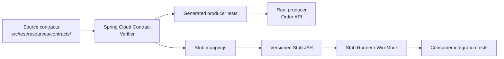
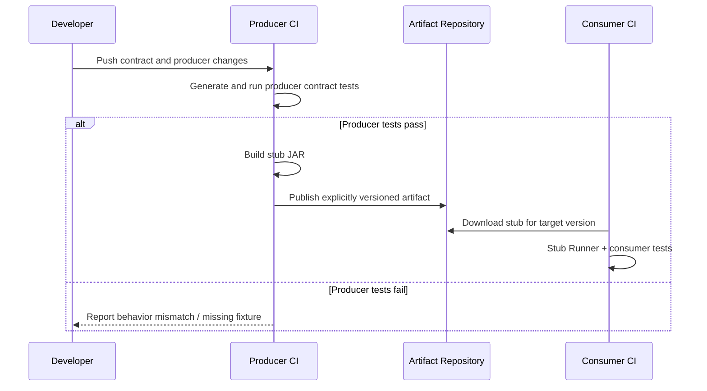

# Contract Directory Structure, Base Tests, and Stub Resources

## 1. Objectives and Big Picture

In **Spring Cloud Contract**, a producer publishes HTTP or messaging behaviors that consumers can rely on. Contracts are written in **Groovy DSL** or **YAML DSL**, and are then used to:

1. **Generate producer-side tests**: confirm the real application satisfies the promised requests and responses.
2. **Generate stubs**: produce simulated behavior so consumers can develop and test independently.
3. **Publish versioned stubs**: allow **Stub Runner** to download the right stub and run consumer-side tests, including in CI.

This lesson focuses on where to place three critical resource groups in a project: **source contract files**, **base tests for generated tests**, and **generated stub resources**. Examples use a producer named `order-service` and a consumer named `checkout-service`. Class names, endpoints, and artifact coordinates are illustrative; when applying them, use your project's actual names.

## 2. Diagram of Components and Where They Live



**Distinguishing the three file types**:

| Type | Where Is It Located? | Edited Directly? | Purpose |
|---|---|---|---|
| **Source contract** (`.yml`, `.yaml`, `.groovy`) | Producer's `src/test/resources/contracts/` directory by default convention | **Yes**; this is where expectations are edited and reviewed | Describes request/response or messaging interactions |
| **Generated tests** | Build directory such as `target/generated-test-sources/contracts/` in Maven | **No**; edit the DSL or test-generation config instead | Verifies whether the producer implements the contract |
| **Stub mappings / stub JAR** | Build directory and packaged `*-stubs.jar` artifact | **No**; regenerated from source contracts | Serves simulated responses for consumers |

The base test lives separately under `src/test/java/` and **is written and maintained by developers**. Generated tests extend the base test to share the same Spring context, controller, mock, and test data initialization.

## 3. Recommended Directory Structure for the Producer

For a Java project using Maven, you can organize files as follows:

```text
order-service/
├── pom.xml
└── src/
    ├── main/
    │   ├── java/com/example/orders/
    │   │   ├── OrderServiceApplication.java
    │   │   ├── api/OrderController.java
    │   │   └── service/OrderService.java
    │   └── resources/application.yml
    └── test/
        ├── java/com/example/orders/
        │   ├── contract/ContractVerifierBase.java
        │   └── service/OrderServiceTest.java
        └── resources/
            ├── application-test.yml
            └── contracts/
                ├── orders/
                │   ├── get-paid-order.yml
                │   ├── get-order-not-found.yml
                │   └── create-order-invalid.yml
                └── payments/
                    └── publish-payment-confirmed.groovy
```

This is a **recommended convention**, not the only mandatory layout. What must stay consistent is: source contracts sit where the plugin is configured to scan; scenarios are grouped by API or feature; the base class sits in the test source set; and generated artifacts stay inside the build directory.

### 3.1. Naming and Grouping Contracts

- Use names reflecting **observable behavior**: `get-order-not-found.yml` is clearer than `test2.yml`.
- Group by domain such as `orders/` and `payments/` so contracts are easy to locate when modifying APIs.
- Each file should describe one clear scenario; multiple files for the same endpoint are fine for success, error, authorization, and edge cases.
- Standardize on YAML or Groovy within the team. Both DSLs can coexist, but avoid accidentally defining two duplicate contracts with the same request and response without reason.
- For responses containing dynamic values such as UUIDs, timestamps, and transaction IDs, use appropriate matchers rather than hardcoding unstable values.

If the project uses **Gradle**, source structure under `src/main` and `src/test` is still generally similar; the build output directory shifts to `build/` and plugin configuration uses Gradle DSL.

## 4. Examples of YAML and Groovy Contract Files

### 4.1. Successful HTTP Contract in YAML

Placed at `src/test/resources/contracts/orders/get-paid-order.yml`:

```yaml
description: "Fetch a paid order to display at checkout"
request:
  method: GET
  url: /api/orders/42
  headers:
    Accept: application/json
response:
  status: 200
  headers:
    Content-Type: application/json
  body:
    id: 42
    status: PAID
    totalAmount: 120000
    currency: VND
```

This scenario specifies an HTTP `GET /api/orders/42` request and expects a `200` response with the fields needed by the consumer. **ID `42` and the amount are test fixture data**: producer tests must prepare the corresponding order. If the producer lacks that input data, generated tests will fail even when the contract structure is valid.

Stubs generated from this contract return this exact JSON sample when the consumer sends the matching request. Yet the stub **does not replace** producer tests: the stub can keep returning `200` even after the real producer accidentally renames a field or alters behavior.

### 4.2. Error HTTP Contract in Groovy

Placed at `src/test/resources/contracts/orders/get-order-not-found.groovy`:

```groovy
import org.springframework.cloud.contract.spec.Contract

Contract.make {
    description "Order not found"
    request {
        method GET()
        url "/api/orders/9999"
    }
    response {
        status NOT_FOUND()
        headers {
            contentType(applicationJson())
        }
        body(
            code: "ORDER_NOT_FOUND",
            message: "Order does not exist"
        )
    }
}
```

Groovy DSL provides helper methods such as `GET()`, `NOT_FOUND()`, and `applicationJson()`, plus more flexible expressions when checking dynamic data. YAML is often easier to read and review; Groovy shines when specifications require complex matcher logic or transformations. Choose the DSL based on your team's maintenance preferences—not because one DSL automatically produces "more accurate" stubs than the other.

### 4.3. Contracts vs. OpenAPI, Mocks, and Unit Tests

| Artifact | Role |
|---|---|
| **OpenAPI** | Describes broader HTTP API surface and schemas for discovery/client generation |
| **Contract DSL** | Locks in verifiable request/response or messaging scenarios |
| **Producer generated test** | Invokes or verifies the real application against the DSL |
| **Stub mapping** | Provides request matching and simulated responses for consumers |
| **Unit test** | Verifies class/function logic without necessarily covering cross-service interfaces |

You do not need to copy every internal response field into a contract if consumers do not depend on them. Conversely, do not assert only status `200` when consumers depend on specific formats or business values.

## 5. Base Tests: The Foundation for Generated Producer Tests

### 5.1. What Is a Base Test?

Spring Cloud Contract Verifier generates Java/Kotlin test classes from contracts. Those test classes must know **how to boot the producer and invoke the API using the appropriate mechanism**. `ContractVerifierBase` is the base class authored by the team to supply shared setup.

A base test typically handles:

1. Starting the Spring application context or the controller under test.
2. Configuring Rest Assured MockMvc, WebTestClient, or the mechanism matching the selected test mode.
3. Creating/mocking deterministic data expected by contracts.
4. Configuring beans, security test rules, test databases, or external service mocks when genuinely needed.

### 5.2. Example Base Class for HTTP with MockMvc

Placed at `src/test/java/com/example/orders/contract/ContractVerifierBase.java`:

```java
package com.example.orders.contract;

import io.restassured.module.mockmvc.RestAssuredMockMvc;
import org.junit.jupiter.api.BeforeEach;
import org.springframework.beans.factory.annotation.Autowired;
import org.springframework.boot.test.autoconfigure.web.servlet.AutoConfigureMockMvc;
import org.springframework.boot.test.context.SpringBootTest;
import org.springframework.web.context.WebApplicationContext;

@SpringBootTest(webEnvironment = SpringBootTest.WebEnvironment.MOCK)
@AutoConfigureMockMvc
public abstract class ContractVerifierBase {

    @Autowired
    private WebApplicationContext context;

    @BeforeEach
    protected void setupContractTests() {
        RestAssuredMockMvc.webAppContextSetup(context);
    }
}
```

Here, generated tests run on **MockMvc**, using the Spring context to invoke the HTTP path inside the application without opening a real network port. For the `GET /api/orders/42` example, the test application must have data or a mock for order `42` returning the promised response. Fixtures can be added to the base class or test setup consistently with your project.

**Note on test mode:** this example uses Spring MVC, JUnit 5, and Rest Assured MockMvc. If your application uses WebFlux, JAX-RS, another test mode, or skips booting a Spring context, the base test and verifier config must change accordingly; never copy the MockMvc class blindly across every system.

### 5.3. Do Not Confuse the Base Test with Generated Tests

| Team-Authored Base Test | Plugin-Generated Tests |
|---|---|
| Lives in `src/test/java/.../ContractVerifierBase.java` | Live in the build output directory |
| Tracked in Git and updated when test initialization changes | Regenerated from contracts on every build |
| Holds setup, fixtures, mocks, and test infrastructure | Hold request/response assertions generated from DSL |
| Typically an `abstract class` without individual test cases | Extend the base class to run each scenario |

If generated tests fail with connection errors, Spring startup failures, or missing mock data, inspect the **base test, fixtures, and test mode**. If an assertion fails because the API changed behavior, inspect the **source contract and producer code**. Never edit generated tests directly because the next build will overwrite them.

### 5.4. When There Are Multiple Contract Groups

One shared base class suffices if all contracts share the same setup. When a producer has both HTTP and messaging contracts, or controller groups requiring different fixtures, you can configure multiple base classes using the plugin's package-mapping rules. Add extra base classes only when initialization or data genuinely differs; too many base classes with duplicated setup make maintenance harder.

## 6. Maven Configuration for the Verifier and Base Test

The example below shows the **relevant snippets in the producer's `pom.xml`**, assuming Spring Boot, the Spring Cloud BOM, and required HTTP dependencies are already present:

```xml
<dependencies>
    <dependency>
        <groupId>org.springframework.cloud</groupId>
        <artifactId>spring-cloud-starter-contract-verifier</artifactId>
        <scope>test</scope>
    </dependency>
</dependencies>

<build>
    <plugins>
        <plugin>
            <groupId>org.springframework.cloud</groupId>
            <artifactId>spring-cloud-contract-maven-plugin</artifactId>
            <version>${spring-cloud-contract.version}</version>
            <extensions>true</extensions>
            <configuration>
                <baseClassForTests>
                    com.example.orders.contract.ContractVerifierBase
                </baseClassForTests>
                <testFramework>JUNIT5</testFramework>
                <testMode>MOCKMVC</testMode>
            </configuration>
        </plugin>
    </plugins>
</build>
```

In a real project, `spring-cloud-contract.version` and the BOM must follow a **compatible Spring Boot/Spring Cloud combination**. This XML snippet is not a complete POM; without the BOM, dependencies, and appropriate test configuration, the project still will not build.

Points to cross-check:

- `baseClassForTests` must be the **fully qualified class name including package**, matching the base test file.
- `testFramework` must match the active test framework; the example above uses `JUNIT5`.
- `testMode` must match how the base class initializes HTTP tests; the example above uses `MOCKMVC`.
- Contracts must sit under the path scanned by the plugin; if changing the default directory, reconfigure the plugin and update team documentation.
- When running multiple producer modules in one repository, attach verifier configuration and stub output to the **exact Maven module** exposing that API.

In Gradle, use the `org.springframework.cloud.contract` plugin, declare the verifier dependency in the test configuration, and set `baseClassForTests` inside the `contracts` extension. Never mix Maven configuration syntax into `build.gradle`. The goal is identical: generate tests from contracts, execute them, and package stubs.

## 7. Stub Resources: Sources, Generated Files, and Published Artifacts

### 7.1. Where Do Stubs Come From?

For HTTP contracts, Spring Cloud Contract generates **WireMock request mappings** from the DSL: matching rules for method, URL, headers, and body along with the corresponding response. When responses are large, mappings may reference external body files. For message contracts, stub generation and execution depend further on your messaging system setup; never assume every message contract maps to an HTTP WireMock mapping.

A Maven build generates intermediate resources under `target/` and packages them into the stub artifact. Typical JAR layout:

```text
order-service-1.0.0-stubs.jar
└── META-INF/
    └── com.example/
        └── order-service/
            └── 1.0.0/
                ├── contracts/
                │   └── orders/...
                ├── mappings/
                │   └── ... .json
                └── __files/          # may be present if mapping uses a body file
```

This illustrates a **typical logical layout**; internal file names and exact paths may vary by plugin version and contract type. What matters is verifying that the artifact contains the mappings and resources required by Stub Runner. In your source repository, **do not** commit manual copies of `target/` or `build/`.

### 7.2. Stub Identifiers and Versions

Example artifact:

```text
groupId    = com.example
artifactId = order-service
version    = 1.0.0
classifier = stubs
```

In Maven terms, the artifact is typically named `order-service-1.0.0-stubs.jar`. `groupId:artifactId:version` must match what the consumer requests in Stub Runner. Use **traceable pinned versions** in reproducible pipelines, and bump the version explicitly when consumers test a new API. If using dynamic versions like `+`, understand that the same test can pull different stub versions across runs.

### 7.3. Publishing and Storage

- **LOCAL**: producer installs the stub artifact into the local Maven repository, typically `~/.m2/repository`, for consumer tests running on the same machine.
- **REMOTE**: producer publishes the artifact to a compatible Maven repository; consumer configures Stub Runner to download from that repository. Repository credentials should come from environment secrets, never hardcoded in contracts.
- **CLASSPATH**: reads stubs already on the classpath in supported setups; resources must follow the directory layout Stub Runner expects.

When CI runs on isolated machines/containers, running `mvn install` on a developer laptop **does not** make the stub appear on the consumer's CI runner. Pipelines need a controlled artifact publishing or transfer step paired with the right download mode.

## 8. Consumer Directory Layout and Stub Runner Configuration

The consumer normally **does not copy source contracts into its own repository** once it consumes stub artifacts published by the producer. Example:

```text
checkout-service/
├── pom.xml
└── src/
    ├── main/java/com/example/checkout/
    │   └── OrderClient.java
    └── test/
        ├── java/com/example/checkout/
        │   └── OrderClientContractTest.java
        └── resources/application-test.yml
```

In a Maven consumer, add the corresponding test dependency:

```xml
<dependency>
    <groupId>org.springframework.cloud</groupId>
    <artifactId>spring-cloud-starter-contract-stub-runner</artifactId>
    <scope>test</scope>
</dependency>
```

Example test configuring Stub Runner to start the **locally installed** stub of `order-service`. Application imports such as `OrderClient` and assertions are abbreviated to keep focus on the flow:

```java
@SpringBootTest
@AutoConfigureStubRunner(
    ids = "com.example:order-service:1.0.0:stubs:8085",
    stubsMode = StubRunnerProperties.StubsMode.LOCAL
)
class OrderClientContractTest {

    @Autowired
    StubFinder stubFinder;

    @Test
    void checkoutReadsPaidOrder() {
        URL stubUrl = stubFinder.findStubUrl("com.example", "order-service");

        // OrderClient is the application's HTTP client, not a Stub Runner API.
        OrderClient orderClient = new OrderClient(stubUrl.toString());
        OrderDto order = orderClient.findById(42);

        assertThat(order.status()).isEqualTo("PAID");
        assertThat(order.currency()).isEqualTo("VND");
    }
}
```

This example demonstrates `@AutoConfigureStubRunner`, `StubRunnerProperties.StubsMode.LOCAL`, and `StubFinder` inside a Spring Boot test. Add imports, `OrderClient`, `OrderDto`, and base-URL injection matching your real codebase. Port `8085` is requested in the example; if port collisions occur on your machine, choose an appropriate port-allocation strategy.

**Crucial verification rule**: consumer tests must invoke real consumer logic and assert that the consumer interprets the stub's response properly. Checking only that "Stub Runner started" does not prove `OrderClient` handles the contract correctly.

## 9. Build and CI Flow from Source Contract to Consumer

Recommended workflow for Maven-based producer and consumer:



Reference sequence of operations:

1. **Producer**: add or edit `src/test/resources/contracts/...`, ensuring the base test sets up controllers/context and fixtures for all scenarios.
2. **Build producer**: run `mvn clean verify` to generate and execute tests; check assertion failures before publishing stubs. Depending on plugin and lifecycle, packaged artifacts may be created during the package phase.
3. **Publish stub**: use `mvn install` locally or the appropriate `mvn deploy` step in a pipeline authorized to publish. The build must execute all required tests per project policy.
4. **Consumer**: declare the exact `groupId:artifactId:version:stubs` and configure Stub Runner to fetch from the published source.
5. **Test consumer**: call the real integration client using the stub's URL/port; assert business values and error-handling branches.
6. **CI gate**: block changes or deployments that break known consumers without a compatibility plan.

Example: the producer renames `status` to `paymentState` without retaining `status`. If the old contract still requires `status`, the producer's generated test catches the mismatch. If the contract is updated to match the new API while the consumer still reads `status`, consumer tests against the new stub catch the failure. Thus, **producer contract tests and consumer stub tests reinforce each other**.

## 10. Common Configuration Mistakes

| Symptom | Likely Cause | How to Fix |
|---|---|---|
| Build generates no contract tests | DSL is not in the scanned directory; plugin is not activated properly | Check `src/test/resources/contracts/` and plugin config; inspect test-generation logs |
| Generated test cannot find base class | Wrong package/class name in `baseClassForTests` or class missing from test source set | Verify package, class name, and `src/test/java` |
| Test returns `404` for sample ID | Producer lacks fixture setup or route mismatch | Prepare deterministic data; check URL and test setup |
| MockMvc or context fails to initialize | Base test uses mismatched mode or misses beans/mocks | Check `testMode`, annotations, and test dependencies |
| Stub generated yet consumer still calls real API | Consumer did not point base URL to Stub Runner port | Inject URL supplied by Stub Runner into HTTP client |
| Stub Runner fails to download artifact | Wrong coordinates, missing `install/deploy`, wrong `LOCAL/REMOTE`, or missing repo access | Verify GAV/classifier, version, repo, and download logs |
| Consumer test stays green after API change | Stale stub, weak assertions, or only testing server startup | Point to the target stub version; assert fields consumer actually uses |
| Tests flake by time or execution order | Shared mutable fixture data or fragile fixed timestamps/IDs | Isolate test data, use appropriate matchers, avoid shared state |
| Repository contains generated mapping files | Build output directory was committed to Git | Keep source contracts in Git and generate artifacts in CI |

## 11. Handover Checklist for a Contract Project

- [ ] `src/test/resources/contracts/` exists and contains clearly named scenarios grouped logically.
- [ ] Contracts are code-reviewed; they contain no credentials, real personal data, or hardcoded production URLs.
- [ ] `ContractVerifierBase` is configured via exact FQN and matches the project's `testMode` and test framework.
- [ ] Producer tests prepare complete state/fixtures and execute deterministically.
- [ ] The build generates both tests and stubs from the same source contracts; generated code and mappings are never edited directly.
- [ ] The Stub JAR has clear coordinates and version, stored where consumers and CI can access it.
- [ ] Stub Runner pulls from the right source and the consumer genuinely calls the stub port.
- [ ] Consumer tests verify application behavior dependent on the API, including key error cases.
- [ ] CI runs producer verification before publishing, and consumer tests target the intended stub version.

A quick way to onboard onto an existing project is to trace the chain: **source contract → generated test → base test → real producer → stub artifact → Stub Runner → consumer test**. Knowing the location and responsibility of each link lets teams pinpoint root causes quickly when tests fail and sustain contract testing long-term as code and APIs evolve together.
