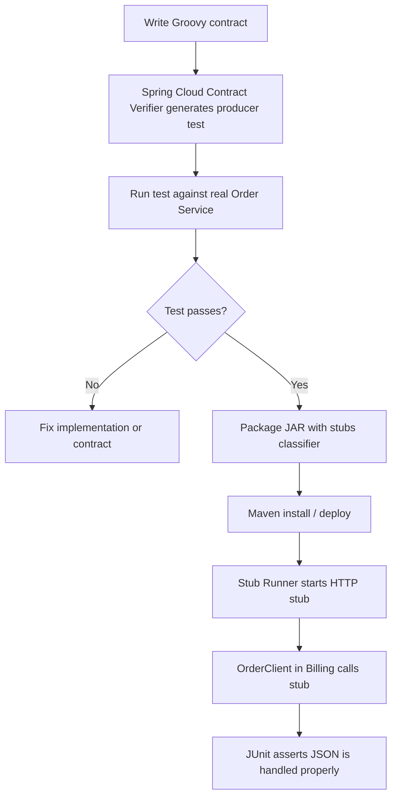

# Running the First Workflow from Contract to Consumer Test

**Spring Cloud Contract** helps two services agree on and verify communication behavior without booting the entire system on every API change. On the **producer** side, HTTP or messaging behavior is described in Groovy/YAML DSL contracts, tests are generated to prove the implementation honors the contract, and stubs are packaged. On the **consumer** side, **Stub Runner** fetches those stubs and runs tests against the consumer's real API-calling code. Wiring both sides into CI catches integration-breaking changes early.

Within the **Project Setup** chapter, this lesson takes you through a complete small HTTP workflow, from **a single contract file to a passing consumer test**. The example uses Maven, Java 17, Spring Boot, and Spring Cloud Contract; steps are arranged so you know which project to run each command in, what output to inspect, and where to diagnose failures.

## 1. Objectives and Outcomes of This Practice

We will build two independent applications:

- **`order-service` (producer):** exposes `GET /api/orders/42`, returning JSON with the order ID and payment status.
- **`billing-service` (consumer):** uses `OrderClient` to call that endpoint, reads status `PAID`, and has a test running against the `order-service` stub.

Agreed behavior between both sides:

```http
GET /api/orders/42
```

```http
HTTP/1.1 200 OK
Content-Type: application/json

{"id":42,"status":"PAID"}
```

By the end of this lesson, you will have built `order-service-1.0.0-stubs.jar`, verified that **generated producer tests** executed against the producer application, installed the stub artifact into local Maven, started the HTTP stub via **Stub Runner**, and run a **consumer test** exercising the real `OrderClient` code. Finally, you will know how to move from local testing to publishing stubs to an artifact repository for CI.



**Both test types verify different things:** generated producer tests verify *whether the real producer fulfills what it promised*; consumer tests with stubs verify *whether consumer code calls and handles the promised behavior properly*. Seeing consumer tests pass alone does not prove the real producer still works properly, because stubs simulate the contract rather than running producer code.

## 2. Prerequisites and Version Choices

Your machine needs **JDK 17 or newer**, Maven 3.9.x or an equivalent Maven Wrapper, an IDE supporting Java and Maven, and access to download dependencies from a Maven repository. Commands below can be run in a terminal from the parent folder holding both projects; if using Maven Wrapper, replace `mvn` with `./mvnw` or `mvnw.cmd` depending on your OS.

**Versions must align within the same release train.** To keep the example concrete, the POM files below use an illustrative version set for Spring Boot 3.x:

| Component | Version Used in Example | Role |
| --- | --- | --- |
| Java | 17 | Runs the apps and enables `record` syntax. |
| Spring Boot | `3.3.5` | Dependencies and runtime for both applications. |
| Spring Cloud BOM | `2023.0.4` | Manages Spring Cloud dependency versions. |
| Spring Cloud Contract Maven Plugin | `4.1.5` | Generates producer tests and stubs on the producer side. |

This is a **fixed illustrative set for reading and practice**, not a recommendation for the latest version at the time you read this. When applying this to an active project, select a compatible Spring Boot, Spring Cloud BOM, and Spring Cloud Contract plugin stack per your project's supported release train; never upgrade one piece arbitrarily while leaving the rest behind. The BOM manages dependencies, whereas the **Maven plugin version** is declared explicitly in the POM.

Create two independent Maven directories:

```text
contract-first-lab/
├── producer/
│   ├── pom.xml
│   └── src/
│       ├── main/java/com/acme/orders/
│       │   ├── OrderApplication.java
│       │   └── OrderController.java
│       └── test/
│           ├── java/com/acme/orders/ContractTestBase.java
│           └── resources/contracts/orders/get_paid_order.groovy
└── consumer/
    ├── pom.xml
    └── src/
        ├── main/java/com/acme/billing/
        │   ├── BillingApplication.java
        │   └── OrderClient.java
        └── test/java/com/acme/billing/OrderClientStubTest.java
```

Source paths below are relative to `producer/` or `consumer/`. Both projects share `groupId` while using distinct `artifactId` values; builds and tests can run independently.

## 3. Initializing the Maven Producer

Create `producer/pom.xml`:

```xml
<project xmlns="http://maven.apache.org/POM/4.0.0"
         xmlns:xsi="http://www.w3.org/2001/XMLSchema-instance"
         xsi:schemaLocation="http://maven.apache.org/POM/4.0.0
                             https://maven.apache.org/xsd/maven-4.0.0.xsd">
    <modelVersion>4.0.0</modelVersion>

    <parent>
        <groupId>org.springframework.boot</groupId>
        <artifactId>spring-boot-starter-parent</artifactId>
        <version>3.3.5</version>
        <relativePath/>
    </parent>

    <groupId>com.acme</groupId>
    <artifactId>order-service</artifactId>
    <version>1.0.0</version>
    <properties>
        <java.version>17</java.version>
        <spring-cloud.version>2023.0.4</spring-cloud.version>
        <spring-cloud-contract.version>4.1.5</spring-cloud-contract.version>
    </properties>

    <dependencyManagement>
        <dependencies>
            <dependency>
                <groupId>org.springframework.cloud</groupId>
                <artifactId>spring-cloud-dependencies</artifactId>
                <version>${spring-cloud.version}</version>
                <type>pom</type>
                <scope>import</scope>
            </dependency>
        </dependencies>
    </dependencyManagement>

    <dependencies>
        <dependency>
            <groupId>org.springframework.boot</groupId>
            <artifactId>spring-boot-starter-web</artifactId>
        </dependency>
        <dependency>
            <groupId>org.springframework.boot</groupId>
            <artifactId>spring-boot-starter-test</artifactId>
            <scope>test</scope>
        </dependency>
        <dependency>
            <groupId>org.springframework.cloud</groupId>
            <artifactId>spring-cloud-starter-contract-verifier</artifactId>
            <scope>test</scope>
        </dependency>
    </dependencies>

    <build>
        <plugins>
            <plugin>
                <groupId>org.springframework.boot</groupId>
                <artifactId>spring-boot-maven-plugin</artifactId>
            </plugin>
            <plugin>
                <groupId>org.springframework.cloud</groupId>
                <artifactId>spring-cloud-contract-maven-plugin</artifactId>
                <version>${spring-cloud-contract.version}</version>
                <extensions>true</extensions>
                <configuration>
                    <testFramework>JUNIT5</testFramework>
                    <testMode>MOCKMVC</testMode>
                    <baseClassForTests>com.acme.orders.ContractTestBase</baseClassForTests>
                </configuration>
            </plugin>
        </plugins>
    </build>
</project>
```

Three settings to understand before running:

- `spring-cloud-starter-contract-verifier` provides libraries required by producer-side contract tests.
- `spring-cloud-contract-maven-plugin` with `extensions=true` binds test and stub generation steps into the project's Maven lifecycle; generated tests execute when Maven reaches the appropriate test phase.
- `testMode=MOCKMVC` verifies Spring MVC endpoints using `MockMvc` without opening a real HTTP port; `baseClassForTests` tells generated tests which test setup class to extend.

### 3.1. Creating the Application and HTTP Endpoint

Create `producer/src/main/java/com/acme/orders/OrderApplication.java`:

```java
package com.acme.orders;

import org.springframework.boot.SpringApplication;
import org.springframework.boot.autoconfigure.SpringBootApplication;

@SpringBootApplication
public class OrderApplication {
    public static void main(String[] args) {
        SpringApplication.run(OrderApplication.class, args);
    }
}
```

Create `producer/src/main/java/com/acme/orders/OrderController.java`:

```java
package com.acme.orders;

import org.springframework.http.HttpStatus;
import org.springframework.http.MediaType;
import org.springframework.web.bind.annotation.GetMapping;
import org.springframework.web.bind.annotation.PathVariable;
import org.springframework.web.bind.annotation.RequestMapping;
import org.springframework.web.bind.annotation.RestController;
import org.springframework.web.server.ResponseStatusException;

@RestController
@RequestMapping("/api/orders")
public class OrderController {

    @GetMapping(value = "/{id}", produces = MediaType.APPLICATION_JSON_VALUE)
    public OrderResponse getOrder(@PathVariable long id) {
        if (id != 42L) {
            throw new ResponseStatusException(HttpStatus.NOT_FOUND);
        }
        return new OrderResponse(42L, "PAID");
    }

    public record OrderResponse(long id, String status) {}
}
```

This is a **minimal fixture for the lesson**: order `42` always exists and is paid, while any other ID returns 404. In a real project, the controller fetches data from a service/repository and tests must prepare deterministic data. Never put hardcoded dummy data like this into production business logic.

## 4. Writing the Groovy DSL Contract

Create `producer/src/test/resources/contracts/orders/get_paid_order.groovy`:

```groovy
import org.springframework.cloud.contract.spec.Contract

Contract.make {
    description 'Fetch paid order 42'

    request {
        method 'GET'
        url '/api/orders/42'
    }

    response {
        status 200
        headers {
            contentType(applicationJson())
        }
        body(
            id: 42,
            status: 'PAID'
        )
    }
}
```

In this contract, `request` describes **the input the producer must accept**: an HTTP `GET` to `/api/orders/42`. `response` describes **the output the producer must return**: status `200`, JSON content type, and the two fields `id` and `status`. Both the producer test and the HTTP stub are generated from **the exact same file**.

`src/test/resources/contracts` is the standard default contract path for the plugin. The `orders/` subfolder organizes interactions; you can add `404`, `400`, `PENDING` status, or request variants once the baseline workflow runs cleanly.

**YAML DSL can also be used** to express the exact same behavior, though this exercise uses Groovy so learners stay focused on the build, test, and stub lifecycle. Avoid placing two behaviorally identical files side by side just to test syntax, as each file generates its own test/mapping to maintain.

## 5. Preparing the Base Class for Generated Producer Tests

The plugin generates test code; you **do not edit generated Java files directly**. Instead, create a base class so generated tests can access the Spring test context and `MockMvc`.

Create `producer/src/test/java/com/acme/orders/ContractTestBase.java`:

```java
package com.acme.orders;

import io.restassured.module.mockmvc.RestAssuredMockMvc;
import org.junit.jupiter.api.BeforeEach;
import org.springframework.beans.factory.annotation.Autowired;
import org.springframework.boot.test.autoconfigure.web.servlet.AutoConfigureMockMvc;
import org.springframework.boot.test.context.SpringBootTest;
import org.springframework.test.web.servlet.MockMvc;

@SpringBootTest(classes = OrderApplication.class)
@AutoConfigureMockMvc
public abstract class ContractTestBase {

    @Autowired
    private MockMvc mockMvc;

    @BeforeEach
    void setUp() {
        RestAssuredMockMvc.mockMvc(mockMvc);
    }
}
```

`ContractTestBase` does not need its own `@Test`: its job is to supply `MockMvc` wired to the producer application. Generated tests extend this class and execute the requests and assertions generated from the contract. For contracts with dynamic data, this is also where you prepare fixtures or mock external integrations so test outcomes remain deterministic.

**Why must producer tests run?** If the contract expects `status` yet the controller renames it to `state`, a stub generated from the contract will keep returning `status`. Only generated tests executing against the real producer catch this drift at implementation verification time.

## 6. Building the Producer, Verifying Tests, and Packaging the Stub Artifact

From the root `contract-first-lab/` directory, run:

```shell
mvn -f producer/pom.xml clean install
```

This command walks through the required Maven phases, including generating tests from contracts, running tests against producer code, packaging, and installing artifacts into local Maven. Once it succeeds, inspect these outputs (exact folder names may vary with plugin configuration):

| Output | What to Look For |
| --- | --- |
| `producer/target/generated-test-sources/contracts/` | Contains the Java test class generated from `get_paid_order.groovy`. |
| Surefire/test report results | Generated producer test ran and **PASSED**; seeing `BUILD SUCCESS` with zero tests executed means configuration needs checking. |
| `producer/target/order-service-1.0.0-stubs.jar` | Stub artifact with classifier `stubs`; typically holds WireMock mappings/resources. |
| Local Maven repository | Contains `com.acme:order-service:1.0.0` along with its `stubs` artifact so the consumer can pull it in `LOCAL` mode. |

The default local Maven path is under `.m2/repository/com/acme/order-service/1.0.0/` for the user running Maven, unless overridden in `settings.xml`. You can inspect the JAR contents with `jar tf` on the file path or via your IDE; the goal is confirming mappings were packaged rather than only an application JAR.

**First verification gate:** if generated producer tests fail, **do not** move on to the consumer yet. Check the HTTP method, URL, JSON, return types, status, and base test. When the contract reflects agreed expectations, fix the producer to honor the contract; editing the contract merely to turn the build green can hide a breaking change.

In this example, `install` places the stub into the **local Maven repository of the machine running the command**; that is the shortest path to finish the first loop. It is not yet publishing to a remote repository accessible by CI pipelines or other teams. Section 9 moves to a real publishing flow.

## 7. Initializing the Maven Consumer

Create `consumer/pom.xml` with the same version set, using **Stub Runner** as the test dependency instead of Contract Verifier:

```xml
<project xmlns="http://maven.apache.org/POM/4.0.0"
         xmlns:xsi="http://www.w3.org/2001/XMLSchema-instance"
         xsi:schemaLocation="http://maven.apache.org/POM/4.0.0
                             https://maven.apache.org/xsd/maven-4.0.0.xsd">
    <modelVersion>4.0.0</modelVersion>

    <parent>
        <groupId>org.springframework.boot</groupId>
        <artifactId>spring-boot-starter-parent</artifactId>
        <version>3.3.5</version>
        <relativePath/>
    </parent>

    <groupId>com.acme</groupId>
    <artifactId>billing-service</artifactId>
    <version>1.0.0</version>
    <properties>
        <java.version>17</java.version>
        <spring-cloud.version>2023.0.4</spring-cloud.version>
    </properties>

    <dependencyManagement>
        <dependencies>
            <dependency>
                <groupId>org.springframework.cloud</groupId>
                <artifactId>spring-cloud-dependencies</artifactId>
                <version>${spring-cloud.version}</version>
                <type>pom</type>
                <scope>import</scope>
            </dependency>
        </dependencies>
    </dependencyManagement>

    <dependencies>
        <dependency>
            <groupId>org.springframework.boot</groupId>
            <artifactId>spring-boot-starter-web</artifactId>
        </dependency>
        <dependency>
            <groupId>org.springframework.boot</groupId>
            <artifactId>spring-boot-starter-test</artifactId>
            <scope>test</scope>
        </dependency>
        <dependency>
            <groupId>org.springframework.cloud</groupId>
            <artifactId>spring-cloud-starter-contract-stub-runner</artifactId>
            <scope>test</scope>
        </dependency>
    </dependencies>

    <build>
        <plugins>
            <plugin>
                <groupId>org.springframework.boot</groupId>
                <artifactId>spring-boot-maven-plugin</artifactId>
            </plugin>
        </plugins>
    </build>
</project>
```

`spring-cloud-starter-contract-stub-runner` provides artifact resolution, mapping loading, and a stub server for tests. There is no need to pull Order Service source code, controllers, or databases into Billing Service.

### 7.1. Writing Real Consumer Code

Create `consumer/src/main/java/com/acme/billing/BillingApplication.java`:

```java
package com.acme.billing;

import org.springframework.boot.SpringApplication;
import org.springframework.boot.autoconfigure.SpringBootApplication;

@SpringBootApplication
public class BillingApplication {
    public static void main(String[] args) {
        SpringApplication.run(BillingApplication.class, args);
    }
}
```

Create `consumer/src/main/java/com/acme/billing/OrderClient.java`:

```java
package com.acme.billing;

import org.springframework.beans.factory.annotation.Value;
import org.springframework.stereotype.Component;
import org.springframework.web.client.RestClient;

@Component
public class OrderClient {
    private final RestClient http;

    public OrderClient(RestClient.Builder builder,
                       @Value("${orders.base-url}") String baseUrl) {
        this.http = builder.baseUrl(baseUrl).build();
    }

    public OrderView getOrder(long id) {
        return http.get()
                .uri("/api/orders/{id}", id)
                .retrieve()
                .body(OrderView.class);
    }

    public record OrderView(Long id, String status) {}
}
```

`RestClient` is Spring Framework 6.1+'s synchronous HTTP client. This is **real application code**, not a test mock. The client reads `orders.base-url` from configuration: in real environments it points to Order Service; in tests it points to the stub. If you use `WebClient`, `RestTemplate`, or OpenFeign, follow the same principle of keeping the **base URL configurable**.

Create `consumer/src/main/resources/application.yml` with a default URL for a typical dev environment, such as:

```yaml
orders:
  base-url: http://localhost:8080
```

This value simply illustrates a real Order Service listening on port `8080`. The test in the next step overrides it with the stub address, so Order Service does not need to run during consumer tests.

## 8. Running the Consumer Test with Stub Runner

Create `consumer/src/test/java/com/acme/billing/OrderClientStubTest.java`:

```java
package com.acme.billing;

import org.junit.jupiter.api.Test;
import org.springframework.beans.factory.annotation.Autowired;
import org.springframework.boot.test.context.SpringBootTest;
import org.springframework.cloud.contract.stubrunner.spring.AutoConfigureStubRunner;
import org.springframework.cloud.contract.stubrunner.spring.StubRunnerProperties;

import static org.assertj.core.api.Assertions.assertThat;

@SpringBootTest(properties = "orders.base-url=http://localhost:8090")
@AutoConfigureStubRunner(
        ids = "com.acme:order-service:1.0.0:stubs:8090",
        stubsMode = StubRunnerProperties.StubsMode.LOCAL
)
class OrderClientStubTest {

    @Autowired
    private OrderClient orderClient;

    @Test
    void docTrangThaiDonHangTuStub() {
        OrderClient.OrderView order = orderClient.getOrder(42L);

        assertThat(order).isNotNull();
        assertThat(order.id()).isEqualTo(42L);
        assertThat(order.status()).isEqualTo("PAID");
    }
}
```

Explanation of each setting:

| Setting | Purpose |
| --- | --- |
| `ids = "com.acme:order-service:1.0.0:stubs:8090"` | Finds the exact group, artifact, version, and classifier of the stub; instructs the HTTP stub to listen on port `8090`. |
| `stubsMode = LOCAL` | Pulls the artifact installed into local Maven by the producer's `mvn install` step. |
| `orders.base-url=http://localhost:8090` | Overrides `OrderClient`'s URL so all test requests hit the HTTP stub server. |
| `orderClient.getOrder(42L)` | Executes **the consumer's real calling code**: sends GET, receives JSON, maps into DTO. |
| AssertJ assertions | Verifies what Billing code parsed rather than merely checking whether the stub opened a port. |

From `contract-first-lab/`, once `mvn -f producer/pom.xml clean install` succeeds, run:

```shell
mvn -f consumer/pom.xml test
```

Expected outcome: JUnit test `docTrangThaiDonHangTuStub` passes. You do not need to manually start WireMock or Order Service in a separate terminal: Stub Runner manages the stub lifecycle within the Spring test context.

With both producer and consumer tests passing, you have completed one full **contract → generated producer test → stub JAR → Stub Runner → consumer test** cycle. This is the first milestone, though it does not yet cover other interactions like business 404s, new-version compatibility checks, or live deployment behavior.

## 9. From Local Install to Stubs Published in CI

For consumers on other machines or in CI to consume the stub, the producer must **publish** the `stubs`-classifier artifact to a Maven repository readable by the consumer—such as Nexus, Artifactory, or your organization's artifact registry. Until then, the consumer only uses the **local** copy you just built.

In `producer/pom.xml`, add `distributionManagement` directly under `<project>` (the URL below is an example; substitute your real repository):

```xml
<distributionManagement>
    <repository>
        <id>internal-releases</id>
        <url>https://repo.example.org/repository/maven-releases</url>
    </repository>
</distributionManagement>
```

Configure Maven repository write credentials in the build/CI account's `settings.xml` matching `id=internal-releases`, using CI secrets instead of embedding passwords or tokens in the POM. After producer tests pass, run:

```shell
mvn -f producer/pom.xml clean deploy
```

Running `deploy` on a properly configured Maven project uploads both the main artifact and the plugin-attached stub artifact to the repository. Confirm the repository holds **`order-service-1.0.0-stubs.jar`** and that the consumer has read access. A stub JAR sitting on a developer's machine without being published will not be found by an independent CI pipeline in `REMOTE` mode.

In the consumer test, switch to repository-based resolution:

```java
@AutoConfigureStubRunner(
        ids = "com.acme:order-service:1.0.0:stubs:8090",
        stubsMode = StubRunnerProperties.StubsMode.REMOTE,
        repositoryRoot = "https://repo.example.org/repository/maven-releases"
)
```

Keep `@SpringBootTest(properties = "orders.base-url=http://localhost:8090")` and the assertions as-is. Now consumer CI downloads the exact published artifact, Stub Runner starts the HTTP mappings, and the test calls the exact `OrderClient` used in production. Configure download authentication using the mechanism supported by your Stub Runner and Maven/CI setup; the example URL does not represent a live repository.

CI should follow this sequence:

1. **Producer CI** reads contracts, generates and runs producer tests, and blocks publishing if tests fail.
2. **Producer CI** packages the artifact with classifier `stubs` and publishes it with a traceable version.
3. **Consumer CI** selects the target stub version, fetches it from the repository via Stub Runner, and runs `OrderClientStubTest` plus other consumer scenarios.
4. **Release management** accepts changes only once protected consumers pass their tests, retaining valid contracts for older consumers still in service.

In real CI, ensure the artifact is **fully published and readable** before the consumer job starts to avoid race conditions between concurrent jobs. Pin an explicit version when qualifying a release; pointing coordinates to "latest" makes test results hard to reproduce.

## 10. Introducing Controlled Failures

To confirm the tests genuinely protect the contract, try three isolated edits; revert each edit before moving to the next.

### Case A — Producer Implements the Contract Incorrectly

In `OrderController`, rename the JSON field `status` to `state` while **keeping** `get_paid_order.groovy` unchanged. Re-run:

```shell
mvn -f producer/pom.xml clean verify
```

**Expected:** the generated producer test fails because the contract still requires `status: "PAID"`. This catches a producer breaking the agreed behavior; consumer tests running against an old stub would still pass, so consumer tests can never replace producer tests.

### Case B — Consumer Calls the Wrong Path

Revert the producer, then change the URL in `OrderClient` from `/api/orders/{id}` to `/orders/{id}`. Run:

```shell
mvn -f consumer/pom.xml test
```

**Expected:** the request matches no contract mapping, so the consumer test fails. WireMock commonly returns 404 when no mapping matches, yet a **404 due to an unmatched stub request** is not the same as a business 404 explicitly defined by the producer.

### Case C — Consumer Deserializes the Response Incorrectly

Revert the path, then rename `status` to `state` in `OrderView` and update the reader without updating the contract. Re-run the consumer test.

**Expected:** depending on Jackson settings, `state` stays unpopulated or deserialization fails because the stub JSON sends `status`; the assertion expecting `PAID` fails. This catches a consumer mishandling the published response. When changing DTO types or mappers, keep assertions checking the exact fields Billing relies on instead of merely asserting non-null responses.

These three tests show the boundary between the two test layers: **producer tests catch provider code drifting from the contract; consumer tests catch caller code failing to interact properly with the stub**. Never edit contracts or stubs arbitrarily just to turn tests green; any contract change must account for still-supported consumers.

## 11. Common Errors on First Run

| Symptom | Most Likely Cause | How to Check or Fix |
| --- | --- | --- |
| No generated producer tests appear in build. | Files not placed in `src/test/resources/contracts`, plugin not bound to lifecycle, or wrong test config. | Verify contract path, `extensions=true`, test-gen goal logs, and generated source dir. |
| Generated tests exist but Spring context fails to boot. | Wrong `baseClassForTests` name, missing `@SpringBootTest`/`@AutoConfigureMockMvc`, or missing test dependencies. | Check FQN of `ContractTestBase`, Spring MVC setup, and dependencies. |
| Producer test gets 404 or JSON mismatch. | Controller route, status, content type, fixture, or response structure differs. | Compare `request`/`response` sections against implementation; fix the mismatched side. |
| `stubs.jar` missing after build. | Plugin did not generate/attach stub artifact or build stopped before package phase. | Check stub-generation logs, `target/`, `mvn clean install` output, and plugin config. |
| Consumer cannot find artifact in `LOCAL` mode. | Producer `install` not run, wrong Maven coordinates, or commands use different local repositories. | Check `com.acme:order-service:1.0.0:stubs` and local Maven repo location. |
| Stub Runner fails to start on `8090`. | Port occupied by another process or stub failed to load. | Check Stub Runner logs; pick an open port and update **both** stub port and base URL. |
| Consumer hits `Connection refused`. | Client URL does not point to stub port, or stub server failed to start. | Check effective `orders.base-url` and Stub Runner startup logs. |
| Consumer receives HTTP 404 from stub. | Wrong path/method/headers or missing mapping. | Compare real request with mappings inside artifact; distinguish unmatched 404 from business 404. |
| Works locally for dev, fails fetching stub in CI. | Only installed to local Maven without publishing; wrong repository URL, version, or credentials. | Verify published artifact, read permissions, `REMOTE` mode, and pinned version in CI. |

If consumer `mvn test` prints `BUILD SUCCESS` with no test names reported, check test discovery and Surefire reports. Likewise, a green producer build that ran zero **generated producer tests** has not proven contract compliance. What you want to observe is **specific test cases actually executing and PASSING**.

## 12. Expanding Once the Basic Workflow Runs

Starting from a single `200` scenario, expand gradually based on real consumer dependencies:

- **Error contracts:** add a 404 scenario with a standard API error body. Consumer tests should verify mapping that error to an exception or domain value; asserting only `404` can accidentally accept a WireMock "no matching stub" 404.
- **Additional data states:** add `PENDING`, `CANCELLED`, empty lists, or optional fields that Billing actually consumes.
- **Dynamic data:** use matchers/DSL supported by your Spring Cloud Contract version to describe request and response patterns instead of hardcoding every ID.
- **Breaking changes:** experiment with removing `status`, changing `id`'s type, or moving the endpoint; retain and run active contracts to catch impacts on older consumers.
- **Asynchronous messages:** Spring Cloud Contract also supports messaging contracts, though that requires appropriate message producer/consumer test setup. Never apply the HTTP WireMock setup from this lesson directly to claim a broker flow works.

**Limitation to remember:** contracts only protect interactions that are explicitly described and tested. Passing producer tests plus passing consumer tests still do not verify real network links, authentication, transactions, production data, or out-of-contract edge cases; those risks require separate integration and operational tests.

## 13. Completion Checklist and Self-Check Questions

You can consider your first run successful when you have confirmed all of the following:

1. The producer has a Groovy contract for `GET /api/orders/42` and the plugin reads it.
2. Generated producer tests **actually execute** against `OrderController` and PASS; breaking a JSON field causes tests to FAIL.
3. The build produces `order-service-1.0.0-stubs.jar` and `mvn install` places it in local Maven.
4. Consumer Stub Runner resolves the exact classifier/version and starts the HTTP stub on the configured port.
5. The test calls the real `OrderClient.getOrder(42L)`, receives a DTO with `id=42` and `status=PAID`, and PASSES.
6. Changing the client URL makes the consumer test FAIL; reverting makes it PASS.
7. For multi-machine/CI execution, the producer publishes the artifact to a shared repository and the consumer uses `REMOTE` with an explicit version.

Answer for yourself: **Why can a consumer test pass even after the real producer broke the contract?** **Why is `mvn install` on a developer laptop insufficient for CI on another machine?** **Why must you verify the count of executed tests instead of relying on `BUILD SUCCESS`?** **If both sides update to a new contract and pass tests, what still needs to be done to protect older consumer versions?**

The workflow to remember is: **define contract → generate and run producer tests → package/publish stub → Stub Runner serves stub → run real consumer client code with clear assertions**. Both branches originate from a single specification source, and artifact versioning plus CI execution order determine how early incompatible API changes get caught.
