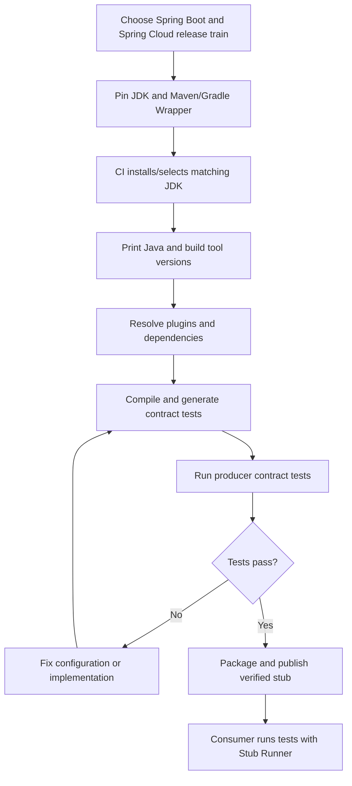

# Checking Java Version and Build Tool Requirements

Before writing HTTP or message contracts in **Groovy/YAML DSL**, Spring Cloud Contract learners must verify whether their environment can **compile source code, generate producer tests, run tests, and package stubs**. A failure during `generateContractTests` sometimes has nothing to do with contract content: the JDK may be too old, Maven/Gradle may run on a different Java version than the IDE, or the Spring Cloud Contract version may be incompatible with Spring Boot.

This lesson belongs to the **Project Setup** chapter of the **SPRING_CLOUD_CONTRACT** track. Its goal is to let you verify foundational prerequisites before learning producer–consumer contract testing, publishing stubs, using Stub Runner, and integrating API compatibility checks into CI.

## 1. Which Components Need Verification?

A Spring Cloud Contract project can be affected by **multiple independent versions**, so checking `java -version` alone is not enough.

| Component | Role | What to Verify |
|---|---|---|
| **JDK** | Runs build tools, compiles Java, executes tests | JDK version satisfies Spring Boot, Spring Cloud Contract, and build tools; `javac` is available when compilation is required |
| **Build Java runtime** | JVM actually running Maven or the Gradle daemon | Matches expected Java version; not accidentally pulled from a different `JAVA_HOME`, IDE setting, or PATH |
| **Maven/Gradle** | Runs lifecycle, fetches plugins/dependencies, generates tests and stubs | Compatible with Spring Boot and JDK; prefer the repository's Wrapper |
| **Spring Boot** | Producer/consumer application foundation | Version selected by the project and compatible with JDK/build tool |
| **Spring Cloud release train** | Manages the Spring Cloud version group | Published as compatible with the active Spring Boot release line |
| **Spring Cloud Contract** | DSL, test-generation plugin, stub generation, Stub Runner | Version matches the Spring Cloud release train; build plugin matches runtime |
| **Repository and network** | Downloads BOMs, plugins, and dependencies | Access to Maven Central/internal registry, proxy, or credentials as needed |
| **CI** | Re-runs builds on automated runners | Uses the same JDK, Wrapper, dependency config, and test steps as local development |

**Distinguish three concepts:** the JDK installed on the machine, the JVM running Maven/Gradle, and the Java **toolchain** used for compilation can all be different versions. A valid toolchain configuration does not automatically guarantee the Maven or Gradle daemon is running on a compatible Java version.

## 2. Selecting Versions Along the Compatibility Chain

Spring Cloud Contract should never be chosen independently of Spring Boot. The sensible sequence when creating or inheriting a repository is:

1. Identify the **Spring Boot** version of the producer or consumer.
2. Consult official documentation to choose a **Spring Cloud release train** compatible with that Spring Boot line.
3. Choose the **Spring Cloud Contract** version belonging to that release train and check the matching Maven/Gradle plugin requirements.
4. Check **minimum Java** and **supported Maven/Gradle versions** for your active Spring Boot/Cloud releases.
5. Pin the JDK and Wrapper in the repository, then verify locally and in CI.

For example, **Spring Boot 3.x requires at least Java 17**. However, that **does not mean** any Java 17 setup automatically works with every Spring Cloud Contract or Gradle release: version pairs must still satisfy the selected release's compatibility matrix. Java 21 is a common choice for new projects, though only use it when supported by your project's Spring Boot, build tool, and plugins.

Sources to check before locking in version numbers:

- [Spring Boot — System Requirements](https://docs.spring.io/spring-boot/system-requirements.html): supported Java and Maven/Gradle versions for the selected documentation release.
- [Spring Cloud — Release Trains](https://spring.io/projects/spring-cloud): relationship between Spring Boot and Spring Cloud.
- [Spring Cloud Contract — Reference](https://docs.spring.io/spring-cloud-contract/reference/): plugin versions, test/stub generation, and configuration requirements.
- [Gradle — Compatibility Matrix](https://docs.gradle.org/current/userguide/compatibility.html): which Java runs **Gradle itself**, and which Java runs via toolchains.
- [Apache Maven](https://maven.apache.org/docs/): Maven, JDK, and Maven Wrapper versions.

**Note on versioned documentation:** a `/current/` URL may point to a newer release than your project uses. When a project uses an older Spring Boot or Spring Cloud Contract release, open the **exact pinned version's documentation** and check the corresponding support matrix. Never guess compatibility solely from adjacent version numbers.

## 3. Checking Java on a Developer Machine

### 3.1. Linux or macOS

In a terminal inside the project directory:

```bash
java -version
javac -version
echo "$JAVA_HOME"
command -v java
command -v javac
```

What each line tells you:

- `java -version` shows the first JVM found on `PATH`.
- `javac -version` shows the compiler; if missing, you may have only a JRE installed or an incomplete PATH.
- `JAVA_HOME` is commonly used by Maven and many Java tools to locate the JDK.
- `command -v` checks the exact executable path the shell invokes.

Illustrative output for JDK 17:

```text
$ java -version
openjdk version "17.x" ...
$ javac -version
javac 17.x
$ echo "$JAVA_HOME"
/path/to/jdk-17
```

This is only an **output structure example**, not a requirement to install a specific patch or directory path. Actual version numbers must satisfy the compatibility matrix in section 2.

If `java` and `javac` belong to different versions, inspect your PATH order and JDK installation. Avoid blindly changing global system settings if other projects require a different Java version; use a JDK manager or configure shell/IDE settings per project.

### 3.2. Windows PowerShell

```powershell
java -version
javac -version
$env:JAVA_HOME
where.exe java
where.exe javac
```

In PowerShell, use `where.exe` to locate executables; plain `where` resolves to a different alias. If `JAVA_HOME` points to JDK 17 yet `where.exe java` resolves an older JDK first, inspect `PATH` or restart terminals/IDEs opened prior to environment variable changes.

### 3.3. Checking Which JDK the IDE Uses

IntelliJ IDEA, Eclipse, or VS Code can each maintain separate settings for:

- **Project SDK / Java language level** for Java sources.
- **Gradle JVM** or **Maven runner JRE** used to execute builds.
- **JUnit/Test runner JRE** used when running tests directly from the IDE.

If terminal builds succeed yet clicking Run Test in the IDE fails, compare these settings against Maven/Gradle output in the next section. Do not blame Groovy/YAML contracts when the two environments are running different JVMs.

## 4. Preferring the Maven Wrapper or Gradle Wrapper

A **Wrapper** is a script checked into the repository so everyone runs the exact build tool version specified by the project. Wrappers reduce drift between developer laptops, CI runners, and producer/consumer machines.

| Tool | Linux/macOS | Windows PowerShell | What Does It Check? |
|---|---|---|---|
| Maven Wrapper | `./mvnw -version` | `.\mvnw.cmd -version` | Maven version **and the Java runtime Maven is using** |
| Gradle Wrapper | `./gradlew --version` | `.\gradlew.bat --version` | Gradle version, JVM running Gradle, and environment details |

Run these commands **in the directory containing the project's Wrapper scripts**. If `mvnw`/`gradlew` do not exist, check whether the project intentionally relies on globally installed Maven/Gradle or lacks a Wrapper yet; never assume the script sits in another directory.

Maven example:

```bash
./mvnw -version
```

In the output, look for entries like:

```text
Apache Maven 3.x.x
Java version: 17.x
Java home: /path/to/jdk-17
```

The Maven version here is **illustrative**. What matters is that `Java version` matches the Spring Boot and Spring Cloud Contract versions in use. If `java -version` prints Java 21 while Maven prints Java 17, investigate `JAVA_HOME`, IDE runners, and the tool's Java selection logic.

For Gradle:

```bash
./gradlew --version
```

Lines such as `Gradle`, `Launcher JVM`, and `Daemon JVM` (exact labels depend on Gradle version) reveal both the build tool version and the Java version launching the build. When a project uses Java toolchains, also check:

```bash
./gradlew javaToolchains
```

`javaToolchains` shows which JDKs Gradle detected for compilation and testing. A JDK declared in a toolchain may still be missing or undiscovered by Gradle; automatic JDK provisioning also depends on resolver configuration and network access.

### 4.1. Wrapper Version vs. Globally Installed Version

Suppose `gradle --version` reports Gradle 8.x while `./gradlew --version` reports a different version. When working inside a repository, **trust the Wrapper output** because local builds and CI should run the project-controlled version. Likewise, `mvn -version` does not replace `./mvnw -version`.

The Wrapper **does not choose the right JDK on its own**: for Maven, check `JAVA_HOME`; for Gradle, check both the JVM running Gradle and configured toolchains. The Wrapper may also need to download the Maven/Gradle distribution on first run, so an offline machine can hit distribution download errors even when Java is valid.

## 5. Checking Java Settings in a Maven Project

In a Maven project, inspect the relevant settings in your existing `pom.xml`:

```xml
<properties>
    <java.version>17</java.version>
    <maven.compiler.release>17</maven.compiler.release>
</properties>
```

This is an **illustrative example** for a project compiling for Java 17; it does not require every Spring Cloud Contract project to use Java 17. Depending on parent/plugins, a project may configure the compiler differently; avoid blindly adding these properties if the build system already manages them.

Distinguish between them:

- `<java.version>` is commonly used by the Spring Boot ecosystem as the desired Java version property.
- `<maven.compiler.release>` targets the Java compiler's API and bytecode level (when supported by the plugin and JDK).
- **The JDK running Maven** must be new enough to execute the plugins. Declaring target 17 does not allow a Maven process running under an older JDK to execute a plugin requiring newer Java.

To see how Maven merged parent, properties, and plugins, run:

```bash
./mvnw help:effective-pom -Doutput=target/effective-pom.xml
```

Then **inspect** sections for `maven-compiler-plugin`, Spring Boot, the Spring Cloud BOM, and the Spring Cloud Contract plugin in the effective POM. This command may download `maven-help-plugin` and dependencies, so valid repository settings are required.

### 5.1. Checking Spring Cloud Contract Dependencies and Plugin

In Maven, **the BOM manages dependency versions**; **build plugin** versions are not automatically managed by the dependency BOM. The configuration structure below highlights what to inspect, with placeholders that must be replaced by verified compatible versions:

```xml
<properties>
    <spring-cloud.version>REPLACE_WITH_COMPATIBLE_TRAIN</spring-cloud.version>
    <spring-cloud-contract.version>REPLACE_WITH_MATCHING_CONTRACT_VERSION</spring-cloud-contract.version>
</properties>

<dependencyManagement>
    <dependencies>
        <dependency>
            <groupId>org.springframework.cloud</groupId>
            <artifactId>spring-cloud-dependencies</artifactId>
            <version>${spring-cloud.version}</version>
            <type>pom</type>
            <scope>import</scope>
        </dependency>
    </dependencies>
</dependencyManagement>

<build>
    <plugins>
        <plugin>
            <groupId>org.springframework.cloud</groupId>
            <artifactId>spring-cloud-contract-maven-plugin</artifactId>
            <version>${spring-cloud-contract.version}</version>
            <extensions>true</extensions>
        </plugin>
    </plugins>
</build>
```

This is a **reference snippet, not a complete `pom.xml`**. Placeholders are intentionally not real versions. Depending on the project, you also need `spring-cloud-starter-contract-verifier` in test dependencies, a base class for generated tests, and other plugin settings. Consult the exact documentation for your Spring Cloud Contract version.

In particular, avoid letting the **Spring Cloud Contract plugin use one version line while verifier/stub runner libraries resolve from an incompatible line**. The simplest safeguard is aligning versions via the release train and verifying dependency resolution output.

## 6. Checking Java Settings in a Gradle Project

In Gradle using Groovy DSL, a Java toolchain configuration typically looks like:

```groovy
plugins {
    id 'java'
}

java {
    toolchain {
        languageVersion = JavaLanguageVersion.of(17)
    }
}
```

In Kotlin DSL:

```kotlin
plugins {
    java
}

java {
    toolchain {
        languageVersion = JavaLanguageVersion.of(17)
    }
}
```

These examples express **Java 17 requirements for compiling/testing via toolchains**. They do not guarantee every Gradle version can run on Java 17 or that JDK 17 is already installed; consult the Gradle Compatibility Matrix and verify with `./gradlew --version` and `./gradlew javaToolchains`.

In a build using Spring Cloud Contract, confirm that:

1. The `org.springframework.cloud.contract` plugin is applied at a version compatible with your project's Spring Cloud stack.
2. The Spring Boot plugin and dependency management (if used) belong to a supported version set.
3. `testImplementation` includes required producer test dependencies, such as Contract Verifier per your version's docs.
4. The contract test-generation task is registered and wired into test execution as intended by the project.
5. Configured repositories provide both **Gradle plugins** and **runtime/test dependencies**. Plugin repositories and dependency repositories may be configured in different places.

To list tasks after build script evaluation:

```bash
./gradlew tasks --all
```

When the Spring Cloud Contract plugin is applied properly, the list should include test or stub generation tasks such as `generateContractTests`. If the task is missing, verify that the plugin is applied and its version matches the documentation you follow; do not jump to blaming contract files.

## 7. Verifying the Environment with a Minimal Build

Once Java and build tools are confirmed, run a sequence **from fewest dependencies to full build**. Run these commands on your workstation or project CI; they are diagnostic steps, not prompts to modify system files before knowing the root cause of a failure.

### 7.1. Maven Projects

```bash
./mvnw -version
./mvnw -DskipTests compile
./mvnw test
./mvnw package
```

- `-version`: confirms active Maven and JDK.
- `compile`: verifies dependency resolution and producer compilation before running tests.
- `test`: executes lifecycle tests; when Contract Verifier is configured properly, contract-generated tests run here.
- `package`: verifies artifact packaging; with proper Spring Cloud Contract setup, also confirm stub artifacts/mappings are generated and packaged as expected.

`-DskipTests` is only a way to **temporarily skip test execution to isolate compilation errors**, never a way to complete producer verification. Before declaring an environment release-ready, **real tests must execute**.

### 7.2. Gradle Projects

```bash
./gradlew --version
./gradlew tasks --all
./gradlew compileJava
./gradlew test
./gradlew build
```

Depending on the project, the compile task may differ (`compileKotlin`, for example) and the Spring Cloud Contract plugin may register custom tasks. `build` only validates contracts when producer test generation/execution and stub packaging tasks **are properly wired into the lifecycle**. Never assume a green build proves stubs were generated or all contracts ran if the plugin is unconfigured.

### 7.3. Reading Output Layer by Layer

| Symptom | Check First | Remediation |
|---|---|---|
| `java: command not found` or `java is not recognized` | PATH, JDK install, active terminal | Install/select a supported JDK and configure PATH/`JAVA_HOME` |
| `java` exists yet `javac` is missing | JDK vs. JRE, compiler/toolchain | Select a full JDK or configure project toolchains |
| `Unsupported class file major version ...` | Java running Gradle/Maven, plugins, dependency bytecode | Check JDK vs. Gradle/plugin compatibility matrix; do not just tweak `sourceCompatibility` |
| `invalid target release: 17` | Actual JDK used by compiler | Ensure compiler/toolchain supports the declared target |
| `Could not resolve ...` / `Plugin not found` | Repositories, proxy, credentials, artifact coordinates, plugin version | Check plugin/BOM/dependency resolution; separate network failures from nonexistent versions |
| `generateContractTests` is missing | Spring Cloud Contract plugin config and version | Apply plugin properly and verify plugin loaded before debugging DSL |
| Producer contract tests fail to compile | Generated sources, test dependencies, base test class, JDK | Inspect test source set configuration and matching dependencies |
| Contract tests run yet return `404`/wrong JSON | Endpoint, fixture data, HTTP method/path, matchers | Compare implementation behavior against contract; this may be a **real contract failure** |

Separating **environment/build errors** from **producer behavior errors** is a crucial skill. When the plugin cannot even load, you cannot yet conclude whether the producer complies with or breaks contracts. Once generated tests execute and return unexpected responses, investigate the implementation or test data setup.

## 8. Checking Conditions Beyond Versions

Even when JDK, Maven/Gradle, and Spring Cloud Contract versions align, test/stub generation can still fail due to environment conditions:

| Condition | How to Check | Risk If Overlooked |
|---|---|---|
| **Repository access** | Can the build download parents, BOMs, plugins, test dependencies, and WireMock/Stub Runner? | Resolution failures in CI despite valid code |
| **Proxy/SSL and credentials** | Configure Maven `settings.xml` or Gradle per project policy | Handshake errors, HTTP 401/403, or timeouts |
| **Write permissions to build dir** | Can the process create `target/` or `build/`? | Cannot emit generated sources or mappings |
| **Contract source location** | Do Groovy/YAML files sit in the directory configured on the plugin? | Zero tests generated; build may appear falsely green |
| **Base test class and fixtures** | Are the base class, context, and deterministic data ready for generated tests? | Tests generate yet fail to run properly |
| **Test ports and backing resources** | Can Stub Runner/HTTP mocks bind ports; are test DBs/brokers available when needed? | Port conflicts and flaky tests |
| **CI environment** | Does the runner use the right JDK/Wrapper, repositories, and secrets? | Works locally yet fails in CI |

For **message contract** testing, beyond Java and the build tool, you may also need an appropriate binder, broker, or message verifier setup. A passing HTTP test does not guarantee messaging verification is fully configured.

## 9. Keeping Local and CI Results Consistent

In your pipeline, record the chosen version set explicitly and have CI run the same Wrapper as developers. Minimal workflow:



Example pipeline preamble for a Linux runner using the Maven Wrapper:

```bash
set -e
java -version
javac -version
./mvnw -version
./mvnw test
```

With the Gradle Wrapper:

```bash
set -e
java -version
javac -version
./gradlew --version
./gradlew test
```

For these snippets to work, **earlier pipeline steps must select the right JDK** and ensure the Wrapper script is executable in the runner. `set -e` stops the shell on failing commands, though it does not substitute for complete test/dependency configuration.

**Never use `-DskipTests`, `-x test`, or disable contract tests in a release pipeline** just because the environment has a version mismatch. When producer tests do not run, the team has no proof that published stubs match implementation behavior. Pin stub versions and contract sources as well so consumers test against traceable artifacts rather than pulling an unspecified snapshot.

### 9.1. Recording Essential Details When Reporting Errors

When a build fails, a helpful bug report includes:

```text
OS / CI runner:
Java (`java -version`):
Java compiler (`javac -version`):
JAVA_HOME (JDK path only, no secrets):
Maven Wrapper (`./mvnw -version`) or Gradle Wrapper (`./gradlew --version`):
Spring Boot version:
Spring Cloud release train:
Spring Cloud Contract plugin version:
Failing command:
First meaningful error message:
```

Avoid posting logs containing artifact repository tokens, passwords, private keys, or raw config files with secrets. The goal is providing the technical context needed to reproduce and fix the issue.

## 10. Practice: Evaluating a Fresh Machine for a Spring Cloud Contract Project

Suppose a team selected Spring Boot 3.x, plans to compile with Java 17, and has a producer repository using the Maven Wrapper. A developer sets up a new machine with both JDK 11 and JDK 17 installed; the IDE has Project SDK set to 17, yet the terminal has not been configured.

Follow these steps in order:

1. Run `java -version`, `javac -version`, and inspect `JAVA_HOME`/executable paths. Record which Java the shell is actually using.
2. Run `./mvnw -version` (Windows: `.\mvnw.cmd -version`). Compare Maven's Java runtime against project requirements without guessing from IDE settings.
3. If Maven is using JDK 11, switch the **session/project** JDK selection to 17 per team conventions and re-run step 2.
4. Verify that the Spring Cloud release train matches the current Spring Boot line and that the Spring Cloud Contract plugin uses the agreed version.
5. Run compile and tests via the Wrapper. If the test-generation plugin is not configured yet, record that as **missing contract testing configuration**, rather than treating a plain build as proof of producer compliance.
6. Verify generated tests/stubs according to the configured lifecycle and mirror those same checks into CI.

**Expected outcome:** the learner accurately identifies the JDK running the build, selects compatible tool versions, separates Java/plugin errors from contract test failures, and knows what must pass before packaging stubs for consumers.

## 11. Self-Check Knowledge Questions

1. **`java -version` reports 17, yet `./mvnw -version` reports Java 11. Which result should you trust when diagnosing a Maven failure?** Trust the **Java version Maven is actually running on**; then inspect `JAVA_HOME`, PATH, and runner settings.
2. **Does setting `sourceCompatibility = 17` let Gradle run on any JDK?** No. That controls the compilation target; Gradle itself and the JVM running Gradle must still be compatible.
3. **Why check Spring Boot before selecting Spring Cloud Contract?** Because Spring Cloud release trains and Contract components form supported version pairs; picking arbitrarily causes dependency/plugin errors.
4. **What problem does the Maven/Gradle Wrapper solve?** It pins the build tool version to the repository; the Wrapper does not automatically pin or pre-install the right JDK.
5. **Why is a green build with zero generated contract tests still insufficient?** The plugin or contract source path may be misconfigured, meaning consumer expectations were never executed against the producer.
6. **If a producer test runs successfully and fails on a wrong JSON body, is that a Java error or a contract failure?** Once the build/test environment works, investigate the implementation, fixtures, and DSL; the failure likely reflects real behavioral drift.
7. **Should you disable producer contract tests to publish stubs faster?** No. Unverified stubs should only be treated as development drafts; release artifacts must pass the producer verification gate.

## Conclusion

To start learning **Spring Cloud Contract** effectively, verify not only the **Java version** but also **which Java runs the build tool, Maven/Gradle Wrapper versions, Spring Boot–Spring Cloud–Contract compatibility, plugin/dependency download access, and CI test conditions**. Once these prerequisites are verified, you have a reliable foundation to generate producer tests from Groovy/YAML DSL, publish stubs, use Stub Runner, and catch contract-breaking API changes early between producer and consumer.
