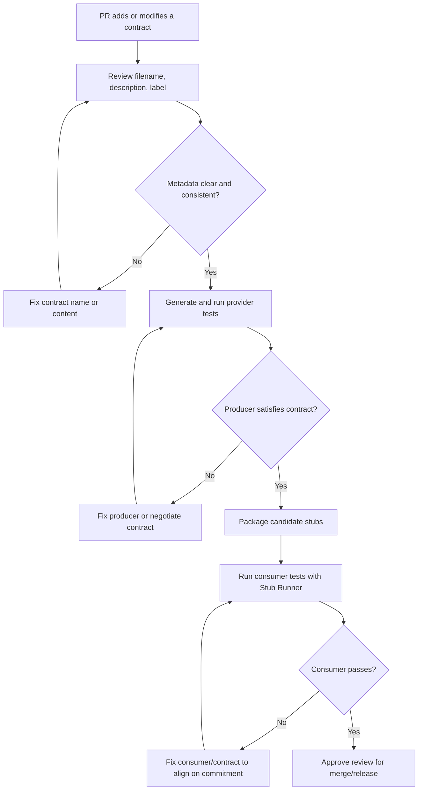

# Contract Naming, Descriptions, and Labels in Spring Cloud Contract

When the number of contracts grows from a few files to hundreds, the challenge is no longer just writing valid Groovy/YAML DSL. The development team must also **locate the contract that needs editing, understand the committed behavior, identify each scenario when running tests/stubs, and know which changes impact consumers**. Cryptic filenames, vague descriptions, or duplicate message labels can make reviews and troubleshooting time-consuming, even when the contracts are syntactically valid.

In **Spring Cloud Contract (SCC)**, the producer defines HTTP or messaging behavior using the Groovy/YAML DSL; the tool can generate tests for the producer and produce stubs for consumers to test against via Stub Runner. This lesson in the **Contract Organization** chapter focuses on three metadata elements used for that management: **contract name**, **description** (`description`), and **identifying label** (`label`). The running example is the `order-producer` service, which exposes an API for reading orders and publishes an order-created event.

## 1. Distinguishing Names, Descriptions, and Labels

These three concepts are related, but they do not serve the same purpose:

| Component | Where It Is Attached | Who or What Uses It | Primary Function |
| --- | --- | --- | --- |
| Contract filename and path | For example `contracts/http/get-order-by-id-ok.groovy` | Developers, reviewers, build, test/stub generator | Organizes and locates scenarios in the repository |
| `description` | Field inside a Groovy/YAML contract | Contract readers, reviewers, viewers of test output depending on configuration | Explains **why** and **when** the behavior is committed |
| `label` | Field inside a contract, especially useful for messaging | Consumer tests using Stub Runner to trigger a message | Identifies a **message scenario** by a logical name |
| `request.method`, `request.url` | HTTP contract content | Contract Verifier and HTTP stub | Specifies the actual HTTP call being verified |
| `outputMessage.sentTo` | Messaging contract content | Message verifier, message transport/test adapter | Specifies the destination to which the producer emits the message |
| Maven coordinates of `-stubs.jar` | Artifact configuration during build and Stub Runner execution | CI, consumer, artifact repository | Identifies the **stub bundle** and version being used |

A file named `get-order-by-id-ok.groovy` may contain a long description to clarify the scenario. A messaging contract named `order-created-v1.groovy` may use `label 'order_created_v1'`, while the message is still sent to `orders.created`. These three values **do not automatically substitute for one another**.

In particular, **`description` is not an assertion condition**: tests verify the constraints in `request`, `response`, `input`, and `outputMessage`. If the description says "returns 404" while the actual configuration is `status: 200`, the contract is contradictory and needs fixing, even though the build may still run.

## 2. Principles for Naming Contract Files

### 2.1. Name by Observable Behavior

A useful name should answer most of the following questions: **which communication channel, what operation, which resource/entity, which scenario, and what outcome**.

Suggested convention:

- HTTP: `<method>-<resource>-<scenario>-<expected-result>.<groovy|yml>`.
- Messaging: `<event-or-command>-<scenario-or-version>.<groovy|yml>`.
- Use lowercase letters and hyphens `-` for filenames; if the team already has another convention, keep it consistent within the same module.
- Name stably based on **behavioral semantics**, avoiding random data values in the name.

Examples:

| Suggested Name | Identified Behavior | Assessment |
| --- | --- | --- |
| `get-order-by-id-ok.groovy` | GET an existing order, success response | Clear |
| `get-order-by-id-not-found.yml` | GET a non-existent order, 404 response | Clear error case |
| `post-order-invalid-body.yml` | POST to create an order with an invalid payload | Clear input condition |
| `order-created-v1.groovy` | Order created event, schema v1 | Easy to distinguish from v2 |
| `test1.groovy` | Unclear business purpose or scenario | Not recommended |
| `get.groovy` | Unclear resource or outcome | Not recommended |
| `happy-path-final-v3-new.yml` | Name reflects edit history, lacks semantics | Not recommended |

`ok` or `success` can be used for successful outcomes; for errors, prefer `not-found`, `unauthorized`, or `validation-error` rather than just `error-1`. There is no need to cram every attribute into the name: request values, data types, matchers, and detailed preconditions belong in the **contract body**.

Avoid putting real order numbers, emails, access tokens, customer names, or sensitive data in filenames. Use sample IDs like `1001` in the test body when appropriate, while keeping the filename focused on behavior: `get-order-by-id-ok` instead of `get-order-1001`.

### 2.2. Organizing by Directory Path

Example layout for a producer:

```text
order-producer/
└── src/
    └── test/
        └── resources/
            └── contracts/
                ├── http/
                │   ├── get-order-by-id-ok.groovy
                │   ├── get-order-by-id-not-found.yml
                │   └── post-order-invalid-body.yml
                └── messaging/
                    ├── order-created-v1.groovy
                    └── order-cancelled-v1.groovy
```

`src/test/resources/contracts` is the typical location in a Maven producer project using Spring Cloud Contract; the build can be configured to use a different location. The `http` and `messaging` directories here are a **team organizational convention**, not two mandatory folder types required by the DSL.

When multiple consumers depend on the same producer, the team may choose to group by consumer or by business capability depending on the contract storage strategy. What matters is documenting the path convention so two teams do not unknowingly create two different files for the same commitment.

**Each observable scenario should have one clear contract.** For example, a `200` response and a `404` response are two distinct scenarios. Although the DSL allows multiple ways to express contracts, separating them this way helps with reviews, identifying failing tests, and tracking API evolution.

### 2.3. Naming Independently of Implementation Details

A consumer cares that `GET /api/orders/{id}` returns order details, not whether the controller calls `findByPk()`, the service uses Redis, or the database uses table `ORD_MST`.

Avoid:

```text
order-controller-findByPk-test.groovy
redis-cache-hit-response.yml
methodA-success.groovy
```

Prefer:

```text
get-order-by-id-ok.groovy
get-order-by-id-not-found.yml
```

That way, when the producer refactors internal code while preserving public behavior, contract names and contents do not need unnecessary changes.

## 3. Writing `description` So Readers Understand the Behavior Accurately

### 3.1. What Makes a Good Description?

A description should be concise while containing **context, condition, and observable outcome**. A practical template:

> When [condition or request], the producer must [specific behavior] so that the consumer can [intended purpose].

Good examples:

- "When the order exists, GET by ID returns 200 and JSON containing the order ID and status."
- "When the order is not found, GET by ID returns 404."
- "After an order is successfully created, the producer publishes the `order_created_v1` event containing `orderId` and `status`."

Examples to avoid:

- "Test GET."
- "Check response."
- "API works."
- "Fix bug ORDER-123." — an issue key can be added as a reference link, but it is not enough to explain the contract.

Comparison table:

| Vague Description | Reviewable Description |
| --- | --- |
| "Get order" | "When the ID is valid and exists, GET order returns HTTP 200 along with that order's JSON data" |
| "Not found" | "When the order ID does not exist, GET by ID returns HTTP 404" |
| "Send message" | "When order creation succeeds, the producer publishes an OrderCreated v1 message to the committed destination" |
| "Validation" | "When an order creation request is missing required fields, POST returns HTTP 400 and a validation error code" |

The description does not need to copy every line of JSON; exact constraints belong in the DSL section below. However, the description must match the DSL. If the prose mentions `404` while `response.status` is `200`, the contract's explanation is wrong even before running tests.

### 3.2. Vietnamese and Readability

`description` can be written in Vietnamese UTF-8 to match the learning context or the team's documentation language; filenames and machine labels can stay in ASCII English for ease of use with builds and scripts. For example:

```groovy
description 'Khi đơn hàng tồn tại, GET theo ID trả HTTP 200 và trạng thái hiện tại'
```

If the build/tooling environment has encoding constraints, standardize on UTF-8 across the repository and CI. There is no need to strip Vietnamese diacritics from human-readable descriptions.

### 3.3. Describing Business Behavior Rather Than Retelling Code Details

A description like "calls `OrderServiceImpl.findOrder()` then maps to DTO" easily becomes outdated after refactoring. Replace it with behavior from the consumer's perspective: "GET by ID returns the published order details".

Important business conditions such as "only orders belonging to an authorized account return 200" can be noted, provided that the contract, test setup, or related security tests actually prove that condition; do not let the description become an unverified promise.

## 4. HTTP Example: Filename and Description in Groovy DSL

Suppose we create the file:

```text
src/test/resources/contracts/http/get-order-by-id-ok.groovy
```

Contents:

```groovy
import org.springframework.cloud.contract.spec.Contract

Contract.make {
    description 'When order 1001 exists, GET by ID returns 200 and status CREATED'

    request {
        method GET()
        url '/api/orders/1001'
    }

    response {
        status OK()
        headers {
            contentType(applicationJson())
        }
        body(
            id: 1001,
            status: 'CREATED'
        )
    }
}
```

Here:

1. **Filename** `get-order-by-id-ok` identifies the scenario to look up in the repository.
2. **`description`** states the condition and behavior for human readers.
3. **`request`** and **`response`** are the actual data used to generate producer verification tests and HTTP stubs for consumers.
4. No `label` is needed for a consumer to call an HTTP stub: the client sends a request matching the mapping via the declared method, URL, and request conditions.

If a developer renames a file for readability without changing `request`/`response`, the communication semantics do not necessarily change. However, generated test names, artifact paths, or paths tracked by team tools may differ; review renames as intentional organizational changes.

### Example of the Same Scenario in YAML DSL

In a team that chooses YAML, the file `get-order-by-id-ok.yml` can express the equivalent contract:

```yaml
description: "When order 1001 exists, GET by ID returns 200 and status CREATED"
request:
  method: GET
  url: /api/orders/1001
response:
  status: 200
  headers:
    Content-Type: application/json
  body:
    id: 1001
    status: CREATED
```

**Choose either Groovy or YAML for a single scenario** in practice. Placing both equivalent versions under the discovery directory at the same time can produce two duplicate contracts, causing redundant tests/stubs and making maintenance error-prone when one version is updated and the other is forgotten.

### Creating an Error Scenario with a Dedicated Name

To guard the not-found case:

```yaml
# get-order-by-id-not-found.yml
description: "When no order with ID 9999 exists, GET by ID returns HTTP 404"
request:
  method: GET
  url: /api/orders/9999
response:
  status: 404
```

When the `404` test fails, the path `get-order-by-id-not-found.yml` helps developers quickly spot that the **error scenario** changed, instead of guessing what "test2" represents.

In real-world APIs, dynamic IDs, timestamps, and other variable fields should use appropriate **matchers**; filenames should not be tied to a single hardcoded test value. What matters is that the contract protects the rule the consumer relies on.

## 5. The `label` Field in Messaging Contracts

### 5.1. What Problem Does `label` Solve?

With HTTP, the consumer sends a request to the HTTP stub server and compares the response. With messaging, a producer may emit an event triggered by an internal action; consumer tests need a mechanism to ask Stub Runner to emit a sample message. In that case, **`label` serves as the logical identifier to trigger the message stub**.

Example file `messaging/order-created-v1.groovy`:

```groovy
import org.springframework.cloud.contract.spec.Contract

Contract.make {
    description 'When order creation succeeds, the producer publishes an OrderCreated v1 event'
    label 'order_created_v1'

    input {
        triggeredBy('publishOrderCreated()')
    }

    outputMessage {
        sentTo('orders.created')
        headers {
            messagingContentType(applicationJson())
        }
        body(
            orderId: 1001,
            status: 'CREATED',
            schemaVersion: 1
        )
    }
}
```

Meaning of each part:

| Declaration | Example Value | Role |
| --- | --- | --- |
| Filename | `order-created-v1.groovy` | Locates the contract by business event and schema version |
| `description` | "When order creation..." | Explains the scenario |
| `label` | `order_created_v1` | Allows consumer tests to ask Stub Runner to emit the corresponding message |
| `input.triggeredBy` | `publishOrderCreated()` | Provider verification test invokes this hook to trigger the producer to emit the event |
| `outputMessage.sentTo` | `orders.created` | Logical destination of the output message |
| `outputMessage.body` | `orderId`, `status`, `schemaVersion` | Payload required by the contract |

The `publishOrderCreated()` method must be provided by the producer's base/test setup class and must trigger the proper event-publishing path. This is a test hook, **not a label name** or a consumer listener name.

### 5.2. How Does a Consumer Test Invoke a Label?

When the consumer project has configured Spring Cloud Contract Stub Runner and a compatible message transport, tests can use `StubTrigger`:

```java
@Autowired
private StubTrigger stubTrigger;

@Test
void receivesOrderCreatedV1() {
    stubTrigger.trigger("order_created_v1");

    // Wait with a timeout, then verify that the listener processed orderId = 1001.
    // The actual assertion depends on the queue/test binder and how processing state is stored.
}
```

This is an excerpt illustrating the trigger call; to make it a complete test, Stub Runner, the message adapter/binder, and an assertion observing the consumer's handling outcome must be configured. Calling `trigger("order_created_v1")` **does not automatically prove** that the listener receives and processes the message properly.

The name `order_created_v1` is an **identifier used in tests**. It does not automatically create a topic named `order_created_v1`, nor does it replace `sentTo('orders.created')`. If the label is changed while forgetting to update the consumer test, the trigger call using the old label may fail to find the expected scenario, even though the destination has not changed at all.

### 5.3. Label Naming Conventions

A practical convention is `<domain>_<event>[_version][_scenario]`, for example:

```text
order_created_v1
order_cancelled_v1
payment_authorized_v1
order_created_v2
```

Teams can choose `snake_case` or `kebab-case`; what matters is **consistency, ease of typing, stability, and collision avoidance**. When the same stub bundle contains multiple message contracts, use distinct labels for scenarios that need to be triggered independently. Duplicate labels can lead to ambiguity over which scenario is triggered, depending on how Stub Runner and the message stubs configuration resolve labels.

Only include a version in the label when distinguishing schema or behavior by version is genuinely meaningful. For instance, `order_created_v1` and `order_created_v2` can coexist during a consumer migration period. A change to the description, file formatting, or comments does not require changing the label.

Do not use per-build timestamps, random ticket numbers, or developer names as labels; that causes churn in consumer tests and fails to convey event semantics.

## 6. Common Confusions Between Label, Destination, and Version

Consider these three identifiers:

```text
Contract file : messaging/order-created-v1.groovy
Label         : order_created_v1
Destination   : orders.created
```

They are related, but operate in different scopes:

- **Filename** belongs to contract source organization.
- **Label** belongs to the message stub identification mechanism in tests.
- **Destination** belongs to the messaging communication behavior committed by the producer, such as a logical topic/channel configured by the binder.

`label` is also not synonymous with the `artifactId` or version of `-stubs.jar`. A consumer can configure Stub Runner to select stub bundle version `2.4.0`, and then use `label` to trigger a message within that stub bundle:

```java
@AutoConfigureStubRunner(
    ids = "com.example:order-producer:2.4.0:stubs:8085",
    stubsMode = StubRunnerProperties.StubsMode.LOCAL
)
```

The string `com.example:order-producer:2.4.0:stubs:8085` specifies the Maven coordinates and the port serving HTTP stubs per configuration; `order_created_v1` remains the event identifier used for triggering. You cannot use `label` alone to specify which producer version is being stubbed.

**Note on versioning:** `v1` in the event/label name describes the contract or schema version by business convention; `2.4.0` in the stubs artifact is the producer's release version. These two version lifecycles can differ. A producer at `2.4.0` may still emit both v1 and v2 event schemas during a transition period.

## 7. Designing Conventions for Multi-Producer and Multi-Consumer Teams

If a team starts from a small project, writing contracts directly in the producer may suffice. As scale grows, agree on conventions early to reduce renames and scope confusion.

### 7.1. Minimum Rule Set

| Rule | Applied Example | Rationale |
| --- | --- | --- |
| Filename describes behavior | `get-order-by-id-not-found.yml` | Quickly locate failing scenarios |
| One scenario, one distinct name | `get-order-by-id-ok`, `get-order-by-id-not-found` | Avoid vague or duplicate files |
| Description states condition and outcome | "When ID does not exist, GET returns 404" | Reviewers understand the commitment |
| Stable message labels | `order_created_v1` | Consumer tests trigger the right scenario |
| Labels distinct from destinations | `order_created_v1` vs `orders.created` | Avoid confusing test triggers with routing |
| Add version only when justified | `order-created-v2.groovy` for a new schema | Avoid pointless renames |
| No sensitive data | `get-order-by-id-ok`, not real emails | Safe and reusable |
| One convention per repository | All filenames use `kebab-case` | Easy to automate and review |

### 7.2. Contracts Serving Multiple Consumers

If multiple consumers call `GET /api/orders/{id}`, there is no need to create multiple identical contracts just to add each consumer's name. First identify **which behavioral commitment is shared**, then keep a single source of truth if your sharing workflow allows it.

When one consumer has a different requirement—for example, a reporting API receiving an extra projection or a specialized header—describe that condition as a separate scenario. The name can hint at the condition, but **should not encode the owning team's name as an immutable technical detail**, unless the contract itself is consumer-specific under your chosen organizational strategy.

Example:

```text
get-order-by-id-ok.groovy
get-order-by-id-with-summary-projection.groovy
get-order-by-id-unauthorized.yml
```

Contracts can be stored together or separated by consumer in a dedicated contract repository. If there are multiple producer modules, make the root/path clear enough to prevent identical filenames from colliding within the same stub generation scope.

### 7.3. Managing Changes to Names and Descriptions

Not every metadata edit is a breaking change:

| Change | Typical Impact | What to Verify |
| --- | --- | --- |
| Fix typo in `description` | Human readers / test reports | DSL still reflects the same behavior |
| Rename file `get-order-ok` to `get-order-by-id-ok` | Path, generated test name/group depending on build | Discovery still picks up the contract, tests/stubs still generate |
| Rename label `order_created_v1` to `order_created` | Consumer tests calling `StubTrigger` | Update consumer tests and label documentation |
| Change `sentTo('orders.created')` to `sentTo('orders.v2')` | Message routing | Consumer subscriptions, broker binding, verification |
| Rename `response.body.status` to `state` | HTTP API contract | Provider verification and consumer parsing |
| Change stubs JAR version | Contract bundle used by consumer tests | Whether consumer tests pin the right candidate version |

Good names and descriptions **cannot compensate for a contract missing assertion constraints**. Dynamic values should use matchers, error cases need corresponding contracts, and asynchronous behavior needs testing with the proper adapter/message transport.

## 8. Review Workflow and CI Checks

Spring Cloud Contract generates tests and stubs from contract contents, whereas editorial rules like "descriptions must be understandable" or "filenames must use kebab-case" are usually **team conventions** that require review or custom CI checks. You should not assume Contract Verifier automatically enforces every organizational naming rule.

A pull request adding or modifying a contract should pass these questions:

1. **Proper scope:** Is the file placed under the contracts root scanned by the build and in the right HTTP/messaging group?
2. **Name reflects scenario:** Reading the filename, can you distinguish success, not-found, validation-error, or event type?
3. **Description matches DSL:** Do the described condition, HTTP code/destination, and data match the request/response/message sections?
4. **Correct message label:** If consumer tests trigger the message by label, is the label stable and distinct from other labels in the stub bundle?
5. **No duplicate contracts:** Is another file already guarding the same behavior?
6. **Verified on both sides:** Does producer verification pass, and do consumer tests pass against candidate stubs if the change affects compatibility?

Verification flow diagram:



Example pseudocode for **additional convention checks**, not built-in SCC commands:

```text
for each contract in changed_contract_files:
    require_filename_matches_team_convention(contract.path)
    require_description_is_present(contract)
    require_description_matches_expected_behavior_during_review(contract)

for each message_contract in candidate_stub_set:
    require_label_is_present_when_stub_trigger_needs_it(message_contract)
    require_label_is_unambiguous_within_intended_stub_scope(message_contract)

run_provider_contract_verification()
package_candidate_stubs()
run_consumer_contract_tests_against_candidate_stubs()
```

In a Maven project configured with `spring-cloud-contract-maven-plugin` and appropriate test dependencies, producer verification is typically run with:

```bash
mvn clean verify
```

This step does not automatically check the prose quality of `description`. For messaging, producer tests also need the `triggeredBy` hook and a suitable message verifier/test binder; consumer tests need Stub Runner and an appropriate transport to receive message stubs.

Check the actual generated test logs: a green build with no generated or executed contract tests does not prove the contract has been verified.

## 9. Common Pitfalls and How to Fix Them

**Filenames like `contract-01`, `contract-02`...**

When a test fails, readers cannot tell which scenario is affected. Rename by channel, behavior, condition, and outcome. If this is a rename in a repository already integrated with CI, re-check the discovery path, test output, and review workflow.

**Description only repeats the endpoint name.**

"GET /orders" does not explain when it succeeds or fails. Add the condition and observable outcome: "When the order exists, GET by ID returns 200 along with the order status".

**Description and response contradict each other.**

The description says 404 while `response.status` says 200. During review, treat the DSL as the machine-verified specification; update both the description and DSL so they express the agreed-upon commitment together.

**Using label as a substitute for destination.**

`label 'order_created_v1'` does not mean the message is sent to topic `order_created_v1`. The destination belongs in `outputMessage.sentTo`, while the label identifies the stub trigger.

**Two message contracts sharing the same label when they need independent triggering.**

Use distinct labels by event type, version, or business scenario to avoid ambiguity in consumer tests. Also ensure the team agrees on uniqueness scope when publishing multiple stubs.

**Changing a label as a "harmless" refactor.**

Consumer tests calling `StubTrigger.trigger("order_created_v1")` may depend directly on this string. Before renaming, locate and update affected tests, and pin the right artifact under test.

**Adding a version to every name whenever the Maven artifact number increments.**

Incrementing the producer artifact to `2.4.0` does not mean the message schema must switch from `v1` to `v2`. Only introduce a new contract version when there is a semantic/schema change that needs separation.

**Clean names, but contract content is too rigid or too loose.**

If a response contains a dynamically generated UUID, do not hardcode a single UUID across every test when only the format matters. Conversely, do not drop constraints that consumers genuinely rely on just to make tests pass. Both identification quality and contract quality matter.

## 10. Hands-On Exercise with Completion Criteria

Suppose an `order-producer` project needs to commit to three behaviors:

- GET `/api/orders/1001` when the order is found: `200` response with `id` and `status`.
- GET `/api/orders/9999` when not found: `404` response.
- After creating an order: emit `OrderCreated` schema v1 to `orders.created`.

Perform the following steps in order:

1. Name the three files following a convention that distinguishes `ok`, `not-found`, and event v1; organize them under `contracts/http` and `contracts/messaging`.
2. Write `description` using the "When..., ..." pattern for each contract, stating the condition and outcome.
3. Write the two HTTP contracts in Groovy or YAML DSL; verify that the description aligns with `method`, `url`, `status`, and `body`.
4. Write the event contract with `label 'order_created_v1'`, `triggeredBy('publishOrderCreated()')`, `sentTo('orders.created')`, and a body containing `orderId` and `status`.
5. Configure the producer verification test and consumer Stub Runner in the practice project. The HTTP consumer calls the stub by method/URL; the messaging consumer uses the exact label to trigger and asserts that the listener processed the payload.
6. Try changing only the description and check whether the contract retains the same behavior. Try changing only the label and see which consumer test locations need updating. Finally, try changing the response body `status` to `state` to observe the difference between metadata edits and breaking communication commitment changes.
7. Add a review rule or CI check to reject files named `test1.groovy`, empty descriptions, or duplicate labels among message contracts that require independent triggering.

Self-assessment checklist:

| Criterion | Evidence of Completion |
| --- | --- |
| Meaningful contract names | Filenames clearly distinguish all three scenarios at a glance |
| Clear and accurate descriptions | Each description states a condition and outcome matching the DSL |
| Understands message labels | Can explain why `label` differs from `sentTo` |
| Knows rename impact | Can pinpoint what needs updating when renaming a file or label |
| Producer verified | Generated tests actually execute and verify behavior |
| Consumer uses stubs properly | Stub Runner uses the right artifact/label and includes assertions |
| CI supports team conventions | A step exists to check metadata consistency and build health |

A maintainable Spring Cloud Contract setup requires **filenames that accurately describe the scenario, descriptions that clearly state the commitment, and stable labels for message stubs that need triggering**. These are complementary identification layers on top of the request/response or input/outputMessage DSL, enabling both producers and consumers to read, test, publish stubs, and handle API changes in a controlled manner.
