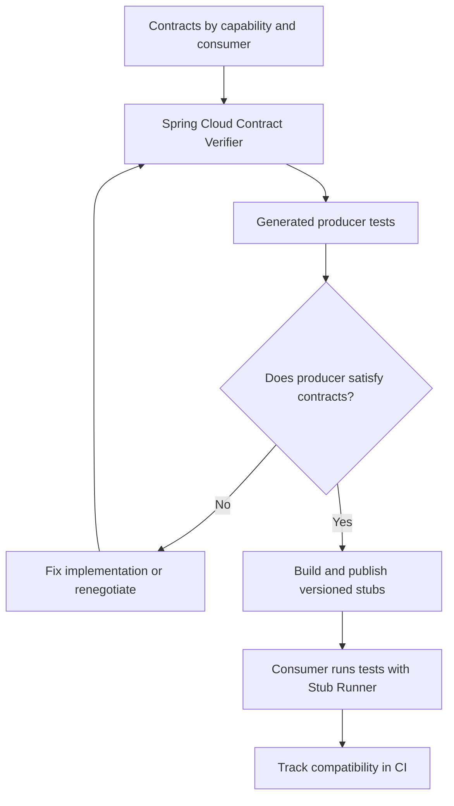

# Grouping Contracts by Consumer and Business Capability

In a microservices architecture, one **producer** typically serves multiple **consumers**, and each consumer depends on only part of the producer's behavior. As the number of Spring Cloud Contract files grows, placing every Groovy/YAML file into a flat directory makes it difficult for the development team to answer: *who uses this behavior, which business function does it belong to, which consumers will be affected by an API change, and which tests need to run?*

This lesson is part of the **Contract Organization** chapter of **Spring Cloud Contract**. We will organize HTTP and messaging verification contracts by **consumer** and **business capability**, helping producers accurately generate tests, publish stubs, support consumers running Stub Runner, and detect incompatible API changes in CI. The focus is not on making folder names look neat, but on building **a traceability system for commitments** across teams.

After this lesson, you will be able to:

- Distinguish the two classification axes: consuming client and provided business capability.
- Design a scalable contract directory tree for a producer with multiple consumers.
- Name files, scenarios, ownership, and dependencies according to a consistent convention.
- Handle shared contracts, consumer-specific contracts, and potentially conflicting requirements.
- Understand how organization affects generated tests, stubs, Stub Runner, and CI.
- Plan the reorganization of legacy contracts while preserving committed behaviors.

## 1. Why Does a Producer Need to Group Contracts?

Suppose an e-commerce system has a producer `InventoryService` and three consumers:

1. `OrderService` needs to **reserve inventory** before confirming an order.
2. `StorefrontService` needs to **display stock availability** to shoppers.
3. `PlanningService` needs to **receive inventory change events** to forecast replenishment.

All three consumers relate to inventory, yet depend on **three distinct business capabilities**:

| Consumer | Capability Used | Expected Communication | Key Expectations |
| --- | --- | --- | --- |
| `OrderService` | Stock reservation (`reservation`) | HTTP `POST /api/v1/reservations` | Clear reservation ID and hold result; recognize out-of-stock |
| `StorefrontService` | Availability lookup (`availability`) | HTTP `GET /api/v1/availability/{sku}` | Know whether an item is sellable; handle non-existent SKUs |
| `PlanningService` | Stock changes (`stock events`) | Message `stock.adjusted` | Receive the correct event type, SKU, and delta quantity |

*The endpoints, topics, and error codes in this lesson are design examples; real applications must agree on them between producer and consumer.*

If you group only by consumer, the owner of the `availability` capability may have to search multiple folders to see all committed behaviors. If you group only by capability, the development team will struggle to tell which consumer requested a specific error branch or data format. Both axes need to be represented simultaneously.

### The Consumer Axis: Who Depends on the Behavior?

Classifying by consumer helps answer:

- Who will be impacted if a status code, response field, or message format changes?
- Which team needs to sign off when a contract is modified or removed?
- Which older consumer version is still relying on a committed rule?
- Which stubs must a consumer use to test both success and error paths?

The consumer is the **user of the contract**, not necessarily the owner of the repository containing the contract. Even when contracts live alongside producer code, the consumer's business requirements remain the source defining what behavior needs protection.

### The Business Capability Axis: Where Does the Behavior Belong?

A business capability is a cohesive group of behaviors serving a stable purpose, such as `reservations`, `availability`, `payments`, `shipping`, or `notifications`. Grouping by capability helps:

- Find contracts describing the same business rule.
- View success, invalid input, and business error branches of the same feature.
- Assign the team responsible for implementing the capability on the producer side.
- Assess the impact of splitting, merging, or replacing a capability in the architecture.

Name folders using **business language** rather than technical class names. For example, `reservations` expresses the function better than `ReservationController`; the producer's internal class structure can change while the commitment to consumers stays intact.

## 2. Choosing a Two-Dimensional Directory Structure

A readable convention is **business capability first, consumer second**. Example for a Maven-based `InventoryService` project:

```text
inventory-service/
└── src/
    └── test/
        └── resources/
            └── contracts/
                ├── reservations/
                │   └── order-service/
                │       ├── create-reservation-success.groovy
                │       ├── create-reservation-insufficient-stock.groovy
                │       └── cancel-reservation-success.groovy
                ├── availability/
                │   ├── storefront-service/
                │   │   ├── get-availability-success.yml
                │   │   └── get-availability-not-found.yml
                │   └── order-service/
                │       └── get-availability-for-checkout.groovy
                └── stock-events/
                    └── planning-service/
                        └── stock-adjusted.groovy
```

`src/test/resources/contracts` is the common default location for Spring Cloud Contract Verifier in Maven projects. The subdirectories here are **team-designed conventions**, not special folder types predefined by the framework. If a project configures its contract source at another location, apply the same principle inside that configured source root.

Reading a path from left to right:

```text
contracts / reservations / order-service / create-reservation-success.groovy
              ^               ^                     ^
          Capability       Consumer       Verification scenario
```

We immediately see that the contract belongs to the reservation feature, serves `OrderService`, and describes the success path when creating a reservation.

In an organization where ownership is managed primarily by consumer, the inverted structure is also reasonable:

```text
contracts/
  order-service/
    reservations/
      create-reservation-success.groovy
    availability/
      get-availability-for-checkout.groovy
  storefront-service/
    availability/
      get-availability-success.yml
```

**How to choose:** put first the axis used most often for reviews and change management. If the producer organizes teams around business capabilities, prefer `capability/consumer`. If contract review and intake workflows are organized around consumer teams, consider `consumer/capability`. More important than the ordering is **consistency, traceability, and clear rules for shared behaviors**.

### Do Not Infer an Automatic Guarantee from File Location

Spring Cloud Contract can read contracts inside subdirectories of the configured source and generate tests for matching contracts. However, placing a file under `order-service/` **does not automatically mean** only `OrderService` receives that stub; nor does it mean every build environment runs only that consumer's tests.

A default build typically processes all contracts found in the configured source. If separate stubs per consumer are needed, you must research and configure the appropriate stub-distribution mechanism for your Spring Cloud Contract version, and then **verify the actual artifact contents**. Folder names are only part of an organizational convention, not a substitute for build and distribution configuration.

## 3. Naming Contracts to Reflect Behavior

Filenames should express **the action or event + the meaningful case for the consumer**. They should be specific enough to show what is being verified at a glance, without depending on Java method names.

| Confusing Name | Suggested Name | Reason |
| --- | --- | --- |
| `test1.groovy` | `create-reservation-success.groovy` | States both behavior and outcome |
| `api-error.groovy` | `create-reservation-insufficient-stock.groovy` | Distinguishes a specific business error |
| `getData.yml` | `get-availability-not-found.yml` | Ties to capability and error branch |
| `KafkaTest.groovy` | `stock-adjusted.groovy` | Avoids tying the name to transport technology |
| `new-contract.groovy` | `cancel-reservation-success.groovy` | Useful when reading change history |

In addition to the filename, use the `name` field in the DSL to give the scenario a clear identifier and avoid unintended collisions:

```groovy
Contract.make {
    name 'order_create_reservation_success'
    // request and response are defined below
}
```

Once a naming convention is agreed upon in the repository, keep the filename, `name`, and scenario description consistent. A practical convention:

```text
<consumer>_<action-or-event>_<expected-result>
```

Examples: `order_create_reservation_insufficient_stock`, `storefront_get_availability_success`, `planning_stock_adjusted_event`.

There is no need to put an API version number in every filename while most contracts apply uniformly. Only include the version in the path or name when **two behaviors genuinely coexist** and must be distinguished, such as `v1` and `v2` supported concurrently.

## 4. Groovy DSL Example: Contracts for OrderService

For `reservations/order-service/create-reservation-success.groovy`, both teams agree that a successful request to reserve two units must return `201` with a reservation identifier.

```groovy
import org.springframework.cloud.contract.spec.Contract

Contract.make {
    name 'order_create_reservation_success'
    description 'OrderService creates a stock reservation to proceed with checkout'

    request {
        method 'POST'
        url '/api/v1/reservations'
        headers {
            contentType(applicationJson())
        }
        body([
            sku     : 'SKU-100',
            quantity: 2
        ])
    }

    response {
        status 201
        headers {
            contentType(applicationJson())
        }
        body([
            reservationId: 'RES-100',
            status       : 'HELD'
        ])
    }
}
```

The next contract at `reservations/order-service/create-reservation-insufficient-stock.groovy` describes the business error branch:

```groovy
import org.springframework.cloud.contract.spec.Contract

Contract.make {
    name 'order_create_reservation_insufficient_stock'

    request {
        method 'POST'
        url '/api/v1/reservations'
        headers {
            contentType(applicationJson())
        }
        body([
            sku     : 'SKU-EMPTY',
            quantity: 2
        ])
    }

    response {
        status 409
        headers {
            contentType(applicationJson())
        }
        body([
            code: 'INSUFFICIENT_STOCK'
        ])
    }
}
```

Thus both contracts belong to the `reservations` capability and both serve `OrderService`, yet verify **two different scenarios**. This lets reviewers see whether the consumer has enough information to handle both success and insufficient stock.

For producer tests to run reliably, test data must be prepared so `SKU-100` has sufficient stock and `SKU-EMPTY` does not. If `reservationId` is randomly generated in the real implementation, use an appropriate matcher or deterministic fixture; putting a fixed ID in an example does not mean the production API always returns `RES-100`.

## 5. YAML DSL Example: Contract for StorefrontService

For the `availability` capability, `StorefrontService` needs to know whether an item is available to display. The file `availability/storefront-service/get-availability-success.yml` can be written in YAML DSL:

```yaml
name: storefront_get_availability_success
description: StorefrontService displays SKU sellable availability
request:
  method: GET
  url: /api/v1/availability/SKU-100
response:
  status: 200
  headers:
    Content-Type: application/json
  body:
    sku: SKU-100
    available: true
```

In this example, the consumer does not need `reservationId` or status `HELD`, because it is performing a different task. Do not copy fields from `reservations` into `availability` merely because both features operate on inventory data.

If the same endpoint is also called by `OrderService` during checkout, ask **whether the two consumers share the exact same semantic commitment**:

- If they send the same request and depend on a completely equivalent set of behaviors, you can maintain one shared contract with the consumer list clearly recorded.
- If `OrderService` needs an extra status or header that `StorefrontService` does not use, add a separate contract or adjust the API design to express the difference accurately.
- If two consumers require **conflicting** results for the same request under identical conditions, never resolve it by keeping two stubs with different responses and hoping the right one gets picked.

### Where Can a Shared Contract Live?

For example, when both consumers agree on the exact behavior of `GET /api/v1/availability/SKU-100`, you can use:

```text
contracts/
  availability/
    shared/
      get-availability-success.yml
```

The name `shared` is a **team-defined convention**, not a special DSL feature. The team should record the relationship: this contract is used by both `StorefrontService` and `OrderService`. That relationship can be captured in the contract description, review conventions, or a team dependency tracking table.

Do not create identical copies under two consumer folders: after a few edits, the two copies easily drift apart, leaving one consumer protected while the other still relies on outdated expectations. Conversely, do not merge contracts that merely *look similar* when they have real differences in semantics and business conditions.

## 6. Organizing Contracts for Messaging Communication

Classifying by consumer and business capability remains useful for message-based communication. For example, `PlanningService` listens to inventory change events emitted by `InventoryService`, so the contract can live at:

```text
contracts/stock-events/planning-service/stock-adjusted.groovy
```

An example describing the message in Groovy DSL:

```groovy
import org.springframework.cloud.contract.spec.Contract

Contract.make {
    name 'planning_stock_adjusted_event'

    input {
        triggeredBy('emitStockAdjusted()')
    }

    outputMessage {
        sentTo('stock.adjusted')
        headers {
            header('contentType', 'application/json')
        }
        body([
            sku     : 'SKU-100',
            delta   : -2,
            reason  : 'RESERVATION'
        ])
    }
}
```

This example assumes the producer can trigger event emission via the test method `emitStockAdjusted()` and the test environment has configured the corresponding message-capturing mechanism. This is a **contract modeling example**, not a standalone runnable test suite without configuring Spring Cloud Contract message verification and a test base class.

Placing the contract under `stock-events/planning-service` shows who depends on the payload; it **does not determine** the broker, physical topic, or routing key in a real environment. Those settings must be configured and verified according to the messaging system in use.

A change such as turning `delta` from an integer into a string can cause the consumer to misread messages. Grouping contracts under the `stock-events` capability helps the producer see affected consumers when considering schema changes. However, a contract test for a single message does not prove event ordering, delivery durability, or idempotency; other appropriate tests are required for those.

## 7. Building a Consumer × Capability × Scenario Matrix

The directory tree makes files easy to find; a **contract matrix** helps uncover testing gaps.

| Capability | Consumer | Scenario to Commit | Example Contract | Approver |
| --- | --- | --- | --- | --- |
| Reservations | `OrderService` | Create reservation succeeds | `create-reservation-success.groovy` | Ordering flow owner |
| Reservations | `OrderService` | Insufficient stock | `create-reservation-insufficient-stock.groovy` | Ordering flow owner |
| Reservations | `OrderService` | Cancel reservation | `cancel-reservation-success.groovy` | Ordering flow owner |
| Availability | `StorefrontService` | Query in-stock SKU | `get-availability-success.yml` | Product page owner |
| Availability | `StorefrontService` | SKU does not exist | `get-availability-not-found.yml` | Product page owner |
| Availability | `OrderService` | Query availability before checkout | `get-availability-for-checkout.groovy` | Ordering flow owner |
| Stock events | `PlanningService` | Emit stock adjustment event | `stock-adjusted.groovy` | Forecasting flow owner |

The files in the table are an **illustrative organizational example set**; the lesson only shows full code for selected scenarios. In real implementations, add all scenarios confirmed by the team rather than assuming this matrix is a complete specification.

The matrix helps the team answer three questions before accepting an API change:

1. **Scope:** which capability does the change fall under and which consumers might it impact?
2. **Coverage:** do the relevant success and failure scenarios already have contracts?
3. **Reviewers:** who has enough context to approve the contract change and consumer upgrade plan?

A team can manage the matrix in its review process or work-tracking tool. It does not have to be a separate file in the repository, but the link between consumers and contracts must be traceable somewhere, especially for the `shared` folder.

## 8. Boundaries Between Contracts, Generated Tests, and Stubs

Spring Cloud Contract Verifier can read Groovy/YAML contracts from the configured source and **generate producer-side tests** to verify the application code. In the build pipeline, those contracts are also the input for producing **stubs** that consumers use with Stub Runner.



Key distinctions:

| Concept | How Grouping Helps | Limitation to Remember |
| --- | --- | --- |
| Contract files | Helps humans locate scenarios by feature and consumer | Folders do not automatically verify content correctness |
| Producer-side tests | Makes it easy to trace failures back to a contract group | Discovered contracts may all run within the same build |
| Packaged stubs | Provides structure to trace the source of behavior | Folders do not automatically create separate artifacts per consumer |
| Stub Runner | Consumer selects artifact/version to test against | Must verify that packaged stubs contain the expected scenarios |
| CI | Can report changes by directory/owner | Checks must cover all impacted dependencies |

In a Maven project, verify the contract set and tests generated from them using:

```bash
mvn -B -ntp clean verify
```

Tests are only meaningful when they actually exercise producer behavior (the controller or configured message-publishing path). If all tests are generated yet skipped, or if the base class returns mocked data without going through the producer, even clean folder organization cannot prevent regressions.

**Key verification step when changing folder structure:** compare the list of discovered contracts, the count of actually executed tests, and the interactions inside the stub before/after moving files. Do not rely solely on `BUILD SUCCESS`.

## 9. Choosing Stub Scope for Consumers

With a producer serving multiple consumers, two common needs arise:

- **Shared stub per producer version:** consumers use the same stub artifact containing all interactions published by the producer.
- **Consumer-scoped stubs:** the team wants each consumer to see only the scenarios relevant to it, avoiding unrelated mappings.

The second model requires designing and configuring supporting mechanisms, such as **stubs-per-consumer** when using a Spring Cloud Contract version that supports it. Naming a folder `order-service` only creates a filesystem classification; it does not guarantee Stub Runner filters the contents properly.

When using a shared stub, check for potentially conflicting mappings. For example:

| Mapping A | Mapping B | Problem |
| --- | --- | --- |
| `GET /api/v1/availability/SKU-100` returns `available=true` | Same request returns `available=false` | One request matches two different responses |
| `POST /api/v1/reservations` with `SKU-100` returns `201` | Same request and body return `409` | The stub cannot guess business state outside matching conditions |
| `GET /api/v1/availability/SKU-100` | `GET /api/v1/availability/SKU-EMPTY` | Distinct inputs, works cleanly for stubs |

When two scenarios genuinely differ, express **observable distinguishing conditions** via body, path, query, header, or stub state explicitly modeled with the DSL/tooling support. Contract data must stay consistent between producer tests and stubs. Do not simply drop two files into two different folders and expect WireMock to pick based on consumer name.

For differences across API versions, manage versioning and migration policies separately. Simply renaming a folder to `v2` neither gives the producer a new endpoint nor forces consumers to upgrade.

## 10. Ownership Rules and Change Workflow

A sustainable contract tree clearly answers **who proposes, who verifies, and who approves**:

| Activity | Recommended Responsibility |
| --- | --- |
| Propose new behavior | Consumer describes the need and scenario |
| Confirm ability to provide | Producer reviews semantics and feasibility |
| Author/adjust DSL | Assigned owner; both sides review |
| Run generated tests | Producer's pipeline and owning team |
| Publish stubs | Producer's release workflow |
| Verify call flow with Stub Runner | Consumer team |
| Retire old behavior | Dependent consumers and producer agree on a plan |

In a pull request, reviewers should see **the list of changed contract files grouped by capability/consumer**. For instance, a PR modifying `reservations/order-service/create-reservation-success.groovy` needs to explain its impact on the reservation flow, verify that the corresponding producer test ran, and determine whether the consumer needs code changes.

For shared contracts, you cannot consult only whichever consumer happens to appear in a folder name. Every consumer relying on that behavior must be considered. Without a place tracking the consumer list, the risk of accidentally breaking compatibility remains high.

### When the Producer Wants to Change an API

Suppose the producer plans to change a success response from:

```json
{
  "reservationId": "RES-100",
  "status": "HELD"
}
```

to:

```json
{
  "holdId": "RES-100",
  "state": "HELD"
}
```

Looking at the `reservations/order-service` folder, the team immediately knows `OrderService` uses the reservation contract. Renaming fields risks breaking response-parsing code. The proper workflow is to confirm whether the consumer accepts the new format; if older consumers still exist, preserve compatibility using an agreed transition or versioning strategy. Only after both sides agree and appropriate checks pass should the old contract be removed.

Adding a new field can be compatible with existing consumers, yet you still need to check data types, required constraints, and how the consumer deserializes JSON. Compatibility conclusions must be based on **what consumers actually depend on**, not just the number of changed JSON lines.

## 11. Integrating Contract Grouping into CI

Folder structure helps CI display reports and filter changes, while compatibility gates must be designed around **actual dependencies**. For example:

1. When a PR changes a contract, require review from the producer and affected consumers.
2. CI generates tests and verifies all contracts applicable to the producer on that build.
3. If a contract test fails, block the merge or release; investigate whether the failure comes from the implementation, fixtures, or an unapproved commitment change.
4. Once all mandatory gates pass, package and publish stubs with a clear version.
5. Consumers run Stub Runner with the right artifact/version and test the call flows they perform.

Example minimal GitHub Actions CI job for a Maven producer:

```yaml
name: Verify producer contracts

on:
  pull_request:
  push:
    branches: [main]

jobs:
  verify:
    runs-on: ubuntu-latest
    steps:
      - uses: actions/checkout@v4
      - uses: actions/setup-java@v4
        with:
          distribution: temurin
          java-version: '21'
          cache: maven
      - name: Run producer verification
        run: mvn -B -ntp clean verify
```

This example assumes the project already declares the Spring Cloud Contract Verifier plugin and required test dependencies. The job does not perform contract approval or stub publishing on its own; those two steps require separate configuration.

**Do not optimize prematurely by running tests only for the edited folder.** A change in shared business logic, DTOs, or controllers can break other consumers even when their contracts were untouched. On release branches, prefer running the full set of contracts the producer commits to. If a large pipeline needs test splitting, ensure the union of splits still covers all relevant contracts.

## 12. Migrating from a Flat Folder to the New Structure

Suppose a repository currently contains:

```text
contracts/
  contract1.groovy
  reserveFail.groovy
  getInventory.groovy
  event2.groovy
```

You can reorganize it with these steps:

1. **Inventory:** read the semantics of each contract and identify dependent consumers, business capability, success/error outcome, and usage status.
2. **Classify:** build a consumer × capability × scenario matrix. Items with unclear owners or duplicates must be discussed rather than guessed from filenames.
3. **Establish conventions:** agree on folder order, `name` format, shared handling, error branches, and versioning rules.
4. **Move:** relocate contracts to their new paths; keep request/response unchanged if this is purely an organizational change. Only edit `name` or DSL contents when genuinely needed and impact-checked.
5. **Verify:** compare discovered contracts, generated/executed tests, and stub contents before and after. Verify no scenarios were lost or introduced conflicts from duplicate names/mappings.
6. **Update workflow:** communicate the new file-lookup conventions, review rules, stub versions, and configured contract source paths to CI.

Moving folders can affect generated test package/class names, test base-class mapping rules, or how the build picks up contracts by path. Therefore, inspect related configurations in the actual project when moving files; do not assume path changes are always completely build-neutral.

### Common Pitfalls When Organizing

| Mistake | Consequence | How to Address |
| --- | --- | --- |
| A flat directory with hundreds of contracts | Hard to analyze impact and find approvers | Group by capability and consumer |
| Grouping solely by `Controller` or `Repository` | Structure changes whenever implementation changes | Prefer stable business capability names |
| Duplicating the same contract per consumer | Copies drift out of sync over time | Share the contract if the commitment is truly identical |
| Merging every consumer into one overly broad contract | One consumer gets unintentionally coupled to another's needs | Commit only to genuinely shared behavior |
| Two stubs with identical requests but different responses | Stub selects mappings unpredictably relative to business intent | Distinguish request/state conditions or redesign scenarios |
| Assuming consumer folders automatically filter stubs | Consumers receive the wrong set of mappings | Configure and verify the published stub scope |
| Deleting old contracts immediately upon API change | Consumers running older versions may break | Inventory dependencies and establish a transition plan |
| Moving files without checking generated tests | Tests get skipped or lose base class configuration | Compare test and stub lists before and after |

## 13. Checklist for a Real Repository

- [ ] Every contract has an identified business capability and consuming service, or is intentionally marked shared.
- [ ] Folder convention has a consistent order, easy to navigate from capability name and consumer name.
- [ ] Filenames and contract names describe behavior/outcome, not just technology names or sequence numbers.
- [ ] Success and key error branches sit side by side within the same business group.
- [ ] Shared contracts maintain a list of dependent consumers for review.
- [ ] No conflicting mappings exist for the same request under the same stub conditions.
- [ ] The producer generates and executes all tests from contracts in the configured source.
- [ ] The stub artifact has an appropriate version and content scope; consumers verify with Stub Runner.
- [ ] CI does not skip scenarios simply because a contract sits inside a subdirectory.
- [ ] The contract edit/deletion workflow includes consumer impact assessment and a compatibility strategy.

### Hands-On Exercise

You need to organize contracts for `InventoryService` serving three consumers: `OrderService`, `StorefrontService`, and `PlanningService`.

**Requirements:**

1. Sketch the directory tree under `src/test/resources/contracts` with three capabilities `reservations`, `availability`, and `stock-events`, and their respective consumers.
2. Create one HTTP contract for a successful stock reservation and another for insufficient stock. Explain why the two scenarios must be separated.
3. Create one YAML contract for `StorefrontService` retrieving product availability status and one message contract for `PlanningService` receiving stock-adjustment events.
4. Suppose `OrderService` also reads the availability API. Decide whether to use a shared or separate contract, and write the reasoning based on actual required behavior rather than endpoint name.
5. Build a matrix showing which capability each contract belongs to, which consumer uses it, and which team must approve edits.
6. Simulate a PR renaming `reservationId` to `holdId`: list affected contracts, analyze potential compatibility breakage, and identify which producer/consumer tests must run.
7. Run the producer test generation and execution workflow in a project configured with Spring Cloud Contract; verify the discovered contract set and scenarios included in the stub. Then use Stub Runner on the consumer side to verify one success flow and one error flow.

**Completion criteria:** when looking at any contract, you can answer **which consumer needs it, which business capability it belongs to, what behavior is committed, and how a change will affect consumers**. Grouping then becomes a practical part of contract lifecycle management, API protection, and release coordination across teams.
