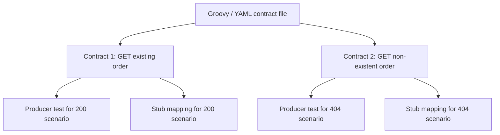
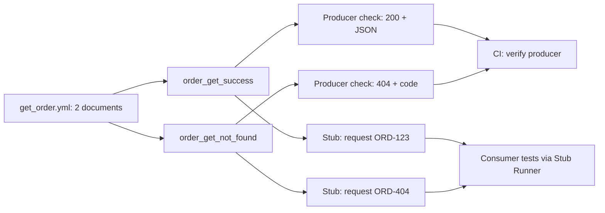

# Single File Containing One or Multiple Interactions

## 1. Problem Statement: Must One Contract File Describe Only One Scenario?

In **Spring Cloud Contract**, a producer (providing an HTTP API or emitting messages) and a consumer (calling the API or receiving messages) agree on the behaviors that the consumer is allowed to rely on. That agreement is written in the **Contract DSL**, typically Groovy or YAML. The plugin can use these definitions to **generate producer-side tests**, produce **stubs** for consumers, and integrate compatibility verification into **CI**.

A frequent source of confusion when organizing contract directories is the relationship between a **file** and an **interaction**:

- A single file can contain **one** interaction (one contract).
- A single file can also contain **multiple** interactions (multiple contracts).
- Each contract still describes **one specific communication scenario**, such as an expected HTTP request and response, or message publishing/receiving behavior.

Choosing one or multiple contracts in the same file is a decision about **source code organization and maintainability**, not a mechanism to merge all business logic of an endpoint into a single assertion.

### Learning Outcomes

After this lesson, you will be able to:

1. Distinguish between a DSL file, a `Contract` definition, an interaction, and generated tests/stubs.
2. Write the correct syntax for **one** or **multiple** contracts in a Groovy file.
3. Write the correct syntax for **one** or **multiple** contracts in a YAML file.
4. Choose how to group contracts by cohesion, owner, consumer, API, and rate of change.
5. Avoid duplicate test/stub names, overlapping request-matching conditions, and unintended reliance on scenario ordering.
6. Verify after reorganizing files that producer tests and stubs still represent all interactions.

## 2. Distinguishing Four Levels Before Organizing Files

Consider `Order Service` exposing `GET /api/orders/{id}` to `Web Client`.

| Concept | Example | Responsibility |
| --- | --- | --- |
| **Contract file** | `get_order.groovy`, `get_order.yml` | Unit of DSL storage in the repository |
| **One contract** | Querying an existing order → HTTP 200 | Expresses one specific verification scenario |
| **Interaction** | `GET /api/orders/ORD-123` → Order JSON | Observable behavior at the producer–consumer boundary |
| **Generated test / stub mapping** | One response verification test and one corresponding stub configuration | Artifacts generated by tooling from the contract for verification or simulation |

The diagram illustrates one file containing two contracts. The plugin may place multiple test methods in the same generated test class or organize names differently depending on configuration, yet **the two scenarios still have independent verification conditions and outcomes**. Therefore, never count files as a proxy for the number of contracts/tests.

> In this lesson, the term *interaction* refers to one observable scenario described in the DSL. It does not imply a multi-step, stateful business sequence or mandatory execution order.

## 3. A Groovy File Containing One Interaction

Minimal structure:

~~~text
order-service/
└── src/
    └── test/
        └── resources/
            └── contracts/
                └── order/
                    └── get_order_success.groovy
~~~

Contents of `src/test/resources/contracts/order/get_order_success.groovy`:

~~~groovy
import org.springframework.cloud.contract.spec.Contract

Contract.make {
    name('order_get_success')
    description('Consumer retrieves an existing order')

    request {
        method 'GET'
        url '/api/orders/ORD-123'
        headers {
            accept(applicationJson())
        }
    }

    response {
        status OK()
        headers {
            contentType(applicationJson())
        }
        body(
            orderId: 'ORD-123',
            status: 'CONFIRMED',
            totalAmount: 199000
        )
    }
}
~~~

This is **one `Contract` object** created by `Contract.make { ... }`. The contract describes one scenario: the consumer sends a request with matching path and headers; the producer must respond with status `200` and the agreed JSON fields.

To describe the order-not-found case, you can create a **second Groovy file**:

~~~text
contracts/
└── order/
    ├── get_order_success.groovy
    └── get_order_not_found.groovy
~~~

Contents of `get_order_not_found.groovy`:

~~~groovy
import org.springframework.cloud.contract.spec.Contract

Contract.make {
    name('order_get_not_found')
    description('Consumer receives an error when the order does not exist')

    request {
        method 'GET'
        url '/api/orders/ORD-404'
    }

    response {
        status NOT_FOUND()
        headers {
            contentType(applicationJson())
        }
        body(
            code: 'ORDER_NOT_FOUND'
        )
    }
}
~~~

**Advantages** of one contract per file: small files, easy to review, easy to locate scenarios, and easy to edit independently. **On the flip side**, an endpoint with many branches can produce many files, requiring readers to open multiple places to view all related scenarios.

## 4. A Groovy File Containing Multiple Interactions

Spring Cloud Contract allows **returning a list of `Contract` objects** at the top level of a Groovy file. This is the core syntactic difference compared to writing a single contract.

File `src/test/resources/contracts/order/get_order.groovy`:

~~~groovy
import org.springframework.cloud.contract.spec.Contract

[
    Contract.make {
        name('order_get_success')
        description('Query an existing order')

        request {
            method 'GET'
            url '/api/orders/ORD-123'
            headers {
                accept(applicationJson())
            }
        }

        response {
            status OK()
            headers {
                contentType(applicationJson())
            }
            body(
                orderId: 'ORD-123',
                status: 'CONFIRMED',
                totalAmount: 199000
            )
        }
    },

    Contract.make {
        name('order_get_not_found')
        description('Query a non-existent order')

        request {
            method 'GET'
            url '/api/orders/ORD-404'
        }

        response {
            status NOT_FOUND()
            headers {
                contentType(applicationJson())
            }
            body(
                code: 'ORDER_NOT_FOUND'
            )
        }
    }
]
~~~

How to read this snippet:

1. The outer `[` and `]` form a **Groovy list**.
2. Each list element is **one** `Contract.make { ... }` with its own `request` and `response`.
3. Each contract has its own `name` and can describe a different branch of the same endpoint.
4. The result of the file is a **list of contracts**, not a single contract with two `request` blocks or two `response` blocks.

Do not write two consecutive `Contract.make { ... }` statements without a list structure and assume the plugin will pick up both. In Groovy, return a list following the pattern supported by Spring Cloud Contract.

The success and failure branches above also help tests/stubs clearly distinguish requests via `ORD-123` and `ORD-404`. If both branches use the **same URL** while the producer responds based on data state, tests need distinct state setups; stubs also require explicit request conditions or scenario mechanisms to avoid two competing mappings.

### Why Name Each Contract?

The `name` field is not merely descriptive. It helps tooling name generated tests/stubs and helps reviewers identify scenarios. For instance, a name like `order_get_not_found` is much clearer than an auto-generated name tied to file location or list index.

Names should be:

- Unique within the relevant test/stub generation scope.
- Stable when moving contracts across files.
- Composed of characters safe for generated test source code, such as letters, digits, and underscores.
- Expressive of behavior, such as `order_get_success`, `order_get_not_found`, or `payment_authorized_message`.

**Duplicate `name` values can cause generated test compilation errors or cause stub files to overwrite each other.** Do not rely on a contract's index inside a list for long-term naming, because inserting an element at the top of the list can change auto-generated names for subsequent elements.

## 5. A YAML File Containing One Interaction

For the same successful HTTP behavior, you can use the YAML DSL:

~~~yaml
name: order_get_success
description: Query an existing order
request:
  method: GET
  url: /api/orders/ORD-123
  headers:
    Accept: application/json
response:
  status: 200
  headers:
    Content-Type: application/json
  body:
    orderId: ORD-123
    status: CONFIRMED
    totalAmount: 199000
~~~

A YAML file with **a single document** like the above describes one contract. This suits teams that prefer declarative configuration without Groovy syntax.

Note: **YAML contract DSL is not lesson metadata YAML**. In a training content repository, a three-field metadata file (`menuLevel1`, `menuLevel2`, `status`) serves a separate purpose; it is not a contract file used to generate Spring Cloud Contract tests.

## 6. A YAML File Containing Multiple Interactions

To place multiple contracts in the same YAML file, Spring Cloud Contract supports **multiple YAML documents separated by `---`**.

File `src/test/resources/contracts/order/get_order.yml`:

~~~yaml
---
name: order_get_success
description: Query an existing order
request:
  method: GET
  url: /api/orders/ORD-123
  headers:
    Accept: application/json
response:
  status: 200
  headers:
    Content-Type: application/json
  body:
    orderId: ORD-123
    status: CONFIRMED
    totalAmount: 199000
---
name: order_get_not_found
description: Query a non-existent order
request:
  method: GET
  url: /api/orders/ORD-404
response:
  status: 404
  headers:
    Content-Type: application/json
  body:
    code: ORDER_NOT_FOUND
~~~

Here:

- `---` starts a **YAML document**; the two documents are parsed as two contracts.
- Each document has its own `name`, `request`, and `response`.
- Do not merge two documents by placing two `request` keys in the same YAML mapping: duplicate keys may be rejected by the parser or overwrite each other, losing an interaction.
- Do not confuse `---` with `-` used for YAML sequence items. For the multi-contract syntax documented by Spring Cloud Contract, use **multi-document YAML**.

Comparison table:

| Interaction Count | Groovy DSL | YAML DSL |
| --- | --- | --- |
| Single | `Contract.make { ... }` | One YAML document with `request` and `response` |
| Multiple | `[Contract.make { ... }, Contract.make { ... }]` | Multiple YAML documents separated by `---` |
| Naming | `name('order_get_success')` | `name: order_get_success` |
| Adding a new scenario | Add a `Contract.make` element to the list | Add `---` and a complete document |
| Error cases | Separate contract | Separate document |
| Test/stub generation | Each contract is processed individually | Each contract document is processed individually |

### What Does Not Change When Merging Files

Switching from two files `get_order_success.yml` and `get_order_not_found.yml` to one file `get_order.yml` with two documents **does not change the business meaning** of either scenario. The producer still must satisfy both `200` and `404`; consumers still need both corresponding stubs.

However, **source file paths and auto-generated names** may change if contracts lack an explicit `name`. After merging or splitting files, verify generated test names and stub names rather than checking only the file count.

## 7. Criteria for Choosing One Contract vs. Multiple Contracts per File

There is no rule stating "one file is always better than multiple files." Choose whichever makes maintenance easy to understand and lets the pipeline catch incompatible changes.

| Criterion | One Contract per File | Multiple Contracts per File |
| --- | --- | --- |
| Distinct, loosely related scenarios | Easy to locate and edit each scenario | Risk of bundling unrelated cases |
| One endpoint with a few simple branches | File count can grow | Easy to inspect success/error branches side by side |
| Multiple independent consumers/owners | Easy to assign review permissions and ownership | One shared file risks merge conflicts across teams |
| Rapidly growing scenario count | Folder holds many files, but each file stays short | Files grow long and diffs become hard to follow |
| Need to separate API or event versions | Easy to group by version | Requires discipline to avoid mixing v1/v2 confusingly |
| PR diffs and change inspection | Usually focused on a single case | Convenient to review when cases truly belong together |

**Suggested rule of thumb:** Group scenarios when they belong to the same behavior/endpoint, change together, share an owner, and remain easy to read in size. Split them when scenarios have different lifecycles, consumers, review requirements, or setup mechanisms.

Reasonable example to group: one `get_order.yml` file with `200` and `404` for `GET /api/orders/{id}`.

Example better split: a `POST /api/payments` contract for consumer `Order Service` and a `PaymentAuthorized` event contract for consumer `Notification Service`, especially when the two teams have different release policies or base test classes.

## 8. Organizing Contract Directories for Long-Term Maintenance

When contracts live inside the producer, Spring Cloud Contract typically reads from the configured contract source directory. In common Maven examples, that is `src/test/resources/contracts`; the actual path can be overridden in build configuration. Do not guess from folder names; inspect the active plugin configuration.

A maintainable structure:

~~~text
order-service/
└── src/test/resources/contracts/
    ├── orders/
    │   ├── get_order.yml
    │   └── create_order.yml
    ├── payments/
    │   └── request_payment.groovy
    └── events/
        └── order_confirmed.groovy
~~~

You can group by:

- **API or domain:** `orders/`, `payments/`, `customers/`.
- **Consumer:** `web-client/`, `billing-service/`, when contracts reflect distinct consumer requirements.
- **Interface version:** `v1/`, `v2/`, when versions carry different commitments.
- **Communication type:** `http/` and `events/`, if the producer exposes both REST APIs and messaging.

Pick **one primary organizing principle**, adding sub-layers only when genuinely helpful. If the team frequently moves files around because grouping is overly complex, that structure is creating unnecessary overhead.

### File Naming and Contract Naming Are Two Separate Concerns

For example, `get_order.yml` is the **source filename** containing two documents, whereas `order_get_success` and `order_get_not_found` are the **names of two contracts**. The filename should summarize the group of behaviors; the contract name should pinpoint each individual case.

When combining multiple contracts, **keep `name` stable** so test and stub names do not depend on positional indices. After renaming files or moving folders, re-check the build, especially if the build maps source subdirectories to specific base classes or artifact paths.

## 9. Impact on Producer Tests and Consumer Stubs

Spring Cloud Contract turns contracts into verifications and stubs. Deciding on one file or multiple files does not remove the need to verify **each** behavior.

### 9.1. Producer Verification

On the producer side, the plugin generates tests from the DSL using the configured **base test class** and test environment. In the two-document example, the producer must satisfy both branches:

- `GET /api/orders/ORD-123` yields `200` and the committed JSON fields.
- `GET /api/orders/ORD-404` yields `404` with error code `ORDER_NOT_FOUND`.

If the success test passes while the `404` test lacks a fixture for a missing order, that is a setup/test issue to fix. If the producer genuinely changed its API so the consumer can no longer handle it properly, that is a contract divergence requiring coordinated resolution.

### 9.2. Published Stubs

Once producer verification passes, the build pipeline can package stubs for consumers to use via **Spring Cloud Contract Stub Runner**. Multiple contracts in the same file still produce multiple mappings corresponding to multiple request cases.

When combining contracts, avoid **two stubs matching the exact same request while returning conflicting responses**. For instance, two documents both declaring `GET /api/orders/ORD-123` where one returns `200` and the other returns `404` with no extra distinguishing condition. Consumer tests may then receive an unintended response depending on mapping selection. Distinguish via path, query, header, body, or an intentional stateful scenario if state is truly required.

### 9.3. CI After Merging or Splitting

Example using the producer's Maven wrapper:

~~~bash
./mvnw -B clean verify
~~~

If using Gradle, run the build/test task configured to include generated contract tests, such as:

~~~bash
./gradlew clean build
~~~

These commands assume a project **already configured with the Spring Cloud Contract plugin, dependencies, and base class**; merely dropping DSL files into a directory is not enough for tests to run automatically.

When moving from two files to one file, confirm that the counts of **contracts**, generated tests, and stub mappings did not drop unintentionally; ensure tests actually execute rather than being skipped. Also verify that the new names are stable and artifacts are published with the right version so consumer tests keep running.

## 10. Should HTTP and Messaging Interactions Share a File?

Spring Cloud Contract supports both HTTP and messaging in Groovy/YAML DSL. Structurally, combining multiple contracts is not limited to HTTP; however, **carefully consider separate organizational needs** because their verification mechanisms differ.

Example of a standalone Groovy messaging contract:

~~~groovy
import org.springframework.cloud.contract.spec.Contract

Contract.make {
    name('payment_authorized_message')
    description('Emit event after payment succeeds')
    label 'paymentAuthorized'

    input {
        triggeredBy('publishAuthorizedPayment()')
    }

    outputMessage {
        sentTo('payments.authorized')
        headers {
            header('contentType', 'application/json')
        }
        body(
            eventType: 'PaymentAuthorized',
            orderId: 'ORD-123',
            paymentId: 'PAY-456'
        )
    }
}
~~~

In the messaging case, the base class and message verification mechanism must provide the `publishAuthorizedPayment()` trigger as well as a way to observe output messages. HTTP contracts, by contrast, typically use MockMvc or an equivalent HTTP test environment.

Therefore, when organizing multiple contracts:

- Group **events sharing a lifecycle/producer** when setup, destination, and owner align.
- Separate HTTP and messaging when different **base class mappings** or test environments are needed.
- Do not bundle all messages simply because they travel over the same broker: business purpose and consumer are the deciding criteria.

For a flow involving both a `POST /api/payments` command and a `PaymentAuthorized` event, you can keep them in two easy-to-find files. Putting them in a single file does not turn them into **one** atomic interaction.

## 11. Common Mistakes When Storing Multiple Interactions in One File

| Mistake | Consequence | How to Fix |
| --- | --- | --- |
| Writing two standalone `Contract.make` calls in Groovy without returning a list | Parser receives an unexpected structure or drops a contract | Wrap `Contract.make` blocks inside a `[ ... ]` list |
| Using two `request` keys in one YAML mapping | Duplicate key is rejected or overwrites the first | Make each contract a separate YAML document separated by `---` |
| Reusing the same `name` across contracts | Duplicate generated test names or overwritten stubs | Assign unique, stable, code-safe names |
| Omitting `name` on list elements | Auto-generated names depend on file and order, making them brittle | Set an explicit `name` for every scenario |
| Two stubs matching the exact same request with different responses | Consumer tests receive nondeterministic responses relative to intent | Add distinguishing conditions or model an intentional stateful scenario |
| Bundling dozens of unrelated scenarios | File becomes hard to review; teams clash on edits | Split by endpoint, domain, consumer, or owner |
| Combining scenarios requiring completely different setups | Bloated base class; tests risk state leakage | Separate contract groups and map appropriate base classes |
| Treating list/YAML order as execution order | Flaky tests depending on leftover state from prior tests | Design independent contracts with per-test data setup |
| Checking only file count after merging files | Missed contracts silently dropped during refactoring | Check generated test and stub mapping counts after build |

### Contract Order Is Not Business Execution Order

Writing two contracts in one Groovy list or two YAML documents **does not automatically create a "run scenario 1, then scenario 2" flow**. The test framework may order execution according to its own rules; each scenario should have independent fixtures and not rely on state left behind by an earlier test.

Spring Cloud Contract does support **stateful contracts/scenarios** via dedicated conventions, though project documentation recommends avoiding them unless necessary. If a consumer needs to verify a multi-step sequence such as login → add to cart → checkout, do not infer execution order merely by placing multiple contracts in one file; consider independent contracts plus an end-to-end integration test for the flow.

## 12. Real-World Organization Decision Example

Suppose `Catalog Service` provides:

| Scenario | Consumer | Expected Behavior |
| --- | --- | --- |
| Look up existing product | Checkout Service | `GET /products/P-100` → `200` with `price`, `available` |
| Look up non-existent product | Checkout Service | `GET /products/P-404` → `404`, `PRODUCT_NOT_FOUND` |
| Create product from admin | Admin Web | `POST /products` → `201` |
| Emit price change event | Pricing Consumer | `ProductPriceChanged` with `productId`, `price` |

An intuitive layout:

~~~text
src/test/resources/contracts/
├── checkout-service/
│   └── get_product.yml              # 2 YAML documents: 200 and 404
├── admin-web/
│   └── create_product.groovy        # 1 Contract.make
└── events/
    └── product_price_changed.groovy # 1 message contract
~~~

This groups the two branches of `GET /products/{id}` because they share the same consumer, endpoint, and usage intent. `POST /products` and the price-change event are separated because their consumers, behaviors, or test setups differ.

**Check point:** If a new consumer arrives that only reads `productId` and `name`, you do not necessarily have to duplicate Checkout Service's entire contract for it; define its specific expectations and apply appropriate naming/ownership and review processes.

## 13. Hands-On Exercise: Moving from One Contract/File to Multiple Contracts/File

You are working with the `Inventory Service` producer. Consumers call:

- `GET /api/inventory/SKU-1` → `200`, body with `sku: SKU-1`, `quantity: 8`.
- `GET /api/inventory/SKU-404` → `404`, body with `code: INVENTORY_NOT_FOUND`.

### Task A — One Interaction per File

Create two files:

~~~text
src/test/resources/contracts/inventory/
├── get_inventory_success.groovy
└── get_inventory_not_found.groovy
~~~

Write each file to return a single `Contract.make` with a unique `name`. Configure the producer base class so data exists for both the success and not-found cases. Generate and run the generated tests, confirming both scenarios are verified.

### Task B — Merge into One File with Multiple Interactions

Replace the two Groovy files with a single `get_inventory.groovy` returning a list `[Contract.make { ... }, Contract.make { ... }]`. Preserve the `name` values from Task A.

Next, represent the same behavior using **one YAML file** with two documents separated by `---`. When converting DSL formats, verify that the contracts yield **equivalent test/stub results**, and avoid leaving both Groovy and YAML versions active unintentionally as that creates duplicate definitions.

### Task C — Verify Change Detection

Change the producer so `quantity` becomes `stockCount` without updating the contracts. Run producer verification and observe which test fails. Then restore compatible behavior or negotiate the change with the consumer.

Questions to answer:

1. Why are the number of contracts and scenarios to verify still **two** after merging two files into one?
2. Without an explicit `name`, what can happen to test/stub names when reordering the two elements?
3. If two documents both match `GET /api/inventory/SKU-1` yet return two different responses, how must the matching conditions be fixed?
4. Why must a multi-contract file never be relied upon to guarantee the success test runs before the error test?

Suggested Answers

1. A file is a storage unit; each `Contract` or YAML document remains a separate communication scenario.
2. Default names may derive from the filename and list index; changing order can change auto-generated names. An explicit `name` keeps them stable.
3. Distinguish by path, header, query, body, or other attributes the consumer actually sends; if different responses are required based on state, use an appropriate stateful testing strategy.
4. Listing order does not guarantee execution order by the test framework. Each test needs independent setup.

## 14. Review Checklist When Adding or Merging Interactions

- [ ] Each contract describes a concrete behavior that a consumer genuinely relies on.
- [ ] If a Groovy file has multiple contracts, the top-level output is a **list of `Contract.make`**.
- [ ] If a YAML file has multiple contracts, they are **separate documents** delimited by `---`.
- [ ] Every contract has a unique, stable `name` valid for code generation.
- [ ] Request/stub mappings are distinct enough to avoid unintended overlapping matches.
- [ ] Success and error branches have matching setup data in producer verification.
- [ ] File grouping reflects business domain, consumer/owner, and independent rate of change.
- [ ] Element order inside a file is never relied upon to dictate test execution order.
- [ ] After merging/splitting, generated tests and corresponding stubs still appear and run properly in CI.
- [ ] When renaming or moving files, base-class mappings and stub packaging configuration have been verified.

## 15. References

- [Spring Cloud Contract — Contract DSL, Multiple Contracts in One File](https://docs.spring.io/spring-cloud-contract/reference/project-features-contract.html): Groovy list syntax and multi-document YAML.
- [Spring Cloud Contract — Common Top-Level Elements](https://docs.spring.io/spring-cloud-contract/reference/project-features-contract/common-top-elements.html): the `name` field and its effect on generated tests/stubs.
- [Spring Cloud Contract — Developing Your First Application](https://docs.spring.io/spring-cloud-contract/reference/getting-started/first-application.html): contract source directory, producer verification, and stub generation flow.

**Key takeaway:** **One file does not mean one interaction.** Groovy can return a single `Contract` or a list of `Contract`s; YAML can contain one or multiple contract documents. Group by cohesion for maintainability, assign distinct names to each interaction, and verify that every consumer expectation remains represented in producer tests and stubs after restructuring files.
