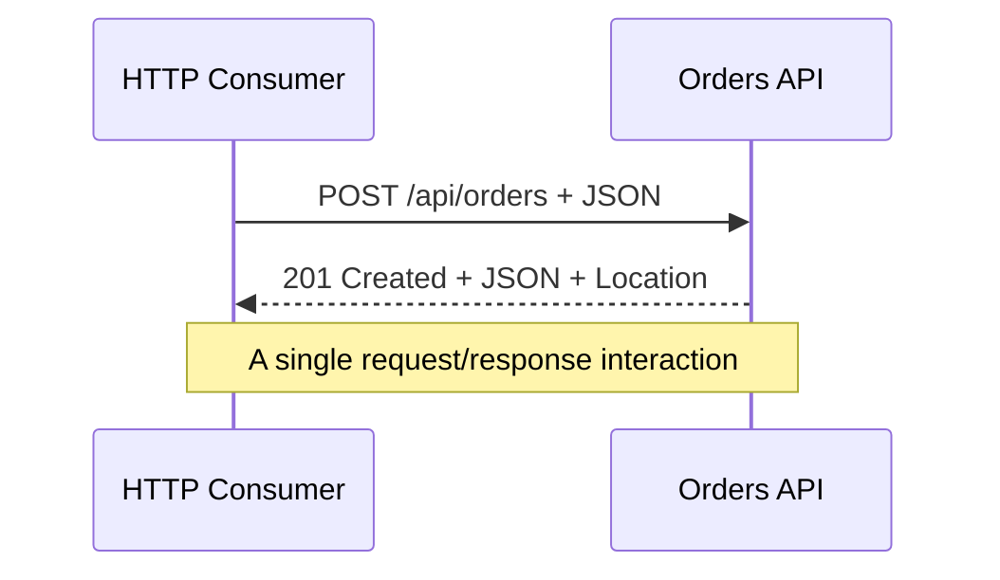
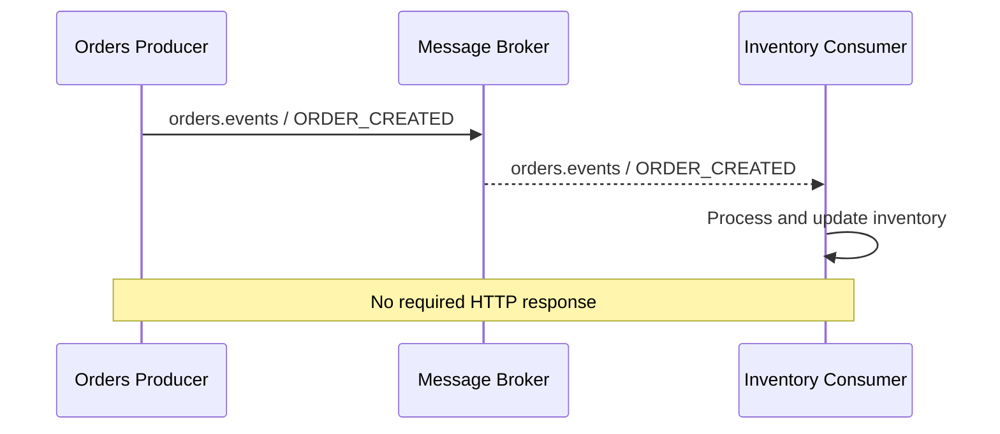

# Distinguishing HTTP Contracts from Messaging Contracts

## 1. Two Interaction Types, One Contract Testing Goal

In the **SPRING_CLOUD_CONTRACT** module, Spring Cloud Contract helps producers and consumers agree on how services interact over **HTTP** or **messaging**. Contracts are declared using Groovy DSL or YAML DSL, then used to generate producer-side tests and produce stubs for consumers. Combined with Stub Runner and CI, teams catch integration interface changes that risk breaking dependent applications early.

What matters when **organizing contracts** is understanding that these two communication styles have different observable boundaries:

- With **HTTP**, a consumer sends a request to a producer and waits for a corresponding response within the same call.
- With **messaging**, one component sends or emits a message through a channel; another component receives and processes it on its own schedule. A message does not necessarily produce a direct reply to the sender.

Therefore, two contracts may both describe "creating an order" yet verify different things. An HTTP contract describes method, URL, headers, body, HTTP status, and response. A messaging contract describes the trigger condition or input message, destination, headers, and output message payload.

After this lesson, you will be able to identify contract types from data flows, read and write basic DSL structures, choose the appropriate producer verification approach, and organize contract directories consistently for stub packaging.

## 2. Interaction Models and Contract Boundaries

### 2.1. HTTP: Request and Response



In this example, the consumer needs to know:

1. How to send `POST /api/orders` with valid JSON.
2. On success, what status `201` and fields the producer returns.
3. On failure, under which conditions the producer returns `400`, `404`, or `409`, if those branches are part of the API commitment.

An HTTP contract protects behaviors directly observable when sending a request. It **does not by itself prove** database side effects, transaction durability, or out-of-band event publishing unless those behaviors are also modeled and verified.

### 2.2. Messaging: Emit, Transport, and Receive



Here, the inventory consumer does not call an orders producer endpoint to receive the event. It subscribes to or reads from a channel according to what the messaging system supports. The contract should protect the **message structure and semantics** the inventory consumer relies on, such as `eventType`, `orderId`, `items`, `destination`, and correlation headers if present.

An `ORDER_CREATED` event may be delivered late, redelivered, or processed after the order-creation HTTP request has already completed. A message data contract does not by itself guarantee delivery timing, global ordering, exactly-once processing, or eventual consistency. Those properties must be designed and tested separately according to the broker, retry mechanism, and application behavior.

### 2.3. Quick Comparison Table

| Criterion | HTTP Contract | Messaging Contract |
| --- | --- | --- |
| Typical context | Client calls REST API to fetch/create resources | Service emits an event or receives a command via broker |
| Input | Method, URL, query, headers, body | Trigger on producer or incoming message on a destination |
| Output to protect | HTTP status, headers, response body | Destination, message headers, payload |
| Interaction pair | Request paired with response in the same call | Usually no direct reply; may be part of separate message flows |
| DSL representation | `request { ... }` and `response { ... }` | `input { ... }` and `outputMessage { ... }` |
| Typical failure behaviors | `400`, `401`, `403`, `404`, `409`, timeout | Rejection events, malformed payload, dead-letter, retries depending on design |
| Producer verification | Send HTTP call to producer and assert response | Trigger producer and observe message, or inject input message and observe output |
| Consumer stub usage | HTTP stub returns response on matching request | Message stub/trigger emits sample message; requires compatible messaging integration |
| Behaviors **not** proven by default | DB transactions, all side effects | Delivery guarantees, ordering, idempotency, broker availability |

> **Key distinction:** The "Producer" is the party providing the behavior committed by the contract. In HTTP, that is typically the server receiving the request. In messaging, it is typically the component **emitting the message** that the consumer depends on, even if that component consumes another message before emitting output.

## 3. Running Example: An Order Processing Application

Suppose the system consists of three components:

- **Ordering API** receives order creation requests from web/mobile over HTTP.
- **Orders Service** confirms the order and emits an `ORDER_CREATED` event to channel `orders.events`.
- **Inventory Service** receives the event to update stock.

Names, sample payloads, and destinations in this lesson are **illustrative assumptions**, not mandatory Spring Cloud Contract conventions.

| Scenario | Dependent Party | Information Needed | Contract Type |
| --- | --- | --- | --- |
| Create order succeeds | Web/mobile | `POST /api/orders` returns `201`, `id`, `status` | HTTP |
| Invalid quantity | Web/mobile | Returns `400` and `INVALID_QUANTITY` | HTTP |
| Order created | Inventory Service | Receives `ORDER_CREATED` event with `orderId` and `items` | Messaging |
| Insufficient stock during event handling | Orders Service or downstream inventory consumer | Receives `RESERVATION_REJECTED` message with `reason` | Messaging, if this event emission is agreed upon |

Both HTTP and messaging contracts can coexist for the same business action. Do not write a single "combined contract" assuming a `201` response automatically means the broker delivered the message: the two events can happen at different times and require separate guarantees.

## 4. Writing HTTP Contracts

### 4.1. Groovy DSL: Order Created Successfully

Example file `create_order_success.groovy`:

```groovy
import org.springframework.cloud.contract.spec.Contract

Contract.make {
    name 'create_order_success'
    description 'Create order with valid quantity'

    request {
        method POST()
        url '/api/orders'
        headers {
            contentType(applicationJson())
        }
        body([
            productId: 'SKU-001',
            quantity : 2
        ])
    }

    response {
        status 201
        headers {
            contentType(applicationJson())
            header 'Location': '/api/orders/ord-1001'
        }
        body([
            id    : 'ord-1001',
            status: 'CREATED'
        ])
    }
}
```

**How to read it:**

1. `request` describes what the consumer sends: method, endpoint, content type, and input JSON.
2. `response` describes what the producer commits to return: status code, headers, and output JSON.
3. Producer tests generated from the DSL can invoke the real producer and verify the output.
4. HTTP stubs generated from the contract can run in Stub Runner; when the consumer sends a matching request, the stub returns the declared response.

In practice, order IDs are often dynamically generated. Hardcoding `ord-1001` only works when tests use fixtures or deterministic ID generation. When values are dynamic, use **matchers** to validate format instead of pinning the full string; matchers should still be strict enough to catch contract-breaking changes.

### 4.2. Equivalent YAML DSL

Example file `create_order_success.yml`:

```yaml
name: create_order_success
description: Create order with valid quantity
request:
  method: POST
  url: /api/orders
  headers:
    Content-Type: application/json
  body:
    productId: SKU-001
    quantity: 2
response:
  status: 201
  headers:
    Content-Type: application/json
    Location: /api/orders/ord-1001
  body:
    id: ord-1001
    status: CREATED
```

Both examples describe **the exact same behavior**. In a project, pick one representation according to team convention; do not keep both duplicate contracts in a directory automatically scanned by the build, as they can generate duplicate tests and stubs.

### 4.3. Error Branches Are Also Part of the HTTP Contract

When `quantity = 0`, if the API commits to returning `400` with error code `INVALID_QUANTITY`, there should be a dedicated contract:

```yaml
name: create_order_invalid_quantity
request:
  method: POST
  url: /api/orders
  headers:
    Content-Type: application/json
  body:
    productId: SKU-001
    quantity: 0
response:
  status: 400
  headers:
    Content-Type: application/json
  body:
    code: INVALID_QUANTITY
```

This is a **distinct, meaningful branch for the consumer**, because the application might display an input validation error instead of navigating to a new order page. Use distinct input values between the two branches so Stub Runner does not match the wrong mapping.

## 5. Writing Messaging Contracts

Messaging contracts use different blocks from HTTP:

- `input` describes how the behavior is triggered: invoking a method in the test environment or sending a message to an input channel.
- `outputMessage` describes the message the producer must emit, including destination, payload, and committed headers.
- `label` can name a message/stub flow to trigger in consumer tests.

There is no `response.status` or `request.url` in the HTTP sense. A message may contain a `status` field inside its **business payload**, but it does not become an HTTP status code.

### 5.1. Producer Emits an Event When Triggered

Example `order_created_event.groovy`:

```groovy
import org.springframework.cloud.contract.spec.Contract

Contract.make {
    name 'order_created_event'
    label 'order_created'
    description 'Emit event when an order is created'

    input {
        triggeredBy('publishOrderCreated()')
    }

    outputMessage {
        sentTo('orders.events')
        body([
            eventType: 'ORDER_CREATED',
            orderId  : 'ord-1001',
            items    : [
                [productId: 'SKU-001', quantity: 2]
            ]
        ])
    }
}
```

Meaning of each part:

| DSL | Role |
| --- | --- |
| `label 'order_created'` | Label used to reference/trigger the sample message in supported stub scenarios |
| `triggeredBy('publishOrderCreated()')` | Specifies how to trigger the producer in generated tests |
| `sentTo('orders.events')` | Destination to which the producer is expected to emit the message |
| `body([...])` | Payload that the consumer needs to receive and parse |

`publishOrderCreated()` is an **illustrative method that must be implemented in the producer's test base class**. It is not a built-in Spring Cloud Contract function. When the producer test runs, the test suite must be able to call this method, observe the emitted message, and match destination/payload against the contract. Details of connecting binders, brokers, or message verifiers depend on the Spring Cloud Stream/Kafka/Rabbit/JMS infrastructure used by the project.

### 5.2. Equivalent YAML DSL for the Event

If the project prefers YAML DSL, the same semantics can be expressed as:

```yaml
name: order_created_event
label: order_created
description: Emit event when an order is created
input:
  triggeredBy: publishOrderCreated()
outputMessage:
  sentTo: orders.events
  body:
    eventType: ORDER_CREATED
    orderId: ord-1001
    items:
      - productId: SKU-001
        quantity: 2
```

As with HTTP, choose **one** variant—Groovy or YAML—for this scenario. When switching DSL languages, verify that test/mapping generation works properly in your project's Spring Cloud Contract version.

### 5.3. Producer Consumes a Message and Emits Another Message

Not every messaging contract starts with `triggeredBy`. For instance, Inventory Service receives a command/event from `orders.created`, processes it, and emits a result to `inventory.reservations`:

```groovy
import org.springframework.cloud.contract.spec.Contract

Contract.make {
    name 'reserve_inventory_success'

    input {
        messageFrom('orders.created')
        messageBody([
            orderId  : 'ord-1001',
            productId: 'SKU-001',
            quantity : 2
        ])
    }

    outputMessage {
        sentTo('inventory.reservations')
        body([
            orderId: 'ord-1001',
            result : 'RESERVED'
        ])
    }
}
```

Here, an **input message** replaces calling a trigger method directly; the **output message** is the event downstream consumers depend on. Producer verification requires a test environment that can inject the input message and observe the output. This example does not by itself verify that stock was actually decremented in the database; that belongs to business or integration tests.

If inventory has an out-of-stock branch, a contract for `REJECTED` with `reason = OUT_OF_STOCK` is a separate branch. Consumers should not have to infer failure merely from "not seeing a message," since absence could be caused by broker lag, connection issues, or incomplete test setup.

## 6. How Do Key Verification Fields Differ?

### 6.1. HTTP: Route, Status Code, and Response Shape

HTTP contracts typically focus on:

- **Request:** method, URL/path, query parameters, headers such as `Content-Type` or `Authorization` when part of the agreed interface, and input body.
- **Response:** HTTP status, significant headers like `Location` and `Content-Type`, JSON/XML body, and business error codes.
- **Branches:** success, invalid data, not found, unauthorized/forbidden, conflict, etc., according to published behavior.

For `GET /api/orders/{id}`, the difference between `200` and `404` is significant because consumers handle them differently. Meanwhile, changing internal storage without altering the HTTP interface does not necessarily create a new contract.

### 6.2. Messaging: Destination, Event, and Payload Structure

Messaging contracts typically focus on:

- **Destination:** topic, queue, channel, or binding name the consumer depends on.
- **Event type:** such as `ORDER_CREATED` or `RESERVATION_REJECTED`, if defined in payload/headers.
- **Payload:** required fields, data types, nested structures, and value semantics.
- **Headers:** content type, correlation ID, event type, schema version, routing key if part of the integration interface.
- **Versioning rules:** adding fields, removing fields, renaming events, changing schemas, or changing destinations can all impact consumers.

Headers like `correlationId` are very useful for tracing asynchronous flows, but should only be put in a contract when producer and consumer have agreed on how they are used. If generated randomly, use a matcher specific enough to accept valid values while still enforcing type/format.

### 6.3. What Falls Outside a Contract's Scope?

| Question | Can the Contract Describe It? | Additional Testing Needed |
| --- | --- | --- |
| Does the API return the right JSON and HTTP status? | Yes, via an HTTP contract | Performance, full security, DB state tests |
| Is the emitted event sent to the right destination with the right payload? | Yes, via a messaging contract | Live broker operation, permissions, network config |
| Is an event guaranteed to be delivered strictly once? | A data contract alone is not enough | Delivery/retry and idempotency tests |
| Do two events always arrive in order? | Not guaranteed automatically | Partitioning, ordering, and consumer-rule tests |
| Does HTTP `201` guarantee inventory is already updated? | Not guaranteed automatically | Cross-service, eventual consistency, or saga tests |
| Is a new JSON field compatible? | Contracts catch deviations from committed shape | Specific consumer tests, especially with strict decoders |

## 7. Differences in Producer Tests and Consumer Stubs

### 7.1. HTTP Producer Verification

For HTTP contracts, Spring Cloud Contract generates tests that simulate requests and compare producer responses. The test base class must initialize the application or appropriate web layer, set up fixtures, configure the test client, and ensure tests run independently.

For example, a `POST /api/orders` contract expects `201` and `CREATED`. If the real producer returns `200`, the generated test must fail. If fixture `SKU-001` is missing in the test environment, the test may fail due to misconfiguration, so distinguish application bugs from test setup errors.

### 7.2. Messaging Producer Verification

For messaging contracts, the framework generates tests that trigger the message flow via `triggeredBy` or an input message, then observe output and verify content/destination. The test base class and messaging verifier infrastructure must be properly configured. A valid contract DSL does not automatically create a broker or the `publishOrderCreated()` method.

If the producer emits a message with the wrong `eventType`, missing `orderId`, or to an unexpected destination, the producer test must catch the drift. If a real broker is essential to the design, add integration tests with a reproducible broker environment.

### 7.3. HTTP Consumer Stubs

For HTTP, the stub artifact produced by Spring Cloud Contract typically contains mappings for a mock server (usually WireMock). Stub Runner downloads the artifact by `groupId:artifactId:version:stubs`, loads the mappings, and opens an HTTP port. Consumer tests invoke **their real client code** against the stub URL, then assert the client reacts properly to `201`, `400`, `404`, and so on.

For instance, a consumer test can verify that when the stub returns `400 INVALID_QUANTITY`, the UI displays a quantity validation error and does not navigate to a new order page.

### 7.4. Messaging Consumer Stubs

For messaging, a test can trigger a message stub by label (such as `order_created`) via the provided stub-trigger capability, then verify the consumer received and processed the payload. Delivering the message into the consumer application requires adapters or messaging configuration compatible with the test tooling and environment.

**Do not assume** that merely adding `@AutoConfigureStubRunner` to a consumer application causes messages to appear automatically on a real Kafka/RabbitMQ cluster. Stub Runner must be wired to the appropriate messaging environment or mock mechanism, and the test must trigger the target scenario. Consumption conditions, consumer groups, and event listeners remain governed by the project's architecture.

### 7.5. What Both Have in Common

Both require the same verification chain:

```text
Contract DSL -> Generated producer test -> Producer verification
             -> Verified stub artifact -> Stub Runner/consumer test
             -> CI compatibility check
```

Stubs generated from contracts do not guarantee the running producer actually obeys the contract if producer verification is skipped. Likewise, passing producer tests does not prove all consumers can handle changes if consumers lack proper tests.

## 8. Directory Structure When a System Uses Both HTTP and Messaging

In a Maven project, a common layout looks like:

```text
orders-producer/
  src/
    test/
      resources/
        contracts/
          http/
            orders/
              create_order_success.groovy
              create_order_invalid_quantity.yml
          messaging/
            orders/
              order_created_event.groovy
```

This is an **example of human-readable grouping**. The `src/test/resources/contracts` source directory is typically scanned by the Spring Cloud Contract plugin by default; subdirectories, scanning rules, and artifact packaging paths depend on specific project configuration. Do not assume every generator or framework version handles arbitrary directories identically without checking the build output.

Helpful organizational principles:

1. **Separate by protocol or integration boundary.** You can use `http/` and `messaging/`, then subdivide by domain so API responses and events do not mix.
2. **Name by behavior.** `create_order_success`, `create_order_invalid_quantity`, and `order_created_event` immediately reveal who uses the contract and which branch is described.
3. **One scenario, one representation.** Avoid keeping both Groovy and YAML files for the same contract with identical content when both are picked up by the build.
4. **Do not split one contract arbitrarily across two files.** An HTTP contract has request and response; an event contract has trigger/input and output message. Business links between the two protocols belong in design docs or separate integration tests.
5. **Keep test data intentional.** IDs, SKUs, event types, and error codes should clearly represent branches; avoid real data, tokens, or random payloads that hamper reproducibility.
6. **Maintain clear ownership.** The team operating the producer maintains producer-verified contracts; consumers participate in confirming the fields and branches they genuinely depend on.

With multiple consumers, contracts can be organized by consumer, by business domain, or by route/event depending on team conventions and distribution mechanisms. The requirement for choosing a layout is that **all contracts are discovered by the build**, free of duplicates, and traceable to public behavior. A tidy layout that causes the plugin to skip files provides zero test protection.

## 9. Versioning, Stub Packaging, and CI for Both Contract Types

Spring Cloud Contract can package stub outputs into an artifact for consumers, typically a JAR with the `stubs` classifier. For an example producer `com.example:orders-producer:1.4.2`, the stub artifact usually has coordinates:

```text
com.example:orders-producer:1.4.2:stubs
```

Consumers pick the **producer stub version** when configuring Stub Runner. HTTP stubs and message stubs can coexist in the same artifact if the producer's build process configures them that way; runtime execution for each still depends on the corresponding environment and adapters.

A sound CI pipeline:

1. Read new or modified contracts, checking DSL syntax and names/paths.
2. Generate and run producer tests for both HTTP and messaging, with appropriate base classes and test infrastructure.
3. Verify the stub artifact contains the mappings/message scenarios consumers need, then publish with a clear version.
4. Run consumer tests against the chosen stub version; for HTTP call the real client, for messaging deliver the sample event through the appropriate test transport.
5. If a change causes producer or consumer tests to fail, halt the pipeline or require coordinated versioning before release.

For **HTTP** changes, CI can catch `201` turning into `200` or a missing `Location` header. For **messaging** changes, CI can catch `eventType` renames, missing `orderId`, or changed destinations. However, these protections only hold when contracts and tests actually specify and verify those attributes; CI does not infer what every consumer depends on automatically.

For reproducibility, consumers should pin an explicit stub version in release-gating tests. A continuously changing `SNAPSHOT` or a "latest" marker can make CI results shift even when consumer code has not changed.

## 10. Common Misconceptions

| Misconception | Why It Is Wrong or Incomplete | How to Address |
| --- | --- | --- |
| "Both HTTP and messaging have request and response." | Asynchronous events do not require a direct reply | Use `request/response` for HTTP; `input/outputMessage` for messaging |
| "The `status` field in an event equals an HTTP status." | It is an application-defined payload property | Separate business status from protocol status |
| "`201` means the event has already reached the consumer." | HTTP response and broker delivery are separate stages | Verify side effects and eventual consistency with additional tests |
| "A message contract automatically verifies retries and exactly-once delivery." | Messaging contracts primarily describe data and emit/receive paths | Test retries, duplicates, idempotency, and ordering separately |
| "Just write `triggeredBy`, no real method needed." | Generated tests must invoke the trigger in the test environment | Implement the test base class and configure the message verifier |
| "Having Stub Runner sends events to the broker automatically." | Stubs must be triggered and wired to compatible messaging integration | Configure the test adapter/transport and trigger by label |
| "All error branches use HTTP `400`." | Messaging can use error events or dead-letter mechanisms | Agree on error branches per channel semantics |
| "Any field change is automatically a breaking change." | Compatibility depends on schema rules and actual consumer usage | Evaluate both contracts and consumer tests, especially required fields |

## 11. Contract Classification Exercise

**Scenario:** A payment system has the following behaviors:

1. Client calls `POST /payments` and receives `202 Accepted` with `paymentId`.
2. Service emits message `PAYMENT_REQUESTED` to `payments.events`.
3. Worker receives `PAYMENT_REQUESTED`, calls the payment provider, then emits `PAYMENT_SUCCEEDED` or `PAYMENT_FAILED`.
4. Client calls `GET /payments/{id}` and receives the current payment status.

Build the expected contract table:

| Behavior | Contract Needed | Representative Example |
| --- | --- | --- |
| Payment request accepted | HTTP | `POST /payments -> 202` with `paymentId` |
| Read existing payment | HTTP | `GET /payments/pay-1001 -> 200` with `status` |
| Service emits processing request | Messaging | `PAYMENT_REQUESTED` with `paymentId` and `amount` |
| Worker reports success | Messaging | `PAYMENT_SUCCEEDED` with `paymentId` |
| Worker reports failure | Messaging | `PAYMENT_FAILED` with `paymentId` and `reason` |

Next, answer four questions yourself:

1. **Does HTTP `202` guarantee `PAYMENT_SUCCEEDED` was emitted?** No. `202` only indicates the request was accepted for processing per this API's semantics; the final outcome arrives later.
2. **Should `response.status: 200` be used in an event contract?** No. Events use destination, headers, and payload; `200` is an HTTP status code.
3. **How do you test the `PAYMENT_FAILED` branch?** Create a dedicated message contract with deterministic test conditions, verify the producer emits the agreed error payload, and run consumer tests receiving that event.
4. **How do you verify the sequence "HTTP `202` then event then HTTP `200`"?** Use cross-component integration or end-to-end tests with proper waits and infrastructure; individual contracts verify each boundary, not the entire chain automatically.

### Checklist When Choosing a Contract Type

- Does the consumer **call an endpoint and receive a response** or **receive a message from a channel**?
- Should the contract describe `method/url/status` or `trigger/destination/payload`?
- Are the consumer's error branches expressed as HTTP status codes or messages/events?
- Does the producer test have the right fixtures, base class, transport, and observation mechanism?
- Does the HTTP stub have appropriate request matchers; does the message stub have a clear label and trigger mechanism?
- Is the artifact packaged, versioned, and verified in CI alongside consumers?
- Are you expecting a contract to prove delivery, ordering, retries, or cross-service state that it cannot guarantee alone?

**Key takeaway:** HTTP contracts protect the promise of **what is returned when called**, while messaging contracts protect the promise of **what message is emitted/received at the integration boundary**. Distinguishing the two properly keeps DSL definitions in the right place, yields meaningful producer tests, delivers suitable stubs for consumers, and catches incompatible changes early in CI.
