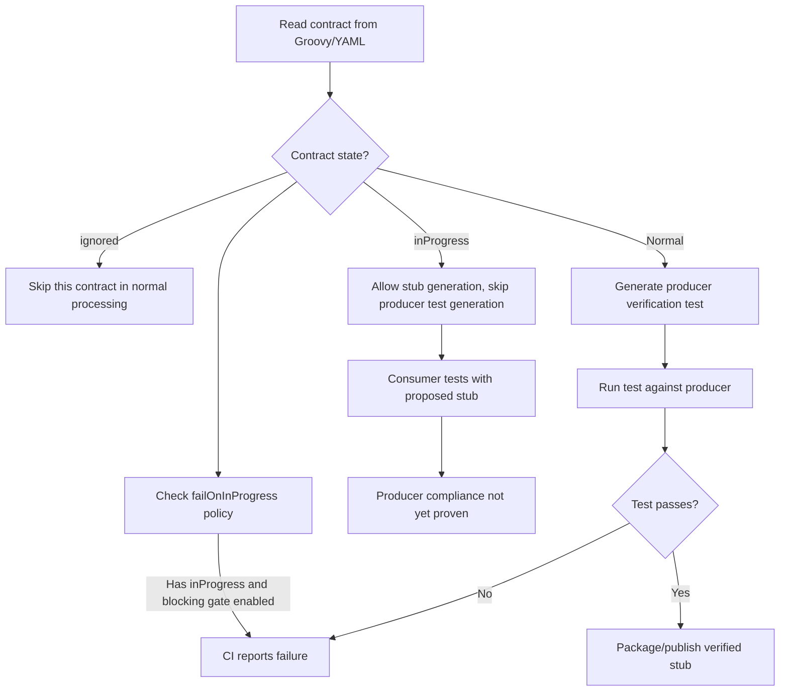

# Marking Contracts as Ignored or In Progress When Supported

## 1. The Problem: Not Every Contract Is Ready for Verification

In a multi-service system, a **consumer** team may propose a new HTTP interaction before the **producer** team finishes implementing it. In another situation, an older contract might currently be wrong, obsolete, or temporarily paused from verification while both sides agree on a fix. Deleting the contract immediately loses context and review visibility; leaving it to be verified normally can break the build due to an unapproved or unimplemented requirement.

**Spring Cloud Contract (SCC)** provides two useful flags in DSL versions that support them: **ignoring a contract** (`ignored`) and **marking a contract in progress** (`inProgress`). Both are statuses of **a contract definition**; they do not replace communication between producer and consumer or the project's release policy.

Placed in the overall Spring Cloud Contract picture:

- Producer and consumer agree on HTTP or messaging behavior in **Groovy DSL/YAML DSL**.
- Tooling can generate **producer verification tests** to check whether the implementation satisfies the contract.
- **Stubs** can be built from contracts; consumers use **Stub Runner** to test API calls, response deserialization, or message handling.
- CI combines these steps to detect incompatible API changes before release.

When a contract is ignored or in progress, **the meaning of test signals changes**. Therefore, you must know exactly what is generated, what is not verified, and what risks remain before reading a CI result as "PASS".

After this lesson, you will be able to choose between `ignored` and `inProgress`, write valid Groovy/YAML syntax, understand their impact on producer tests and stubs, enforce controls in CI, and establish a workflow to take a contract from draft to fully verified.

## 2. Two Flags with Different Meanings

The properties below belong at the **top level of the contract**, not inside `request`, `response`, `headers`, or `body`.

| Criterion | `ignored: true` | `inProgress: true` | Normal Contract |
|---|---|---|---|
| Intent | Temporarily exclude a contract from normal processing | Allow the consumer team to start with stubs before the producer finishes implementing | Verify agreed and implemented behavior |
| Producer verification test | Skips the marked contract | **Does not generate tests** for the in-progress contract | Generates tests if build is properly configured |
| Stub | Do not treat an ignored contract as an active verified stub source; check artifact output per configuration | **Can generate stubs** even before producer verification | Generates stubs from the contract per build workflow |
| Signal to consumer | Should not treat an ignored contract as a protected interface | Consumer can test early against **proposed** behavior, not yet guaranteed by producer | Stubs and producer verification rest on the confirmed contract |
| Primary risk | Hiding an important expectation if forgotten | Stub "passes green" while the producer does not support it yet | Only protects cases and assertions present in the contract |
| Governance condition | Record reason, owner, review deadline | Have a completion plan and CI gate blocking unverified releases | Maintain tests as behavior or versions evolve |

**Brief distinction:** `ignored` expresses a decision **not to use the contract for verification for now**; `inProgress` expresses a decision **to use the contract as a blueprint for generating stubs before the producer is ready**. The two states are not equivalent and should not be set simultaneously on the same contract while relying on undocumented precedence.

In some versions or integrations, flag handling can vary. Check your **SCC version, Groovy/YAML DSL, and Maven/Gradle plugin** alongside actual test/stub generation output. The examples below follow the properties documented in the official Spring Cloud Contract reference.

## 3. Running Example: Order Status API

Suppose `checkout-service` (consumer) calls `order-service` (producer) to retrieve an order's status. A normal contract for already-implemented behavior might be:

```yaml
name: order-status-existing
description: "Return existing order status"
request:
  method: GET
  url: /api/orders/42/status
response:
  status: 200
  headers:
    Content-Type: application/json
  body:
    orderId: 42
    status: PAID
```

This example describes only one specific request: `GET /api/orders/42/status` returning `200` with the declared JSON. When verified on the producer, the test checks those constraints. It **does not automatically prove** all IDs, error cases, authorization checks, or full business correctness work.

### 3.1. Temporarily Ignoring a Contract with `ignored`

Suppose the team discovers an older contract specifies `status: PAID`, while the real consumer has moved to a different status model. Both teams need to review and agree before resuming verification on that contract. One way to mark it in **YAML DSL**:

```yaml
name: order-status-legacy
description: "Legacy contract awaiting replacement decision"
ignored: true
request:
  method: GET
  url: /api/orders/42/legacy-status
response:
  status: 200
  body:
    status: PAID
```

The `ignored: true` property sits at the same level as `name`, `request`, and `response`. It is **not** `response.status` and not a custom status field in lesson-management metadata.

When supported by tooling and processed as an ignored contract, this contract stays out of the normal verification flow. That can help during transitions, yet must never **be interpreted as "the producer is compatible"**. Having zero test failures may simply mean the test was excluded from execution scope.

The team should document the **reason for ignoring, issue link, owner, and next review date** in the pull request, issue tracker, or description field per project conventions. Do not turn `ignored: true` into a way to hide a regression with no remediation plan.

### 3.2. Marking a Developing Contract with `inProgress`

Suppose the consumer wants an estimated delivery time while the producer does not yet have that endpoint. Both teams can agree upfront on the expected behavior so the consumer can code and run tests against stubs:

```yaml
name: order-delivery-estimate
description: "Estimated delivery time - API under development"
inProgress: true
request:
  method: GET
  url: /api/orders/42/delivery-estimate
response:
  status: 200
  headers:
    Content-Type: application/json
  body:
    orderId: 42
    estimatedDays: 3
```

Here is the crucial difference: **an in-progress contract does not generate a producer verification test, yet still allows stub generation**. The consumer can call the stub and verify it parses `estimatedDays` properly **before the producer completes the API**. This is a tool for parallel development, not proof that the producer implementation is already right. <https://docs.spring.io/spring-cloud-contract/reference/project-features-contract/common-top-elements.html>

If you only run consumer tests against stubs, CI may turn green even when `/delivery-estimate` does not exist on the producer at all. This is a **false positive on integration readiness**: the consumer test suite is verifying how the consumer interacts with *simulated behavior*, not testing the real producer.

### 3.3. What Happens Once the Producer Finishes?

After the producer implements the API, the team **removes** `inProgress: true` or sets it to `false` according to the DSL format and project conventions, then reruns normal verification:

```yaml
name: order-delivery-estimate
description: "Retrieve estimated delivery time"
request:
  method: GET
  url: /api/orders/42/delivery-estimate
response:
  status: 200
  headers:
    Content-Type: application/json
  body:
    orderId: 42
    estimatedDays: 3
```

Once `inProgress` is gone, a generated producer test can be produced and executed against the application in an appropriate test environment. The producer must seed data for order `42` and return the exact constrained values. Only publish stubs as a **verified interface** after producer tests pass on the target source commit and artifact version.

For contracts marked `ignored`, decide whether to **restore**, **replace**, or **remove per API governance policy**, and verify the impact on consumers using the old endpoint. Blindly removing the flag can make CI fail again if the contract still does not reflect agreed behavior.

## 4. Same Meaning in Groovy DSL

Spring Cloud Contract also supports the top-level `ignored()` and `inProgress()` methods in **Groovy DSL**. For example, `order-status-legacy.groovy`:

```groovy
org.springframework.cloud.contract.spec.Contract.make {
    name('order-status-legacy')
    description('Legacy contract awaiting replacement decision')
    ignored()

    request {
        method GET()
        url '/api/orders/42/legacy-status'
    }

    response {
        status OK()
        body(status: 'PAID')
    }
}
```

For an in-progress contract, you can write:

```groovy
org.springframework.cloud.contract.spec.Contract.make {
    name('order-delivery-estimate')
    description('API under development for consumer testing with stubs')
    inProgress()

    request {
        method GET()
        url '/api/orders/42/delivery-estimate'
    }

    response {
        status OK()
        headers {
            contentType(applicationJson())
        }
        body(orderId: 42, estimatedDays: 3)
    }
}
```

Both `ignored()` and `inProgress()` are **contract-level attributes**, not methods inside `request` or `response`. If the version or tool you use does not support these properties, do not invent names like `skip: true`, `pending: true`, or `status: IN_PROGRESS` expecting SCC to honor them; arbitrary keys carry no automatic meaning for the plugin.

**Syntax note:** YAML DSL and Groovy DSL have different invocation styles even though their intent is identical. Do not copy Groovy's `inProgress()` directly into YAML, or write `inProgress: true` as a Groovy statement. Also, do not confuse skipping **one contract** with flags that **skip entire build test tasks**.

## 5. What Actually Happens in the Pipeline?

Let's map the three contract usages across typical Spring Cloud Contract pipeline stages:



The diagram is a conceptual model of the workflow. Exact ordering and how the plugin executes each step can depend on Maven/Gradle and the SCC version. **Do not** assume an `inProgress` contract will produce an artifact if the entire build is blocked earlier by the `failOnInProgress` gate; stub generation occurs only on a run where the team **intentionally permits** in-progress contracts.

In Spring Cloud Contract documentation, the plugin property **`failOnInProgress` defaults to `true`** in currently documented plugins. When an in-progress contract exists, the plugin can **fail the build** to prevent misleading test results. To enable parallel development and early stub generation, the team must deliberately permit it in an appropriate environment by setting `failOnInProgress` to `false`, then restore the blocking gate before release. <https://docs.spring.io/spring-cloud-contract/reference/howto/how-to-mark-contract-in-progress.html>

Consequently, two statements are simultaneously true:

1. `inProgress` **allows stub generation without generating a producer test** for that contract.
2. **The build can still fail** due to the `failOnInProgress` policy, even though the contract technically permits stub generation.

Without separating these two layers, learners are often surprised: "I set `inProgress: true` and the build is still red." That can be an **intentionally designed safety gate**, not a contract syntax error.

## 6. Configuring `failOnInProgress`: Open During Development, Locked at Release

With **Maven**, this property is supported in the Spring Cloud Contract Maven plugin configuration. Illustrative snippet for a release pipeline:

```xml
<build>
    <plugins>
        <plugin>
            <groupId>org.springframework.cloud</groupId>
            <artifactId>spring-cloud-contract-maven-plugin</artifactId>
            <version>${spring-cloud-contract.version}</version>
            <extensions>true</extensions>
            <configuration>
                <failOnInProgress>true</failOnInProgress>
            </configuration>
        </plugin>
    </plugins>
</build>
```

In a development pipeline or sandbox branch that **intentionally permits unverified stubs**, `failOnInProgress` can be set to `false` in the corresponding configuration:

```xml
<configuration>
    <failOnInProgress>false</failOnInProgress>
</configuration>
```

These two snippets illustrate **values of the same option** in two configuration contexts; do not put both as simultaneously active blocks in one plugin. A complete POM also requires a compatible plugin version, test base dependencies, and test/stub generation settings. Property details and defaults are listed in the parameter reference for the [Maven plugin `generateTests` goal](https://docs.spring.io/spring-cloud-contract/docs/current/spring-cloud-contract-maven-plugin/generateTests-mojo.html).

With **Gradle**, the Spring Cloud Contract Gradle plugin offers a corresponding option, though declaration syntax and configuration passing should be checked against the documentation for **your exact version**. Do not infer from the Maven example that raw XML can be pasted into `build.gradle`, or assume every plugin version shares identical property names and behavior.

An easy-to-verify CI strategy:

| Environment | Allow `inProgress`? | Goal and Control Gate |
|---|---|---|
| Feature branch / dedicated sandbox | Allowed with limits | Consumer tests early against stubs; clearly marked lacking producer verification |
| Producer pull request | Per team policy | Review flags, issue, owner, deadline; verify already-stable contracts |
| Release branch / production gate | Should not allow | `failOnInProgress=true`, normal contracts' generated tests must run and pass |
| Consumer testing via Stub Runner | May use dedicated experimental stub build | Never mistake green consumer tests for an implemented producer; pin stub version |

**Separate artifact channels:** if the team intentionally publishes experimental stubs from an `inProgress` contract, use a distinct version, repository, or distribution channel so they never mix with producer-verified stubs. That separation is a **team CI/release convention**, not an automatic guarantee provided by `inProgress`.

## 7. Governance Workflow for an Unready Contract

Setting a flag in the DSL is only a small part of the job. Manage it through these steps:

1. **Record the request source:** which consumer needs the interaction, which use case, and which API/message version is affected.
2. **Identify why it is not ready:** wrong or obsolete contract (`ignored`); new behavior agreed prior to implementation (`inProgress`); or a design issue needing revision instead of a flag.
3. **Document status and owner:** issue/PR link, plan, review date, and flag-removal criteria. The contract's `description` can summarize the reason, while detailed tracking belongs in the team's work-tracking tool.
4. **Define permitted environments:** experimental branches may produce stubs from `inProgress`; release branches must not treat those stubs as verified.
5. **Track flags in code review and CI:** inspect all changes to `ignored`/`inProgress` so temporary flags never become forgotten defaults.
6. **Complete and remove the flag:** update contract semantics, build fixtures, run generated producer tests, publish valid stubs, and run matching consumer tests.
7. **Re-verify after changes:** check stub version, producer artifact, and supported consumers; never infer safety of a new version from a green run on an old stub.

Example feature lifecycle:

| Stage | `delivery-estimate` Contract | Reasonable Verification |
|---|---|---|
| Design | Draft for both teams to review | Agree on request, response, semantics, and use case |
| Consumer starts implementation | `inProgress: true` (if supported by version) | Consumer tests against experimental stub, confidence level clearly noted |
| Producer implements | Prepare to remove `inProgress` | Build test base/fixtures, write code satisfying contract |
| Ready for integration | Remove `inProgress` | Generate and run producer tests; fix any failures |
| Release | Normal contract, release CI blocks `inProgress` | Publish versioned stub and run consumer tests against supported version |

For an `ignored` contract, the decision branch differs: after checking real-world usage, the team **restores valid contents**, **replaces it with a new contract**, or **retires the obsolete contract per compatibility policy**. Not every ignored contract should simply be re-enabled as-is.

## 8. What These Flags Do Not Guarantee

### Consumer Tests Against Stubs Are Not Producer Verification

Suppose a consumer relies on an `inProgress` stub returning:

```json
{
  "orderId": 42,
  "estimatedDays": 3
}
```

The consumer parses the payload cleanly; Stub Runner returns the expected response. Yet the producer may not have the endpoint at all, or when implemented, might return `deliveryDays` instead of `estimatedDays`. Consumer tests can still pass against previously published stubs. **No producer test is generated for an `inProgress` contract**, leaving a critical link in the verification chain missing.

A trustworthy release requires at least one path proving **the producer obeys the contract on the release-candidate commit/artifact**, alongside consumer tests on the corresponding stub/version. While `inProgress` remains, state explicitly what evidence is still missing.

### `ignored` Does Not Prove a Contract Is Irrelevant

An ignored contract may still describe behavior an older consumer depends on. Ignoring a test does not stop clients from calling the API. Before replacing or deleting a contract, check active consumers and supported versions; if the API must remain active, establish an accurate contract in place of the ignored one.

### No Flag Replaces Other Testing Layers

Even normal contracts do not automatically verify all data edge cases, security, authorization, performance, broker reliability, retries, or production deployment. The `ignored`/`inProgress` flags only adjust **how tooling processes a contract definition**; they are not production feature flags and do not toggle application endpoints directly.

## 9. Common Mistakes and How to Fix Them

| Mistake | Consequence | Fix |
|---|---|---|
| Setting `inProgress: true` and treating green consumer tests as API completion | Stubs exist while the producer remains unverified | Require removing the flag and running producer verification before release |
| Setting `failOnInProgress=false` across the entire pipeline | Unfinished contracts slip past release gates | Allow only in dev/experimental branches; keep release gate enabled |
| Setting `ignored: true` to hide errors after an API change | Loses compatibility checks for existing consumers | Review the change and handle breaking changes deliberately |
| Using `ignored` and `inProgress` together | Contradictory intent, ambiguous build outcome | Pick one meaningful state and check behavior for your version |
| Placing keys inside `response` instead of top-level | DSL does not interpret them as expected | Place `ignored`/`inProgress` at the same level as `request` |
| Inventing `status: pending` in YAML expecting plugin support | Non-standard fields will not trigger intended behavior | Use exact keys documented in your version's schema/reference |
| Reusing experimental stubs as release artifacts | Consumers test against behavior the producer never proved | Version artifacts properly, separating experimental from verified stubs |
| Removing the flag without running generated tests | No proof the producer satisfies the contract | Inspect test tasks, logs, and reports, failing on mismatches |
| Omitting owner and removal deadline | Temporary flags linger indefinitely | Attach issue, owner, and CI/code review tracking |

## 10. Practice: Choosing the Right Status for Each Contract

Read the four scenarios below and decide whether to **keep as a normal contract**, **mark `ignored`**, **mark `inProgress`**, or **fix the contract/producer instead of adding a flag**.

| Scenario | Recommended Handling | Reason |
|---|---|---|
| A. Consumer agreed on a new endpoint, producer has not implemented it yet; consumer wants to test early with stubs | `inProgress` in an appropriate dev environment | Generates stubs early; producer verification not ready yet |
| B. An old contract is currently inaccurate and needs pausing during review, with an issue and owner assigned | Can use time-boxed `ignored` | Avoids enforcing wrong expectations while resolving root cause |
| C. Producer accidentally renamed a field while active consumers still expect the old name | Keep contract normal; fix producer or agree on compatible migration | This may be a regression that tests are meant to catch |
| D. A new contract is now implemented and producer tests pass | Remove `inProgress`, use normal contract | Restores full verification chain and verified stub release |

### Mini Exercise

You have a YAML contract for `POST /api/notifications` that the producer has not implemented yet, while the consumer needs to verify handling of a `202 Accepted` response:

```yaml
name: create-notification
request:
  method: POST
  url: /api/notifications
  headers:
    Content-Type: application/json
  body:
    recipientId: 7
    message: Hello
response:
  status: 202
```

Complete three tasks:

1. Add the appropriate flag allowing the consumer to use stubs while the producer is unfinished; explain why producer tests are not generated for that contract yet.
2. Describe how to configure **`failOnInProgress`** so experimental branches can intentionally produce stubs while the release pipeline still blocks unverified contracts.
3. Once the producer supports the endpoint, describe the steps to **remove the flag, run producer-side tests, publish a valid versioned stub, and verify the consumer**.

**Self-check hint:** The right flag in step 1 is `inProgress: true` placed at the **same level** as `name`, `request`, and `response`. A consumer receiving `202` from Stub Runner does not prove the real producer returns `202`. To conclude development, run producer verification against the real implementation and ensure release gates no longer accept `inProgress` contracts.

## 11. Pre-Merge and Pre-Release Checklist

- [ ] Your Spring Cloud Contract version supports `ignored` and `inProgress` in the chosen DSL.
- [ ] Each flag sits at the top level using the exact boolean or Groovy method syntax.
- [ ] Reason, issue link, owner, and removal plan are documented.
- [ ] `ignored` is never used as a default way to bypass unresolved regressions.
- [ ] Stubs from `inProgress` contracts are clearly separated from producer-verified stubs.
- [ ] Release pipeline enables or keeps the default `inProgress` block (`failOnInProgress=true` per current plugin docs).
- [ ] Normal contracts have generated **and executed** producer tests; real mismatches fail CI.
- [ ] Stubs and consumer tests use the exact artifact/version; never infer results from an old stub.
- [ ] Before release, no critical contract remains ignored without a reviewed compatibility plan.

## 12. Summary and References

Spring Cloud Contract lets you mark a contract with `ignored()`/`ignored: true` to **temporarily skip it**, or `inProgress()`/`inProgress: true` to **generate stubs early without generating producer tests**. The `inProgress` flag is especially helpful when producers and consumers develop in parallel, though it can create a false sense of integration safety while the producer has never passed contract verification.

Treat these flags as **time-boxed, governed decisions**. Before declaring a contract ready for release, remove temporary flags, verify the producer with generated tests, publish traceable stubs, and test consumers against the exact version. Protecting CI with `failOnInProgress` helps contain the risks of early parallel development.

Official documentation to cross-check against your project version:

- [Spring Cloud Contract — Common Top-Level Elements: Ignoring Contracts and Contracts in Progress](https://docs.spring.io/spring-cloud-contract/reference/project-features-contract/common-top-elements.html).
- [Spring Cloud Contract — How Can I Mark that a Contract Is in Progress](https://docs.spring.io/spring-cloud-contract/reference/howto/how-to-mark-contract-in-progress.html).
- [Spring Cloud Contract — Maven Plugin `generateTests`: `failOnInProgress` parameter](https://docs.spring.io/spring-cloud-contract/docs/current/spring-cloud-contract-maven-plugin/generateTests-mojo.html).
