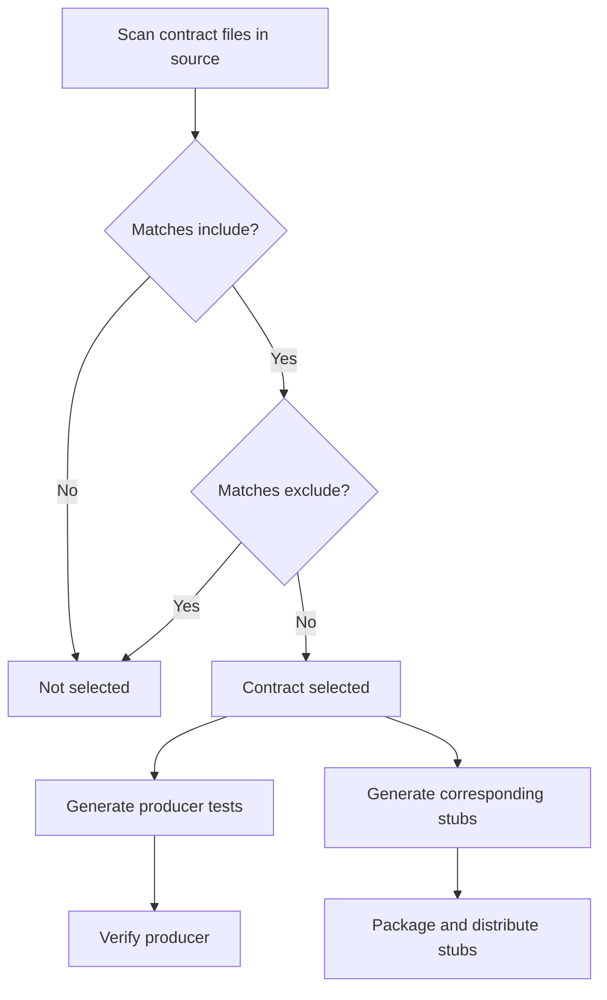
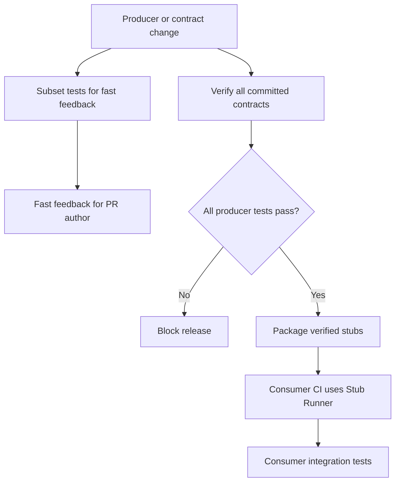

# Selecting Contracts Using Include and Exclude Filters

## 1. Why Filter Contracts?

In **Spring Cloud Contract**, a contract describes behavior agreed upon between a **producer** and a **consumer**: HTTP requests, responses, and matching rules, or messaging data and trigger conditions. Groovy/YAML DSL files serve as the source to generate **producer tests**, produce **stubs** for **Stub Runner**, and integrate API compatibility checks into CI.

A single producer may serve multiple consumers and accumulate many contracts. For example, an ordering system might have scenarios for `checkout`, `backoffice`, mobile apps, HTTP error cases, legacy APIs, and experimental APIs. When developing one API group, developers want to run a subset of contracts for fast feedback. Before releasing, however, the system must verify **all active commitments**.

**Include filters** select contract files eligible to participate in a run; **exclude filters** omit files outside that run's scope. They control the input set for **test/stub generation**, but do not change the producer's actual behavior and do not by themselves guarantee API compatibility.

By the end of this lesson, you will know how to organize directories by usage scope, write include/exclude rules, verify the exact set of selected contracts, and apply controlled filtering in Maven/Gradle and CI.

## 2. Understanding the Filtering Model Before Configuring the Plugin

Suppose:

- `D`: the set of contract files discovered by the tool in the source directory.
- `I`: the set of files matching at least one include rule.
- `E`: the set of files matching at least one exclude rule.
- `S`: the final selected set of files.

A common selection policy is expressed as:

```text
S = (D intersect I) minus E
```

Under this policy, if no include is configured then `I = D`; if no exclude is configured then `E` is empty. When a file matches both include and exclude, **exclude wins**. This is the selection model used in this lesson; verify the exact behavior and defaults of your **specific plugin version**, as pattern/path interpretation can vary.



**Note the differences among pattern syntaxes:**

| Syntax | Conceptual Example | Meaning |
| --- | --- | --- |
| Path glob | `checkout/**/*.groovy` | `.groovy` files under `checkout` at any depth |
| Regex | `checkout/.+\.groovy` | Path string following regular expression rules |
| Shell wildcard | `*.groovy` | Behavior depends on shell and execution context |

You cannot blindly copy strings across these three styles. For example, `**` in globs means something different from `**` in regex, and `.` differs too. Windows paths use `\`, while many matchers expect `/`. Verify whether the plugin's matcher evaluates **relative or absolute paths**, whether it is case-sensitive, and whether it normalizes path separators.

## 3. A Sample Directory Layout to Practice With

Suppose producer `order-service` contains:

```text
src/test/resources/contracts/
├── checkout/
│   ├── orders/
│   │   ├── get-confirmed-order.groovy
│   │   ├── get-missing-order.groovy
│   │   └── experimental-discount.groovy
│   └── payments/
│       └── get-payment.yml
├── backoffice/
│   ├── orders/
│   │   └── search-orders.groovy
│   └── reports/
│       └── export-report.yml
└── shared/
    └── health/
        └── service-status.groovy
```

This is an **illustrative layout**, not a structure mandated by Spring Cloud Contract. Teams should pick a clear classification dimension: by consumer, bounded context, API version, or stability. Clear naming rules help reviewers spot when a contract is placed in the wrong group.

Goal for a fast run: select all contracts under `checkout`, except files prefixed with `experimental-`.

```yaml
# ILLUSTRATIVE GLOB SPECIFICATION, NOT PLUGIN CONFIGURATION SYNTAX.
sourceRoot: src/test/resources/contracts
include:
  - "checkout/**/*"
exclude:
  - "checkout/**/experimental-*"
```

Applying the policy from Section 2, the expected result is:

| Path Relative to sourceRoot | Matches include? | Matches exclude? | Selected? |
| --- | :---: | :---: | :---: |
| `checkout/orders/get-confirmed-order.groovy` | Yes | No | **Yes** |
| `checkout/orders/get-missing-order.groovy` | Yes | No | **Yes** |
| `checkout/orders/experimental-discount.groovy` | Yes | Yes | **No** |
| `checkout/payments/get-payment.yml` | Yes | No | **Yes** |
| `backoffice/orders/search-orders.groovy` | No | No | **No** |
| `backoffice/reports/export-report.yml` | No | No | **No** |
| `shared/health/service-status.groovy` | No | No | **No** |

Paths and outcomes in the table are **expected values to verify against**. If your plugin actually expects regex or matches against a different base path, translate the rules accordingly before running.

### Distinguishing Source Directory from Filters

The source directory is where the plugin **searches** for contracts, whereas include/exclude decides which discovered contracts **participate in output generation**. If a contract sits outside the directory scanned by the plugin, even the broadest include cannot pick it up. If a contract sits in the right place yet gets excluded, having the physical file on disk does not guarantee a generated test.

## 4. Filter by Consumer, API Version, or Stability?

### By Consumer

A producer has `checkout/`, `backoffice/`, and `mobile/` directories. A fast checkout pipeline might select only `checkout/`. Yet if the producer still commits to supporting backoffice and mobile, **the release pipeline must not run only checkout**: it must protect every active contract.

Some Spring Cloud Contract features also support organizing or serving stubs per consumer. Those relate to **stub consumption/distribution**; do not mistake them for the exact same mechanism as input-file filtering during producer test generation.

### By API Version

If `v1/orders/` and `v2/orders/` coexist, selecting `v2` makes sense when iterating on a new flow. However, legacy consumers may still rely on `v1`. Filtering `v1` out of every pipeline merely because `v2` was written removes compatibility verification signals.

### By Readiness Level

You can separate `experimental/` from committed contracts. When excluding them from release builds, clearly document the reason and the promotion criteria. **Never use exclude to hide a failing producer test** caused by an implementation breaking a contract consumers already use.

## 5. Applying Include/Exclude in Maven or Gradle

Spring Cloud Contract integrates into a producer via its build plugin. Many versions offer file-selection mechanisms with properties commonly named `includedFiles` and `excludedFiles`. **Exact property names, data types, matcher syntax, and declaration format in Maven/Gradle must be verified against the documentation for your project's plugin version**; never treat the illustrative YAML above as runnable configuration.

One way to prepare configuration is to state requirements independently of syntax:

```text
contractsRoot = src/test/resources/contracts
include      = checkout contracts
exclude      = checkout contracts named experimental-*
expected     = 3 contracts, including success, 404, and payment
```

**Maven workflow:**

1. Identify the producer's `spring-cloud-contract-maven-plugin` and the contract DSL location the plugin actually reads.
2. Translate include/exclude criteria into the configuration supported by your plugin/version; verify whether patterns use regex, Ant globs, or another syntax.
3. Run the appropriate lifecycle, such as `./mvnw clean verify`, then inspect **generated test sources** and test count reports; when packaging stubs, inspect artifact contents.

**Gradle workflow:**

1. Identify the `org.springframework.cloud.contract` plugin, source root, and file-selection configuration in `build.gradle` or `build.gradle.kts`.
2. List tasks via `./gradlew tasks --all`, verifying whether contract test and stub generation tasks are wired into `check`/`build`.
3. Run the required tasks and inspect generated test code, reports, and the stubs artifact. A green build with **0 contract tests** does not prove your filter is right.

A Maven producer does not force consumers to use Maven. A Gradle consumer can still pull a `stubs.jar` published by a Maven producer, provided the artifact and version match.

If a plugin version does not support the desired filter style, you can split contract sets into separate modules or builds with explicit configurations. Avoid deleting, moving files, or altering contracts just to force them past a filter.

## 6. Cross-Checking Three Outputs After Filtering

A filter is truly trustworthy only when you verify **what was selected**, **what tests were generated**, and **what stubs were packaged**.

| Verification Layer | Question to Answer | Evidence |
| --- | --- | --- |
| Source files | Which contracts belong to the selected set? | List of source paths after applying include/exclude |
| Producer tests | Which scenarios were verified against the producer? | Generated sources, logs, executed test reports |
| Stub artifact | Which requests can the consumer simulate? | Mappings/responses inside the stubs JAR |

For a packaged HTTP artifact, you can inspect its entries with the JDK:

```bash
jar tf order-service-1.2.0-stubs.jar
```

Entry filenames may differ by version, classifier, and build plugin. Inspect the actual mappings, responses, and scenarios rather than relying solely on filenames. **The number of DSL files does not necessarily equal the number of test methods or mappings**, because a single DSL file can express multiple contracts or tooling may structure generated outputs differently.

In the Section 3 example, you should find evidence for `get-confirmed-order`, `get-missing-order`, and `get-payment` in the corresponding outputs. `experimental-discount`, `search-orders`, and `export-report` should not appear in the fast checkout subset. In particular, `404` is critical behavior if the consumer handles "not found": do not exclude error scenarios just because their names lack `success`.

### Critical Failure Signal

If after updating include rules, logs show zero contracts selected and the test runner executes 0 tests, the build may still succeed depending on configuration. This is a **test-scope failure**, not proof that the producer complies with every contract. CI should enforce non-empty selection and verify required contracts are present.

## 7. Do Not Confuse Contract Filtering with Stub Selection in Stub Runner

Selection happens at two separate stages:

- **During the producer build:** include/exclude decides which contract files participate in generating tests and stubs, per plugin configuration.
- **During consumer tests:** Stub Runner fetches the artifact containing already-generated stubs by coordinates such as `group:artifact:version:classifier:port`.

Example Stub Runner configuration on the consumer:

```java
import org.springframework.cloud.contract.stubrunner.StubRunnerProperties;
import org.springframework.cloud.contract.stubrunner.spring.AutoConfigureStubRunner;

@AutoConfigureStubRunner(
    ids = "com.example:order-service:1.2.0:stubs:9090",
    stubsMode = StubRunnerProperties.StubsMode.LOCAL
)
class CheckoutContractTest {
    // Client sends requests to the stub on port 9090; add tests and assertions.
}
```

This illustrates configuration only, not a complete test. `LOCAL` requires the artifact to be installed in local Maven cache; CI using a remote repository needs appropriate mode and repository settings. `ids` selects the **artifact and port**, not a filter over `.groovy` or `.yml` files. If a contract was excluded from the stubs JAR, Stub Runner cannot conjure up that contract's response on demand.

For messaging contracts, outputs can involve message/trigger configurations rather than HTTP WireMock mappings. Source-selection principles still need verification, yet inspecting only HTTP mappings in the JAR cannot confirm all messaging contracts were processed.

## 8. Designing Safe Filters for CI



| Stage | Selection Scope | Expectation |
| --- | --- | --- |
| Local development | Only the active API group, excluding experimental cases with justification | Fast feedback; explicitly note full suite was not run |
| Pull request | Relevant subset plus mandatory required checks | Catch direct regressions without replacing release checks |
| Producer release | Every active contract committed to supported consumers | Block release if any contract is missing or violated |
| Consumer CI | Published stubs artifact with pinned version | Verify consumer parses and handles API as committed |

Record in CI logs: source root, include/exclude rules, selected filenames, plugin version, count of generated tests **executed**, and stubs JAR coordinates. Counting tests alone is insufficient; when contracts move across folders, mis-selected tests might happen to yield the same count.

A dangerous mistake is changing `checkout/**` to `checkouts/**` so zero files match. Without an "empty selection" check, the job may turn green while verifying nothing. Fail when required contracts are missing, or at minimum forbid using a subset job as a release gate.

## 9. Common Mistakes

| Symptom | Possible Cause | How to Investigate |
| --- | --- | --- |
| No generated tests | Wrong include, wrong source root, or plugin ignores file extension | DSL scan logs, file list, plugin version |
| Unwanted extra contracts selected | Overly broad pattern or unclear folder classification | Compare expected vs. actual matrix |
| Exclude has no effect | Used glob syntax where regex is expected, or wrong path/filename | Check pattern semantics of your exact plugin version |
| File matching both include and exclude stays included | Config not picked up by plugin or misunderstood precedence | Inspect effective applied config and generated output |
| Passes locally, differs in CI | Case sensitivity, `/` vs `\` separators, JDK, or build profile | Diff logs of selected contract lists |
| Consumer receives `404` from stub | Request misses mapping or expected stub missing from artifact | Check request, mapping, artifact, and port |
| Producer tests green while consumer lacks stub | Only subset built, packaging error, or wrong artifact version pulled | Trace all three layers: source → tests → stubs |
| Renaming a folder makes contracts vanish | Include depends on old path | Review filters and folder moves in the same PR |

Filtering limits scope, but never fixes API bugs. If the producer renames `status` to `state` and the existing contract fails, excluding that contract just to make CI green hides breaking-change detection. Fix the implementation or agree on a migration with consumers.

## 10. Practice Exercise

Contract source:

```text
checkout/orders/get-order.groovy
checkout/orders/get-order-404.groovy
checkout/orders/experimental-bulk.groovy
checkout/payments/get-payment.yml
admin/orders/get-order-audit.groovy
shared/health/health-check.groovy
```

**Requirement:** The fast check suite includes only stable checkout contracts. The `404` error branch is behavior the consumer relies on. The release suite must verify every committed contract across checkout, admin, and shared.

Complete these steps:

1. Write illustrative glob include/exclude rules and list the exact three contracts selected in fast checkout mode.
2. Translate the patterns into the exact syntax of the Maven or Gradle plugin your project uses; verify path and matcher assumptions.
3. Run producer test and stub generation; compare selected contract names with generated sources, reports, and stubs JAR contents.
4. Use Stub Runner to run consumer tests against a specific artifact version.
5. Rename `checkout` to `checkouts` without updating include: predict the symptom; add a check so CI catches empty selection.
6. Explain why a release job must never rely solely on the fast checkout filter.

### Suggested Solution

```yaml
# Conceptual intent using globs; do not paste verbatim into Maven/Gradle without verifying syntax.
include:
  - "checkout/**/*"
exclude:
  - "checkout/**/experimental-*"
```

The three selected contracts are `checkout/orders/get-order.groovy`, `checkout/orders/get-order-404.groovy`, and `checkout/payments/get-payment.yml`. `experimental-bulk` is excluded; `admin` and `shared` fall outside the fast run scope. For release, use a broader set covering all supported consumers. After renaming a folder, the job should warn or fail if required files are no longer selected.

## 11. Pre-Application Checklist

- [ ] DSL source and contracts root scanned by the plugin are confirmed.
- [ ] Pattern syntax (regex/glob), path normalization, and case sensitivity are clearly understood.
- [ ] A clear table exists listing contracts **expected** and **excluded** for each job.
- [ ] Include and exclude produce the exact intended set, including files matching both.
- [ ] Generated producer tests are present **and executed**, including required error cases.
- [ ] Stub artifact contains responses consumers need; Stub Runner pulls the right version.
- [ ] CI guards against empty selection and missing mandatory contracts.
- [ ] Release jobs still verify all active commitments; folder/pattern changes are reviewed together.

**Key takeaway:** Include and exclude filters manage only **contract processing scope**. They are valuable for local development and splitting test suites, yet can create blind spots if misconfigured. In Spring Cloud Contract, always verify the selected source set, generated/executed producer tests, and actual stubs delivered to consumers before concluding a pipeline protects API compatibility.
