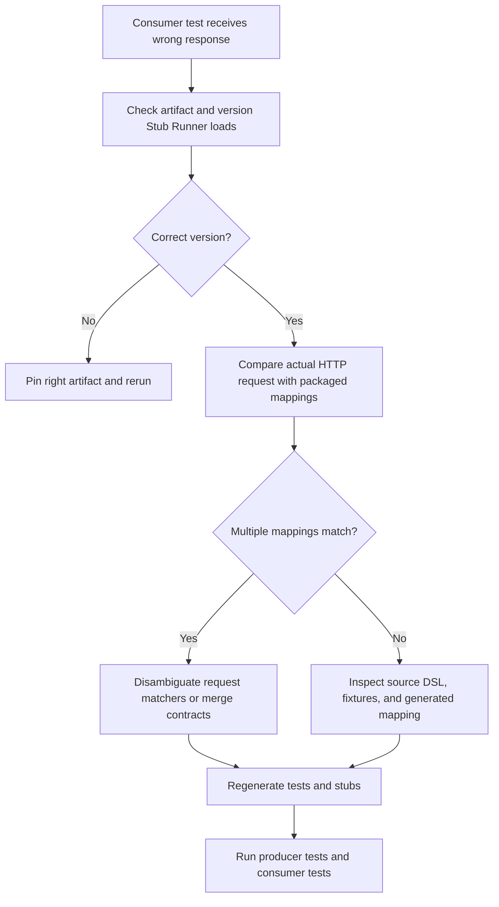

# Avoiding Duplicate Test Names, Labels, and Stub Paths

A Spring Cloud Contract project may start with just a few Groovy or YAML contracts. As multiple consumer teams contribute, the number of contracts grows, and `200`, `400`, `404` scenarios, message events, and API versions begin to overlap. Without disciplined naming, a seemingly small change can cause **duplicate generated test names**, **message labels that fail to pinpoint which contract to trigger**, or **two stubs matching the same HTTP request yet returning different responses**.

This lesson belongs to the **Contract Organization** section of **SPRING_CLOUD_CONTRACT**. The goal is to design naming conventions, directory splits, and conflict checks so the producer team can generate tests from Groovy/YAML DSL, publish stubs, and let consumers use Stub Runner predictably. These rules apply both when contracts are maintained inside the producer repository and when they are contributed by multiple consumers.

## 1. What Types of Duplication Exist?

In Spring Cloud Contract, a **contract** has several distinct identities. They do not serve the same role and cannot substitute for one another:

| Concept | Example | What Is It Used For? | Risk If Duplicated or Ambiguous |
|---|---|---|---|
| **Contract source file path** | `contracts/checkout/get_order_found.groovy` | Managing DSL in Git and feeding plugin input | Overwritten files, hard reviews, accidentally editing the wrong scenario |
| `name` in DSL | `checkout_get_order_found_200` | Meaningful contract identifier; can affect generated test names depending on plugin/version | Colliding generated test names or symbols, hard-to-trace failures |
| `description` in DSL | `Checkout retrieves existing order` | Helps human readers understand the scenario | Duplicate descriptions do not necessarily break builds, but make reports confusing |
| `label` in messaging contracts | `checkout_order_created_v1` | Identifies a message scenario to trigger via stub trigger mechanism | Triggering the wrong or ambiguous scenario when labels collide in active scope |
| **HTTP stub matching criteria** | `GET /api/orders/42`, headers, query, body | Selects the stub response matching a consumer request | Two mappings match the same request yet return conflicting responses |
| **Mapping path inside artifact** | `META-INF/.../mappings/...json` | Stores generated stubs for Stub Runner to load | Overwrites or hard-to-locate mappings when generated names/paths collide |
| **Stub artifact coordinates** | `com.example:order-service:1.2.0:stubs` | Identifies the stub bundle consumers pull | Consumers test against wrong version, wrong producer, or stale stub |

Two files having different names **do not prove** their underlying stubs differ. Conversely, two contracts mentioning the `/api/orders/{id}` endpoint do not necessarily conflict if they specify clearly distinct request conditions, such as an existing ID versus a non-existent ID.

Therefore, you must check **names**, **labels**, and **the actual request scope matched by stubs** together.

## 2. Scalable Team Naming Conventions

A useful convention should answer four questions at a glance: **which consumer needs this behavior, what operation, which scenario, and what expected outcome**.

Example for producer `order-service` with two consumers `checkout` and `support`:

```text
src/test/resources/contracts/
├── checkout/
│   ├── get_order_found_200.groovy
│   ├── get_order_missing_404.groovy
│   └── create_order_invalid_400.yml
└── support/
    ├── get_order_history_found_200.groovy
    └── get_order_history_missing_404.yml
```

This is a **recommended organization**, not the only structure Spring Cloud Contract supports. The default source directory and how the plugin derives test packages/classes can vary by version and configuration; confirm them in your project build.

You can use a naming pattern such as:

```text
<consumer>_<operation>_<scenario>_<expectedResult>
```

For example:

- `checkout_get_order_found_200`
- `checkout_get_order_missing_404`
- `support_get_order_history_found_200`
- `billing_order_created_event_v1`

Practical rules:

1. Use **behavior-describing terms** (`found`, `missing`, `invalid`, `unauthorized`) instead of `test1`, `test_new`, or `final2`.
2. Pick a stable format, such as lowercase and underscores for files/identifiers; never rely on differences solely in letter casing, spaces, or hyphens.
3. Make names **unique within the producer build scope**. Since `name` may be used to derive test method/class names, do not rely on two files sitting in different folders to avoid collisions.
4. Do not tack version numbers onto every name indiscriminately. Only add `_v1` or `_v2` when multiple behaviors/versions genuinely coexist; release lifecycle is also tracked via artifact versions.
5. `name` is a technical identifier; `description` explains business intent to human readers. Never rely on `description` as a uniqueness mechanism.

### 2.1. Distinguishing `name`, Filename, and `description`

Example Groovy contract for consumer Checkout:

```groovy
import org.springframework.cloud.contract.spec.Contract

Contract.make {
    name 'checkout_get_order_found_200'
    description 'Checkout retrieves an existing order to display its status'

    request {
        method GET()
        url '/api/orders/42'
        headers {
            header 'Accept', 'application/json'
        }
    }

    response {
        status OK()
        headers {
            contentType(applicationJson())
        }
        body(
            id: 42,
            status: 'CREATED'
        )
    }
}
```

The file can be saved as `checkout/get_order_found_200.groovy`. Here, `name` intentionally provides a distinct identifier while `description` explains the goal. The Spring Cloud Contract plugin uses contract metadata to generate tests and mappings; **the exact way filenames, `name`, and directories translate into class/method/file names depends on the plugin version**, so inspect actual build output rather than guessing conversion rules.

A YAML contract for another scenario can follow the same naming policy:

```yaml
name: checkout_get_order_missing_404
description: Checkout receives an error when the order ID does not exist
request:
  method: GET
  url: /api/orders/999
  headers:
    Accept: application/json
response:
  status: 404
  headers:
    Content-Type: application/json
  body:
    code: ORDER_NOT_FOUND
```

The two illustrative contracts intentionally use IDs `42` and `999` so they **do not match the same request**. Real values in a project must align with deterministic producer test fixtures; `999` works as a non-existent ID only if the test environment guarantees it.

### 2.2. Avoiding Names That Look Different Yet Collide After Normalization

Some pipelines convert hyphens, spaces, or invalid characters into underscores when generating Java names. Teams should therefore avoid pairs like:

```text
checkout-get-order-found
checkout_get_order_found

GetOrderFound
getorderfound
```

It is unsafe to assume every generator version handles both identically. They are **far too prone to confusion or collision** across normalization steps and when collaborating across Windows, macOS, and Linux. Standardizing on one casing style avoids depending on plugin and filesystem quirks.

## 3. Avoiding Duplicate Test Names Generated from Contracts

In the producer verification model, Spring Cloud Contract takes DSL files, generates Java test code, and runs those tests against the implementation. As contracts grow, unclear names complicate both **code generation** and **CI report analysis**.

Consider two files:

```text
checkout/get_order_found.groovy
support/get_order_found.groovy
```

If both declare `name 'shouldReturnOrder'`, the team may be unable to distinguish them in test reports and risks name collisions during code generation depending on how the plugin creates test classes and methods. Do not assume different folders guarantee uniqueness; instead use:

```text
checkout_get_order_found_200
support_get_order_found_200
```

Proper verification steps on the producer side:

1. Check filenames and `name` values before merging contracts.
2. Run the current build's contract-test generation task to inspect actual generated classes/methods.
3. Verify generated tests have the **expected count, no overwrites, and trace cleanly back to source DSL files**.
4. Execute producer contract tests; successful code generation alone does not prove endpoints satisfy contracts.
5. When CI reports a failure, trace back from the class/method or contract name to the **exact consumer, scenario, and source file**.

Example commands for a **properly configured project**, run inside the producer repository:

```bash
# Maven Wrapper
./mvnw clean test

# Or Gradle Wrapper
./gradlew clean test
```

Do not run both tools if the project uses only one build system. Whether generated tests run in the `test` phase depends on plugin configuration. Inspect the plugin output directory and test reports according to your active version.

**Signs that require investigation:** fewer generated tests than expected scenarios, two contracts appearing with the same name in reports, compiler errors about duplicate classes/methods, or a previously generated mapping/test file vanishing after adding a new contract.

## 4. `label`: Use Only When Actually Needed to Trigger Messages

In Spring Cloud Contract, `label` is primarily used in **messaging contracts** so Stub Runner can **trigger** an event/message defined in the contract. It differs from `description` and should not be used as a decorative tag on every HTTP contract.

Example of a producer emitting an order-created event:

```groovy
import org.springframework.cloud.contract.spec.Contract

Contract.make {
    name 'billing_order_created_event_v1'
    label 'billing_order_created_v1'
    description 'Billing receives a message when a new order is created'

    input {
        triggeredBy('publishOrderCreated()')
    }

    outputMessage {
        sentTo('orders.events')
        body(
            orderId: 'ORDER-42',
            type: 'ORDER_CREATED'
        )
    }
}
```

In producer verification, `publishOrderCreated()` is a **project-provided test hook**, such as in a base test class; it is not a built-in Spring Cloud Contract API. On the consumer side, Stub Runner or the stub-triggering mechanism can use **label** to request emitting the corresponding stub message, depending on binder/message-verifier configuration and library version.

For example, these two labels are a **poor choice** when both stub groups may be loaded together:

```text
billing/order_created.groovy       -> label: order_created
analytics/order_created.groovy     -> label: order_created
```

Whereas:

```text
billing/order_created.groovy       -> label: billing_order_created_v1
analytics/order_created.groovy     -> label: analytics_order_created_v1
```

helps distinguish intent when triggering. Strict technical uniqueness scope can depend on **artifact boundaries, Stub Runner, and trigger invocation style**; team policy should ensure labels never collide **across stubs that may be loaded and triggered together**, using clear prefixes by consumer or event type.

Do not confuse `label` with **topic/queue names**: two contracts may both send to topic `orders.events` while representing two distinct event types. The topic/queue is the **message delivery destination**, whereas `label` is the **identifier of the scenario to trigger**. If two contracts share the same `label` with different outputs, consumer tests may fail to control which exact message they receive.

### 4.1. Label Naming Rules

- Declare `label` only when a messaging scenario needs it for triggering or referencing.
- Use stable, semantic names like `<consumer>_<event>_<version>` rather than `event1` or `trigger`.
- Consider all consumers and artifacts Stub Runner might load within **a single test session**, not just one folder.
- When changing a label, update all consumer tests invoking the old label in sync; changing a label can break tests even when the message structure did not change.
- Do not use labels to differentiate two messages with identical content when the system has not defined clear distinguishing conditions or event types; clarify the contract first.

## 5. Duplicate URLs and HTTP Matching Conditions: Worse Than Duplicate Names

In HTTP stubs, what decides which response Stub Runner returns is not the filename, but the **request mapping** generated from the contract: method, URL/path, headers, query parameters, body, and associated matchers.

Suppose two contracts exist:

| Contract | Request Matched by Stub | Response |
|---|---|---|
| `checkout_get_order_found_200` | `GET /api/orders/42` | `200`, `status=CREATED` |
| `support_get_order_cancelled_200` | `GET /api/orders/42` | `200`, `status=CANCELLED` |

If both match the same request condition while returning incompatible responses, a single HTTP request gives the stub no way to tell which producer state applies. Making filenames arbitrarily long **will not resolve** this conflict.

WireMock and stub servers have their own mapping selection and priority rules. Matching order can be influenced by priority, load order, or version configuration; never rely on implicit behavior to mask two contracts specifying different responses for the exact same condition.

There are three clear ways to resolve this:

1. **Use distinct requests** when business logic permits, such as `GET /api/orders/42` and `GET /api/orders/999` for found vs. not-found cases.
2. **Add meaningful request conditions** when the API actually differentiates by query, header, or body. For example, `GET /api/orders/42?view=summary` and `GET /api/orders/42?view=history` if the producer **genuinely implements** that rule.
3. **Merge or rewrite contracts** if two files are verifying the exact same behavior. Never invent artificial response variants just to help the stub pick a mapping.

Do not add fake headers like `X-Test-Scenario: cancelled` solely to separate stubs if the real producer does not use or commit to that header. Contract tests would then verify a fictitious protocol different from what consumers call in production.

### 5.1. Distinguishing URL Paths and Matching Criteria

Some requests look textually distinct yet can still be matched by the same broad mapping:

```text
GET /api/orders/42
GET /api/orders/999
GET /api/orders/{id}       (route notation)
GET /api/orders/.*         (if DSL uses an appropriate regex)
```

Notation `{id}` is a **documentation route convention**, not necessarily valid matcher syntax when pasted directly into the DSL. In Contract DSL, specify an exact URL or a matcher/regex per your Spring Cloud Contract version's API. An overly broad matcher covering all IDs can accidentally intercept request `999` before the intended `404` mapping.

Risky example:

```text
Mapping A: GET /api/orders/[0-9]+ -> 200
Mapping B: GET /api/orders/999    -> 404
```

Because `999` also matches `[0-9]+`, the two mappings **overlap**. When designing stubs, it is best to craft **mutually exclusive** matchers or use clearly separated test datasets. Consider mapping priorities only when an intentional fallback is genuinely needed and the tool supports explicit priority configuration; still write tests proving that rule.

### 5.2. Headers, Query Parameters, and Bodies Also Cause Collisions

Identical URLs are not the only source of overlap. Consider two POST contracts targeting the same endpoint while each expects a different body:

```json
{"operation":"CONFIRM","orderId":"42"}
```

and:

```json
{"operation":"CANCEL","orderId":"42"}
```

If both match only `POST /api/orders/actions` without constraining the `operation` field, the stub may match the wrong mapping. Use **body matchers** for attributes that determine behavior. Similarly, if the real endpoint differentiates by `Accept`, `Content-Type`, `If-Match`, or query parameters, declare those conditions per the API commitment.

For dynamic values like auto-generated IDs or timestamps, use appropriate matchers so tests are not overly brittle. However, matchers must remain **narrow enough** to preserve business meaning; putting `.*` regex on every field makes distinct scenarios indistinguishable.

## 6. Stub File Paths and Artifact Coordinates: Avoiding Packaging Collisions

In Spring Cloud Contract, `.groovy`/`.yml` files are the **source**. The build plugin uses them to produce **generated tests** and **stub mappings**; the project can then package mappings into an artifact for Stub Runner. These are three separate path layers:

```text
Contract source in repository
  src/test/resources/contracts/checkout/get_order_found_200.groovy
                  |
                  v
Generated tests and WireMock mappings (build directory decided by plugin)
                  |
                  v
Packaged and published artifact
  com.example:order-service:1.2.0:stubs
                  |
                  v
Stub Runner downloads artifact, loads mappings, starts HTTP stub server
                  |
                  v
Consumer calls GET /api/orders/42
```

In a typical Maven artifact model, the stubs JAR might have a layout like:

```text
META-INF/
└── com.example/
    └── order-service/
        └── 1.2.0/
            ├── contracts/
            │   └── ...
            └── mappings/
                └── ...json
```

Exact internal paths, mapping filenames, and whether raw contract sources are also bundled **depend on the plugin and active configuration**. What must be checked is that the final artifact holds **all needed mappings**, with no overwrites, and Stub Runner loads the exact bundle belonging to the target producer.

### 6.1. Duplicate Basenames or Generated Filenames

Two source files in different folders can share the same basename, such as `checkout/get_success.groovy` and `support/get_success.groovy`. Depending on file generation rules, the two mappings may land in separate subdirectories or be renamed to avoid overwriting. **Do not assume either way.** Inspect the packaged artifact contents and compare against the expected contract list.

To preserve clarity across every stage, use semantic basenames right from the source:

```text
checkout_get_order_found_200.groovy
support_get_order_history_found_200.groovy
```

When renaming files or moving folders, check the impact on generated test paths, base-class mapping rules, and build contract-loading rules. Never delete old files casually if pipelines or consumers still rely on stub artifacts from prior versions.

### 6.2. Duplicate Artifact Coordinates and Stub Version Mix-Ups

Maven coordinates for a stub artifact are typically identified by **group ID, artifact ID, version, and the `stubs` classifier**. For example:

```text
com.example:order-service:1.2.0:stubs
com.example:payment-service:1.2.0:stubs
```

Two different producers must never publish different payloads under the same coordinates. Furthermore, avoid publishing inconsistent contents to **the same released version**. When consumers configure Stub Runner, pin a stub version traceable to a producer commit/version the team actually verified.

For instance, a consumer accidentally pinning `order-service:1.1.0:stubs` while the producer verified and released `1.2.0` will keep seeing outdated behavior. Clean contract filenames cannot fix selecting the wrong artifact version.

**Distinction:** the URL `GET /api/orders/42` is the **API path served by the stub**, whereas `META-INF/.../mappings/...json` is the **mapping resource path inside the stub archive**. Duplicate URLs risk ambiguous response selection; duplicate mapping names/paths risk overwriting resources; wrong coordinates cause Stub Runner to load the wrong stub bundle.

## 7. When Are Two Contracts Allowed to Share the Same Endpoint?

You do not need to force every contract onto a different endpoint. One API can have multiple valid scenarios for the same method and path when input conditions differ.

| Scenario | Same Method/Path? | Can Coexist? | Condition |
|---|---|---|---|
| `GET /api/orders/42` returns `200` and `GET /api/orders/999` returns `404` | Different concrete URLs | Yes | Producer fixtures guarantee existing vs. missing IDs |
| `POST /api/orders/actions` with `operation=CONFIRM` or `CANCEL` | Yes | Yes | Body matchers distinguish the two operations |
| `GET /api/orders/42` returns `200 CREATED` or `200 CANCELLED` for the identical request | Yes | **Ambiguous** | Must add real state/criteria or separate producer setups; stubs do not track system state automatically |
| `GET /api/orders/42` from two consumers expecting the identical response | Yes | Possible, though consider merging | If it is the exact same commitment, avoid duplicating and drifting copies |
| Matcher `GET /api/orders/.*` and matcher `GET /api/orders/999` | Overlapping | Risk of conflict | Tighten matcher scope, or define explicitly tested fallback/priority |

In producer contract tests, two scenarios sharing a request can run under separate fixture states if base test classes prepare different data. However, **HTTP stubs typically do not maintain producer-side state** unless you explicitly configure stateful simulation behavior. Thus, scenarios with identical requests yet differing responses must be designed carefully before publishing.

## 8. Setting Up Conflict Checks in Review and CI

Manual checks work in small projects; with multiple consumers, automate several checks in the pipeline before the producer publishes stubs.

### 8.1. Static Inspection Layer

When reviewing a pull request containing new contracts:

1. Scan all `.groovy`, `.yml`, and `.yaml` files treated by the plugin as contracts.
2. Check file paths and normalized names per team conventions (including case-insensitive collision checks if contributors use Windows/macOS).
3. Extract `name` and, for messaging contracts, `label`; warn if duplicates appear within the expected build or Stub Runner session scope.
4. Check that every contract has a `description`, clear request/matchers, and meaningful response.
5. Flag pairs of HTTP contracts sharing the **same method and potentially intersecting request sets** for review. Do not compare raw URL strings alone; examine regexes, query parameters, headers, and bodies.

Example quick search across the contracts directory using `ripgrep`:

```bash
rg -n --glob '*.groovy' --glob '*.yaml' --glob '*.yml' \
  'name|label|method|url|urlPath|bodyMatchers' \
  src/test/resources/contracts
```

This command's output only aids **manual review**. It is not a full parser: the word `name` may appear inside descriptions/bodies; Groovy DSL can use expressions; YAML has nested structures. A serious automated check should use a proper parser/AST or normalized outputs from the build tool, then construct appropriate conflict keys.

Example key model for review automation, **not DSL syntax**:

```text
File identity:       normalized relative path
Generated test key:  generated class + method (after plugin generation)
Message trigger key: loaded stub artifact + label
HTTP matcher key:    method + path matcher + query/header/body constraints
Stub artifact key:   groupId + artifactId + version + classifier
```

Each key operates in a different scope. For instance, `method + path` is only a **candidate-pair filter**, insufficient on its own to prove two matchers conflict. Nor should every contract using `GET /api/orders` be treated as a duplicate when they match distinct valid query parameters.

### 8.2. Build and Runtime Verification Layer

After static checks:

1. Run the plugin to generate producer contract tests and mappings using the repository wrapper.
2. Inspect generated tests, count of processed contracts, duplicate-name warnings, and compilation errors.
3. Run producer contract tests against controlled data.
4. Package the stub artifact and inspect mappings inside to confirm all expected scenarios are present.
5. Have Stub Runner load the **exact artifact/version**; send representative consumer requests to verify mapping selection and responses.
6. For messaging contracts, trigger each label in the expected scope and inspect the emitted topic/queue, headers, and body.

For requests prone to overlap, write **consumer integration tests** covering both specific and broad cases rather than testing just one case and assuming everything works. Never rely solely on build generation succeeding, because matcher conflicts may surface only when the stub server handles live HTTP requests.

### 8.3. Merge or Release Blocking Criteria

| Check Result | Action |
|---|---|
| Two contracts generate duplicate method/class names | Block merge; fix contract `name`/path and re-inspect output |
| Two labels collide within the consumer test triggering scope | Block or clarify scope; set explicit labels and update consumers |
| Two HTTP mappings match the same request with conflicting responses | Block stub release; disambiguate matchers/contracts |
| Multiple contracts identical in both request and response | Review to merge or justify separation; reduce drift risk |
| Stub artifact has wrong version or missing mappings | Block release; fix packaging/publishing and retest |
| Producer tests fail | Do not publish stub as producer-verified; fix implementation or fixtures |

**A strong pipeline checks more than syntax validity**—it verifies end-to-end traceability from DSL files to generated tests, mappings, and the stub artifact consumers actually run against.

## 9. Incident Workflow When a Conflict Has Already Occurred

Suppose consumer tests start receiving `200` instead of `404` after a new contract is added. Investigate in sequence:



Record clear evidence at each step:

1. **Capture the actual request** from the consumer: method, path, query, relevant headers, and body. Avoid leaking sensitive tokens/cookies in logs.
2. **Record the stub coordinates** Stub Runner actually loaded, including version and classifier.
3. **Open the packaged mappings** and search for every mapping capable of matching that request; do not look solely by DSL filename.
4. **Trace back to the source contract** via name/path/description. If names were ambiguous, establish a clearer convention after fixing the root cause.
5. **Fix the matcher or contract** with the relevant teams; never hack around the bug by tweaking file ordering or relying on mapping load order.
6. **Regenerate and test both sides.** For changes affecting the real API, the producer must pass contract tests before publishing the verified stub.

If the failure is a **duplicate message label**, instead of inspecting HTTP requests, identify the label the consumer triggers, all loaded artifacts, and the actual message emitted. Renaming a label may affect tests in other consumers, so check all usages before renaming.

## 10. Hands-On Exercise: Cleaning Up Order Service Contracts

Given a producer `order-service` and three recorded contract files:

```text
src/test/resources/contracts/
├── checkout/
│   ├── success.groovy        # name: shouldReturnOrder
│   └── missing.yml           # name: shouldReturnMissingOrder
└── support/
    └── success.groovy        # name: shouldReturnOrder
```

Both `checkout/success.groovy` and `support/success.groovy` currently match `GET /api/orders/42`, yet one returns `status=CREATED` and the other returns `status=CANCELLED`. Additionally, two messaging contracts share `label: order_created`, even though one scenario serves Billing and the other serves Analytics.

Perform the following tasks:

1. **List all conflicts**: duplicate `name` (`shouldReturnOrder`), two HTTP matchers capable of matching the same request, and two message labels prone to ambiguity when loaded together.
2. **Rename** following team conventions, such as `checkout_get_order_found_200` and `support_get_order_cancelled_200`; rename the files accordingly for traceability.
3. **Resolve the HTTP conflict at its root**: determine whether the real API has any condition distinguishing `CREATED` and `CANCELLED` orders. If none exists, do not keep two stubs with identical requests and conflicting responses. Design distinct fixtures/matchers or renegotiate the contract.
4. **Update labels** to `billing_order_created_v1` and `analytics_order_created_v1` if they are genuinely separate scenarios requiring independent triggers; update consumer tests.
5. **Generate producer tests and stub mappings** via the plugin, inspecting generated test names, mappings, and artifact contents.
6. **Run Stub Runner** with an explicit artifact version; test representative HTTP requests and trigger labels for each scenario.
7. **Write a review/CI rule** to catch all three conflict classes early on future contract contributions.

The exercise succeeds when every scenario has a traceable identity, no single HTTP request receives unintended conflicting responses, message labels are unambiguous, and both producer/consumer tests use the right packaged stub bundle.

## 11. Self-Check Questions

1. **Do two differently named contract files guarantee no collision when Stub Runner runs?** No. If their HTTP matchers overlap or match identically, they can still intercept the same request.
2. **How do `name` and `description` differ?** `name` is the technical scenario identifier that can affect generated names; `description` is business prose helping humans understand the contract.
3. **Why should each triggerable message contract have a distinct label?** So consumer tests trigger the exact intended scenario when multiple stubs are loaded and avoid mixing up messages.
4. **Are `GET /api/orders/[0-9]+` and `GET /api/orders/999` mutually exclusive?** No; ID `999` matches both. Clarify the matchers or define explicit fallback rules.
5. **Does renaming `success.groovy` to `checkout_success.groovy` fix two conflicting responses for the same request?** No; you must resolve matching criteria and underlying business rules.
6. **Is it safe if Stub Runner uses the right filename yet the wrong artifact version?** No; that stub bundle may reflect an outdated contract. Always pin coordinates/versions matching a verified build.
7. **Why is static checking alone insufficient?** Because DSL and matchers can create conflicts that surface only after generating mappings or running live stubs; you also need generated-test checks and consumer tests with Stub Runner.

## Conclusion

In Spring Cloud Contract, **duplicate test names, duplicate message labels, and overlapping stub matchers** are three distinct risks. Naming conventions help locate the right contract; unique labels within active scope ensure the right message is triggered; clear HTTP matchers guarantee stubs return the right response for each request. Adding checks for generated tests, artifact mappings, stub versions, and live Stub Runner verification in CI lets producer and consumer teams catch conflicts early before an API change breaks integration.
