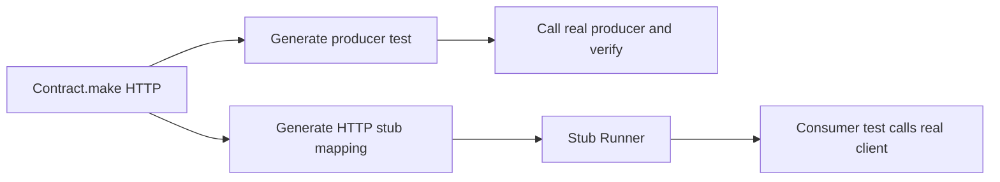

# Structure of Contract.make and Basic Blocks

## 1. What Is Groovy DSL Used to Describe?

In **Spring Cloud Contract** (`SPRING_CLOUD_CONTRACT` module), **Groovy DSL** is a way to define interaction contracts between a **producer** (the service providing the behavior) and a **consumer** (the application depending on that behavior). A contract can describe:

- **HTTP**: the consumer sends the method, URL, headers, and body; the producer returns the HTTP status, headers, and body.
- **Messaging**: the producer emits a message when triggered or after receiving an input message; the contract specifies the destination, headers, and payload to observe.

From a Groovy contract, Spring Cloud Contract can **generate tests for the producer** and **generate stubs** so that the consumer can test integration independently. HTTP stubs are typically run via **Stub Runner**; messaging contracts require an appropriate mechanism to trigger and observe messages. CI pipelines can use these tests to detect incompatible API or event changes.

The goal of this lesson is to be able to **read and write a Groovy DSL file using `Contract.make`**, understand the role of its basic blocks, and know which parts are verified on the producer side and which parts are simulated for the consumer. This is the syntax of a *contract*, not business-logic Controller or service code.

## 2. Skeleton of a Contract

Typically, a Groovy contract is placed in a `.groovy` file under the contracts directory scanned by the Spring Cloud Contract plugin (for example, `src/test/resources/contracts/` in a Maven project, unless configured otherwise).

```groovy
import org.springframework.cloud.contract.spec.Contract

Contract.make {
    name 'get_order_success'
    description 'Retrieve an existing order'

    request {
        method GET()
        url '/api/orders/ord-1001'
    }

    response {
        status 200
        headers {
            contentType(applicationJson())
        }
        body([
            id    : 'ord-1001',
            status: 'CREATED'
        ])
    }
}
```

**Reading from outside in:**

1. `import org.springframework.cloud.contract.spec.Contract`: brings the contract declaration helper class into scope.
2. `Contract.make { ... }`: the root block that creates a contract specification. The curly braces pass a **Groovy closure** containing the DSL statements.
3. `name`, `description`: metadata used to name and explain the test case.
4. `request { ... }`: the HTTP input sent by the consumer.
5. `response { ... }`: the HTTP output committed by the producer.

In this example, the contract states: *"When calling `GET /api/orders/ord-1001`, the service returns `200` with JSON containing `id = ord-1001` and `status = CREATED`."*

### 2.1. Block Diagram

```text
Contract.make {
    name / description          <- contract metadata
    request {                   <- HTTP request
        method / url
        headers / body / ...
    }
    response {                  <- HTTP response
        status
        headers / body / ...
    }
}
```

The root block for a **messaging** contract is still `Contract.make`, but its inner blocks can be replaced with `input` and `outputMessage`. Therefore, before writing code, determine the protocol and which outcomes the consumer actually observes.

## 3. Meaning of `Contract.make`, Closures, and Metadata

### 3.1. `Contract.make` Is a DSL, Not a Runtime API Call

At build time, the Spring Cloud Contract plugin **reads** the Groovy file to build the contract model. It does not mean that every real HTTP request in the live system will invoke the `Contract.make` closure. The DSL only describes the expected behavior so the tool can generate tests and stubs.

For example, `status 200` in the DSL does not automatically modify the Controller to return `200`. If the actual Controller returns `404` for the corresponding fixture, the generated **producer test** will detect the discrepancy.

Groovy allows concise syntax:

```groovy
name 'get_order_success'
method GET()
status 200
```

These lines are similar to passing arguments to methods in the DSL context. They are **not variable declarations** and are not JSON/YAML either.

### 3.2. Naming and Description

`name` helps identify the behavior in generated code and logs; `description` tells readers the **conditions** and **outcomes** being guarded. Choose a name that clearly describes a single branch:

| Suggested Name | Meaning |
| --- | --- |
| `get_order_success` | Read an existing order |
| `get_order_not_found` | Read a non-existent order |
| `create_order_invalid_quantity` | Create an order with an invalid quantity |
| `order_created_event` | Producer emits an order creation event |

Avoid vague names like `test1` or `contract_new`. Readable naming helps with traceability when a generated test fails, especially when there are many branches and multiple consumers.

Metadata does not replace the actual conditions inside `request` or `input`. Naming a contract `not_found` while setting `response.status 200` still defines a contract describing `200`.

## 4. The `request` Block: Describing HTTP Input

A `request` can contain many elements; declare only the parts belonging to the interface that needs verification.

| Element | Example | Purpose |
| --- | --- | --- |
| `method` | `method POST()` | HTTP method |
| `url` | `url '/api/orders'` | URL/path to call |
| `urlPath` | `urlPath('/api/orders') { ... }` | Separates path and query parameters for clearer description |
| `headers` | `contentType(applicationJson())` | Request headers |
| `body` | `body([productId: 'SKU-001', quantity: 2])` | Payload sent to the producer |
| `cookies` | `cookies { ... }` block when needed | Cookies belonging to the integration contract |

### 4.1. POST Example with JSON

```groovy
request {
    method POST()
    url '/api/orders'
    headers {
        contentType(applicationJson())
        header 'X-Request-Source': 'web'
    }
    body([
        productId: 'SKU-001',
        quantity : 2
    ])
}
```

In this example:

- `method POST()` checks the request method.
- `url '/api/orders'` specifies the endpoint.
- `Content-Type: application/json` indicates the payload format is JSON.
- `X-Request-Source` is only meaningful as part of the contract if the producer and consumer have agreed to use it.
- `body([ ... ])` creates a Groovy map-like structure; Spring Cloud Contract can serialize it to JSON based on the content type and context.

Do not hardcode headers such as `Authorization` containing real tokens into a contract. If there is an authorization check branch, use safe test fixtures and configuration; make sure matchers do not overly broadly accept any token value.

### 4.2. Query Parameters and Path

For an HTTP GET with filters, you can express the path and query parameters separately:

```groovy
request {
    method GET()
    urlPath('/api/orders') {
        queryParameters {
            parameter 'status': 'CREATED'
            parameter 'page': 0
        }
    }
}
```

This contract cares about `GET /api/orders` with `status=CREATED` and `page=0`. If the API also accepts multiple query encodings, different parameter orders, or optional parameters, determine what is actually guaranteed before making matchers too strict.

**Rule:** the `request` section must be specific enough for **Stub Runner to select the right stub**, especially when multiple contracts share the same method and path but differ in body, query parameters, or headers.

## 5. The `response` Block: Describing HTTP Output

`response` states what the consumer expects to receive when the request matches:

```groovy
response {
    status 201
    headers {
        contentType(applicationJson())
        header 'Location': '/api/orders/ord-1001'
    }
    body([
        id    : 'ord-1001',
        status: 'CREATED'
    ])
}
```

| Element | Meaning |
| --- | --- |
| `status 201` | HTTP status of the response; DSL constants/helpers can be used as appropriate |
| `headers { ... }` | Response headers the producer must return |
| `body([ ... ])` | Body structure or values to verify |
| `bodyMatchers { ... }` | Matching rules for body fields when values are dynamic or require flexible rules |

For example, a `201` response usually means a resource was created; the `Location` header tells the consumer where to access the new resource. Even if the real client does not use `Location`, the team should still decide whether it is an API commitment that must be preserved.

### 5.1. Distinguishing HTTP Status from Business Status

The two values below play different roles:

```groovy
response {
    status 200
    headers {
        contentType(applicationJson())
    }
    body([
        id    : 'ord-1001',
        status: 'CANCELLED'
    ])
}
```

`response.status 200` is the HTTP status code. `body.status = CANCELLED` is the status field of the **order**, not the HTTP status. The consumer may need to handle both, but they must not be confused with each other.

### 5.2. Writing a Contract for an Error Branch

An API usually has multiple branches. The order-not-found case can be an **independent contract**:

```groovy
import org.springframework.cloud.contract.spec.Contract

Contract.make {
    name 'get_order_not_found'

    request {
        method GET()
        url '/api/orders/ord-missing'
    }

    response {
        status 404
        headers {
            contentType(applicationJson())
        }
        body([code: 'ORDER_NOT_FOUND'])
    }
}
```

This contract differs from the `200` branch because the consumer needs to handle the not-found result. One file/contract name corresponding to one clear branch helps the team manage and re-run important scenarios in CI.

## 6. Complete HTTP Example: Successful Order Creation

Here is an end-to-end contract combining the basic blocks in **a single file**:

```groovy
import org.springframework.cloud.contract.spec.Contract

Contract.make {
    name 'create_order_success'
    description 'Create an order when SKU-001 has sufficient stock'

    request {
        method POST()
        url '/api/orders'
        headers {
            contentType(applicationJson())
        }
        body([
            productId: 'SKU-001',
            quantity : 2
        ])
    }

    response {
        status 201
        headers {
            contentType(applicationJson())
            header 'Location': '/api/orders/ord-1001'
        }
        body([
            id    : 'ord-1001',
            status: 'CREATED'
        ])
    }
}
```

### 6.1. What to Prepare Before Running?

The values `SKU-001`, `quantity = 2`, and `ord-1001` are **assumed fixtures** for this lesson. The producer test must have a mechanism to set up the product, inventory, ID generation rule, and order status so that the response is reproducible. If the real ID is generated randomly, you should not assert a single fixed value without controlling the generation source.

The corresponding verification conditions are:

1. The consumer sends the exact `POST /api/orders` request and specified body.
2. The producer returns `201`; if it returns `200`, the contract fails.
3. The producer returns JSON containing `id` and `status` matching the agreement.
4. The `Location` header (if published) matches the created resource.
5. A stub is generated from the same contract so the consumer can practice handling the success response.

### 6.2. From DSL to Tests and Stubs



A contract only protects compatibility when **producer verification** is executed. A stub returning `201` does not prove on its own that the real application returns `201`, because the stub simply executes what was described.

## 7. Dynamic Data and Basic Matchers

Not every value in a response should be hardcoded. For example, `id` may be generated after saving the order. Spring Cloud Contract provides a way to specify the **value returned by the stub to the consumer** and the **rule the producer test uses to verify the real response**.

An illustrative example in `response.body`:

```groovy
response {
    status 201
    headers {
        contentType(applicationJson())
    }
    body([
        id    : $(consumer('ord-1001'), producer(regex('ord-[0-9]+'))),
        status: 'CREATED'
    ])
}
```

In an **HTTP response** contract:

- `consumer('ord-1001')`: the stub for the consumer receives a deterministic sample value.
- `producer(regex('ord-[0-9]+'))`: the producer test accepts IDs matching the format instead of requiring the ID to be exactly `ord-1001`.
- `status: 'CREATED'`: continues to be checked for an exact match because it is a fixed business value in this branch.

In a **request**, the roles are usually reversed: the stub needs a **matcher** to accept multiple valid inputs from the consumer, while the producer test uses a concrete reproducible input:

```groovy
request {
    method GET()
    urlPath($(consumer(regex('/api/orders/ord-[0-9]+')),
               producer('/api/orders/ord-1001')))
}
```

**Caution:** an overly broad request matcher will cause multiple URLs to match the same stub. Avoid using `.*` indiscriminately, especially when `200` and `404` branches share the same method/path pattern. Only use regex when every value it accepts genuinely belongs to the same agreed-upon behavior class.

### 7.1. When to Use `bodyMatchers`?

Besides the `$(...)` syntax, the DSL also provides `bodyMatchers` to describe matching conditions for JSON properties. For example:

```groovy
response {
    status 200
    headers {
        contentType(applicationJson())
    }
    body([
        id    : 'ord-1001',
        status: 'CREATED'
    ])
    bodyMatchers {
        jsonPath('$.id', byRegex('ord-[0-9]+'))
    }
}
```

The purpose of this example is to allow the producer to return an ID of the form `ord-<number>` while the stub still has the sample body `ord-1001`. When combining matchers with sample data, run the generated tests to ensure the desired fields and data types are checked properly; avoid overly broad matchers that prevent the contract from catching real mismatches.

## 8. Contract.make in Messaging Contracts

Messaging contracts also use `Contract.make`, but with blocks corresponding to message flows:

| Block/Property | Role |
| --- | --- |
| `label` | Sets a label to identify/trigger a message stub scenario when supported by the tooling |
| `input { triggeredBy(...) }` | Specifies a method in the producer test environment to trigger message emission |
| `input { messageFrom(...); messageBody(...) }` | Describes the input message that triggers the behavior |
| `outputMessage { sentTo(...); body(...) }` | Describes the destination and payload of the emitted message |
| `outputMessage { headers { ... } }` | Declares message headers if they are part of the commitment |

### 8.1. Producer Emits an Event When Triggered

```groovy
import org.springframework.cloud.contract.spec.Contract

Contract.make {
    name 'order_created_event'
    label 'order_created'
    description 'When an order is created, emit an event for the inventory service'

    input {
        triggeredBy('publishOrderCreated()')
    }

    outputMessage {
        sentTo('orders.events')
        body([
            eventType: 'ORDER_CREATED',
            orderId  : 'ord-1001',
            quantity : 2
        ])
    }
}
```

Explanation:

- `triggeredBy('publishOrderCreated()')` calls a method **implemented by the team** in the test base/configuration to trigger the behavior; Spring Cloud Contract does not provide `publishOrderCreated()` out of the box.
- `sentTo('orders.events')` is the output destination the contract requires verifying.
- `body(...)` checks the event payload that the consumer will read.
- `label 'order_created'` is useful when a consumer test needs to trigger the corresponding message sample via Stub Runner capabilities.

For the generated test to run, the project must have a mechanism to send and observe messages compatible with the infrastructure (Spring Cloud Stream, Kafka, RabbitMQ, etc.) and the corresponding test configuration. Writing the DSL alone does not automatically start a broker.

### 8.2. When the Producer Processes an Input Message

Suppose the inventory service receives a stock reservation request and returns the result via another message:

```groovy
import org.springframework.cloud.contract.spec.Contract

Contract.make {
    name 'inventory_reserved'

    input {
        messageFrom('orders.created')
        messageBody([
            orderId  : 'ord-1001',
            productId: 'SKU-001',
            quantity : 2
        ])
    }

    outputMessage {
        sentTo('inventory.reservations')
        body([
            orderId: 'ord-1001',
            result : 'RESERVED'
        ])
    }
}
```

This is the **message-in -> message-out** model. Do not add `request.url` or `response.status` just to represent the business outcome of a message. If the payload needs `result = REJECTED` for an out-of-stock branch, that is a **separate message contract** when the consumer needs to handle it distinctly.

> Message contracts verify that emitted messages match the agreed template; they do not by themselves prove guarantees about event ordering, exactly-once delivery, retries, or idempotency. Those guarantees require integration testing and appropriate broker/consumer architecture.

## 9. Which Blocks Belong to Which Contract Type?

| What You Want to Protect | DSL Blocks to Start With | Example |
| --- | --- | --- |
| Consumer calls a REST API | `request` + `response` | `GET /api/orders/ord-1001` returns `200` |
| API returns a structured error | `request` + `response` | `POST /api/orders` returns `400 INVALID_QUANTITY` |
| Producer proactively emits an event | `input.triggeredBy` + `outputMessage` | Emits `ORDER_CREATED` |
| Producer receives an event and emits another | `input.messageFrom` + `outputMessage` | Receives `orders.created`, emits `RESERVED` |
| Varying URL/JSON values | Matchers in request/response | `ord-1001`, `ord-1002` |
| Testing internal algorithm logic only | Appropriate unit test / integration test | Total price calculation logic that does not alter external contracts |

The difference between HTTP and messaging lies in the **communication boundary**, not in the business domain. A single service can both receive HTTP requests and emit events, and both boundaries can be protected by separate contracts.

## 10. File Organization and CI Verification

An illustrative directory structure for a Maven producer:

```text
orders-producer/
  src/test/resources/contracts/
    http/
      get_order_success.groovy
      get_order_not_found.groovy
      create_order_success.groovy
    messaging/
      order_created_event.groovy
```

Contract discovery paths and rules depend on the plugin configuration. If you change the default source directory, you must update the build configuration accordingly and confirm that generated tests and stubs are actually created.

The typical implementation sequence is:

1. **Write the contract** for the behavior branch agreed upon with the consumer, starting with `Contract.make`.
2. **Prepare the test base** to initialize the producer, fixture data, and message channels if needed.
3. **Generate and run producer tests** according to the project's Maven/Gradle configuration; fail if the producer responds differently from the contract.
4. **Package and publish stubs** alongside the producer version; for HTTP, mappings are used by Stub Runner to return simulated responses.
5. **Consumer tests** run through the selected stub, verifying the consumer's own handling logic.
6. **CI verifies compatibility** on code/contract changes and stops the pipeline when significant discrepancies occur.

A stub artifact typically has the `stubs` classifier, for example `com.example:orders-producer:1.4.2:stubs`. The consumer uses Stub Runner to pick the right version. With messaging, consumer tests also need transport/adapter configuration and a way to trigger message stubs; do not assume that merely starting an HTTP stub server is enough to send events over a real broker.

## 11. Common Mistakes When First Writing Groovy DSL

| Mistake | Consequence | How to Avoid |
| --- | --- | --- |
| Writing `Contract.make` without declaring appropriate `request`/`response` or `input`/`outputMessage` | Fails to describe the intended interaction flow | Identify the protocol and observable boundaries first |
| Confusing JSON `status` with HTTP status | Consumer misunderstands field meaning | Distinguish `response.status` from `body.status` |
| Hardcoding random IDs/timestamps | Producer tests break even though the API remains compatible | Control fixtures or use appropriate matchers |
| Using `.*` regex for every body/URL | Stubs match the wrong request; tests miss bugs | Restrict matchers to actual formats and branches |
| Describing only the happy path | Consumer does not test error handling | Add contracts for `400`, `404`, `409` branches when committed |
| Assuming `triggeredBy` generates the method automatically | Generated test fails to run | Provide the trigger method in the test base |
| Writing an event contract with HTTP status | Wrong protocol semantics | Use `input`/`outputMessage`, describe business status in the payload if needed |
| Placing overlapping Groovy and YAML contracts together | Duplicate or conflicting tests/stubs generated | Choose one DSL representation per scenario |
| Running only stub tests and skipping producer tests | Stub passes while the real producer may differ | Run producer verification before publishing stubs |

## 12. Hands-On Exercise

A service has an endpoint:

```text
GET /api/products/SKU-001
200 OK
Content-Type: application/json

{"id":"SKU-001","name":"USB-C Cable","available":true}
```

And for a non-existent code:

```text
GET /api/products/SKU-MISSING
404 Not Found
Content-Type: application/json

{"code":"PRODUCT_NOT_FOUND"}
```

**Requirements:**

1. Write two Groovy files using `Contract.make` named `get_product_success` and `get_product_not_found`.
2. Each file declares `request.method`, `request.url`, `response.status`, `response.headers`, and `response.body`.
3. Explain why the `200` and `404` branches must be separated even though both use the GET method.
4. Assume the producer generates dynamic IDs on a POST endpoint. Propose a matcher to verify the ID has a valid structure without hardcoding a random string.
5. Add a `PRODUCT_STOCK_CHANGED` event to `inventory.events` as a message contract. Clearly specify the trigger method and the payload needed by the consumer.

### Reference Solution for the Not-Found Branch

```groovy
import org.springframework.cloud.contract.spec.Contract

Contract.make {
    name 'get_product_not_found'

    request {
        method GET()
        url '/api/products/SKU-MISSING'
    }

    response {
        status 404
        headers {
            contentType(applicationJson())
        }
        body([code: 'PRODUCT_NOT_FOUND'])
    }
}
```

Self-check point: if the producer returns `200` for `SKU-MISSING`, the generated test must fail. If the consumer test receives `404` from the stub but does not display the not-found state, that is a **consumer** handling bug, not necessarily a producer contract issue.

### Checklist Before Completing a Groovy DSL File

- The file has a valid `import` and `Contract.make` block.
- The contract name describes the branch actually being tested.
- Correct blocks for the protocol: HTTP uses `request/response`; messaging uses `input/outputMessage`.
- Method, URL, status, headers, body or destination/payload accurately describe the agreed behavior.
- Fixture data is reproducible; no secrets are placed in the contract.
- Matchers only accept compatible variants and do not cause stubs to match the wrong branch.
- Producer tests are generated and executed; consumer tests use the stub matching the same contract.

**Conclusion:** `Contract.make { ... }` is the starting point of a Groovy DSL contract. Once you master metadata, `request`, `response`, `input`, `outputMessage`, and matchers, you can express producer behavior verifiably, generate stubs for consumers, and integrate compatibility testing into your system's CI.
