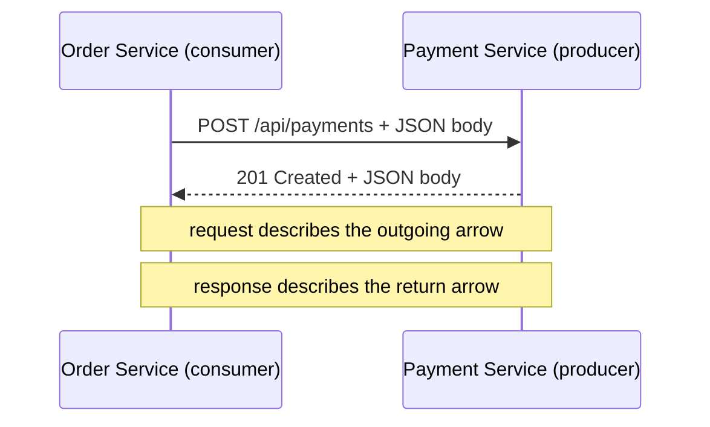
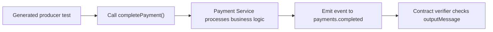
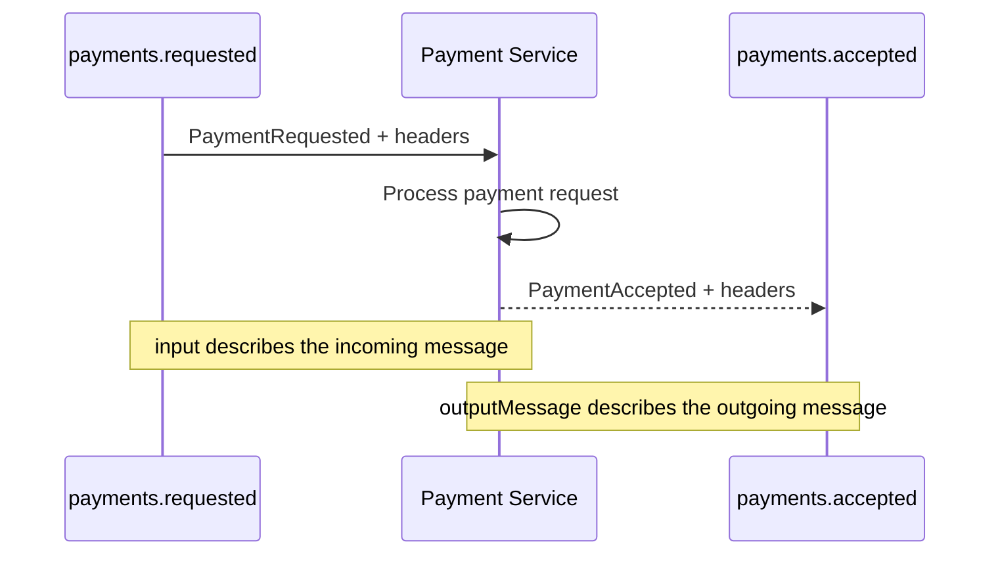

# `request`, `response`, `input`, and `outputMessage` Blocks in Groovy DSL

## 1. Purpose and Context

In a multi-service system, the **producer** exposes an API or events, while the **consumer** sends requests or receives data. The two sides can be developed and deployed independently, so a small change such as altering an HTTP status, removing a JSON field, or sending a message to the wrong destination can break integration.

**Spring Cloud Contract** lets you describe these committed interactions using **Groovy DSL** or YAML DSL. From the contract, the tool can generate tests on the producer side, create stubs for the consumer to run via **Stub Runner**, and incorporate those tests into CI to detect incompatible changes.

In Groovy DSL, the four key blocks are:

| Block | Used For | Meaning |
| --- | --- | --- |
| `request` | HTTP | The request the consumer sends to the producer: method, URL, headers, parameters, and body |
| `response` | HTTP | The response the producer must return: status, headers, and body |
| `input` | Messaging | The condition or trigger that initiates producer behavior: a method call or an incoming message |
| `outputMessage` | Messaging | The message the producer must emit: destination, body, and headers |

The two pairs of blocks express two different communication styles. With HTTP, the producer receives a request and returns a response within the same interaction. With messaging, the producer can be triggered by a call or an input message and then **emit** a message to a destination; the two actions do not necessarily belong to the same HTTP connection.

Lesson objectives:

1. Read and write a `Contract.make { ... }` structure using each block.
2. Understand which content is verified on the producer side and which becomes a stub for the consumer.
3. Distinguish `input.triggeredBy` from `input.messageFrom`.
4. Design contracts that are meaningful for a multi-service system, avoiding over-specification or omitting critical expectations.

## 2. General Structure of a Groovy Contract

A Groovy file typically returns a contract object created with `Contract.make`:

```groovy
import org.springframework.cloud.contract.spec.Contract

Contract.make {
    description 'Behavior committed by the producer'

    // For HTTP: request { ... } and response { ... }
    // For messaging: input { ... } and outputMessage { ... }
}
```

`description` explains the business meaning so readers and reviewers understand what the contract protects. In the examples below, each contract describes **one specific interaction**; success cases, error cases, and different data variants can be split into multiple contracts.

In a Maven/Gradle project configured with Spring Cloud Contract, the default contracts directory is typically `src/test/resources/contracts` on the producer side. How generated test class names, the test framework, the test base class, and contract locations are determined can be configured in the corresponding plugin.

**Scope note:** The following Groovy snippets focus on contract syntax. To run in a real project, you must properly configure the Spring Cloud Contract version, plugin, test base class, and required HTTP/messaging infrastructure. Destination names and sample data are assumed for an example payment system.

## 3. The HTTP Pair: `request` and `response`

Suppose `Order Service` is the consumer and `Payment Service` is the producer. When creating a payment, Order Service sends:

```http
POST /api/payments HTTP/1.1
Content-Type: application/json

{"orderId":301,"amount":125000}
```

Payment Service commits to responding with:

```http
HTTP/1.1 201 Created
Content-Type: application/json

{"paymentId":42,"status":"PENDING"}
```

The Groovy DSL contract can be written as:

```groovy
import org.springframework.cloud.contract.spec.Contract

Contract.make {
    description 'Create a payment for a valid order'

    request {
        method POST()
        url '/api/payments'
        headers {
            contentType(applicationJson())
        }
        body(
            orderId: 301,
            amount: 125000
        )
    }

    response {
        status CREATED()
        headers {
            contentType(applicationJson())
        }
        body(
            paymentId: 42,
            status: 'PENDING'
        )
    }
}
```

Reading the contract along the data flow:



### 3.1. The `request` Block: Which Requests Must the Producer Accept?

`request` describes what **the consumer sends**. Commonly used elements:

| DSL Element | Meaning | Example |
| --- | --- | --- |
| `method` | HTTP method | `method GET()`, `method POST()` |
| `url` | URL targeted by the request | `url '/api/payments/42'` |
| `urlPath` | URL path, useful when specifying path/query conditions | `urlPath '/api/payments/42'` |
| `headers` | Headers the consumer must send | `contentType(applicationJson())` |
| `body` | Request payload | `body(orderId: 301, amount: 125000)` |
| `bodyMatchers` | Matching rules on the request body when flexibility is needed | JSONPath combined with matchers |

Example of a lookup-only contract with no request body:

```groovy
import org.springframework.cloud.contract.spec.Contract

Contract.make {
    description 'Look up the status of an existing payment'
    request {
        method GET()
        url '/api/payments/42'
    }
    response {
        status OK()
        headers {
            contentType(applicationJson())
        }
        body(
            paymentId: 42,
            status: 'PAID'
        )
    }
}
```

For an endpoint with path variables or query parameters, the contract should reflect the exact communication boundary: which method, which URL, which parameters, and which headers are required conditions. If a request uses `Authorization` or a correlation header, include only constraints relevant to the behavior being protected; avoid embedding real credentials in the DSL file.

**Do not hardcode non-essential data** such as random timestamps or IDs generated per call. If a value must be flexible, Spring Cloud Contract provides matchers and syntax to define values for the consumer and producer sides; choose matchers appropriate for the `request` position and the DSL version in use.

### 3.2. The `response` Block: What Must the Producer Return?

`response` describes what **the producer returns** upon receiving a matching request. Main elements:

| DSL Element | Meaning | Example |
| --- | --- | --- |
| `status` | HTTP status code | `status OK()`, `status CREATED()`, `status NOT_FOUND()` |
| `headers` | Headers in the response | `contentType(applicationJson())` |
| `body` | Response structure and data | `body(status: 'PAID')` |
| `bodyMatchers` | Checks type, regex, or JSONPath instead of a fixed value | `jsonPath('$.paymentId', byType())` |

Illustrative example of a dynamically generated field that may vary:

```groovy
response {
    status OK()
    headers {
        contentType(applicationJson())
    }
    body(
        paymentId: 42,
        status: 'PAID'
    )
    bodyMatchers {
        jsonPath('$.paymentId', byType())
        jsonPath('$.status', byRegex('PAID|PENDING|FAILED'))
    }
}
```

This snippet illustrates using matchers in `response` to check the data type and allowed value set. **Matchers do not automatically allow a field to be absent**: if `paymentId` is required, the producer must still return that field. When a field should be optional, model the present/absent policy with appropriate test cases.

In consumer tests, the stub generated from the contract provides the sample response. In producer tests, the real application code is verified against the corresponding constraints. Both steps must run against the same agreed-upon set of contracts.

### 3.3. Do Not Forget Contracts for HTTP Errors

The consumer also needs to know how the producer responds when a payment is not found:

```groovy
import org.springframework.cloud.contract.spec.Contract

Contract.make {
    description 'Payment not found'
    request {
        method GET()
        url '/api/payments/999'
    }
    response {
        status NOT_FOUND()
        headers {
            contentType(applicationJson())
        }
        body(errorCode: 'PAYMENT_NOT_FOUND')
    }
}
```

If Payment Service unexpectedly changes `404` to `200` with an empty body, the consumer may handle it incorrectly. Writing separate error contracts helps catch such changes. Cases for `400`, `401`, `403`, `409`, or `5xx` should be added according to the exact behavior the consumer actually depends on.

## 4. The Messaging Pair: `input` and `outputMessage`

In an event-driven architecture, a producer may emit a message after processing a payment, or after receiving another message. Unlike HTTP, there is no synchronous request/response pair on a single connection: the system cares about the **trigger** and the **emitted message**.

`input` expresses *what causes the producer to perform the behavior*; `outputMessage` expresses *what message the producer must emit and where*. Spring Cloud Contract provides two common forms of `input`:

1. **`triggeredBy(...)`:** a method provided by the test base class that is called to trigger the message-publishing logic.
2. **`messageFrom(...)`:** a message arriving from a specific destination; the contract can also describe `messageBody` and `messageHeaders`.

In both cases, `outputMessage` describes the outcome to observe after triggering.

### 4.1. Form A: Emitting a Message After Calling a Method

Suppose Payment Service has a transaction completion operation. We want to verify that after triggering that operation, the producer emits a `PaymentCompleted` event.

```groovy
import org.springframework.cloud.contract.spec.Contract

Contract.make {
    description 'Emit an event when payment completes'
    label 'payment_completed'

    input {
        triggeredBy('completePayment()')
    }

    outputMessage {
        sentTo('payments.completed')
        body(
            eventType: 'PaymentCompleted',
            paymentId: 42,
            orderId: 301
        )
        headers {
            header('eventType', 'PaymentCompleted')
        }
    }
}
```

Meaning of each important line:

- `label 'payment_completed'` sets a label identifying the interaction, useful when the consumer triggers or references the message stub by label in supported configurations.
- `input.triggeredBy('completePayment()')` requires the producer-supplied test code to have a `completePayment()` method to trigger the business behavior. This string **does not automatically call an HTTP API** and **does not generate the method itself**.
- `outputMessage.sentTo('payments.completed')` specifies the destination expected to receive the message.
- `outputMessage.body` describes the payload emitted by the producer.
- `outputMessage.headers` describes the outgoing message headers; here, the `eventType` header.

Common pitfall: `triggeredBy` only specifies **how to execute the behavior in the producer test**. If the test base class does not declare the exact method or the method does not trigger the real business flow, the generated test will not perform the intended check.

An illustrative base class:

```java
public abstract class BaseContractTest {
    protected void completePayment() {
        // Call the real service to complete payment 42.
        // The test configuration must be able to observe the emitted message.
    }
}
```

This Java snippet only illustrates **where to implement the trigger**; a real project needs dependency injection, a test context, and an appropriate message verifier/binder configuration. An empty method like the example will not produce a message and cannot make a real producer test pass.

Interaction flow:



### 4.2. Form B: Processing a Received Message and Emitting a New Message

For example, a Payment Service receives a `PaymentRequested` request from destination `payments.requested`, processes it, and emits `PaymentAccepted` to `payments.accepted`.

```groovy
import org.springframework.cloud.contract.spec.Contract

Contract.make {
    description 'Receive payment request and emit acceptance result'
    label 'payment_requested'

    input {
        messageFrom('payments.requested')
        messageBody(
            eventType: 'PaymentRequested',
            paymentId: 42,
            amount: 125000
        )
        messageHeaders {
            header('eventType', 'PaymentRequested')
        }
    }

    outputMessage {
        sentTo('payments.accepted')
        body(
            eventType: 'PaymentAccepted',
            paymentId: 42,
            accepted: true
        )
        headers {
            header('eventType', 'PaymentAccepted')
        }
    }
}
```

In this contract:

| Statement | What Does the Test Describe? |
| --- | --- |
| `input.messageFrom(...)` | Destination where the producer receives the input message |
| `input.messageBody(...)` | Payload sent into the system to trigger processing |
| `input.messageHeaders { ... }` | Headers of the incoming message |
| `outputMessage.sentTo(...)` | Destination the producer must emit to |
| `outputMessage.body(...)` | Payload of the outgoing message |
| `outputMessage.headers { ... }` | Headers expected in the outgoing message |



For this test to work, the producer must configure how the test delivers the message to the listener and how emitted messages are observed. The names `payments.requested` and `payments.accepted` are logical destinations in the example; how they map to actual topics, queues, or bindings depends on the messaging framework and application configuration.

**Do not arbitrarily combine `triggeredBy` and `messageFrom`.** They represent two distinct triggering mechanisms. Choose the form that matches how the system works, and consult the capabilities of your Spring Cloud Contract version for complex scenarios.

## 5. Difference Between `headers` and `messageHeaders`

These block names are easy to confuse because both describe metadata, yet they belong in different places:

| Context | Declaration | Role |
| --- | --- | --- |
| HTTP `request` | `headers { ... }` | Request headers sent by the consumer |
| HTTP `response` | `headers { ... }` | Response headers returned by the producer |
| Messaging `input` with `messageFrom` | `messageHeaders { ... }` | Headers of the incoming message |
| Messaging `outputMessage` | `headers { ... }` | Headers of the emitted message |

Putting `headers` inside `input` or `messageHeaders` inside `outputMessage` by mistake can make the contract invalid or fail to check what was intended. When converting an HTTP contract to messaging, review the DSL structure rather than merely renaming an endpoint to a destination.

Similarly, `request.body` and `outputMessage.body` can both carry JSON content, whereas `input.messageBody` is used for the **payload of the input message**. Their semantics are determined by their parent block.

## 6. How Does a Contract Become Producer Tests and Consumer Stubs?

For HTTP contracts:

1. The producer stores `Contract.make { request { ... } response { ... } }`.
2. Spring Cloud Contract Verifier generates tests and uses the described HTTP request to call the producer's test environment.
3. The test checks the returned status, headers, and body against the contract.
4. Once producer verification succeeds, the build can package stubs for the consumer.
5. The consumer uses Stub Runner to run the stub, sends requests with its real HTTP client, and verifies its handling of the result.

For messaging contracts:

1. The producer stores `Contract.make { input { ... } outputMessage { ... } }`.
2. The generated test triggers behavior using the `triggeredBy` method or sends a message according to `messageFrom`.
3. The test system observes the message emitted by the producer and verifies the destination, body, and headers in `outputMessage`.
4. The consumer can test against messaging stubs using the appropriate integration mechanism, including event identifiers/labels and bindings supported by Stub Runner in the chosen setup.

A stub simulating a described response or message **does not on its own prove that the real producer emits it properly**. To be trustworthy, stubs must come from contracts already verified by the producer, and consumer tests must pull the exact target stub version.

## 7. Distinguishing Data-Describing DSL from the Test Runtime Environment

A contract states **observable behavior**; it does not implement controllers, services, queues, test runners, or network connections. For example:

- `request.method POST()` does not create a `@PostMapping` in the application.
- `response.status CREATED()` does not force a controller to return `201` before any test runs; it provides the assertion condition for the producer test.
- `input.triggeredBy('completePayment()')` cannot execute business logic if the base class does not implement the trigger.
- `input.messageFrom('payments.requested')` does not automatically create a Kafka topic or RabbitMQ queue.
- `outputMessage.sentTo('payments.completed')` does not replace binding configuration; it only describes the expected destination.

Therefore, beyond the Groovy file, you need Maven/Gradle plugin configuration, a test base class, and an appropriate test harness/infrastructure (such as MockMvc for HTTP or message verifier/binder setup for messaging). Integration details vary by library version and whether you use Spring Messaging, Spring Cloud Stream, or a specific broker.

## 8. Matchers and Dynamic Data Across the Four Blocks

In real systems, `paymentId`, timestamps, or correlation IDs may change on each run. If a contract pins everything to fixed values, tests break easily on valid differences. Conversely, overly broad regexes allow tests to miss real regressions.

Example with an HTTP response:

```groovy
response {
    status OK()
    body(
        paymentId: 42,
        status: 'PAID'
    )
    bodyMatchers {
        jsonPath('$.paymentId', byType())
        jsonPath('$.status', byRegex('PAID|PENDING|FAILED'))
    }
}
```

This is a `response` snippet inside `Contract.make`, not a standalone complete contract. The `byType` and `byRegex` matchers illustrate checking data types or value sets without locking the entire response to a single sample payload.

For HTTP requests, interactions often need to let the consumer send many valid IDs, while the producer test needs a concrete value to call the application. Message bodies have similar needs. Spring Cloud Contract supports distinguishing values/matchers for the consumer and producer sides; the exact syntax depends on the field type, test direction, and DSL version. Start with fixed-value contracts like the examples above, then add matchers once valid variants are clearly identified.

Classify data before choosing matchers:

| Data Category | Verification Strategy |
| --- | --- |
| Required field with a bounded value set | Verify presence, type, and value domain |
| Dynamically generated ID/timestamp | Use matchers by type, format, or specific constraints |
| Optional field | Test both absent and present cases if the consumer depends on both |
| Field not needed by the consumer | Do not constrain its value; ensure the consumer tolerates extra data |
| Routing header or event type | Check strictly if changing it would prevent the consumer from receiving or handling the message |

There is no need to describe every internal implementation detail in a contract. A contract should focus on what the consumer needs to interact safely with the producer.

## 9. Common Errors and How to Spot Them

| Symptom | Possible Cause | How to Address |
| --- | --- | --- |
| Generated HTTP test fails with `404` | `request.url` does not match a route/controller | Check method, path, mapping, and test base class |
| HTTP test fails with `200` instead of `201` | `response.status` specifies a different code than the producer returns | Check API requirements, fix implementation, or re-align the contract |
| JSONPath matcher cannot find field | Producer renamed or removed the field | Assess compatibility with consumer; do not delete the matcher just to turn the test green |
| Messaging contract fails to generate/run trigger | `triggeredBy` calls a missing method or test context lacks logic | Implement the method properly and connect it to the message-emitting flow |
| Test does not see output message | Wrong destination, listener not running, wrong binding, or producer did not emit | Check routing, message verifier/binder, headers, and business logic |
| Stub Runner does not return expected data | Consumer selected the wrong stub version or contract lacks that interaction | Check artifact version, classifier, and published contracts |
| Producer tests pass but consumer still breaks | Contract does not cover the case the consumer uses, or consumer mishandles the response | Add the relevant interaction and test the consumer using its real client |

For a contract change to be effective in CI, it must traverse the entire chain: the contract is parsed, tests are generated and run, producer verification passes, stubs are published, and the consumer uses the right stub in its own tests.

## 10. Practice Exercise: Choosing the Right DSL Blocks

Consider three requirements:

**Scenario A.** Order Service calls `GET /api/payments/42`, and Payment Service returns `200` with `{"status":"PAID"}`.

**Scenario B.** A `confirmPayment()` method is called; Payment Service emits a `PaymentConfirmed` message to destination `payments.confirmed`.

**Scenario C.** Payment Service receives `PaymentRequested` on `payments.requested`, and after processing emits `PaymentAccepted` to `payments.accepted`.

Determine the pair of blocks and the minimum required elements to describe each scenario.

| Scenario | Structure to Choose | Minimum Elements to Describe |
| --- | --- | --- |
| A | `request` + `response` | HTTP method, URL, response status, and body |
| B | `input` + `outputMessage` | `triggeredBy('confirmPayment()')`, `sentTo`, `body` |
| C | `input` + `outputMessage` | `messageFrom`, `messageBody`, `sentTo`, `body` |

Try extending the three scenarios:

1. In A, add a separate contract for `404 PAYMENT_NOT_FOUND`. If the producer changes the error status to `200`, should the producer test still be allowed to pass?
2. In B, add `paymentId` and `orderId` to the body; which fields are mandatory for a consumer receiving the event?
3. In C, add an `eventType` header to both input and output; should `messageHeaders` or `headers` be used in each block?
4. In a CI pipeline, why should stubs not be published before producer tests pass?

**Self-check hints:** (1) No, if the contract requires `404`; (2) depends on consumer needs, usually both to correlate the transaction and the order; (3) input uses `messageHeaders`, outputMessage uses `headers`; (4) an unverified stub may simulate behavior that the real producer does not satisfy.

## 11. Checklist When Writing Groovy DSL Contracts

- Did you clearly identify **HTTP** vs. **messaging** before choosing the block pair?
- For HTTP, does `request` describe the exact method/URL/headers/body the consumer will send, and does `response` describe the exact status/headers/body the producer commits to?
- For messaging, does `input` express the right trigger mechanism: `triggeredBy` or `messageFrom`?
- Does `outputMessage` include `sentTo`, body, and any headers that affect the consumer?
- Are required fields, dynamic values, optional fields, and extra fields handled intentionally?
- Are the test base class, controller/listener, message bindings, and plugin configured so tests actually run?
- Does CI run producer verification and publish only verified stubs for the consumer to use via Stub Runner?

**Key takeaway:** `request` and `response` define **HTTP** contracts; `input` and `outputMessage` define **messaging** contracts. `input` can be triggered by a method (`triggeredBy`) or by an incoming message (`messageFrom`). Understanding the data direction of each block is the foundation for having Groovy DSL generate useful producer tests and stubs that catch incompatible API or message changes before deployment.
