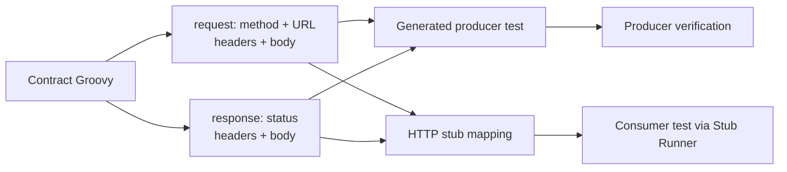
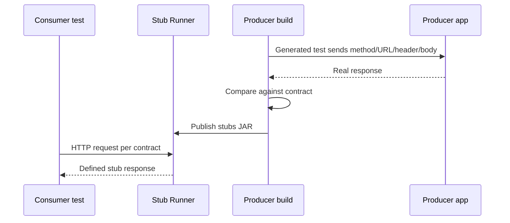

# Declaring Method, URL, Headers, and Body with Groovy DSL in Spring Cloud Contract

An HTTP contract in **Spring Cloud Contract (SCC)** answers two questions: **what request must the consumer send?** and **how does the producer commit to responding?**. With **Groovy DSL**, you describe requests and responses using structured blocks. SCC uses this contract to **generate tests on the producer side** and **generate stubs on the consumer side**; as a result, incompatible API changes can be detected during build or when running tests via **Stub Runner**, before the two services are actually deployed together.

In the **Groovy DSL** chapter, this lesson dives into four core elements of an HTTP contract: **method, URL, headers, and body**. The examples use `order-producer` (the service providing the orders API) and `order-consumer` (the service calling the orders API), then briefly connect to the producer verification, stub publishing, and CI workflow.

## 1. Basic Structure of an HTTP Contract

Example of a static contract for retrieving an order:

```groovy
import org.springframework.cloud.contract.spec.Contract

Contract.make {
    description 'Retrieve order 1001 and return status CREATED'

    request {
        method GET()
        url '/api/orders/1001'
        headers {
            header('Accept', 'application/json')
        }
    }

    response {
        status OK()
        headers {
            contentType(applicationJson())
        }
        body(
            id: 1001,
            status: 'CREATED'
        )
    }
}
```

Place the contract in the typical location inside the producer project:

```text
order-producer/
└── src/
    └── test/
        └── resources/
            └── contracts/
                └── http/
                    └── get-order-by-id-ok.groovy
```

The default directory and how contracts are grouped can be customized via build configuration. `description` is for readers and reviewers; the actual verification conditions reside in `request` and `response`.

| DSL Location | Element | Meaning |
| --- | --- | --- |
| `request.method` | `GET()` | HTTP request type the consumer must send |
| `request.url` | `/api/orders/1001` | URL the producer must receive |
| `request.headers` | `Accept: application/json` | Header required in the request |
| `response.status` | `OK()` | Producer must respond with HTTP 200 |
| `response.headers` | `Content-Type: application/json` | Data type returned by the producer |
| `response.body` | `id`, `status` | Committed JSON values |

Diagram:



**Do not confuse the request body and response body.** `request.body` is the data **sent by the consumer**; `response.body` is the data **returned by the producer**. Likewise, headers in `request` and headers in `response` are two separate sets of properties.

## 2. Declaring the HTTP Method

The method describes the operation the consumer performs on the resource. In Groovy DSL, you can use readable helpers:

```groovy
request {
    method GET()
    url '/api/orders/1001'
}
```

Or string form:

```groovy
request {
    method 'GET'
    url '/api/orders/1001'
}
```

Common methods:

| Method | Common Scenario | What to Verify |
| --- | --- | --- |
| `GET` | Read an order | Exact URL, status, and retrieved data |
| `POST` | Create an order | Input body, creation status, response |
| `PUT` | Replace a resource representation | Exact update body and status |
| `PATCH` | Partial update | Changed fields, patch handling method |
| `DELETE` | Delete or cancel a resource | URL, status, and committed semantics |

A `GET /api/orders/1001` contract does **not** protect an endpoint that only serves `POST /api/orders/1001`. Changing the HTTP method of an API used by a consumer can break compatibility even if the URL stays unchanged.

### 2.1. Name Contracts by Behavior, Not by Class Name

Name the contract `get-order-by-id-ok.groovy` instead of `order-controller-find.groovy`; a contract describes the public interface, not Java method names. If the producer moves from an MVC controller to another architecture while still serving the same method, URL, and response, the contract can remain unchanged.

### 2.2. Distinguishing Method from Status

`POST` is the **input method**; `201 Created` is the **output status**. An order creation contract can use:

```groovy
request {
    method POST()
    url '/api/orders'
}
response {
    status CREATED()
}
```

These two values sit on opposite sides and must match the agreed-upon API. Do not assume every POST must return 201: some valid APIs return 200 or 202 depending on their own semantics.

## 3. Declaring URL: `url`, `urlPath`, and Query Parameters

### 3.1. Fixed URL

For simple endpoints, use `url`:

```groovy
request {
    method GET()
    url '/api/orders/1001'
}
```

In a contract, the URL is typically a server-relative path; you do **not** need to hardcode environment hostnames like `https://staging.example.com`. Stub Runner provides its own HTTP stub server, while provider verification tests send requests to the producer in the test environment.

Paths with special characters, trailing slashes, or version prefixes must match the actual interface the consumer calls. For example, `/api/v1/orders/1001` and `/api/orders/1001` are two different paths if the producer or gateway has no forwarding rule.

### 3.2. Combining URL Path and Query Parameters

When a request requires a query string, declare each parameter explicitly with `urlPath` and `queryParameters`:

```groovy
import org.springframework.cloud.contract.spec.Contract

Contract.make {
    description 'Filter orders by CREATED status and limit results'

    request {
        method GET()
        urlPath('/api/orders') {
            queryParameters {
                parameter 'status': 'CREATED'
                parameter 'limit': '10'
            }
        }
    }

    response {
        status OK()
        headers {
            contentType(applicationJson())
        }
        body([
            [id: 1001, status: 'CREATED'],
            [id: 1002, status: 'CREATED']
        ])
    }
}
```

Equivalent HTTP request conceptually:

```http
GET /api/orders?status=CREATED&limit=10 HTTP/1.1
```

Key points:

- `urlPath('/api/orders')` specifies the path portion of the request; `queryParameters` describes the parameters to verify.
- Parameter names such as `status` and `limit` are part of the contract when the consumer depends on them.
- Query values are transmitted over HTTP as strings. Using `'10'` in the example avoids confusion with integers in a JSON body.
- Only declare query parameters meaningful to the scenario; for optional parameters, create separate contracts when their presence or absence changes the response.

Do not simultaneously use `url` containing a query string and declare conflicting query parameters for the same request. If the URL is dynamic or has complex matching rules, you can use SCC matchers; starting with fixed examples helps keep the contract clear first.

### 3.3. Path Variables Are Part of the URL, Not Query Parameters

Given a controller:

```java
@GetMapping("/api/orders/{id}")
public OrderDto getOrder(@PathVariable long id) {
    return orderService.findById(id);
}
```

An actual request will be `GET /api/orders/1001`. In a static contract, write:

```groovy
url '/api/orders/1001'
```

The `{id}` string used in a Spring MVC route declaration is **not automatically treated as a placeholder interpreted by SCC** if you put it verbatim into the contract URL. To accept multiple IDs, define an appropriate matcher/regex; to describe a specific case, supply a sample ID such as `1001`.

## 4. Declaring Request and Response Headers

Headers provide metadata for communication: data format, version identifier, tenant, correlation ID, or other conditions.

### 4.1. Request Headers

Example of a consumer sending JSON data and a tenant identifier:

```groovy
request {
    method POST()
    url '/api/orders'
    headers {
        contentType(applicationJson())
        header('X-Tenant-Id', 'shop-01')
        header('Accept', 'application/json')
    }
    body(
        customerId: 'CUS-42',
        sku: 'BOOK-01',
        quantity: 2
    )
}
```

Here:

- `contentType(applicationJson())` expresses `Content-Type: application/json` for the request body.
- `header('Accept', 'application/json')` indicates the consumer accepts a JSON response; **Accept is different from Content-Type**.
- `header('X-Tenant-Id', 'shop-01')` is a custom application header; if the producer strictly requires this header, it must be described in the contract.

In principle, HTTP header names are **case-insensitive**. Even so, keep a consistent casing convention in the file to avoid confusion during review. Header values may have specific validation rules depending on business logic.

### 4.2. Response Headers

The producer may commit to returning JSON and a correlation ID:

```groovy
response {
    status OK()
    headers {
        contentType(applicationJson())
        header('X-Correlation-Id', 'req-1001')
    }
    body(
        id: 1001,
        status: 'CREATED'
    )
}
```

Request headers and response headers are not automatically copied to each other. If the client sends `X-Correlation-Id` and requires the server to echo back the same value, express that relationship using the dynamic value/matcher mechanisms supported by SCC, rather than writing two independent values and assuming they always match.

### 4.3. Do Not Put Real Tokens in Contracts

Avoid embedding API keys, production bearer tokens, or sensitive information directly in Groovy contracts. To test authentication, use dummy tokens, set up appropriate security tests, or use matchers when describing formats. Having `Authorization` in a contract **does not replace** real authorization testing.

### 4.4. When Should Headers Be Checked?

| Header | Side | Why Is It Important? |
| --- | --- | --- |
| `Content-Type: application/json` | Request | The producer knows how to parse the JSON body |
| `Accept: application/json` | Request | Expresses the response format expected by the consumer |
| `X-Tenant-Id` | Request | Consumer specifies tenant context if required by the interface |
| `Content-Type: application/json` | Response | Consumer recognizes and parses the JSON response |
| `Location: /api/orders/1001` | Response | Consumer knows the newly created resource URI in a 201 response |
| `X-Correlation-Id` | Response | Used for tracing if included in the communication agreement |

Only constrain headers that truly belong to the interface the consumer depends on. Headers carrying timestamps or auto-generated IDs usually require matchers; hardcoding values can make generated producer tests fail even when behavior is valid.

## 5. Declaring JSON Body Using Groovy Map and List

### 5.1. Body as a JSON Object

Example of an object-shaped body:

```groovy
body(
    orderId: 1001,
    customerId: 'CUS-42',
    status: 'CREATED'
)
```

Equivalent JSON:

```json
{
  "orderId": 1001,
  "customerId": "CUS-42",
  "status": "CREATED"
}
```

Watch the **data types**: `1001` is a number, whereas `'1001'` is a string. A consumer deserializing `orderId` into a number could break if the producer switches it to a string. Keep data types in the contract aligned with the real API.

### 5.2. Nested Bodies and Arrays

In Groovy, a Map can be written as `[key: value]` and a List uses `[item1, item2]`. Example order-creation body:

```groovy
body([
    customerId: 'CUS-42',
    shippingAddress: [
        city: 'Ha Noi',
        country: 'VN'
    ],
    items: [
        [sku: 'BOOK-01', quantity: 2, unitPrice: 50000],
        [sku: 'PEN-02', quantity: 1, unitPrice: 10000]
    ],
    gift: false
])
```

Corresponding JSON:

```json
{
  "customerId": "CUS-42",
  "shippingAddress": {
    "city": "Ha Noi",
    "country": "VN"
  },
  "items": [
    {"sku": "BOOK-01", "quantity": 2, "unitPrice": 50000},
    {"sku": "PEN-02", "quantity": 1, "unitPrice": 10000}
  ],
  "gift": false
}
```

A contract's `body(...)` contains **sample data and verification constraints**, not a definition of a Java `OrderDto` class on the producer. The producer can use records, DTOs, or Maps as long as the emitted HTTP payload satisfies the agreement.

### 5.3. A Body Can Be a Root-Level Array

For an order-listing API:

```groovy
response {
    status OK()
    headers {
        contentType(applicationJson())
    }
    body([
        [id: 1001, status: 'CREATED'],
        [id: 1002, status: 'PAID']
    ])
}
```

Here the response is a **JSON array**, not an object with an `orders` property. Those two shapes are different and can cause parser failures on the consumer. If the real API returns `{"orders": [...]}`, represent it as a Map containing the `orders` key rather than a root-level List.

### 5.4. Distinguishing Empty Body, Absent Body, and `null`

In an HTTP contract:

- Omitting `body` means no specific expectation is placed on content through this field.
- `body([])` represents an empty structure according to how DSL/Groovy handles objects (an empty List), which differs from an empty JSON object `{}`.
- JSON `null` and an omitted property are two different cases that a consumer may handle differently.
- A `204 No Content` response normally has no response body; do not pair it with a non-empty JSON object.

When the specification requires the body to be absent or enforces strict null rules, add appropriate test cases, matchers, or assertions. Do not assume from `status: 204` alone that every test checks every aspect of the body.

## 6. Complete Example: POST to Create an Order

Name the file `src/test/resources/contracts/http/post-order-created.groovy`:

```groovy
import org.springframework.cloud.contract.spec.Contract

Contract.make {
    description 'When consumer sends a valid order, producer creates it and returns HTTP 201'

    request {
        method POST()
        url '/api/orders'
        headers {
            contentType(applicationJson())
            header('Accept', 'application/json')
            header('X-Tenant-Id', 'shop-01')
        }
        body([
            customerId: 'CUS-42',
            items: [
                [sku: 'BOOK-01', quantity: 2]
            ]
        ])
    }

    response {
        status CREATED()
        headers {
            contentType(applicationJson())
            header('Location', '/api/orders/1001')
        }
        body(
            id: 1001,
            status: 'CREATED'
        )
    }
}
```

An HTTP request/response pair illustrating compliance with the contract:

```http
POST /api/orders HTTP/1.1
Content-Type: application/json
Accept: application/json
X-Tenant-Id: shop-01

{"customerId":"CUS-42","items":[{"sku":"BOOK-01","quantity":2}]}
```

```http
HTTP/1.1 201 Created
Content-Type: application/json
Location: /api/orders/1001

{"id":1001,"status":"CREATED"}
```

This is a **fixed** example for getting familiar with the DSL. In a real system, `id` and `Location` may be generated dynamically by the server; in that case, choose appropriate matchers/generators so the producer is not forced to always return ID `1001`. If `Location` is derived from the ID, verifying the relationship between those two values can also be important for the consumer.

### Line-by-Line Breakdown

| Part | Example Value | If the Producer Changes It |
| --- | --- | --- |
| Method | `POST` | Client POST calls may be rejected |
| URL | `/api/orders` | Clients calling the old endpoint may receive 404 |
| Request `Content-Type` | JSON | Server may fail to parse if the format changes |
| Request `X-Tenant-Id` | `shop-01` | Tenant resolution logic may misbehave or reject the request |
| Request body `items` | Array of items | Renaming fields or changing data types can break input |
| Response status | 201 | Clients handling the "created" flow may be affected |
| Response `Location` | New order URI | Clients using the URI for navigation may break |
| Response body | `id`, `status` | Clients parsing the old DTO may break |

**Mini-exercise:** change only `response.status` to `OK()` while keeping the description "returns 201", then spot the contradiction. Fix the contract so the description and behavior align before running the build.

## 7. Example Testing Error Cases

A single endpoint can have multiple valid behaviors. A successful `POST /api/orders` does not cover invalid input payloads.

Create a separate contract `post-order-invalid-body.groovy`:

```groovy
import org.springframework.cloud.contract.spec.Contract

Contract.make {
    description 'When order quantity is invalid, producer returns HTTP 400'

    request {
        method POST()
        url '/api/orders'
        headers {
            contentType(applicationJson())
        }
        body(
            customerId: 'CUS-42',
            items: [
                [sku: 'BOOK-01', quantity: 0]
            ]
        )
    }

    response {
        status BAD_REQUEST()
        headers {
            contentType(applicationJson())
        }
        body(
            code: 'INVALID_QUANTITY',
            message: 'Quantity must be greater than zero'
        )
    }
}
```

If the producer changes validation logic so that a quantity of `0` is accepted, tests generated from this contract can catch the discrepancy. More importantly, the consumer can use the `400` stub to test its error display flow.

**A single contract does not prove every validation rule.** If there are additional rules such as empty `customerId`, negative prices, non-existent products, or unauthorized tenants, identify the scenarios the consumer truly needs and write separate contracts or tests for them.

## 8. Static Data vs. Dynamic Data: Using Matchers in the Right Places

Static values make contracts easy to read but can be overly rigid. For example, the producer may generate an auto-increment ID, UUID, or timestamp depending on the moment:

```json
{"id":934821,"status":"CREATED"}
```

If the contract always expects `id: 1001`, the provider test may turn red simply because the server-generated value differs from the example, whereas the consumer might only care that `id` is a valid number.

Spring Cloud Contract supports **matchers** to describe a set of accepted values. Example of a response with a sample body and type/value verification rules:

```groovy
response {
    status OK()
    headers {
        contentType(applicationJson())
    }
    body(
        id: 1001,
        status: 'CREATED'
    )
    bodyMatchers {
        jsonPath('$.id', byType())
        jsonPath('$.status', byRegex('CREATED|PAID|CANCELLED'))
    }
}
```

In this example:

- `body` provides a clear sample to generate the stub and describe the JSON shape.
- `jsonPath('$.id', byType())` checks the data type at path `$.id` instead of hardcoding a specific ID.
- `jsonPath('$.status', byRegex(...))` allows statuses belonging to the agreed-upon set.
- The scope and application of matchers in request/response depend on declaration placement, consumer/producer direction, and test/stub generation configuration. Whenever you change matchers, inspect the actual generated provider tests and stub mappings to confirm they serve the intended purpose.

Rule of thumb: **do not write overly broad matchers**. If the consumer only handles `CREATED`, `PAID`, and `CANCELLED`, allowing any string to pass can hide breaking changes. If a contract specifies a non-negative price, apply appropriate rules for currency rather than only checking `number`.

### 8.1. Consumer and Producer Sides Can Use Different Values

A common requirement: the stub needs to return fixed sample data for consumer tests, while provider verification must accept a server-generated value. SCC supports declaring values separately for the **consumer side** and **producer side** to decouple sample data from verification constraints.

Key concepts to remember:

| Verification Direction | What Is Needed? |
| --- | --- |
| Producer test | Build a meaningful input request; compare actual response against the contract |
| Consumer HTTP stub | Match the consumer's request and return the sample response from the contract |
| Dynamic data | Specify which value serves as the sample and which rule must be matched/validated |

For dynamic fields like `id`, design matchers so generated tests still verify the right type/format while the stub returns a stable sample. Reviewing the generated tests and stubs helps catch accidentally inverted consumer/producer values.

## 9. From Groovy Contract to Producer Tests and HTTP Stubs

Know where Groovy DSL fits in the Spring Cloud Contract lifecycle:

1. The producer places `*.groovy` files in the contracts directory scanned by the build.
2. Contract Verifier generates tests checking that the real producer satisfies the committed method, URL, headers, body, and response.
3. The build packages a stubs JAR (typically with the `stubs` classifier) containing mappings for consumers.
4. Consumer tests run Stub Runner to call the HTTP stub without needing the real producer.
5. CI runs both producer verification and consumer verification against the **version-matched candidate stubs** whenever the API changes.



Example when the producer has Maven configured for `spring-cloud-contract-maven-plugin` and the corresponding test dependencies:

```bash
mvn clean verify
```

Do not just look for a green build: verify that generated tests were actually created and executed. If controllers are not wired into the test context properly, you may run into setup errors rather than contract errors; if test generation did not run, a green build does not prove the provider satisfies the contract.

### 9.1. What Does an HTTP Stub Verify?

When a consumer test calls the stub:

```http
POST /api/orders HTTP/1.1
Content-Type: application/json
X-Tenant-Id: shop-01

{"customerId":"CUS-42","items":[{"sku":"BOOK-01","quantity":2}]}
```

The stub server matches the request against the mapping generated from the contract (by method, URL, headers, body, and relevant matchers). When the request matches, the stub returns the defined response, such as `201` and JSON containing `id` and `status`.

If the request does not match any mapping, Stub Runner/WireMock may return an unmatched response such as HTTP 404 depending on configuration. That does not by itself prove the real producer is broken; inspect the actual request and generated mapping.

### 9.2. Things a Contract Does Not Guarantee by Itself

- HTTP contract tests do not replace full authentication and security testing.
- Stubs do not prove that the database, message broker, or production infrastructure is operational.
- A contract with a single sample ID does not protect all IDs or all API error cases.
- Adding a JSON field sometimes does not break consumers; renaming/removing fields or changing types a consumer relies on is usually far riskier. Compatibility depends on committed behavior and how consumers parse data.

## 10. Common Mistakes When Declaring Method, URL, Headers, and Body

| Symptom | Common Cause | How to Check/Fix |
| --- | --- | --- |
| Provider test receives HTTP 404 | Method or URL in contract differs from controller | Check method, version prefix, `@RequestMapping`, path variable |
| Provider test receives HTTP 415 | Missing or wrong request `Content-Type` when sending JSON | Add `contentType(applicationJson())` in request |
| Provider test receives HTTP 406 | `Accept` is incompatible with formats supported by producer | Check content negotiation and `Accept` header |
| Stub fails to match query | Missing or incorrect `queryParameters` declaration | Compare query names, values, and actual stub request |
| JSON body fails due to type mismatch | `1001` written as `'1001'` or List vs. object | Check actual JSON schema and body DSL |
| Producer returns 200 but contract expects 201 | Response status does not match contract | Align API semantics, then fix producer or contract |
| Response body has dynamic ID | Fixed sample value used for a dynamic field | Choose the right matcher type and inspect generated test |
| Consumer test calls stale stub | Stub Runner still uses an old artifact version | Pin the candidate version and verify downloaded artifact |
| Multiple contracts match same request but return different results | Scenarios lack distinguishing match conditions | Separate request/headers/body to disambiguate, or manage mock state properly |

**Subtle mistake:** writing `headers { contentType(applicationJson()) }` in the **response** while the producer is receiving a JSON POST request. Those are two different headers. If the input body is JSON, declare the request Content-Type inside the request block.

**Another mistake:** describing `GET /api/orders/{id}` by writing `url '/api/orders/{id}'` and assuming SCC will automatically substitute `{id}` with an ID. The contract must provide an executable sample URL or a matcher for the path segment.

## 11. Self-Assessment Practice

Starting from `order-producer` with endpoints `GET /api/orders/{id}` and `POST /api/orders`, create separate Groovy contracts:

1. **Successful GET:** method `GET`, URL `/api/orders/1001`, request `Accept: application/json`; response `200`, `Content-Type: application/json`, JSON `id: 1001`, `status: CREATED`.
2. **GET not found:** method `GET`, URL `/api/orders/9999`, response `404`; decide clearly whether the API has an error body and reflect it accurately in the contract.
3. **Successful POST:** method `POST`, URL `/api/orders`, request JSON with `customerId` and `items`; response `201`, `Location` header, and JSON identifying the new order.
4. **Invalid POST:** same method and URL, but body with `quantity: 0`; response `400`, body with `code: INVALID_QUANTITY`.
5. **GET with query parameters:** create contract `GET /api/orders?status=CREATED&limit=10`, using `urlPath` and `queryParameters`, and verify an array response.
6. **Dynamic values:** for a producer-generated ID field, try a body matcher and compare the generated test before and after replacing the hardcoded sample ID.
7. **Compatibility check:** intentionally rename `status` to `state` in the producer or change `201` to `200`, and observe provider verification fail. Restore the code so tests pass.
8. **Consumer stub:** package the stubs JAR, use Stub Runner on the consumer to test `200`, `201`, and `400`, and pin the artifact in CI.

Completion criteria:

| Item | Evidence |
| --- | --- |
| Correct method and URL | Generated request reaches the right route with the expected method |
| Correct query parameters | Requests with missing/wrong query params do not match the defined scenario |
| Correct request headers | Contract accurately reflects content negotiation and required metadata |
| Correct JSON body types | Map, List, string, number, and boolean are represented accurately |
| Response matches agreement | Status, headers, and body are verifiable via provider tests |
| Sensible matchers | Dynamic data has verification rules without making tests overly brittle |
| Stub supports consumer | Stub Runner serves scenarios from the right stubs JAR |
| CI catches breaking changes | Changing method/URL/important fields fails the corresponding verification step |

Mastering `method`, `url`/`urlPath`, `headers`, and `body` is the foundation for writing HTTP contracts with Groovy DSL. When you accurately describe **what the consumer sends** and **what the producer commits to returning**, you can use Spring Cloud Contract to generate provider tests, publish stubs, run Stub Runner on the consumer, and keep critical API changes under CI control.
