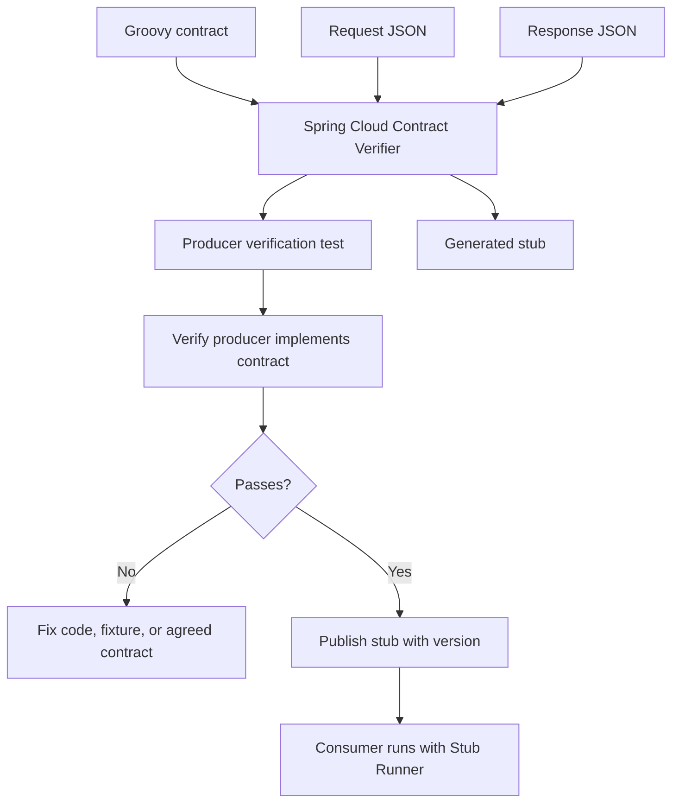

# Referencing Body Files from a Contract

## 1. Why Separate the Body from the Groovy DSL?

In a microservices system, `checkout-service` (consumer) sends a payment creation request to `payment-service` (producer). Both sides must agree on the structure of both the request and the response. When a payload contains many fields, nested lists, or binary content, putting the entire body inline inside the Groovy contract file makes the contract hard to read, hard to review, and hard to reuse sample data.

**Spring Cloud Contract** allows you to keep the HTTP or messaging behavior description in Groovy DSL while **referencing the body content from a separate file**. From these contracts, Spring Cloud Contract Verifier can generate producer verification tests; published stubs can be used by the consumer with Stub Runner and tested in CI to catch incompatible API changes.

For example, instead of writing:

```groovy
response {
    status 201
    headers {
        contentType(applicationJson())
    }
    body('''{
      "paymentId": "PAY-1001",
      "orderId": "ORD-2001",
      "status": "CREATED",
      "amount": 250000,
      "currency": "VND"
    }''')
}
```

you can place the JSON in `create-payment-response.json` and replace the body block with:

```groovy
response {
    status 201
    headers {
        contentType(applicationJson())
    }
    body(file("create-payment-response.json"))
}
```

**`file("...")` is a DSL function** that tells Spring Cloud Contract to read the file content as the body when generating tests and stubs. It is not an endpoint that returns a file, nor is it an arbitrary Java/Groovy `new File(...)` opening absolute paths.

After this lesson, you will be able to: write HTTP contracts using `file(...)` for requests and responses; place files at the right relative locations; distinguish text content from binary data using `fileAsBytes(...)`; understand the impact on producer verification, stubs, and CI; and troubleshoot common errors.

## 2. Core Syntax and Path Rules

In **Groovy DSL**:

| Purpose | Syntax | Meaning |
| --- | --- | --- |
| Read text request body | `request { body(file("request.json")) }` | Uses the file content as the request body in the contract. |
| Read text response body | `response { body(file("response.json")) }` | Uses the file content as the response body in the contract. |
| Read binary request body | `request { body(fileAsBytes("input.pdf")) }` | Uses the binary content of the file; avoids treating bytes as text. |
| Read binary response body | `response { body(fileAsBytes("output.pdf")) }` | Verifies/publishes a binary response according to the contract. |

Paths passed to `file(...)` and `fileAsBytes(...)` are **resolved relative to the directory containing the contract file**. They are not calculated from the Maven/Gradle working directory, the source code root, or WireMock's `__files` directory.

Example **illustrative** directory layout (these are names and locations in a hypothetical producer project, not files created by this lesson):

```text
payment-service/
└── src/
    └── test/
        └── resources/
            └── contracts/
                └── payments/
                    ├── create-payment.groovy
                    ├── create-payment-request.json
                    ├── create-payment-response.json
                    └── payloads/
                        └── payment-error.json
```

In `create-payment.groovy`, `"create-payment-request.json"` points to the sibling file; `"payloads/payment-error.json"` points to the file in a subdirectory of `payments`. If you move the contract to another folder, update the path or move the payload files with it.

The paths above follow the common layout for Maven and standard Spring Cloud Contract setups. With Gradle or when the plugin is configured with a different `contractsDslDir`, the contract source directory may vary; **the rule that paths are relative to the contract's location remains the key check**.

### Distinguishing Similar Names

- `body(file("..."))` **Groovy DSL**: a DSL function call.
- `bodyFromFile: ...` **YAML DSL**: a configuration property.
- `body(fileAsBytes("..."))` **Groovy DSL**: reads raw binary bytes.
- `bodyFromFileAsBytes: ...` **YAML DSL**: equivalent property for binary data.
- `bodyFileName` in raw WireMock configuration is a different mechanism with its own path rules and file root; **do not use it as a direct substitute** for Spring Cloud Contract Groovy DSL syntax.

## 3. Complete Example: HTTP Request and Response from JSON

### 3.1. Business Scenario Under Test

Checkout sends a request to create a payment:

```http
POST /api/payments HTTP/1.1
Content-Type: application/json
Accept: application/json

{
  "orderId": "ORD-2001",
  "amount": 250000,
  "currency": "VND",
  "paymentMethod": "BANK_TRANSFER"
}
```

Payment confirms the payment record was created and returns HTTP `201` with a new `paymentId`, status `CREATED`, and order-matching details. In this learning example, `PAY-1001` is a **fixed** fixture value to help verify the relationship between request and response. If production always generates dynamic codes, adjust the contract/matcher and fixture setup as described later.

### 3.2. File `create-payment-request.json`

Content:

```json
{
  "orderId": "ORD-2001",
  "amount": 250000,
  "currency": "VND",
  "paymentMethod": "BANK_TRANSFER"
}
```

These values are not chosen arbitrarily: `orderId` identifies which order the transaction belongs to, `amount` and `currency` specify the exact sum, and `paymentMethod` indicates the payment method. Using synthetic, stable data makes tests repeatable without depending on real customer information.

### 3.3. File `create-payment-response.json`

Content:

```json
{
  "paymentId": "PAY-1001",
  "orderId": "ORD-2001",
  "status": "CREATED",
  "amount": 250000,
  "currency": "VND"
}
```

The response accurately reflects the request's `orderId`, `amount`, and `currency`. The consumer uses `status` to decide the next step. A real API may include additional properties, but only record in the contract the behaviors both sides genuinely commit to and need verified.

### 3.4. File `create-payment.groovy`

```groovy
import org.springframework.cloud.contract.spec.Contract

Contract.make {
    name("create_payment_success")
    description("Create a valid payment request")

    request {
        method "POST"
        url "/api/payments"
        headers {
            contentType(applicationJson())
            header("Accept", "application/json")
        }
        body(file("create-payment-request.json"))
    }

    response {
        status 201
        headers {
            contentType(applicationJson())
        }
        body(file("create-payment-response.json"))
    }
}
```

Breakdown of each part:

1. `method "POST"` and `url "/api/payments"` describe the HTTP request the producer must handle.
2. `contentType(applicationJson())` declares the payload format is JSON. If the client requests a specific content type, `Accept` is declared on the request side as well.
3. `body(file("create-payment-request.json"))` loads the payload from the JSON file to send in the producer test and to use as request-matching criteria in the stub.
4. `status 201` and `body(file("create-payment-response.json"))` define the expected response from the producer and the simulated response returned by the stub.
5. `name` and `description` make the test/contract easy to identify when CI reports a failure.

This is **one self-contained contract with two sibling JSON files**. All three files must be present when running test/stub generation; the JSON snippets above describe sample content, not files physically created by this lesson.

## 4. At Which Step Does Spring Cloud Contract Process the Files?

Conceptually:



When the generator reads a contract, it pulls the **contents** of the referenced file into the corresponding generated test or stub. The contract is still evaluated across request, response, headers, and status; extracting JSON into a separate file does not remove the responsibility to specify those elements.

| Party | Request Body from File | Response Body from File |
| --- | --- | --- |
| **Producer verification** | Builds and sends the matching request to the producer under test. | Verifies the producer's real response matches the contract. |
| **Generated stub** | Defines the request the stub recognizes according to matching rules. | Provides the simulated response for consumer tests. |
| **CI** | Needs source files so the generator can read them during the build step. | Needs source files during test/stub generation; producer verification must pass before publishing a stable release. |

A common misconception is thinking Stub Runner re-opens `create-payment-response.json` from the producer's repository when the consumer sends an HTTP request. In standard release workflows, the consumer uses the **generated and packaged stub artifact**, without needing direct access to the producer's source workspace. Therefore, editing JSON in the repository **without regenerating and republishing stubs** will not change the behavior of an already published stub artifact.

**Boundary note:** reading the file happens during contract processing/generation; it does not mean Spring Cloud Contract creates databases, seeds fixtures, or executes business logic on behalf of the application. If the producer must find `ORD-2001` in a database to return `PAY-1001`, the producer's base test or test setup must explicitly prepare that state.

## 5. Relative Paths: Three Scenarios and How to Avoid Errors

### 5.1. File in the Same Directory as the Contract

Given:

```text
contracts/payments/
├── create-payment.groovy
└── create-payment-response.json
```

reference:

```groovy
body(file("create-payment-response.json"))
```

This is the simplest way to keep the contract and payload together, reducing risk when moving directories.

### 5.2. File in a Subdirectory

Given:

```text
contracts/payments/
├── payment-not-found.groovy
└── payloads/
    └── payment-error.json
```

reference:

```groovy
body(file("payloads/payment-error.json"))
```

Do not write `"contracts/payments/payloads/payment-error.json"` if the path is resolved from inside `payments`, as that creates a duplicated path. Filenames must match character for character; Linux-based CI systems distinguish `Payment-Error.json` from `payment-error.json`.

### 5.3. When a File Is Moved

If `create-payment.groovy` moves from `contracts/payments/` to `contracts/payments/create/` while the JSON stays in its old folder, `"create-payment-response.json"` **no longer points to the right location**. Either move the payload files alongside the contract or deliberately update the relative path.

For shared contract libraries, avoid absolute paths (such as local drives, temporary folders, or network URLs) because they are not portable across developer machines, CI agents, and build environments. Commit or provide source payloads for contract generation alongside the Groovy files.

## 6. When the Body Is Binary: `fileAsBytes(...)`

Not all APIs exchange JSON. For example, a document service accepts PDFs, images, or `application/octet-stream` data. Those bytes may not represent valid UTF-8 strings; reading them as text with `file("...")` can corrupt the content.

Scenario: the producer receives a sample PDF and returns a stamped PDF. Example structure:

```text
contracts/documents/
├── stamp-document.groovy
├── request.pdf
└── response.pdf
```

Groovy contract:

```groovy
import org.springframework.cloud.contract.spec.Contract

Contract.make {
    name("stamp_document")

    request {
        method "POST"
        url "/api/documents/stamp"
        headers {
            contentType(applicationOctetStream())
        }
        body(fileAsBytes("request.pdf"))
    }

    response {
        status 200
        headers {
            contentType(applicationOctetStream())
        }
        body(fileAsBytes("response.pdf"))
    }
}
```

This is an example of an API **transmitting raw PDF bytes** in the body, with Content-Type `application/octet-stream`. If the API declares `application/pdf`, declare that header type; if it uses `multipart/form-data`, use multipart constructs and appropriate boundary rules rather than treating the whole multipart request as a single PDF file.

Key characteristics:

- `fileAsBytes("request.pdf")` and `fileAsBytes("response.pdf")` read the file bytes without requiring manual Base64 strings in the DSL.
- Sample files must be **stable** and version-controlled in test sources; do not point to files modified daily by external systems.
- Producer verification for binary data can become very strict: if a PDF embeds timestamps, random IDs, or metadata that changes between generations, byte-for-byte comparison may fail even if the rendered document looks identical. In such cases, decide the right level of commitment and add dedicated tests if needed.
- Do not use sensitive data or real documents in sample payloads; use synthetic or properly anonymized files.

Do not confuse `fileAsBytes(...)` with creating a file on the consumer's disk. It is a way to describe the **request/response body**. Over HTTP, the consumer application decides whether to save the received content to disk or process it in memory.

## 7. Quick Comparison with YAML DSL

If the same behavior is described in YAML instead of Groovy, the equivalent property is `bodyFromFile`:

```yaml
description: Create a valid payment request
name: create_payment_success
request:
  method: POST
  url: /api/payments
  headers:
    Content-Type: application/json
    Accept: application/json
  bodyFromFile: create-payment-request.json
response:
  status: 201
  headers:
    Content-Type: application/json
  bodyFromFile: create-payment-response.json
```

For binary data:

```yaml
request:
  method: POST
  url: /api/documents/stamp
  headers:
    Content-Type: application/octet-stream
  bodyFromFileAsBytes: request.pdf
response:
  status: 200
  headers:
    Content-Type: application/octet-stream
  bodyFromFileAsBytes: response.pdf
```

These examples illustrate the **same idea in two notations**. Within a project, choose either Groovy or YAML as the primary contract source for a scenario to avoid accidentally registering two duplicate contracts. The difference is file-referencing syntax, not that only Groovy can generate producer tests and stubs.

## 8. Combining External Body Files with Matchers and Dynamic Data

A sample JSON file typically contains **concrete values**. This works well for business fields that must remain stable, but not every value in a production response is fixed.

Example:

```json
{
  "paymentId": "PAY-1001",
  "orderId": "ORD-2001",
  "status": "CREATED",
  "amount": 250000,
  "currency": "VND",
  "createdAt": "2026-01-15T09:00:00Z"
}
```

If the real producer always generates a new `paymentId` and `createdAt`, asserting fixed values on those two fields can cause unnecessary test failures. Conversely, replacing everything with overly broad regexes can mask API regressions.

Classify each field:

| Property | Appropriate Verification | Reason |
| --- | --- | --- |
| `orderId` | Match against the submitted order code. | Consumer must correlate the right order. |
| `status` | Match the committed value such as `CREATED`. | Drives processing branches. |
| `amount`, `currency` | Keep exact scenario data. | Wrong currency or amount is a business bug. |
| Server-generated `paymentId` | Check format and other constraints if truly dynamic. | Avoids locking to a specific non-contract ID. |
| `createdAt` | Use a fixed `Clock` or a constrained time matcher. | Avoids depending on test execution time. |

Spring Cloud Contract supports **body matchers** and dynamic values in the DSL. Depending on contract type and version, you can define matchers alongside a body referenced from a file; consult the documentation for your exact version and **inspect the generated tests/stubs** to verify the matchers actually take effect. Do not assume a string like `"PAY-.*"` inside a JSON file is automatically treated as a regex: an ordinary JSON file only holds literal string data.

If complex producer/consumer expressions are needed directly inside individual properties, consider using Groovy DSL's `body([...])` for that part or pairing it with matchers per your version's API. Extracting the body into a file must serve readability and maintainability, without losing checks on business invariants.

**Practical rule:** stubs must return representative, stable data so the consumer can test real logic; producer verification must assert enough constraints that the consumer depends on. Moving content to a file does not automatically make data meaningful or make tests cover missing edge cases.

## 9. One Large File or Many Small Files?

Separating bodies from Groovy contracts is especially helpful for large payloads. However, do not turn every tiny response into dozens of hard-to-track files.

| Situation | Suggested Organization |
| --- | --- |
| Simple JSON with only 2–3 fields | Can keep `body([...])` inline in the contract. |
| Nested JSON with dozens of fields | Use a JSON file next to the contract; name it after the behavior. |
| Multiple cases `CREATED`, `REJECTED`, `NOT_FOUND` | Use separate contracts per behavior with separate body files, or shared data when sensible. |
| Multiple contracts sharing a common structure | Share a file only if scenarios share the **same commitment**; avoid editing one file and unintentionally changing many contracts. |
| PDF, images, binary content | Use `fileAsBytes(...)` and stable, appropriately sized sample files. |
| Data containing secrets, real tokens, PII | Create safe synthetic data; never commit sensitive data. |

For example, a payment lookup API might have:

```text
contracts/payments/
├── payment-paid.groovy
├── payment-paid-response.json
├── payment-pending.groovy
├── payment-pending-response.json
├── payment-not-found.groovy
└── payment-not-found-response.json
```

Then consumer tests can distinguish paid from pending and not-found cases. If every contract reused the same `status: "PAID"` JSON, tests might stay green without proving the consumer handles the `PENDING` branch properly.

Shared files aid maintainability but introduce **implicit coupling**: modifying `common-response.json` can alter many contracts at once. Prioritize business clarity and blast radius during code reviews.

## 10. Common Errors

| Symptom | Common Cause | How to Check and Fix |
| --- | --- | --- |
| Generator reports file not found | Path resolved from project root by mistake or contract was moved. | Check `.groovy` file location and exact relative path. |
| Fails only on Linux CI | Case mismatch in filename, or file was not committed. | Compare exact path casing and ensure payload is in CI checkout. |
| Sent content differs from expectation | Invalid JSON syntax, encoding issue, or mismatched Content-Type header. | Check UTF-8 JSON, MIME type, and request sent by generated test. |
| Producer test passes but consumer mishandles | Stub returns an overly generic case or consumer test bypasses real client. | Create sufficiently distinct business scenarios and verify consumer flow. |
| Updated JSON but consumer still sees old body | Stub artifact in use is still the previous version. | Regenerate/republish stub and select the right version in Stub Runner. |
| Corrupted PDF bytes | Used text-mode `file(...)` for binary data. | Use `fileAsBytes(...)` and the right Content-Type. |
| Flaky tests due to timestamp or ID | Exact comparison against dynamic data. | Control fixture/`Clock` or use appropriate matchers. |
| Test reports matching response but wrong business relation | Request and response files use inconsistent IDs, amounts, or currencies. | Cross-check invariants between payloads and add business tests if needed. |
| Groovy code has `file(...)` string but wrong body generated | Placed call in wrong scope or used another tool's file mechanism. | Use `body(file("..."))` inside `request`/`response` and inspect generator output. |

### Checklist Before Opening a Pull Request

1. The Groovy contract file and all referenced files exist in the source repository at the right locations.
2. `file(...)` is used for text content; `fileAsBytes(...)` is used for binary content.
3. Headers such as `Content-Type` match the actual payload.
4. JSON is valid, encoding is consistent, and test data is safe and meaningful to the domain.
5. Relative paths remain valid after any directory restructuring.
6. Producer verification is actually **generated, compiled, and executed**; do not merely check that the pipeline exits with code 0.
7. Generated stubs contain the expected behavior, are published, and are consumed at a deterministic version in consumer CI.

## 11. Hands-On Exercise: Extending the Payment Contract

Suppose the Checkout and Payment teams want to add an `expiresAt` field for incomplete payment requests. You are given three hypothetical files: `create-payment.groovy`, `create-payment-request.json`, and `create-payment-response.json`.

**Tasks:**

1. Place the two JSON files next to `create-payment.groovy` and use `file(...)` for both request and response.
2. Keep `orderId = ORD-2001`, `amount = 250000`, and `currency = VND` consistent across both files. Explain why those fields must align.
3. Add `expiresAt` to the response. Choose how to test when the expiration time is calculated dynamically by the producer: a fixed `Clock` or a reasonably constrained matcher, and explain the trade-offs.
4. Move both JSON files into `payloads/`. Update both paths in the contract to match the new location; do not use absolute paths.
5. Add another contract for an unsupported payment method, with an error body from a separate file and an agreed status code (for example `422` if the API actually commits to it).
6. Describe the steps to generate producer verification, confirm the test fails when the producer drops the `currency` field, and package stubs for Checkout to run with Stub Runner in CI.
7. Explain why a `receipt.pdf` file must be referenced via `fileAsBytes(...)` if the contract describes a binary HTTP body.

**Self-assessment:** Your solution is correct when paths resolve relative to the contract directory, payloads are valid, request/response are business-consistent, and producer tests verify the key commitments. Whenever you edit a JSON file, regenerate tests/stubs before treating it as a new contract version.

## 12. Key Takeaways

- In **Spring Cloud Contract Groovy DSL**, use `body(file("file-name.json"))` to include text file contents in a request or response body.
- File paths are **relative to the directory containing the contract**, not the CI workspace path or WireMock's default `__files` path.
- For binary data (PDFs, images, etc.), use `body(fileAsBytes("file-name.pdf"))`; YAML DSL provides the `bodyFromFile` and `bodyFromFileAsBytes` properties.
- Extracted payloads still require **accurate business values**, sensible matchers, controlled fixture data, and clear versioning.
- Spring Cloud Contract reads these files when **generating producer tests and stubs**. Consumers run Stub Runner against the matching stub artifact; editing source files does not automatically update already published artifacts.
- In CI, verify that files are found, generated tests actually pass, stubs are packaged, and consumers verify behavior through their real client.

### References

- [Spring Cloud Contract — How Can I Reference Text from File?](https://docs.spring.io/spring-cloud-contract/reference/howto/how-to-reference-text-from-file.html): introduces `file(...)` and relative paths.
- [Spring Cloud Contract — Common Top-Level Elements, Passing Values from Files](https://docs.spring.io/spring-cloud-contract/reference/project-features-contract/common-top-elements.html): Groovy and YAML examples, `file(...)`, and `fileAsBytes(...)`.
- [Spring Cloud Contract — HTTP Contracts](https://docs.spring.io/spring-cloud-contract/reference/project-features-contract/http.html): request/response, body, headers, status, and HTTP rules.
- [Spring Cloud Contract — Developing Your First Application](https://docs.spring.io/spring-cloud-contract/reference/getting-started/first-application.html): setting up contracts, generating tests and stubs.
