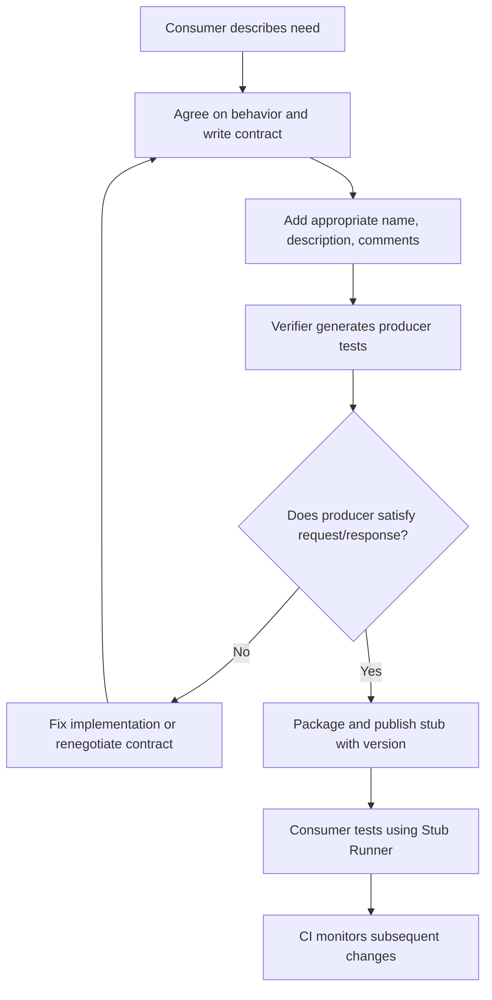

# Metadata and Human-Readable Descriptions

A **Spring Cloud Contract** file can be syntactically valid and generate tests yet still be hard for maintainers to understand: the filename is just `test1.groovy`, the description is blank, nobody knows which consumer uses it or why it must return error code `409`. Months later, when the producer wants to change the API, the development team can easily drop an important commitment simply because its business context is invisible.

In the **Groovy DSL** chapter, this lesson focuses on **metadata and human-readable descriptions**: how to use contract names, descriptions, comments, and traceability conventions so producer and consumer teams understand the exact purpose of each scenario. This is part of learning **Spring Cloud Contract** to describe HTTP or messaging behavior using Groovy/YAML DSL, generate producer-side tests, publish stubs, use Stub Runner, and integrate CI to detect incompatible changes.

After this lesson, you will be able to:

- Explain the difference between **verified behavior** and **information that helps humans understand the contract**.
- Write clear `name` and `description` entries in Groovy DSL tailored to consumer needs.
- Distinguish comments and descriptive metadata from properties that affect tests or stubs, especially `label` in messaging contracts.
- Attach consumer context, business capability, assumptions, and change rules in the right places.
- Use descriptive information to review contracts, analyze impact, and troubleshoot CI failures without mistaking them for automatic assertions.

## 1. What Should a Contract Help Readers Understand?

Consider an order system integration flow:

- **Consumer:** `OrderService` calls the stock reservation API before accepting payment.
- **Producer:** `InventoryService` handles stock reservation.
- **HTTP behavior:** `POST /api/v1/reservations` returns `201` when reservation succeeds.
- **Error behavior:** the same API returns a business error response when available inventory is insufficient.

Looking only at a contract's request and response, a reader can tell *what the API must return*, but not necessarily *why this matters*, *who relies on that outcome*, or *which handling branch will break if the response changes*.

For instance, two responses both in the HTTP 2xx range can mean different things to the consumer: `201 Created` signals a new reservation was created, whereas `202 Accepted` may mean the request is queued for processing. If `OrderService` uses `201` to start the payment step immediately, changing it to `202` is a change worth discussing, even though the API still returns a success status.

Metadata and descriptions help the team revisit that commitment. The **request/response** blocks, matchers, and message conditions are where the test generator extracts verifiable rules.

| Question When Reading a Contract | Where to Look for Info | What Protects the Behavior? |
| --- | --- | --- |
| What scenario is this? | Short, stable name in `name` and filename | `name` aids identification; request/response define test conditions |
| Who depends on this scenario? | `description`, consumer-based path, or governance records | The contract must accurately describe the real need; writing a consumer name creates no assertion |
| Why is status `201` required? | Semantic explanation in `description` | `response { status 201 }` |
| What condition triggers the out-of-stock error? | Business context and test fixtures | `request`, `response`, and producer state setup |
| Who is affected by an API change? | Owners, reviewers, consumer list | Contract test results combined with real compatibility review |
| When does the consumer proceed? | Description of downstream flow upon receiving result | Tests for the fields/statuses the consumer actually reads |

**Principle:** write metadata to explain *the meaning of a commitment*; write the behavioral blocks of the DSL to *verify that commitment*. Never place critical expectations solely inside a description sentence.

## 2. Elements Commonly Grouped Together as "Metadata"

During reviews, teams often refer to contract names, descriptions, labels, and comments collectively as metadata. However, **not all of them play the same role in Spring Cloud Contract Groovy DSL**.

| Element | Example | Primary Role | Notes |
| --- | --- | --- | --- |
| `name` | `reserve_stock_success` | Identifies the contract, helping generated test code and readers trace the scenario | Choose stable names and avoid duplicates within the build scope |
| `description` | `OrderService reserves stock before payment` | Explains context, goal, and behavioral meaning | Descriptive text does not automatically become a verification assertion |
| Groovy comments | `// Producer fixture ensures this SKU is out of stock` | Explains design decisions and test data | Useful only when reading source; not part of the HTTP payload |
| Directory path and filename | `reservations/order-service/create-success.groovy` | Locates contracts by capability and consumer | Repository convention; does not automatically restrict stubs to a consumer |
| `label` on a message contract | `payment_completed` | Identifier usable when triggering messages on a stub | Carries **operational** meaning, not merely decorative |
| `priority` and matchers | Mapping priority, matching rules | Affects how stubs or tests execute depending on context | Do not use as a substitute for human-readable descriptions |

**Version note:** DSL and extension options can change across Spring Cloud Contract versions. This lesson uses well-known elements such as `name`, `description`, and `label`. Do not invent arbitrary properties like `owner`, `team`, `tags`, or `ticket` directly inside `Contract.make { ... }` without confirming your project's DSL version supports them; doing so may prevent the contract from compiling.

### `name`: Short, Searchable Identifier

A good name conveys both the *action* and the *key outcome*:

```groovy
Contract.make {
    name 'order_create_reservation_success'
    // ...
}
```

Helpful conventions:

1. Use a consistent naming scheme across all contract sources, such as `<consumer>_<action>_<outcome>`.
2. Express the observable outcome: `success`, `insufficient_stock`, `invalid_quantity`, or `not_found`.
3. Avoid characters that cause trouble in generated test names; letters, digits, and underscores are generally convenient.
4. Avoid duplicate names that could cause confusion or collisions during test generation, especially if tooling aggregates contracts from multiple directories.
5. Do not rename `name` purely cosmetically in the same PR that makes a major behavior change; test names, reports, or tracking rules may depend on it.

Contract names may be used by Spring Cloud Contract when generating test class/method names, though the exact transformation depends on plugin version and configuration. Do not rely on a specific generated class name as a stable API.

### `description`: Explain for Readers, Not as an Assertion Replacement

`description` should answer:

- Which consumer or business flow needs this behavior?
- Which business condition is under consideration?
- Which outcome allows the consumer to proceed or halt processing?
- Why is a particular field or error code treated as an important commitment?

A good description can be a short sentence or a few lines when context is needed:

```groovy
Contract.make {
    name 'order_create_reservation_insufficient_stock'
    description '''
        Consumer: OrderService.
        When inventory is insufficient for the requested quantity,
        the producer returns INSUFFICIENT_STOCK so the consumer
        halts the payment step and displays a notice.
    '''
    // ...
}
```

The example above shows using a Groovy multiline string to explain semantics. For simple scenarios, a single-line description suffices; what matters is readability and consistency with the conditions the test actually checks.

A description should not be a verbatim copy of the JSON. For example, "Returns `201` and field `reservationId`" is helpful yet fails to explain *why* the consumer needs `reservationId`. Better is "`OrderService` uses `reservationId` to confirm or cancel the reservation before order completion."

### Groovy Comments: Explaining Local Technical Decisions

Comments are appropriate when a contract detail is easy to misinterpret:

```groovy
request {
    method 'POST'
    url '/api/v1/reservations'
    // Producer-side fixture ensures SKU-EMPTY is out of stock.
    body([
        sku     : 'SKU-EMPTY',
        quantity: 2
    ])
}
```

Comments help future editors understand why specific sample data was chosen, but **they do not seed data in the database**. If the fixture is not set up properly, the test can still fail or test the wrong scenario. Whenever a requirement must be verified, express it in the DSL and executable tests rather than only writing a comment.

## 3. HTTP Example: Describing a Complete Success Scenario

Suppose consumer `OrderService` needs to reserve two units of `SKU-100` to proceed to payment. After both teams agree on the contract, we can record it at:

```text
src/test/resources/contracts/reservations/order-service/create-reservation-success.groovy
```

Contents:

```groovy
import org.springframework.cloud.contract.spec.Contract

Contract.make {
    name 'order_create_reservation_success'
    description '''
        Consumer: OrderService.
        After the user confirms the order, OrderService creates a reservation
        to prevent overselling available stock. On success, the consumer needs
        reservationId to reference the hold and status HELD to continue
        the payment flow.
    '''

    request {
        method 'POST'
        url '/api/v1/reservations'
        headers {
            contentType(applicationJson())
        }
        body([
            sku     : 'SKU-100',
            quantity: 2
        ])
    }

    response {
        status 201
        headers {
            contentType(applicationJson())
        }
        body([
            reservationId: 'RES-100',
            status       : 'HELD'
        ])
    }
}
```

In this example:

- `name` identifies the scenario in source code and test reports.
- `description` clearly states **the consumer, when it is called, and why both response fields are needed**.
- `request` and `response` define the concrete verification requirements. The producer is checked against their values and matchers.
- `RES-100` is purely sample data. For randomly generated IDs, use matchers or deterministic test fixtures; avoid accidentally committing production to always returning one hardcoded ID.

The path and API are purely learning examples, not conventions imposed by Spring Cloud Contract. When a real system uses another format or status code, descriptions and conditions must reflect the **agreement between the two teams**.

### Same Contract, Poor Description

```groovy
Contract.make {
    name 'test_post'
    description 'POST works'

    // Assume request/response match the example above.
}
```

This snippet illustrates *uninformative naming and description*, not a complete contract capable of generating tests. Over time, `test_post` gives readers no clue which API, which outcome, or which consumer would be affected. Conversely, a page-long description listing internal implementation steps is unhelpful too; focus on **why the commitment exists**.

## 4. Describing Each Business Branch with a Separate Contract

One API can have multiple outcomes, and each outcome drives consumer decisions. For example, a successful reservation lets payment proceed; insufficient stock must stop the flow. Do not lump both meanings under a vague description like "API handles reservations."

Example contract for the insufficient-stock case:

```groovy
import org.springframework.cloud.contract.spec.Contract

Contract.make {
    name 'order_create_reservation_insufficient_stock'
    description '''
        Consumer: OrderService.
        If stock is insufficient, the producer refuses to create a reservation.
        The consumer relies on error code INSUFFICIENT_STOCK to halt the
        payment step instead of assuming stock was reserved.
    '''

    request {
        method 'POST'
        url '/api/v1/reservations'
        headers {
            contentType(applicationJson())
        }
        body([
            sku     : 'SKU-EMPTY',
            quantity: 2
        ])
    }

    response {
        status 409
        headers {
            contentType(applicationJson())
        }
        body([
            code: 'INSUFFICIENT_STOCK'
        ])
    }
}
```

Readers immediately see the difference:

| Scenario | Contract Name | Meaning to Consumer | Verifiable Conditions |
| --- | --- | --- | --- |
| Reservation succeeds | `order_create_reservation_success` | Proceed to payment with reservation ID | `201`, `reservationId`, `status=HELD` |
| Insufficient stock | `order_create_reservation_insufficient_stock` | Stop payment and report out of stock | `409`, `code=INSUFFICIENT_STOCK` |

Status `409` and code `INSUFFICIENT_STOCK` are API choices for this example. Spring Cloud Contract does not force every out-of-stock workflow to use those exact values.

For test data, the producer must prepare `SKU-100` with sufficient stock and `SKU-EMPTY` without enough stock. Merely writing "insufficient stock" in `description` without controlling input conditions means the test might not cover the intended business branch.

## 5. When Should You Write a Multiline Description?

There is no mandatory length. Descriptions should be longer when a contract carries non-obvious assumptions or semantics. A useful guideline:

| Complexity | Description Style |
| --- | --- |
| Simple read endpoint | One sentence: who calls it and what result is needed |
| Business error branch | State the error condition and the action the consumer must take |
| Result with statuses/timestamps | Clarify status meanings and units/timezones if not obvious |
| Asynchronous message | State the triggering event, consuming service, and payload meaning |
| Contract with complex compatibility history | Summarize active commitments; link to design docs managed in the proper place |

Writing **Given – When – Then** at the business level works well:

> **Given:** the item has at least two units available. **When:** `OrderService` requests a reservation. **Then:** `InventoryService` returns a reservation ID and confirms status `HELD` so the consumer can proceed to payment.

Do not cram this entire scenario into `name`. Short names enable searching; descriptions enable semantic understanding; DSL blocks enable verification.

### Information That Should Not Go into Descriptions

- Sensitive information such as real tokens, passwords, API keys, personal data, or production IDs.
- Internal implementation details not committed to the consumer, such as private method names or mutable table schemas.
- Guarantees that tests cannot verify and the producer team has not agreed to, such as "never fails" or "100% handles every case correctly."
- Temporary ticket IDs as the sole explanation of the contract; if the tracker is deleted or inaccessible, readers lose the scenario's purpose.
- Statements contradicting request/response, such as saying "returns `201`" in the description while the DSL specifies `200`.

## 6. Distinguishing `label` in Message Contracts from Human-Readable Descriptions

For message-based communication, Spring Cloud Contract has the **`label`** concept. This is not merely a search keyword; in corresponding scenarios, a label can be used to **trigger a stub message**, for example via Stub Runner.

Example where producer `PaymentService` emits a payment-succeeded event so consumer `OrderService` updates the order status:

```groovy
import org.springframework.cloud.contract.spec.Contract

Contract.make {
    name 'order_payment_completed_event'
    description '''
        Consumer: OrderService.
        When payment succeeds, PaymentService emits an event
        with orderId and paymentId so the consumer completes the order.
    '''
    label 'payment_completed'

    input {
        triggeredBy('publishPaymentCompleted()')
    }

    outputMessage {
        sentTo('payments.completed')
        headers {
            header('contentType', 'application/json')
        }
        body([
            orderId  : 'ORD-100',
            paymentId: 'PAY-100',
            status   : 'COMPLETED'
        ])
    }
}
```

Here:

1. `name` identifies the test scenario.
2. `description` explains **who needs the message and why**.
3. `label 'payment_completed'` is a label the consumer can use to trigger the message from the stub under supported mechanisms; renaming the label arbitrarily can break consumer tests.
4. `input { triggeredBy(...) }` specifies how the producer test triggers message emission.
5. `outputMessage` specifies the destination, headers, and body to verify.

This example requires a message verification environment compatible with the chosen integration technology and a `publishPaymentCompleted()` test method configured on the producer side. DSL alone is not enough to make every broker or binder run by itself.

**Critical distinction:** if you want to explain "what readers need to know this message is for," use `description`. If a consumer test needs a **label to invoke a message stub trigger**, `label` is part of the executable contract and must be managed as an integration dependency.

## 7. Do Not Turn "Metadata" into Arbitrary Unsupported Fields

A team may want to store extra attributes such as:

- `consumer = OrderService`;
- `businessCapability = Reservation`;
- `ownerTeam = Checkout`;
- `ticket = ORDER-123`;
- `sinceVersion = 1.3`.

These details have governance value, but you cannot assume every arbitrary property name can be added to Groovy DSL:

```groovy
// Example NOT to copy without confirming DSL support:
Contract.make {
    ownerTeam 'Checkout' // Not a universal Contract DSL property.
    ticket 'ORDER-123'   // May cause errors or have no effect.
}
```

To attach extra information, pick mechanisms verifiable in your project:

| Need | Recommended Storage | Reason |
| --- | --- | --- |
| Scenario meaning | `description` | Read alongside the contract file |
| Notes on fixtures or matchers | Comments next to the relevant DSL block | Keeps technical context local |
| Consumer and business capability | Directory/filenames, descriptions, repo conventions | Easy to search and review impact |
| Code reviewers or owners | Repository CODEOWNERS/review rules if used by the project | Integrates with approval workflows |
| Discussions, architectural decisions | Pull requests, ADRs, or design docs at stable URLs | Preserves rationale and change history |
| Custom metadata for tooling | Extension mechanism **supported by the specific version**, with tests for the tool reading it | Avoids inventing DSL properties just to hold tags |

Spring Cloud Contract has extensibility capabilities, though syntax and handling depend on version and configuration. Only use extended metadata APIs after checking the documentation and runtime behavior of your project's version; in this lesson, we rely strictly on the Groovy DSL elements illustrated above.

### Should Descriptions Repeat Information from the File Path?

You do not need to repeat every word. If the file sits at `contracts/reservations/order-service/...`, `description` does not have to restate the entire folder hierarchy. Nevertheless, explicitly stating `Consumer: OrderService` is often helpful when a reader views a single file in a pull request or report without full path context.

The primary value of `description` is answering **why the consumer needs that behavior**, rather than duplicating facts already obvious from the filename.

## 8. Metadata Does Not Replace Test Conditions

Suppose a contract has the description:

> "Returns `reservationId` as a non-empty string and `status` equal to `HELD`."

If the `response` block only checks `status`, the test can still pass even when the producer omits `reservationId`. To protect the commitment, put the condition into the DSL—for instance, using a concrete value or a matcher suited to dynamic data types.

An example checking dynamic data format with Groovy DSL:

```groovy
import org.springframework.cloud.contract.spec.Contract

Contract.make {
    name 'order_create_reservation_dynamic_id'
    description 'OrderService requires reservationId in a deterministic format.'

    request {
        method 'POST'
        url '/api/v1/reservations'
        headers {
            contentType(applicationJson())
        }
        body([
            sku     : 'SKU-100',
            quantity: 2
        ])
    }

    response {
        status 201
        headers {
            contentType(applicationJson())
        }
        body([
            reservationId: $(consumer('RES-100'),
                             producer(regex('RES-[0-9]+'))),
            status       : 'HELD'
        ])
    }
}
```

The idea here is: when using the stub, the consumer sees sample value `RES-100`; the producer test checks the actual ID against regex `RES-[0-9]+`. The consumer/producer syntax and matchers must fit the Spring Cloud Contract version used by the project. In practice, the regex must reflect a **committed format**, not an accidental assumption about ID shapes.

Note: dynamically generated producer values can be checked by matchers, yet that **does not prove** ID uniqueness under all conditions or correctness of concurrent reservations. Those requirements need dedicated state/integration tests.

## 9. Using Metadata to Review API Changes

Suppose a pull request renames `reservationId` to `holdId` in the response. Imagine two situations:

**Case A — sparse description:** name `test_reservation`, description "success". Reviewers may only see a field name difference and assume it is an internal DTO rename.

**Case B — clear description:** `order_create_reservation_success` notes that `OrderService` uses `reservationId` to cancel or confirm the hold. Reviewers immediately understand that renaming the field can break currently running consumers.

A helpful review workflow:

1. Read `name` and `description` to identify affected consumer flows.
2. Compare old and new request/response shapes, distinguishing technical refactors from changes to committed behavior.
3. Check whether the producer can support both shapes during a transition period.
4. Coordinate with consumers on upgrade or versioning strategies if the change is breaking.
5. Run generated producer tests and consumer tests using the appropriate stub version.
6. Update the description to reflect the **current commitment**, leaving no outdated wording behind.

Metadata helps reviewers see **why** an assertion exists. Compatibility decisions must still rest on which fields, codes, and statuses consumers actually use.

### When Only Name or Description Changes, Must Tests Still Run?

A stub response may not change when only `description` is edited; however, check the build if test generation relies on `name` or other fields. Changing `name` can alter generated test names, affecting how CI identifies tests, reports, or filter rules.

Never assume "editing metadata alone has zero effect." Especially with a message **`label`**, renaming it can directly break message-triggering calls in consumer tests.

## 10. Metadata in Test Generation, Stub, and CI Workflows

Typical lifecycle flow:



When Spring Cloud Contract Verifier generates tests, it relies primarily on the **executable conditions defined** in request/response or messages. `name` can affect generated test identifiers. `description` helps humans understand the goal, yet **does not automatically generate extra business assertions**.

Similarly, the stub consumed by clients primarily simulates the defined requests/responses or messages. Do not assume the consumer can read the full `description` from a stub API or that Stub Runner automatically validates the business accuracy of descriptive prose.

For a Maven producer configured with the Verifier plugin, a typical CI step runs:

```bash
mvn -B -ntp clean verify
```

Then:

- Verify that tests were actually generated and executed; a green build with **0 contract tests** does not protect an API.
- When a test fails, use the scenario name and description to trace back to the consumer need.
- Never rewrite a description or delete an assertion just to turn CI green; fix the producer if it fails to meet the commitment.
- Publish stubs only from builds that pass mandatory gates and carry explicit versions.
- Consumers pull the right stub version via Stub Runner; additional tests verify that consumer code handles the committed scenario.

Descriptive information can support automated review pipelines or team-built internal documentation, but **does not replace** human accountability for confirming business intent.

## 11. Common Mistakes When Writing Metadata

| Mistake | Consequence | How to Fix |
| --- | --- | --- |
| `name 'test1'`, `description 'OK'` | Unknown consumer, unknown business branch | Name by action/outcome; describe consumer and rationale |
| Only writing "returns `201`" inside `description` | Generated test might not verify status | Put `status 201` inside `response` |
| Putting compatibility requirements only in comments | Not protected by assertions | Write appropriate DSL conditions or add other tests |
| Copying the happy-path description to error branches | Reviewers misunderstand business impact | Give each branch its own description of consumer decisions |
| Changing `label` like a decorative tag | Consumer may fail to trigger message stub | Manage `label` as part of the messaging interface |
| Adding arbitrary `ownerTeam`/`ticket` fields to Groovy DSL | Can break test generation or carry no effect | Use supported metadata storage or repo conventions |
| Putting real customer data in descriptions or sample requests | Information leak and brittle tests | Use stable synthetic data with no secrets |
| Description no longer matches request/response | Creates misleading picture of system behavior | Update description alongside contract edits; review both together |
| Putting every internal implementation detail into descriptions | Review noise, goes stale quickly | Keep focus on producer/consumer obligations; link to design docs when needed |

## 12. Checklist for a Readable Contract

Before opening a pull request, ask yourself:

- [ ] `name` conveys the action and key outcome without needing to open the implementation.
- [ ] `name` does not collide with another contract within generator scope.
- [ ] `description` states the relevant consumer or business flow.
- [ ] Description explains **why the consumer needs the behavior**, not just repeating the status code.
- [ ] Mandatory conditions appear in request/response, matchers, or message blocks of the DSL.
- [ ] Sample data and fixtures are clear enough for others to reproduce the scenario.
- [ ] Comments explain only non-obvious decisions and contain no secrets or sensitive data.
- [ ] If `label` is used for messaging, checked whether consumer tests depend on that label name.
- [ ] No arbitrary metadata fields unsupported by the project's DSL version.
- [ ] Description, filename, and actual behavior are consistent with one another.
- [ ] Generated tests have been run, and it is clear which producer version the published stub represents.

### Practice Exercise

You receive the following contract from another team:

```groovy
import org.springframework.cloud.contract.spec.Contract

Contract.make {
    name 'test1'
    description 'reserve'

    request {
        method 'POST'
        url '/api/v1/reservations'
        headers { contentType(applicationJson()) }
        body([sku: 'SKU-EMPTY', quantity: 2])
    }

    response {
        status 409
        headers { contentType(applicationJson()) }
        body([code: 'INSUFFICIENT_STOCK'])
    }
}
```

Complete these tasks:

1. Change `name` to clearly express the consumer, action, and error outcome.
2. Write a `description` explaining the "insufficient stock" condition, which operation the consumer must halt, and why `INSUFFICIENT_STOCK` is needed.
3. Add a brief comment about the fixture required for `SKU-EMPTY`, without moving HTTP conditions out of the DSL blocks.
4. Explain why changing `description` without updating `response` cannot change status `409` into `400`.
5. Suppose the producer wants to rename `INSUFFICIENT_STOCK` to `OUT_OF_STOCK`: identify which consumer must be consulted, which tests must run, and what needs updating in the contract.
6. For a separate message contract using `label 'payment_completed'`, explain why changing the label can affect tests using Stub Runner even if the message payload stays unchanged.

**Expected outcome:** when a reviewer unfamiliar with the producer source code opens the contract, they can still answer **who depends on the behavior, what behavior is committed, why it matters, and which parts of the DSL actually verify that commitment**. High-quality metadata makes contracts easy to understand and maintain; tests and stubs bring those described commitments into verification pipelines to catch incompatible changes.
