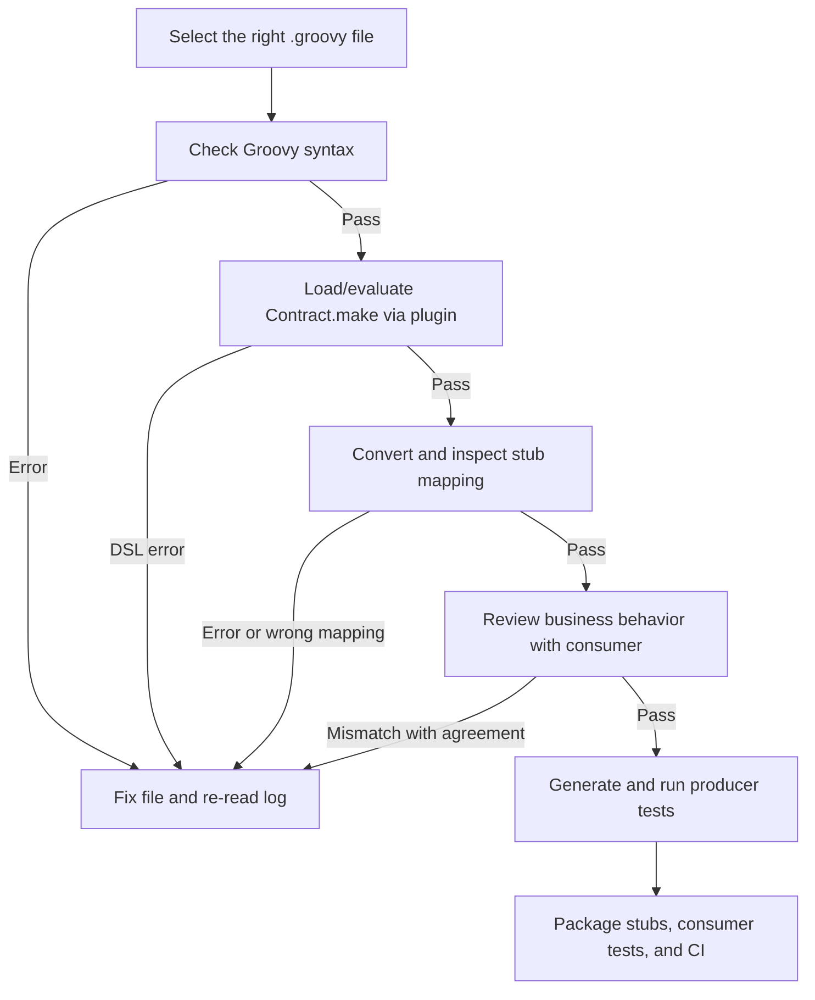

# Reading Syntax Errors and Validating Contracts Before Generating Tests

## 1. Why Validate Groovy DSL Before the Test-Generation Step?

In **Spring Cloud Contract** (`SPRING_CLOUD_CONTRACT` module), a contract is a description of the behavior that a **producer** commits to providing for a **consumer**. Contracts can be written in Groovy or YAML DSL to describe HTTP requests/responses or messaging events. From these contracts, the tooling generates **producer tests** and **stubs**; Stub Runner lets consumers test against published stubs. CI can use those steps to catch incompatible API changes.

With **Groovy DSL**, a misplaced bracket, typo in a DSL method name, wrong request condition, or misconfigured matcher can cause test generation to fail—or worse, generate tests that **verify the wrong behavior**. Therefore, before asking the tool to generate producer tests, we need to validate contract files across multiple layers.

After this lesson, you will be able to:

- Distinguish **Groovy syntax errors**, **DSL call errors**, and **contract semantic errors**.
- Read error messages by filename, line, column, and root cause; avoid patching based on the last line of a stack trace.
- Audit `Contract.make`, `request`, `response`, `input`, `outputMessage`, and matcher blocks.
- Use the **contract conversion/validation** step before generating and running producer tests, when supported by the build.
- Establish a repeatable validation workflow in pull requests and CI.

> **Scope:** This lesson focuses on **reading errors and validating contract inputs before generating tests**. This is an early verification step; it does not replace running producer tests, consumer tests, or downstream integration tests.

## 2. Four Classes of Issues Commonly Called "Contract Errors"

| Issue Class | Example | How Is It Detected? | Can It Pass Syntax Checks? |
| --- | --- | --- | --- |
| **1. Groovy syntax** | Missing `}`, missing quote, mismatched `[`/`]` brackets | Groovy parser/compiler in the IDE or when the plugin loads the file | No |
| **2. Structure/DSL** | Calling `statuses 200` instead of `status 200`; using a block unsupported by the DSL | When executing/evaluating `Contract.make` as the plugin reads and converts it | Yes |
| **3. Representation validity** | Invalid matcher, unconvertible body, data incompatible with mapping format | Contract-to-test/stub conversion step, if caught by the tool | Yes |
| **4. Integration semantics** | Contract says `200` while the API agreed on `404`; missing `code` field the consumer depends on | Review against API/consumer specs and producer/consumer tests | Yes |

A **valid Groovy file** is not necessarily a **valid Spring Cloud Contract**. A contract that converts cleanly is not necessarily **business-correct** either. Thus, "zero syntax errors" alone can never serve as grounds for publishing stubs.

## 3. Starting from a Well-Structured HTTP Contract

Suppose producer `orders-producer` exposes `GET /api/orders/ord-1001`. When fixture `ord-1001` exists, the API agrees to return `200 OK` and JSON containing `id` and `status`.

Illustrative file `get_order_success.groovy`:

```groovy
import org.springframework.cloud.contract.spec.Contract

Contract.make {
    name 'get_order_success'
    description 'Return details of an existing order'

    request {
        method GET()
        url '/api/orders/ord-1001'
    }

    response {
        status 200
        headers {
            contentType(applicationJson())
        }
        body([
            id    : 'ord-1001',
            status: 'CREATED'
        ])
    }
}
```

When reading or reviewing this file, proceed in order:

1. **Root block:** is `Contract.make { ... }` properly opened and closed?
2. **Metadata:** do `name` and `description` accurately describe the behavior branch?
3. **Request:** does it match the agreed method, URL/path, query params, headers, and body?
4. **Response:** does it match the HTTP status, headers, and body the consumer will consume?
5. **Fixture:** can `ord-1001` data be produced in the producer test environment?

The value `ord-1001` is controlled illustrative data, not a value provided automatically by Spring Cloud Contract. If the producer generates random IDs, the contract should use deterministic test data or appropriate matchers.

## 4. Reading Groovy Syntax Errors: Start with Brackets and Strings

### 4.1. Missing Closing Brace

Error example:

```groovy
import org.springframework.cloud.contract.spec.Contract

Contract.make {
    name 'get_order_success'

    request {
        method GET()
        url '/api/orders/ord-1001'
    // missing } closing request

    response {
        status 200
    }
}
```

The Groovy parser may report a message like `Unexpected input`, `expecting '}'`, or `Unexpected end of file`, depending on error position and Groovy version. The message sometimes points to the end of the file rather than the line where the brace was omitted: the parser notices only when it can no longer pair structures.

**How to fix:**

1. Walk backward from the line reported by the parser to the nearest unclosed block.
2. Verify matching `{ }` pairs for `Contract.make`, `request`, `response`, `headers`, and `bodyMatchers`.
3. Also check `( )` and `[ ]` in map/list bodies.
4. Fix the single closest root cause and re-run validation; do not edit indiscriminately across stack trace lines.

Corrected version of the request section:

```groovy
request {
    method GET()
    url '/api/orders/ord-1001'
}

response {
    status 200
}
```

These are two blocks **inside** `Contract.make`; the corrected snippet above is not a standalone contract file.

### 4.2. Missing Quote or Comma

Error example:

```groovy
body([
    id    : 'ord-1001,
    status: 'CREATED'
])
```

The opening single quote at `'ord-1001` is unclosed, preventing Groovy from parsing the string properly. If the error points to the `status` line, check the **preceding line** before assuming `status` is wrong.

Another common error is writing a map with invalid separators:

```groovy
body([
    id: 'ord-1001'
    status: 'CREATED'
])
```

In a multi-entry map, separate entries clearly with commas:

```groovy
body([
    id    : 'ord-1001',
    status: 'CREATED'
])
```

**Debugging tip:** check the ending character of the expression being built; many "next-line errors" actually stem from a missing quote, comma, or bracket on the line above.

### 4.3. Syntax Log Example

The lines below are a **simulated log for reading practice**, not fixed verbatim output across all versions:

```text
ERROR .../contracts/get_order_success.groovy: 14:
unexpected token: response @ line 14, column 5
    response {
    ^
```

From this log, extract:

- Which file failed: `get_order_success.groovy`.
- Where the parser stopped: line 14, column 5.
- Offending token: `response`.
- First hypothesis to check: the immediately preceding `request` block was never closed.

Do not start by renaming `response`. `response` may be completely valid; the bug is that the parser still thinks it is inside the earlier `request` block.

## 5. Syntactically Valid Groovy Calling the Wrong DSL

### 5.1. Misspelled DSL Method Name

Example:

```groovy
Contract.make {
    request {
        method GET()
        url '/api/orders/ord-1001'
    }
    response {
        statuses 200
    }
}
```

`statuses 200` is syntactically valid Groovy method-call syntax, yet it is **not** the `response` property used to set HTTP status in the DSL. When Spring Cloud Contract evaluates the closure, this can surface as a `MissingMethodException` or a corresponding DSL exception.

Fix it to:

```groovy
response {
    status 200
}
```

**Symptom:** if the stack trace mentions `MissingMethodException`, `MissingPropertyException`, or reports an unresolved property/method on a DSL object, check **exact block names and nesting** before touching business logic.

### 5.2. Placing a Property in the Wrong Block

Example that is valid Groovy syntax yet wrong DSL placement:

```groovy
request {
    method POST()
    url '/api/orders'
    status 201
}
```

Here `status 201` sits inside `request` instead of `response`. Depending on DSL execution, the tool may raise an error for not supporting that call here, and even before running, a review should catch it immediately: **HTTP status is a producer response property**.

Fix by separating the boundary:

```groovy
request {
    method POST()
    url '/api/orders'
}
response {
    status 201
}
```

Likewise, message contracts do not use `response.status` to describe a business outcome inside an event. A message payload may contain `result: 'REJECTED'`, which is not an HTTP status.

### 5.3. Confusing Groovy DSL with YAML DSL

The snippet below is YAML syntax, not valid content to paste directly into a Groovy file:

```yaml
request:
  method: GET
  url: /api/orders/ord-1001
response:
  status: 200
```

In Groovy DSL, you must use `Contract.make`, closures, `method GET()`, `url '/...'`, `status 200`, and corresponding blocks. If your team chose YAML DSL, save files following YAML conventions so tooling parses them as YAML instead of trying to force YAML into Groovy by changing the file extension.

## 6. Matcher Errors: Syntactically Valid but Producing Unintended Behavior

Spring Cloud Contract operates from two perspectives when building an HTTP contract:

- **Producer tests** use deterministic input data to call the producer and verify output data.
- **Consumer stubs** need to match requests sent by the consumer and return the described response.

Therefore, when using matchers, `consumer(...)` and `producer(...)` have opposite meanings depending on whether the matcher sits in **request** or **response**.

### 6.1. Matchers in HTTP Responses

Suppose the producer generates order IDs formatted as `ord-<number>`, while the consumer stub needs a concrete, stable ID:

```groovy
import org.springframework.cloud.contract.spec.Contract

Contract.make {
    name 'create_order_success'

    request {
        method POST()
        url '/api/orders'
        headers {
            contentType(applicationJson())
        }
        body([productId: 'SKU-001', quantity: 2])
    }

    response {
        status 201
        headers {
            contentType(applicationJson())
        }
        body([
            id    : $(consumer('ord-1001'),
                      producer(regex('ord-[0-9]+'))),
            status: 'CREATED'
        ])
    }
}
```

In **response**:

| Perspective | Value | Effect |
| --- | --- | --- |
| Consumer stub | `ord-1001` | Stub returns a stable sample ID |
| Producer verification | Regex `ord-[0-9]+` | Producer test accepts real IDs matching the format |

Swapping the two sides by mistake or using a regex that accepts any string can prevent verification from reflecting requirements. For instance, `.*` on an ID field accepts empty strings, malformed formats, or unexpected values depending on how the matcher is applied.

### 6.2. Matchers in HTTP Requests

Suppose the stub should accept any valid ID for the order-found branch, while the producer test only needs to send one concrete URL:

```groovy
request {
    method GET()
    urlPath($(consumer(regex('/api/orders/ord-[0-9]+')),
               producer('/api/orders/ord-1001')))
}
```

In **request**, the consumer side provides the **stub-matching condition**; the producer side provides the **actual test request value**. A regex spanning both the "order exists" and "order missing" branches causes the HTTP stub to accidentally return `200` instead of `404`. Unless every ID matched by the regex belongs to the exact same branch, use concrete URLs or non-overlapping conditions.

### 6.3. `bodyMatchers` and Specificity

Another way to verify dynamic JSON responses is declaring `bodyMatchers`:

```groovy
response {
    status 200
    headers {
        contentType(applicationJson())
    }
    body([
        id    : 'ord-1001',
        status: 'CREATED'
    ])
    bodyMatchers {
        jsonPath('$.id', byRegex('ord-[0-9]+'))
    }
}
```

Use matcher styles compatible with your data types and your project's DSL version. Do not stack multiple matchers on the same property without a clear purpose. When validating before test generation, answer: *"Which matchers govern the request stub? Which matchers govern the producer test response? Are they tight enough to catch bugs?"*

## 7. Semantic Verification: Tooling Does Not Know the Agreement Between Teams

The following example **may be syntactically and DSL-valid**:

```groovy
Contract.make {
    name 'get_order_not_found'
    request {
        method GET()
        url '/api/orders/ord-missing'
    }
    response {
        status 200
        headers {
            contentType(applicationJson())
        }
        body([id: 'ord-missing'])
    }
}
```

Yet if the API agreed that a missing order must return `404` with `code = ORDER_NOT_FOUND`, the file above is **wrong per the business contract**. Naming it `get_order_not_found` does not make the framework turn `status 200` into `404`.

A contract reflecting the agreement would be:

```groovy
Contract.make {
    name 'get_order_not_found'
    request {
        method GET()
        url '/api/orders/ord-missing'
    }
    response {
        status 404
        headers {
            contentType(applicationJson())
        }
        body([code: 'ORDER_NOT_FOUND'])
    }
}
```

**Semantic review** must rely on the API specification, consumer expectations, and agreed business decisions. The plugin cannot infer on its own that `ord-missing` must return `404`.

### 7.1. HTTP Semantic Checklist

| Question | What to Inspect |
| --- | --- |
| Are method and URL/path right? | `GET` vs. `POST`; path, query, and encoding match the API |
| Which headers belong to the commitment? | `Content-Type`, `Location`, routing or auth headers when meaningful |
| Does the body match schema and types? | Required fields, enum values, numbers vs. strings, nested objects/lists |
| Are error branches separated? | `400`, `404`, `409` when consumers handle them differently |
| Which values are dynamic? | IDs, timestamps, correlation IDs need matchers or stable fixtures |
| Are request mappings distinguishable? | Avoid two stubs matching the same request while returning different responses |
| Are producer tests reproducible? | Independent fixtures, unaffected by execution order or stale environment data |

### 7.2. Messaging Semantic Checklist

A messaging contract can start from `input` and describe `outputMessage`:

```groovy
import org.springframework.cloud.contract.spec.Contract

Contract.make {
    name 'order_created_event'
    label 'order_created'

    input {
        triggeredBy('publishOrderCreated()')
    }

    outputMessage {
        sentTo('orders.events')
        body([
            eventType: 'ORDER_CREATED',
            orderId  : 'ord-1001'
        ])
    }
}
```

Before generating tests, verify:

1. `publishOrderCreated()` **will be implemented in the producer test base class** or corresponding trigger mechanism. This is an illustrative method name, not a built-in API.
2. `orders.events` matches the destination the consumer subscribes to; avoid confusing logical binding names with physical topic names if the project maps between them.
3. `eventType` and `orderId` reflect the actual schema the consumer uses.
4. `label` is set explicitly if consumer tests need to trigger the message stub by label.
5. The test environment has a way to **observe emitted messages**; a contract does not install or start a broker automatically.

For flows that consume one message and emit another, `input` can use `messageFrom(...)` and `messageBody(...)` instead of `triggeredBy(...)`. DSL and mapping errors of this type must be verified using plugins/test suites configured appropriately for messaging. Never use HTTP `response.status` to describe an event outcome.

## 8. Pre-Generation Verification Workflow for Producer Tests

No single universal command across all projects guarantees **syntax, DSL, and semantics** without a build environment. Separate the steps and record the outcome of each step.



### Step 1 — Identify the File and Scope Under Check

Confirm:

- The file resides in the contracts directory actually scanned by the plugin and has the right extension.
- It contains `Contract.make` and the HTTP or messaging blocks matching the protocol.
- No duplicate Groovy/YAML files with overlapping content cause the build to register the same scenario twice.
- Each contract has traceable data and naming, and contains no credentials or real user data.

Do not conclude "all contracts are validated" if the build only scanned a subdirectory or a stale copy of the file.

### Step 2 — Check Groovy Syntax

IDEs with Groovy support catch bracket, string, and closure errors early. In CI, the plugin step that **loads and evaluates the DSL** will normally report parser errors on broken files as well. Pure syntax checking only states that a file is valid Groovy; it does not verify DSL methods, HTTP structures, or business rules.

If a standalone syntax checker must load the `Contract` class to resolve imports, ensure its classpath includes the project's Spring Cloud Contract libraries. Never treat an "unable to resolve import" error as proof of a broken contract when the parser environment lacks dependencies.

### Step 3 — Run Contract Conversion Before Generating Tests

With **Maven** and `spring-cloud-contract-maven-plugin` configured, you can use the contract-to-stub-mapping conversion goal to catch certain DSL/conversion errors early:

```bash
./mvnw -B spring-cloud-contract:convert
```

**Prerequisite:** the goal/prefix above requires a compatible plugin and version configured/resolved in the project. If Maven reports the prefix or goal is not found, check the plugin configuration and documentation for your project's version first; it is not necessarily an error in the Groovy file. If the plugin is bound to a lifecycle phase, actual behavior depends on build configuration.

`convert` **transforms contracts into stub/mapping representations**; it is not a real producer test and **does not prove** the application's endpoints comply with the contract. Nor is it a complete business-semantic validator. Conversion can succeed even when the HTTP status or event schema in the DSL violates the team agreement.

In Gradle projects, use the conversion/stub-generation task provided by your configured plugin version. Task names can vary across versions; inspect the actual project rather than guessing a task name and blaming "task not found" on a broken contract.

### Step 4 — Inspect the Converted Mapping or Artifact

Once conversion succeeds, confirm the output faithfully reflects the DSL:

- HTTP mappings have the expected method, URL/path, query/body/header matchers, and response.
- Branches like `200`, `400`, `404`, etc. do not use unintentionally overlapping request conditions.
- Dynamic data translates into matchers in the right direction rather than overly broad values.
- For messaging, inspect the generated message representations/scenarios supported by the build and how they are triggered; do not assume a WireMock mapping exists for every message.

If the plugin produces no output for a file, check the contracts directory path, scan filters, conversion configuration, and logs. **Never mark a step PASS simply because the command returned exit code 0 when expected contracts were silently skipped.**

### Step 5 — Review Behavior Before Running the Generator

Place three artifacts side by side: **the contract**, **the business specification**, and **the consumer handling behavior**. For example, if the consumer relies on `404 ORDER_NOT_FOUND`, both `404` and `code` must visibly appear in the contract. For `ORDER_CREATED`, the right destination and mandatory fields must be present.

This step catches discrepancies that parsers and converters cannot see. If it falls short, fix the DSL and re-check; only then let test generation create the corresponding test code.

### Step 6 — Generate and Execute Producer Tests

Once preliminary checks pass, proceed to **generating producer tests** per your project build, then **running** those generated tests. Even though this goes beyond pre-check scope, it is mandatory in the contract-protection workflow:

```text
Groovy syntax
    -> DSL evaluation / conversion
    -> review contract semantics
    -> generated producer tests
    -> execute producer tests
    -> package/publish verified stubs
    -> consumer tests
```

**Note:** A successfully generated test only proves the tool emitted test code; it does not prove the real producer passes that test. Run the tests and check assertions.

## 9. Reading Logs Effectively by Root-Cause Layer

When a build fails, avoid reading the entire stack trace blindly from top to bottom. Inspect details in order:

1. **Which phase failed?** Parser, converter, generator, or producer test runtime?
2. **Which file?** The contract file or a generated test class?
3. **Which line/column?** Remember the parser's detection point may appear after the actual typo.
4. **What is the root exception?** `MultipleCompilationErrorsException`, `MissingMethodException`, matcher mismatch, or assertion failure each mean something different.
5. **Is infrastructure involved?** Plugin resolution, classpath, repository, or fixture failures do not indicate a syntax error.

| Message / Symptom | Likely Cause | First Thing to Check |
| --- | --- | --- |
| `MultipleCompilationErrorsException`, `Unexpected input` | Wrong brackets, quotes, or Groovy syntax | Check the line before the reported position and bracket pairs |
| `MissingMethodException: ... statuses(...)` | Misspelled DSL call | Verify `status` inside `response` |
| `MissingPropertyException` inside DSL closure | Wrong property reference or wrong block context | Check property name, parent block, and DSL API for your version |
| JSON/mapping conversion failure | Unconvertible body, matcher, or representation | Check types, JSONPath, regex, and body structure |
| Maven plugin prefix/goal not found | Incorrect build/plugin configuration | Check plugin version, repositories, and goal name |
| No generated mappings/tests | File not scanned, contract excluded, or build skipped that phase | Verify contracts directory, plugin lifecycle, and output |
| Producer test assertion failed | Producer diverged from contract or wrong test fixture | Compare real request/response with DSL; inspect fixtures |
| Stub returns unexpected branch | Overlapping mappings or unmatched request | Compare method, URL, headers, body, and mapping priority/order |

### 9.1. Issue Report Template for Reproducibility

A helpful error report can look like this:

```text
Contract: src/test/resources/contracts/http/get_order_success.groovy
Phase: contract conversion
Error: MissingMethodException on statuses(200)
Location: response block, line 13
Expected: response status 200
Root cause: typo in Groovy DSL
Fix: change statuses 200 to status 200
Validation: conversion succeeds; mapping contains HTTP 200
```

The details above only illustrate the format. In an actual report, capture the real filename, phase, message, line number, and result from that run. Never put paths containing secrets, repository URLs with credentials, or real user payloads into public logs.

## 10. Validation Workflow in Pull Requests and CI

A multi-stage pipeline can place **pre-checks** ahead of **producer verification**:

| Stage | Check | Expected Outcome |
| --- | --- | --- |
| File review | Valid Groovy DSL structure, right branches and fixtures | No obvious errors or misleading metadata |
| Conversion | Plugin reads contract and converts cleanly | No parse/DSL errors; expected mappings/scenarios produced |
| Semantic review | Method/status/schema/destination match agreement | At least one example for each behavior the consumer needs |
| Generate tests | Tool generates producer tests | Tests correspond to modified contracts |
| Execute producer tests | Producer app satisfies contracts | Assertions pass with stable test data |
| Package stub | Create clearly versioned artifact | Stub actually contains mappings/message scenarios |
| Consumer integration | Stub Runner and consumer tests | Consumer handles key interaction branches correctly |

Never place publishing before producer verification passes. If CI runs parallel jobs, ensure **the published artifact is the exact artifact just verified**, and avoid publishing releases under the same version with overwritten contents.

A common pitfall is letting a pipeline succeed because **zero contracts were discovered**. Check the count and list of contracts read and generated, especially when changing directories, extensions, or filter settings.

## 11. Practice: Finding Bugs in Three Contracts

### Scenario A — Syntax Error

```groovy
import org.springframework.cloud.contract.spec.Contract

Contract.make {
    request {
        method GET()
        url '/api/products/SKU-001'
    }
    response {
        status 200
        body([id: 'SKU-001', available: true]
    }
}
```

**Question:** At which layer does the error appear? Which character should you check first?

**Hint:** `body([ ... ])` must close both `]` and `)`. The snippet above is missing the `)` closing `body(...)`. This is a Groovy syntax error; there is no need to speculate about HTTP status or the producer yet.

### Scenario B — DSL Error

```groovy
import org.springframework.cloud.contract.spec.Contract

Contract.make {
    request {
        method GET()
        url '/api/products/SKU-001'
    }
    response {
        statuses 200
        body([id: 'SKU-001'])
    }
}
```

**Question:** Why might an editor report no syntax error while the plugin fails when evaluating the DSL?

**Hint:** Groovy parses `statuses` as a valid method name, yet it does not belong to the `response` block's DSL API. Fix it to `status 200`, then re-run the conversion step.

### Scenario C — Valid Syntax, Wrong Behavior

Agreed specification: `GET /api/products/SKU-MISSING` returns `404` with `code = PRODUCT_NOT_FOUND`.

```groovy
import org.springframework.cloud.contract.spec.Contract

Contract.make {
    name 'get_product_not_found'
    request {
        method GET()
        url '/api/products/SKU-MISSING'
    }
    response {
        status 200
        headers {
            contentType(applicationJson())
        }
        body([id: 'SKU-MISSING'])
    }
}
```

**Question:** Why might conversion succeed even though the contract still needs fixing?

**Answer:** The plugin does not know the business rule requiring `404` for a missing product. Fix it to `status 404` and body `[code: 'PRODUCT_NOT_FOUND']`. Without review, the plugin would generate tests and stubs protecting the wrong `200` behavior.

### Extension Exercise

Building on the corrected Scenario C contract, add a contract `GET /api/products/SKU-001` returning `200`. Then verify the two mappings do not overlap. Suppose product IDs are dynamic strings; propose a matcher narrow enough to accept only valid IDs, and explain why a generic `.*` matcher could cause the stub to match the wrong branch.

## 12. Pre-Check Checklist Before Generating Tests

- [ ] File sits in the directory scanned by the plugin; `.groovy` extension and `Contract` import are correct.
- [ ] `Contract.make` and closures have balanced `{ }` braces; maps/lists and strings are properly closed.
- [ ] No misspelled DSL calls or properties placed in the wrong block.
- [ ] HTTP uses `request`/`response`, declaring required method, URL, status, headers, and body.
- [ ] Messaging uses `input`/`outputMessage` with agreed trigger/message, destination, and payload.
- [ ] `name`, `description`, and request/response branches reflect the same scenario.
- [ ] Dynamic data has appropriate matchers; producer/consumer sides point in the right direction.
- [ ] Stubs sharing method/path have sufficiently distinct request conditions.
- [ ] Test fixtures can be prepared and do not depend on uncontrolled random data.
- [ ] Plugin conversion/pre-check runs successfully **and** outputs the expected contracts.
- [ ] Semantics reviewed against API/event requirements and affected consumers.
- [ ] Generating **and executing** producer tests remains gated in CI before publishing stubs.

**Conclusion:** Effective error reading starts with identifying whether you have a **parser error, DSL error, conversion error, or behavioral error**. Validate `Contract.make` through those layers before generating producer tests, then continue executing tests and distributing versioned stubs. That way, your Spring Cloud Contract pipeline verifies genuine integration promises rather than merely generating passing tests for a broken contract.
