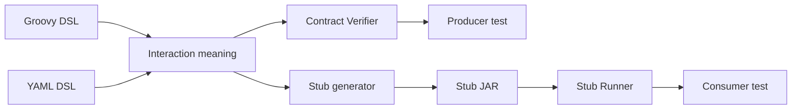
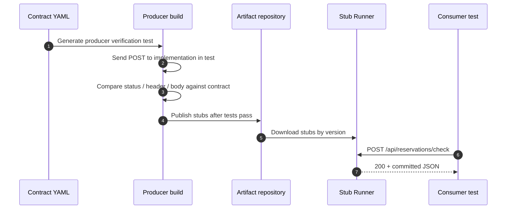
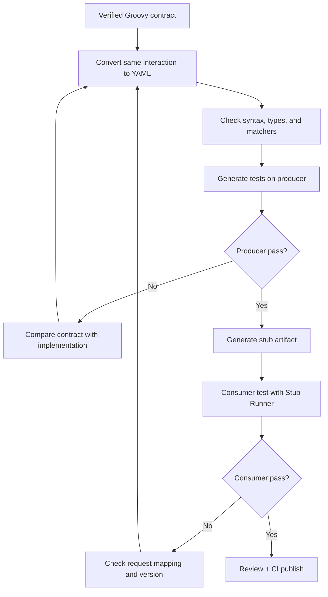

# Representing the Same Interaction in YAML

> **Chapter:** YAML and Other DSLs  
> **Scope:** `SPRING_CLOUD_CONTRACT` — Spring Cloud Contract for contract testing between **producer** and **consumer**.

## Learning Objectives

After this lesson, you will be able to:

1. Convert **an HTTP interaction** from Groovy DSL to **YAML DSL** while preserving the exact contract meaning.
2. Explain the `request`, `response`, `headers`, `body`, and `matchers` fields, and how they relate to producer tests and consumer stubs.
3. Use the right data types, YAML syntax, JSONPath, and matchers to avoid unintended differences when converting between DSLs.
4. Represent a **messaging interaction** in YAML and compare it with Groovy DSL.
5. Integrate YAML contracts into the **producer test generation → verification → stub creation and publishing → Stub Runner on consumer → CI** workflow.

## 1. Why Can the Same Interaction Be Written in YAML?

Spring Cloud Contract allows defining **committed communication behavior** between two systems using either Groovy DSL or YAML DSL. For HTTP, a contract describes what kind of request the producer must accept and what response it returns. For messaging, a contract can describe input events, triggers, message destinations, headers, and payloads.

The two DSLs are **two forms of expression** for a contract; the author must preserve the same meaning:

- **Producer:** when receiving a matching request, does the real implementation perform the committed behavior? Spring Cloud Contract Verifier uses the contract to generate producer tests.
- **Consumer:** how does the application send requests and handle responses? Spring Cloud Contract generates stubs from the contract; Stub Runner lets the consumer call the stub in tests.
- **CI:** producer tests must pass before publishing a verified stub; the consumer needs to use the exact stub version it intends to support.

YAML is useful when a team wants a concise declaration that is easy to review in pull requests and convenient for people unfamiliar with Groovy. Groovy DSL is advantageous when you need helpers, expressions, or complex programmatic structures. Choose the DSL based on readability and expressiveness needs, because **compatibility safety depends on the contract content and actually running verification**, not on the file extension.



The diagram illustrates the two **input options**. In practice, usually only **one** version of the contract is stored to avoid duplicate tests and stubs.

## 2. The HTTP Interaction to Represent

Suppose `checkout-service` (consumer) wants to check whether two units of `SKU-001` can be reserved. `inventory-service` (producer) exposes the endpoint:

```http
POST /api/reservations/check HTTP/1.1
Content-Type: application/json
Accept: application/json

{
  "sku": "SKU-001",
  "quantity": 2,
  "channel": "WEB"
}
```

The producer commits to returning:

```http
HTTP/1.1 200 OK
Content-Type: application/json

{
  "sku": "SKU-001",
  "approved": true,
  "available": 5,
  "requestId": "CHK-0042"
}
```

Business meaning: there is currently enough inventory to approve the reservation request, with tracking ID `requestId`. To keep a clear test case at the start of the lesson, we initially keep **all values fixed**; the matcher section will expand this when `requestId` can vary.

Let's define the interface before writing the DSL:

| Element | Committed value/behavior |
| --- | --- |
| HTTP method | `POST` |
| Path | `/api/reservations/check` |
| Request header | `Content-Type: application/json`, `Accept: application/json` |
| Request body | `sku` is string, `quantity` is number, `channel` is string |
| Response status | `200` |
| Response header | `Content-Type: application/json` |
| Response body | `sku` is string, `approved` is boolean, `available` is number, `requestId` is string |

Listing these out prevents situations where you only convert syntax but accidentally change the path, field types, or HTTP status.

## 3. Writing the Interaction in Groovy DSL

Here is a Groovy-style contract, for example at `src/test/resources/contracts/reservation_check_approved.groovy` in the producer project:

```groovy
org.springframework.cloud.contract.spec.Contract.make {
    name 'reservation_check_approved'

    request {
        method 'POST'
        url '/api/reservations/check'
        headers {
            contentType('application/json')
            header 'Accept': 'application/json'
        }
        body(
            sku: 'SKU-001',
            quantity: 2,
            channel: 'WEB'
        )
    }

    response {
        status 200
        headers {
            contentType('application/json')
        }
        body(
            sku: 'SKU-001',
            approved: true,
            available: 5,
            requestId: 'CHK-0042'
        )
    }
}
```

Here `Contract.make` describes **one communication interaction**. The `request` block is the condition for calling the API; the `response` block is the expectation. The values `true` and `2`/`5` are not placed in quotes so they preserve their boolean/number types.

Note: the Groovy snippet is not producer controller code. It is a **specification capable of generating tests and stubs**, which works once the project has configured the Spring Cloud Contract plugin and test base class.

## 4. Converting the Exact Interaction to YAML DSL

Place the YAML version at:

```text
src/test/resources/contracts/reservation_check_approved.yml
```

Contents:

```yaml
name: reservation_check_approved
description: "Check reservation request with sufficient quantity"

request:
  method: POST
  url: /api/reservations/check
  headers:
    Content-Type: application/json
    Accept: application/json
  body:
    sku: SKU-001
    quantity: 2
    channel: WEB

response:
  status: 200
  headers:
    Content-Type: application/json
  body:
    sku: SKU-001
    approved: true
    available: 5
    requestId: CHK-0042
```

This is the **exact same HTTP interaction** as the Groovy version in section 3. `description` helps maintainers and does not change the request/response. Field ordering in YAML may differ when read by a parser, but **indentation levels** and their parent fields must be accurate.

### 4.1. Mapping Between Groovy and YAML

| Groovy DSL | YAML DSL | Meaning |
| --- | --- | --- |
| `Contract.make { ... }` | Root YAML structure | A contract |
| `name 'reservation_check_approved'` | `name: reservation_check_approved` | Contract name |
| `request { ... }` | `request:` | Input condition |
| `method 'POST'` | `method: POST` | HTTP method |
| `url '/api/reservations/check'` | `url: /api/reservations/check` | HTTP path |
| `headers { contentType('application/json') }` | `headers: Content-Type: application/json` | HTTP header (nested map in YAML) |
| `body(sku: 'SKU-001', quantity: 2)` | `body: sku: SKU-001; quantity: 2` | JSON object with data types |
| `response { status 200 }` | `response: status: 200` | Response status |
| `body(approved: true, available: 5)` | `body: approved: true; available: 5` | Boolean and number |

In the table, the semicolon notation is only a way to **write compactly in a single cell**. When entering a real YAML file, use multiple lines and indentation as shown in the full example.

### 4.2. Reading YAML from Outside In

A quick way to read it:

1. `name` identifies the scenario, e.g., *reservation approved*.
2. `request.method` and `request.url` identify the call.
3. `request.headers` and `request.body` specify the data the consumer must send.
4. `response.status` defines the HTTP status the producer must return.
5. `response.headers` and `response.body` describe the committed response content.

With this structure, reviewers can see what the API promises without reading controller code. The contract is not just documentation: the plugin also uses it as **input for test generation**.

## 5. From YAML to Producer Tests and Consumer Stubs

Assume the producer has configured `spring-cloud-contract-maven-plugin`, the `spring-cloud-starter-contract-verifier` dependency, and a base class setting up MockMvc or WebTestClient.



Run in the producer:

```bash
mvn clean verify
```

Once tests pass, run the appropriate lifecycle phase to install the stub artifact into local Maven:

```bash
mvn clean install
```

The output typically includes a JAR such as `inventory-service-1.0.0-stubs.jar`. Stubs are generated from the contract, while generated tests verify the producer implementation; **only publish the artifact after verification actually passes**.

On the consumer side, Stub Runner can use example coordinates:

```java
@AutoConfigureStubRunner(
    ids = "com.example:inventory-service:1.0.0:stubs:8090",
    stubsMode = StubRunnerProperties.StubsMode.LOCAL
)
```

The consumer configures its HTTP client to call `http://localhost:8090` in tests; the stub responds according to the YAML. Coordinates/ports are illustrative only and must match the actual artifact. In CI where jobs run on different machines, stubs must be passed between jobs or published to a Maven-compatible artifact repository and consumed with the appropriate mode.

**Do not delete the Groovy version and simply assume the YAML is correct:** after converting, run producer verification and consumer tests with the newly generated stub to verify both representations preserve identical behavior.

## 6. From Fixed Values to Matchers in YAML

In a real system, `requestId` usually changes with every request. If the contract requires strictly `CHK-0042`, producer tests may fail even though the API returns the right format and the consumer does not need that exact value.

In Groovy DSL, you can declare response conditions with `bodyMatchers`. With YAML DSL, the corresponding mechanism is placed under **`response.matchers`**.

Keep `body.requestId: CHK-0042` as the sample value, then **add**:

```yaml
response:
  status: 200
  headers:
    Content-Type: application/json
  body:
    sku: SKU-001
    approved: true
    available: 5
    requestId: CHK-0042
  matchers:
    body:
      - path: $.requestId
        type: by_regex
        value: 'CHK-[0-9]{4}'
```

This is a **replacement for the `response` block** of the original contract, not a second YAML document placed at the bottom of the file.

The different roles of the two fields:

- `body.requestId` provides the **example value** for the stub to return; the value `CHK-0042` matches the regex.
- `response.matchers.body` tells producer verification to check the field at JSONPath `$.requestId` against a **regex**, instead of requiring the exact example string.
- Values matching `CHK-1234` or `CHK-9999` are accepted by the matcher; invalid formats such as `ABC` or a missing field will cause the test to fail.

Keep the matcher in its proper place: in YAML it is `response.matchers.body`, **not** a top-level `bodyMatchers` key. Spring Cloud Contract only accepts matcher types supported by the YAML schema. A matcher must point to a field that exists in the example body.

### 6.1. Commonly Used Matchers

| YAML matcher | Used for | Notes |
| --- | --- | --- |
| `by_equality` | Value must equal the example | Suitable when this is a strict commitment |
| `by_regex` | Strings or dynamic value patterns | Requires an appropriate `value` or `predefined` |
| `by_type` | Value type matching the example body | Suitable when exact value comparison is unnecessary |
| `by_date` | Date values | Choose when producer returns a supported date format |
| `by_time` | Time values | Avoids locking to a fixed time |
| `by_timestamp` | Timestamp | Suitable for event-occurrence timestamps |
| `by_null` | Value must be null | Primarily on the response/test side |
| `by_command` | Custom verification condition | Use when appropriate helpers and base test are prepared |

Example replacing the response matcher to verify a **numeric type** for `available` instead of forcing the exact number 5:

```yaml
response:
  status: 200
  headers:
    Content-Type: application/json
  body:
    sku: SKU-001
    approved: true
    available: 5
    requestId: CHK-0042
  matchers:
    body:
      - path: $.available
        type: by_type
      - path: $.requestId
        type: by_regex
        value: 'CHK-[0-9]{4}'
```

The `by_type` matcher relies on the type in the example body. If the consumer requires the exact behavior `approved: true`, **keep checking this value**, and do not loosen the matcher indiscriminately, which would allow the producer to change business behavior while tests remain green.

### 6.2. Request-Side Matchers

If the requirement is "accept SKUs matching `SKU-` followed by three digits", you can keep the concrete example body and add a matcher:

```yaml
request:
  method: POST
  url: /api/reservations/check
  headers:
    Content-Type: application/json
    Accept: application/json
  body:
    sku: SKU-001
    quantity: 2
    channel: WEB
  matchers:
    body:
      - path: $.sku
        type: by_regex
        value: 'SKU-[0-9]{3}'
```

In this case:

- **Producer test:** still has the sample request data used to invoke the implementation.
- **Consumer stub:** can match `sku` values satisfying the pattern instead of only accepting `SKU-001`.
- **Consequence:** if the stub returns a fixed `SKU-001` even when the request uses `SKU-777`, that is the behavior of the stub example; **do not** infer that the producer can return the exact requested SKU. To commit to a response depending on the request, define and verify that rule (such as a request-referencing mechanism) rather than loosening the matcher.

Request and response matchers have **different roles**: request matchers determine which requests the stub accepts, while response matchers determine which conditions the producer must satisfy in tests.

### 6.3. Comparing with Groovy Matcher Syntax

Example expressing *response requestId matches regex* in Groovy:

```groovy
response {
    status 200
    headers {
        contentType('application/json')
    }
    body(
        sku: 'SKU-001',
        approved: true,
        available: 5,
        requestId: 'CHK-0042'
    )
    bodyMatchers {
        jsonPath('$.requestId', byRegex('CHK-[0-9]{4}'))
    }
}
```

This is a **replacement `response` block** in the Groovy contract, not a new contract. Compared to YAML, the main difference is that `bodyMatchers { jsonPath(..., byRegex(...)) }` becomes a list:

```yaml
matchers:
  body:
    - path: $.requestId
      type: by_regex
      value: 'CHK-[0-9]{4}'
```

When converting, verify the matcher is on the right **request or response side**. Putting a matcher on the wrong side can make the stub too permissive or cause producer tests to verify the wrong thing.

## 7. Changing How URLs, Queries, and Data Are Described

### 7.1. GET Request with Query Parameters

For another interaction, such as looking up stock counts via query parameters, YAML can use `urlPath` and `queryParameters`:

```yaml
name: stock_query
request:
  method: GET
  urlPath: /api/stock
  queryParameters:
    sku: SKU-001
response:
  status: 200
  headers:
    Content-Type: application/json
  body:
    sku: SKU-001
    quantity: 5
```

The corresponding request is `GET /api/stock?sku=SKU-001`. `urlPath` focuses on the path portion, while `queryParameters` holds query parameters in a separate structure. Choose the URL form based on how the client actually calls it, consistently between Groovy and YAML; changing `url` to `urlPath` during conversion can alter matching conditions.

### 7.2. YAML Data Types Become JSON Data Types

YAML differs from JSON in syntax but can describe the same data structures. Compare:

```yaml
quantity: 2        # number
approved: true     # boolean
requestId: CHK-0042  # string
cancelled: false   # boolean
```

If you quote values incorrectly, you change the value type:

```yaml
quantity: "2"       # string, not number
approved: "true"    # string, not boolean
```

String/number/boolean types are critical for JSON binding, validation, and how the consumer deserializes responses. When unsure how a parser interprets special strings (like date-like values, `null`, `yes/no`, `on/off`), quote **strings** to avoid differences between YAML tools.

### 7.3. JSON Fields Containing Dots and Special Characters

In JSON, field names can contain dots:

```json
{
  "client.id": "CUS-001",
  "loanAmount": 1000
}
```

YAML representation:

```yaml
body:
  "client.id": CUS-001
  loanAmount: 1000
```

If you need a matcher for `client.id`, the JSONPath must describe **a single key containing a dot**, not a two-level nested object:

```yaml
matchers:
  body:
    - path: "$.['client.id']"
      type: by_regex
      value: 'CUS-[0-9]{3}'
```

By contrast, `$.client.id` could be interpreted as the `id` field inside a `client` object. Always inspect the actual JSON structure before writing JSONPath.

## 8. Representing the Same Idea as a Messaging Contract in YAML

Spring Cloud Contract also supports describing **messaging** interactions. This is a **separate** example, not a direct conversion from HTTP `POST` to a message: after confirming inventory, the producer can emit a `StockReserved` event.

Suppose invoking the `reservationTriggered()` method on the producer causes the system to send a message to the `inventory.events` channel, with payload:

```json
{
  "eventType": "StockReserved",
  "sku": "SKU-001",
  "quantity": 2
}
```

### 8.1. Groovy DSL for the Event

```groovy
org.springframework.cloud.contract.spec.Contract.make {
    name 'stock_reserved_event'
    label 'stock_reserved'

    input {
        triggeredBy('reservationTriggered()')
    }

    outputMessage {
        sentTo('inventory.events')
        body(
            eventType: 'StockReserved',
            sku: 'SKU-001',
            quantity: 2
        )
        headers {
            messagingContentType(applicationJson())
        }
    }
}
```

### 8.2. Corresponding YAML DSL

```yaml
name: stock_reserved_event
label: stock_reserved

input:
  triggeredBy: reservationTriggered

outputMessage:
  sentTo: inventory.events
  body:
    eventType: StockReserved
    sku: SKU-001
    quantity: 2
  headers:
    contentType: application/json
```

Comparison:

| HTTP contract | Messaging contract |
| --- | --- |
| `request.method`, `request.url` | `input.triggeredBy` or input message |
| `request.headers`, `request.body` | Headers/payload of input message if present |
| `response.status` | No HTTP status for a pure event |
| `response.body` | `outputMessage.body` |
| `response.headers` | `outputMessage.headers` |
| Endpoint and request matching | Destination/channel, trigger, payload, and headers |

**To execute a messaging contract**, the project must configure the corresponding messaging support, producer test base, the `reservationTriggered()` trigger, and an adapter/binder (depending on Kafka, RabbitMQ, Spring Integration, or the messaging mechanism). YAML by itself does not create topics or brokers. The destination `inventory.events` is illustrative only and must be mapped to actual messaging infrastructure and mechanisms.

Just like HTTP, the producer must verify that the message is emitted with the right content, and the consumer must test how it handles the event. Concerns like broker availability, retries, ordering, or network connectivity still require appropriate integration/E2E tests.

## 9. Verified Groovy → YAML Conversion Workflow

When converting an existing Groovy contract to YAML:

1. **Read the original contract**, noting request conditions, response results, data types, matchers, dynamic patterns, contract name, and error branches.
2. **Create the corresponding YAML**, keeping the same method/path/query/headers/body, status, and matching conditions.
3. **Choose one version as the source of truth**: avoid having both picked up by the plugin in a single build. If comparison is needed, use a separate branch or convert and test each version individually.
4. **Run producer verification** and compare generated tests against real producer behavior; do not merely check whether the YAML parses.
5. **Generate stubs**, verify HTTP method, URL, header/body matchers, and response mappings; run consumer tests via Stub Runner against the new artifact.
6. **Check CI**, ensuring producer tests pass before publishing stubs for consumers; maintain compatible versioning history as the API evolves.



This is a **behavior-verified conversion workflow**; a YAML file that looks similar in wording but differs in data types, JSONPath, or matchers can still produce different stubs/tests from Groovy.

### 9.1. Equivalence Verification Matrix

| Item to verify | Verification question |
| --- | --- |
| Method/path | Is it strictly `POST /api/reservations/check`? |
| Headers | Are `Content-Type` and `Accept` preserved? |
| Request body | Is `quantity` a number or a string? Are all field names exact? |
| Response | Are `200`, boolean `approved`, numeric `available`, and string `requestId` accurate? |
| Matchers | Is the regex placed on request or response? Does it match the provided example? |
| Stub behavior | Does a consumer sending the same request receive the expected JSON? |
| Producer verification | Does returning the wrong type/field from the API make the test fail? |

## 10. Common Mistakes When Writing YAML Contracts

| Issue | Example or symptom | Resolution |
| --- | --- | --- |
| Wrong indentation | `body` placed outside `response` | Use consistent spaces; inspect hierarchy |
| Wrong data type | `quantity: "2"` instead of `quantity: 2` | Enforce JSON types per the contract |
| Wrong boolean type | `approved: "true"` | Use `approved: true` if consumer expects boolean |
| Wrong matcher syntax | Using Groovy `bodyMatchers` in YAML | Use `request.matchers` / `response.matchers` |
| Incorrect JSONPath | `$.client.id` for key `"client.id"` | Use JSONPath bracket notation |
| Regex mismatches example | Body `requestId: CHK-0042` but regex expects a different format | Example value must satisfy the matcher |
| Duplicated contract | Both `.groovy` and `.yml` describe the same scenario | Only let the plugin process one version |
| Producer test not generated | Saved in wrong directory or plugin unconfigured | Check `src/test/resources/contracts` and Maven/Gradle config |
| Stub does not match request | Header/path/query differs from real consumer | Inspect request logs and WireMock mappings |
| Stub green but real API broken | Producer never verified contract or consumer uses stale stub | Block publishing on verifier failure; manage versions |
| YAML parses but wrong meaning | Dotted field names or date-like values misinterpreted by parser | Check generated JSON and quote strings when needed |

An especially dangerous mistake is **making matchers too broad** just to turn CI green. For instance, if `approved: true` is business behavior the consumer relies on, changing it to any boolean check will miss cases where the producer unexpectedly returns `false`.

## 11. Hands-On Exercises

**Exercise 1 — Equivalent conversion.** From the Groovy DSL in section 3, write the YAML file without looking at section 4. Cross-check every field against the verification matrix. List 3 syntax/type mistakes that could happen.

**Exercise 2 — Dynamic matcher.** Allow `requestId` to take the form `CHK-` followed by four digits. Write `response.matchers.body` using `by_regex`; explain why `requestId` in `body` still needs a valid sample value.

**Exercise 3 — Request variant.** Write an additional contract for `quantity: 99` and response `approved: false`. Identify where the producer needs changes so the new test passes. Do not use a request matcher so broad that the two stubs cannot distinguish the scenarios.

**Exercise 4 — Spot the bug in YAML.** Why might the following snippet break communication when the consumer uses a Java record with `boolean approved` and `int available`?

```yaml
response:
  status: 200
  body:
    approved: "true"
    available: "5"
```

*Hint:* Both values are strings. Fix the types and add the appropriate `Content-Type` header if the API returns JSON.

**Exercise 5 — Messaging.** Convert the `StockReserved` event to YAML with a new field `reservationId`. Explain what matcher and producer test additions are needed if the ID is dynamically generated.

**Exercise 6 — CI.** Design two pipelines for producer and consumer: the producer must run verifier before publishing artifacts; the consumer runs Stub Runner against a specific stub version. Describe how to handle the case where the producer renames `available` to `stockCount` before the consumer updates.

## 12. Summary

**The same interaction** can be declared in either Groovy DSL or YAML DSL while keeping the exact same contract semantics. YAML uses `request`/`response` for HTTP, `input`/`outputMessage` for messaging, and `matchers` when dynamic patterns must be verified. Correct conversion requires preserving **method, path, headers, body, data types, status, and matching conditions**.

Spring Cloud Contract's strength comes from the contract workflow: **generating producer tests, verifying the implementation, publishing verified stubs, running Stub Runner in consumer tests, and gating CI** to catch incompatible API changes before deployment.

## References

- [Spring Cloud Contract — Developing Your First Application](https://docs.spring.io/spring-cloud-contract/reference/getting-started/first-application.html) — examples of the same interaction in Groovy and YAML, producer and consumer.
- [Spring Cloud Contract — Contract DSL](https://docs.spring.io/spring-cloud-contract/reference/project-features-contract.html) — contract mechanisms and DSLs.
- [Spring Cloud Contract — Dynamic Properties](https://docs.spring.io/spring-cloud-contract/reference/project-features-contract/dsl-dynamic-properties.html) — YAML `matchers` syntax and condition types.
- [Spring Cloud Contract — YML Schema](https://docs.spring.io/spring-cloud-contract/reference/yml-schema.html) — valid properties for YAML contracts.
- [Spring Cloud Contract — Stub Runner Core](https://docs.spring.io/spring-cloud-contract/reference/project-features-stubrunner/stub-runner-core.html) — using stubs with consumers.
