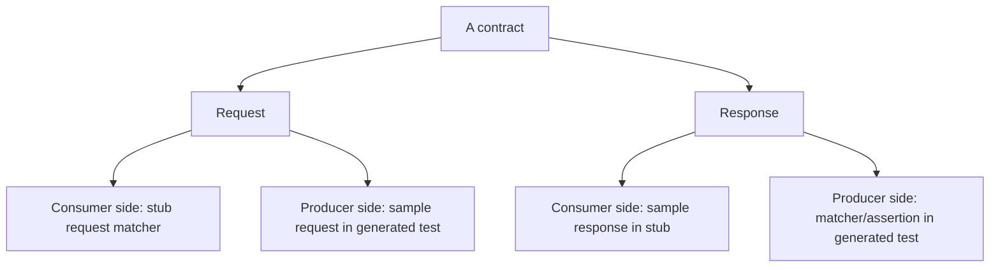
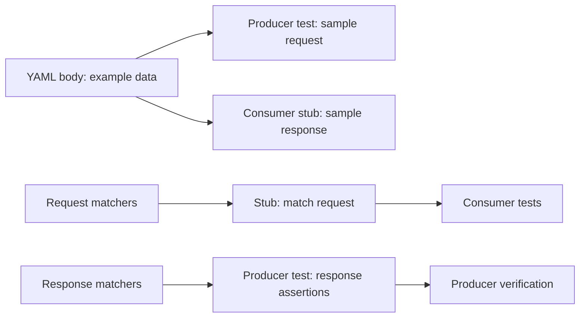
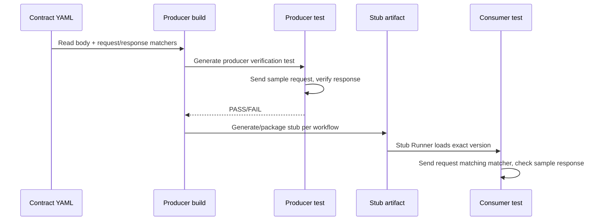

# Two-Sided Values in Declarative Formats

## 1. Why Does a Contract Need Two Perspectives on Data?

In **Spring Cloud Contract**, the same contract definition serves two distinct tasks: **producer verification** checks whether the API or message provider satisfies its commitments; **consumer testing** uses the **stub** generated from the contract to verify how the consumer interacts with that interface. These two sides often need *different ways of expressing values*.

For example, an application calls `POST /api/payments` with an order ID. The consumer may send many valid IDs such as `ORD-42`, `ORD-83`; however, the generated test on the producer needs **a concrete, reproducible request** to execute. Conversely, the producer may generate a different payment ID each time, whereas the stub for the consumer needs **a stable sample response**.

If a contract only uses fixed values, tests can be overly brittle; if it uses an overly broad regular expression everywhere, the contract can let incompatible changes slip through. **Two-sided values** combine concrete sample data with flexible matching rules.

This lesson belongs to the **YAML and Other DSLs** chapter of the **SPRING_CLOUD_CONTRACT** module. Examples are set in the context of HTTP contract testing with **Groovy/YAML DSL**, generating producer tests, creating and publishing stubs, using **Stub Runner** on the consumer, and integrating into CI. The two-sided principle is equally important when verifying message payloads.

After this lesson, you will be able to distinguish the `consumer` and `producer` sides in the DSL, read the direction in which values apply in `request`/`response`, express equivalent behavior using YAML `body` + `matchers`, and verify that generated tests and stubs reflect the intended semantics.

## 2. Two Sides Do Not Mean the `request` and `response` Blocks

In a **coded DSL** such as Groovy, Spring Cloud Contract can describe a value like this:

```groovy
value(consumer(...), producer(...))
```

You may encounter equivalent forms: `$(consumer(...), producer(...))` or aliases `client` / `server`, `stub` / `test`. The names `consumer` and `producer` specify **the perspective from which a value is used**, not a pair of JSON keys named `consumer` and `producer`.

The core is understanding **which perspective is used for what**:

| Location in contract | Consumer side (stub/client) | Producer side (test/server) |
|---|---|---|
| **Request** | Rule for recognizing requests sent to the stub, e.g. `orderId` matching regex | Concrete request value that generated producer test sends to the app |
| **Response** | Concrete value that the stub returns to the consumer | Condition/matcher that generated producer test uses to verify the real response |
| **Output message** | Sample payload/headers used for consumer-side stub | Constraint verifying the message actually emitted by the producer |

You can remember this with a diagram:



**Pay attention to data direction:** In `request`, the consumer actively **sends** the request. In `response`, the producer actively **returns** the data. Thus, the word `consumer` does not always mean "data being sent"; and `producer` does not always mean "data being returned". Each side's role reverses depending on the direction of the interaction.

A value can be identical on both sides, but separating the two sides is helpful when you need to allow many valid requests or many valid responses while still producing stubs and tests with clear sample data.

## 3. Original Groovy DSL Example: Two-Sided Value Syntax

Before moving to YAML, let's look at how a coded DSL expresses both sides explicitly. Suppose `payment-service` accepts a payment creation request:

```groovy
import org.springframework.cloud.contract.spec.Contract

Contract.make {
    name 'create_payment_with_dynamic_ids'

    request {
        method POST()
        url '/api/payments'
        headers {
            contentType(applicationJson())
        }
        body(
            orderId: value(
                consumer(regex('ORD-[0-9]+')),
                producer('ORD-42')
            ),
            amount: 150000
        )
    }

    response {
        status CREATED()
        headers {
            contentType(applicationJson())
        }
        body(
            paymentId: value(
                consumer('PAY-1001'),
                producer(regex('PAY-[0-9]+'))
            ),
            state: 'ACCEPTED'
        )
    }
}
```

Let's read **`request`** first:

- The consumer side stipulates that the stub accepts `orderId` values matching `ORD-[0-9]+`, such as `ORD-42` or `ORD-83`.
- The producer side uses `ORD-42` as concrete data for the generated test sent to the producer.
- `amount: 150000` is not split into two sides, so it remains a fixed value represented in the contract.

Read **`response`** in the opposite direction:

- The consumer side defines the sample value `PAY-1001` that the stub can return to the consumer.
- The producer side verifies that the actual payment ID matches `PAY-[0-9]+`; the producer can return `PAY-783` and still satisfy this constraint.
- `state: 'ACCEPTED'` remains a fixed expectation. If the consumer only handles `ACCEPTED`, do not turn it into an overly broad regex.

The chosen strings are only **contract examples**, not built-in Spring Cloud Contract APIs. In real projects, align the meaning of `amount`, status values, and ID formatting rules with consumers.

### When One Side Uses a Regex, What Does the Other Side Need?

If one side is a **matcher**, the other side usually needs a **concrete value matching that matcher**. This lets the build generate a deterministic request on the producer or a deterministic stub response for the consumer.

| Expression | Suitable? | Why |
|---|---|---|
| Request: consumer regex `ORD-[0-9]+`; producer sample `ORD-42` | Yes | Producer test sends an ID that the stub also accepts |
| Response: consumer sample `PAY-1001`; producer regex `PAY-[0-9]+` | Yes | Stub returns a valid example, producer may return another ID |
| Response: consumer sample `INVALID`; producer regex `PAY-[0-9]+` | Unreasonable | Stub value fails to satisfy the contract's own expected rule |
| Response: consumer `PAID`; producer regex `.*` | Too loose | Tests may miss changes to an enum the client genuinely depends on |

Helpers that generate valid strings from a regex exist in some coded DSLs, but **you should not rely on random generation** when a fixed sample makes tests easier to inspect and reproduce.

## 4. Expressing the Same Meaning in YAML: `body` and `matchers`

**Major difference:** YAML is a **declarative** DSL. Per current Spring Cloud Contract documentation, dynamic values in YAML are configured in the **`matchers`** section rather than placing Groovy `value(consumer(...), producer(...))` expressions directly inside `body`.

Instead of writing a field with two nested branches, YAML uses:

1. **`body`** holds concrete example values, such as `orderId: ORD-42` and `paymentId: PAY-1001`.
2. **`request.matchers`** describes how **the stub matches requests** sent by the consumer.
3. **`response.matchers`** describes how **generated tests verify the real response** returned by the producer.

The file `create-payment.yml` can be written as follows:

```yaml
name: create_payment_with_dynamic_ids
description: "Create payment with format-constrained IDs"
request:
  method: POST
  url: /api/payments
  headers:
    Content-Type: application/json
  body:
    orderId: "ORD-42"
    amount: 150000
  matchers:
    body:
      - path: $.orderId
        type: by_regex
        value: "ORD-[0-9]+"
response:
  status: 201
  headers:
    Content-Type: application/json
  body:
    paymentId: "PAY-1001"
    state: "ACCEPTED"
  matchers:
    body:
      - path: $.paymentId
        type: by_regex
        value: "PAY-[0-9]+"
```

This is a **single YAML document** for one HTTP scenario, not two separate contracts. The two `matchers` blocks live under **two different parent blocks**, so their meanings differ:

| YAML component | How it is used in the Spring Cloud Contract flow |
|---|---|
| `request.body.orderId: "ORD-42"` | Sample request value for producer tests |
| `request.matchers.body[path=$.orderId]` | Stub requires `orderId` sent by consumer to match `ORD-[0-9]+` |
| `request.body.amount: 150000` | Sample value that is also a fixed constraint unless overridden by a matcher |
| `response.body.paymentId: "PAY-1001"` | Sample value that the stub can return to the consumer |
| `response.matchers.body[path=$.paymentId]` | Generated producer test verifies response has `paymentId` matching `PAY-[0-9]+` |
| `response.body.state: "ACCEPTED"` | Fixed status constraint for this scenario |
| `response.status: 201` | Specific HTTP status code the producer must return in this scenario |

To avoid confusion, do not write the following and expect Spring Cloud Contract to treat it as two-sided syntax:

```yaml
# WRONG EXAMPLE: not the standard way to express
# two-sided values in SCC's YAML DSL.
response:
  body:
    paymentId:
      consumer: "PAY-1001"
      producer: "PAY-[0-9]+"
```

To a normal YAML parser, the snippet above is **a nested JSON object** with two keys `consumer` and `producer`. It does not automatically become a dynamic value pair that SCC interprets like Groovy's `value(consumer(...), producer(...))`.

## 5. Reading Tests and Stubs Generated from YAML Step by Step

From the `create-payment.yml` contract, the expected behavior conceptually works as follows. Exact generated code depends on the **Spring Cloud Contract version, plugin, test mode, and base class configuration**.

### 5.1. Producer side: send fixed data, verify flexible output

The generated producer verification test builds a representative request:

```http
POST /api/payments HTTP/1.1
Content-Type: application/json

{"orderId":"ORD-42","amount":150000}
```

It then verifies the declared commitments. An example response that passes:

```http
HTTP/1.1 201 Created
Content-Type: application/json

{"paymentId":"PAY-7821","state":"ACCEPTED"}
```

Why is `PAY-7821` valid even though `response.body.paymentId` says `PAY-1001`? Because the **response matcher** requires the pattern `PAY-[0-9]+`, allowing the ID to vary across runs. Other conditions, such as HTTP `201` and `state: ACCEPTED`, must still hold.

If the producer returns `paymentId: "abc"`, the matcher should fail. If it returns `state: "REJECTED"`, the fixed status check should fail. Of course, the actual level of checking depends on generated assertions being created and executed properly; always inspect the actual test report.

### 5.2. Consumer side: send flexible requests, receive fixed mock data

When the consumer uses Stub Runner, the stub generated from the same contract can accept:

```http
POST /api/payments HTTP/1.1
Content-Type: application/json

{"orderId":"ORD-83","amount":150000}
```

Because `ORD-83` matches `ORD-[0-9]+`, the request mapping is designed to match. The stub returns the response described by the sample values, e.g.:

```json
{
  "paymentId": "PAY-1001",
  "state": "ACCEPTED"
}
```

The consumer test can assert that the payment ID is parsed into its DTO or business logic, that status `ACCEPTED` is handled properly, and that HTTP `201` is recognized.

However, a **green consumer test against a stub** does not prove the real producer returns the same format. Producer and consumer tests must use **the same contract set, artifact, and compatible versions**, wired together in CI.

### 5.3. Viewing It Through Four Information Sources



**Do not interpret this diagram as a mechanical copy of every `body` property in both directions.** Any field without an explicit matcher still obeys the contract engine's default rules. For headers, query parameters, URLs, or messages, examine their specific structures and rules rather than considering only the JSON body.

## 6. Declarative Matchers: Choosing the Right Strictness

The YAML DSL supports multiple matcher types. Those commonly used for two-sided scenarios include:

| Matcher type | Meaning | When to use |
|---|---|---|
| `by_equality` | Compare for equality with the contract sample | Stable values such as status or event type |
| `by_regex` | Verify a format or set of values | IDs, transaction codes, enums with a specific value set |
| `by_type` | Verify data type | Numeric/string fields allowed to vary when type is a strong enough constraint |
| `by_date`, `by_time`, `by_timestamp` | Verify corresponding temporal formats | Date/time values changing per run |
| `by_null` | Verify null where supported at the target location | Contract mandates a null value for the field |
| `by_command` | Invoke a custom verification method on the test side | Special rules requiring assertion code in the test base |

**Not every type has the same effect in every direction.** For example, `by_type` and `by_command` primarily serve **producer-side verification** on responses, while request matchers build stub request-matching rules. Consult the schema and documentation for your SCC version before applying any matcher type to a given location.

### 6.1. Using a Built-In Matcher to Verify UUIDs

If the producer generates a UUID on return, you can express it in YAML:

```yaml
response:
  status: 200
  body:
    requestId: "550e8400-e29b-41d4-a716-446655440000"
  matchers:
    body:
      - path: $.requestId
        type: by_regex
        predefined: uuid
```

The sample value must be valid for the corresponding matcher type. The stub needs a concrete `requestId` that the consumer can parse; the generated producer test needs to verify the response contains a valid UUID. Supported `predefined` types depend on the version; documented ones include `uuid`, `number`, `iso_date`, `iso_date_time`, and others.

### 6.2. Preserving Enum Constraints Instead of Opening Too Wide

Suppose the consumer only understands two statuses: `PENDING` and `PAID`. Do not write:

```yaml
response:
  body:
    status: "PAID"
  matchers:
    body:
      - path: $.status
        type: by_regex
        value: ".*"
```

This matcher accepts semantically invalid statuses as well. If both statuses are genuinely supported, you can use an explicit set:

```yaml
response:
  body:
    status: "PAID"
  matchers:
    body:
      - path: $.status
        type: by_regex
        value: "PENDING|PAID"
```

However, if the test scenario describes a **paid order**, the contract may need to keep `status: PAID` fixed; loosening a matcher must reflect agreed business rules, not just make tests pass easily.

### 6.3. Header Matchers Do Not Live Inside Body Matchers

For dynamic headers, YAML has a dedicated `headers` structure, for example:

```yaml
name: lookup_order_with_correlation_id
request:
  method: GET
  url: /api/orders/42
  headers:
    X-Correlation-Id: "trace-42"
  matchers:
    headers:
      - key: X-Correlation-Id
        regex: "trace-[0-9]+"
response:
  status: 200
```

In this case, the stub can accept requests whose header matches the pattern, while the generated producer test has a sample header `trace-42` to send. Notice that `matchers.headers` uses `key` and `regex` per this schema; do not use `path: $.X-Correlation-Id` because it is not a JSON body.

### 6.4. When the Response Should Echo the Request

Sometimes the consumer wants `correlationId` in the response to **equal the exact value** sent in the request, rather than a fixed example. Separate regexes on both sides only prove **each field has a valid format**; they do not prove **the two values are equal**.

Spring Cloud Contract provides mechanisms to reference the request from the response: Groovy DSL has `fromRequest()`; YAML can express references via Handlebars and appropriate helpers. That is a different mechanism from ordinary `matchers`. Check syntax for your SCC version and add assertions when you need to protect the relationship between two values, rather than inferring equality just because both match a regex.

## 7. Choosing Sample Data and Matchers When Designing Contracts

Several principles keep two-sided values meaningful:

1. **Start from consumer needs.** Which fields does the consumer read, what formats does it require, and which enum values does it depend on? Only constrain what matters for the use case.
2. **Pick valid concrete examples.** If the regex is `ORD-[0-9]+`, use `ORD-42` rather than `42` on the sample side.
3. **Loosen only what genuinely varies.** IDs, timestamps, and transaction codes are common candidates; field names, error codes, and business statuses usually need tighter bounds.
4. **Preserve data semantics.** `amount: 150000` requires agreed units, currency, and rounding rules. A numeric type matcher does not guarantee identical semantics.
5. **Attach matchers to the right path.** `$.paymentId` must reference an actual field in `body`; a wrong path can make test generation or verification behave unexpectedly.
6. **Verify both outputs.** Check that the generated producer test actually sends the sample data and asserts the response; check that the stub mapping accepts dynamic requests and returns the sample response.
7. **Use the same contract source in CI.** Tie contracts, producer builds, stub artifacts, and consumer tests together with explicit versions.

Do not confuse two-sided values with forcing the producer to use a dummy ID in production. The producer side in `request` is **input for the generated test**, while the producer side in `response` can be a **matcher applied to real test output**. The production application still processes real data according to its own rules.

## 8. Comparing YAML with Groovy, Java, and Kotlin DSLs

| Criterion | YAML DSL | Groovy DSL | Java/Kotlin DSL |
|---|---|---|---|
| How contracts are expressed | `request`/`response` structures in YAML | Configuration blocks in Groovy code | DSL API in Java/Kotlin code |
| Dynamic values in JSON body | Sample values in `body`, rules in `matchers` | Can use `value(consumer(...), producer(...))`/`$()` directly, or `bodyMatchers` | Uses corresponding DSL methods and matchers |
| Reviewability | Declarative data easy to inspect, minimal programming syntax | Expressive dynamic expressions | Typed and follows programming language syntax |
| Common pitfalls | Treating arbitrary YAML keys as SCC commands; placing matchers at wrong level | Mixing up `consumer`/`producer`; embedding dynamic values in hard-to-parse strings | Differences in API syntax, data types, and escaping between Java/Kotlin |
| Best fit | Teams preferring declarative contracts and clear JSON data | Need rich dynamic value expressions | Teams wanting a DSL aligned with Java/Kotlin |

For example, you **cannot copy** the expression below straight into a YAML field:

```groovy
paymentId: value(consumer('PAY-1001'), producer(regex('PAY-[0-9]+')))
```

In YAML, the equivalent expression spans **two places**: `response.body.paymentId` holds `PAY-1001` and `response.matchers.body` holds `by_regex` for `$.paymentId`. Converting between DSLs therefore requires checking **semantics**, not just renaming `.groovy` to `.yml`.

## 9. For Asynchronous Messages, the Two-Sided Mindset Remains Identical

Beyond HTTP, Spring Cloud Contract can describe **message contracts**. A producer may emit an event with a dynamic ID, while the consumer needs a sample payload to run tests. In YAML, `outputMessage` has `body` and `matchers` structured similarly to an HTTP response.

Conceptual example for a producer emitting an event after processing a payment:

```yaml
description: "Emit payment accepted event"
label: payment_accepted_event
input:
  triggeredBy: emitPaymentAccepted
outputMessage:
  sentTo: payments
  headers:
    contentType: application/json
  body:
    paymentId: "PAY-1001"
    state: "ACCEPTED"
  matchers:
    body:
      - path: $.paymentId
        type: by_regex
        value: "PAY-[0-9]+"
```

This is a **DSL example for learning how to apply matchers**; to execute it, you need messaging test configuration, the destination, and the `emitPaymentAccepted` method in the producer test base. The destination `payments` is illustrative only, not a pre-existing broker/topic.

On the consumer side, the stub supplies the example payload to test receiving, deserializing, and handling the event. On the producer side, the generated test verifies that the emitted message contains a `paymentId` matching the pattern. However, such a contract **does not by itself guarantee** broker availability, delivery ordering, retries, deduplication, or production permissions.

## 10. Common Mistakes When Expressing Two-Sided Values in YAML

| Mistake | What can happen | How to fix |
|---|---|---|
| Using `value(consumer(...), producer(...))` directly in YAML body | YAML does not interpret it like coded DSL; payload may be wrong or contract invalid | Put sample values in `body` and rules in `matchers` at the right level |
| Placing response matchers under `request` | Matcher applies to wrong side and fails to check producer response as intended | Move under `response.matchers` |
| Placing request matchers under `response` | Stub may only accept a fixed value | Move under `request.matchers` |
| Regex and sample value contradict each other | Stub and generated test describe conflicting behaviors | Choose an example that satisfies the regex; verify with a real test case |
| Using `by_type` for a business-meaningful enum | Changing `PAID` to `FAILED` still shares the string type | Use a fixed value or a sufficiently narrow enum regex |
| Referencing a `path` absent from `body` | Matcher does not bind to real data; may fail conversion/tests | Cross-check JSONPath against payload schema |
| Assuming stub responses are dynamic because response matcher uses regex | Stub still typically returns sample data from `response.body` | If response must depend on request, use the appropriate request-reference mechanism |
| Running only consumer tests with stubs | No proof the real producer honors the contract | Run producer verification on the candidate build before release |
| Using unpinned latest stubs | Today's and tomorrow's CI runs may test different interfaces | Version contracts and stubs reproducibly |
| Broadening regexes just because generated tests fail | Masks incompatible API changes | Identify the mismatch and fix code or agree on a new contract |

**Note on regexes:** matchers generally evaluate strings using the corresponding engine's rules; do not assume a regex written for another language shares identical escaping. In YAML, **single-quoted strings** preserve regex `\` characters without triggering YAML double-quote escaping rules. For example, `'ORD-\d+'` for digits should be verified against the exact engine and data type. In introductory examples, `[0-9]+` avoids escaping confusion.

## 11. Integrating Producer and Consumer Test Loops into CI

A YAML contract with matchers is only an **input**. To catch incompatible changes, both flows must be verified:



A reliable pipeline needs:

- **Producer build:** generates tests from Groovy/YAML DSL and executes them against a stable test base/fixture; if the producer returns invalid output, CI must fail.
- **Stub publication:** publishes version-tagged stub artifacts according to team policy; never treat *generating a stub* as proof that the producer passed tests.
- **Consumer build:** uses **Stub Runner** to load the exact artifact, points the HTTP/messaging client at the stub, and asserts fields the consumer truly depends on.
- **Release control:** ties contracts, test reports, producer artifacts, stub artifacts, and supported consumers to explicit versions.

In the payment example, a producer change returning `paymentId: "123"` will be caught by producer verification **if** the `PAY-[0-9]+` contract and assertions are generated and executed against the new code. Consumer tests running against the old stub containing `PAY-1001` could still pass; that is why both branches are required.

## 12. Hands-On: Translating a Two-Sided Expectation into YAML

**User story:** Consumer `shipping-ui` needs to display shipment details. The consumer sends various valid `trackingCode` values like `TRK-100` or `TRK-999`. The producer tests with `TRK-100` prepared in test fixtures. The producer may generate a new `eventId` each time; the stub must return a sample ID. The consumer only supports statuses `CREATED` or `IN_TRANSIT`.

Requirements:

1. Write a YAML contract with `POST /api/tracking/lookup`; request body has `trackingCode: "TRK-100"` and a matcher accepting `TRK-[0-9]+`.
2. Response must have HTTP `200`, `eventId` matching `EVT-[0-9]+` with sample `EVT-51`, and `status: CREATED`.
3. Explain which side the request matcher checks and which side the response matcher checks.
4. Point out what remains unverified if the consumer passes against Stub Runner while the producer has not yet run verification.

### Reference Solution

```yaml
name: tracking_lookup
description: "Look up shipment and return formatted event ID"
request:
  method: POST
  url: /api/tracking/lookup
  headers:
    Content-Type: application/json
  body:
    trackingCode: "TRK-100"
  matchers:
    body:
      - path: $.trackingCode
        type: by_regex
        value: "TRK-[0-9]+"
response:
  status: 200
  headers:
    Content-Type: application/json
  body:
    eventId: "EVT-51"
    status: "CREATED"
  matchers:
    body:
      - path: $.eventId
        type: by_regex
        value: "EVT-[0-9]+"
```

**Explanation:** `TRK-100` is the fixed request used in producer tests; the matcher on `trackingCode` lets the stub accept multiple valid tracking codes. `EVT-51` is the stub's sample response; the producer test accepts any properly formatted `eventId` without requiring exactly `EVT-51`.

For `status`, the task describes the `CREATED` scenario so the contract keeps a fixed value; if you want to allow `IN_TRANSIT` in **the exact same scenario**, confirm the business semantics and adjust the matcher intentionally. A consumer test passing against a stub only confirms the consumer interacts properly with **mocked data**; it does not prove the producer implements the endpoint or returns a valid real response.

## 13. Checklist Before Finalizing a YAML Contract with Two-Sided Values

- [ ] Correctly distinguish `consumer/stub` and `producer/test` perspectives for both `request` and `response`.
- [ ] In YAML, place sample values in `body` and flexible rules in `request.matchers` or `response.matchers` as appropriate.
- [ ] Matchers use `path` pointing to an actual field in `body`, or `key` pointing to the right header for header matchers.
- [ ] Every fixed sample satisfies the declared regex/data type.
- [ ] Matchers are tight enough to protect field names, enums, units, and formats the consumer depends on.
- [ ] Verified that generated producer tests contain the right sample request and response assertions.
- [ ] Verified that the stub mapping matches dynamic requests and returns the expected sample response.
- [ ] Producer and consumer tests actually run in CI with failure gates and versioned stubs.
- [ ] Out-of-scope concerns such as business logic, security, transactions, brokers, and performance are covered by appropriate test layers.

## 14. Takeaways and References

In **Spring Cloud Contract**, two sides are not simply two different values for the same field. They are **two execution perspectives**: stub/consumer and generated test/producer. For **request**, the consumer side describes how the stub accepts requests and the producer side supplies the sample request; for **response**, the consumer side supplies the data returned by the stub and the producer side defines conditions verifying the real response.

**Groovy/Java/Kotlin DSLs** can express this with `value(consumer(...), producer(...))`. **YAML DSL** conveys the same intent via `body` + `matchers`, separating `request` and `response` matchers. Proper use of both sides keeps tests resilient to random IDs/timestamps while staying strict enough to catch breaking interface changes. A contract's value is only realized when producer verification, stub publication, Stub Runner, and CI are all configured and run properly.

Official sources to consult for your Spring Cloud Contract version:

- [Spring Cloud Contract — Dynamic properties and YAML matchers](https://docs.spring.io/spring-cloud-contract/reference/project-features-contract/dsl-dynamic-properties.html).
- [Spring Cloud Contract — Contract DSL: YAML and coded DSLs](https://docs.spring.io/spring-cloud-contract/reference/project-features-contract.html).
- [Spring Cloud Contract — YML Schema](https://docs.spring.io/spring-cloud-contract/reference/yml-schema.html).
- [Spring Cloud Contract — HTTP contracts](https://docs.spring.io/spring-cloud-contract/reference/project-features-contract/http.html).
- [Spring Cloud Contract — First application (HTTP and messaging contracts)](https://docs.spring.io/spring-cloud-contract/reference/getting-started/first-application.html).
