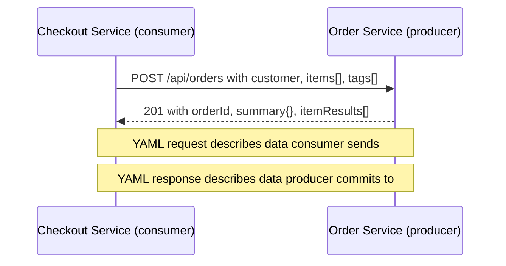

# Nested Bodies, Arrays, and File-Backed Payloads in Spring Cloud Contract

## 1. Why Does Body Structure Matter in Contract Testing?

In a multi-service architecture, consumers often receive multi-level JSON: customer info, addresses, product lists, item attributes, and summary data. When the producer changes the structure—such as changing `items` from an array to an object or moving `customer.address.city` to `customer.city`—the consumer can break even when the HTTP status remains `200` or `201`.

**Spring Cloud Contract** helps both sides agree on HTTP or messaging behavior using Groovy/YAML DSL. From the contract, the producer team generates and runs verification tests and packages stubs; the consumer team uses Stub Runner to test without booting the real producer. In CI, these tests help catch incompatible API changes early.

This lesson focuses on three contract-design skills:

1. Writing **nested bodies** (objects inside objects) in YAML.
2. Representing **arrays** of primitives, objects, or nested arrays; choosing verification conditions per element.
3. Moving long payloads to **external files** using `bodyFromFile` or `bodyFromFileAsBytes`, and understanding their equivalents in Groovy DSL.

Examples use an `Order Service` API. This is an illustrative scenario; endpoint names, packages, and data values should be adapted to your real system.

## 2. How YAML Represents Nested JSON

YAML has two foundational constructs to master:

- **Mapping:** `key: value` pairs, corresponding to JSON objects in this lesson's examples.
- **Sequence:** items prefixed with `-`, corresponding to JSON arrays.

Nesting levels are expressed using **space indentation**, never tabs. Consider this YAML data:

```yaml
customer:
  id: "C-101"
  profile:
    fullName: "Nguyen An"
    address:
      city: "Ha Noi"
      countryCode: "VN"
  contactChannels:
    - "email"
    - "sms"
```

The corresponding JSON data is:

```json
{
  "customer": {
    "id": "C-101",
    "profile": {
      "fullName": "Nguyen An",
      "address": {
        "city": "Ha Noi",
        "countryCode": "VN"
      }
    },
    "contactChannels": ["email", "sms"]
  }
}
```

In HTTP contracts, fields under `request.body` or `response.body` form the payload content. Indentation level determines which element is a child of which. For instance, `city` belongs to `customer.profile.address`, while `contactChannels` is an array directly under `customer`.

**Do not confuse dotted keys with nested objects.** Declaring `"customer.id": "C-101"` creates a single key named `customer.id`; whereas `customer: { id: "C-101" }` creates an object `customer` containing key `id`. Their JSONPaths differ: `$['customer.id']` versus `$.customer.id`.

## 3. Complete YAML Contract: Objects and Arrays in HTTP Request/Response

Suppose a consumer submits an order with customer information and two line items:

```yaml
description: Create order with two items
request:
  method: POST
  url: /api/orders
  headers:
    Content-Type: application/json
  body:
    customer:
      id: "C-101"
      address:
        city: "Ha Noi"
        countryCode: "VN"
    items:
      - sku: "BOOK-01"
        quantity: 2
        options:
          giftWrap: false
          color: "blue"
      - sku: "PEN-02"
        quantity: 1
        options:
          giftWrap: true
          color: "black"
    tags:
      - "mobile"
      - "promotion"
response:
  status: 201
  headers:
    Content-Type: application/json
  body:
    orderId: "O-202"
    summary:
      totalQuantity: 3
      amount:
        currency: "VND"
        value: 260000
    itemResults:
      - sku: "BOOK-01"
        accepted: true
      - sku: "PEN-02"
        accepted: true
```

Key observations:

| Structure | Path in JSON | Data type | Role |
| --- | --- | --- | --- |
| `customer` | `$.customer` | Object | Groups customer data |
| `address` | `$.customer.address` | Nested object | Shipping address |
| `items` | `$.items` | Array | List of line items |
| First item | `$.items[0]` | Object | Includes SKU, quantity, and options |
| `giftWrap` | `$.items[0].options.giftWrap` | Boolean | Nested property inside array element |
| `tags` | `$.tags` | String array | Source/campaign labels |
| `summary.amount.value` | `$.summary.amount.value` | Number | Aggregated value in response |
| `itemResults[1].accepted` | `$.itemResults[1].accepted` | Boolean | Result for the second item |

This contract describes one **concrete scenario**: the request has two items and the response has two results. If business rules allow varying item counts, do not infer from one sample contract that every count is tested. Add appropriate scenarios or matchers.

### 3.1. Producer–Consumer Direction View



Producer verification checks that the real endpoint returns the agreed structure. Stubs generated from the contract supply sample responses so the consumer can test its `itemResults` handling even when the producer is not running.

## 4. Representing Common Array Shapes

A YAML sequence can contain simple scalar elements, nested objects, or another sequence.

### 4.1. Array of primitives

```yaml
response:
  status: 200
  body:
    supportedCurrencies:
      - "VND"
      - "USD"
      - "EUR"
```

Corresponding JSON: `{"supportedCurrencies":["VND","USD","EUR"]}`.

### 4.2. Array of objects

```yaml
response:
  status: 200
  body:
    payments:
      - id: 42
        status: "PAID"
        details:
          method: "CARD"
      - id: 43
        status: "PENDING"
        details:
          method: "TRANSFER"
```

Each `-` opens a new element. Fields `id`, `status`, and `details` at the same indentation level inside an item belong to the same object. If `details` were aligned with `payments`, the resulting structure would change completely.

### 4.3. Array of arrays

```yaml
response:
  status: 200
  body:
    groupedIds:
      - [42, 43]
      - [50, 51, 52]
```

Corresponding JSON: `{"groupedIds":[[42,43],[50,51,52]]}`. Inner arrays can also be written across multiple lines if that improves readability.

### 4.4. Empty arrays, missing fields, and `null`

The following payloads have distinct meanings:

```json
{"items": []}
```

```json
{"items": null}
```

```json
{}
```

- `[]` is **an existing array with 0 elements**.
- `null` is **an existing field without an array value**.
- Omitting `items` is **a missing field**.

If the consumer requires `items` to be an array, the latter two cases can break the contract. If the consumer requires at least one item, even `[]` is invalid. These rules should be explicitly documented per business requirements and tested separately; a sample body with two items does not verify size constraints.

## 5. JSONPath Matchers for Nested Fields and Array Elements

A sample body only gives example data. In practice, values like `orderId`, monetary amounts, or SKUs may vary while **types and formats** must hold. Spring Cloud Contract YAML uses `matchers` to express such constraints.

For example, the following `response` block can be placed in a YAML contract:

```yaml
response:
  status: 201
  headers:
    Content-Type: application/json
  body:
    orderId: "O-202"
    summary:
      totalQuantity: 3
      amount:
        value: 260000
    itemResults:
      - sku: "BOOK-01"
        accepted: true
      - sku: "PEN-02"
        accepted: true
  matchers:
    body:
      - path: '$.orderId'
        type: by_regex
        value: 'O-[0-9]+'
      - path: '$.summary.totalQuantity'
        type: by_type
      - path: '$.summary.amount.value'
        type: by_type
      - path: '$.itemResults[0].sku'
        type: by_regex
        value: '[A-Z]+-[0-9]+'
      - path: '$.itemResults[0].accepted'
        type: by_type
      - path: '$.itemResults[1].sku'
        type: by_regex
        value: '[A-Z]+-[0-9]+'
      - path: '$.itemResults[1].accepted'
        type: by_type
```

With `response.matchers.body`, these rules are enforced when verifying the producer response:

- `$.orderId` must match `O-[0-9]+`.
- `$.summary.totalQuantity` and `$.summary.amount.value` must match the types of the sample data.
- Both `itemResults[0]` and `itemResults[1]` are checked individually for SKU format and boolean type.

**Matchers must reference fields that exist in the sample body.** A path such as `$.summary.currency` would be invalid for the body above because that field is absent. In the YAML DSL, matchers live under `request.matchers` or `response.matchers` depending on the direction being checked; do not use Groovy's `bodyMatchers { ... }` syntax directly in YAML.

### 5.1. Which JSONPath Targets Which Data?

| JSONPath | Target |
| --- | --- |
| `$.customer.address.city` | `city` field of the `address` object |
| `$.items[0].sku` | SKU of the first element in `items` |
| `$.items[1].quantity` | Quantity of the second element |
| `$.items[0].options.giftWrap` | Boolean inside nested object of the first element |
| `$.tags[0]` | First string in the `tags` array |
| `$.itemResults[*].accepted` | All `accepted` values in the array; a multi-element selector |

JSONPath indexes elements starting from **0**. The path `$.items[2]` matches nothing if the array only has two elements. The expression `[*]` selects multiple elements, so verify whether the matcher applies to **the entire set** or each individual value depending on the specific mechanism; never assume a matcher on the first element protects every element.

### 5.2. Limitations When Verifying Arrays

Constraining **array length**, **every element**, and **element order** requires separate consideration:

1. If the consumer truly requires two elements in a specific order, define/test that condition explicitly.
2. If order has no business meaning, do not lock the contract to fixed elements `[0]` or `[1]` and treat it as a general contract.
3. If every element must satisfy a schema, consider additional collection-level matchers/tests or dedicated schema tests.
4. Spring Cloud Contract documentation notes that **array size verification** depends on configuration/version; for example, some versions have `spring.cloud.contract.verifier.assert.size` or plugin option `assertJsonSize`. Never assume array size is checked by default.

If one element has its own matcher, ensure remaining elements are checked at the desired strictness. Inspect the actual generated test code to see exactly which assertions are enforced.

## 6. Loading JSON Bodies from External Files with `bodyFromFile`

When payloads have deep nesting, many elements, or are shared across docs and tests, embedding hundreds of JSON lines in YAML makes contracts hard to read. **`bodyFromFile`** moves the body into a standalone content file.

Example file layout for **an illustrative project**:

```text
src/test/resources/contracts/orders/
├── create-order.yml
├── request.json
└── response.json
```

Contents of `create-order.yml`:

```yaml
description: Create order from JSON data in files
request:
  method: POST
  url: /api/orders
  headers:
    Content-Type: application/json
  bodyFromFile: request.json
response:
  status: 201
  headers:
    Content-Type: application/json
  bodyFromFile: response.json
```

Contents of `request.json`:

```json
{
  "customer": {
    "id": "C-101",
    "address": {
      "city": "Ha Noi",
      "countryCode": "VN"
    }
  },
  "items": [
    {"sku": "BOOK-01", "quantity": 2},
    {"sku": "PEN-02", "quantity": 1}
  ]
}
```

Contents of `response.json`:

```json
{
  "orderId": "O-202",
  "summary": {
    "totalQuantity": 3,
    "amount": {"currency": "VND", "value": 260000}
  },
  "itemResults": [
    {"sku": "BOOK-01", "accepted": true},
    {"sku": "PEN-02", "accepted": true}
  ]
}
```

When generating tests and stubs, Spring Cloud Contract reads the referenced file's contents and uses them as the request/response body. **File paths are resolved relative to the contract's directory**, so `request.json` and `response.json` in the example sit alongside `create-order.yml`.

**Key points to remember:**

- `bodyFromFile: request.json` means **load the contents** of the file, not send the literal filename string `"request.json"` as the body.
- For a given request or response side, pick **one body source**—either `body` or `bodyFromFile`—so the contract stays readable and unambiguous.
- External JSON files must be **valid JSON**, without comments or trailing commas. Do not assume the parser automatically converts an external YAML file to JSON when using `bodyFromFile`.
- Payloads in external files **are still contract content**. Modifying `request.json` or `response.json` can change generated tests and stubs, so keep related files under version control and code review.
- Example filenames are illustrative only: in real projects you must create all referenced files; a contract pointing to a missing file will fail.

### 6.1. Can Matchers Be Used with `bodyFromFile`?

With a JSON payload loaded from a file, you can still define matchers for JSON paths that need flexibility. Example replacing only the `response` section:

```yaml
response:
  status: 201
  headers:
    Content-Type: application/json
  bodyFromFile: response.json
  matchers:
    body:
      - path: '$.orderId'
        type: by_regex
        value: 'O-[0-9]+'
      - path: '$.summary.amount.value'
        type: by_type
```

Here `response.json` must contain `orderId` and `summary.amount.value`. Matchers do not inject missing fields and do not substitute for preparing valid sample JSON.

### 6.2. When Should You Split Bodies into Files?

| Approach | Best suited when | Trade-offs |
| --- | --- | --- |
| Inline `body:` | Small JSON, reviewers want to see the whole interaction in one place | Long YAML and repetitive data if bodies are complex |
| `bodyFromFile:` | Large JSON, deep nested objects/arrays, consistently reused fixtures | Extra files and paths to manage; reviews must open both contract and fixture |
| `bodyFromFileAsBytes:` | Binary payloads such as PDFs, images, downloadable files | Cannot use JSONPath matchers as with regular JSON |

No single choice fits every API. The goal is keeping contracts clear enough to review and strict enough to catch incompatible changes.

## 7. Reading Binary Data with `bodyFromFileAsBytes`

Suppose a producer accepts a PDF and returns processed PDF bytes. Here the payload is **binary bytes**, not JSON or plain text. YAML contract:

```yaml
description: Process PDF document
request:
  method: PUT
  url: /api/documents/42
  headers:
    Content-Type: application/octet-stream
  bodyFromFileAsBytes: upload.pdf
response:
  status: 200
  headers:
    Content-Type: application/octet-stream
  bodyFromFileAsBytes: processed.pdf
```

Assume `upload.pdf` and `processed.pdf` sit next to the YAML contract file. `bodyFromFileAsBytes` loads **binary data**, appropriate for file upload/download cases. Do not use `bodyFromFile` arbitrarily as a substitute for binary data.

**Distinguishing the three body forms:**

| YAML syntax | Where data comes from | Typical use |
| --- | --- | --- |
| `body: { ... }` or multiline mapping | Values written directly in YAML | Inline JSON/text representation |
| `bodyFromFile: response.json` | Text file contents | JSON, XML, or appropriate text content |
| `bodyFromFileAsBytes: processed.pdf` | Raw file bytes | PDFs, images, and other binary payloads |

Set `Content-Type` to match the real API interface. `application/octet-stream` is a generic binary type; an endpoint returning PDFs can declare `application/pdf` if that is the real contract.

## 8. Equivalents in Groovy DSL and Other DSLs

YAML is one way to express a contract. In **Groovy DSL**, use `file(...)` to load text content and `fileAsBytes(...)` to load binary data:

```groovy
import org.springframework.cloud.contract.spec.Contract

Contract.make {
    description 'Create order from JSON fixture'
    request {
        method POST()
        url '/api/orders'
        headers {
            contentType(applicationJson())
        }
        body(file('request.json'))
    }
    response {
        status CREATED()
        headers {
            contentType(applicationJson())
        }
        body(file('response.json'))
    }
}
```

Binary example:

```groovy
import org.springframework.cloud.contract.spec.Contract

Contract.make {
    request {
        method PUT()
        url '/api/documents/42'
        headers {
            contentType(applicationOctetStream())
        }
        body(fileAsBytes('upload.pdf'))
    }
    response {
        status OK()
        headers {
            contentType(applicationOctetStream())
        }
        body(fileAsBytes('processed.pdf'))
    }
}
```

Java/Kotlin DSL libraries also provide ways to declare file-backed payloads, though exact syntax depends on the DSL and version. Whether written in Groovy or YAML, keep **payload structure, headers, status, and fixture paths** consistent; syntax conversion must never accidentally alter commitments to the consumer.

## 9. Real-World Pitfalls with Multi-Level Bodies

### Pitfall 1 — Wrong indentation alters structure

Suppose you intend `address` to be a child object of `customer`, but write:

```yaml
body:
  customer:
    id: "C-101"
  address:
    city: "Ha Noi"
```

The result is two **sibling** fields `customer` and `address`, whereas the consumer expects `customer.address.city`. Compare the actual resulting JSON instead of relying solely on eyeballing the YAML.

### Pitfall 2 — Missing `-` or placing it at the wrong level

```yaml
body:
  items:
    sku: "BOOK-01"
    quantity: 2
```

Here `items` is an **object**, not an array. If the API promises `items: [ ... ]`, producer/consumer deserialization will fail on type mismatch.

### Pitfall 3 — YAML automatic type inference

YAML can parse `true` as a boolean, `42` as a number, and `null` as null. Strings with leading zeros, date-like strings, or keywords may be interpreted unexpectedly depending on the YAML parser version. If a value is an **identifier** or **business string**, write:

```yaml
body:
  customerCode: "00123"
  createdDate: "2026-11-24"
  enabled: true
  quantity: 2
```

`customerCode` stays the string `"00123"`, while `enabled` and `quantity` intentionally use boolean and number types.

### Pitfall 4 — Matcher points to wrong JSONPath

If the body has `customer.address.city`, a matcher for `$.customer.city` will not find the expected field. For arrays, `$.items[1].sku` refers to the **second** element, not the first. Keys containing dots must use proper bracket key-access notation instead of treating dots as object nesting.

### Pitfall 5 — Locking order or values the consumer does not rely on

If the API does not guarantee `items` ordering but the contract forces `items[0].sku` to always equal `BOOK-01`, valid responses can fail tests. Conversely, if the consumer requires priority ordering, checking order is necessary. Clarify business needs before choosing matchers.

### Pitfall 6 — Wrong fixture path or uncommitted fixture files

`bodyFromFile: request.json` resolves paths relative to the contract directory. If `create-order.yml` is moved to another folder without moving/updating fixtures, test and stub generation will fail. Committing only YAML while forgetting companion JSON/PDF files leaves CI without the data needed to run.

### Pitfall 7 — Mixing JSON matchers into binary data

PDFs and images are not JSON, so JSONPaths like `$.items[0]` make no sense. For binary payloads, verify appropriate attributes such as HTTP status, headers, content type, and expected payload bytes.

### Pitfall 8 — Consumer tests green while producer diverges

Stub Runner uses contract data to simulate behavior. If a team only runs consumer tests against stubs **without running producer verification**, the stub can return the right sample JSON while the real API has already changed structure. Pipelines must verify the producer before publishing verified stubs.

## 10. Practice Workflow and CI Integration

To apply this lesson to an API with complex bodies:

1. **List the data the consumer genuinely needs.** Identify required fields, optional fields, objects/arrays, and whether element ordering matters.
2. **Choose inline or external fixtures.** Small bodies can live right in YAML; long bodies should be split into JSON files for easier review.
3. **Write a structurally sound request/response contract.** Verify indentation, scalar types, object nesting, arrays, and fixture paths.
4. **Add purposeful matchers.** Dynamic fields use `by_regex`, `by_type`, or appropriate matchers; JSONPaths must exist in the sample payload.
5. **Run producer verification.** Check that generated tests actually assert multi-level structures, array elements, and business conditions needed by the consumer.
6. **Generate and publish stubs after tests pass.** Commit and version all YAML files together with JSON/PDF fixtures; tie stubs to producer versions.
7. **Run consumer tests with Stub Runner.** Exercise single-item, multi-item, empty-array, and dynamic-value cases when relevant to the consumer.
8. **Enforce in CI and review compatibility changes.** When the producer evolves schemas, contracts and tests must distinguish safe changes from client-breaking changes.

Examples of incompatible changes:

| Producer change | Risk to consumer | Contract/test protection needed |
| --- | --- | --- |
| Moving `customer.address.city` to `customer.city` | Cannot read address | Nested field path |
| Changing `items` from array to object | Mapping or iteration failure | Collection type |
| Changing `items[0].quantity` from number to string | Calculation error | Nested element field type |
| Removing elements/reordering | Wrong mapping if consumer depends on position | Count or order rules when committed |
| Adding a `metadata` field | Usually safe if client ignores unknown fields | Consumer compatibility policy |
| Replacing JSON with PDF | Complete payload format change | Content-Type and body/fixture type |

## 11. Self-Check Exercise

A producer returns:

```json
{
  "shipmentId": "S-900",
  "recipient": {
    "name": "Mai",
    "address": {"city": "Da Nang", "postalCode": "550000"}
  },
  "packages": [
    {"weightGrams": 500, "labels": ["fragile", "priority"]},
    {"weightGrams": 1200, "labels": []}
  ]
}
```

Try completing the following tasks:

1. Write `response.body` in YAML, keeping `recipient.address` nested and `packages` as an array of two objects.
2. Write JSONPaths for `recipient.address.postalCode`, `packages[0].weightGrams`, and the `packages[1].labels` array.
3. Decide which fields should be type-checked and which should be regex-checked if `shipmentId` changes every call.
4. Extract that body into a file `shipment-response.json`, then write `response.bodyFromFile` to reference it.
5. Explain why `labels: []` differs from `labels: null` and from omitting the `labels` field.

YAML hint for the body section:

```yaml
response:
  status: 200
  headers:
    Content-Type: application/json
  body:
    shipmentId: "S-900"
    recipient:
      name: "Mai"
      address:
        city: "Da Nang"
        postalCode: "550000"
    packages:
      - weightGrams: 500
        labels:
          - "fragile"
          - "priority"
      - weightGrams: 1200
        labels: []
```

The right JSONPaths are `$.recipient.address.postalCode`, `$.packages[0].weightGrams`, and `$.packages[1].labels`, respectively. When using an external fixture, replace `body:` with `bodyFromFile: shipment-response.json` and save the JSON next to the contract. `labels: []` means an empty array is present; `null` and an omitted field carry different meanings and require explicit contract rules.

## 12. Pre-Pull-Request Checklist

- Does the YAML structure accurately represent the objects, arrays, and nesting levels agreed upon by the API?
- Are codes, dates, or numeric-looking strings quoted when needed to preserve string types?
- Have missing fields, `null`, empty objects/arrays, and populated lists been properly distinguished?
- Do matcher JSONPaths point to existing fields in the sample body, including exact array indices?
- Is array size/order verification needed, and do generated tests actually enforce it?
- Are `bodyFromFile`/`bodyFromFileAsBytes` paths relative to the contract directory, do the files exist, and have they been committed?
- Was **text** or **bytes** loading chosen to match `Content-Type`, avoiding JSON matchers on binary payloads?
- Do producer verification and consumer Stub Runner tests use the same verified contract/stub version?

**Official references for version-specific syntax:**

- [Spring Cloud Contract — Contract DSL](https://docs.spring.io/spring-cloud-contract/reference/project-features-contract.html)
- [Spring Cloud Contract — Dynamic properties and matchers](https://docs.spring.io/spring-cloud-contract/reference/project-features-contract/dsl-dynamic-properties.html)
- [Spring Cloud Contract — Reference text from file](https://docs.spring.io/spring-cloud-contract/reference/howto/how-to-reference-text-from-file.html)

**Takeaway:** Nested objects in YAML are expressed using mappings and indentation, and arrays using `-` sequences. `bodyFromFile` loads text payloads from files next to the contract; `bodyFromFileAsBytes` handles binary payloads. Choose matchers and test cases based on real consumer needs so Spring Cloud Contract catches incompatible changes while letting producers evolve APIs safely.
