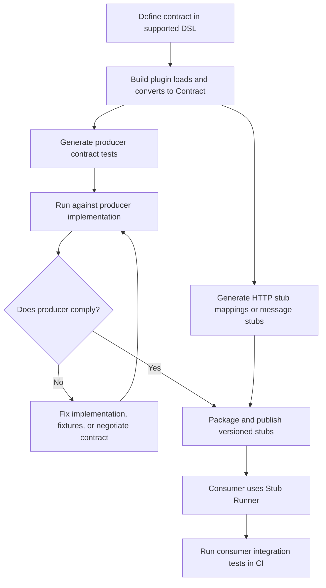

# Java DSL and Kotlin DSL According to Version Support

In **Spring Cloud Contract**, a contract's goal is to describe **inputs and behaviors that the producer commits to the consumer**, so tools can generate producer-side tests and build stubs for the consumer to use via Stub Runner. Groovy DSL and YAML DSL are commonly used in introductory examples, yet many Spring Cloud Contract versions also let you declare contracts using **Java DSL** and **Kotlin DSL**.

These two styles are useful when a team wants to leverage familiar syntax, IDE support, and the code-organization capabilities of Java/Kotlin. However, using Java or Kotlin to build a service **does not automatically guarantee** the build already supports Java/Kotlin contract files. You must verify the exact **Spring Cloud Contract version**, plugin settings, source paths, and DSL dependencies.

This lesson belongs to the **YAML and Other DSLs** chapter of the **SPRING_CLOUD_CONTRACT** track. It covers checking support by version, equivalent examples across languages, Maven/Gradle configurations, and a workflow ensuring producer tests, stub artifacts, and consumer tests operate consistently.

## 1. Distinguishing Contract Language from Application Language

A Pricing service can be written in Java while storing contracts in YAML. A consumer written in Kotlin can still run Stub Runner with stubs generated from Groovy contracts. **The language of the contract does not dictate the language of the service code or generated tests.**

| Definition style | Typical source format | Expression style | Conditions to note |
|---|---|---|---|
| Groovy DSL | `*.groovy` | `Contract.make { ... }` with closures | Requires Spring Cloud Contract plugin configured to scan sources |
| YAML DSL | `*.yml`, `*.yaml` | `request`, `response` structure via keys/values | Must conform to the version's schema |
| Java DSL | `*.java` | Class providing `Contract` via `Supplier` | Requires classpath, compilation/discovery of Java contracts, and proper directory |
| Kotlin DSL | `*.kts` | Kotlin Script calling `contract { ... }` | Requires script support and matching `spring-cloud-contract-spec-kotlin` dependency |

**What this table means:** Java/Kotlin are not replacements for producer verification or Stub Runner. They are **syntaxes for declaring the same kinds of commitments** that the build turns into tests and stubs.

Spring Cloud Contract **4.3** and **5.0** documentation have dedicated sections for Groovy, YAML, Java, and Kotlin DSLs. That does not mean every example found online applies verbatim to all 2.x, 3.x, 4.x, or 5.x releases: default paths, Kotlin scripting libraries, builder APIs, and Spring Boot/Gradle compatibility can vary.

## 2. Checking Support Before Choosing Java DSL or Kotlin DSL

Do not decide based on a vague statement like "Spring Cloud Contract supports Java/Kotlin" without checking exact versions. Verify in this order:

1. **Spring Boot version** of both producer and consumer.
2. **Spring Cloud release train** compatible with that Spring Boot line.
3. **Spring Cloud Contract version** actually resolved in the build; check both the test-generation plugin and spec/verifier/stub-runner libraries.
4. **JDK, Maven, or Gradle Wrapper** used by the build; for Kotlin, also check the plugin/compiler and Kotlin scripting runtime.
5. **Contract DSL documentation for the pinned version**: does it document Java DSL/Kotlin DSL, which packages/methods do examples use, and what dependencies are needed?
6. **Execution proof**: at least one Java or Kotlin file is discovered, generates a producer test, runs successfully, and produces stub mappings.

Official references:

- [Spring Cloud Contract 4.3 — Contract DSL](https://docs.spring.io/spring-cloud-contract/reference/4.3/project-features-contract.html)
- [Spring Cloud Contract — current reference documentation](https://docs.spring.io/spring-cloud-contract/reference/project-features-contract.html)
- [Spring Cloud — release trains](https://spring.io/projects/spring-cloud)
- [Spring Boot — system requirements](https://docs.spring.io/spring-boot/system-requirements.html)

When reading examples, check the **version at the top of the documentation page**. If your project pins a specific version, use the documentation for that exact version. Never take a snippet from a newer release and assume builder APIs are fully backward-compatible.

### 2.1. Three Distinct Layers of "Support"

| Verification layer | Question | Passing signal |
|---|---|---|
| **DSL/API** | Does the current version include `Contract.make` with Java builder or `ContractDsl.contract` for Kotlin? | The version-specific example compiles/reads into `Contract` |
| **Build integration** | Does the Maven/Gradle plugin discover and process the source file? | Generated tests and stub mappings are produced from that exact file |
| **Runtime verification** | Does the producer satisfy the contract and can the consumer call the stub? | Producer contract tests pass; Stub Runner serves the expected response |

"The Java class compiles cleanly" only partially proves the first layer. If the plugin does not scan that directory, zero contracts are tested. Similarly, Stub Runner serving data from a mapping does not by itself prove the producer implementation runs properly.

## 3. One HTTP Behavior Used Across All Examples

Suppose **Checkout** needs to call **Pricing** to fetch a product's price:

```http
GET /api/prices/SKU-42
Accept: application/json

HTTP/1.1 200 OK
Content-Type: application/json

{"sku":"SKU-42","currency":"VND","amount":120000}
```

The caller depends on three fields:

- `sku` is the product code.
- `currency` is the currency code.
- `amount` is an integer, representing the currency unit chosen for the example.

The producer must generate this exact structure when receiving the contract request. The consumer must deserialize and handle the response. The value `120000` is fixed test data; real projects can use matchers for dynamic values while still protecting the fields and data types the consumer requires.

The Java, Kotlin, and YAML snippets below **express the same scenario for comparison**. When experimenting in a repository, enable only **one contract source** for this scenario; loading all three at once can produce duplicate generated tests and mappings.

## 4. Java DSL: Defining `Contract` via `Supplier`

In versions supporting Java DSL, official documentation describes creating a Java class implementing:

- `Supplier<Contract>`: supplies a single contract.
- `Supplier<Collection<Contract>>`: supplies a collection of contracts.

The example below chooses the **collection** form, even with just one contract initially, to make expansion straightforward.

Illustrative file: `src/test/java/contracts/PricingContract.java`.

```java
import java.util.Collection;
import java.util.Collections;
import java.util.function.Supplier;

import org.springframework.cloud.contract.spec.Contract;
import org.springframework.cloud.contract.verifier.util.ContractVerifierUtil;

class PricingContract implements Supplier<Collection<Contract>> {

    @Override
    public Collection<Contract> get() {
        return Collections.singletonList(
            Contract.make(c -> {
                c.name("checkout_get_price_found_200");
                c.description("Checkout fetches price for an existing SKU");

                c.request(r -> {
                    r.method(r.GET());
                    r.url("/api/prices/SKU-42");
                    r.headers(h -> {
                        h.header("Accept", "application/json");
                    });
                });

                c.response(r -> {
                    r.status(r.OK());
                    r.headers(h -> {
                        h.header("Content-Type", "application/json");
                    });
                    r.body(ContractVerifierUtil.map()
                        .entry("sku", "SKU-42")
                        .entry("currency", "VND")
                        .entry("amount", 120000));
                });
            })
        );
    }
}
```

Characteristics to understand:

1. `Contract.make(c -> { ... })` uses a **Java lambda builder**, unlike Groovy's closure syntax `Contract.make { ... }`.
2. `r.method(r.GET())` and `r.status(r.OK())` use builder values, not calls to a real HTTP client.
3. `r.body(ContractVerifierUtil.map().entry(...))` expresses a structured JSON body; it does not create a database entity.
4. `Supplier` lets the tool retrieve one or more contract objects. This is **not** a hand-written JUnit `@Test`.
5. You must configure where Java contract sources live and get discovered. Compiling cleanly with `javac` does not guarantee the plugin is reading the contract.

### 4.1. When You Need Multiple Contracts in One Class

Use `Supplier<Collection<Contract>>` and return a collection of `Contract.make` calls, for example:

```java
@Override
public Collection<Contract> get() {
    return java.util.Arrays.asList(
        Contract.make(c -> {
            c.name("checkout_get_price_found_200");
            // request and response for the 200 scenario
        }),
        Contract.make(c -> {
            c.name("checkout_get_price_missing_404");
            // request and response for the 404 scenario
        })
    );
}
```

This snippet illustrates **collection structure**, not a complete contract file: each contract must define a full request and response. For large suites, multiple clearly named small files are usually easier to review than one file packing too many scenarios.

## 5. Kotlin DSL: Using Kotlin Script `.kts`

Spring Cloud Contract Kotlin DSL is documented as a **Kotlin Script** `.kts`. This is an easy point of confusion:

- `PricingContract.kts`: a **contract declaration** file.
- `build.gradle.kts`: a **Gradle build configuration** file written in Kotlin DSL.
- `PricingContract.kt`: a regular Kotlin source file; the plugin will not automatically read it as a contract script.

All three file types involve Kotlin, yet serve different purposes and loading mechanisms.

Example contract matching the Java behavior in section 4:

```kotlin
import org.springframework.cloud.contract.spec.ContractDsl.Companion.contract

contract {
    name = "checkout_get_price_found_200"
    description = "Checkout fetches price for an existing SKU"

    request {
        method = GET
        url = url("/api/prices/SKU-42")
        headers {
            header("Accept", "application/json")
        }
    }

    response {
        status = OK
        headers {
            header("Content-Type", "application/json")
        }
        body = body(
            mapOf(
                "sku" to "SKU-42",
                "currency" to "VND",
                "amount" to 120000
            )
        )
    }
}
```

Save as something like `src/test/resources/contracts/checkout_get_price_found_200.kts` **if your project's Maven plugin version scans that directory**; with Gradle plugin 3.0.0+, docs use `src/contractTest/resources/contracts` as the default directory while still accepting the legacy `src/test/resources/contracts` path with a warning. Check docs for your exact version and configure `contractsDslDir` if needed.

In `.kts`, `contract { ... }` comes from Spring Cloud Contract's `ContractDsl.Companion.contract`, **not** a language-builtin Kotlin DSL. Kotlin Script must have access to the matching `spring-cloud-contract-spec-kotlin` library and required scripting compiler/runtime.

### 5.1. Do Not Mechanically Port Java DSL Syntax to Kotlin

Java DSL uses `c.request(r -> ...)`, `r.method(r.GET())`, and `r.body(...)`. Kotlin DSL uses properties like `method = GET`, `status = OK`, and `body = body(...)` inside its builder. Groovy DSL typically uses `request { method GET() }` or similar syntax. All three describe requests/responses, yet **cannot be copied line-for-line across files** expecting the parser to translate them.

If Kotlin reports `Unresolved reference: contract` or `Unresolved reference: GET`, check imports, DSL receiver scope, and the Kotlin Script classpath before touching business contract semantics.

## 6. Comparing YAML DSL with Java and Kotlin

A YAML file expresses the same request/response using this structure:

```yaml
name: checkout_get_price_found_200
description: Checkout fetches price for an existing SKU
request:
  method: GET
  url: /api/prices/SKU-42
  headers:
    Accept: application/json
response:
  status: 200
  headers:
    Content-Type: application/json
  body:
    sku: SKU-42
    currency: VND
    amount: 120000
```

Equivalent component mapping:

| Meaning | Java DSL | Kotlin DSL | YAML DSL |
|---|---|---|---|
| Scenario name | `c.name("...")` | `name = "..."` | `name: ...` |
| Method | `r.method(r.GET())` | `method = GET` | `method: GET` |
| Path | `r.url("/...")` | `url = url("/...")` | `url: /...` |
| Status code | `r.status(r.OK())` | `status = OK` | `status: 200` |
| JSON body | `ContractVerifierUtil.map().entry(...)` | `body(mapOf(...))` | `body:` and child keys |
| Dependency | Java builder API | Kotlin Script/spec library | YAML schema and parser |

What matters is **behavioral equivalence**, not line count. If Java accepts `GET /api/prices/SKU-42` while YAML accepts `GET /api/prices/{sku}` with a broader matcher, they are **no longer the same contract** even if they share a name.

### 6.1. When to Choose Which?

| Context | Preferred option | Rationale |
|---|---|---|
| Polyglot team, minimal DSL logic | YAML | Easy to review and discuss without writing Java/Kotlin builders |
| Existing stable Groovy contract repo | Groovy | Reuses established workflow/plugins; no need to migrate just because backend uses Kotlin |
| Java-fluent team wanting class-based contracts | Java DSL | Lambdas, types, and IDE tooling help structure contracts, at the cost of build/classpath setup |
| Kotlin team wanting idiomatic scripts | Kotlin DSL | Concise syntax, though Kotlin scripting/spec dependencies must be managed |
| Heterogeneous plugin versions across pipelines | DSL supported by every pipeline | Producer/CI readability and generation reliability matter more than syntax preference |

There is no rule stating "services written in Kotlin must declare contracts in Kotlin". Many teams keep YAML or Groovy because they depend less on the service's compiler toolchain.

## 7. Maven Configuration: Contract Paths and Kotlin Dependencies

This section illustrates **configuration patterns based on Spring Cloud Contract 4.3 documentation**, not a complete `pom.xml` for every version.

### 7.1. Java DSL in test source directories

If placing Java contracts under `src/test/java/contracts`, official guides use `contractsDirectory` to tell the Maven plugin where to look:

```xml
<!-- Inside <build><plugins> of pom.xml -->
<plugin>
    <groupId>org.springframework.cloud</groupId>
    <artifactId>spring-cloud-contract-maven-plugin</artifactId>
    <version>APPROPRIATE_VERSION</version>
    <extensions>true</extensions>
    <configuration>
        <contractsDirectory>src/test/java/contracts</contractsDirectory>
    </configuration>
</plugin>
```

`APPROPRIATE_VERSION` is a placeholder: substitute the Contract version aligned with your Spring Boot/Spring Cloud versions. Projects may set the version via a Maven property or `pluginManagement`; inspect the **effective POM** to confirm the plugin is resolved.

Not every Java contract must reside in `src/test/java`; docs allow other directories provided classpath and plugin scanning align. Moving contracts without updating configuration can make builds stay green simply because **no contracts were found to generate tests**.

### 7.2. Kotlin DSL: Adding the Spec Library to the Maven Plugin

For Kotlin DSL, version 4.3 explicitly requires `spring-cloud-contract-spec-kotlin` inside **plugin dependencies**. Minimal structure example:

```xml
<!-- Inside <build><plugins> of pom.xml -->
<plugin>
    <groupId>org.springframework.cloud</groupId>
    <artifactId>spring-cloud-contract-maven-plugin</artifactId>
    <version>APPROPRIATE_VERSION</version>
    <extensions>true</extensions>
    <dependencies>
        <dependency>
            <groupId>org.springframework.cloud</groupId>
            <artifactId>spring-cloud-contract-spec-kotlin</artifactId>
            <version>APPROPRIATE_VERSION</version>
        </dependency>
    </dependencies>
</plugin>
```

For IDE/test-scope DSL recognition, docs also instruct adding the dependency to the project's `<dependencies>`, for example:

```xml
<!-- Inside project <dependencies> -->
<dependency>
    <groupId>org.springframework.cloud</groupId>
    <artifactId>spring-cloud-contract-spec-kotlin</artifactId>
    <scope>test</scope>
</dependency>
```

When using a BOM to manage dependency versions, you may omit the version on the **project dependency**, but **the plugin version and plugin dependency version must still resolve properly**. Do not assume a dependency BOM automatically sets every build plugin version.

If moving `.kts` directories, configure `contractsDirectory` according to your version's support and verify via generated tests.

## 8. Gradle Configuration: Paths and Kotlin Scripting

Per 4.3 docs, the Gradle plugin defaults to scanning `src/contractTest/resources/contracts`; since 3.0.0, the legacy `src/test/resources/contracts` path is still checked for migration compatibility with a warning. **Never assume Maven and Gradle default paths match.**

Optional configuration example in `build.gradle` using Groovy DSL:

```groovy
contracts {
    contractsDslDir = new File(project.rootDir, "src/test/java/contracts")
}
```

This snippet is for Java contracts placed under `src/test/java/contracts`, **assuming the Spring Cloud Contract plugin is already applied**. It only overrides where the plugin scans for sources; it is not a full plugin/dependency setup.

When using Kotlin `.kts` contracts, besides the Contract plugin, 4.3 Gradle docs show test/scripting dependencies such as:

```groovy
dependencies {
    testImplementation "org.springframework.cloud:spring-cloud-contract-spec-kotlin"
    testImplementation "org.jetbrains.kotlin:kotlin-scripting-compiler-embeddable:KOTLIN_VERSION"
}
```

Here `KOTLIN_VERSION` is a placeholder. Use the exact Kotlin compiler version compatible with your project's Kotlin and Contract/Gradle docs. Docs also show adding `spring-cloud-contract-gradle-plugin` to the `buildscript` classpath; in newer Gradle setups, plugin registration syntax can differ. Verify both the plugin source **and** dependency resolution rather than copying only the `dependencies` block.

**Note:** the example above is a **Gradle Groovy build script**, whereas the Kotlin contract file is **`.kts`**. Using `build.gradle.kts` changes Gradle build syntax, not whether `.kts` contracts automatically receive the spec library.

## 9. What Does Spring Cloud Contract Do After Reading the DSL?

Whether contracts are written in Groovy, YAML, Java, or Kotlin, the verification flow is fundamentally identical:



Verify every layer:

- **Source recognition**: does the plugin actually find and read `.java`/`.kts` files?
- **Generated tests**: is a test generated for `checkout_get_price_found_200`?
- **Producer verification**: does the controller implementation return the expected status, headers, body, and matchers?
- **Stub output**: does the generated mapping contain the right request/response?
- **Consumer test**: does Stub Runner download the right artifact and does Checkout's client parse the response properly?

For message contracts, replace HTTP request/response handling with the appropriate trigger and output-message mechanisms. Choosing Java/Kotlin DSL **does not automatically supply** required message binders, brokers, or message verifiers.

### 9.1. Do Not Confuse the Two Test Types

Producer tests generated from contracts check whether **producer code** fulfills commitments. Consumer tests with Stub Runner check whether **consumer code** interacts cleanly with stubs derived from contracts. If learners only run Stub Runner and never run producer verification, stubs can simulate behavior the producer has never implemented.

## 10. Does Switching Between Java, Kotlin, Groovy, and YAML Affect API Compatibility?

**Changing the declaration language** does not inherently alter the API. If two representations generate the **same request matchers, response, and business constraints**, producer and consumer observe identical behavior.

Conversely, syntax conversion easily introduces accidental semantic drift:

| Drift during DSL conversion | Consequence |
|---|---|
| Dropping `Accept` or `Content-Type` header | Stub may match wrong requests or consumer may fail response parsing |
| Changing `amount` from integer to string | Consumer expecting a number can fail |
| Overly broad regex in request matcher | The 200 stub matches requests meant to return 404 |
| Missing matchers for dynamic data | Producer tests become overly brittle or overly loose |
| Uncontrolled change to `name`/`label` | Generated tests or message triggers become hard to trace |
| Keeping both old and new contracts in scanned directory | Duplicate tests or colliding HTTP stub mappings |
| Moving source directory without updating plugin config | Zero tests/stubs generated while other tests keep build green |

Therefore, safe migration should **compare outputs**, not just compare two source texts. Keep scenario names, run generation, inspect test counts and mapping contents, and run both producer and consumer tests.

### 10.1. Workflow for Migrating a YAML Contract to Kotlin

1. Document the original YAML's behavior: method, URL, headers, body, matchers, and status code.
2. Pin the Contract plugin version along with Kotlin spec/scripting dependencies.
3. Write the `.kts` file expressing the same behavior; confirm the IDE resolves imports and DSL receivers.
4. Temporarily feed only one representation to the build; never let YAML and Kotlin generate mappings for the same request simultaneously.
5. Generate producer tests/stubs and compare request/response conditions against the original source.
6. Run producer tests, then consumer integration tests via Stub Runner.
7. Only after both pass should you commit the change to CI and remove the superseded source.

The same approach applies when converting Groovy to Java. If a team has no practical need to migrate, keeping stable YAML/Groovy minimizes maintenance overhead.

## 11. Troubleshooting Common Java/Kotlin DSL Errors

| Symptom | First cause to check | Resolution |
|---|---|---|
| Java contract reports `cannot find symbol: Contract` | Missing spec/API dependency on compile classpath | Verify version-specific dependencies, test source sets, and plugin config |
| Java class compiles/runs but no tests are generated | Plugin not scanning `contractsDirectory` or not recognizing `Supplier` | Check configured path and generation output |
| Kotlin `Unresolved reference: contract` | Missing `ContractDsl.Companion.contract` import or `spec-kotlin` | Check Kotlin script classpath/dependencies |
| `.kts` reports parser/compilation error | Incompatible Kotlin version, scripting compiler, or DSL API | Cross-check Kotlin/Contract versions; use docs for exact version |
| Gradle cannot find contract files | Wrong `contractsDslDir` or assuming Maven path | Check defaults/paths for your Gradle plugin version |
| Maven/Gradle dependency download fails | Repository/pluginRepository config, nonexistent version, or proxy | Fix dependency resolution before tweaking DSL |
| Tests generate but generated sources fail to compile | Wrong JDK, missing test dependencies, or bad base class | Read compiler error and producer test config |
| Producer contract test gets `404` instead of `200` | Endpoint/fixture does not satisfy contract yet | Check controller implementation and test fixture state |
| Consumer Stub Runner returns unexpected response | Wrong artifact/version/mapping or overlapping mappings | Pin artifact, inspect actual request and packaged mappings |

Before concluding "Kotlin DSL is unsupported", check docs for your exact version and distinguish **lack of support**, **missing dependencies**, **wrong directory**, **syntax error**, and **actual contract violation**.

## 12. Practice: Testing Java DSL and Kotlin DSL in a Producer

Assume the team owns `pricing-service` and consumer `checkout-service`. Work on a producer exercise branch equipped with the Spring Cloud Contract plugin and compatible dependencies.

### Part A — Check Versions and Build

1. Confirm Spring Boot version, Spring Cloud release train, Spring Cloud Contract plugin version, JDK, and Maven/Gradle Wrapper.
2. Open Contract DSL documentation for that exact version; check requirements for `Supplier<Contract>`, `Supplier<Collection<Contract>>`, and Kotlin Script `.kts`.
3. Run the corresponding tool check command, e.g. `./mvnw -version` or `./gradlew --version`. Do not assume the IDE's JDK matches the build JVM.

### Part B — Java DSL

1. Save the Java contract from section 4 into the directory scanned by the plugin.
2. If needed, configure `contractsDirectory`/`contractsDslDir` per the docs.
3. Generate and run producer contract tests. If the controller does not return a price for `SKU-42` yet, note this as an intentional failing test.
4. Implement the endpoint and fixture so the test passes. Inspect the generated stub mapping.

### Part C — Kotlin DSL

1. Use a separate contract source to avoid loading duplicate Java and Kotlin definitions for the same request.
2. Add `spring-cloud-contract-spec-kotlin` and any Kotlin scripting dependencies required by your plugin version.
3. Save the `.kts` file in the plugin-scanned directory; run test generation and inspect output.
4. Compare Kotlin's request/response against Java's; ensure status, headers, and body match.

### Part D — Consumer and CI

1. Package the stub that passed producer verification.
2. Configure Stub Runner to fetch that exact artifact and pin its version.
3. Use Checkout's real HTTP client to call `GET /api/prices/SKU-42` and assert `amount = 120000`, `currency = "VND"`.
4. Rename a field in the producer response (e.g., `amount` to `price`), observe the producer contract test fail, then restore the implementation.
5. Wire generate/test/package and consumer tests into CI, avoiding skipping tests just to keep the pipeline green.

**Completion criteria:** concrete proof that the build reads Java or Kotlin contracts for your version, generates producer tests, verifies the implementation, produces stubs, and passes consumer tests. "Java/Kotlin file has no syntax errors" is not enough.

## 13. Self-Check Questions

1. **Must a service written in Kotlin use Kotlin contract DSL?** No. Contract declaration language is independent of service implementation language; Groovy or YAML can be used.
2. **How does Java DSL typically hand contracts to the plugin?** A class implementing `Supplier<Contract>` or `Supplier<Collection<Contract>>`, depending on whether one or multiple contracts are needed and what the version supports.
3. **Is `build.gradle.kts` a Kotlin DSL contract file?** No. It is a build script. Contract files in docs are typically Kotlin Script `.kts` files read by the plugin from the contracts directory.
4. **Why might a Kotlin `.kts` contract fail to run even when the project already uses Kotlin?** It may be missing `spring-cloud-contract-spec-kotlin`, the Kotlin scripting compiler, the proper source path, or have version mismatches.
5. **Does the Spring Cloud BOM automatically guarantee every Maven plugin version?** Never assume so. Always verify both plugin versions and plugin classpath dependencies.
6. **If a YAML file and a Java contract define different responses for the same HTTP request, is renaming one file enough?** No. You must remove the duplicate source or disambiguate request conditions/matchers.
7. **Why must producer contract tests run before publishing stubs?** To prove the real implementation honors the contract; a passing stub test alone only proves the mapping matches written expectations.
8. **How do you verify whether your project's version supports Java/Kotlin DSL?** Check docs for your pinned Spring Cloud Contract version and run an actual generate/test/stub check with the corresponding build config.

## Conclusion

**Java DSL and Kotlin DSL are two ways to express contracts in Spring Cloud Contract versions that support them**, alongside Groovy and YAML. Java typically organizes contracts via `Supplier` and a builder API; Kotlin uses `.kts` and `ContractDsl.contract` with matching spec/scripting dependencies. To adopt them safely, teams must check the Spring Boot–Spring Cloud–Contract version matrix, DSL paths, plugin classpaths, and test/stub generation outputs. When producer verification and consumer integration tests both run against traceable artifacts, choosing a DSL improves readability and maintainability without weakening the goal of catching incompatible API changes.
