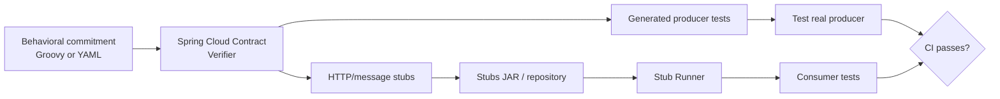
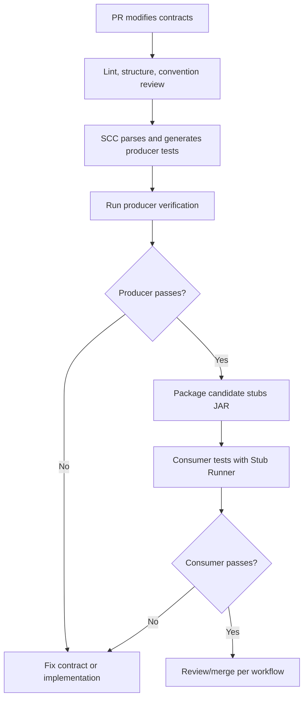

# Comparing Readability, Scalability, and Tooling Requirements of YAML and Other DSLs

In **Spring Cloud Contract (SCC)**, a contract describes what the producer must fulfill so the consumer can communicate safely: HTTP method, path, headers, body, and status, or messaging destination and payload. Contracts are used to **generate producer-side tests** and **build stubs** for the consumer to run with **Stub Runner**. That gives CI a foundation to catch many incompatible API changes before release.

There are multiple ways to express the same commitment. **Groovy DSL** uses declarative code with `request`, `response`, `input`, and `outputMessage` blocks. **YAML DSL** presents data through indented structures. Beyond these two, teams may encounter API specs like OpenAPI/AsyncAPI, Pact contracts, or programming-language DSLs. Choosing a format is not just about preference: you must weigh **the audience, behavioral complexity, maintainability, and the toolchain that can actually verify the contract**.

This lesson in the **YAML and Other DSLs** chapter compares options along three main axes: **readability**, **scalability**, and **tooling requirements**. Examples use `order-producer`, a service exposing APIs and emitting order events to `order-consumer`.

## 1. Distinguishing Contract Format from Verification Workflow

A syntactically valid Groovy or YAML file is not enough to prove a service honors the contract. The verification lifecycle has distinct steps:



Contract format shapes how authors write, reviewers read, and tools parse files. It **does not alter** the division of responsibilities:

- **Producer verification** runs generated tests against real producer behavior.
- **Consumer verification** runs consumer logic against stubs generated from the contract.
- **CI** must test both producer and consumer using matching artifact versions.
- **Integration and operational tests** are still needed for networking, security, databases, brokers, retries, or latency.

A YAML contract describing the wrong response still generates a stub simulating the wrong response. A highly flexible Groovy contract that never runs in the build still leaves the API unprotected. Therefore, compare **accuracy of generated tests/stubs** alongside syntax.

## 2. Quick Comparison Matrix

| Criterion | Groovy DSL in SCC | YAML DSL in SCC | Other related formats/tools |
| --- | --- | --- | --- |
| Form | DSL blocks using Groovy syntax | Indented key/values, maps, and lists | Depends on choice: Java/Kotlin, JSON, OpenAPI, AsyncAPI, Pact… |
| Readability for non-programmer reviewers | Requires familiarity with braces, closures, and helpers | Often easy to scan static data fields | OpenAPI makes API structure clear but can be verbose; code DSLs require language fluency |
| Expressing basic HTTP | Good | Good | Needs corresponding adapter/tooling |
| Expressing conditions and matchers | Rich helpers, expressions, and matcher mechanisms | Matcher structures supported by SCC; must match schema | Varies significantly by ecosystem and version |
| Code reuse and extensibility | Easier if project permits Groovy abstractions | YAML itself is mostly data, so reuse often relies on external generators/templates | Language DSLs enable abstractions; API specs have their own mechanisms |
| Review risks | Side logic, obscure helpers, or overly complex conditions | Indentation, scalar types, escaping, and duplicate contract files | Schema drift, plugin mismatches, and conversion steps |
| SCC tooling for producer tests/stubs | Directly supported by SCC | Directly supported by SCC | Must **verify specific integration support**; never assume direct use |
| IDE support | Groovy syntax/IDE support depending on setup | YAML syntax, linting, and schema validation if configured | Varies by format and extensions |
| Best-fit scenarios | Complex contracts, teams comfortable with Groovy DSL | Mostly static contracts, wide reviewer audience | When the organization already standardizes on that framework with a clear conversion pipeline |

This table reflects **general tendencies**, not rigid rules. A YAML contract with matchers can still handle dynamic scenarios; a Groovy contract can still be written concisely and clearly. Specific capabilities must be verified against the **exact Spring Cloud Contract version in use**, as schemas, matchers, and plugins differ across versions.

## 3. The Same HTTP Contract Written in Groovy and YAML

Suppose the consumer calls:

```http
GET /api/orders/1001 HTTP/1.1
Accept: application/json
```

The producer must return:

```http
HTTP/1.1 200 OK
Content-Type: application/json

{"id":1001,"status":"CREATED"}
```

### 3.1. Groovy DSL

Example file `src/test/resources/contracts/http/get-order-by-id-ok.groovy`:

```groovy
import org.springframework.cloud.contract.spec.Contract

Contract.make {
    description 'When order exists, GET by ID returns 200 and status CREATED'

    request {
        method GET()
        url '/api/orders/1001'
        headers {
            header('Accept', 'application/json')
        }
    }

    response {
        status OK()
        headers {
            contentType(applicationJson())
        }
        body(
            id: 1001,
            status: 'CREATED'
        )
    }
}
```

**Reading advantages:** `request` and `response` blocks cleanly separate the two sides; helpers `GET()`, `OK()`, and `applicationJson()` express intent clearly. **Cost:** reviewers must understand Groovy closures and know that `body(id: 1001, status: 'CREATED')` represents JSON data using map syntax.

### 3.2. YAML DSL

Equivalent file `src/test/resources/contracts/http/get-order-by-id-ok.yml`:

```yaml
description: "When order exists, GET by ID returns 200 and status CREATED"
request:
  method: GET
  url: /api/orders/1001
  headers:
    Accept: application/json
response:
  status: 200
  headers:
    Content-Type: application/json
  body:
    id: 1001
    status: CREATED
```

**Reading advantages:** readers unfamiliar with Groovy immediately recognize `request.method`, `response.status`, and the JSON payload. **Cost:** semantics depend strictly on indentation levels, YAML data types, and the SCC schema. A field placed at the wrong nesting level can fail parsing or give the contract a meaning the author never intended.

### 3.3. Pick One Version for the Same Scenario

The two files above are **two representations for comparison**. In practice, place only **one version** inside the contract directory scanned by the build at a time. Keeping both simultaneously can generate duplicate tests/stubs; editing only one leaves the team unsure which is the authoritative source of truth.

| Behavior | Groovy | YAML |
| --- | --- | --- |
| HTTP method | `method GET()` | `method: GET` |
| URL | `url '/api/orders/1001'` | `url: /api/orders/1001` |
| Request header | `header('Accept', 'application/json')` | `headers: {Accept: application/json}` |
| Response status | `status OK()` | `status: 200` |
| Response Content-Type | `contentType(applicationJson())` | `Content-Type: application/json` under response headers |
| Response JSON body | `body(id: 1001, status: 'CREATED')` | `body:` containing map `id`, `status` |

Even though both contracts represent the same example, never assume they produce **byte-for-byte identical test files**. What must be verified is that both produce the same **test and stub behavior** for the agreed request/response.

## 4. Readability: Seeing Syntax and Seeing Behavior

### 4.1. YAML Is Easy to Visually Scan in Static Contracts

When a contract mostly consists of method, URL, headers, status, and body, YAML reads top-to-bottom like structured documentation. Pull request diffs stay focused as well:

```diff
 response:
-  status: 200
+  status: 404
```

Reviewers do not need to understand closure syntax. Nevertheless, **readable YAML does not mean error-free YAML**. Misaligned indentation breaks structure, and "number/boolean-like" strings can be parsed differently than intended.

### 4.2. Groovy Is Expressive for Complex Conditions

Groovy DSL uses helpers and declarative blocks close to testing concepts. For example, a response whose `id` field needs the right type without locking down its exact value:

```groovy
response {
    status OK()
    headers {
        contentType(applicationJson())
    }
    body(
        id: 1001,
        status: 'CREATED'
    )
    bodyMatchers {
        jsonPath('$.id', byType())
    }
}
```

Here `body` holds a sample value, while the matcher checks the field's data type on the real response. This is useful when the producer generates dynamic IDs. YAML DSL also supports matchers, though with a different structure that must match the schema supported by your project's SCC version.

**Groovy readability limit:** adding many conditional branches, global variables, or hard-to-trace helpers into contract files makes it difficult for reviewers to tell which behavior is actually verified. A Groovy file reading like business logic code is usually a sign to simplify the contract.

### 4.3. Descriptions Shape Readability Just as Much as Format

Compare two descriptions:

```text
"Test GET"
"When order 1001 exists, GET by ID returns 200 and status CREATED"
```

The second is clearer in both Groovy and YAML. Standardize on:

- Scenario-revealing filenames: `get-order-by-id-ok`, `get-order-by-id-not-found`.
- `description` stating conditions and observable outcomes.
- `request`/`response` or `input`/`outputMessage` constraining real behavior.
- Checking fields the consumer relies on; never hiding essential constraints inside comments.

Good naming and description conventions yield larger long-term benefits than switching DSLs just to make files look shorter.

## 5. YAML Details Prone to Errors at Scale

YAML is a data format, so structure and data types demand care.

### 5.1. Indentation Defines the Data Tree

Correct:

```yaml
response:
  status: 200
  headers:
    Content-Type: application/json
  body:
    id: 1001
    status: CREATED
```

Errors happen easily if `body` sits at the wrong level or `status` is indented under `headers`. Never indent with tabs; use consistent spaces and enable YAML linting in IDE/CI.

### 5.2. Distinguishing Numbers, Strings, Booleans, and Null

```yaml
body:
  orderId: 1001
  externalOrderId: "001001"
  confirmed: true
  optionalNote: null
```

Intended meaning: `orderId` is a number; `externalOrderId` is a string preserving leading zeros; `confirmed` is a boolean; `optionalNote` is null. If the consumer expects string `"001001"` but the contract omits quotes as `001001`, the parser may interpret it numerically and lose formatting.

Scalars like `yes`, `no`, `on`, `off`, date strings, or numbers with leading zeros can also behave differently across YAML parsers/schema versions. For fields requiring **strict string types**, safely quote them and verify parsing/stub generation output.

### 5.3. Special Characters in Strings

Colons followed by space, `#`, backslashes, or quotes can alter meaning in YAML—for example, in regex patterns, URLs with special characters, or long messages:

```yaml
description: "When id does not exist: producer returns 404"
request:
  method: GET
  url: "/api/orders/9999"
```

Regex strings in YAML are sometimes easier to maintain using **single quotes**, because backslashes are not processed as double-quoted YAML escapes. Still, account for regex-layer escaping too; verify the actual matcher parsed by SCC.

### 5.4. Do Not Treat YAML as Self-Executing Templates

YAML has no built-in loops, functions, or runtime variables like a programming language. If a team generates dozens of contracts from templates, you must manage a **separate generator** and ensure final output consists of SCC-supported contracts.

The pseudo-template below is **not valid SCC syntax**:

```text
for each orderStatus in [CREATED, PAID, CANCELLED]:
    emit contract with request status=orderStatus
```

If adopting an external generator, keep an output validation step, inspect Git diffs, and run generated producer tests/stubs. Never let template complexity obscure committed behaviors.

## 6. Scalability: Adding Behavior, Not Just More Files

When asking whether a DSL "scales well", separate three needs:

1. **Scenario growth:** adding 404, 400, 401 responses, versions, or new message cases.
2. **Data rule growth:** matching UUIDs, timestamps, enums, dynamic headers, array elements, optional fields.
3. **Organizational growth:** multiple producers, multiple consumers, multiple stub versions, and cross-team reviews.

A DSL that makes one scenario brief does not automatically make hundreds of scenarios easy to manage. You need sensible directory layout, anti-duplication rules, and appropriate CI checks.

### 6.1. Adding New Scenarios Explicitly

Suppose the GET API has a not-found case. YAML can use a dedicated file `get-order-by-id-not-found.yml`:

```yaml
description: "When order 9999 does not exist, GET by ID returns 404"
request:
  method: GET
  url: /api/orders/9999
response:
  status: 404
```

Groovy can express the exact same case:

```groovy
import org.springframework.cloud.contract.spec.Contract

Contract.make {
    description 'When order 9999 does not exist, GET by ID returns 404'
    request {
        method GET()
        url '/api/orders/9999'
    }
    response {
        status NOT_FOUND()
    }
}
```

Distinct scenarios should have sufficiently distinct requests/matchers. Two contracts matching the same request while specifying conflicting responses make stub behavior unpredictable. This is a **contract suite design** problem, not whether YAML or Groovy is syntactically "better".

### 6.2. Matchers and Dynamic Data

When the producer returns server-generated values, hardcoding `id: 1001` makes tests brittle. SCC provides matchers/generators so consumers get a fixed sample while producers face flexible assertions.

For example, with response:

```json
{"id": 82731, "status": "CREATED"}
```

A solid contract can require:

| Field | Condition to verify | Risk if too loose |
| --- | --- | --- |
| `id` | Numeric type or agreed ID format | Consumer fails to parse new IDs |
| `status` | Within valid value set | Producer adds a status consumer cannot handle |
| `createdAt` | Timestamp in committed format | Consumer misparses timestamps |
| `currency` | Valid currency code if business logic depends on it | Consumer miscalculates/misdisplays amounts |

Groovy DSL expresses matchers with helpers like `byType()`, `byRegex()`, `jsonPath()`; YAML DSL declares matchers as structured data. When comparing, verify the **same rule** is generated into producer tests and stubs, because writing a matcher does not yield identical behavior if placed on the wrong request/response side.

Do not use `.*` regexes to mask every difference. Matchers should only relax values **allowed to vary**; data types and semantics the consumer depends on must remain constrained.

### 6.3. Abstraction and Reuse

Groovy is a programming language with a DSL; if your organization permits, authors can leverage Groovy mechanisms to support declarations. This helps when many contracts share a rule, but brings risks:

- Editing shared logic can affect many contracts unintentionally.
- Reviewers must inspect helpers to know what contracts actually enforce.
- Reproducibility depends on extra source code and dependencies.

YAML tends to keep each scenario's data more explicit and self-contained. To reduce duplication, you can use file generators, at which point the generator becomes part of your build system and must be versioned/reviewed. **Never assume YAML anchors, aliases, or custom tags are handled identically across every stage of the SCC pipeline**; verify with your specific parser and plugin.

### 6.4. Scaling Across Consumers and Versions

With multiple consumers, the key question is **who still depends on which behavior**. You can organize contracts by domain or agreed consumer, tie contracts to stub artifact versions, and run tests for affected consumers.

Example:

```text
contracts/
  http/
    get-order-by-id-ok.yml
    get-order-by-id-not-found.yml
    post-order-created.groovy
  messaging/
    order-created-v1.groovy
    order-created-v2.groovy
```

This layout is merely a **team convention**, not mandatory Spring Cloud Contract directory names. Real projects can standardize on YAML or Groovy, or combine both when each clearly solves a distinct need. When mixing them, enforce review rules to prevent duplicate contracts in different languages.

## 7. Message Contracts: Comparing an Example Beyond HTTP

For event testing, the producer emits a message after creating an order. Groovy example:

```groovy
import org.springframework.cloud.contract.spec.Contract

Contract.make {
    description 'When order creation succeeds, emit OrderCreated v1'
    label 'order_created_v1'

    input {
        triggeredBy('publishOrderCreated()')
    }

    outputMessage {
        sentTo('orders.created')
        body(
            orderId: 1001,
            status: 'CREATED'
        )
    }
}
```

Same declaration intent in YAML:

```yaml
description: "When order creation succeeds, emit OrderCreated v1"
label: order_created_v1
input:
  triggeredBy: publishOrderCreated()
outputMessage:
  sentTo: orders.created
  body:
    orderId: 1001
    status: CREATED
```

These fields serve distinct roles:

- `input.triggeredBy` specifies the hook called by the generated producer verification test to trigger message emission.
- `outputMessage.sentTo` is the logical destination the message must be sent to.
- `outputMessage.body` is the payload committed by the producer.
- `label` is the identifier consumer tests use to fire the message stub, e.g. `StubTrigger.trigger("order_created_v1")`.

**Do not confuse `label` with `destination`.** Changing `label` can break consumer tests looking up the scenario; changing `destination` can leave consumers subscribed to the old topic without events. Neither Groovy nor YAML eliminates this distinction.

Message producer tests also require an appropriate **message verifier/test binder or adapter** matching your app; consumer-side Stub Runner needs a transport and a way to observe the listener handling the message. Writing a syntactically valid contract does not spin up a broker or guarantee messages flow in a real environment.

For messaging, choosing Groovy vs. YAML also depends on whether the team frequently writes complex payload matchers, declares many headers, or reuses rules across event versions. Prototype one representative system contract before choosing a format for the entire message catalog.

## 8. Tooling Requirements: What Do Both DSLs Need to Work?

### 8.1. Core Spring Cloud Contract Components

With Maven or Gradle, you need a compatible set of Spring Boot/Spring Cloud Contract versions and build configuration to generate tests and package stubs. Typical flow:

| Task | Component/tool |
| --- | --- |
| Parsing Groovy/YAML contracts | DSL processor provided by Spring Cloud Contract in build config |
| Generating producer verification tests | Spring Cloud Contract Verifier with build plugin |
| Running tests against real app | JUnit/test framework and appropriate HTTP/message test mechanism |
| Packaging HTTP stubs | SCC plugin and WireMock mappings generated from contracts |
| Publishing stubs | Maven/Gradle publishing artifacts with `stubs` classifier per config |
| Booting stubs for consumer | Spring Cloud Contract Stub Runner |
| Verifying changes before release | CI running producer verification and consumer tests with candidate stubs |

A common misconception: **choosing YAML does not eliminate Contract Verifier or Stub Runner**. YAML only changes the input format; test/stub generation still requires the right plugin and dependencies. Likewise, with Groovy DSL, projects using the SCC plugin typically do not need a system-wide `groovy` binary installed just to build, as long as the plugin and dependencies are properly declared.

### 8.2. Directional Maven Configuration Example

Below is an **illustrative plugin configuration snippet**, assuming plugin versions are properly managed in your build:

```xml
<plugin>
    <groupId>org.springframework.cloud</groupId>
    <artifactId>spring-cloud-contract-maven-plugin</artifactId>
    <extensions>true</extensions>
    <configuration>
        <baseClassForTests>com.example.order.ContractVerifierBase</baseClassForTests>
    </configuration>
</plugin>
```

The producer project also needs an appropriate test dependency such as `spring-cloud-starter-contract-verifier`, along with a base class setting up the application/test mode. For HTTP, the base class may use MockMvc or another HTTP invocation setup depending on configuration; for messaging, an adapter/binder is required. Do not treat this isolated plugin snippet as a complete `pom.xml`.

Once properly configured:

```bash
mvn clean verify
```

Verify that **generated tests actually execute**, not just that the build exits green. When packaging and publishing the stubs JAR, the consumer uses Stub Runner pointing to the exact coordinates (`groupId`, `artifactId`, `version`, `stubs` classifier). Whether using Groovy or YAML, verify both sides:

1. Producer tests check real behavior against the contract.
2. Consumer stubs represent the same commitment and match the producer version slated for release.

### 8.3. Format Quality-Checking Tools

| Tool category | Value | Limitations |
| --- | --- | --- |
| YAML syntax highlighting/linter | Catches tabs, indentation issues, some structural errors | Syntactically valid YAML can still violate SCC schema |
| YAML schema-aware validation | Catches wrong fields when paired with version-matched schema | Requires accurate schema and IDE/CI integration |
| Groovy IDE support | Highlighting, navigation, DSL editing assistance | Does not replace running Contract Verifier |
| Formatters/code review | Standardizes naming, descriptions, and content | Does not prove producer honors behavior |
| Generated test/stub inspection | Shows how the tool actually interpreted contracts | Still requires verifying app logic and runtime setup |
| Artifact/version checks in CI | Reduces risk of consumer testing against stale stubs | Still requires running consumer tests and runtime checks as needed |

Linting is only the first layer; **the SCC build itself confirms inputs are accepted by SCC and yield expected tests/stubs**.

## 9. What Are "Other DSLs", and Can They Be Used Directly with SCC?

In practice, teams often already maintain other API specification sources. Not all of these options serve as **direct drop-in replacements for Groovy/YAML inside SCC**.

| Option | Strengths | What to clarify before combining with SCC |
| --- | --- | --- |
| Java/Kotlin or programming-language DSLs | Integrates with source ecosystem and IDE when supported by tool/version | Does your SCC version accept that syntax directly? Which dependencies/plugins are required? |
| **OpenAPI** | Documenting and describing REST APIs, schemas, parameters, responses | Does the team operate a converter/generator or integration? OpenAPI specs do not out-of-the-box generate SCC producer tests like Groovy/YAML contracts |
| **AsyncAPI** | Describing channels, messages, schemas, and async events | Requires conversion tooling or sync process with SCC message contracts if shared |
| **Pact** | Contract testing ecosystem, typically consumer-driven | Separate workflow/framework; requires explicit integration design—never treat Pact files as SCC `*.yml` |
| **JSON Schema/Protocol Buffers** | Constraining data shapes or message schemas | Schema checks alone do not cover HTTP status, headers, routing, business rules, or runtime compatibility |

The "best" option depends on your goal. If you need to **publish API documentation** to partners, OpenAPI may be ideal. If you need **producer verification and Stub Runner in an SCC-based system**, Groovy/YAML are usually the most direct and controllable paths. If an organization wants a single specification for both docs and contract tests, verify that the converter preserves critical matchers and scenarios.

Never simply rename `contract.json` to `contract.yml` expecting SCC to understand it. **Formats and schemas must be explicitly supported by your tooling.**

## 10. Choosing a DSL by Team and Needs

A practical decision table:

| Context | First option to consider | Rationale |
| --- | --- | --- |
| HTTP APIs with mostly fixed request/response | YAML | Easy to read even for teammates who do not write Groovy |
| Contracts with many matchers and dynamic rules | Groovy, or YAML if matchers are fully supported | Pick the clearest expression with fewest workarounds |
| Primarily PR-reviewed across multiple teams | YAML with schema rules, linting, and descriptions | Visual diffs, easy structural review |
| Team fluent in Groovy with shared helper logic | Groovy with bounded abstraction | Leverages helpers and avoids duplication when controlled |
| Existing OpenAPI/AsyncAPI docs | Design a pipeline linking docs and executable contracts | Prevents two conflicting sources of truth |
| Existing Pact adoption on consumers | Evaluate keeping Pact or clear integration | Avoids duplicate tests and false confidence about coverage |
| Many message events with schema versions | Prototype one representative event in Groovy and YAML | Tests matchers, labels, binders, and Stub Runner behavior |

A repeatable evaluation process:

1. Select **one HTTP contract** with request body and response status, one **contract with matchers**, and one **message contract**.
2. Write both Groovy and YAML in **separate branches or separate test suites**, avoiding running both in the main contract set.
3. Have a producer developer, consumer developer, and cross-team reviewer read both; note anything prone to misreading.
4. Run the build to generate tests and stubs; check whether generated output enforces the right values/types.
5. Run the consumer with Stub Runner and verify exact artifact version and message labels where needed.
6. Estimate maintenance cost when adding 404s, v2 events, dynamic matchers, or schema changes.
7. Document the chosen convention; only mix multiple DSLs in one project if justified and guarded against duplicates.

"Readability" should be measured by **real humans accurately reviewing behavior**; "scalability" by **adding scenarios without making contracts unmaintainable**; and tooling requirements by **whether CI generates and runs accurate tests/stubs**.

## 11. Strategy for Migrating from Groovy to YAML or Vice Versa

When a project already has hundreds of contracts, converting everything at once produces massive diffs that easily hide behavioral regressions. Treat DSL migration like a **contract refactor** requiring evidence.

### 11.1. Migrate Representative Contracts Incrementally

Recommended workflow:

```text
Pick an existing contract
  -> record current HTTP request/response or message behavior
  -> convert to target DSL on a separate branch
  -> regenerate producer tests and stubs
  -> compare verified behavior (matchers, status, body, headers)
  -> run producer verification
  -> run consumer tests with candidate stubs
  -> replace old file with new file once behavior matches
```

Do not compare text alone: a `byType()` matcher could accidentally turn into a fixed sample value in YAML, making the new test **too rigid**. Conversely, turning `status: CREATED` into a wildcard regex makes it **too loose**. Comparing generated tests and stubs is essential.

### 11.2. Avoiding Duplicate Stubs and Unintended Changes

Keeping both `get-order-by-id-ok.groovy` and `get-order-by-id-ok.yml` inside the scanned directory lets both generate tests/stubs. During migration:

- Use a separate branch or temporarily keep the comparison copy outside the discovery path.
- Only leave one version in the main path after verification.
- Keep HTTP paths, statuses, headers, bodies, and matchers the consumer relies on stable.
- Verify the stubs JAR version and confirm consumer tests use the new candidate.
- For messaging, preserve `label` and `sentTo` unless intentionally changing behavior.

Changing DSLs **must never silently change the API**. If the actual goal is changing behavior, separate that into its own change with proper review, migration, and compatibility testing.

## 12. What Should CI Verify Regardless of the Chosen DSL?

Core stages:



Minimum CI checklist:

- Contracts sit in the **right directory** and are discovered by the plugin; generated test count does not drop unexpectedly.
- Parsing/validation succeeds, including matchers, YAML scalars, and data types.
- Producer verification runs against the real app and proper test mode.
- Generated stubs cover required scenarios with no duplicate contracts causing ambiguity.
- Consumer verification uses **candidate stubs of the version slated for release**, avoiding stale stubs.
- Message tests have real binders/adapters and assertions, not just trigger invocations.
- Breaking changes to methods, URLs, statuses, JSON fields, or key destinations cause the corresponding verification step to fail.

A typical Maven command once plugin and dependencies are configured:

```bash
mvn clean verify
```

This is incomplete verification if the plugin is misconfigured or generated tests do not execute. In multi-repo CI, link producer build results with consumer tests and version-matched candidate artifacts. **Choosing YAML or Groovy never replaces this pipeline design.**

## 13. Common Mistakes When Evaluating and Using Multiple DSLs

**"YAML is readable so it must scale better."** With hundreds of matchers and scenarios, YAML can duplicate data and become hard to synchronize. Measure by actual cost of change, not single-file brevity.

**"Groovy is code so write arbitrary helpers and loops."** Over-abstraction prevents reviewers from knowing which tests are generated and can cause hard-to-reproduce failures. Keep contracts focused on communication behavior.

**"Switching DSLs only changes syntax."** Dropping matchers, changing number/string types, altering headers, or renaming labels changes contract semantics. Compare generated producer tests and stub mappings.

**"YAML parses cleanly so SCC understands it."** Valid YAML can still violate SCC schemas or nest fields at the wrong level. Linting and the SCC build catch different classes of errors.

**"Having OpenAPI means no contract tests needed."** OpenAPI excels at specs and documentation; verifying real producers and consumer stubs still requires integrated tooling or pipelines. Do not infer runtime compliance from documentation alone.

**"Pact and SCC only differ in file format."** They are distinct ecosystems and workflows with different centers of gravity, tools, and artifacts. Compare contract ownership, where tests execute, and how results are shared.

**"Stub Runner runs cleanly so the producer is correct."** Stubs can follow the contract even when the real producer has drifted. You still must run generated producer tests against the implementation.

**"Message label is the topic."** `label` identifies/triggers stubs; `sentTo` specifies the destination. Confusing them can leave consumer tests green while listeners subscribe to the wrong channel.

## 14. Criteria-Driven Comparison Lab

Create `order-producer` and `order-consumer` applications with a properly configured Spring Cloud Contract version. Work in an experimental branch to avoid generating duplicate contracts in the same build.

1. **Static HTTP:** write `GET /api/orders/1001` returning `200`, `id`, and `status` in both Groovy and YAML. Compare field names, data types, and PR diff readability.
2. **Error HTTP:** write `GET /api/orders/9999` returning `404`. Observe how adding scenarios feels in both file layouts.
3. **Dynamic HTTP:** extend the response with a dynamically generated ID. Apply matching matchers in each DSL and check whether generated producer tests hardcode the ID or assert the right type.
4. **Messaging:** write an `orders.created` event with `label` and `triggeredBy`. Verify the message verifier, then use `StubTrigger` in the consumer to test the listener.
5. **YAML edge cases:** test `externalId: "001001"`, a boolean scalar, and a string containing a colon. Observe whether the parser and stub preserve exact types.
6. **Tooling evaluation:** record build setup, IDE/linter behavior, plugin setup, review time, conversion mistakes, and debuggability.
7. **Introduce a breaking change:** rename `status` to `state` or change the HTTP method; verify which producer/consumer CI stage catches the failure.
8. **Decision:** build a DSL selection matrix for your team and write a brief justification backed by hands-on evidence.

Self-assessment rubric:

| Criterion | Required evidence |
| --- | --- |
| Both formats express identical behavior | HTTP request/response and message behavior compared explicitly |
| Readability | Reviewers identify scenarios and outcomes purely by reading files |
| Correct matchers | Dynamic IDs/fields validated by rules, neither too strict nor too loose |
| Scalability | Error cases, message versions, and headers added cleanly while keeping suite clear |
| Tooling compliance | SCC parses, generates tests, and passes producer verification |
| Accurate stubs | Consumer runs Stub Runner with candidate stubs and real assertions |
| Compatibility control | CI detects API changes meaningful to consumers |
| Evidence-based decision | Rationale for choosing YAML, Groovy, or another integration backed by team constraints |

When choosing a contract format, **YAML** generally excels for static data declarations, quick reading, and reviews; **Groovy DSL** excels when teams need helpers and rich matcher expressiveness inside Spring Cloud Contract. Other specifications and DSLs can suit specific goals, provided their integration path with SCC is verified. Regardless of choice, the decisive value remains **verified producer behavior, consumer stubs reflecting real commitments, and CI catching incompatible changes early**.
