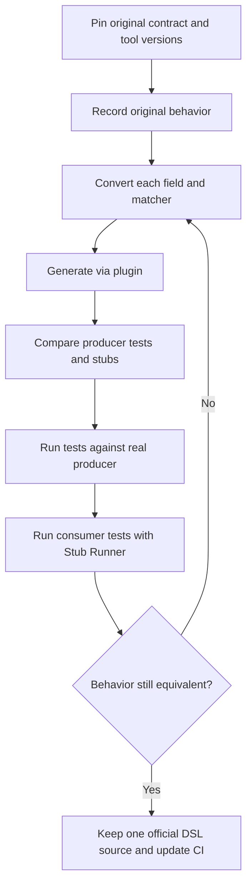

# Converting Formats While Preserving Test Semantics

## 1. Changing Syntax Does Not Guarantee Preserving the Contract

In **Spring Cloud Contract**, a *contract* expresses a commitment between a **producer** and a **consumer**. For HTTP, commitments typically cover request method, URL, headers, query/body, and response status, headers, body, and matchers. For messaging, a contract can describe input data or output messages. Spring Cloud Contract supports expressing these behaviors in **Groovy DSL** and **YAML DSL**.

A team may want to convert contracts from Groovy to YAML because their repository favors data-oriented configuration, or convert the other way to leverage Groovy DSL conveniences. Conversion succeeds only when **the same valid requests are still accepted, invalid requests are still rejected under the same rules, producer tests still verify the same constraints, and consumers receive equivalent stubs**.

For instance, changing an integer `orderId` to the string `"42"` can break client JSON deserialization. Changing a `status` matcher from the exact value `"CONFIRMED"` to "any string" causes the contract to miss API changes. Both formats can be syntactically valid yet **no longer equivalent in testing**.

Goal of this lesson: perform controlled conversions between Groovy and YAML DSLs, avoiding mistakes with data types, matchers, and dynamic values, then verify outputs through producer tests, stubs, and CI.

## 2. "Equivalence" Must Be Verified on Both Sides

A contract serves at least **two purposes**:

| Side | What does Spring Cloud Contract produce? | What must remain intact after changing format? |
| --- | --- | --- |
| **Producer** | Generated tests verifying the API implementation | Request, response, required values, and matchers are neither loosened nor overly tightened |
| **Consumer** | Stubs, typically WireMock mappings for HTTP, served via Stub Runner | Requests accepted by the stub and status/headers/body returned to the consumer carry equivalent meaning |
| **CI** | Test results, stubs JAR, and artifact version | No dropped scenarios or publishing stubs not verified by the producer |

**Behavioral equivalence** does not require two files to share the same line count, key order, or generated test class names. What matters is comparing:

1. Do valid and invalid requests match under the exact same conditions?
2. Are committed statuses, headers, and bodies preserved for every scenario?
3. Which producer changes still fail the tests, and which are allowed?
4. Does the consumer receive sample data with the same semantics when calling the stub?

Merely parsing the DSL successfully answers none of these four questions.

## 3. Baseline Example: The Same HTTP Contract in Two DSLs

Suppose `order-service` exposes `GET /api/orders/42`; consumer `checkout-service` needs the order ID and status.

### 3.1. Groovy DSL

File `src/test/resources/contracts/orders/get-confirmed-order.groovy`:

```groovy
import org.springframework.cloud.contract.spec.Contract

Contract.make {
    description 'Query confirmed order 42'

    request {
        method GET()
        url '/api/orders/42'
        headers {
            accept(applicationJson())
        }
    }

    response {
        status OK()
        headers {
            contentType(applicationJson())
        }
        body([
            orderId: 42,
            status : 'CONFIRMED'
        ])
    }
}
```

### 3.2. Corresponding YAML DSL

File `src/test/resources/contracts/orders/get-confirmed-order.yml`:

```yaml
description: Query confirmed order 42
request:
  method: GET
  url: /api/orders/42
  headers:
    Accept: application/json
response:
  status: 200
  headers:
    Content-Type: application/json
  body:
    orderId: 42
    status: "CONFIRMED"
```

Both files describe a **single scenario**. When converting formats in a real project, keep only **one contract source** where the plugin scans. Keeping both versions can generate two sets of tests/stubs for the same request, causing duplicates or conflicts.

### 3.3. Condition-by-Condition Mapping Table

| Meaning | Groovy DSL | YAML DSL | What must be preserved |
| --- | --- | --- | --- |
| Description | `description '...'` | `description: ...` | Same scenario |
| HTTP method | `method GET()` | `method: GET` | GET |
| URL | `url '/api/orders/42'` | `url: /api/orders/42` | Same path and matching intent |
| Request header | `accept(applicationJson())` | `Accept: application/json` | Accepted media type |
| Response status | `status OK()` | `status: 200` | HTTP 200 |
| Response header | `contentType(applicationJson())` | `Content-Type: application/json` | JSON response |
| Numeric ID | `orderId: 42` | `orderId: 42` | Number, not string |
| Status | `status: 'CONFIRMED'` | `status: "CONFIRMED"` | Exact string |

YAML does not invoke helper calls like `OK()` or `applicationJson()` as Groovy does. You must translate **the behavior they represent**, rather than copying helper names literally into YAML strings.

## 4. Preserving Data Types During Conversion

YAML infers scalar types, whereas Groovy has programming-language literals. Resulting JSON has its own types: string, number, boolean, null, array, and object.

| Intended JSON type | Groovy Map | YAML | Common mistake |
| --- | --- | --- | --- |
| Number `42` | `id: 42` | `id: 42` | `id: "42"` turns it into a string |
| String `"0042"` | `id: '0042'` | `id: "0042"` | Omitting quotes can let parser treat it as a number |
| Boolean | `active: true` | `active: true` | `active: "true"` is a string |
| Null | `note: null` | `note: null` | `note: "null"` is a string |
| Date-time string | `at: '2026-11-24T09:00:00Z'` | `at: "2026-11-24T09:00:00Z"` | YAML loader may infer a timestamp |
| Strings `on`, `yes` | `value: 'on'` | `value: "on"` | Some YAML 1.1 parsers interpret them as booleans |
| List | `items: ['A', 'B']` | `items: ["A", "B"]` | Turning a list into a map changes structure |

YAML 1.1/1.2 and different parsers may infer types differently. **Whenever a value must be a string, quote it**, especially identifiers with leading zeros, timestamps, and boolean-like words.

### Missing field vs. null field

The following two responses can differ in meaning if the consumer checks key presence:

```json
{ "orderId": 42 }
```

```json
{ "orderId": 42, "note": null }
```

In YAML, `note: null` represents a key with value null; **omitting the `note` key** represents a missing field. The same applies in Groovy Maps. Preserve this distinction if the consumer relies on it.

### Object vs. string containing JSON

Do not assume the following two declarations are equivalent:

```yaml
body:
  orderId: 42
  status: "CONFIRMED"
```

```yaml
body: '{"orderId":42,"status":"CONFIRMED"}'
```

In the second example, `body` is a **scalar string in YAML**. How the plugin handles body, content type, and serialization determines the result; there is a risk of receiving an escaped JSON string instead of a JSON object. Inspect the actual response served by the stub and generated assertions.

## 5. Matchers: The Trickiest Part of Conversion

The `body` section provides sample data but cannot express every dynamic rule on its own. A contract may require:

- `status` must **equal** `CONFIRMED`.
- `orderId` must be a valid number per a rule, rather than strictly equaling the sample number.
- `requestId` has UUID format yet changes between requests.
- A header may **match a regex** instead of equaling a fixed string.

When converting to another DSL, preserve **the matcher type, path, target side, and sample value**. Dropping a matcher can make tests too rigid; loosening a matcher too far can let tests miss changes that break consumers.

### 5.1. Response matcher with dynamic values

Suppose the stub needs to return a concrete `orderId` of `42`, while producer tests should accept any numeric-digit ID. In Groovy DSL this can be expressed as:

```groovy
response {
    status OK()
    headers {
        contentType(applicationJson())
    }
    body([
        orderId: $(consumer(42), producer(regex('[0-9]+'))),
        status : 'CONFIRMED'
    ])
}
```

In **`response`**, the `consumer` value is the sample data the stub returns to consumer tests; the `producer` matcher lets generated producer tests verify the real response without locking it to a single immutable value. Other business constraints (such as matching the ID from the request) still need to be added if the consumer relies on them.

An equivalent way to express that intent in YAML DSL uses a sample body plus a matcher at the JSONPath:

```yaml
response:
  status: 200
  headers:
    Content-Type: application/json
  body:
    orderId: 42
    status: "CONFIRMED"
  matchers:
    body:
      - path: $.orderId
        type: by_regex
        value: '[0-9]+'
```

This illustrates the principle of mapping matchers. **Check the schema and matcher types supported by your actual Spring Cloud Contract version**; syntax and generated tests can vary across versions. The regex `[0-9]+` only allows digits; it does not enforce rules like forbidding leading zeros or bounding numeric values, and a regex matcher itself may evaluate representations differently than a numeric type matcher.

### 5.2. Request and response have opposite directions

When encountering two-sided values like `consumer(...)` and `producer(...)` in Groovy, understand where each is used:

| Data | What is the matcher used for? | What is the concrete example used for? |
| --- | --- | --- |
| **Request** | Stub must accept requests from the consumer matching the matcher | Generated producer test needs a sample request to send |
| **Response** | Generated producer test must verify the producer's real response | Stub needs a stable sample response for consumer tests |

Therefore, when migrating a **request matcher** to YAML, place it in the `request` section; when migrating a **response matcher**, place it in the `response` section. Copying the same regex into `body` without preserving the target side can flip producer test and stub behavior.

### 5.3. Matcher risk table

| Original intent | Conversion mistake | Consequence |
| --- | --- | --- |
| `status = CONFIRMED` | Using regex `.*` | Producer returning any status still passes |
| ID within valid numeric domain | Locking exact sample ID `42` | Producer changing to another valid ID fails |
| Path may match a pattern | Copying pattern as a literal URL | Stub accepts only one exact path |
| Regex contains `.` or `\d` | Wrong escaping across Groovy/YAML | Matcher changes meaning or fails to parse |
| Checking only a few JSON fields | Switching to strict whole-body equality | Adding unrelated metadata causes false failures |
| Distinguishing null vs. absent field | Dropping presence check | Incompatible changes can slip past |

**Never assume** declaring two JSON fields in both DSLs always generates matching that allows arbitrary extra fields. Inspect generated assertions and test both a response with an extra field and one missing a field to confirm strictness matches consumer needs.

## 6. Preserving HTTP Conditions Outside the Body

Many conversion bugs hide in overlooked parts:

| Component | Question to answer |
| --- | --- |
| Method | Is it still `GET`, `POST`, `PUT` as expected by the scenario? |
| URL | Which path and query are required? Exact match or regex? |
| Request headers | Are `Accept`, `Content-Type`, tokens, or business headers properly preserved? |
| Request body | Do required fields, values, nulls, and matchers preserve the same semantics? |
| Response status | Were `200`, `201`, `400`, `404` accidentally altered? |
| Response headers | Are media types and consumer-relevant headers still present? |
| Response body | Were types, matchers, or list conventions changed? |

### Query parameters and URL

The following two requests differ in business conditions:

```http
GET /api/orders?state=CONFIRMED
GET /api/orders?state=PENDING
```

If the original contract requires query `state = CONFIRMED`, the converted version must retain that condition. Do not convert `urlPath` plus query matchers into a fixed `url` if the consumer is allowed to reorder query parameters; nor should you drop query matchers just to shorten the YAML. Verify that the generated WireMock mapping matches valid requests and rejects out-of-scope ones.

### Headers

HTTP header names are protocol-wise case-insensitive; header values and semantics still matter. Converting `accept(applicationJson())` to `Accept: application/json` in the example preserves intent. However, if the original contract allows multiple media types or needs a dedicated matcher, a fixed value can narrow the accepted requests.

### Arrays and ordering

JSON arrays are ordered; JSON objects do not assign meaning to key order. If the consumer relies on element order, the contract must preserve that rule. If only certain elements need to satisfy conditions, converting to rigid whole-array comparison can impose unnecessary data constraints.

## 7. Messaging Contracts: Preserving Metadata and Event Direction

Spring Cloud Contract also supports **message contracts**. When converting from Groovy to YAML or vice versa, do not just copy the JSON payload while losing message reception/emission mechanics.

Items to inspect:

- **Input:** condition under which the producer receives a message or gets triggered otherwise.
- **Output message:** which destination, topic, routing key, or channel receives the event.
- **Headers:** event type, content type, correlation ID, and metadata the consumer actually uses.
- **Body:** payload structure, nullability, sample values, and matchers.
- **Trigger:** how behavior is triggered so generated producer tests can verify the message.

For example, an `OrderConfirmed` contract sent to destination `orders.confirmed` differs from a JSON snippet containing `orderId` and `status` without specifying where it is emitted. Consumers may subscribe to that specific topic or branch on headers. HTTP WireMock mappings do not substitute for verifying messaging brokers, destinations, or triggers.

Messaging features and syntax vary by messaging system, configuration, and Spring Cloud Contract version. Compare actual generated tests, stubs, and messages instead of assuming identical payloads are enough.

## 8. Safe Format Conversion Workflow



### Step 1. Lock the baseline

Pin the commit, JDK, Spring Cloud Contract version, and build plugin. Record the original source contracts, generated producer tests, stub mappings, and stubs JAR. Do not convert DSLs and upgrade plugins in the same experiment if you need to isolate the cause of changes.

### Step 2. Tabulate commitments

For every request/response condition, note: is this an **example value** or a **mandatory value**; which side owns the matcher; what are the data types, nullability, and JSONPaths; and what does the consumer actually depend on.

### Step 3. Convert one scenario at a time

Write the new Groovy/YAML from the commitment table. Start with method/URL/status and fixed body fields; then add matchers, query/headers, dynamic values, HTTP error cases, and messaging. While testing, keep the new version in an isolated location so the plugin does not generate duplicate tests/stubs.

### Step 4. Generate tests and stubs with the same plugin version

With Maven configured with Contract Verifier:

```bash
./mvnw clean verify
```

With Gradle, inspect available tasks and run the appropriate verification flow:

```bash
./gradlew tasks --all
./gradlew clean check
```

Do not assume every Gradle setup wires generated contract tests into `check` automatically; inspect logs, generated test counts, and the count of tests **actually executed**. Verify stub artifacts according to your project's packaging/publishing setup.

### Step 5. Compare both outputs

1. Do generated producer tests share the same request and key assertions?
2. Does the stub accept the same set of valid requests and reject invalid ones?
3. Does the stub response return the same status, headers, body, and data types?
4. Do matchers keep the same direction and strictness?
5. Are necessary `404`, `400`, unauthorized, and messaging scenarios still present?

Comparing class names, mapping names, or raw byte diffs is secondary: JSON key order can change without altering semantics, whereas changing one character in a regex can change behavior.

### Step 6. Run differential verification tests

| Scenario | Expectation when both versions are equivalent |
| --- | --- |
| Producer returns exact `orderId = 42` and `status = CONFIRMED` | Generated producer test passes |
| Producer changes `status` from string to object | Test must catch it if contract commits to string |
| Producer drops required `orderId` | Test must catch it |
| Producer returns HTTP `204` instead of `200` | Test must catch it |
| Consumer calls wrong method or path | Stub must not match the request |
| Consumer calls valid request | Stub returns scenario data |
| Producer adds unrelated metadata | Should be allowed if contract is designed for extensibility |
| Producer changes dynamic value within matcher rules | Should be allowed per agreed matcher |

### Step 7. Pick one source format and update CI

Once verified, keep only one contract source in the directory scanned by the build plugin. The producer pipeline must generate and run tests from the new source; the stubs JAR must be published **after producer tests pass**. The consumer pipeline uses the right artifact version to run Stub Runner and exercise business flows.

## 9. Common Conversion Mistakes

| Symptom | Possible cause | How to verify |
| --- | --- | --- |
| YAML fails to parse | Wrong indentation, colons, escaping, or regex syntax | Run with the project's exact plugin version and inspect error location |
| Producer test misses type errors | Number turned into string or matcher dropped | Check generated assertions and test a mistyped response |
| Stub fails to match valid request | Exact URL changed to another matcher, or dropped query/headers | Compare client request against WireMock mapping |
| Consumer receives JSON as a string | Object body turned into a YAML scalar | Call the stub and check actual body/`Content-Type` |
| Date/boolean changed type | YAML loader inferred scalar type | Quote scalars meant to stay strings |
| Regex stopped matching | Improper escaping of `\`, `.`, or special characters | Inspect generated matchers in producer tests/stubs |
| Stub returns right sample but test is too strict | Producer-side dynamic matcher was lost | Check `consumer`/`producer` sides of dynamic values |
| Test count doubled | Both Groovy and YAML versions kept in scanned directory | Inspect discovered contract list and generated tests |
| A scenario vanished | Extension/path changed so plugin stopped scanning it | Check plugin logs, generated output, and executed test count |
| Passes locally but fails in CI | Different JDK, plugin version, parser, or test data | Pin versions, use wrappers, record stubs JAR coordinates |

### Mistake: only checking that new tests pass

Suppose the original Groovy contract has a regex matcher on `requestId`, while the new YAML drops the matcher and keeps the sample value. With current test fixtures, both can pass. Yet once the producer generates a different valid ID, the YAML version can fail falsely. Therefore, test **valid variations** beyond sample data rather than only running the happy path.

### Mistake: dropping a contract because a matcher looks hard to convert

If an original contract uses a matcher that your YAML DSL version does not yet support or cannot easily express, never silently delete the constraint and call the conversion done. Keep Groovy DSL for that scenario, look up the equivalent feature in your plugin version, or document the limitation to make an explicit engineering decision. One repository may hold multiple DSL formats if each contract covers distinct scenarios and the plugin supports it, but never maintain **two independent copies of the same promise**.

## 10. Hands-On Exercise: Convert an HTTP 404 Error Contract

The producer exposes `GET /api/orders/999` and returns a JSON error when the order does not exist. Original Groovy contract:

```groovy
import org.springframework.cloud.contract.spec.Contract

Contract.make {
    description 'Order not found'
    request {
        method GET()
        url '/api/orders/999'
        headers {
            accept(applicationJson())
        }
    }
    response {
        status NOT_FOUND()
        headers {
            contentType(applicationJson())
        }
        body([
            code   : 'ORDER_NOT_FOUND',
            message: 'Order 999 does not exist'
        ])
    }
}
```

**Requirements:**

1. Convert to YAML DSL while keeping HTTP method, URL, headers, status, and body intact.
2. Explain why changing `status: 404` to `status: 200` alters the contract even though the body still contains `ORDER_NOT_FOUND`.
3. Confirm `code` and `message` are strings, and verify they appear accurately in the stub.
4. Generate and run producer tests, then use the new stub for the consumer to test the "not found" branch.
5. Change the error code in the real producer to `INTERNAL_ERROR` without changing the contract; verify whether generated producer tests catch it.

### Reference YAML Solution

```yaml
description: Order not found
request:
  method: GET
  url: /api/orders/999
  headers:
    Accept: application/json
response:
  status: 404
  headers:
    Content-Type: application/json
  body:
    code: "ORDER_NOT_FOUND"
    message: "Order 999 does not exist"
```

HTTP `404` is a critical condition: the consumer may branch differently on `200` versus `404` even with identical bodies. When converting to YAML, preserve the exact HTTP status so generated producer tests and stubs verify the same error branch.

**Extension exercise:** In practice, `message` may be localized and need not be fixed character-for-character, while `code` must remain fixed for consumer handling. If the consumer does not depend on the exact message text, design an appropriate matcher/contract scope in the original version first, then convert to the other DSL with that same decision. Never silently relax constraints during format conversion without agreement.

## 11. Equivalence Verification Checklist

- [ ] Each scenario has only one authoritative contract file after conversion.
- [ ] Request method, URL, query, headers, and body share identical matching conditions.
- [ ] Response status, headers, body, data types, and nullability are unchanged.
- [ ] Sample values, matchers, and `consumer`/`producer` sides map accurately.
- [ ] Special YAML scalars are quoted; regexes and escapes work properly.
- [ ] In-scope HTTP error scenarios and message contracts remain complete.
- [ ] Generated producer tests contain equivalent assertions, **actually execute**, and pass.
- [ ] Stubs are tested with valid and invalid requests; consumer tests run via Stub Runner.
- [ ] JDK, build plugin version, and stubs JAR version are pinned for CI reproducibility.
- [ ] Tested at least one breaking change and one valid variation beyond sample data.

**Key takeaway:** Converting Groovy DSL to YAML DSL or vice versa is **test-behavior preservation**. A new contract source is trustworthy only when requests, responses, and matchers still carry equivalent meaning for the producer, stub, and consumer; the ability to catch incompatible API changes must be proven through automated test generation and real execution.
