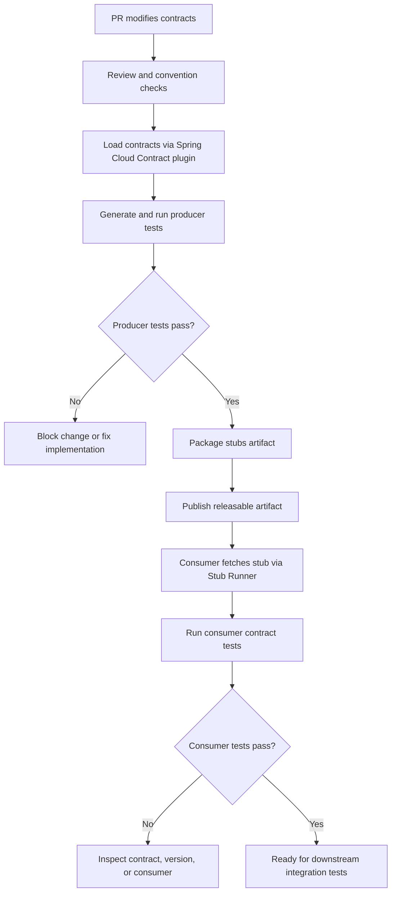

# Choosing a Unified Team Convention

**Spring Cloud Contract** helps producers and consumers jointly verify agreed interactions: a contract describes HTTP or messaging behavior; the producer uses the contract to generate and run tests; the consumer uses published stubs and **Stub Runner** to test integration code. Spring Cloud Contract supports **Groovy DSL** and **YAML DSL**, each with different expressiveness and extensibility. When multiple developers author contracts, picking a format is only the first step: the team also needs conventions for file locations, naming, sample data, matcher rules, versioning, and review workflows.

This lesson belongs to the **YAML and Other DSLs** chapter and centers on the question: **how should a development team choose and maintain a shared convention so contracts stay readable, testable, free of duplication, and protective of consumers when APIs change?** Examples revolve around `Order Service` (producer) and `Billing Service` (consumer), though the principles apply equally to HTTP and messaging contracts.

After this lesson, you will be able to draft a technical decision on DSL choice, propose an immediately actionable set of repository rules, spot inconsistencies that break tests/stubs, and organize CI workflows so conventions are genuinely enforced.

## 1. Why Does a Team Need a Unified Convention?

Suppose a single team is developing an order-lookup API. One developer writes a Groovy contract with path `/orders/42`, while another writes YAML using `/api/orders/42`; the first file checks `status`, the second checks `state`; one returns an error body with `code`, another only specifies status `404`. Both may be **syntactically** valid, yet readers cannot tell which scenarios the team actually commits to supporting.

The consequences go beyond maintainability:

1. **Producer tests** may verify inconsistent behaviors or miss fields critical to consumers.
2. **Stub mappings** generated from contracts may overlap or reflect conflicting expectations, leaving consumer tests unpredictable.
3. **Code reviews** waste time debating formatting, filenames, and paths instead of API compatibility.
4. **CI** may pass against new contracts while no longer checking contracts that older consumers still depend on.
5. **Change traceability** suffers: it becomes unclear which contract corresponds to which stub version or which consumers need notification.

A solid convention must answer three practical questions: **how to write**, **how to verify**, and **what process governs contract changes**. It is a technical agreement enforced via review and automation, not merely a style-preference document.

## 2. Choosing a DSL Based on Team Needs

Projects using Spring Cloud Contract commonly encounter Groovy DSL and YAML DSL. Fundamentally, both serve as **inputs to the same producer verification and consumer stub-generation workflow**; however, they differ in how they express matchers, dynamic values, and logic reuse.

| Criterion | YAML DSL | Groovy DSL | Questions to align on |
| --- | --- | --- | --- |
| Review readability | Clear data structure, familiar to config authors, minimal executable code. | DSL close to Java/Groovy, convenient for expressing complex spec logic. | Are reviewers fluent in this format? |
| Expressing basic scenarios | Suited for static requests/responses, easy to diff. | Also suited for static scenarios with concise syntax. | Are cases mostly simple HTTP samples or complex conditions? |
| Matchers and dynamic values | Tool-supported matcher structures; syntax and feature coverage must be checked per version. | Built-in matcher/consumer-producer value syntax in DSL; helpful for complex specs. | Which matcher features are genuinely required and functional in our toolchain? |
| Reuse | Favors small files and explicit data; reuse via external generators requires clear workflow. | Can leverage Groovy capabilities to organize specs; excessive dynamic code hurts readability. | How much reuse does the team need without sacrificing transparency? |
| Safe review | Easy to enforce formatting and structural checks. | Contracts are Groovy scripts; reviews must watch for code behavior and dependencies. | Who is responsible for reviewing logic changes inside the DSL? |
| Tooling compatibility | Must verify parser, matcher features, plugin, and IDE support. | Must verify plugin version and DSL APIs used. | Which release train does CI run, and are there working examples for required features? |

**Selection guideline:** if the team primarily describes clear HTTP scenarios that split cleanly into independent cases and includes reviewers unfamiliar with Groovy, consider choosing **YAML as the default format**. If the team needs many complex matchers/transformations and already has Groovy experience, consider choosing **Groovy as the default format**. Never force a switch simply because one format looks "prettier"; the deciding criteria are **contract clarity, testability, and maintenance cost**.

A single repository can hold contracts in multiple DSLs if the toolchain supports it. However, letting everyone pick arbitrarily per file makes reviews inconsistent. A helpful rule is: **one default DSL for new contracts; exceptions require technical justification, reviewer sign-off, and test verification**. If Groovy is chosen as the default, the exact same rule applies in reverse.

### 2.1. Quick Decision Matrix

Score each criterion from 1 to 5 according to project priority, then evaluate **YAML and Groovy via a practical proof of concept**. Never decide based on gut feelings about syntax.

| Criterion to test | Evidence required from the pilot |
| --- | --- |
| Newcomers can read contracts | Someone outside the author group accurately explains request, response, and conditions. |
| Expresses hardest scenarios | Required request matchers, dynamic values, error cases, and messaging are all accurately modeled. |
| Generates right producer tests | Plugin generates tests and tests fail when the implementation is intentionally broken. |
| Generates right stubs | Artifact contains expected mappings, Stub Runner boots cleanly, and consumer tests verify behavior. |
| Smooth reviews | Changing one JSON field or status yields a small diff where compatibility impact is obvious. |
| Straightforward CI integration | CI loads contracts, runs tests, packages artifacts, and blocks publishing on test failure. |

If both DSLs satisfy every requirement, favor **the format your team can maintain best**, and record the decision in a brief architecture doc.

## 3. One HTTP Behavior, Two Descriptions for Comparison

Suppose Billing needs to fetch a paid order via HTTP:

```http
GET /api/orders/42
Accept: application/json
```

```http
HTTP/1.1 200 OK
Content-Type: application/json

{"id":42,"status":"PAID"}
```

### 3.1. With YAML DSL

A file at `src/test/resources/contracts/orders/get_paid_order.yml` can be written as:

```yaml
description: Return paid order
request:
  method: GET
  url: /api/orders/42
response:
  status: 200
  headers:
    Content-Type: application/json
  body:
    id: 42
    status: PAID
```

This file describes **one** interaction. The keys `request`, `method`, `url`, `response`, `status`, `headers`, and `body` let readers trace input conditions and output expectations. Writing `Content-Type` and `application/json` consistently helps client parsers decode the right data types.

### 3.2. With Groovy DSL

An equivalent definition in `get_paid_order.groovy`:

```groovy
import org.springframework.cloud.contract.spec.Contract

Contract.make {
    description 'Return paid order'
    request {
        method 'GET'
        url '/api/orders/42'
    }
    response {
        status 200
        headers {
            contentType(applicationJson())
        }
        body(
            id: 42,
            status: 'PAID'
        )
    }
}
```

Both definitions state that the producer must return `200` with the same JSON object when receiving the matching request. In a real project, **pick one of the two files as the active contract** for that scenario. Placing both in the directory scanned by the plugin can generate **two duplicate producer tests and two overlapping stub mappings**; if one gets updated and the other forgotten, the contract suite contradicts itself.

This example intentionally uses **static data** to keep focus on conventions. For dynamic values, type matchers, or regular expressions, verify the exact structures supported by your **project's Spring Cloud Contract version**; YAML and Groovy syntax are not always one-to-one word-for-word.

## 4. Conventions for Location, Scope, and Naming

The team should agree on **one source of truth** for each contract set. A common choice is storing contracts alongside the producer in `src/test/resources/contracts` so the build pipeline loads them directly to generate tests and stubs:

```text
order-service/
└── src/
    └── test/
        └── resources/
            └── contracts/
                ├── orders/
                │   ├── get_paid_order.yml
                │   ├── get_missing_order.yml
                │   └── create_order.yml
                └── payments/
                    └── get_payment.yml
```

This is an **internal organization example**, not a mandatory layout for every Spring Cloud Contract version. When using a dedicated contracts repository, teams must establish contract-source rules, how producers pull them into builds, and how versions map to stub artifacts.

A minimal rule set might look like:

1. **Name folders by API group or business domain**, e.g. `orders/`, `payments/`, never by developer names.
2. **Name files after observable behavior**: `get_paid_order.yml`, `get_missing_order.yml`; avoid `test1.yml`, `new_contract.yml`.
3. **One clear scenario per YAML file** per team convention; in Groovy, only group multiple `Contract.make` blocks in one file when closely related and the script returns a valid contract list.
4. **Never create two contracts with overlapping request matchers and conflicting responses** unless explicit disambiguation or priority rules are designed and tested.
5. **Never rename, move, or delete contracts arbitrarily** without checking the number of scenarios loaded by the plugin and which consumers still depend on them.

If one interaction is shared by multiple consumers, do not duplicate it across multiple files just because the consumer count grows. Document **which consumers are protected** and which versions remain active, avoiding drift between two copies describing the same request.

## 5. Conventions for Writing Review-Friendly Contracts

Standardize expression so a reviewer reading the file can answer: **when the producer receives what request, what must it return, and what does the consumer depend on**.

### 5.1. Rules for HTTP requests

Standardize the following points:

| Element | Example convention | Rationale |
| --- | --- | --- |
| HTTP method | Write uppercase `GET`, `POST`, `PUT`, `PATCH`, `DELETE`. | Easy to scan; matches standard API docs. |
| Path | Include prefix/version if the real API uses one, e.g. `/api/orders/42`. | Avoids omitting route prefixes, especially behind gateways. |
| Query parameters | Declare parameters that govern behavior; do not assume they are always optional. | Prevents overly broad stub matching. |
| Headers | Specify contract-significant headers like `Content-Type` or `Accept` when needed. | Prevents media-type or formatting mismatches. |
| Request body | Specify data types, required fields, and meaning of key fields. | Catches requests where consumers send wrong schemas. |
| Sample data | Use stable, meaningful IDs/timestamps containing no real PII. | Keeps tests reproducible on dev machines and CI. |

For requests with a body, agree on whether fields like `idempotencyKey`, `currency`, `amount`, or `tenantId` are mandatory contract parts. If the consumer truly depends on them, omitting them weakens the protection of producer tests and stubs.

### 5.2. Rules for HTTP responses

A response contract should clarify:

- **Status code** per scenario, e.g. `200`, `201`, `400`, `404`, `409`; do not document only the happy path.
- **Consistent `Content-Type`**, especially for JSON or other media types.
- **Field names, types, and requiredness** read by the consumer, e.g. string `status` and numeric `id`.
- **Date/time formats**, timezones, currency units, or enum values when consumers rely on them.
- **Structured error payloads**, such as `code` and `message`, so consumers distinguish business errors from connection/stub failures.

Example YAML contract for a **business 404**:

```yaml
description: Nonexistent order returns a defined error code
request:
  method: GET
  url: /api/orders/404
response:
  status: 404
  headers:
    Content-Type: application/json
  body:
    code: ORDER_NOT_FOUND
    message: Order does not exist
```

Save this file as `get_missing_order.yml` alongside `get_paid_order.yml`. **Never assert only HTTP 404 in consumer tests**: WireMock also returns 404 when a request **fails to match any mapping**. Also assert `code=ORDER_NOT_FOUND` per the contract, or verify that the request matched the intended mapping.

### 5.3. Rules for matchers and dynamic values

Some values must not be fixed, such as request IDs, timestamps, or tokens. The team should follow clear principles:

1. Use **concrete example values** when the scenario demands a specific value; clearer examples make failures easier to diagnose.
2. Only use **matchers** for genuinely dynamic fields, such as numeric `orderId` or formatted timestamps.
3. Matchers must be **tight enough** to catch incompatible changes. Overly broad regexes, like accepting any string for an enum field, strip producer tests of consumer protection.
4. Watch **producer vs. consumer expectations** when the DSL expresses test values and stub values separately; never let the two sides carry different business meanings.
5. For complex matchers, include **a small contract with runnable producer and consumer stub tests** in review before scaling out.

Do not write a Groovy helper that generates entire request lists from external data sources invisible to reviewers; do not replace YAML matchers with external extensions unchecked by CI. Reuse to cut duplication only helps when **the final specification remains verifiable and traceable**.

## 6. Dedicated Conventions for Messaging Contracts

Spring Cloud Contract also supports **messaging contracts** alongside HTTP. When standardizing YAML/Groovy for messaging, teams must also settle:

| Aspect | Questions to answer |
| --- | --- |
| Event names and destinations | What naming convention applies to `OrderCreated`, topics, queues, or routing keys? |
| Payload | Which fields are required, and how are data types and version/schema expressed? |
| Headers | How are `eventType`, correlation ID, content type, tracing, or version used? |
| Trigger | What action causes the producer to emit the message, and how will tests trigger it? |
| Incompatibility | Deleting/renaming fields, changing routing keys, or changing types breaks which consumers? |

Consider an `OrderCreated` event with payload `orderId` and `eventType`. Conventions must state each field's name and type, how producer tests observe emitted messages, and how consumer tests receive/decode messaging stubs via the supported integration. **Never mechanically apply HTTP WireMock stub assumptions to messaging**: broker/adapter tests, transactions, and at-least-once delivery semantics still require appropriate test layers.

If a team uses both HTTP and messaging, it can adopt **one default DSL** or allow per-interaction exceptions if required by tooling versions. What matters is keeping conventions for naming, contract quality, ownership, reviews, and CI **consistent** across both types.

## 7. Standardizing Contract Change Review Workflows

Conventions only hold when every PR modifying contracts is evaluated against the same standard.

### 7.1. Suggested review checklist

A contract review should confirm:

1. **Why the change is needed:** new scenario, fixing a buggy contract, or preparing a new API version?
2. **Who is impacted:** which consumers send this request or read this response; are older versions still running?
3. **Clarity:** are filename, description, request matchers, response, data types, and error branches complete?
4. **Executability:** does the plugin load the contract; do generated producer tests actually run against producer code?
5. **Reusability:** is the stub artifact built under the right version; can Stub Runner serve the behavior to consumer tests?
6. **Compatibility:** were fields removed/renamed, or types, HTTP statuses, paths, headers, or message schemas altered that older consumers depend on?
7. **Observability:** when a test fails, is it obvious which contract and diff caused the failure?

For incompatible changes, agree on a migration plan with consumer teams: keep old paths/fields during a transition window, introduce a new version, or upgrade consumers sequentially. **Never update a contract just to match new producer code and declare it safe** without knowing what older consumers still rely on.

### 7.2. Ownership and decision-making

Teams should define clear roles:

- **Consumers** describe actual needs: fields read, errors handled, versions in production.
- **Producers** confirm feasibility and keep generated producer tests passing.
- **Reviewers or integration owners** verify adherence to shared DSL/format conventions, no overlapping matchers, and no removal of still-active contracts.
- **CI** enforces automated checks; results must link back to commits and artifact versions.

A small table in technical docs helps trace dependencies, for example:

| Contract | Producer | Key consumers | Support status |
| --- | --- | --- | --- |
| `orders/get_paid_order.yml` | Order Service | Billing Service | Active |
| `orders/get_missing_order.yml` | Order Service | Billing Service, Portal | Active |
| `orders/get_order_v2.yml` | Order Service | New Billing Service version | Migrating |

This table only illustrates governance rules; teams must keep it current with real project metadata. Naming a contract `v2` **does not automatically solve compatibility** if real requests/responses and older consumers go untested.

## 8. Enforcing Conventions in Tooling and CI

CI's goal is verifying **both validity and behavioral correctness**, not merely whether YAML parses. A well-structured pipeline can include:



CI can enforce checks in layers:

| Verification layer | What can be automated? | Risk if skipped |
| --- | --- | --- |
| Formatting | YAML parses cleanly, naming/paths follow conventions, no duplicate filenames or disallowed metadata fields. | Contracts hard to read, fail to load, or untraceable. |
| Spring Cloud Contract compile/generate | Plugin reads DSL and generates producer tests/stub mappings matching scenario count. | File is syntactically valid YAML yet misparsed by the tool. |
| Producer verification | Run generated tests against implementation, verifying status/body/headers. | Stubs reflect promises while real producer has already drifted. |
| Stub artifact | Check `stubs` classifier, version, and presence of expected mappings. | Consumers fail to download or pull the wrong version. |
| Consumer verification | Stub Runner starts stubs; real client code executes business assertions. | Consumer requests/responses drift despite green producer tests. |
| Compatibility checks | Review or run test suites against still-supported contracts/consumers. | Deleting old contracts keeps current tests green while breaking live consumers. |

For Maven, teams can run `mvn verify` on the producer if the plugin is bound to the proper lifecycle; run `mvn test` on the consumer once the stub artifact is available. Commands never replace **reading test reports and confirming generated tests actually executed**. For Gradle or other setups, pick the corresponding tasks from your actual build config.

A critical publishing rule: **only publish trusted stubs after producer verification passes**. Tools may generate stub files during the build before all tests finish; gating publication belongs to pipeline configuration. When running consumer tests in CI, select **specific stub versions** rather than always pulling latest so builds remain reproducible.

## 9. Ready-to-Adopt Team Convention Template

Below is an **example technical decision** for a team mostly writing straightforward HTTP contracts. This is not a mandatory Spring Cloud Contract rule; every team should adapt it to its parser/DSL capabilities and needs.

> **Contract Convention v1 — Order Platform**
>
> - Default DSL: **YAML** for HTTP contracts; use Groovy when YAML in the current release train cannot express required matchers/dynamic elements and a reviewer approves.
> - Contract location: `producer/src/test/resources/contracts/<domain>/`; filenames follow behavior `<action>_<scenario>.yml`.
> - Scope: one clear scenario per YAML file; require consumer-critical fields, success responses, and at least the business errors consumers must handle.
> - Specification: uppercase methods; full paths; status, Content-Type, field names, data types, and error payloads consistent with the API; fixed sample data with zero secrets.
> - Matchers: use only for genuinely dynamic data, expressed tightly; complex matchers require runnable producer and consumer test proof.
> - Review: contract changes require a producer reviewer and confirmation of affected consumer needs; breaking changes require a compatibility plan.
> - CI: load/generate all contracts, run generated producer tests before publishing, publish versioned `stubs`, then run consumer tests via Stub Runner.
> - Versioning: consumer tests pin versions; never silently overwrite released artifacts; old contracts are removed only after confirming no consumer still requires support.

If the team chooses **Groovy as default**, simply swap the DSL policy and file extension while keeping all rules on clarity, versioning, review, compatibility, and CI intact.

### 9.1. Documenting the decision so newcomers understand

A concise **Architecture Decision Record (ADR)** might contain:

```text
Title: Conventions for Writing Spring Cloud Contracts in Order Platform
Status: Accepted
Context: Multiple consumers call our APIs; changes require clear reviews.
Decision: YAML by default; Groovy when technically justified.
Scope: HTTP contracts for Order Service.
Requirements: Naming, matchers, error schemas, CI, and stub versioning.
Consequences: Easier reviews and onboarding; exceptions must state rationale.
Verification: Producer generated tests + consumer tests via Stub Runner.
```

Update the ADR whenever release trains, plugins, supported DSLs, or product requirements change. A convention proves its worth when newcomers can read it and immediately **write valid contracts and know which builds/tests to run**.

## 10. Migrating a Repository Currently Mixing YAML and Groovy

If a project already mixes styles, avoid bulk rewrites without impact checks. A safe migration plan:

1. **Inventory existing contracts:** record actual scenario counts, storage locations, formats, consumers, and stub versions in use.
2. **Pick a default format and rules** using section 2 criteria; classify contracts that must stay Groovy for specific features.
3. **Pilot on a small API:** align on filenames, error responses, and matchers; write new contracts or convert one scenario.
4. **Compare behavior before/after:** identical requests must yield identical producer expectations and stubs; check both 200s and key error cases.
5. **Run generated producer tests and consumer tests** before deleting old sources; verify no two files generate duplicate mappings for the same behavior.
6. **Migrate API groups incrementally**, with reviews, contract count tracking, and protection for active versions.
7. **Update docs and CI**, adding contract templates, review checklists, and matching format/lifecycle checks.

Do not rewrite every file purely for cosmetic uniformity if compatibility risk outweighs the benefit. Teams can apply **the convention to new contracts** and convert legacy contracts as they are modified, provided test/stub pipelines remain reliable.

## 11. Practice: Establishing a Convention for a Three-Person Team

Scenario: a team owns producer `order-service` and two consumers `billing-service` and `portal-service`. One developer knows Groovy, one knows YAML, and the third manages CI. The `GET /api/orders/{id}` API has two behaviors:

- ID `42`: HTTP `200`, `{"id":42,"status":"PAID"}`.
- ID `404`: HTTP `404`, `{"code":"ORDER_NOT_FOUND","message":"Order does not exist"}`.

Execute these steps:

1. **Compare both DSLs:** use the two templates in section 3 for the `200` response. Have the person who did not write a template read and state the exact request/response; prototype expressing one matcher needed by the project.
2. **Make a team decision:** choose YAML or Groovy as default, recording three evidence-based reasons rather than personal preference.
3. **Write two active contracts** following naming conventions. Keep only one version per scenario; if testing the other format for comparison, keep it outside the plugin's scan path or delete the draft before building.
4. **Run producer verification:** intentionally rename `status` to `state` in the implementation while keeping the contract intact; confirm the corresponding generated test fails.
5. **Generate and consume stubs:** build and install/publish the `stubs` artifact; have Billing use Stub Runner to assert `PAID`; have Portal verify the `ORDER_NOT_FOUND` error.
6. **Review a breaking change:** propose renaming `status` to `state`; identify impacted consumers, compatibility strategy, and when the old contract may be retired.
7. **Refine the checklist:** have another teammate apply the review checklist to a PR and identify at least one gap in the initial checklist.

**Completion criteria:** the team has a documented DSL decision; each scenario has a single authoritative specification; the plugin generates and runs producer tests properly; stub artifacts are consumed via Stub Runner; and CI pinpoints which change broke tests and why.

## 12. Common Mistakes When Adopting Conventions

| Mistake | Why it hurts | How to fix |
| --- | --- | --- |
| "The team chose YAML, so every case must be forced into YAML at all costs." | Current version may lack needed matcher or messaging expressiveness. | Validate with a proof of concept; allow controlled exceptions. |
| Keeping both YAML and Groovy for the same request as two official contracts. | Generates duplicate tests/mappings; editing one yields conflicting expectations. | Designate one source of truth per scenario; remove drafts from scan paths. |
| Requiring only nice filenames and valid YAML parsing. | Syntactically valid contracts can still miss error responses, use overly broad matchers, or be ignored by plugins. | Run Contract Verifier, verify test counts, and run consumer stub tests. |
| Writing contracts only for HTTP 200. | Consumers may rely on 400/404/409, headers, or error bodies left unprotected. | Prioritize scenarios with high business impact and compatibility risk. |
| Assuming green consumer tests mean the real producer is right. | Stubs reflect the contract; producer may have drifted if generated tests never ran. | Producer CI must run tests and publish stubs only after passing. |
| Updating contracts to match new code just to turn a red build green. | Can erase expectations of older consumers, hiding breaking changes. | Review consumer impact, preserve supported contract versions, and plan migrations. |
| CI always pulls latest unpinned stubs. | Tests lose reproducibility; the same consumer commit yields inconsistent results. | Pin versions or choose intentional versions in the CI matrix. |
| Writing overly broad matchers. | Misses type, format, or value regressions consumers rely on. | Permit only valid variations; test with intentional negative examples. |

## 13. Self-Check Questions

1. If both YAML and Groovy can describe the API, which criteria beyond personal preference determine the team's choice?
2. Why is a cleanly parsed YAML file insufficient to prove it is a working Spring Cloud Contract?
3. What should be done when two contracts share the same request matcher yet define different responses?
4. What can go wrong if a team bulk-replaces all Groovy files with YAML without comparing generated producer tests and stub mappings?
5. Why must consumers assert the `ORDER_NOT_FOUND` error payload instead of checking only status `404`?
6. Why shouldn't producer tests and consumer stub tests be treated as duplicates of the same check?
7. If an existing consumer still reads `status`, what must happen before renaming the API field to `state` and updating the contract?

**Takeaway:** A unified convention for Spring Cloud Contract does not end at picking **YAML** or **Groovy**. The team needs a single clear source of contracts, consistent naming and structure, tight-enough matchers and sample data, change-review rules, actually executing generated producer tests, and versioned stub artifacts for consumers to test with Stub Runner. **Conventions are trustworthy only when enforced by the build and actively protecting supported consumers.**
