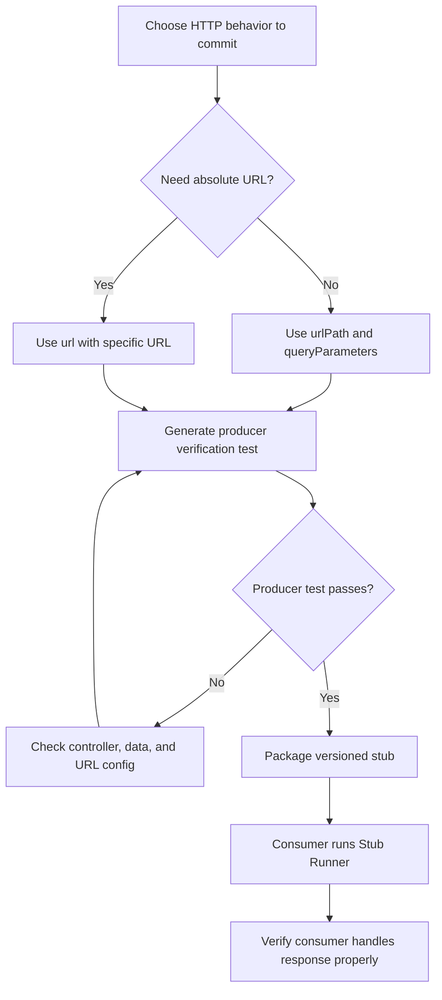

# Distinguishing Full URL from `urlPath`

## 1. The Challenge of Designing HTTP Requests in a Contract

Suppose `checkout-service` (consumer) needs to call `payment-service` (producer) to look up a transaction:

```http
GET /api/payments/PAY-1001?includeHistory=false HTTP/1.1
Host: payment-service:8080
Accept: application/json
```

Both teams agree that the producer must return transaction `PAY-1001` in the `PAID` status. With **Spring Cloud Contract**, teams can describe the interaction using **Groovy DSL** or **YAML DSL**, generate producer verification tests, package stubs for the consumer to run with **Stub Runner**, and integrate these steps into CI to detect incompatible API changes.

When writing the `request` section of an HTTP contract, you will encounter two options:

- `url(...)`: declares the request **URL**; it can be a relative value (e.g. `/api/payments/PAY-1001`) or an absolute one (e.g. `http://localhost:8080/api/payments/PAY-1001`).
- `urlPath(...)`: declares the **path** component of the request; if you need to constrain the query string, place the parameters inside `queryParameters { ... }`.

Both options can describe similar requests, yet they carry different configuration implications. In particular, hardcoding a host, port, or query string can make contracts difficult to port between developer machines and CI, or cause stubs to match requests in unintended ways.

**Lesson objective:** understand URL components, choose correctly between `url` and `urlPath`, declare query parameters intentionally, read Groovy/YAML examples, and understand how producer verification and stubs react when the request changes.

## 2. Breaking Down the Components of an HTTP URL

Consider the address:

```text
https://payments.example.test:8443/api/v1/payments/PAY-1001?includeHistory=false&locale=vi
|---|  |------------------------| |--------------------------| |---------------------------|
scheme           authority                path                      query
```

| Component | Example | What Is It Used For? |
| --- | --- | --- |
| **Scheme** | `https` | Protocol used for the connection. |
| **Host** | `payments.example.test` | Server or service name receiving the request. |
| **Port** | `8443` | Connection port when explicitly specified. |
| **Path** | `/api/v1/payments/PAY-1001` | Resource/path handled by the API. |
| **Query string** | `includeHistory=false&locale=vi` | Filter, option, or pagination parameters. |
| **Fragment** | `#section` (if present in a browser URL) | Not sent in the HTTP request-target to the server; not used to define an endpoint contract. |

Note: in the first line of a typical HTTP/1.1 request, the client normally sends the path and query, while the host goes in the `Host` header. At the client configuration layer, the *base URL* may be determined by the environment. Therefore, in a contract between two services, we usually need to commit to **method + path + relevant query/headers/body**, rather than locking the application to a specific hostname.

A very important distinction:

```text
/api/v1/payments/PAY-1001
    = path

?includeHistory=false&locale=vi
    = query string

/api/v1/payments/PAY-1001?includeHistory=false&locale=vi
    = path + query (origin-form request target)

https://payments.example.test:8443/api/v1/payments/PAY-1001?includeHistory=false&locale=vi
    = absolute URL with scheme, authority, path, and query
```

In the context of this lesson, the phrase **"full URL"** refers to an absolute URL with a scheme/host (and optionally a query). However, Spring Cloud Contract's `url(...)` method **does not require** an absolute URL: it also accepts a relative path.

## 3. Comparing `url(...)` and `urlPath(...)`

| Criterion | `url(...)` | `urlPath(...)` |
| --- | --- | --- |
| Primary representation | A URL specified in the contract. | Specifically the path component of the request. |
| Can a relative value be used? | **Yes**, e.g. `url('/api/payments')`. | **Yes**, and this is the typical usage. |
| Can an absolute URL be declared? | **Yes**, e.g. `url('http://localhost:8080/api/payments')`. | Not used to declare scheme/host/port; declares only the path. |
| When query parameters exist | Can be declared in the DSL; if written directly into the URL string, the query is tied to that string. | Recommended to combine `urlPath('/api/payments')` with `queryParameters { ... }`. |
| Host independence | Relative URLs do not lock the host; absolute URLs explicitly specify host/port. | The option recommended by Spring Cloud Contract for host-independent tests. |
| Best suited for | When a specific URL must be described, including an absolute URL by design. | Most HTTP contracts between services, especially when environments have different hosts/ports. |

**Do not place both `url(...)` and `urlPath(...)` inside the same `request` block.** The Spring Cloud Contract documentation explicitly states this is an invalid configuration; choose exactly one of the two.

**Invalid** example:

```groovy
request {
    method 'GET'
    url('/api/payments/PAY-1001')
    urlPath('/api/payments/PAY-1001') // Error: two URL declarations at once
}
```

With both approaches, `method` remains a required part of the request in an HTTP contract. Using `urlPath` does not replace declaring `method 'GET'` or `method 'POST'`.

## 4. Using `url(...)` in Groovy DSL

### 4.1. Relative URL

Contract for looking up a transaction:

```groovy
import org.springframework.cloud.contract.spec.Contract

Contract.make {
    name 'get_paid_payment_by_url'

    request {
        method 'GET'
        url('/api/payments/PAY-1001')
        headers {
            header 'Accept': 'application/json'
        }
    }

    response {
        status 200
        headers {
            contentType(applicationJson())
        }
        body([
            paymentId: 'PAY-1001',
            orderId: 'ORD-2001',
            status: 'PAID'
        ])
    }
}
```

The value `'/api/payments/PAY-1001'` is a relative URL. It contains no scheme, host, or port, so it is **not** an absolute URL. When generating tests, the framework still relies on the appropriate test configuration to send the request to the producer under test.

This example has a clear business purpose: the consumer needs to verify that ID `PAY-1001` in the request is mapped by the producer to `ORD-2001` with status `PAID`. The sample data here is kept fixed so tests are repeatable.

### 4.2. Absolute URL

Spring Cloud Contract also allows:

```groovy
request {
    method 'GET'
    url('http://localhost:8888/api/payments/PAY-1001')
}
```

Here, the URL contains `http://`, host `localhost`, port `8888`, and the path. This is the **full/absolute URL** case.

An absolute value is valid in the DSL, but think carefully before hardcoding it into a shared contract:

- When running in CI, the producer may start on a random port or be invoked via MockMvc/WebTestClient; `localhost:8888` may not apply.
- When running stubs via Stub Runner, the stub's host and port are usually assigned by the consumer test configuration rather than fixed to match a production URL.
- If the API sits behind a gateway, reverse proxy, or service discovery, the runtime environment's host differs from a host written inside a contract file.

The Spring Cloud Contract documentation **recommends `urlPath` for host-independent tests**. This does not mean every contract using `url(...)` is wrong; relative `url('/api/payments')` still works, but `urlPath(...)` expresses the intent to commit only to the path more clearly.

## 5. Using `urlPath(...)` to Clearly Describe the Path

Let's rewrite the payment lookup contract using only the path:

```groovy
import org.springframework.cloud.contract.spec.Contract

Contract.make {
    name 'get_paid_payment_by_path'

    request {
        method 'GET'
        urlPath('/api/payments/PAY-1001')
        headers {
            header 'Accept': 'application/json'
        }
    }

    response {
        status 200
        headers {
            contentType(applicationJson())
        }
        body([
            paymentId: 'PAY-1001',
            orderId: 'ORD-2001',
            status: 'PAID'
        ])
    }
}
```

The intent is now clear: verify the `/api/payments/PAY-1001` path and its corresponding response; the contract does not need to know whether the producer runs at `localhost:8080`, `payment-service:8080`, or behind a gateway.

The example above includes only the path, with no query constraint. If the consumer also requires `includeHistory=false` and the system needs to verify that parameter, do not sneak `?includeHistory=false` onto the `urlPath` string. Declare `queryParameters` explicitly as shown in the next section.

## 6. Path and Query Parameters: Practical Contract Design

### 6.1. Writing Query Parameters Alongside `urlPath`

Suppose Checkout needs a list of paid transactions, limited to 20 records:

```http
GET /api/payments?status=PAID&limit=20 HTTP/1.1
Accept: application/json
```

Groovy contract:

```groovy
import org.springframework.cloud.contract.spec.Contract

Contract.make {
    name 'list_paid_payments'
    description 'Filter paid transactions, limiting record count'

    request {
        method 'GET'
        urlPath('/api/payments') {
            queryParameters {
                parameter 'status': equalTo('PAID')
                parameter 'limit': 20
            }
        }
        headers {
            header 'Accept': 'application/json'
        }
    }

    response {
        status 200
        headers {
            contentType(applicationJson())
        }
        body([
            payments: [[
                paymentId: 'PAY-1001',
                orderId: 'ORD-2001',
                status: 'PAID'
            ]],
            total: 1
        ])
    }
}
```

Key takeaways:

1. `urlPath('/api/payments')` contains only the **path**; there is no `?` character.
2. `queryParameters { ... }` declares **the query parameters that the contract actually cares about**.
3. `parameter 'status': equalTo('PAID')` constrains `status` to `PAID`.
4. `parameter 'limit': 20` is a literal value shorthand; the DSL applies matching equivalent to `equalTo` for literals.
5. The response clearly shows that the consumer fetches a list of paid transactions; `total` and each `status` carry business meaning in the scenario.

This style separates **the meaning of the URL path** from **query criteria**. That is especially useful when the same endpoint supports `status`, `limit`, `page`, or `sort`.

### 6.2. Writing the Entire Query into `url(...)`

You may also encounter contracts that describe the request as a single string:

```groovy
request {
    method 'GET'
    url('/api/payments?status=PAID&limit=20')
}
```

This syntax expresses both path **and query** in a single URL value. However, it makes reviewing individual query conditions or replacing values with matchers less clear than using `queryParameters`. Depending on how the converter/generator maps the URL string to tests and stubs, details such as query order, character encoding, and literal values can affect matching; check the generated tests/stubs for the Spring Cloud Contract version in use.

For an API where **query parameter order carries no business meaning**, declare parameters separately to focus on the names and values you want to protect. Do not assume two URL strings with different query ordering must always be treated as two different API behaviors.

### 6.3. What Happens When Queries Are Added or Missing?

Given `urlPath('/api/payments')` with `status=PAID` and `limit=20` declared:

| Request | Meaning with Respect to the Contract |
| --- | --- |
| `GET /api/payments?status=PAID&limit=20` | Matches the described query conditions. |
| `GET /api/payments?limit=20&status=PAID` | Same query names/values; separating query parameters avoids treating string order as a business rule. |
| `GET /api/payments?status=PENDING&limit=20` | Differs from `status=PAID`; needs a separate contract if the producer supports this scenario. |
| `GET /api/payments?status=PAID` | Missing `limit` required by the contract; must not be assumed to match the sample request. |
| `GET /api/payments?status=PAID&limit=20&trace=true` | Contains an extra parameter not mentioned in the contract; if it should be rejected, there must be an explicit rule/test rather than inferring from contract silence. |

**Important principle:** according to the Spring Cloud Contract documentation, a query parameter **not declared** in the contract means it is **not a required condition for the request to match**. Omitting a parameter does not automatically create a rule that "that parameter must be absent." If security or business rules require the API to reject invalid queries, describe it explicitly and add appropriate tests.

### 6.4. Query Parameters with Matchers

Suppose the system allows `offset` to be a non-negative integer during pagination. To illustrate the **DSL matcher** part, you can write:

```groovy
request {
    method 'GET'
    urlPath('/api/payments') {
        queryParameters {
            parameter 'status': equalTo('PAID')
            parameter 'offset': value(
                consumer(matching('[0-9]+')),
                producer(0)
            )
        }
    }
}
```

This is a condensed example of the **request block**, which must be placed inside `Contract.make { ... }` with an appropriate `response` block to form a complete contract. In the request position, the **consumer** value defines the constraint for requests accepted by the stub, while the **producer** value is the concrete example the generator uses when creating the producer verification request.

The `[0-9]+` matcher only verifies numeric format; it does **not** guarantee that `offset` falls within all bounds required by business logic. If the consumer relies on `limit <= 100`, the pagination policy should be tested with targeted cases rather than an overly broad regex.

## 7. Equivalent YAML DSL Example

You do not have to write Groovy DSL to declare `urlPath`. The paid transactions listing scenario can be written in **YAML DSL**:

```yaml
description: Filter paid transactions, limiting record count
name: list_paid_payments
request:
  method: GET
  urlPath: /api/payments
  queryParameters:
    status: PAID
    limit: 20
  headers:
    Accept: application/json
response:
  status: 200
  headers:
    Content-Type: application/json
  body:
    payments:
      - paymentId: PAY-1001
        orderId: ORD-2001
        status: PAID
    total: 1
```

If you want to use `url` in YAML, change the **URL field** accordingly, for example:

```yaml
request:
  method: GET
  url: /api/payments/PAY-1001
```

Or an absolute URL:

```yaml
request:
  method: GET
  url: http://localhost:8888/api/payments/PAY-1001
```

These small YAML snippets illustrate only the `request.url` property and require a `response` to form a complete HTTP contract. **Do not declare both `url` and `urlPath`** in the same YAML request, just like in Groovy DSL.

Since both formats support the same concepts, pick **either a Groovy or YAML file** as the primary contract source for each scenario; do not duplicate the same scenario across two files just to show both syntaxes.

## 8. Relationship to Producer Verification and Stub Runner

Choosing `url` or `urlPath` does more than change text in a Groovy file. It affects how the generator constructs requests and how stubs recognize requests.



### 8.1. Producer Side

For the contract `GET /api/payments?status=PAID&limit=20`, the generated test needs to send the corresponding request to the producer (via MockMvc, WebTestClient, or the appropriate HTTP mode) and verify the response status, headers, and body.

If the producer renames the endpoint from `/api/payments` to `/api/payment-records` without keeping the old path, the contract requiring `/api/payments` should catch the incompatible change. Similarly, if `status=PAID` stops filtering properly, producer verification must have meaningful fixture data and response assertions to catch the discrepancy.

**Note:** a contract only describes the interaction; it does not automatically insert payment records into a database. The producer's base test/fixture must create or mock the required data so test results are deterministic.

### 8.2. Consumer Side

Once producer verification passes, the producer can publish a versioned `stubs` artifact. The consumer uses **Spring Cloud Contract Stub Runner** to launch the stub, configures its client to point to the stub's host/port, and verifies the business flow.

For example, Checkout wants to verify that when calling:

```http
GET /api/payments?status=PAID&limit=20 HTTP/1.1
Host: localhost:6565
```

the stub returns the agreed list of payments. If the contract uses `urlPath('/api/payments')` and separate query parameters, the request commitment focuses on path/query, which works well when the stub runs on a different port than the real producer. There is no need to write `localhost:6565` into the source contract.

A test that merely asserts "the stub returned 200" is not enough to prove the consumer is correct. Exercise Checkout's HTTP client code and verify the business decision, such as whether Checkout actually classifies `PAID` differently from `PENDING`.

### 8.3. In CI

A pipeline can implement:

1. Review contracts whenever the producer or consumer proposes HTTP endpoint changes.
2. Generate producer verification tests from Groovy/YAML DSL.
3. Verify the count of generated tests, compile, and run them; if the producer breaks a commitment, fail the pipeline.
4. Publish stubs tagged with the producer version after tests pass.
5. Have the consumer pull the **exact stub version** via Stub Runner and run client/business tests.
6. When changing a path or query, re-run affected contracts before publishing the new API.

If tests only run with an absolute URL like `http://localhost:8888`, CI can fail because no service listens on that port; using `urlPath` in contracts that only need a path helps reduce environment coupling. You still must configure the base test, mock server, and client address properly; `urlPath` alone does not start a producer or stub.

## 9. Common Mistakes When Distinguishing URL and Path

| Symptom | Common Cause | Fix |
| --- | --- | --- |
| Contract invalid due to having both `url` and `urlPath` | Declaring two mutually exclusive options in one request. | Keep one of the two; prefer `urlPath` if only the path is needed. |
| CI fails unable to connect to `localhost:8888` | Absolute URL locks host/port to another environment. | Consider `urlPath` and configure base URL per environment/test mode. |
| Stub does not match request with query | Putting query into the path string, or wrong parameter names/values in `queryParameters`. | Use `urlPath('/api/payments') { queryParameters { ... } }`. |
| Stub responds to unwanted requests | Contract does not constrain query or matcher is too broad. | List the important queries; add contracts/tests for rejected behavior. |
| New path breaks consumer while tests stay green | Only the new contract exists, with no contract/tests left for clients on the old path. | Maintain compatibility contracts and run tests for still-supported consumers. |
| Tests pass locally, fail behind gateway | Environment URL context path/prefix differs. | Agree on the path the producer actually exposes; configure gateway/client properly instead of guessing arbitrary prefixes. |
| `/api/payments` and `/api/payments/` are treated differently | Trailing slash can affect routing and matching. | Agree on the exact path; test redirects/compatibility if committed by the API. |
| Query with spaces, `+`, `%`, or Unicode fails | Inconsistent URL encoding/decoding. | Use a URI builder on the client, inspect decoded parameter names/values, and test with special data. |
| Relying on host for multi-tenancy while using path only | Contract omits a constraint that business logic actually needs. | Describe the header/host and related rules if committed, along with appropriate integration/security tests. |

### Question Marks, Hash Marks, and Path Parameters

- `?` starts the **query** part of a URL; do not put the query string as if it were part of `urlPath`.
- `#fragment` is handled client/browser-side and is not sent to the HTTP server as part of the request path for contract verification.
- `/api/payments/PAY-1001` embeds `PAY-1001` in a **path segment**, unlike `/api/payments?paymentId=PAY-1001` which puts it in a **query parameter**.
- If the actual ID varies, you can use a DSL matcher for the path component as supported by your version; make sure the stub uses a concrete example and the producer test verifies the pattern/business relationship. Do not switch to a regex that accepts every path just to silence errors.

## 10. Choosing a Style in Real Projects

Ask yourself three questions:

**1. Which part of the request is the contract committing to?** If the consumer only needs `GET /api/payments/{id}` and does not care where the server runs, using `urlPath` expresses that goal accurately.

**2. Do query parameters affect the outcome?** If `status=PAID`, `currency=VND`, or `limit=20` affects the consumer's decision, declare `queryParameters` explicitly and use appropriate matchers/literals. If a query parameter is not part of the commitment, do not add it just to mimic a random production URL.

**3. Is there a real need to constrain host or port?** This is rarely a core commitment between microservices; it usually belongs to deployment or routing configuration. If host-based routing is part of the contract, describe and test the required constraints explicitly rather than assuming an absolute host in `url` proves the entire routing policy.

Consequently, a common choice is:

```groovy
request {
    method 'GET'
    urlPath('/api/payments') {
        queryParameters {
            parameter 'status': 'PAID'
        }
    }
}
```

The block above illustrates the request section; a `response { ... }` block is required to form a complete HTTP contract.

## 11. Hands-On Exercise

A producer `inventory-service` provides an inventory lookup API. Consumer `checkout-service` uses:

```http
GET /api/v1/inventory?sku=SKU-001&warehouse=HN01 HTTP/1.1
Host: inventory-service:8080
Accept: application/json
```

Agreed response:

```json
{
  "sku": "SKU-001",
  "warehouse": "HN01",
  "available": true,
  "quantity": 12
}
```

**Tasks:**

1. Write a Groovy contract using `urlPath('/api/v1/inventory')` and `queryParameters` for `sku=SKU-001`, `warehouse=HN01`; return `200` with the JSON above.
2. Write the equivalent version in YAML DSL using `request.urlPath` and `request.queryParameters`. Preserve the request/response semantics.
3. Write an example using `url('http://localhost:8080/api/v1/inventory?sku=SKU-001&warehouse=HN01')` and explain the risk when running in CI with a different host/port.
4. Identify the fields that must match exactly so the consumer does not place orders against the wrong warehouse. If `quantity` changes in production, explain how to use a deterministic fixture or an appropriately bounded matcher.
5. Handle the `warehouse=SG01` scenario: same path but different query; per business rules should it return SG01 warehouse data or an error? Write a separate contract for the agreed decision.
6. Suppose the consumer reverses the query order to `?warehouse=HN01&sku=SKU-001`. Why should you focus on query names and values rather than URL string order? Inspect the generated stub/test to verify the behavior of your plugin version.
7. Describe the steps to generate producer verification, run the stub via Stub Runner, and verify that the consumer handles `available=false` properly in CI.

**Self-check hint:** A correct solution distinguishes path from query, uses only one of `url`/`urlPath` per request, avoids locking host into the contract unnecessarily, and has fixtures/stubs that accurately reflect inventory business logic.

## 12. Key Takeaways

- **`url(...)`** accepts both relative and absolute URLs; therefore, "`url` is always a full URL with a host" is a false conclusion.
- **`urlPath(...)`** focuses on the **path** component; the Spring Cloud Contract documentation recommends this so producer verification does not depend on hostnames.
- Never use `url(...)` and `urlPath(...)` together in the same contract request.
- For queries that affect business logic, use `queryParameters { ... }` in Groovy or `queryParameters:` in YAML to constrain parameters explicitly; do not assume undeclared queries must be absent.
- How the URL is described affects generated producer tests and stubs. Always verify actual behavior, publish versioned stubs, and have consumers run them via Stub Runner in CI.

### References

- [Spring Cloud Contract — HTTP Contracts](https://docs.spring.io/spring-cloud-contract/reference/project-features-contract/http.html): HTTP request section, `url`, `urlPath`, absolute URLs, query parameters, and matchers.
- [Spring Cloud Contract — Contract DSL](https://docs.spring.io/spring-cloud-contract/reference/project-features-contract.html): writing Groovy/YAML contracts and generating producer verification/stubs.
- [Spring Cloud Contract — Dynamic Properties](https://docs.spring.io/spring-cloud-contract/reference/project-features-contract/dsl-dynamic-properties.html): dynamic values and referencing path/query in contracts.
- [Spring Cloud Contract — Stub Runner](https://docs.spring.io/spring-cloud-contract/reference/project-features-stubrunner.html): how consumers download and run published stubs.
