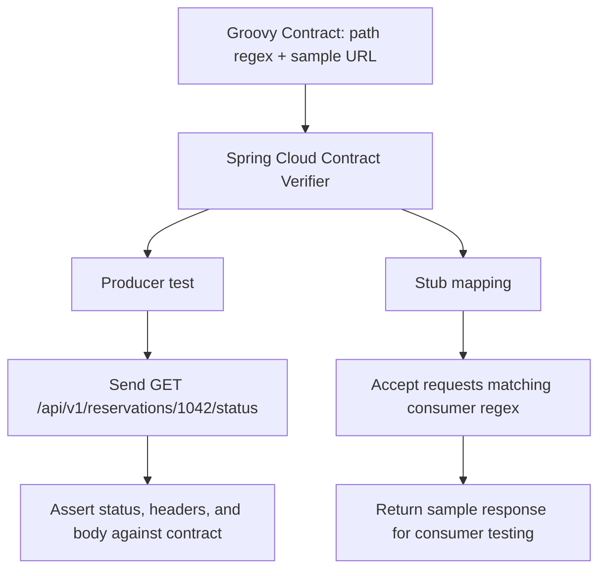

# Path Parameters and Path Matching Expressions

In HTTP applications, two requests such as `GET /api/v1/orders/1042` and `GET /api/v1/orders/2055` typically invoke the same feature: retrieving order details by ID. The `1042` or `2055` portion is a **path parameter** (a parameter embedded in the path). When defining a contract, we must decide whether the producer commits to handling only **one specific URL** or **a class of URLs satisfying a format rule**.

In the **Request HTTP** chapter of **Spring Cloud Contract**, this lesson guides you on how to describe URLs, path parameters, and regular expressions (**regex**) in Groovy DSL, while also introducing static path representation in YAML DSL. The goal is to generate clear producer-side tests, produce stubs for consumers to run with **Stub Runner**, and detect incompatible HTTP API changes in CI without causing stubs to accidentally match other endpoints.

After this lesson, you will be able to:

- Distinguish between path parameters, query parameters, fixed URLs, and path patterns.
- Use `urlPath`, `url`, and the `consumer(...)` / `producer(...)` pair appropriately in a request contract.
- Design regexes over the **entire path**, with clear boundaries for each parameter.
- Combine path parameters with query parameters, error status codes, and related response fields.
- Recognize the impact of matchers on generated tests, stubs, and the ability to catch API changes in CI.
- Spot common pitfalls: overly broad matchers, sample data not matching the regex, overlapping mappings, and confusing Spring MVC syntax with the DSL.

## 1. What Is a Path Parameter and How Does It Differ from a Query Parameter?

A typical HTTP URL:

```text
GET /api/v1/shops/hn-01/orders/1042?includeItems=true
                  └──┘        └──┘ └───────────────┘
                shopId      orderId   query parameter
```

In this API:

- `hn-01` is the **path parameter** `shopId`, used to select the shop.
- `1042` is the **path parameter** `orderId`, used to select the order.
- `includeItems=true` is a **query parameter**, requesting additional line-item details.

In a Spring MVC controller, a developer might write:

```java
@GetMapping("/api/v1/shops/{shopId}/orders/{orderId}")
public OrderView getOrder(
        @PathVariable String shopId,
        @PathVariable Long orderId,
        @RequestParam(defaultValue = "false") boolean includeItems) {
    return orderService.getOrder(shopId, orderId, includeItems);
}
```

This is how Spring MVC maps path variables at runtime. **Spring Cloud Contract does not automatically read `@PathVariable` metadata from controllers to generate contracts.** In the DSL, the producer and consumer teams must define the appropriate request, using either a fixed path or a matcher.

| Component | Example | Meaning | How to Express in a Contract |
| --- | --- | --- | --- |
| Fixed path | `/api/v1/orders` | Identifies a resource or resource collection | `urlPath('/api/v1/orders')` |
| Numeric path parameter | `/api/v1/orders/1042` | Selects a specific order | A concrete sample URL or a regex for the ID part |
| Multiple path parameters | `/shops/hn-01/orders/1042` | Identifies a resource scoped to a shop | Regex with constraints for each path segment |
| Query parameter | `?includeItems=true` | Adjusts query behavior | `queryParameters` inside `urlPath` |
| Header | `Accept: application/json` | Negotiates format or passes request metadata | `headers` of `request` |

Path parameters and query parameters are both request data, yet they live in different parts of the request. In a contract, you should not collapse everything into a single URL string with a catch-all regex when the DSL provides dedicated constructs to describe them.

## 2. Starting with a Fixed URL to Understand Behavior

Before writing a regex, describe a concrete scenario with deterministic test data. Suppose `OrderService` (consumer) calls `InventoryService` (producer) to check reservation status.

```groovy
import org.springframework.cloud.contract.spec.Contract

Contract.make {
    name 'get_reservation_status_fixed'
    description 'OrderService looks up status of reservation 1042'

    request {
        method 'GET'
        urlPath('/api/v1/reservations/1042/status')
    }

    response {
        status 200
        headers {
            contentType(applicationJson())
        }
        body([
            status: 'HELD'
        ])
    }
}
```

The contract above states a very specific requirement: the request `GET /api/v1/reservations/1042/status` must return status `200` and JSON containing `status = HELD` based on the prepared fixture. This is a **hypothetical API example**, not an endpoint provided by Spring Cloud Contract by default.

A fixed URL is useful when:

1. Only one specific path matters and needs protection.
2. The scenario must verify against one exact fixture dataset.
3. The input has a special identifier or behavior that cannot be generalized to the same response.

However, if the consumer needs to call multiple reservation IDs, a stub matching only `1042` will not simulate calls for `2055`. In that case, consider a **matcher for dynamic paths**.

## 3. `urlPath` and `url` in Groovy DSL Requests

Spring Cloud Contract allows defining the HTTP URL portion using `urlPath(...)` or `url(...)`. In request examples using relative paths, `urlPath` is usually appropriate because it focuses on the path component and pairs cleanly with query parameter declarations. It also avoids tying the contract to a test environment's hostname/port.

```groovy
request {
    method 'GET'
    urlPath('/api/v1/reservations/1042/status')
}
```

Another valid option:

```groovy
request {
    method 'GET'
    url('/api/v1/reservations/1042/status')
}
```

**Choose only one URL declaration style per request:** do not write both `url(...)` and `urlPath(...)` in the same contract. With hosts and ports varying by environment, prefer relative paths instead of putting `http://localhost:8080` into the commitment.

In the DSL, the path `/api/v1/reservations/1042/status` is simply a **concrete value**. The fact that a Spring MVC controller uses `/{reservationId}/` does not automatically turn the literal string `'{reservationId}'` in a contract into a variable matching any ID. To describe a family of URLs, define an explicit matcher.

## 4. Regex for Dynamic Paths with `consumer` and `producer`

In a request contract, `consumer(...)` describes the condition that the **consumer-side stub** must accept; `producer(...)` provides a **concrete value for the producer-side generated test** to send to the real application.

This is easy to mix up because the same `$(...)` expression plays different roles on each side. For a path containing a numeric ID, describe it as:

```groovy
import org.springframework.cloud.contract.spec.Contract

Contract.make {
    name 'get_reservation_status_numeric_id'
    description '''
        OrderService needs to look up reservation status by numeric ID.
        Producer must handle valid URL format; stub serves valid IDs.
    '''

    request {
        method 'GET'
        urlPath($(consumer(regex('/api/v1/reservations/[0-9]+/status')),
                  producer('/api/v1/reservations/1042/status')))
    }

    response {
        status 200
        headers {
            contentType(applicationJson())
        }
        body([
            status: 'HELD'
        ])
    }
}
```

Reading the expression from both sides:

| Component | Value | Purpose |
| --- | --- | --- |
| `consumer(regex(...))` | `/api/v1/reservations/[0-9]+/status` | Stub can match paths with one or more digits |
| `producer(...)` | `/api/v1/reservations/1042/status` | Auto-generated test sends this concrete request to the producer |
| `response` | `200`, JSON with `status: HELD` | Response condition being verified and simulated |

Thus a single **contract** can produce a **producer test with a concrete example** while the stub accepts a family of URLs. This is not proof that the producer handles **every** ID value properly: to prove boundaries and error behavior, add appropriate scenarios.

### Reading the Example Regex

```text
/api/v1/reservations/[0-9]+/status
                     └────┘
                  one or more digits
```

- `[0-9]`: a digit in the range 0–9.
- `+`: repeats the preceding element **at least once**.
- `/status`: fixed path segment after the ID, helping distinguish it from other endpoints.

Spring Cloud Contract regexes are used to match the entire target region; by design, treat the regex as the **pattern for the whole path**, not a substring that happens to appear inside the path. For instance, `/reservations/[0-9]+` is not the right pattern for `/api/v1/reservations/1042/status`. When the framework must generate strings from a regex, anchors like `^` and `$` also have limitations depending on the version/tooling; instead of relying on them, use a full bounded pattern and provide a concrete `producer(...)` value.

### Why Must There Be a Real ID on the Producer Side?

The generated test needs an executable request. The value `1042` should correspond to prepared test data (for instance, an existing reservation in state `HELD`). If the test picks a non-existent ID, the implementation may legitimately return `404` per business logic, whereas the success contract expects `200`.

A simple verification rule: **the `producer` value must satisfy the `consumer` regex, and the fixture state must align with the expected response**.

## 5. Choosing Regexes Based on Business Data Types

The broader the path pattern, the higher the chance the stub returns a response for a request outside the intended scenario. Only widen matchers to the exact scope the consumer needs.

| Identifier Type | Example Path Pattern | Matches | Does Not Match |
| --- | --- | --- | --- |
| Positive integer ID as digits | `/orders/[0-9]+` | `/orders/1042` | `/orders/abc` |
| Code with letters, digits, and hyphens | `/products/[A-Za-z0-9-]+` | `/products/SKU-001` | `/products/SKU_001` |
| Single path segment without slashes | `/orders/[^/]+` | `/orders/A_42` | `/orders/A/42` |
| Numeric ID with exactly six digits | `/orders/[0-9]{6}` | `/orders/001042` | `/orders/42` |
| Tenant and order ID | `/tenants/[a-z0-9-]+/orders/[0-9]+` | `/tenants/hn-01/orders/1042` | `/tenants/hn-01/orders/x` |

`[^/]+` means "one or more characters other than `/`" and is useful for keeping a parameter within **a single path segment**. Still, it is broader than `[0-9]+` or a fixed SKU pattern: if business rules only accept digits, choose a numeric pattern.

Some examples requiring caution:

| Regex | Risk |
| --- | --- |
| `/orders/.*` | Accepts an empty ID and can swallow multiple path segments |
| `.*/orders/.*` | Can match paths outside the API being protected |
| `/orders/[0-9]*` | `*` allows **zero digits** |
| `/orders/[0-9]+.*` | Can match unexpected suffixes |
| `/orders/[0-9]+` | Reasonable for numeric IDs, but does **not** prove the ID exists in the system |

Regex is a **syntactic** matching tool. Rules such as "the order belongs to the right user," "the ID exists," "the reservation has not expired," or "the tenant has access permission" must be implemented in the producer and tested with appropriate business and security scenarios.

## 6. Multiple Path Parameters in the Same URL

Suppose an API looks up an order belonging to a shop:

```text
GET /api/v1/shops/hn-01/orders/1042
                 ^^^^^        ^^^^
                 shopId       orderId
```

A Groovy contract for this request:

```groovy
import org.springframework.cloud.contract.spec.Contract

Contract.make {
    name 'shop_get_order_by_id'
    description 'OrderService looks up an order by shopId and orderId'

    request {
        method 'GET'
        urlPath($(consumer(regex('/api/v1/shops/[a-z0-9-]+/orders/[0-9]+')),
                  producer('/api/v1/shops/hn-01/orders/1042')))
    }

    response {
        status 200
        headers {
            contentType(applicationJson())
        }
        body([
            status: 'CONFIRMED'
        ])
    }
}
```

The formats of `shopId` and `orderId` are specified **right at their positions in the path**. The matcher does not need to know the Java variable names `shopId` or `orderId`; what matters is that the HTTP request URL satisfies the contract.

Related business rules should be clarified:

- Does Shop ID allow uppercase letters? If so, add the appropriate character class or normalize according to the agreement.
- Can Order ID start with `0`? `[0-9]+` still accepts it, so if it must be disallowed, use a different matcher or validation.
- Does looking up an order belonging to another shop return `403` or `404`? That is a separate scenario and may require additional access-control testing.
- Is the order of segments in the path stable? Changing `/shops/{shopId}/orders/{orderId}` to `/orders/{orderId}/shops/{shopId}` is usually a breaking change for un-upgraded consumers.

## 7. Combining Path Parameters and Query Parameters

Query parameters are not part of the **path**. Spring Cloud Contract supports the `queryParameters` block when declaring `urlPath`.

For example, the consumer wants to check reservation status and request extra details:

```groovy
import org.springframework.cloud.contract.spec.Contract

Contract.make {
    name 'get_reservation_status_with_details'

    request {
        method 'GET'
        urlPath($(consumer(regex('/api/v1/reservations/[0-9]+/status')),
                  producer('/api/v1/reservations/1042/status'))) {
            queryParameters {
                parameter 'includeHistory': 'true'
            }
        }
    }

    response {
        status 200
        headers {
            contentType(applicationJson())
        }
        body([
            status: 'HELD',
            historyIncluded: true
        ])
    }
}
```

Here the request corresponds to:

```http
GET /api/v1/reservations/1042/status?includeHistory=true
```

This separation makes it clear to readers that:

- **Path regex** defines the ID format in the middle of the URL.
- **`queryParameters`** specifies the `includeHistory` parameter and value needed by the consumer.
- The producer test runs with sample ID `1042` and the declared query parameter.

For dynamic query parameters, the DSL also offers matchers like `matching(...)`, `equalTo(...)`, and context-specific `consumer/producer` values. Pick a matcher that meets the consumer's exact need instead of stuffing `?` and query expressions into the path regex.

## 8. YAML DSL: Describing Static Paths and Matcher Differences

Spring Cloud Contract also supports YAML DSL. For a static URL, an equivalent file can be:

```yaml
name: get_reservation_status_fixed
description: OrderService looks up reservation by sample ID
request:
  method: GET
  urlPath: /api/v1/reservations/1042/status
response:
  status: 200
  headers:
    Content-Type: application/json
  body:
    status: HELD
```

Static YAML contracts work well when you only need to fix the request for one scenario. When you need dynamic expressions in the request URL, **do not copy Groovy's `$(consumer(...), producer(...))` syntax directly into YAML**: YAML uses its own matcher structure, depending on the Spring Cloud Contract version.

If a project uses YAML DSL for dynamic paths, consult **the URL matcher syntax in the documentation for the version in use** and inspect both generated tests and generated stub mappings. The Groovy examples in this lesson directly illustrate the `consumer/producer` pair because that form makes the distinction between **stub matching** and **producer test value** easy to see.

A telltale sign of misconfiguration is when the producer test still uses a fixed path while the stub mapping turns into a string with literal brackets or uninterpreted regex syntax. Therefore, after generating artifacts, inspect the actual request matcher rather than looking only at the source file.

## 9. Contracts for Non-Existent Resource Cases

A contract with a dynamic path regex and status `200` does not prove that every ID exists. If the consumer needs to distinguish missing orders, add an **error contract**.

```groovy
import org.springframework.cloud.contract.spec.Contract

Contract.make {
    name 'get_reservation_not_found'
    description 'OrderService receives 404 when looking up a non-existent reservation'

    request {
        method 'GET'
        urlPath('/api/v1/reservations/999999/status')
    }

    response {
        status 404
        headers {
            contentType(applicationJson())
        }
        body([
            code: 'RESERVATION_NOT_FOUND'
        ])
    }
}
```

**Stub conflict warning:** the success example in section 4 uses a regex accepting **any numeric ID**, so it can also match `999999`. If you package both the success contract and the error contract into the same stub without adding a distinguishing condition, both mappings can match the request and Stub Runner/WireMock may choose an unintended result.

In practice, you can:

1. Narrow the success pattern to an appropriate data domain in the stub environment so it does not overlap with the non-existent case's URL.
2. Distinguish scenarios using observable request conditions actually used by the consumer, or stub state mechanisms if appropriate for the flow.
3. Configure mapping priority only when truly needed, understanding the rules and verifying behavior after packaging; **priority does not replace proper matcher design**.
4. Create separate contracts or stub environments with clear scopes if scenarios genuinely cannot coexist under one broad mapping.

Illustration of avoiding conflicts within one stub set:

| Scenario | Concrete Path in Stub | Response |
| --- | --- | --- |
| Exists | `/api/v1/reservations/1042/status` | `200`, `HELD` |
| Does not exist | `/api/v1/reservations/999999/status` | `404`, `RESERVATION_NOT_FOUND` |

With this approach, both contracts can use **fixed** paths, since each path corresponds to a fixture. If you want the stub to handle a realistic range of IDs, design and test non-overlapping matchers before publishing. Never assume an HTTP stub knows the real data in the producer's database.

## 10. One Pattern Does Not Replace Multiple Business Scenarios

For instance, `GET /api/v1/reservations/1042/status` can yield different outcomes depending on context:

| Condition | Example Response | What Does the Consumer Decide? | How to Verify |
| --- | --- | --- | --- |
| Valid ID, reservation exists | `200`, `HELD` | Can proceed with flow | Success contract and fixture containing reservation |
| Valid format ID, does not exist | `404`, `RESERVATION_NOT_FOUND` | Cannot look up reservation | Error contract, fixture without ID |
| Invalid characters in ID, e.g. `abc` | `400` or `404` per API convention | Do not retry needlessly | Separate contract if consumer needs a guarantee; validation/controller tests |
| Missing access permission for reservation | `403` or `404` per security policy | Deny access | Security/integration tests and contract if response is committed |

A regex only determines **which path pattern** a request belongs to. A regex does not verify that the application returns the right result for every record, every state, or every access permission. Producer tests generated from a contract usually use the sample request on the `producer` side; separate tests are needed for other important branches.

## 11. Edge Cases to Align With the Consumer

### Trailing Slash

`/api/v1/orders/1042` and `/api/v1/orders/1042/` are not always handled identically by frameworks or reverse proxies. If the consumer depends on accepting a trailing `/`, state it explicitly in the contract; do not casually add `/?` to a regex just to make the stub "more forgiving."

### Case Sensitivity and Unicode

The pattern `[a-z0-9-]+` does not accept `SKU-001`, whereas `[A-Za-z0-9-]+` does. If IDs allow Unicode characters or have case-normalization rules, agree on encoding and use a clear enough matcher. A broad regex like `.+` does not distinguish valid values from invalid input.

### Special Characters and URL Encoding

Values containing spaces, `?`, `#`, `%`, `/`, or Unicode characters may be URL-encoded. For instance, a slash inside ID data may appear as `%2F`, though how servers, proxies, and frameworks decode or block it depends on configuration. Do not assume that `[^/]+` guarantees proper handling of an **encoded slash**. If IDs can contain such characters, design API/encoding rules and corresponding end-to-end tests.

### UUID Path Variables

If IDs follow the standard UUID format, you can use a full pattern of hex groups instead of just `[a-f0-9-]+`. However, a syntax-checking regex does not prove a UUID exists or is valid under all version/variant rules. Do not confuse character-format validation with business-identifier validation.

### Empty Parameters and Invalid Numeric IDs

The regex `[0-9]+` rejects an empty ID segment but still matches `0000`. If business logic only accepts positive non-zero numbers, that condition must be expressed through proper validation rules and separate tests. Contract design must reflect what the consumer needs, rather than inferring from a simple regex that all numeric rules are protected.

## 12. How Do Producer Tests and Stubs Interpret Path Matchers?

Given a contract with:

```groovy
urlPath($(consumer(regex('/api/v1/reservations/[0-9]+/status')),
          producer('/api/v1/reservations/1042/status')))
```

Keep the two outcomes distinct:



The **producer test** verifies the real system with the sample value. The **stub mapping** simulates a response when the consumer's request satisfies the defined condition. This has two consequences:

1. Do not use an overly broad regex just so one stub handles "every case": the stub could return `200` even when the real application would return `404`.
2. If the response contains data reflecting the path parameter (such as `orderId`), the stub may need a **response transformer/dynamic response** or request-referencing configuration supported by Spring Cloud Contract, rather than returning a hardcoded `orderId = 1042` for every request with a different ID.

In Groovy DSL, Spring Cloud Contract provides helpers like `fromRequest()` to reference request data from the response. When applying this, select the right path segment, verify index calculation in your project's version, and inspect the output of **both** the producer test and the stub. This lesson uses a generic `status` response to stay focused on path matching and avoid misleading ID echoing.

## 13. Verifying Path Scenarios Before Publishing Stubs

For the regex `/api/v1/reservations/[0-9]+/status`, build a table of requests to verify directly against the stub:

| Request Path | Should It Match the Success Contract? | Why |
| --- | --- | --- |
| `/api/v1/reservations/1042/status` | Yes | ID consists of digits |
| `/api/v1/reservations/2055/status` | Yes, if same business scenario | Matches path pattern; sample response must fit |
| `/api/v1/reservations/abc/status` | No | ID is not numeric |
| `/api/v1/reservations//status` | No | Empty ID |
| `/api/v1/reservations/1042` | No | Missing `/status` suffix |
| `/api/v1/reservations/1042/status/extra` | No | Extra path segment |
| `/api/v2/reservations/1042/status` | No | Different API version |

The table above checks **matcher scope**. It does not prove the real producer returns success for `2055`; that depends on data state and business rules.

In a producer project configured with the Spring Cloud Contract Maven plugin, you can run:

```bash
mvn -B -ntp clean verify
```

Verify that:

1. The contract was read and generated tests were **actually executed**.
2. The producer test uses the exact sample path `/api/v1/reservations/1042/status`.
3. Tests fail when the route or response code diverges from the contract.
4. The packaged stub has the right matcher; check that it does not accidentally match error branches or other routes.
5. The consumer uses Stub Runner with the right stub version and has tests for at least one valid path as well as a path that should be rejected by the mapping.

If the build is green but no contract tests were generated or executed, you cannot conclude the API is compatible. Likewise, if Stub Runner returns the right body for the sample ID without tests for other IDs, the proof scope of your test suite remains narrow.

## 14. Common Mistakes

| Mistake | Symptom | Resolution |
| --- | --- | --- |
| Writing literal `'{id}'` in the URL expecting variable substitution | Stub fails to match real paths or generated test uses wrong path | Use a sample literal or explicit `consumer/producer` matcher |
| Putting both `url` and `urlPath` in one contract | Invalid contract | Use only one URL declaration style |
| Using `.*` for the entire path | Stub may match the wrong endpoint or extra path segments | Constrain prefixes, suffixes, and each ID segment |
| Using `[0-9]*` for a required ID | Matcher still allows an empty ID | Use `[0-9]+` and add further validation as needed |
| `producer` value falls outside the `consumer` regex domain | Test and stub represent inconsistent scenarios | Choose a test value within the committed domain |
| Fixture `1042` does not exist while contract expects `200` | Producer test fails due to missing data | Prepare fixtures in the appropriate state |
| Stub response echoes a fixed ID for all regex requests | Consumer receives an ID different from its request | Use an appropriate dynamic response or narrow the matcher |
| Broad `200` regex contract alongside `404` for an ID inside that regex | Conflicting stub mappings, unpredictable responses | Design non-overlapping matchers/conditions and inspect artifacts |
| Mixing query parameters into path regex | Matcher violates URL semantics and is hard to read | Use `urlPath` with `queryParameters` |
| Assuming regex checks access permissions and data existence | Overestimating contract tests | Write separate business/security tests |
| Ignoring trailing `/`, case sensitivity, and encoding | Differences across local, proxy, and production | Agree on URL semantics and test edge cases |

## 15. Checklist Before Adding a Contract to CI

- [ ] Know which consumer calls the endpoint and why path parameters are needed.
- [ ] Distinguish fixed path segments, varying IDs, and query parameters.
- [ ] Specify ID format (numeric, SKU, UUID, allowed characters) per the actual API.
- [ ] Choose `urlPath` or `url` properly without declaring both.
- [ ] When using regex, set prefix/suffix boundaries and avoid matching out-of-scope paths.
- [ ] The `consumer/producer` pair accurately reflects stub matching and producer test needs.
- [ ] The producer-side value matches the regex and has a fixture consistent with the response.
- [ ] Key `200`, `404`, `400`, and `403` branches are separated into appropriate contracts/tests.
- [ ] Stub mappings do not conflict or overlap ambiguously.
- [ ] ID-dependent response fields are handled properly when the stub accepts multiple paths.
- [ ] Generated tests and actual stub contents have been inspected before release.
- [ ] The consumer uses Stub Runner to verify valid paths, invalid paths, and the corresponding business flow.

### Hands-On Exercise

You are implementing `OrderService` calling `InventoryService` via the following API:

```text
GET /api/v1/warehouses/wh-hcm-01/items/SKU-100/availability?quantity=2
```

Producer returns:

```json
{
  "sku": "SKU-100",
  "canReserve": true
}
```

Complete the following tasks:

1. Identify the two path parameters and one query parameter in the request.
2. Write a Groovy contract using `urlPath` and fixed values for a success scenario.
3. Replace the fixed URL with a regex so `warehouseId` accepts lowercase letters, digits, and hyphens; `sku` accepts uppercase letters, digits, and hyphens. Keep the `quantity=2` query in `queryParameters`.
4. Use `consumer(regex(...))` and `producer(...)` with a valid sample path; explain which step in Spring Cloud Contract each side serves.
5. List at least five paths that should match and should not match; pay attention to trailing slashes, missing IDs, invalid characters, and different URL versions.
6. Create a contract for when the item does not exist or quantity is invalid per the agreed API convention; ensure the stub has no two conflicting mappings.
7. Generate and run producer tests in a project configured with Spring Cloud Contract; then package the stub, run consumer tests with Stub Runner, and test the requests from your table.

**Expected outcome:** you know how to turn a URL with path parameters into a **verifiable contract**, clearly understand where literals vs. regexes belong, and can explain how changing a path or matcher condition impacts producer tests, stubs, and consumers in CI.

## References

- [Spring Cloud Contract — HTTP Contracts](https://docs.spring.io/spring-cloud-contract/reference/project-features-contract/http.html): `url`, `urlPath`, query parameters, and HTTP specification syntax.
- [Spring Cloud Contract — Dynamic Properties](https://docs.spring.io/spring-cloud-contract/reference/project-features-contract/dsl-dynamic-properties.html): `consumer`, `producer`, regex syntax, and limitations to keep in mind. When implementing, cross-reference the exact Spring Cloud Contract version your project uses.
