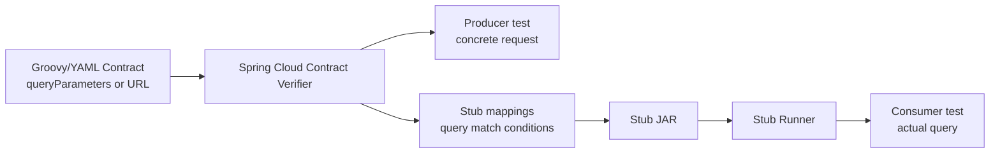

# Required, Optional, and Multi-Value Query Parameters

## 1. Why Are Query Parameters Part of an HTTP Contract?

In **Spring Cloud Contract**, a contract describes the behavior that a **producer** commits to providing for a **consumer**. Beyond the HTTP method, path, headers, body, and response, **query parameters** determine whether a request is accepted and what result will be returned.

For example, the following three requests can carry very different meanings:

```http
GET /api/orders?state=PAID
GET /api/orders?state=PAID&limit=20
GET /api/products?tag=java&tag=spring
```

- `state=PAID` may be a **required** filter condition.
- `limit=20` may be an **optional** parameter that defaults to a value when omitted.
- Two occurrences of `tag` indicate a **multi-value** parameter, commonly used for list-based filtering.

If the contract only checks `GET /api/orders` and status `200`, a change causing the producer to ignore `state` could go undetected. If the contract locks every query into a single rigid URL string, the stub might reject valid requests simply because parameters appear in a different order.

This lesson belongs to the **Request HTTP** chapter of Spring Cloud Contract and focuses on using **Groovy DSL/YAML DSL**, generating producer tests, creating stubs, running **Stub Runner** on the consumer side, and checking API changes through CI.

## 2. Key Concepts to Distinguish

### 2.1. Query String, Query Parameter, and Value

In a URI:

```text
/api/products?tag=java&tag=spring&sort=price
             └─────────────────────────────┘
                      query string
```

The `name=value` pairs in the query string are query parameters. **A single name can appear multiple times**; thus a query cannot always be accurately represented by `Map<String, String>`. For the request above, the data can be modeled as:

```text
tag  -> ["java", "spring"]
sort -> ["price"]
```

| Case | Sample URL | Semantics to Agree On |
|---|---|---|
| Single value | `?state=PAID` | `state` holds the value `PAID` |
| Missing parameter | `/api/orders` | `state` is not sent |
| Present but empty | `?state=` | Key `state` is present with an empty string |
| Key only | `?state` | Interpretation depends on the HTTP stack; test if the API distinguishes it |
| Repeated key | `?tag=java&tag=spring` | `tag` has two values |
| Single value with comma | `?tag=java,spring` | One string containing a comma; not automatically equivalent to two values |
| Encoded value | `?q=C%2B%2B` | Decoded value is `C++` |

**Required/optional** is an **API** rule; HTTP itself does not mandate that `state` be present. **Single-value vs. multi-value** is also an API design choice. Contract tests must accurately reflect the rules the consumer depends on.

### 2.2. Two Sides of Testing

From a single specification, Spring Cloud Contract can:

1. Generate a **producer test** that sends a concrete HTTP request to the real application and verifies the response.
2. Generate a **stub** so consumer tests can send requests to Stub Runner/WireMock and receive sample responses.

A query matcher can allow a stub to accept *multiple* valid values, while the generated producer test typically uses *one* sample value. Therefore, **a passing producer test with one sample value does not mean all input values have been tested**.

## 3. Syntax for Declaring Queries in Groovy DSL

In Groovy DSL, it is usually best to declare queries separately from the path using `urlPath(...)` and `queryParameters`:

```groovy
import org.springframework.cloud.contract.spec.Contract

Contract.make {
    description 'Get list of paid orders'

    request {
        method GET()
        urlPath('/api/orders') {
            queryParameters {
                parameter 'state': 'PAID'
                parameter 'limit': '20'
            }
        }
    }

    response {
        status OK()
        headers {
            contentType(applicationJson())
        }
        body(
            orders: [
                [id: 42, state: 'PAID']
            ]
        )
    }
}
```

This is a contract with two query parameters included in the test request. `parameter 'state': 'PAID'` describes the expectation for `state`, while `parameter 'limit': '20'` describes the `limit` value for this specific scenario.

Related helpers:

| Syntax | Role |
|---|---|
| `url('/api/orders?state=PAID')` | Specifies the entire URL as a string, including query if present |
| `urlPath('/api/orders') { ... }` | Structurally describes the path and query configuration |
| `queryParameters { ... }` | Block declaring query parameters |
| `parameter 'state': 'PAID'` | Parameter with expected value |
| `$(consumer(...), producer(...))` | Different values for the stub/consumer side and the producer test side |
| `regex('...')` | Pattern matcher when you do not want to lock a single value |
| `optional(...)` | Expresses a matcher for an optional value where supported by the DSL |

**Choose `urlPath` when you need to match individual query parameters** or use regexes. A full-string URL is convenient for very specific cases, but with multiple parameters it easily creates unintended coupling to parameter ordering, encoding, and URL construction.

## 4. Required Query Parameters

### 4.1. Business Requirement

Suppose `GET /api/orders` is valid only when `state` is one of `PAID`, `PENDING`, or `CANCELLED`. If `state` is missing, the producer returns `400 Bad Request` with error code `MISSING_STATE`.

Contract for the success scenario:

```groovy
import org.springframework.cloud.contract.spec.Contract

Contract.make {
    description 'Filter orders by required status'

    request {
        method GET()
        urlPath('/api/orders') {
            queryParameters {
                parameter 'state': $(
                    consumer(regex('PAID|PENDING|CANCELLED')),
                    producer('PAID')
                )
            }
        }
    }

    response {
        status OK()
        headers {
            contentType(applicationJson())
        }
        body(orders: [[id: 42, state: 'PAID']])
    }
}
```

In **request**, the two sides are interpreted as:

- **`consumer(regex(...))`**: matcher condition used when the consumer calls the **stub**. The stub allows `state` values matching the pattern.
- **`producer('PAID')`**: concrete request value that the **generated producer test** actually sends to the application.

The sample value `PAID` must align with the data and response prepared in the test. If the API returns different results for `PENDING`, do not carelessly let the stub return the same `PAID` orders for every request just because the matcher accepts all three statuses. Instead, use scenario-tight matchers, multiple separate contracts, or input-linked responses where appropriate.

### 4.2. "Required" Must Have a Test When the Parameter Is *Missing*

Declaring `parameter 'state': 'PAID'` **does not by itself prove** that the producer rejects requests missing `state`. It only verifies the behavior of a request that includes `state`. To protect the "required" rule, add a negative contract:

```groovy
import org.springframework.cloud.contract.spec.Contract

Contract.make {
    description 'Missing state must return an error'

    request {
        method GET()
        url '/api/orders'
    }

    response {
        status BAD_REQUEST()
        headers {
            contentType(applicationJson())
        }
        body(
            code: 'MISSING_STATE',
            message: 'state is required'
        )
    }
}
```

In the generated producer test, `GET /api/orders` is sent **without `state`** to verify `400`. On the stub side, ensure the error mapping and success mapping do not conflict: a stub matching the path too broadly can return `200` for a request missing the parameter if the DSL does not properly constrain the query.

If the API also treats `state=` as invalid, test the **empty value** case separately. Missing parameter, empty string, and out-of-enum value may produce three different error codes or messages depending on the design.

### 4.3. Do Not Arbitrarily Relax Business Values

For example, `regex('.*')` for `state` accepts `PAID`, `MISSING`, and an empty string; that does not validate the allowed value set. If the enum set expands, check whether older consumers can handle the new values. **Adding an enum value can be a breaking change**, even if the schema still says string.

## 5. Optional Query Parameters

### 5.1. What Optional Means

Suppose `limit` can be omitted and the server defaults to `20`, while if provided its valid value is a positive integer in `1..99`.

Three cases should be distinguished:

1. **`limit` omitted:** the producer uses the committed default value.
2. **`limit=10` sent:** the producer caps results at 10.
3. **`limit=abc` or `limit=0` sent:** the producer returns an error if disallowed by the API.

The `optional(...)` helper in Groovy DSL can be used on the **consumer side of the request** to describe a matcher for a parameter that is allowed to be absent:

```groovy
import org.springframework.cloud.contract.spec.Contract

Contract.make {
    description 'limit may be omitted'

    request {
        method GET()
        urlPath('/api/orders') {
            queryParameters {
                parameter 'state': 'PAID'
                parameter 'limit': $(
                    consumer(optional(regex('[1-9][0-9]?'))),
                    producer('20')
                )
            }
        }
    }

    response {
        status OK()
        headers {
            contentType(applicationJson())
        }
        body(orders: [[id: 42, state: 'PAID']])
    }
}
```

**Crucial point:** `optional` expresses optionality for **stub matching** where supported by the DSL; **the generated producer test still sends `limit=20`** because that value was chosen for the producer side. This contract **has not yet tested** the real application when `limit` is absent.

### 5.2. Protecting Default Behavior with a Separate Contract

If the consumer relies on the default value `20`, you need a second contract sending a request without `limit`:

```groovy
import org.springframework.cloud.contract.spec.Contract

Contract.make {
    description 'Use default limit when limit is omitted'

    request {
        method GET()
        url '/api/orders?state=PAID'
    }

    response {
        status OK()
        headers {
            contentType(applicationJson())
        }
        body(
            effectiveLimit: 20,
            orders: [[id: 42, state: 'PAID']]
        )
    }
}
```

`effectiveLimit` is a **hypothetical field in this illustrative API**, meant to make the default value explicit. If the real API does not return such a field, you can use a response matching the fixture and check the item count indirectly, or write an additional producer test. Do not add a field solely for contract test convenience if it is not part of the public contract.

For stubs, omitting `limit` in a mapping does not necessarily mean "every request containing `limit` is rejected"; many matching engines only check declared parameters and ignore extra ones. When the **absence** of a parameter is a branching condition, inspect the generated mapping or use a matcher capable of asserting key absence in your version of WireMock/Spring Cloud Contract.

### 5.3. When Should You Split into Multiple Contracts?

| Rule | Recommended Contract |
|---|---|
| Sending `limit=10` returns at most 10 results | Query scenario with `limit` and corresponding fixture |
| Omitting `limit` defaults to 20 | Scenario **without** `limit` |
| `limit=0` or `limit=abc` is rejected | `400` scenario for invalid values |
| `limit` accepted from 1 to 99 | Tight matcher and/or boundary tests for 1, 99 |
| `limit=100` invalid | Producer verification scenario for out-of-range value |

You do not need to multiply contracts for every possible number; protect the **boundaries** and behaviors that consumers genuinely rely on.

## 6. Multi-Value Query Parameters

### 6.1. Distinguishing Repeated Keys from Comma-Separated Lists

The following two URLs are **not automatically equivalent**:

```http
GET /api/products?tag=java&tag=spring
GET /api/products?tag=java,spring
```

In the first URL, the `tag` key appears **twice**; in the second URL, `tag` appears **once** with content `java,spring`. Some frameworks bind both forms into a list, while other consumers, gateways, caches, or request-signing validators may treat them differently. The contract must explicitly specify which format is supported.

A product filtering API might commit to:

- `tag` is a repeatable parameter to find products carrying **any** of the tags;
- at most five tag values;
- each tag must be non-empty;
- tag order does **not** affect results.

These rules must be expressed through an appropriate set of contracts and business tests; a single example with two tags is not enough to prove the five-value limit or order invariance.

### 6.2. Contract Example with Two Explicit Repeated Values

A **clear, readable way** to write a concrete scenario in Groovy DSL is to provide the full URL containing both values:

```groovy
import org.springframework.cloud.contract.spec.Contract

Contract.make {
    description 'Filter products by two tag query values'

    request {
        method GET()
        url '/api/products?tag=java&tag=spring'
    }

    response {
        status OK()
        headers {
            contentType(applicationJson())
        }
        body(
            appliedTags: ['java', 'spring'],
            products: [
                [id: 'P-42', name: 'Spring Handbook']
            ]
        )
    }
}
```

The URL in this example **literally contains `tag` twice**. The generated producer test will send the corresponding request; the stub matches the described HTTP scenario. This works well when verifying one concrete query variant, though it can be **sensitive to ordering** and URL character encoding. Therefore, do not infer that this contract protects every permutation of the tag list.

**Especially avoid** writing the same key twice into a `Map<String, String>`-like structure assuming both values will be preserved. If you choose advanced `queryParameters` configuration for repeated keys, verify the syntax and generated WireMock mapping in your **project's Spring Cloud Contract version**, as multi-value representation can differ from single-value parameters.

### 6.3. Real Requests from the Consumer

Example calling the API with `curl` using two values:

```bash
curl -G 'http://localhost:8080/api/products' \
  --data-urlencode 'tag=java' \
  --data-urlencode 'tag=spring'
```

After encoding, this corresponds to `?tag=java&tag=spring`. When the consumer is a Spring application, the client must build a URI that **preserves both values** instead of overwriting the first. For example, with `UriComponentsBuilder`:

```java
URI uri = UriComponentsBuilder
        .fromPath("/api/products")
        .queryParam("tag", "java", "spring")
        .build()
        .encode()
        .toUri();

// Path + query: /api/products?tag=java&tag=spring
```

On the producer side, Spring MVC can receive multiple values:

```java
@GetMapping("/api/products")
public List<ProductDto> findProducts(
        @RequestParam(name = "tag") List<String> tags) {
    return productService.findByTags(tags);
}
```

**Note:** the controller example only shows how to receive a list. Whether `tag` is **required**, allowed to be empty, accepts duplicates, has a five-item cap, or produces order-dependent results are business rules that must be implemented and tested separately.

### 6.4. When Order Is Not Part of the Commitment

When the consumer may send `tag=spring&tag=java`, you have two options:

1. **Write an additional scenario** with the reversed order to verify the producer handles it properly; this is straightforward when the number of cases is small.
2. **Design value/structure-based query matchers** and inspect the generated stub mapping to make sure no unintended ordering constraint is imposed. For complex filters, add producer integration tests verifying both requests and asserting they are semantically equivalent.

Do not claim that a matcher on the `tag` key automatically checks **list length, value set, order, and repetition count** without observing actual output. An overly broad stub can return `200` even when the real producer only reads the first value.

## 7. YAML DSL Equivalents: Required and Optional

Spring Cloud Contract supports defining HTTP contracts in **YAML DSL**. For single-value queries, you can use `urlPath` and `queryParameters`:

```yaml
description: Filter orders by status
request:
  method: GET
  urlPath: /api/orders
  queryParameters:
    state: PAID
    limit: "20"
response:
  status: 200
  headers:
    Content-Type: application/json
  body:
    orders:
      - id: 42
        state: PAID
```

The YAML above describes a request with `state=PAID` and `limit=20`. The quotes around `"20"` emphasize that HTTP query parameters are text data; a JSON number `20` in the response body is a different matter.

When writing matchers in YAML DSL, Spring Cloud Contract also supports test/stub-side value expressions and matchers depending on version/configuration; YAML syntax is **not a word-for-word translation** of Groovy closure syntax. For **multiple values sharing a key**, do not do this:

```yaml
# Wrong idea: YAML map with duplicate keys easily loses one value.
queryParameters:
  tag: java
  tag: spring
```

Two repeated `tag` keys in a YAML mapping do not safely represent a multi-value query. To accurately illustrate two values without relying on special matcher syntax, you can use the full URL:

```yaml
description: Filter products by two query values
request:
  method: GET
  url: /api/products?tag=java&tag=spring
response:
  status: 200
  headers:
    Content-Type: application/json
  body:
    appliedTags:
      - java
      - spring
```

Choose a representation compatible with the **plugin version in use**, and inspect both generated tests and stub mappings before concluding that optional or multi-value parameters work as intended.

## 8. Checking Range, Encoding, and Edge-Case Values

### 8.1. Missing Key, Empty String, and Null Are Not the Same

For example, `GET /api/orders?state=` is a request that **has** `state` with an empty value. `GET /api/orders` is a request **without** this key. Do not merge both into a single scenario if the producer must return different errors or use different fallbacks.

In Java:

```java
@GetMapping("/api/orders")
public List<OrderDto> findOrders(
        @RequestParam(name = "state", required = true) String state,
        @RequestParam(name = "limit", required = false) Integer limit) {
    int effectiveLimit = (limit == null) ? 20 : limit;
    return orderService.find(state, effectiveLimit);
}
```

`required = true` expresses a Spring MVC constraint; the contract still needs to verify the public behavior, such as returning `400` when `state` is missing. For empty values, binding/validation behavior depends on converters, annotations, and business code; do not assume from `required = true` alone that every empty value is rejected.

### 8.2. Encoding and Normalization

- Values containing spaces, `&`, `+`, `?`, or Unicode characters must be properly URI-encoded.
- In form-style query encoding, `+` may be interpreted as a space; use `%2B` when a literal plus sign is needed.
- `q=C%2B%2B` represents searching for `C++`; `q=C++` may not mean the same thing across every system component.
- A proxy or gateway may normalize URLs or reorder query parameters when forwarding, especially for signed or cached requests.
- Contracts should describe **the values committed by the API** and add encoding tests for flows affecting consumers.

### 8.3. Unintended Duplicates and HTTP Parameter Pollution

If the API allows only a single `state`, a request like `?state=PAID&state=CANCELLED` needs explicit behavior: reject with `400`, take the first value, take the last value, or treat as a list? Letting the framework silently pick one value without a policy can cause inconsistencies across gateways, applications, and caches.

When a key allows **only one value**, deliberately test duplicate-key requests. When a key allows **multiple values**, define how identical repeated values are handled, such as `?tag=java&tag=java`.

## 9. Verifying with Producer Tests, Stubs, and Stub Runner



**On the producer side**, the verifier generates tests from the contract, invokes the path with the producer-side query, and compares the actual response. Test fixtures must be consistent: if `state=PAID`, the returned data should correspond to `PAID`.

**On the consumer side**, Stub Runner starts the stub from the published artifact. Consumer tests must call the application's real HTTP client and verify that the application handles the response properly. Having the stub return `200` only proves the stub matched the request; it does not prove the consumer sent all required queries or displayed the data correctly.

Example verification scenarios:

| Scenario | What Producer Test Must Prove | What Consumer Test with Stub Must Prove |
|---|---|---|
| `state=PAID` | Producer executes the filter properly | Consumer sends the right `state` and reads data correctly |
| Missing `state` | Producer returns the committed error | Consumer handles error response properly |
| `limit` omitted | Producer applies the committed default | Consumer does not need to inject the parameter unnecessarily |
| `limit` out of range | Producer rejects per policy | Consumer displays an error or fixes the request |
| `tag=java&tag=spring` | Producer receives both values and filters properly | Client does not drop any value |
| Repeated `tag` in reversed order | Same result if API promises order independence | Client does not rely on order unless committed |

CI should run **generated producer tests** before creating/publishing stubs; then run **consumer tests** with Stub Runner against the target stub version. Whenever adding a required parameter, changing a default value, altering multi-value policy, or dropping support for a parameter, evaluate whether already-deployed consumers remain compatible. If an incompatible change is needed, plan an explicit migration or versioning strategy.

## 10. Common Contract Design Mistakes

| Mistake | Consequence | Fix |
|---|---|---|
| Writing `url '/api/orders?state=PAID&limit=20'` for all filter scenarios | Stub may over-constrain query order/URL representation | Use `urlPath` and `queryParameters` for single values that need individual matching |
| Testing only requests that **include** a required parameter | Producer might still accept requests missing the parameter | Add a negative contract with the key missing |
| Using `optional(...)` and assuming tests ran the *absent* case | Producer default remains unverified | Write a producer test scenario omitting the parameter |
| Using `regex('.*')` for enums | Stub accepts invalid statuses | Use an explicit value set and test each behavior |
| Repeating keys in a YAML map | One value can overwrite the other | Use a sample URL with both keys or a multi-value representation supported by your DSL version |
| Treating `tag=a,b` as identical to `tag=a&tag=b` | Consumers/gateways handle them differently | Choose and publish one or explicitly support both formats |
| Claiming tag order does not matter while testing only one order | Order-handling bugs go undetected | Add a reversed-order scenario or set-based test |
| Comparing numeric query parameters to JSON numbers | Confusing query data (strings) with response body types | Define type-coercion and validation boundaries |
| Only checking that Stub Runner starts | Does not prove the client sends all queries | Call the real client and assert consumer behavior |
| Not pinning stub versions | CI tests may use stale stubs | Pin artifact versions or set a traceable update strategy |

## 11. Hands-On Exercise: Order and Tag Filters

**Context:** an admin portal calls the API:

```http
GET /api/orders?state=PAID&limit=10
GET /api/orders?state=PAID
GET /api/products?tag=java&tag=spring
```

Commitments:

1. `state` is required, accepting `PAID` or `PENDING`; missing `state` returns `400`.
2. `limit` is optional, defaults to 20, and is bounded from 1 to 99.
3. `tag` allows multiple values sent via repeated keys.
4. Producer publishes stubs so the consumer can run independent tests.

**Steps:**

1. Write a Groovy contract with `urlPath('/api/orders')`, `parameter 'state': 'PAID'`, `parameter 'limit': '10'`, and a sample response.
2. Write a contract for `/api/orders` missing `state`; expect `400` and the published error code.
3. Write a contract for `/api/orders?state=PAID` without `limit`; the fixture must reflect or verify the default behavior.
4. Write a contract for `/api/orders?state=PAID&limit=0`; expect the error code per API rules.
5. Write a contract for `/api/products?tag=java&tag=spring`, preparing fixtures for both tags. Add a reversed-order scenario if the API commits to order independence.
6. Run the generated producer tests, build the stub artifact, and test the consumer client with Stub Runner.

**Self-check questions:**

- Why is `state=PAID` in a contract not enough to prove `state` is required? — Because no request missing `state` was sent to the producer to observe the error.
- Why doesn't `optional(regex(...))` automatically test the producer's default value? — Because the generated producer test still uses the concrete value from the `producer(...)` side.
- Why shouldn't you write two identical `tag` keys in a YAML mapping? — Because a YAML mapping is not a reliable multi-map structure; one value can be lost.
- If the producer changes the default `limit` from 20 to 50, could that break compatibility? — Yes, if consumers rely on the default count or pagination and a prior contract protected that rule.
- If `tag=spring&tag=java` returns differently from `tag=java&tag=spring`, is it always a bug? — Only if the API committed that order does not affect results.

## 12. Review Checklist Before Accepting a Contract

- [ ] Distinguishes **required parameters**, **optional parameters**, and **multi-value parameters** per API semantics.
- [ ] Uses `urlPath`/`queryParameters` or intentional sample URLs without accidentally locking query order.
- [ ] For required parameters, includes at least one test with the **key missing**.
- [ ] For optional parameters, includes tests both **with a value** and **when omitted** if defaults matter to consumers.
- [ ] For bounded value domains, matchers are no broader than business rules allow.
- [ ] For multi-value parameters, verifies repeated keys preserve all values; clarifies duplicates and ordering.
- [ ] Includes tests for empty values, wrong types, out-of-range values, or encoding when they affect behavior.
- [ ] Generated producer tests run with reproducible fixtures; stub mappings match expected requests.
- [ ] Consumer tests use the real client with Stub Runner and assert behavior after receiving the response.
- [ ] CI verifies the producer, publishes versioned stubs, and catches incompatible API changes.

When designing query parameters in Spring Cloud Contract, the most important question is: **"Which requests must the producer accept, which must it reject, and are consumers relying on that distinction?"** Writing clear scenarios for **required, optional, and multi-value** parameters makes contracts both reliable in CI and flexible as the application evolves.
