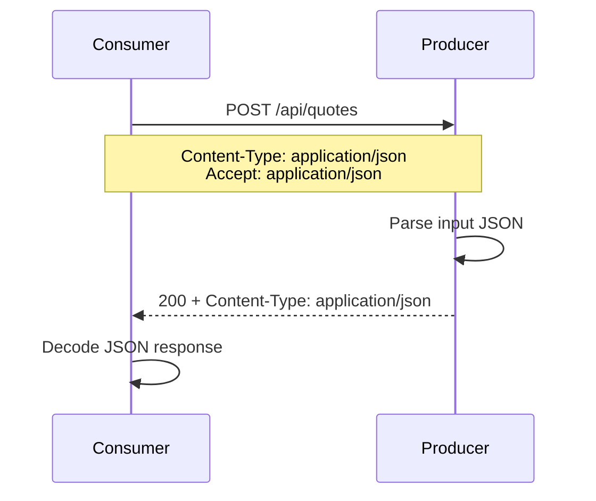
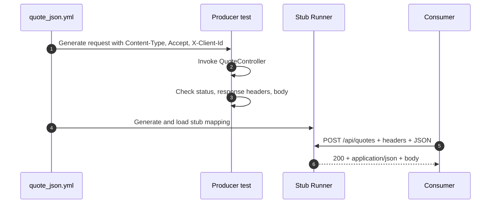
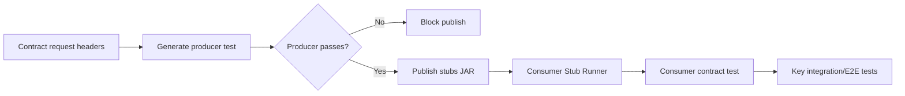

# Request Headers and Content Negotiation

> **Chapter:** Request HTTP  
> **Module:** `SPRING_CLOUD_CONTRACT` — learning contract testing between producer and consumer with Spring Cloud Contract, using Groovy/YAML DSL, producer verification, stubs, Stub Runner, and CI.

## Learning Objectives

After this lesson, you will be able to:

1. Distinguish **request headers** from **response headers**, especially the roles of `Accept` and `Content-Type`.
2. Explain **content negotiation**: the client advertises which representations it can accept, and the server selects a supported representation or rejects the request.
3. Define request headers in **Groovy DSL** and **YAML DSL** in Spring Cloud Contract.
4. Write contracts to verify required headers, headers with dynamic patterns, `application/json` and `text/plain` variants, as well as `406`/`415` cases.
5. Understand how headers participate in producer tests and in request matching for stubs run by Stub Runner.
6. Organize contracts in CI to catch incompatible API changes without making tests brittle over unrelated headers.

## 1. Where Do Headers Sit in HTTP Communication?

An HTTP request typically consists of a **method**, **target URI**, **header fields**, and an optional **body**.

For example, consumer `checkout-service` asks producer `pricing-service` for a quote:

```http
POST /api/quotes HTTP/1.1
Host: pricing-service
Content-Type: application/json
Accept: application/json
X-Client-Id: checkout

{
  "sku": "SKU-001",
  "units": 2
}
```

Producer returns:

```http
HTTP/1.1 200 OK
Content-Type: application/json

{
  "sku": "SKU-001",
  "units": 2,
  "amount": 250000
}
```

In this request:

- `Content-Type: application/json` describes the **data type of the body the consumer is sending**.
- `Accept: application/json` expresses the **response representation type the consumer wants/accepts**.
- `X-Client-Id: checkout` is an application-defined header identifying the calling system.
- `Host` serves HTTP routing; it is **not synonymous** with caller identity and should not be used as an authentication mechanism.

Headers can govern routing, validation, serialization, auth, caching, or observability. Thus a header change can break API integration even when the JSON body is unchanged.

**Contract tests** care about headers that are part of the communication promise. Spring Cloud Contract can generate **producer-side tests** from the contract and generate **HTTP stubs** for the consumer to call via Stub Runner. Both must agree on important headers such as media types or a required application header.

## 2. Distinguishing `Accept` and `Content-Type`

These are two commonly confused headers:

| Header | Appears On | Question Answered | Example |
| --- | --- | --- | --- |
| `Content-Type` | Request with body | *What format is the data I am sending?* | `Content-Type: application/json` |
| `Accept` | Request | *What response formats can I receive?* | `Accept: application/json` |
| `Content-Type` | Response with body | *What format is the data the server actually returned?* | `Content-Type: text/plain` |
| `Content-Language` | Response | *What language does the returned content use?* | `Content-Language: vi` |
| `Accept-Language` | Request | *Which languages do I prefer?* | `Accept-Language: vi, en;q=0.8` |
| `Accept-Encoding` | Request | *Which content encodings/compressions do I accept?* | `Accept-Encoding: gzip, br` |

**Two examples to remember:**

- A `GET /api/products/SKU-001` request with no body **does not need** to send `Content-Type` just to signal that it wants JSON; send `Accept: application/json`.
- A `POST` request sending JSON **can still want text back**. In that case `Content-Type: application/json` and `Accept: text/plain` is completely valid, **provided** the endpoint supports a `text/plain` response.



In the diagram example, each header has a single job. `Accept` does not describe the request body; the request's `Content-Type` does not automatically determine that the response will be JSON.

### 2.1. What Is Content Negotiation?

**Content negotiation** is the mechanism for selecting an appropriate **representation** for the same resource or business result: JSON, XML, plain text, language, or compression format, depending on server capabilities and client preferences.

For media types, the consumer can send:

```http
Accept: application/json
```

Or accept multiple types with different priorities:

```http
Accept: application/json;q=0.9, text/plain;q=0.5
```

The `q` value lies between `0` and `1`. When `q` is omitted, the default is `1`; `q=0` means that type is not acceptable. The server considers the representations it supports alongside priority, specificity, and representation-selection policy; it does not necessarily return whichever item appears first in the string.

```http
Accept: */*
```

means the consumer accepts any media type. However, a test intended to verify **the JSON variant specifically** should declare `Accept: application/json` to make expectations explicit.

HTTP header names are **case-insensitive** (`Accept` and `accept` refer to the same field); however, when writing stub matchers, do not assume every formatting of the **header value** is automatically matched identically. `application/json; charset=UTF-8`, `application/json`, whitespace, and multi-media-type lists may require appropriate matcher rules.

### 2.2. Two Commonly Related Status Codes

| Code | Typical Scenario | Header to Inspect |
| --- | --- | --- |
| **406 Not Acceptable** | Client only accepts response types the endpoint cannot provide | `Accept` |
| **415 Unsupported Media Type** | Server does not support the media type of the request body | `Content-Type` |
| **400 Bad Request** | Malformed structured data or missing a required input header | Check validation and application policy |
| **401/403** | Missing or insufficient access credentials/permissions | `Authorization` and security configuration |

For example, in Spring MVC:

```java
@PostMapping(
    path = "/api/quotes",
    consumes = MediaType.APPLICATION_JSON_VALUE,
    produces = MediaType.APPLICATION_JSON_VALUE
)
```

- Sending a `text/plain` body with `Content-Type: text/plain` can be rejected with `415` because it does not satisfy `consumes`.
- Sending `Accept: application/pdf` when the endpoint only produces JSON can lead to `406` because it does not satisfy `produces`.
- If `@RequestBody` expects valid JSON but the body has a syntax error, the server normally returns `400`, **not `415`**, because the media type is still JSON.

This is the illustrative behavior of Spring MVC under default configuration; custom exception handlers, content negotiation strategies, or gateways can produce different actual responses. **The contract must reflect what the API actually commits to.**

## 3. Choosing Which Request Headers to Include in a Contract

Not every header appearing in a packet capture needs to be constrained.

| Header Group | Example | Should It Be Included in the Contract? |
| --- | --- | --- |
| Media types | `Content-Type`, `Accept` | Yes, if request/response handling depends on media type |
| Required business headers | `X-Client-Id`, `X-Tenant-Id` | Yes, when the producer uses them as behavior conditions |
| Tracing | `X-Request-Id`, `traceparent` | If consumer/producer commit to a specific format or echo behavior; use a matcher for dynamic values |
| Authentication | `Authorization` | Only to describe relevant verification behavior, using fake tokens in tests; never commit real secrets |
| Environment-added headers | `User-Agent`, `Via`, `X-Forwarded-For` | Only when they are part of the contract; otherwise avoid hardcoding |
| Length/connection | `Content-Length`, `Connection` | Usually should not be hardcoded in application contracts since the HTTP stack manages them |

Principle: **constrain exactly what the consumer actually relies on**. A contract describing only a success case with header `X-Client-Id` is not enough to prove the producer **rejects** calls missing that header; if rejection is a requirement, add a negative contract or appropriate integration/security tests.

## 4. Minimal Producer Example for Testing

Create an illustrative controller. Standard Spring MVC imports are omitted for brevity:

```java
@RestController
public class QuoteController {

    @PostMapping(
        path = "/api/quotes",
        consumes = MediaType.APPLICATION_JSON_VALUE,
        produces = MediaType.APPLICATION_JSON_VALUE
    )
    public QuoteResponse quote(
        @RequestHeader("X-Client-Id") String clientId,
        @RequestBody QuoteRequest request
    ) {
        return new QuoteResponse(
            request.sku(),
            request.units(),
            250000
        );
    }

    public record QuoteRequest(String sku, int units) {}

    public record QuoteResponse(
        String sku,
        int units,
        long amount
    ) {}
}
```

Expected output when sending the request from section 1:

```json
{
  "sku": "SKU-001",
  "units": 2,
  "amount": 250000
}
```

A few things to understand before writing the contract:

- `@PostMapping(consumes = ...)` governs which request media types the mapping supports.
- `@PostMapping(produces = ...)` governs which response media types the endpoint can produce.
- `@RequestHeader("X-Client-Id")` requires that header by default when Spring MVC binds the parameter; missing the header usually results in `400`.
- The JSON response is serialized from the Java record by Spring when an appropriate message converter is present.
- The example does not yet validate that the **value** of `clientId` is `checkout`: the controller only requires the header to be present. If business logic must block other values, corresponding logic and tests must be added.

A producer-side contract test can use a base class setting up MockMvc/RestAssuredMockMvc with this controller. For example:

```java
public abstract class ContractTestBase {

    @BeforeEach
    void setup() {
        RestAssuredMockMvc.standaloneSetup(new QuoteController());
    }
}
```

This snippet illustrates only the setup; executing it requires the Contract Verifier, JUnit 5, and Rest Assured MockMvc dependencies plus Maven/Gradle configuration pointing to the corresponding base class.

## 5. Defining Request Headers in Groovy DSL

Example file `src/test/resources/contracts/quote_json.groovy` in the producer:

```groovy
org.springframework.cloud.contract.spec.Contract.make {
    name 'quote_json'

    request {
        method 'POST'
        url '/api/quotes'

        headers {
            contentType(applicationJson())
            header 'Accept': 'application/json'
            header 'X-Client-Id': 'checkout'
        }

        body(
            sku: 'SKU-001',
            units: 2
        )
    }

    response {
        status 200
        headers {
            contentType(applicationJson())
        }
        body(
            sku: 'SKU-001',
            units: 2,
            amount: 250000
        )
    }
}
```

**Request-side explanation:**

- `headers { ... }` **inside `request`** declares the request headers required by the contract.
- `contentType(applicationJson())` is a Groovy helper for `Content-Type: application/json`.
- `header 'Accept': 'application/json'` adds the expected response media type header.
- `header 'X-Client-Id': 'checkout'` constrains the application header.
- `body(...)` declares the request JSON. `units: 2` is a number, not the string `"2"`.

**Response-side explanation:**

- `response.headers { contentType(applicationJson()) }` specifies the response media type.
- `status 200` and `response.body` are the expectations the producer must satisfy.
- The same contract provides the data to generate the stub for the consumer.

Writing `contentType(applicationJson())` inside `request` **does not substitute** for the `Accept` header. Conversely, having only `Accept` **does not declare** the outgoing body format.

## 6. Representing the Same Contract in YAML DSL

If the team uses YAML, the equivalent file is `src/test/resources/contracts/quote_json.yml`:

```yaml
name: quote_json
description: "Consumer requests a quote in JSON"

request:
  method: POST
  url: /api/quotes
  headers:
    Content-Type: application/json
    Accept: application/json
    X-Client-Id: checkout
  body:
    sku: SKU-001
    units: 2

response:
  status: 200
  headers:
    Content-Type: application/json
  body:
    sku: SKU-001
    units: 2
    amount: 250000
```

YAML represents headers as a **map** under `request.headers` or `response.headers`. Read the structure by path:

| Position in YAML | Meaning |
| --- | --- |
| `request.headers.Content-Type` | Body sent by consumer is JSON |
| `request.headers.Accept` | Consumer requests a JSON response |
| `request.headers.X-Client-Id` | Request carries the agreed caller identifier |
| `response.headers.Content-Type` | Producer returns the response as JSON |
| `request.body.units` | Numeric type of the input field |
| `response.body.amount` | Numeric value of the output field |

**Important:** Groovy `quote_json.groovy` and YAML `quote_json.yml` in the two sections above **express the same contract**. In real projects, keep only **one** file to avoid generating duplicate tests and stub mappings.

When using YAML:

- Indent accurately; `headers` must sit inside the appropriate `request` or `response` block.
- Values that look like numbers or booleans in YAML can be coerced by the parser. For tokens, codes, or media types with special characters, quote them when needed to preserve **string** semantics.
- Header names with hyphens (like `X-Client-Id`) are valid YAML keys.
- Use realistic header values accepted by the producer; never accidentally commit secrets into the repository.

## 7. How Are Request Headers Verified?

From `quote_json.yml`, Spring Cloud Contract can generate:

1. **Producer verification test:** sends `POST /api/quotes` with the example headers and body, then checks the response (status, headers, body) from the implementation.
2. **Stub mapping:** accepts requests matching the described method, URL, request headers/body; returns the committed response.
3. **Consumer test:** the real HTTP client sends headers to Stub Runner; a request not matching the mapping can receive `404` or a mapping error instead of the defined response.



Important limitation to note: if the producer test **always sends** `X-Client-Id: checkout`, a passing producer test **does not prove** that the API rejects requests missing or sending the wrong header. To guarantee that, add a negative contract or dedicated validation tests.

A request arriving at the stub may fail to match if it omits the `Accept` header required by the contract, even when the real producer still allows requests with `Accept: */*`. This shows that the stub is built from the **scope and matching rules** you describe; writing overly strict headers will cause false failures in consumer tests.

## 8. Using Request Header Matchers for Dynamic Values

Some headers change on every request, such as `X-Request-Id` or `Authorization` carrying test tokens. Hardcoding every value can cause the stub to accept only a single literal request.

For example, the consumer must send `X-Request-Id` matching `req-` + four digits. Starting from the YAML contract in section 6, update `request`:

```yaml
request:
  method: POST
  url: /api/quotes
  headers:
    Content-Type: application/json
    Accept: application/json
    X-Client-Id: checkout
    X-Request-Id: req-0042
  body:
    sku: SKU-001
    units: 2
  matchers:
    headers:
      - key: X-Request-Id
        regex: 'req-[0-9]{4}'
```

This is an **alternative `request` block** for illustration; do not add a second `request` block inside the same contract.

- `request.headers.X-Request-Id` provides the **sample** value for the producer test.
- `request.matchers.headers` allows the stub to match the header value by **regex** instead of forcing every consumer request to use the exact string `req-0042`.
- `req-0777` will match the pattern, whereas `request77` will not.
- The example regex constrains the **entire** format. If you want to allow extra prefixes/suffixes, express that explicitly in the pattern.

The exact YAML structure for header matchers is a list containing `key` and `regex` (or `command` when custom logic is needed). This differs from body matchers, which live under `matchers.body` with `path` and `type`.

### 8.1. Dynamic Response Headers

Suppose the producer actually **returns** an additional `X-Correlation-Id` formatted as `corr-1234`, and the consumer needs that field without caring about the exact value. Then you can replace the contract's `response` block with:

```yaml
response:
  status: 200
  headers:
    Content-Type: application/json
    X-Correlation-Id: corr-0042
  body:
    sku: SKU-001
    units: 2
    amount: 250000
  matchers:
    headers:
      - key: X-Correlation-Id
        regex: 'corr-[0-9]{4}'
```

Meaning:

- Producer verification checks the returned header against the regex, provided the generator/plugin supports this matcher.
- The stub can return the sample value `corr-0042` for the consumer to read.
- **The producer application must actually return `X-Correlation-Id`** for this test to be valid; the minimal controller in section 4 does not emit that header yet. This is an extension for practice and should not be merged into the initial contract until the implementation is updated.

If the API commits to **echoing back the exact request ID**, a format-checking regex is not enough; you must enforce the relationship between request and response (request references in the DSL or additional tests). Do not equate "valid format" with "matching corresponding value."

### 8.2. Do Not Over-Relax Important Headers

| Declaration | Effect | When Appropriate |
| --- | --- | --- |
| Fixed `X-Client-Id: checkout` | Stub accepts only the specified value | This consumer must always use identifier `checkout` |
| Regex `checkout-[a-z]+` | Accepts a family of identifiers | Contract allows multiple callers matching the pattern |
| Omit `X-Client-Id` from contract | Stub does not constrain that header | Value is outside the agreement of the described interaction |

Never use regex `.*` or omit a header just to "make tests green" when that header is an authentication, authorization, or tenant-selection condition. If you need to verify actual security policy, add integration/security tests; a stub does not replace security middleware.

## 9. Content Negotiation: Two Representations for the Same URL

Consider a stock lookup endpoint:

```http
GET /api/stock/SKU-001 HTTP/1.1
Accept: application/json
```

The producer can return JSON:

```http
HTTP/1.1 200 OK
Content-Type: application/json

{"sku":"SKU-001","quantity":4}
```

If the consumer switches to `Accept: text/plain`, the same URL can return plain text:

```http
HTTP/1.1 200 OK
Content-Type: text/plain

SKU-001:4
```

**Precondition:** the producer must **actually support both representations**. Content negotiation does not synthesize a text representation if the controller only has converters/handlers for JSON.

### 9.1. Two YAML Contracts

Contract for JSON, file `stock_json.yml`:

```yaml
name: stock_json
request:
  method: GET
  url: /api/stock/SKU-001
  headers:
    Accept: application/json
response:
  status: 200
  headers:
    Content-Type: application/json
  body:
    sku: SKU-001
    quantity: 4
```

Contract for text, file `stock_text.yml`:

```yaml
name: stock_text
request:
  method: GET
  url: /api/stock/SKU-001
  headers:
    Accept: text/plain
response:
  status: 200
  headers:
    Content-Type: text/plain
  body: "SKU-001:4"
```

Both contracts share the **same method and path**, but differ in `request.headers.Accept`. That gives the stub a basis to select the corresponding response. If you remove `Accept` from both, the two stubs will overlap in conditions and the outcome will depend on priority/matching order, making tests unpredictable.

An illustrative Spring MVC implementation:

```java
@RestController
@RequestMapping("/api/stock")
public class StockController {

    @GetMapping(
        path = "/{sku}",
        produces = MediaType.APPLICATION_JSON_VALUE
    )
    public StockResponse asJson(@PathVariable String sku) {
        return new StockResponse(sku, 4);
    }

    @GetMapping(
        path = "/{sku}",
        produces = MediaType.TEXT_PLAIN_VALUE
    )
    public String asText(@PathVariable String sku) {
        return sku + ":4";
    }

    public record StockResponse(String sku, int quantity) {}
}
```

Spring MVC uses `produces` together with `Accept` to pick the matching handler. The data is hardcoded for `SKU-001` for illustration; a real application must look up inventory by SKU and handle missing SKUs.

**Detail to verify:** Spring may append parameters like `charset` to `Content-Type` for certain representations depending on converters/configuration. Do not assume `text/plain` always yields the **exact identical** header string in every environment; run producer tests and tune matchers to reflect the contract's true intent. In this basic example, the contract assumes the exact media type shown.

### 9.2. Not Acceptable Case: 406

Suppose the producer supports only JSON and text as above, and the consumer sends:

```http
GET /api/stock/SKU-001 HTTP/1.1
Accept: application/pdf
```

No matching PDF representation exists. With the illustrative Spring MVC configuration, a negative contract could be:

```yaml
name: stock_not_acceptable
request:
  method: GET
  url: /api/stock/SKU-001
  headers:
    Accept: application/pdf
response:
  status: 406
```

Do not add an error body or headers before agreeing on them: error responses may be generated by the framework or an exception handler in a different format. If the consumer requires a stable error format, put that error policy into the contract and the producer implementation.

### 9.3. Unsupported Request Body Case: 415

Returning to `POST /api/quotes` with a controller that only accepts JSON:

```http
POST /api/quotes HTTP/1.1
Content-Type: text/plain
Accept: application/json

sku=SKU-001&units=2
```

This request sends **plain text**, not JSON. Contract testing the error branch:

```yaml
name: quotes_unsupported_content_type
request:
  method: POST
  url: /api/quotes
  headers:
    Content-Type: text/plain
    Accept: application/json
  body: "sku=SKU-001&units=2"
response:
  status: 415
```

This scenario differs from `406`:

- `415` asks: "Can the server **read this request format**?"
- `406` asks: "Can the server **return a response format the client accepts**?"

If neither `consumes` nor `produces` matches, the exact status code chosen can depend on the router and implementation; write each negative contract for one clear cause to avoid ambiguity.

## 10. Verifying with `curl` Before Writing Contracts

With the producer running locally on port `8081`:

### Successful Request

```bash
curl -i -X POST "http://localhost:8081/api/quotes" \
  -H "Content-Type: application/json" \
  -H "Accept: application/json" \
  -H "X-Client-Id: checkout" \
  --data '{"sku":"SKU-001","units":2}'
```

Expected: `200`, `Content-Type: application/json`, and a JSON response matching the contract.

### Missing Required Header

```bash
curl -i -X POST "http://localhost:8081/api/quotes" \
  -H "Content-Type: application/json" \
  -H "Accept: application/json" \
  --data '{"sku":"SKU-001","units":2}'
```

Because the controller uses `@RequestHeader("X-Client-Id")`, which is required by default, the server normally returns `400`. If rejecting a missing header is a **committed behavior**, define a contract for this error as well.

### Unsupported Content-Type

```bash
curl -i -X POST "http://localhost:8081/api/quotes" \
  -H "Content-Type: text/plain" \
  -H "Accept: application/json" \
  -H "X-Client-Id: checkout" \
  --data 'sku=SKU-001&units=2'
```

Expected in the example: `415`.

### Unsupported Accept

```bash
curl -i "http://localhost:8081/api/stock/SKU-001" \
  -H "Accept: application/pdf"
```

Expected with `StockController` supporting only JSON/text: `406`.

The commands above illustrate `curl` syntax in shells supporting `\` line continuation (Bash, zsh). In PowerShell, enter them on one line or use the appropriate line-continuation character; do not assume `curl` always points to the same binary on every operating system.

## 11. How Does Spring Cloud Contract Detect Header Changes?

Suppose a consumer depends on:

```http
Accept: application/json
```

but the new producer only supports `text/plain`. When the producer runs the contract test from `stock_json.yml`:

1. The generated test sends a request with `Accept: application/json` to the producer.
2. The producer has no matching representation and may return `406`.
3. The contract expects `200` and JSON, causing **producer verification to FAIL**.
4. CI should block publishing the new artifact/stub when this test fails.

Similarly, if the producer changes the response `Content-Type` from JSON to plain text, the contract test can detect the header mismatch even if the body still looks like JSON.

**Limitations to distinguish:**

- Consumer tests using an older stub version may still pass because the old stub still returns JSON per the old contract.
- Stub Runner only guarantees the client communicates properly with the **selected stub**, not directly with the new producer.
- Renaming `X-Client-Id` to `X-Caller-Id` is only caught if contracts or tests actually constrain that header name/behavior.
- Headers listed in a request contract act as **inputs** to the producer test. To prove the producer rejects invalid variants, you must add a **negative contract** or independent test.
- If the response `Content-Type` gains a valid parameter that the consumer still understands, an overly strict exact-string assertion can cause false alarms. Pick a matcher fitting the real agreement.

## 12. `Vary`, `Accept-Language`, `Authorization`, and Other Headers

### 12.1. `Vary` Supports Correct Caching by Representation

When the same URL can return multiple representations based on `Accept`, the response sometimes needs:

```http
Vary: Accept
```

The `Vary` header tells caches which request headers a response depends on when deciding reusability. If returning translations based on `Accept-Language`, you can use `Vary: Accept-Language` or a list containing both. There is no need to add `Vary` to a contract if the application does not use caching or has not committed to this behavior, but when proxies/caches are part of the design, it is a factor worth testing.

### 12.2. `Accept-Language` Is Not `Content-Type`

Example:

```http
GET /api/messages/HELLO HTTP/1.1
Accept: application/json
Accept-Language: vi-VN, en;q=0.8
```

`Accept: application/json` selects the **format**, while `Accept-Language` expresses the **preferred language** of the content. The producer can return JSON with `Content-Language: vi` if supported. Tests expecting Vietnamese content should only be written when the producer genuinely implements locale resolution and multilingual data.

### 12.3. `Authorization` and Sensitive Information

You can declare the `Authorization` header in a contract to check request shape, but **never place real access tokens** into repositories, CI logs, or public stubs. Use dummy values accepted by the test environment and test authentication separately through security integration tests.

Note: putting `Authorization: Bearer test-token` in a request contract only ensures the test sends that header; a passing producer verification **does not prove** invalid tokens are rejected. Add `401 Unauthorized` or `403 Forbidden` scenarios when that is committed API behavior.

### 12.4. Multi-Value Headers and Normalization

HTTP headers can have multiple values, or a single field can carry a list such as `Accept`. Clients and HTTP stacks may merge or normalize headers. For these fields, avoid matchers that depend on **raw textual ordering** unless that order has business significance. Express the actual priority needed, or verify content negotiation using separate contracts corresponding to each expected response.

## 13. Integrating Producer Verification and Stub Runner into CI

A typical verification cycle:



Example steps that can be automated:

1. Producer stores Groovy/YAML contracts in `src/test/resources/contracts`.
2. Maven/Gradle Contract Verifier generates tests, runs them against the implementation, and checks status, response headers, and body.
3. Only after verification passes is the explicitly versioned `*-stubs.jar` published.
4. Consumer tests use Stub Runner to fetch the appropriate stub, send requests through the real client, and verify handling.
5. CI also verifies committed 406/415/400 scenarios and necessary integration/E2E tests.

For request headers, prioritize protecting important agreements: supported media types, required business headers, dynamic header formats, and error branches consumers may encounter. Do not inflate contract count just because HTTP requests carry many auxiliary headers.

### Cross-Checking When a Test Fails

| Symptom | What to Inspect | How to Verify |
| --- | --- | --- |
| Producer test gets `406` instead of `200` | `Accept` does not match `produces` | Inspect the generated test request and controller's supported media types |
| Producer test gets `415` | `Content-Type` does not match `consumes` | Inspect request headers, converters, and annotations |
| Producer test gets `400` | Missing required header or invalid JSON | Read Spring MVC logs, body, and `@RequestHeader`/`@RequestBody` |
| Stub returns `404` while real producer returns `200` | Request headers do not match stub mapping | Check WireMock request logs, compare `Accept`/`X-Client-Id` |
| Test fails due to charset | Contract enforces overly strict media type matching | Decide whether charset matters to consumer, then adjust matcher |
| Producer test passes yet missing header still succeeds | Only success case was tested | Write a negative contract/test for the required header |
| Consumer test passes yet production breaks | Stale stub artifact or unverified producer | Check stub version and producer contract verification status |

## 14. Hands-On Exercises

**Exercise 1 — Identifying Headers.** Given the request:

```http
POST /api/quotes HTTP/1.1
Content-Type: application/json
Accept: text/plain
X-Client-Id: checkout

{"sku":"SKU-001","units":2}
```

Explain the format of the **request body** and the **expected response**. Why can these two media types differ? Predict the outcome if the controller only declares `produces = application/json`.

**Exercise 2 — Writing YAML.** From Groovy `quote_json.groovy`, convert to YAML, ensuring `Content-Type`, `Accept`, `X-Client-Id`, the numeric type for `units`, and response `amount` are preserved. Compare with `quote_json.yml` in section 6.

**Exercise 3 — Dynamic Headers.** Add `X-Request-Id: req-0042` and regex matcher `req-[0-9]{4}`. Explain why the stub should accept `req-0731` but reject `abc`. Identify a separate test if the server must reject requests lacking the header.

**Exercise 4 — Representation Switching.** Write two contracts for `GET /api/stock/SKU-001` covering `application/json` and `text/plain`. When inspecting the stub, verify the two contracts have distinct `Accept` request matchers. Explain what happens if `Accept` is removed from both contracts.

**Exercise 5 — Distinguishing 406 and 415.** Design two error requests to `POST /api/quotes`: one sending `Content-Type: text/plain`, and another sending valid JSON with `Accept: application/pdf`. Choose the corresponding error codes and state the implementation preconditions required to conclude them.

**Exercise 6 — CI Review.** The producer changes the response `Content-Type` from JSON to plain text while the consumer still parses JSON. Describe how the producer verification step must block the release and why consumer tests using an old stub might still pass.

## 15. Summary

**Request headers** are a vital part of an HTTP agreement. `Content-Type` describes the data format of the body **being sent**, whereas `Accept` indicates the representation **desired in return**. Spring Cloud Contract lets you describe these headers in **Groovy/YAML DSL**, generate producer-side tests, generate stubs, and run **Stub Runner** for consumer tests.

When an API supports multiple representations, explicitly specify `Accept` for each scenario, verify response `Content-Type`, and add negative contracts for `406` or `415` when that is expected behavior. Dynamic headers should use meaningful matchers, while headers outside the agreement should not be hardcoded. Effective CI requires **producer tests to pass before publishing stubs** and consumers to test against the right artifact version.

## References

- [Spring Cloud Contract — HTTP Contracts](https://docs.spring.io/spring-cloud-contract/reference/project-features-contract/http.html): Groovy/YAML request/response and `headers` syntax.
- [Spring Cloud Contract — Dynamic Properties](https://docs.spring.io/spring-cloud-contract/reference/project-features-contract/dsl-dynamic-properties.html): header matchers and dynamic values.
- [Spring Cloud Contract — Contract DSL](https://docs.spring.io/spring-cloud-contract/reference/project-features-contract.html): supported DSL formats.
- [Spring Cloud Contract — Stub Runner Core](https://docs.spring.io/spring-cloud-contract/reference/project-features-stubrunner/stub-runner-core.html): executing stubs in consumer tests.
- [RFC 9110 — HTTP Semantics](https://www.rfc-editor.org/rfc/rfc9110): semantics of `Accept`, `Content-Type`, `406`, `415`, and negotiation.
