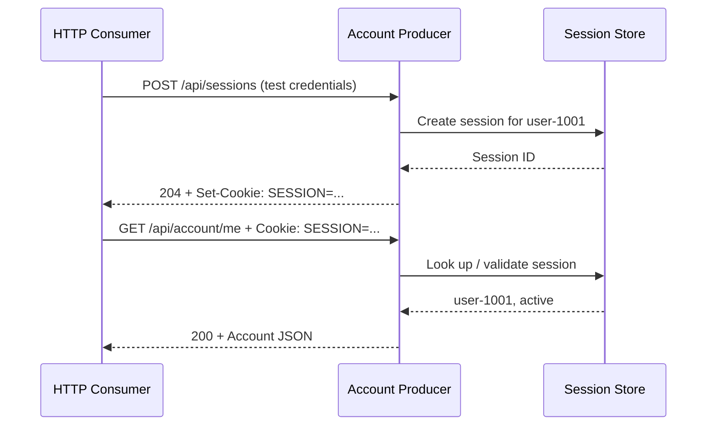
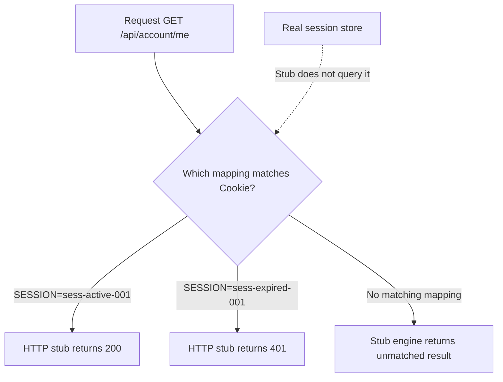

# Cookies and Session Information in Contracts

## 1. Where Do Cookies Fit in HTTP Contract Testing?

In **Spring Cloud Contract** (module `SPRING_CLOUD_CONTRACT`), a producer publishes the behavior consumers can rely on via contracts written in **Groovy DSL** or **YAML DSL**. For HTTP, a contract describes the required request, response, headers, and body. The tooling can generate producer-side tests, create stubs for consumers to use with **Stub Runner**, and integrate both steps into CI to detect incompatible API changes.

**Cookies** are part of HTTP interaction: the server can send `Set-Cookie` in a response, and the client sends cookie names and values back via `Cookie` on subsequent requests. Cookies can carry a login session identifier, UI preferences, correlation IDs, or other data. When a consumer depends on a cookie to call an API, the contract should clearly express the **request condition** and the **observable outcome**.

This lesson focuses on:

- Distinguishing **request `Cookie`** from **response `Set-Cookie`**.
- Using `cookies { cookie(...) }` in **Groovy DSL** and the `cookies` field in **YAML DSL** to describe outgoing cookies.
- Writing contracts for valid sessions, expired sessions, and responses that set sessions.
- Preparing producer-side fixtures and consumer tests with Stub Runner.
- Identifying security behaviors, session lifecycle rules, and browser policies that are **not automatically guaranteed by stubs**.

Examples throughout use an account API with session-cookie authentication; the endpoints, cookie names, and user data in this lesson are **all illustrative**.

## 2. Three Concepts to Distinguish

### 2.1. Cookie, Session ID, and Server-Side Session

A cookie is a name/value pair that a client can store and send back in HTTP requests. A **session ID** is an identifier for a session; if the system uses server-side sessions, the ID typically maps to session data stored in memory, a database, or a session store.

For example: the client holds the cookie `SESSION=sess-active-001`, while the server stores the corresponding session for user `user-1001`. When the client calls `GET /api/account/me`, the server validates the cookie, looks up the session, and decides whether to return account info or an authentication error.

The name `SESSION` is used for illustration. Traditional Servlet containers may use `JSESSIONID`; when using Spring Session or custom configuration, the cookie name can differ. **Use the actual name agreed upon by producer and consumer**, rather than assuming every Spring application uses the same cookie name.

### 2.2. Request `Cookie` vs. Response `Set-Cookie`

```http
GET /api/account/me HTTP/1.1
Host: api.example.test
Cookie: SESSION=sess-active-001; locale=vi
```

This is a **request**: the client sends only cookie names/values, without attributes like `HttpOnly` or `SameSite`.

```http
HTTP/1.1 204 No Content
Set-Cookie: SESSION=sess-active-001; Path=/; HttpOnly; Secure; SameSite=Lax
```

This is a **response**: the server instructs the client to store or update a cookie, along with attributes controlling its scope and transmission. If a response sets multiple cookies, it typically uses **multiple separate `Set-Cookie` headers**, rather than joining them into one comma-separated string.

| HTTP Part | Sender | Contents | Example |
| --- | --- | --- | --- |
| Request `Cookie` | Client → server | Name and value of one or more cookies | `SESSION=sess-active-001` |
| Response `Set-Cookie` | Server → client | Name, value, and storage/sending attributes | `SESSION=...; Path=/; HttpOnly; Secure` |
| Response status | Server → client | Outcome of current request | `200`, `204`, `401` |
| Session store | Server | Whether session is active, which user it belongs to, when it expires | Not inside the Cookie header |

HTTP itself is stateless across requests. Cookies combined with a session store **create session context at the application layer**, yet a cookie value appearing in a request does not prove that the session is still valid.

### 2.3. Login and Session Usage Flow Diagram



The diagram depicts an **illustrative business flow**. A single Spring Cloud Contract typically verifies one request/response boundary; it does not by itself verify the entire sequence of create session → store cookie → look up session → invalidate session.

## 3. Using `cookies` in Groovy DSL Requests

In Groovy DSL, an HTTP contract still starts with `Contract.make { ... }`. Inside `request`, use the `cookies` block to express the cookies sent by the client:

```groovy
import org.springframework.cloud.contract.spec.Contract

Contract.make {
    name 'get_account_with_session'

    request {
        method GET()
        url '/api/account/me'
        cookies {
            cookie('SESSION', 'sess-active-001')
        }
    }

    response {
        status 200
        headers {
            contentType(applicationJson())
        }
        body([
            id   : 'user-1001',
            name : 'Nguyen An'
        ])
    }
}
```

In this example, `cookies { cookie('SESSION', 'sess-active-001') }` states that a request for the success branch must include the `SESSION` cookie with representative value `sess-active-001`. When generating the HTTP stub, the request matcher distinguishes that cookie; when generating the producer test, the request is sent to the producer with the declared cookie.

The value `sess-active-001` is only a **lesson fixture**, not a valid session in every environment. The producer test must create or simulate the corresponding session so the request is genuinely authenticated.

### 3.1. Multiple Cookies in the Same Request

```groovy
request {
    method GET()
    url '/api/account/preferences'
    cookies {
        cookie('SESSION', 'sess-active-001')
        cookie('locale', 'vi')
    }
}
```

Here the `cookies` block requires the corresponding values for two cookie names. Other undescribed cookies are **not automatically forbidden**; whether the absence of other cookies is enforced depends on the generated matcher and testing engine.

Do not put `HttpOnly`, `Secure`, or `SameSite` inside the request `cookies` block as if they were separate cookies. Those are **attributes of the response `Set-Cookie`**, enforced by browsers when storing/sending cookies.

### 3.2. Using YAML DSL for the Same Behavior

You can write the equivalent contract in YAML DSL:

```yaml
name: get_account_with_session
description: Get account information with a valid session
request:
  method: GET
  url: /api/account/me
  cookies:
    SESSION: sess-active-001
response:
  status: 200
  headers:
    Content-Type: application/json
  body:
    id: user-1001
    name: Nguyen An
```

When adding to a project, pick **one** representation (Groovy or YAML) for the same test case. If both are scanned by the plugin, duplicate tests and stubs can be generated.

## 4. Choosing Examples for Different Session States

Suppose this lesson's API publishes the following rules:

- Valid session: `GET /api/account/me` returns `200` with user details.
- Cookie carrying an expired session ID: returns `401` and `code = SESSION_EXPIRED`.
- Missing authentication credentials: returns `401` and `code = AUTHENTICATION_REQUIRED`.
- Valid session but user lacks permission for an admin resource: may return `403` (if specified by the API).

Behavior matrix:

| Case | Input / Precondition | Expected Response | Consumer Handling |
| --- | --- | --- | --- |
| Valid session | `SESSION=sess-active-001`, session store has user | `200` and account | Display data |
| Expired session | `SESSION=sess-expired-001`, session invalidated/expired | `401 SESSION_EXPIRED` | Redirect to login / refresh session flow |
| Missing auth cookie | No `SESSION` sent | `401 AUTHENTICATION_REQUIRED` | Prompt for login |
| Valid session, insufficient permission | Valid session but missing role | `403 FORBIDDEN` | Report insufficient permissions |

**Important:** `401` and `403` are distinct HTTP status codes; do not assume every system uses these exact JSON error codes. Only create contracts for behaviors agreed upon by producer and consumer.

### 4.1. Contract for an Expired Session

File `get_account_expired_session.groovy`:

```groovy
import org.springframework.cloud.contract.spec.Contract

Contract.make {
    name 'get_account_expired_session'
    description 'Reject expired session cookie'

    request {
        method GET()
        url '/api/account/me'
        cookies {
            cookie('SESSION', 'sess-expired-001')
        }
    }

    response {
        status 401
        headers {
            contentType(applicationJson())
        }
        body([
            code: 'SESSION_EXPIRED'
        ])
    }
}
```

The valid-session and expired-session contracts **share the same method/URL** but have **different cookie values** so the stub can distinguish the branches. When the producer test runs, fixtures must ensure `sess-expired-001` is genuinely an expired/invalid ID; merely naming a string "expired" does not make the server treat it as expired.

### 4.2. Missing Cookie Is Not the Same as Wrong Cookie

A common mistake is writing:

```groovy
request {
    method GET()
    url '/api/account/me'
    // No cookies declaration
}
```

and then concluding the stub **only** matches when the request has no cookie. That conclusion is **unsafe**: if a contract does not require a specific cookie, the generated mapping may accept requests **with** cookies as well, risking overlap with the valid-session mapping.

To protect the **no-cookie** branch, you need an explicit *absence* matching condition compatible with your DSL/stub engine version, or direct tests against the producer. Never assume that **omitting the `cookies` block** means "the Cookie header is forbidden."

Example producer-side HTTP test when the API commits to returning `401` on missing cookie:

```java
// Illustrative snippet in a MockMvc test configured with Spring Security.
mockMvc.perform(get("/api/account/me"))
       .andExpect(status().isUnauthorized());
```

Running the snippet above requires importing `get`, `status`, and configuring `mockMvc` and the corresponding security filter chain. An application using form login might return a `302` redirect instead of `401`; therefore, align on the actual HTTP contract before locking down assertions.

## 5. Response Setting a Session Cookie via `Set-Cookie`

Suppose `POST /api/sessions` with valid test credentials returns `204 No Content` and instructs the client to store a session cookie. In the contract, `Set-Cookie` is described as a **response header**.

### 5.1. Groovy DSL: Login Contract

File `login_sets_session_cookie.groovy`:

```groovy
import org.springframework.cloud.contract.spec.Contract

Contract.make {
    name 'login_sets_session_cookie'
    description 'Valid login issues a session cookie'

    request {
        method POST()
        url '/api/sessions'
        headers {
            contentType(applicationJson())
        }
        body([
            username: 'demo-user',
            password: 'fixture-password'
        ])
    }

    response {
        status 204
        headers {
            header 'Set-Cookie': 'SESSION=sess-active-001; Path=/; HttpOnly; Secure; SameSite=Lax'
        }
    }
}
```

In this example:

- `status 204` means this endpoint **returns no body**, per the illustrative design.
- `Set-Cookie` is the header sent by the server so the client creates/updates the cookie.
- `SESSION=sess-active-001` is a session ID **controlled by the test fixture**, never to be used as a fixed session ID in real production systems.
- `fixture-password` is just a dummy password for illustration. Never put real passwords or real session IDs into a contract repository or stub artifact.

### 5.2. Equivalent YAML DSL

```yaml
name: login_sets_session_cookie
request:
  method: POST
  url: /api/sessions
  headers:
    Content-Type: application/json
  body:
    username: demo-user
    password: fixture-password
response:
  status: 204
  headers:
    Set-Cookie: "SESSION=sess-active-001; Path=/; HttpOnly; Secure; SameSite=Lax"
```

The examples above describe the **exact value** of the header. If the producer generates random session IDs or changes the order of `Set-Cookie` attributes, literal string matching can be too rigid. Choose a matcher appropriate for **the dynamic value format and actual committed cookie policy**, then inspect the generated producer test. Do not use regex `.*` for the entire header: an overly broad matcher can miss the absence of `HttpOnly` or `Secure` expected by consumers/security.

### 5.3. Attributes of `Set-Cookie`

| Attribute | Basic Meaning | Scenarios to Watch |
| --- | --- | --- |
| `Path=/` | Specifies the URL path scope where the cookie applies | Will the client send the cookie when calling endpoints on another path? |
| `Domain` | Defines hostname scope per cookie rules | Should it be shared across valid subdomains? |
| `HttpOnly` | Prevents page JavaScript from reading the cookie via `document.cookie` | Reduces risk of leaking session IDs via JavaScript |
| `Secure` | Sends cookie only over secure connections per client rules | Browsers running over HTTPS in real environments |
| `SameSite=Lax` | Restricts cookie sending in cross-site contexts per browser rules | Login, navigation, CSRF |
| `SameSite=None` | Allows broader cross-site usage when browser requirements are met | Usually requires `Secure` |
| `Max-Age` | Lifetime in seconds from when the cookie is received | Renewal, cookie deletion, timeout |
| `Expires` | Expiration timestamp for the cookie | Persistent cookies, point-in-time expiration |

Not every attribute above has to appear in all contracts. Only assert attributes **belonging to the agreed interface/policy**. `SameSite` and `Secure` are enforced by browsers, whereas a standard HTTP stub only returns header strings and cannot prove full browser behavior on its own.

Additionally, **client-side cookie expiration** and **session expiration in the session store** are two separate concerns. A cookie still present in the browser whose session has been invalidated on the server must still be handled according to published authentication rules.

## 6. Dynamic Data and Contract Stability

Real session IDs must be unpredictable and are usually generated dynamically. If a contract forces every login to return:

```http
Set-Cookie: SESSION=sess-active-001; Path=/; HttpOnly; Secure; SameSite=Lax
```

then a producer generating secure random session IDs will fail even though it works properly. There are three suitable ways to handle this depending on verification needs:

1. **Controllable fixtures:** use a test base class, test session store, or stubbing mechanism so the producer returns the expected value. Only use fixed IDs in test environments.
2. **Bounded matchers:** the consumer side receives a stable example string; the producer test checks cookie name, ID format, and important attributes committed by the API. Check the matcher syntax for your Spring Cloud Contract version.
3. **Split verification:** contracts protect required status and header structure; integration/security tests verify generation, rotation, expiration, and invalidation details.

When choosing a matcher, ask:

- What format is the **public commitment**? Does the consumer only need a non-empty cookie value, or a specific format?
- Is the cookie ID actually stable between producer test and consumer stub?
- Can the `Set-Cookie` header appear multiple times or with attributes in a different order?
- Are critical attributes like `HttpOnly` and `Secure` checked separately?
- Could the `200` and `401` stub mappings match the same request because of overly broad cookie conditions?

An overly broad matcher loses the ability to catch breaking changes; an overly strict match on random data causes false failures. The contract's goal is to **protect behaviors the consumer depends on**.

## 7. Sessions Are Stateful, but HTTP Stubs Usually Do Not Hold Business State

Suppose the consumer executes this sequence:

1. `POST /api/sessions` to log in and receive `Set-Cookie`.
2. `GET /api/account/me` sending `Cookie` to retrieve account info.
3. `DELETE /api/sessions/current` to log out.
4. Resend the old cookie and expect `401`.

A set of stub mappings generated from separate contracts **does not create a session store** and does not automatically mutate state across calls. The stub for `GET` normally matches the **current cookie value**, whether that value came from the login endpoint or was set directly by the test.



This illustrates **stub request matching**. The result when no mapping matches depends on Stub Runner/WireMock and the active configuration; it is typically an unmatched error response, not proof of a verified authentication branch.

If you need to guarantee the login → fetch data → logout → reject old cookie flow, add an **integration test** against a real producer/session store or an explicitly configured stateful stub model. Do not assume isolated contracts verify the full session lifecycle.

## 8. Preparing Producer Tests So Cookies Are Truly Meaningful

### 8.1. Why Putting a Cookie in the Request Is Not Enough

When the generated test executes:

```text
GET /api/account/me
Cookie: SESSION=sess-active-001
```

the producer must have a way to resolve this ID into a valid session. If the test base lacks an appropriate session store or security context, the application may return `401`, redirect `302`, or create a new session while the contract expects `200`.

**Responsibilities of the test base/fixture:**

- Initialize user `user-1001` and the required authentication state.
- Ensure `sess-active-001` is linked to the user or equivalent credentials are simulated per project design.
- Create an expired or invalidated ID for `sess-expired-001`.
- Isolate data between tests so execution order does not alter outcomes.
- Configure Spring Security/filter chain and session store to match the boundary under test.

In an application using **Spring Security**, merely attaching a `Cookie` header does not automatically populate an authorized `SecurityContext`. Conversely, if a test disables all security filters, the `200` contract can pass without ever verifying that a valid session is required.

### 8.2. Choosing the Appropriate Testing Level

| Testing Level | What It Verifies | Limitations |
| --- | --- | --- |
| Generated producer test | Producer returns status/body/headers per contract with appropriate fixtures | Does not verify all session/security rules on its own |
| Auth/session integration test | Cookie maps to right session, expiration, revocation, logout | Requires environment and session store setup |
| Browser/E2E test | Browser stores/sends cookies per `Secure`, `SameSite`, `Path`, and navigation flows | More resource-intensive; needs proper HTTPS/origin |
| Consumer test with Stub Runner | Consumer sends cookie and handles `200`/`401` per stub | Stub does not prove a real session exists |

Because cookies often involve authentication, combine contracts **and** appropriate security/session-behavior tests. These are two complementary verification layers.

## 9. Consumers Using Stub Runner to Test Cookies

After producer verification passes, the team can package a versioned stub JAR, such as `com.example:account-producer:1.4.2:stubs`. The consumer uses Stub Runner to download the exact version and launch the HTTP stub.

Suppose the stub listens on port `8090` and has loaded the two contracts from sections 3 and 4. When testing the consumer:

```http
GET /api/account/me HTTP/1.1
Host: localhost:8090
Cookie: SESSION=sess-active-001
```

the stub returns `200` and JSON for the valid session. With:

```http
GET /api/account/me HTTP/1.1
Host: localhost:8090
Cookie: SESSION=sess-expired-001
```

the stub returns `401` and `SESSION_EXPIRED` when the corresponding mapping is loaded and matched.

What the consumer test truly needs to assert is not just "did the stub return JSON," but also:

- Does the client send the right cookie to the endpoint?
- Upon receiving `200`, does the consumer parse the account information?
- Upon receiving `401 SESSION_EXPIRED`, does the consumer redirect or prompt for login as designed?
- When using a cookie from the login response, does the client store and resend the right cookie, if that is the client's job?

### 9.1. Notes on HTTP Clients and Browsers

A Java HTTP client may need a **cookie jar/cookie store** configured to save `Set-Cookie` automatically and send `Cookie` on subsequent requests. Calling two endpoints back-to-back **does not automatically ensure** cookies are forwarded if the client lacks cookie persistence.

If the stub runs over `http://localhost:8090` while the response specifies `Secure`, a **real browser** may not send the cookie the same way a test HTTP client explicitly setting headers does. Behavior on `localhost` also depends on the browser and environment. Therefore, browser cookie-policy tests should run with proper origins and HTTPS; when using Stub Runner over HTTP, tests can pass cookies manually to verify consumer logic, but that result **does not prove** browsers store/send the cookie per policy.

### 9.2. Example Manual Request Check Against the Stub

You can simulate both requests using `curl`:

```bash
curl -i \
  -H 'Cookie: SESSION=sess-active-001' \
  http://localhost:8090/api/account/me
```

```bash
curl -i \
  -H 'Cookie: SESSION=sess-expired-001' \
  http://localhost:8090/api/account/me
```

This is a way to **send an explicit Cookie header**, useful for observing request matchers. It does not replace consumer integration tests and does not test automatic browser cookie storage rules.

## 10. Cookies and Security Considerations When Writing Contracts

Spring Cloud Contract checks declared communication properties; it is **not a comprehensive security test suite**. When contracts involve session cookies, consider:

1. **Do not commit real session IDs.** Values like `sess-active-001`, `sess-expired-001`, and `fixture-password` must be dummy data unusable in real systems.
2. **Do not disable authentication checks just to make generated tests pass.** If the contract protects authentication behavior, the test needs real filters/session fixtures.
3. **Verify `HttpOnly`, `Secure`, `SameSite` per policy.** Values and header formatting can vary with framework configuration; avoid rigid full-string matching when attribute ordering is not committed.
4. **Distinguish `401` and `403`.** Unauthenticated or invalid session differs from authenticated but lacking permission.
5. **Watch out for CSRF.** APIs using session cookies for state-changing operations may require CSRF tokens depending on configured defenses. Contracts for `POST`/`PUT`/`DELETE` must describe the real request, including relevant headers/tokens when part of the interface.
6. **Distinguish session cookies from `Authorization` tokens.** Bearer tokens in the `Authorization` header are a different authentication transport; do not try to force them into the cookie DSL.
7. **Handle logout and session revocation.** A cookie-clearing response may use `Set-Cookie` with `Max-Age=0`, yet the server must also invalidate the session. Seeing only a cookie-clearing header does not prove the session was revoked.
8. **Do not put sensitive user data into stubs.** Contracts and artifacts may be downloaded by many people or CI runners; use harmless fixtures.

### 10.1. Example Cookie-Deletion Response

Suppose `DELETE /api/sessions/current` is the logout endpoint in the API design:

```http
HTTP/1.1 204 No Content
Set-Cookie: SESSION=; Path=/; Max-Age=0; HttpOnly; Secure; SameSite=Lax
```

`Max-Age=0` tells the client to delete the cookie for the matching scope. If the original cookie had a specific `Path` or `Domain`, deletion must match that scope; at the same time, verify that the server-side session was invalidated. A contract can protect the returned header, while session invalidation requires integration/security tests.

## 11. Troubleshooting Cookie Errors in Producer Tests and Stubs

| Symptom | Possible Cause | How to Check |
| --- | --- | --- |
| Producer test expects `200` but receives `401` | Fixture didn't create session; wrong cookie name; misconfigured filter/security context | Inspect actual request and session store/test base configuration |
| Producer test returns `302` instead of `401` | Security redirects to a login page | Align on JSON API vs. form login and verify security entry point |
| Stub returns response for the wrong branch | Success/expired mappings overlap or lack cookie conditions | Inspect mappings, Cookie header, and request matchers |
| Consumer does not send cookie after login | HTTP client lacks cookie persistence; `Path`, `Domain`, or `Secure` mismatch | Check cookie jar, origin/HTTPS, and client settings |
| Test passes with manual Cookie header yet browser fails to stay logged in | Stub does not test browser behavior; `SameSite`/`Secure`/CORS/credentials may differ | Add browser/E2E tests with real origins |
| `Set-Cookie` attribute order change breaks tests | Contract matches full string too strictly | Use purposeful matchers or deterministic fixture headers |
| "Expired" session still returns `200` | Fixture ID is actually still active or test disabled security | Check session data and authentication configuration |
| Missing cookie yet stub returns `200` | Mapping does not constrain cookie absence | Add proper absence matching or test producer directly |
| Old cookie still works after logout | Server did not invalidate session, only cleared client cookie | Integration test directly against the session store |

When troubleshooting, check in order:

1. **Outgoing request:** are the actual `Cookie` name and value correct?
2. **Mapping/contract:** does it require the exact cookie and distinguish branches?
3. **Producer state:** does the session ID exist, remain active, and belong to the right user?
4. **Response:** do status, `Set-Cookie`, and JSON error code match the commitment?
5. **Client policy:** does the client store/resend the cookie according to Path, Domain, Secure, SameSite?

Do not edit `status` in a contract to match broken output just to make CI green. Determine whether the bug lies in test data, authentication config, producer source code, or the API agreement.

## 12. Integrating Cookie Tests into CI

A workflow suited to Spring Cloud Contract:

```text
Groovy/YAML Contract
    -> Review cookie/session branches and Set-Cookie attributes
    -> Generate producer tests
    -> Set up valid/expired session fixtures
    -> Run producer tests
    -> Package/publish versioned stubs
    -> Consumer tests using Stub Runner
    -> Integration/browser tests for session lifecycle and cookie policy
```

In producer CI, verify that changing security configuration or cookie names causes **relevant tests to fail** rather than being skipped. In consumer CI, pin a deterministic stub version for reproducible results and test both `200` and `401` branches.

Contracts can detect if the producer renames `SESSION` to something else or drops `Set-Cookie` when those properties are specified. They **cannot automatically catch** session store bugs, timeouts, CSRF, CORS, browser cookie rejections, or replay attacks unless those behaviors are tested with additional tools and environments.

## 13. Hands-On Exercise: Building Session Contracts for a Shopping Cart

Suppose an e-commerce site's `GET /api/cart` API has the following rules:

- Cookie `SESSION=cart-user-001` links to user `user-001`'s cart.
- If the session is valid, `200` response contains `ownerId` and `items`.
- If the session is revoked, `401` response contains `code = SESSION_REVOKED`.
- Endpoint `POST /api/sessions` returns `204` and `Set-Cookie` with `HttpOnly; Secure; SameSite=Lax` on valid login.

**Exercise tasks:**

1. Write Groovy contract `get_cart_authenticated.groovy` using `cookies` in the request and `200` in the response.
2. Write a second contract `get_cart_revoked.groovy` with cookie `SESSION=cart-revoked-001` and response `401 SESSION_REVOKED`. Ensure the two request matchers differ.
3. Write a login contract with `Set-Cookie` in **response headers**. Explain why `HttpOnly`/`Secure` do not belong in `request.cookies`.
4. Describe the producer test fixtures needed so the two cookies are classified properly.
5. Run consumer tests with Stub Runner, verifying the consumer renders the cart on `200` and prompts for login on `401`.
6. Propose an integration test proving a revoked session cannot be reused even when the client still holds the old cookie value.

### Reference Solution for the Revoked Branch

```groovy
import org.springframework.cloud.contract.spec.Contract

Contract.make {
    name 'get_cart_revoked'

    request {
        method GET()
        url '/api/cart'
        cookies {
            cookie('SESSION', 'cart-revoked-001')
        }
    }

    response {
        status 401
        headers {
            contentType(applicationJson())
        }
        body([code: 'SESSION_REVOKED'])
    }
}
```

This contract protects the API's response for a **representative cookie value**. To prove session revocation actually works, create a session, revoke it in the session store, and then send a request with that exact cookie in an integration test.

### Pre-Completion Checklist

- [ ] Understand how request `Cookie` differs from response `Set-Cookie`.
- [ ] Declare request cookies using `cookies`/`cookie` with exact names and values.
- [ ] Place `Set-Cookie` in response headers when the API sets or clears a session.
- [ ] Valid/expired/unauthorized session branches have statuses and error codes matching the contract.
- [ ] Producer test fixtures exist for valid, expired, or revoked session IDs.
- [ ] Do not confuse omitting the `cookies` block with testing cookie **absence**.
- [ ] Do not use real session IDs or real credentials in contracts.
- [ ] Do not expect Stub Runner to automatically maintain a session store or enforce browser cookie policies.
- [ ] Run producer verification, consumer tests, and necessary integration/security tests before release.

**Remember:** cookies are part of the HTTP interface that must be described accurately when consumers depend on them. Spring Cloud Contract helps verify **which cookie a request carries** and **what status/headers/body the response returns**; session validity, login/logout lifecycles, and real cookie policies still require fixtures and appropriate integration tests.
