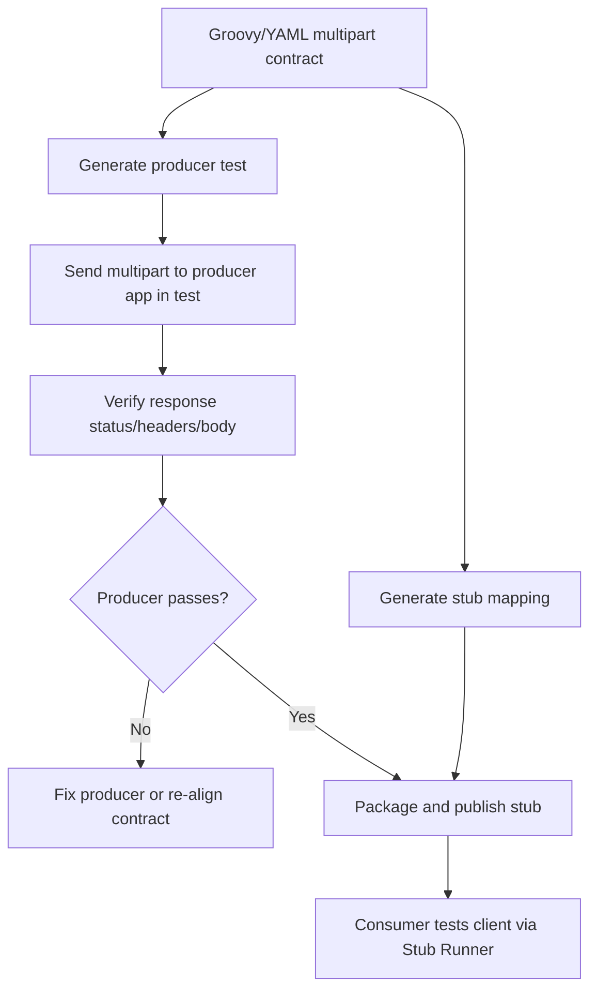

# Multipart, Form Fields, and File Contents in HTTP Contracts

## 1. The Problem: Sending Forms and Files in One HTTP Request

In multi-service systems, consumers do not send only JSON. An order service may need to send an **order ID**, **document type**, and **receipt file** to a storage service; a profile service may upload a photo along with descriptive metadata. These interactions typically use `multipart/form-data`.

If the producer renames field `orderId` to `orderCode`, changes part `document` to `file`, or stops accepting files with certain contents, the consumer can break even though the endpoint still exists. **Spring Cloud Contract** lets you record these HTTP expectations in **Groovy/YAML DSL**, generate producer-side tests, publish stubs, and let consumers exercise calls via **Stub Runner** in CI.

This lesson belongs to the **Request HTTP** section and focuses on the three parts of a multipart request:

1. **Form fields:** simple values such as `orderId`, `documentType`, and `note`.
2. **File parts:** carry a part name, usually a filename, content type, and text or binary contents.
3. **HTTP metadata:** `Content-Type` of the overall request and of each part, plus the `boundary` separating the parts.

After this lesson, you will be able to read multipart structure on the wire, write YAML/Groovy contracts for form fields and files, pick appropriate matchers, verify binary data, and build a producer–consumer verification workflow.

## 2. Distinguishing JSON, Form URL-Encoded, and Multipart

| Request Type | Typical `Content-Type` | Representation | Use Case |
| --- | --- | --- | --- |
| JSON | `application/json` | One JSON object/array in the body | Creating resources, updating structured data |
| Form URL-encoded | `application/x-www-form-urlencoded` | Encoded `key=value` pairs in a single body | Forms with text fields only, no file parts |
| Multipart | `multipart/form-data; boundary=...` | Multiple parts, each with its own headers and body | Uploading files alongside text/metadata, multiple files, or mixed parts |

**Multipart is not a JSON object containing a `file` field.** In multipart, one part of the request carries `orderId` and another part carries the file content. Each part can have its own `Content-Disposition` and `Content-Type`.

Illustrative request:

```http
POST /api/attachments HTTP/1.1
Host: documents.example.test
Content-Type: multipart/form-data; boundary=Boundary42

--Boundary42
Content-Disposition: form-data; name="orderId"

O-42
--Boundary42
Content-Disposition: form-data; name="note"

Payment receipt
--Boundary42
Content-Disposition: form-data; name="document"; filename="receipt.txt"
Content-Type: text/plain

Payment received for order O-42
--Boundary42--
```

This is a **human-readable** presentation of the payload; on the wire, line separators use CRLF (`\r\n`) and file parts may contain non-printable bytes. `Boundary42` is merely an example name, not a literal value every HTTP client must use.

### Three Easily Confused Names

| Element | In the Example | Meaning |
| --- | --- | --- |
| Form field name | `orderId`, `note` | Key used by the controller to read text values |
| File **part** name | `document` | Key used by the controller to locate the uploaded file |
| **File** name | `receipt.txt` | Name declared by the client in `filename` |

A controller looking for `@RequestPart("document")` will not receive the part merely because the filename is `document.pdf` if the **part name** is `attachment`. The contract must describe the exact part name published by the API.

## 3. How Do `boundary` and `Content-Type` Affect Contracts?

In multipart, `boundary` appears in the top-level header:

```http
Content-Type: multipart/form-data; boundary=Boundary42
```

Each part is separated by `--Boundary42`; the entire body ends with `--Boundary42--`. The `boundary` in the header must match the delimiter string in the body, otherwise the parser cannot separate fields and files.

**Real HTTP clients typically generate boundaries dynamically.** Therefore, you should not force production consumers to hardcode `Boundary42`. The Spring Cloud Contract documentation shows sample contracts using `multipart/form-data;boundary=AaB03x` to generate illustrative test requests; when applying this to real clients, verify whether your stub matcher and test config accept client-generated boundaries. When needed, use an appropriate header condition instead of locking to a per-request changing string.

Each part can have its own `Content-Type`. For example, the `document` part may be `text/plain`, while a `metadata` part may be `application/json`. The **overall request** `Content-Type` remains `multipart/form-data`.

Do not manually set a bare `Content-Type: multipart/form-data` in an HTTP client if the library needs to append `boundary`; let the multipart client configure both headers and body consistently.

## 4. Multipart Contracts in YAML DSL

Suppose `Document Service` exposes an API:

- `POST /api/attachments`.
- Requires text fields `orderId` and `note`.
- Requires a file part named **`document`**, filename `receipt.txt`, text content.
- Returns `201 Created` with `attachmentId` and status `STORED`.

An illustrative YAML contract:

```yaml
description: Store text receipt for an order
request:
  method: POST
  url: /api/attachments
  headers:
    Content-Type: multipart/form-data;boundary=AaB03x
  multipart:
    params:
      orderId: "O-42"
      note: "Payment receipt"
    named:
      - paramName: document
        fileName: receipt.txt
        fileContent: "Payment received for order O-42"
        contentType: text/plain
response:
  status: 201
  headers:
    Content-Type: application/json
  body:
    attachmentId: "A-101"
    status: "STORED"
```

Key field names:

| YAML Location | Meaning |
| --- | --- |
| `request.method`, `request.url` | Method and endpoint the consumer must call |
| `request.headers.Content-Type` | Overall request media type; here with an illustrative boundary |
| `request.multipart.params` | Mapping of **form field name → value** |
| `request.multipart.named` | List of named file parts and their contents |
| `paramName` | **Part name** of the file: `document` |
| `fileName` | Filename reported to the producer: `receipt.txt` |
| `fileContent` | Text file content used in the test scenario |
| `contentType` | Content type of the `document` part, not of the entire request |
| `response` | HTTP status, headers, and body the producer must return |

Unlike regular JSON requests, multipart data is placed under `request.multipart`. Do not write `request.body.document: ...` expecting the tool to create a file part. In YAML DSL, **form fields** belong to `multipart.params`, and **file parts** belong to `multipart.named`.

Sample values use a fixed order ID, text file, and boundary so tests are reproducible. For real interactions, teams must adapt data and matchers to API requirements. Before using a less common feature, verify it against the Spring Cloud Contract documentation for your project's declared version.

## 5. Writing the Equivalent Contract in Groovy DSL

Groovy DSL uses `multipart(...)` inside `request`. Text fields are declared via key/value; file parts use `named(...)`:

```groovy
import org.springframework.cloud.contract.spec.Contract

Contract.make {
    description 'Store text receipt for an order'

    request {
        method POST()
        url '/api/attachments'
        headers {
            contentType('multipart/form-data;boundary=AaB03x')
        }
        multipart(
            orderId: $(c(regex('O-[0-9]+')), p('O-42')),
            note: $(c(regex(nonEmpty())), p('Payment receipt')),
            document: named(
                name: $(c(regex(nonEmpty())), p('receipt.txt')),
                content: $(c(regex(nonEmpty())), p('Payment received for order O-42')),
                contentType: $(c(regex(nonEmpty())), p('text/plain'))
            )
        )
    }

    response {
        status CREATED()
        headers {
            contentType(applicationJson())
        }
        body(
            attachmentId: 'A-101',
            status: 'STORED'
        )
    }
}
```

In the snippet above:

- `orderId` and `note` are form fields.
- `document: named(...)` declares a file part named `document`. Its `name`, `content`, and `contentType` properties describe the filename, content, and part media type.
- `$(c(...), p(...))` separates **values accepted on the consumer/stub side** (`c`) from **values used by the producer test** (`p`). Thus the stub accepts orders matching the regex, while the generated test has concrete data to call the producer.
- `nonEmpty()` merely illustrates a non-empty check. If the application requires filenames ending in `.txt` or structured contents, put that constraint into the matcher instead of checking only non-emptiness.

This is the `named` syntax in Groovy DSL documented by Spring Cloud Contract. It differs from YAML's `named: - paramName: ...` syntax; do not mix the two forms.

### Why Do Both `consumer` and `producer` Sides Matter?

For `orderId`:

```groovy
orderId: $(c(regex('O-[0-9]+')), p('O-42'))
```

The producer test uses `O-42` to invoke the real endpoint. The stub can use regex `O-[0-9]+` to match consumer request values like `O-11` or `O-43`. However, if the endpoint only has one fixed order in the test environment, ensure the producer fixture provides matching data.

A stub matching requests by regex **does not mean** the producer has been tested with infinitely many valid values. Different business scenarios still need separate contracts/tests when consumers depend on distinct behaviors.

## 6. Multipart Matchers in YAML

YAML DSL has a `request.matchers.multipart` section, separate from `request.multipart`:

```yaml
request:
  method: POST
  url: /api/attachments
  headers:
    Content-Type: multipart/form-data;boundary=AaB03x
  multipart:
    params:
      orderId: "O-42"
      note: "Payment receipt"
    named:
      - paramName: document
        fileName: receipt.txt
        fileContent: "Payment received for order O-42"
        contentType: text/plain
  matchers:
    multipart:
      params:
        - key: orderId
          regex: 'O-[0-9]+'
        - key: note
          predefined: non_empty
      named:
        - paramName: document
          fileName:
            regex: '[A-Za-z0-9_-]+\.txt'
          fileContent:
            predefined: non_empty
          contentType:
            regex: 'text/plain'
response:
  status: 201
```

**`multipart` describes the sample data**, whereas **`matchers.multipart` describes acceptance criteria** during matching. Specifically:

- `matchers.multipart.params` uses `key` to target a form field, then `regex` or `predefined` to constrain its value.
- `matchers.multipart.named` uses `paramName` to target a file part; inner matchers check filename, content, or content type where supported by the active version.
- `predefined: non_empty` requires a non-empty value per matcher definition; it does not validate file extension or document format.

If `fileName` must be literally `receipt.txt`, use an exact-name condition. If only `.txt` extension is required, a regex is more suitable. If the consumer relies on a specific string or header, avoid overly broad matchers just to make tests pass easily.

**Note:** `matchers.multipart` is not `matchers.body` for JSONPath. Multipart contains multiple parts, not a single JSON object; hence you cannot use `$.document` to verify the bytes of a file part automatically.

## 7. File Contents: Text, JSON Parts, and Binary Data

### 7.1. Text Files

In earlier examples, `fileContent` held inline text directly:

```yaml
multipart:
  named:
    - paramName: document
      fileName: receipt.txt
      fileContent: "Payment received for order O-42"
      contentType: text/plain
```

This snippet is a **fragment under `request`** that must be combined with `method`, `url`, `headers`, and `response` to form a complete contract. During test/stub execution, the part content is constructed from the described data, not as a JSON object keyed by `document`.

### 7.2. Parts Containing JSON

An API may also accept JSON data via a `metadata` part alongside a file part:

```http
Content-Disposition: form-data; name="metadata"
Content-Type: application/json

{"orderId":"O-42","documentType":"RECEIPT"}
```

At the HTTP level, this is **a part with JSON content**, not a plain text form field. A controller might use `@RequestPart("metadata")` to deserialize it into a DTO. When testing a JSON part with its own media type, describe it as a named part with `contentType: application/json` in DSL versions that support it, or implement complementary contracts/tests.

If you merely put a JSON string into `multipart.params.metadata`, do not assume that part automatically receives `Content-Type: application/json`. Inspect the actual HTTP request sent by the client and generated test before deciding the controller's binding mechanism.

### 7.3. Binary Files

For images, PDFs, or ZIP archives, do not put fake strings into `fileContent: "..."` pretending they are real contents. The Spring Cloud Contract YAML schema provides `fileContentFromFileAsBytes` for named file parts:

```yaml
description: Upload proof image for order
request:
  method: POST
  url: /api/attachments
  headers:
    Content-Type: multipart/form-data;boundary=AaB03x
  multipart:
    params:
      orderId: "O-42"
    named:
      - paramName: document
        fileName: proof.png
        fileContentFromFileAsBytes: proof.png
        contentType: image/png
response:
  status: 201
```

This example **assumes** a `proof.png` file exists in the fixture directory alongside the contract per your tool version's path conventions. `fileContentFromFileAsBytes` is a property of **a named multipart part**, distinct from `request.bodyFromFileAsBytes` which applies to **the entire raw request body**. If your project uses a Spring Cloud Contract version different from the referenced schema, verify support for this field before running the build.

For binary files, contracts should verify what consumer/producer actually commit to: part name, content type, basic format, empty or non-empty conditions. A text regex is not a reliable way to inspect arbitrary PNG/PDF bytes. Rules like file size limits, accepted MIME magic bytes, checksums, malware scanning, and actual storage must be tested at the appropriate layer.

### 7.4. When to Use `bodyFromFileAsBytes`?

Comparison:

| Case | Usually Appropriate Representation |
| --- | --- |
| Multipart upload with `orderId` and a file | `request.multipart.params` + `request.multipart.named` |
| Named part with short text content | `fileContent` |
| Named part containing binary data from a fixture | `fileContentFromFileAsBytes` if supported by DSL version |
| Request whose **entire body** is a single binary file, not split into parts | `request.bodyFromFileAsBytes` |

Do not use request-level `bodyFromFileAsBytes` instead of `multipart.named` if the real API expects `multipart/form-data`. The two produce different wire formats; a server expecting multipart will fail to parse raw bytes.

## 8. Example Spring MVC Producer Receiving Multipart

On the producer side, Spring MVC can receive text fields with `@RequestParam` and file parts with `@RequestPart` or `@RequestParam` as appropriate:

```java
@RestController
@RequestMapping("/api/attachments")
class AttachmentController {

    @PostMapping(consumes = MediaType.MULTIPART_FORM_DATA_VALUE)
    ResponseEntity<AttachmentResponse> upload(
            @RequestParam("orderId") String orderId,
            @RequestParam("note") String note,
            @RequestPart("document") MultipartFile document) {

        // Invoke service here to validate and store the file;
        // example returns a fixed result to illustrate the contract.
        return ResponseEntity.status(HttpStatus.CREATED)
                .body(new AttachmentResponse("A-101", "STORED"));
    }
}

record AttachmentResponse(String attachmentId, String status) {}
```

This code is an **illustrative snippet**, requiring Spring/JDK imports, Spring Boot configuration, and real file-storage business logic. `orderId`, `note`, and `document` must match **form field/part names**, not filenames on disk.

If the controller uses `@RequestPart("metadata") SomeDto metadata`, the client must send the `metadata` part with JSON and the right media type. If the controller uses `@RequestParam("note") String note`, it is a simple form value. Binding rules differ, so align the contract with the controller signature and consumer requirements.

### Testing with `curl`

Against a running producer, assuming `receipt.txt` exists in the current directory:

```bash
curl -X POST "http://localhost:8080/api/attachments" \
  --form "orderId=O-42" \
  --form "note=Payment receipt" \
  --form "document=@receipt.txt;type=text/plain"
```

This command asks `curl` to build the multipart payload, including the boundary. It helps test the real producer, yet **does not guarantee** matching a WireMock stub that strictly requires the exact fixed boundary string from the sample contract. With Stub Runner, use matchers compatible with your HTTP client and inspect generated mappings.

## 9. How Are Producer Tests and Stubs Generated?

For an HTTP multipart contract, the workflow can be visualized as:



On the producer side, the tool builds a multipart request from contract data and checks the response. Reference docs show generated tests using `.param(...)` for form fields and `.multiPart(...)` for file parts. This only happens when the plugin, test mode, and base test class are configured properly.

On the consumer side, stub matching must receive a request with the right method, path, form fields, and file parts. If producer verification passes yet the stub mapping fails to match the boundary/part types sent by a real HTTP client, consumer tests can still fail; inspect the actual request and generated mapping rather than blindly tweaking the response.

A sound CI pipeline:

1. Read contracts and related fixtures; generate test/stub sources.
2. Run producer contract tests against the real controller/service in the test environment.
3. Only after producer tests pass, package/publish stubs tagged with the producer version.
4. Consumer uses Stub Runner to fetch the exact stub version, sends multipart with its real client, and checks handling.
5. Whenever contracts or Spring Cloud Contract libraries change, inspect both generated tests and stub mappings before publishing.

A **generated stub** alone does not prove the real producer is right; you must verify the producer against that contract. Conversely, a passing producer test does not prove every multipart request sent by the consumer matches the stub: the consumer still needs its own client tests.

## 10. Which Changes Can Break Multipart Contracts?

| Change in Producer or Client | Impact | What Tests Should Catch |
| --- | --- | --- |
| Renaming `orderId` to `orderCode` | Controller fails to read old form field | Field name and required data |
| Renaming part `document` to `attachment` | Upload treated as missing file | `paramName` of named part |
| Rejecting previously supported `text/plain` | Consumers with valid files fail to upload | Part `contentType` and error code |
| Filename no longer accepted | Producer rejects file by extension/format | Filename matcher and error response if needed |
| Returning `200` instead of `201` | Consumer may misinterpret resource creation status | `response.status` |
| Client header boundary differs from body | Server fails to parse request | HTTP client/parser integration tests |
| Producer lowers file size limit | Large files get rejected | Thresholds and statuses like `413` in appropriate tests |
| Adding an optional form field | Usually still compatible if client doesn't need to send it | Compatibility policy and absent-field handling |

A realistic case is **a file part with the same `fileName` but different contents**. If the consumer must guarantee a specific format or content, a matcher checking only the filename is not enough. Conversely, if the producer accepts arbitrary text files, do not lock the entire `fileContent` as a rigid expectation for all requests.

## 11. Common Errors and Resolutions

### 11.1. Returning `415 Unsupported Media Type`

Possible causes: the request used `application/json` instead of `multipart/form-data`, or the controller expects a JSON part while the client sent `text/plain`. Check the endpoint's `consumes`, overall `Content-Type`, per-part `Content-Type`, and actual wire payload.

### 11.2. Returning `400 Bad Request` Due to Missing Part

The `paramName` in the contract or the key sent by the client does not match `@RequestPart("document")`. Or the parser failed to split the multipart payload due to a bad boundary. Compare part names and boundary rather than looking only at `filename`.

### 11.3. Stub Runner Reports Unmatched Request

Check URL/method, form field names, file parts, content matchers, and multipart headers. A varying boundary, extra quotes in form text, or a different file media type can prevent a match. Inspect WireMock/Stub Runner diagnostic logs alongside the real request sent.

### 11.4. Tests Pass with Text Files but Fail with PNG/PDF

Text `fileContent` does not accurately represent binary file bytes. Use binary fixtures and the corresponding DSL mechanism, then add byte/size/hash tests where business logic requires them.

### 11.5. Tests Pass Because Only HTTP Status Is Checked

If the contract asserts only `201` without verifying key fields/file parts, the producer could ignore `orderId` or mishandle the file while tests still stay green. Identify mandatory behaviors and design cases with concrete data; contract tests do not replace file-storage business tests.

### 11.6. Duplicate Form Field Names or Multi-File Uploads

HTTP multipart can contain multiple parts sharing the same name. Do not infer from one `named` example that all `List<MultipartFile>` or `MultipartFile[]` cases are tested. When the API allows multiple files, verify your DSL version's syntax support and write producer/consumer tests for count, ordering, and per-file constraints.

## 12. Hands-On Exercise: Uploading an Invoice

Business requirements:

- Consumer calls `POST /api/invoices/upload`.
- Sends `invoiceId` matching `INV-[0-9]+`.
- Sends `source` as `MOBILE` or `WEB`.
- Sends file part `invoice` named `invoice.pdf` with type `application/pdf`.
- Producer returns `201` with `{"status":"ACCEPTED"}` if the upload is valid.
- If `invoice` is missing, producer returns `400` with error code `FILE_REQUIRED`.

**Task 1:** Write YAML `request.multipart.params` for `invoiceId`, `source` and `request.multipart.named` for `invoice`; add `response.status: 201`.

**Task 2:** Write `request.matchers.multipart.params` so `invoiceId` matches regex `INV-[0-9]+` and `source` accepts only `MOBILE|WEB`.

**Task 3:** Show how to describe the PDF file using a byte fixture. Explain why `fileContent: "invoice.pdf"` does not mean uploading the bytes of `invoice.pdf`.

**Task 4:** Write a separate contract for `400 FILE_REQUIRED`. Distinguish between **the part being absent** and a part **being named with empty content**, because controllers may treat those two states differently.

Hint for multipart data and matchers in the success scenario:

```yaml
request:
  method: POST
  url: /api/invoices/upload
  headers:
    Content-Type: multipart/form-data;boundary=AaB03x
  multipart:
    params:
      invoiceId: "INV-123"
      source: "WEB"
    named:
      - paramName: invoice
        fileName: invoice.pdf
        fileContentFromFileAsBytes: invoice.pdf
        contentType: application/pdf
  matchers:
    multipart:
      params:
        - key: invoiceId
          regex: 'INV-[0-9]+'
        - key: source
          regex: 'MOBILE|WEB'
      named:
        - paramName: invoice
          fileName:
            regex: '[A-Za-z0-9_-]+\.pdf'
response:
  status: 201
  headers:
    Content-Type: application/json
  body:
    status: ACCEPTED
```

`invoice.pdf` is a **fixture that must be supplied during practice**, not a file auto-generated by this YAML snippet. Before running, verify that your Spring Cloud Contract version supports `fileContentFromFileAsBytes` inside a named multipart part, and adjust byte assertions if the application has custom PDF content validation rules.

## 13. Checklist Before Merging a Multipart Contract

- Is the overall `Content-Type` `multipart/form-data`, and is the boundary in the HTTP request actually valid?
- Do form field names in `multipart.params` and file part `paramName` match the controller?
- Are **part** name, **file** name, and per-part `Content-Type` clearly distinguished?
- If a part contains JSON, do the client/test send the proper media type instead of plain text?
- For text files, do matchers check the content that needs protection; for binary files, are fixtures and byte mechanisms appropriate?
- Have required fields, missing parts, empty parts, and format/size errors been tested where business logic requires it?
- Have generated producer tests and stub mappings—especially multipart conditions and boundaries—been inspected?
- Does CI publish stubs only after producer verification passes, and does the consumer pull the exact stub version via Stub Runner?

**Official references:**

- [Spring Cloud Contract — HTTP Contracts (Multipart)](https://docs.spring.io/spring-cloud-contract/reference/project-features-contract/http.html)
- [Spring Cloud Contract — YAML Schema](https://docs.spring.io/spring-cloud-contract/reference/yml-schema.html)
- [Spring Cloud Contract — Common Top-Level Elements and File Data](https://docs.spring.io/spring-cloud-contract/reference/project-features-contract/common-top-elements.html)

**Remember:** An HTTP multipart request consists of **form fields** and **named file parts** separated by a boundary. In Spring Cloud Contract, YAML expresses them via `multipart.params` and `multipart.named`, while Groovy uses `multipart(...)` with `named(...)`. Choose accurate matchers for field names, filenames, content types, and bytes to inspect so producer contract tests and consumer tests catch incompatible API changes.
