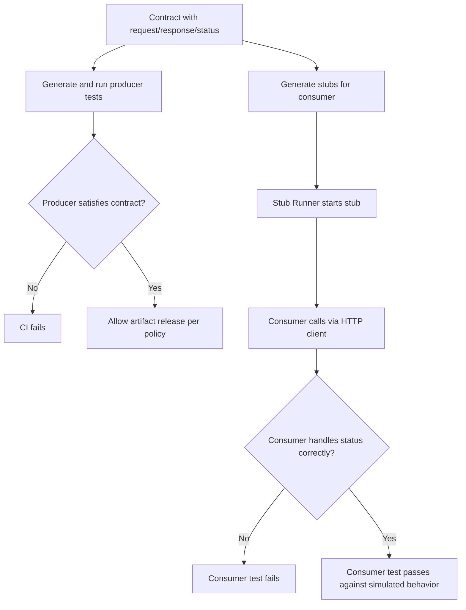

# Status Codes and Contract Meaning for the Consumer

## 1. HTTP Codes Are Part of the Interface the Consumer Depends On

When a **consumer** calls an API, the first piece of information it can use to decide the next step is usually the **HTTP status code**. A response with a structurally valid JSON body but the wrong HTTP code can still cause the consumer to fail: the HTTP client might take the error-handling branch, a retry library might re-trigger the request, or the application might not read the body as expected.

In **Spring Cloud Contract (SCC)**, the producer and consumer agree on communication behavior using the **Groovy/YAML DSL**. For an HTTP contract, the `request` section describes the call, and the `response.status` section describes **the code the producer commits to returning** for that scenario. SCC can generate tests to verify the producer and generate stubs to simulate behavior for the consumer. **Stub Runner** helps the consumer use stubs in testing; CI can detect early when a producer changes an HTTP code outside the agreement.

For example, the consumer calls:

```http
GET /api/orders/42 HTTP/1.1
Accept: application/json
```

If the contract specifies `200 OK`, then having the producer switch to `202 Accepted` is a behavioral change that can cause failures, even if the response still has the `id` and `status` fields. `200` means the request was processed successfully according to the method's semantics; `202` only indicates that the request has been accepted for processing, and processing may not yet be complete.

**Lesson objectives:** understand the meaning of status codes from the consumer's perspective, write HTTP contracts that accurately reflect behavior, design separate success and failure scenarios, distinguish producer test results from consumer tests against stubs, and put status expectations into CI to prevent incompatible API changes.

> A passing contract test proves that **the declared scenario under test** satisfied the status code and related conditions in the test environment. It does not prove that every scenario, every consumer version, or every business state is correct.

## 2. What Does a Status Code Represent?

An HTTP response typically has three groups of information:

- **Status code:** indicates the protocol-level outcome of the request, for example `200`, `404`, `503`.
- **Headers:** add context such as `Content-Type`, `Location`, `Retry-After`, or caching information.
- **Body:** business data or error information that the consumer needs to decode.

For example:

```http
HTTP/1.1 404 Not Found
Content-Type: application/json

{
  "code": "ORDER_NOT_FOUND",
  "message": "Order does not exist"
}
```

In this example, `404` tells the consumer that the requested resource was not found in the context of the request; `code: ORDER_NOT_FOUND` is a **business error code designed by the two teams**, not a standard HTTP code. The consumer can handle `404` responses generally while using `code` to pick a message suited to the specific feature.

Do not swap the two: `response.status: 404` in SCC constrains the HTTP code; `response.body.code: ORDER_NOT_FOUND` constrains the JSON value. A contract can protect both if the consumer genuinely depends on both.

### Five Status Code Classes

| Range | Group | General Meaning | Points to Note for the Consumer |
|---|---|---|---|
| `1xx` | Informational | Intermediate response, request is still continuing | Not typically the final business result of an API |
| `2xx` | Success | Request received/processed successfully according to the specific code | `200`, `201`, `202`, `204` are **not synonymous** |
| `3xx` | Redirection | Another destination/info is needed or cached copy should be used | HTTP client may follow redirects automatically; behavior must be tested |
| `4xx` | Request/client-related error | Current request cannot be processed as requested | Need to distinguish authentication, authorization, data, not found, conflict |
| `5xx` | Server/gateway-side error | Server or intermediary failed to fulfill the request | Consumer may have retry, notification, or fallback policies |

**Do not infer that every code in the same class is handled the same way.** For instance, `401` and `403` usually require two different actions; `409` may require the user to resolve a conflict; `429` may require respecting rate limits.

## 3. Common Codes and Consumer Decisions

| Code | Meaning at the HTTP Level | Example Consumer Behavior That May Be Needed | What Should Be Expressed in the Contract |
|---|---|---|---|
| `200 OK` | Request succeeded | Read order data | Status, Content-Type, fields that are used |
| `201 Created` | Resource created successfully | Save new ID, navigate to resource | `201`; `Location`/body if the consumer relies on them |
| `202 Accepted` | Request accepted, processing may not be complete | Display "processing", track status | `202`; job reference if the interface commits to it |
| `204 No Content` | Succeeded with no body | Complete operation without parsing JSON | `204`, do not expect a JSON body |
| `301/302/307/308` | Redirect with different semantics | Handle new URL or follow redirect if permitted | Status and `Location` if the client actually depends on them |
| `400 Bad Request` | Invalid request or unprocessable due to syntax/format | Display input error | Status and agreed error code/error fields |
| `401 Unauthorized` | Request lacks or has invalid authentication credentials | Prompt login/refresh authentication when appropriate | Status, authentication mechanism, and required headers |
| `403 Forbidden` | Server denies access permission | Display insufficient permissions | Status and error representation if any |
| `404 Not Found` | Target resource not found; sometimes used to hide forbidden resources | Display "not found" | Status, error code if the consumer branches on code |
| `409 Conflict` | Request conflicts with current state | Show warning, refresh data, resolve conflict | Status and meaningful conflict code |
| `422 Unprocessable Content` | Content is syntactically valid but semantically unprocessable | Display data validation errors | Status and field error structure if any |
| `429 Too Many Requests` | Client sent too many requests within the allotted time | Slow down, respect retry policy | Status; `Retry-After` if the API commits to it |
| `500 Internal Server Error` | Unspecified server error | Report system error, log for tracking | Status and appropriate error envelope |
| `503 Service Unavailable` | Service temporarily unavailable | Display outage status; controlled retry | Status; `Retry-After` if used |

The table above is a **consumer design suggestion**, not a directive that every HTTP library must automatically handle them that way. A consumer can use exceptions, response wrappers, callbacks, or custom branching code. The contract needs to come from **how the consumer actually uses the API**, and the teams must confirm the communication policy between both sides.

### Distinctions That Easily Cause Bugs

**`200` and `202`:** Both belong to the `2xx` class, but they do not carry the same commitment that the work is finished. With `202`, the consumer may need to use `operationId` to check later; it should not mark a payment as completed on its own.

**`200` and `204`:** `204` has no message body; a consumer attempting to parse JSON may hit EOF or a decoding error. If the API returns `204`, the contract should not demand a `{}` or `null` body as a payload.

**`201` and `200`:** When creating a new resource, `201` represents the creation result; the consumer may depend on `Location` or the returned ID. Returning `200` instead of `201` might still contain valid data while violating the status agreement.

**`400` and `422`:** Two teams may distinguish malformed requests from syntactically valid data that fails business rules. The exact classification must be agreed upon by both sides and applied consistently.

**`401` and `403`:** `401` relates to authentication; `403` relates to the server denying access. Do not write a contract saying "any `4xx` code is fine" if the consumer handles them differently.

**`404` and `500`:** A missing resource can be an expected outcome for the consumer to show a "not found" state. A `500` error usually signals that the server failed to process the request and may require separate alerting or monitoring.

**`429` and `503`:** Both can involve retry strategies, but for different reasons: client rate limiting versus temporary service unavailability. Do not retry every request by default: for non-idempotent operations like creating a payment, an idempotency mechanism and an agreed retry policy are required to avoid creating duplicate transactions.

## 4. Writing HTTP Status Contracts in the YAML DSL

The Spring Cloud Contract documentation defines `request` and `response` as the two mandatory sections of an HTTP contract. Within `response`, **`status` is mandatory**; `headers`, `cookies`, and `body` can be added depending on the case.

Suppose producer `order-service` serves the `order-web` application. The consumer wants to retrieve information about a paid order. File `order-found.yml`:

```yaml
name: order_found
description: "Consumer retrieves a paid order"
request:
  method: GET
  url: /api/orders/42
  headers:
    Accept: application/json
response:
  status: 200
  headers:
    Content-Type: application/json
  body:
    id: 42
    status: PAID
    totalAmount: 125000
    currency: VND
```

This contract describes a **specific scenario**:

1. The consumer sends `GET /api/orders/42` and requests JSON.
2. The producer must return HTTP `200`.
3. The response must have the constrained content type and JSON fields.
4. Producer-side tests generated from the contract can verify the real response in the test environment.
5. Stubs generated from the contract allow the consumer to test how it decodes and uses the simulated data.

**`response.body.status: PAID` is the order status, distinct from `response.status: 200` which is the HTTP code.** The two fields share the name `status` but have different paths and different meanings. This is a common source of confusion when reading YAML.

Teams also need to agree on what unit `totalAmount` uses, which stage of payment `PAID` represents, and which consumers actually need these fields. Testing the right shape and HTTP code does not necessarily prove the underlying business data is right.

### Groovy DSL Expressing the Same Commitment

In Groovy, this can be written as:

```groovy
import org.springframework.cloud.contract.spec.Contract

Contract.make {
    name('order_found')

    request {
        method GET()
        url '/api/orders/42'
    }

    response {
        status OK()
        headers {
            contentType(applicationJson())
        }
        body(
            id: 42,
            status: 'PAID',
            totalAmount: 125000,
            currency: 'VND'
        )
    }
}
```

Here, `OK()` is a Groovy DSL helper corresponding to code `200`. You can write `status 200` instead of the helper. Groovy also provides other helpers such as `BAD_REQUEST()`; do not guess helpers from code names without checking the version. In YAML, use **numeric codes** like `status: 200` for clarity and valid syntax.

These are two ways of declaring **the same meaning**, not a requirement for the producer to maintain two duplicate contract files.

## 5. Each Important Status Branch Should Have Its Own Contract Scenario

The `order_found` contract only describes the case where the order exists. It does not automatically protect the missing-order branch, input errors, or conflicts. For branches the consumer needs to distinguish, create **separate scenarios with concrete requests and responses**.

### 5.1. Order Not Found: `404 Not Found`

File `order-not-found.yml`:

```yaml
name: order_not_found
description: "Order does not exist"
request:
  method: GET
  url: /api/orders/9999
response:
  status: 404
  headers:
    Content-Type: application/json
  body:
    code: ORDER_NOT_FOUND
    message: Order not found
```

The consumer can rely on `404` to take the "not found" branch, and on `ORDER_NOT_FOUND` to identify the business error. If `message` is only for display, it might change due to localization or operational wording; the team should decide whether the consumer **truly depends on the exact string** before constraining it tightly in the contract.

For the producer verification test to run, the test application must guarantee the condition that **order `9999` does not exist**, or provide an equivalent way to mock the data source. Without fixtures, the test can become flaky even when the YAML is valid.

### 5.2. Creating a New Order: `201 Created`

File `order-created.yml`:

```yaml
name: order_created
description: "New order created successfully"
request:
  method: POST
  url: /api/orders
  headers:
    Content-Type: application/json
  body:
    customerId: 7
    sku: BOOK-1
    quantity: 1
response:
  status: 201
  headers:
    Content-Type: application/json
    Location: /api/orders/42
  body:
    id: 42
    status: CREATED
```

In this design, the consumer uses `Location` to navigate to the new resource. The `Location` header is an expectation **agreed upon by both sides** in the contract; it does not appear automatically just by declaring `201`. If the new ID varies across runs, use matchers for dynamic parts or stable test fixtures instead of forcing production to always generate ID `42`.

`201` notifies that the resource was created. How the consumer handles it afterward depends on the business flow; for example, `status: CREATED` in the body only represents the order's state, not that the order has been shipped.

### 5.3. Accepting Asynchronous Processing: `202 Accepted`

Suppose the consumer requests report generation, but the report takes time to process. File `report-accepted.yml`:

```yaml
name: report_generation_accepted
description: "Report generation request has been accepted"
request:
  method: POST
  url: /api/reports
  headers:
    Content-Type: application/json
  body:
    month: "2026-10"
response:
  status: 202
  headers:
    Content-Type: application/json
  body:
    operationId: job-42
    state: QUEUED
```

`202` means **accepted, without committing that the work has finished successfully**. The consumer can save `operationId`, display "processing", and call another status API if both sides have agreed on it. It should not treat the presence of `202` as proof that the report has finished generating.

A `202` contract only verifies the **request acceptance** response. If you need to protect the completion process as well, build separate contracts/scenarios for the tracking endpoint or completion message; combine with integration tests to verify real side effects and job processing.

### 5.4. Successful Deletion Returning No Body: `204 No Content`

File `order-delete-no-content.yml`:

```yaml
name: order_delete_no_content
description: "Delete order and return no content"
request:
  method: DELETE
  url: /api/orders/42
response:
  status: 204
```

This is a conceptually valid contract with **only a status code**, needing no `response.body`. `204` carries no response body, so the consumer must treat it as a successful outcome **with no JSON to parse**.

Do not do the following:

```yaml
# Inconsistent with 204 No Content semantics:
response:
  status: 204
  body:
    deleted: true
```

If the consumer needs additional confirmation data in the response, the team should consider designing a different response with a body and appropriate status (for example `200`), or having the consumer fetch the status via a separate request. `204` only indicates that the request succeeded with no body; it does not by itself prove the record was permanently deleted from the database.

### 5.5. Version Conflict: `409 Conflict`

File `order-version-conflict.yml`:

```yaml
name: order_version_conflict
description: "Consumer updates with an outdated order version"
request:
  method: PUT
  url: /api/orders/42
  headers:
    Content-Type: application/json
  body:
    version: 3
    note: "Afternoon delivery"
response:
  status: 409
  headers:
    Content-Type: application/json
  body:
    code: VERSION_CONFLICT
```

Here, the team decided that `409` carries the meaning "a newer version already exists". The consumer may need to reload the order before letting the user continue editing. However, `409` does **not automatically** mean "version conflict" for every API; that is the usage explicitly documented via `code: VERSION_CONFLICT` in this contract.

The examples in section 5 are **independent scenarios**. For practical use, the producer needs an appropriate data model and test state for each request, especially if tests run in parallel or share a database.

## 6. Status, Headers, and Body Must Be Semantically Consistent

A correct status code alone is not enough if the consumer needs additional information to act. Consider these examples:

| Scenario | Status | Headers/Body That May Matter | Risk If Missing |
|---|---|---|---|
| Resource just created | `201` | `Location` or resource ID | Consumer does not know where to access the new resource |
| Authentication failure | `401` | `WWW-Authenticate` when required by the HTTP authentication scheme | Client lacks proper challenge information |
| Rate limited | `429` | `Retry-After` if the API commits to a retry time | Consumer retries too early, adding load |
| Service temporarily unavailable | `503` | `Retry-After` when provided | Consumer does not know if/when to retry |
| Processed with no content | `204` | No response body | Client attempts to parse body and throws an error |
| Redirect | `3xx` | `Location` per code semantics and client configuration | Consumer goes to wrong URL or fails to follow redirect |

Therefore, the contract must constrain **the status and related fields the consumer actually uses**. Do not hardcode every dynamic header like `Date`, request ID, or trace ID if the consumer only needs them in a valid format. At the same time, do not omit critical headers like `Location` if the client must navigate after a `201`.

**Note on `401`:** When using standard HTTP authentication, corresponding responses may require the `WWW-Authenticate` header. This lesson does not mandate a specific authentication style. The contract should follow the system's actual authentication mechanism and the agreement between both sides.

**Note on `429/503`:** The `Retry-After` header can specify a duration or a timestamp. If the consumer must use that header, express the supported structure/format accurately and test retry behavior separately. A status contract alone does not prove the client has a safe retry mechanism.

### Why "Always Return HTTP 200 and Put Errors in JSON" Causes Trouble

An API is sometimes designed with responses like:

```http
HTTP/1.1 200 OK
Content-Type: application/json

{
  "success": false,
  "errorCode": "ORDER_NOT_FOUND"
}
```

This **may be the agreed interface** of a system, so you must not arbitrarily alter the contract against the actual API. However, this approach loses HTTP-level error distinction: an HTTP client may treat the request as successful, status-based observability systems struggle to categorize errors, and the consumer always has to open the body to know an error occurred.

If the team decides to switch to `404`, treat it as a **compatibility change that can break older consumers**. Survey clients, prepare a migration plan, and test the relevant versions before releasing.

## 7. How Do Generated Producer Tests Check Status?

When configuring the Spring Cloud Contract plugin and the producer test environment, YAML/Groovy contracts serve as input for test generation. For instance, the `order_not_found` contract can lead to a test that conceptually looks like:

```java
// Pseudocode illustrating the concept; not generated test code
// that can be copied directly across SCC versions.
Response response = callGet("/api/orders/9999");
assertEquals(404, response.statusCode());
assertEquals("ORDER_NOT_FOUND", response.json("code"));
```

Actual generated code depends on tooling, test mode, test framework, and project configuration; it may use Rest Assured, MockMvc, or another mechanism. The implementation must ensure the test **actually calls the producer with the prepared data state**, then matches the response against the contract.

If the producer accidentally changes `404` to `500`, the test asserting status `404` will report a failure. If the producer returns `404` but omits the `code` field required by the consumer, the test with the corresponding assertion must also catch the mismatch. The condition is that these tests are **generated, compiled, and executed** in CI and failures are not ignored.

**A contract for `404` does not automatically verify `200`**, just as a contract for `200` does not automatically verify `404`. Important branches must be described separately and run against suitable fixtures.

## 8. How Do Consumer Tests Using Stub Runner Understand Status?

The producer can publish stub artifacts from verified contracts. The consumer uses **Stub Runner** to start an HTTP stub and call it just like calling the real producer.



Example consumer handling a lookup result:

```java
// Pseudocode illustrating client logic.
if (status == 200) {
    renderOrder(parseOrder(responseBody));
} else if (status == 404) {
    showOrderNotFound();
} else if (status == 503) {
    showTemporarilyUnavailable();
} else {
    showGenericError();
}
```

Consumer tests should verify branches with **business significance** rather than merely verifying that Stub Runner starts up. For example:

- When the stub returns `200` and valid JSON, the screen displays the order properly.
- When the stub returns `404`, the screen displays "not found" without attempting to parse the body as order data.
- When the stub returns `204`, the HTTP client does not attempt to decode an empty JSON body.
- When the stub returns `202`, the flow transitions to a waiting state without reporting completion.
- When the stub returns `503` or `429`, the consumer applies the appropriate error/retry policy, tested separately.

**Important limitation:** If a consumer test passes when running against an old stub returning `404`, that **does not prove** the new producer version still returns `404`. The producer may have changed to `200` or `500`. Producer verification must run on the exact commit/artifact being released, and the stub version used by the consumer must be managed.

## 9. Testing Error Branches and Avoiding Overly Broad Contracts

A contract can become meaningless if it only constrains "any error" or "a code in the 2xx group". For instance, the consumer needs to distinguish `401` to prompt login from `403` to display "insufficient permissions". If both states are collapsed into `4xx`, tests may fail to catch the producer switching branches and breaking the user experience.

### Scenario Matrix to Consider

| What Does the Consumer Need to Do? | Representative Request/Condition | Suggested Status to Agree On | Minimum Assertions |
|---|---|---|---|
| Display order | ID exists | `200` | Status, displayed fields, Content-Type |
| Display "not found" | ID does not exist | `404` | Status and error code needed by client |
| Prompt login | Missing token on API requiring auth | `401` | Status and related auth requirements |
| Display insufficient permissions | Valid token but lacks permission | `403` | Status, no leakage of forbidden data |
| Display input error | Request fails validation conditions | `400` or `422` per API | Status, appropriate error structure |
| Handle stale data | Outdated version used during update | `409` | Status and conflict code |
| Wait for background processing | Request accepted for later processing | `202` | Status and job reference if used |
| Complete with no body | DELETE succeeds, API chooses no body | `204` | Status; consumer does not parse body |
| Rate limit traffic | Configured limit exceeded | `429` | Status and retry info if present |
| Report temporary error | Producer or gateway unavailable | `503` | Status; appropriate handling/fallback path |

The codes in the table are **design candidates for illustrative scenarios**, not default behaviors imposed by SCC. The team must confirm how the producer actually behaves, existing API standards, and which consumers/versions must be maintained.

### When Is a Failing Contract a Useful Signal?

Suppose producer code is modified to "return `200` for every request so the frontend can handle it easily". The `order_not_found` contract currently requires `404`. The generated producer test fails: that is the **exact right signal** showing the producer drifted from the agreed interface.

To handle this, there are two valid paths:

1. **Fix the producer** to continue complying with the contract if the `200` change was unintentional or impacts current consumers.
2. **Propose a contract change** if the new behavior is an intentional design decision: review with consumers, bump version/plan compatible migration, and update tests/stubs according to the release schedule.

Do not simply edit the YAML to `200` to make CI green while the consumer still depends on `404`. A contract is a tool for recording communication agreements, not a target to "turn green" at any cost.

## 10. Cases Requiring Special Caution

### 10.1. Status Codes Do Not Verify Business Side Effects

`201` does not by itself prove the resource was durably persisted in the database. `202` does not guarantee the background task will eventually succeed. `204` does not prove the record was deleted from all replicas. To verify those, use integration tests, transaction tests, outbox/event tests, or appropriate end-to-end tests.

### 10.2. `HEAD`, `204`, and `304` Do Not Carry a Response Body Like `200`

HTTP `HEAD` asks the server to send corresponding metadata without a message body. `204 No Content` and `304 Not Modified` also do not carry response content like a normal `200`. If a client assumes every successful response has JSON, it can fail when encountering these cases. Use contracts for specific scenarios and test how the client handles an *absent body*, rather than blindly applying a single shared parser.

### 10.3. Redirects Do Not Automatically Prove the Consumer Can Follow Them

With `3xx`, automatic redirect following depends on the HTTP client, configuration, and request type. In particular, semantics around preserving or changing the HTTP method can differ between `302` and `307/308`. When an API uses redirects, the contract must protect the code and headers the consumer needs; consumer tests must show that the HTTP client handles them properly. Never implicitly assume the producer returns `302` and the consumer will always receive the payload at the target URL.

### 10.4. Retrying Is Not Automatically Safe Just Because You See `5xx`

`500`, `502`, `503`, and `504` signal different situations. Although some transient errors may suit retrying, the decision must consider request idempotency, idempotency keys, backoff, and anti-overload policies. Status contracts are one layer of information; resilience testing and request retry flows require additional mechanisms.

### 10.5. Security Requires Supplementary Testing

`401`/`403` help express API outcomes on declared authentication/authorization cases. A contract returning the right code in one fixture **is not sufficient proof** of the entire security policy, absence of data leakage, or proper expired-token handling across all layers. Security/integration tests across multiple roles and scenarios are required.

## 11. Integrating Status Expectations Into CI and Stub Releases

A useful pipeline needs to connect the following steps:

1. **Consumer and producer agree on statuses for each use case.** Specify success codes, error codes, relevant headers/bodies, and business messages. For existing APIs, do not change code meanings arbitrarily.
2. **Write Groovy/YAML DSL for each important scenario.** In YAML, `response.status` uses the corresponding HTTP integer; do not confuse it with a business status field in JSON.
3. **Generate and run producer verification tests.** The producer test base must set up corresponding fixtures: order `42` exists, `9999` does not exist, old version conflicts, etc. Generated tests must execute and fail when status/body is wrong.
4. **Publish versioned stub artifacts.** Perform according to build/release policy after the producer has been verified. Contract and tested producer code must be traceable.
5. **Consumer runs tests via Stub Runner.** Point the HTTP client to the stub, verifying the `200`, `202`, `204`, `404`, etc. handling branches that the consumer actually uses.
6. **Block incompatible changes and check versions.** Do not infer compatibility from green consumer tests against old stubs; protect client versions still under support.
7. **Maintain supplementary test layers.** Contract tests do not replace business unit tests, security tests, database/broker integration tests, or operational tests.

For example, a pull request changing `GET /api/orders/9999` from `404` to `200` will be blocked **if** the corresponding producer test actually runs against the changed code and the CI job uses the failure as a gate. If the contract does not cover the `404` branch or CI skips generated tests, the change can slip through.

## 12. Common Mistakes

| Mistake | Impact | Fix |
|---|---|---|
| Checking only JSON body, ignoring status | Producer changes `404` to `200` undetected by tests | Constrain `response.status` for each scenario |
| Treating all `2xx` as "complete" | Consumer handles `202` like `200` | Explicitly test the accept-and-wait branch |
| Returning `204` with a body and requiring JSON parsing | Violates No Content semantics; client may fail | Do not declare a body for `204`; adjust design if data is needed |
| Grouping `401`, `403`, `404` into one generic branch | Consumer shows wrong message or login flow | Define separate codes and test each branch's handling |
| Treating `500` as "not found" | Hides system errors, causes incorrect handling | Use `404` for missing resources if the API agrees on that |
| Ignoring `429` without testing handling | Client retries aggressively | Contract required headers; test retry/backoff separately |
| Hardcoding random IDs in `201` | Producer tests become flaky | Use fixtures or appropriate matchers for variable fields |
| Passing `200` test and claiming all error cases work | No contract for `400`/`404`/`409` | Choose negative cases the consumer actually needs |
| Running only consumer tests with stubs | Old stubs may differ from current producer | Require producer verification on the exact code/artifact |
| Changing contract to pass tests without updating consumer | Incompatible API change gets legitimized | Review with consumer and plan versioning/migration |
| Only generating tests without running them | No proof the producer meets the contract | Run generated tests, fail CI on mismatch |

## 13. Practice: From User Story to Status Matrix and YAML

**Context:** `invoice-service` (consumer) sends invoice creation requests via `billing-service` (producer). Both sides are agreeing on the scenarios:

- Valid data: invoice is created immediately, returning `201` with ID and `Location`.
- Same request code but information conflicts with current state: returns `409` and `code: INVOICE_CONFLICT`.
- Service under maintenance: returns `503`; consumer displays temporarily unavailable status and does not unconditionally retry invoice creation.

### Practice Requirements

1. Write a table listing request/fixture, status, body/headers used by the consumer, and client handling branches.
2. Write at least two independent YAML contracts for `201` and `409`. `response.status` must be correct; for `201`, declare `Location`; for `409`, declare the error code.
3. Explain why `201` should not be changed to `200` just to "simplify" tests.
4. Describe how producer verification and consumer tests with Stub Runner protect both branches.
5. State the limitations of status contracts if the invoice creation request has database side effects or is resent on network timeout.

### Suggested Success Contract

```yaml
name: invoice_created
description: "Create a new invoice"
request:
  method: POST
  url: /api/invoices
  headers:
    Content-Type: application/json
  body:
    orderId: 42
    requestId: "REQ-1001"
response:
  status: 201
  headers:
    Content-Type: application/json
    Location: /api/invoices/501
  body:
    invoiceId: 501
    state: CREATED
```

### Suggested Conflict Contract

```yaml
name: invoice_conflict
description: "Invoice creation request conflicts with current state"
request:
  method: POST
  url: /api/invoices
  headers:
    Content-Type: application/json
  body:
    orderId: 42
    requestId: "REQ-CONFLICT"
response:
  status: 409
  headers:
    Content-Type: application/json
  body:
    code: INVOICE_CONFLICT
```

Both sample requests must have **independent fixtures or clearly prepared test state** so the producer returns `201` and `409` according to the exact context. Do not just create stub mappings and forget to verify that the producer actually has the corresponding handling path.

### Self-Check Criteria

- Each contract describes **one scenario with a meaningful status**, without using overly loose matchers that accept any code.
- The consumer knows which status/header/body to rely on when switching UI or business branches.
- The producer has test data for both successful creation and conflict.
- Consumer tests with Stub Runner verify the handling branch, not just that the stub can run.
- CI ties the contract/stub version to the verified producer build.
- Side effects, safe retries, and idempotency are tested at the appropriate layer, outside the scope of pure status contracts.

## 14. Checklist When Reviewing an HTTP Response Contract

- [ ] `response.status` is declared with the exact HTTP code for the scenario.
- [ ] `response.status` is not confused with a `body.status` field carrying business meaning.
- [ ] Status reflects the true outcome: `200`, `201`, `202`, `204` and `4xx`/`5xx` branches are distinguished when the consumer needs them.
- [ ] `Content-Type`, `Location`, `Retry-After`, or other headers are described when the consumer depends on them.
- [ ] No response body is required when using `204`; bodyless cases are handled appropriately.
- [ ] Error codes and error body schemas are consistent with how the consumer actually decodes them.
- [ ] Concrete fixtures exist for both success flows and important error cases.
- [ ] Generated producer tests are generated, executed, and fail if the status is wrong.
- [ ] Consumer tests run against the right stub version and assert on status branches.
- [ ] Still-supported client versions are considered when changing status codes.
- [ ] Supplementary tests exist for side effects, authorization, retries, and performance when needed.

## 15. Takeaways and References

**HTTP status codes are part of the communication contract**, not decorative numbers in a response. The consumer uses them to decide whether to read data, wait for processing, navigate, report errors, request authentication, or apply controlled retries. Thus, changing `200` to `202`, `201` to `200`, or `404` to `500` can break consumer behavior even if the JSON structure stays the same.

Spring Cloud Contract expresses that commitment using **`response.status`** in YAML or **`status OK()` / `status 200`** in Groovy. Producer verification checks the real response in declared scenarios; stubs and Stub Runner let the consumer test client logic with simulated responses. Only when tests are executed, results are tied to the right version, and CI blocks mismatches does the team have reliable evidence that status branches are protected.

Official documentation to reference during implementation:

- [Spring Cloud Contract — HTTP Contracts, HTTP Response](https://docs.spring.io/spring-cloud-contract/reference/project-features-contract/http.html).
- [Spring Cloud Contract — Dynamic Properties and response matchers](https://docs.spring.io/spring-cloud-contract/reference/project-features-contract/dsl-dynamic-properties.html).
- [MDN — HTTP response status codes](https://developer.mozilla.org/en-US/docs/Web/HTTP/Reference/Status).
- [HTTP Semantics — RFC 9110](https://www.rfc-editor.org/rfc/rfc9110.html).
