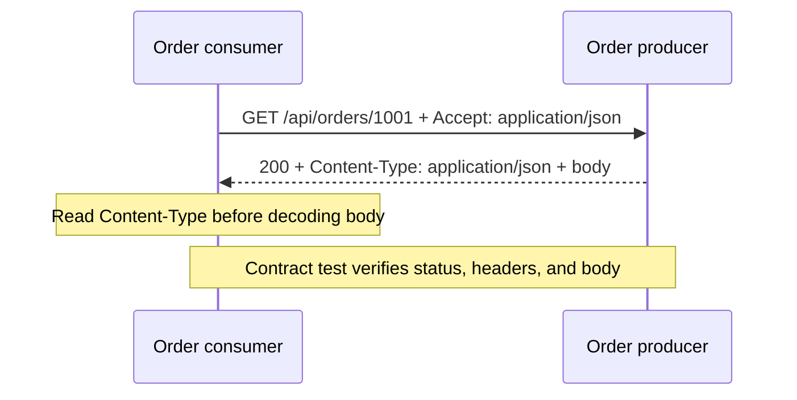

# Response Headers and Content Type in Spring Cloud Contract

In HTTP communication, the **status code** indicates the overall outcome, the **response body** contains the data, and **response headers** explain how the client must interpret and use that response. An API that returns valid JSON but omits or sends the wrong `Content-Type` can still prevent the consumer from decoding the response. Similarly, a `201 Created` response with a valid body but missing the `Location` header can break a client relying on the URI of the newly created resource.

**Spring Cloud Contract (SCC)** lets you declare these commitments in the **Groovy DSL or YAML DSL**. From the contract, the tool can generate **provider verification tests** to check the producer's real response, while also generating **HTTP stubs** for the consumer to test with **Stub Runner**. This lesson in the **Response HTTP** chapter focuses on how to declare, verify, and evolve **response headers and content type**. The examples use `order-producer` providing the order API and `order-consumer` calling that API.

## 1. Where Do Response Headers Sit in HTTP?

A simple HTTP response:

```http
HTTP/1.1 200 OK
Content-Type: application/json
Cache-Control: no-store
X-Request-Id: req-1001

{"id":1001,"status":"CREATED"}
```

Reading each part:

| Component | Example | Role |
| --- | --- | --- |
| Status | `200 OK` | Request was processed successfully per HTTP semantics |
| `Content-Type` | `application/json` | Media type of the representation in the response body |
| `Cache-Control` | `no-store` | Directive on how caches are allowed to store the response |
| `X-Request-Id` | `req-1001` | Tracing identifier established by application convention |
| Body | `{"id":1001,"status":"CREATED"}` | Data that the consumer decodes and uses |

In a contract, headers are not notes for humans: if declared under `response.headers`, they become part of a **verifiable commitment**. Changing a header the consumer needs can be a breaking change even when the response body stays unchanged.

Flow diagram:



**Distinguishing the two sides:**

- `request.headers` are headers **sent by the consumer**, e.g. `Accept`, `Authorization`, request `Content-Type`.
- `response.headers` are headers **returned by the producer**, e.g. `Content-Type`, `Location`, `ETag`, `Cache-Control`.
- Headers with the same name can appear on both sides, serving different roles. Specifically, request `Content-Type` describes the **request body**, whereas response `Content-Type` describes the **response body**.

## 2. Declaring Response Headers with the Groovy DSL

Suppose `GET /api/orders/1001` must return JSON and instruct clients not to cache. File `src/test/resources/contracts/http/get-order-by-id.groovy`:

```groovy
import org.springframework.cloud.contract.spec.Contract

Contract.make {
    description 'Order exists: return JSON and instruct not to cache'

    request {
        method GET()
        url '/api/orders/1001'
        headers {
            header('Accept', 'application/json')
        }
    }

    response {
        status OK()
        headers {
            contentType(applicationJson())
            header('Cache-Control', 'no-store')
        }
        body(
            id: 1001,
            status: 'CREATED'
        )
    }
}
```

The core part:

```groovy
response {
    status OK()
    headers {
        contentType(applicationJson())
        header('Cache-Control', 'no-store')
    }
    body(id: 1001, status: 'CREATED')
}
```

- `status OK()` constrains status `200`.
- `headers { ... }` contains **response headers**, not request headers.
- `contentType(applicationJson())` is a helper representing the JSON media type.
- `header('Cache-Control', 'no-store')` adds a specific header per HTTP convention.
- `body(...)` describes the JSON content. Setting `Content-Type` and the matching body helps the consumer decode the response properly.

You can express content type by header name instead of the helper:

```groovy
response {
    status OK()
    headers {
        header('Content-Type', 'application/json')
    }
    body(id: 1001, status: 'CREATED')
}
```

Both approaches express the same media type in this example. When a project needs to check parameters like `charset` or a specialized media type, declare the expected string explicitly and inspect the actual generated tests and stubs.

### 2.1. When to Use the Helper vs. `header(...)`?

| Declaration Style | Suitable When | Things to Note |
| --- | --- | --- |
| `contentType(applicationJson())` | Standard JSON responses | Easy to read, avoids media type typos |
| `header('Content-Type', 'application/json')` | Need to express the header directly | Easy to compare against raw HTTP response |
| `header('Content-Type', 'application/problem+json')` | Error API using a specialized JSON media type | Consumer may need dedicated media type handling |
| `header('Location', '/api/orders/1001')` | Resource creation response needing a URI | `Location` header is an independent commitment from the body |
| `header('ETag', '"order-v3"')` | API using caching/conditional requests | Quotes are part of the ETag representation in this example |

There is no need to declare every header the framework adds automatically to the response. **Only pin the headers that the API contract commits to and the consumer depends on**. Freezing dynamic headers generated by servers/proxies can cause provider tests to fail unnecessarily due to compatibility-unrelated changes.

## 3. Equivalent Declaration with the YAML DSL

If you choose YAML, an equivalent contract can be placed at `src/test/resources/contracts/http/get-order-by-id.yml`:

```yaml
description: "Order exists: return JSON and instruct not to cache"
request:
  method: GET
  url: /api/orders/1001
  headers:
    Accept: application/json
response:
  status: 200
  headers:
    Content-Type: application/json
    Cache-Control: no-store
  body:
    id: 1001
    status: CREATED
```

Semantically, the Groovy and YAML files describe **the exact same request and response**. They are **two options to learn**, and should not coexist for the same scenario in the contract directory scanned by the build, as that can create duplicate tests and stubs.

Quick comparison:

| Groovy DSL | YAML DSL | Meaning |
| --- | --- | --- |
| `response { headers { ... } }` | `response: headers:` | Headers returned by the producer |
| `contentType(applicationJson())` | `Content-Type: application/json` | Response is JSON |
| `header('Cache-Control', 'no-store')` | `Cache-Control: no-store` | Do not store response in cache |
| `status OK()` | `status: 200` | HTTP 200 |
| `body(id: 1001, status: 'CREATED')` | `body: {id: 1001, status: CREATED}` | JSON object |

In YAML, **indentation determines structure**. If `Content-Type` is placed under `request.headers`, the contract is requiring a consumer-side header rather than checking the producer's header. If `Content-Type` is placed under `body`, it is no longer a response header.

## 4. Understanding Content-Type and Media Types Accurately

According to HTTP, **`Content-Type` describes the media type of the content being sent**. The value can include a primary media type and parameters:

```http
Content-Type: application/json
Content-Type: application/json; charset=utf-8
Content-Type: text/plain; charset=utf-8
Content-Type: application/problem+json
```

The **media type** and **body shape** must be consistent. For example, if the API returns a JSON object `{"id":1001}`, the producer should send `application/json`, unless the interface has published a specialized JSON media type.

| Media Type | Typical Body | What the Consumer Needs to Know |
| --- | --- | --- |
| `application/json` | JSON object, array, or JSON value | Parse JSON and check fields/data types |
| `application/problem+json` | JSON-formatted Problem Details | Handle errors according to the structure defined by the API |
| `text/plain; charset=utf-8` | Plain text string | Decode characters using the right charset |
| `text/csv` | CSV data | Parse row/column headers, CSV escaping |
| `application/octet-stream` | Binary bytes | Do not decode as JSON/text |
| `application/pdf` | PDF file | Handle as a PDF document |
| `text/event-stream` | SSE event stream | Requires a streaming-capable client, not treated as a single JSON response |

These media types illustrate types of HTTP representations; they do not imply every type is automatically and fully verified semantically by SCC. For streaming, binary files, or large payloads, choose an appropriate contract and integration testing strategy.

### 4.1. `application/json` vs. `application/json; charset=utf-8`

Both headers denote the JSON media type, yet they **are not identical character strings**. A matcher checking the exact header value may consider them different, even if the consumer supports both.

To decide the strictness level:

- If the consumer only needs JSON and does not depend on the `charset` parameter, design verification matching that requirement; inspect how generated tests and stub mappings behave in the SCC version you use.
- If the protocol or a legacy client genuinely requires a specific string/parameter, the contract may need stricter matching.
- With `application/json`, character decoding is governed by the JSON format's own rules; do not add `charset` arbitrarily just to make the response look nicer.

**HTTP field names are case-insensitive**, so `content-type` and `Content-Type` are the same header name at the protocol level. By contrast, **values** must be interpreted per each header's rules; do not assume every header value is compared case-insensitively.

### 4.2. Valid JSON with Wrong Content-Type

Suppose the producer returns:

```http
HTTP/1.1 200 OK
Content-Type: text/plain

{"id":1001,"status":"CREATED"}
```

The body looks like JSON, yet the header advertises plain text. An HTTP client may behave differently depending on its configured decoders. Therefore, the contract must verify **both Content-Type and body**, not just compare JSON strings.

Conversely, `Content-Type: application/json` alone does not prove the body is valid JSON. Provider verification and JSON parsing tests must check the real data.

## 5. Distinguishing Accept and Content-Type in Content Negotiation

Even though both mention media types, `Accept` and `Content-Type` answer two different questions:

- **Request `Accept`:** What kind of representation does the consumer want to receive?
- **Response `Content-Type`:** What kind of representation is the producer actually sending?
- **Request `Content-Type`:** If the request has a body, what type is that body?

For example:

```http
GET /api/orders/1001 HTTP/1.1
Accept: application/json
```

```http
HTTP/1.1 200 OK
Content-Type: application/json

{"id":1001,"status":"CREATED"}
```

There is no rule requiring every response to copy `Accept` verbatim into `Content-Type`. A client can accept multiple types, such as `Accept: application/json, application/xml`, and the producer selects a representation it supports.

### 5.1. Example: Producer Supporting Multiple Representations

If the real producer supports both JSON and XML for the same URL, two separate contracts may be needed:

```groovy
// Example contract for when the client requests JSON
request {
    method GET()
    url '/api/orders/1001'
    headers {
        header('Accept', 'application/json')
    }
}
response {
    status OK()
    headers {
        contentType(applicationJson())
        header('Vary', 'Accept')
    }
    body(id: 1001, status: 'CREATED')
}
```

The contract for XML must have `Accept: application/xml`, XML `response.headers.Content-Type`, and the corresponding XML body. `Vary: Accept` is helpful for caching when the representation varies by `Accept`, though only declare it if the real producer commits to sending this header.

**Do not write two contracts with identical request conditions but conflicting responses** and expect the stub to randomly pick the right one. Stub mappings need conditions sufficient to distinguish scenarios.

### 5.2. Where Do HTTP 406 and 415 Fit?

| Status | When Encountered | Relationship to Headers |
| --- | --- | --- |
| `406 Not Acceptable` | Producer cannot produce a representation matching `Accept` | Relates to choosing **response media type** |
| `415 Unsupported Media Type` | Producer does not support the format of the sent **request body** | Relates to **request Content-Type** |
| `200 OK` | Data read succeeded | Response Content-Type should match the representation |
| `201 Created` | Resource created | Often consider response `Location` |
| `204 No Content` | Succeeded with no body | Do not describe a non-empty JSON body |

Not every API implements `406` or `415` the same way. Only write contracts for behaviors the producer API has actually agreed upon; avoid treating these statuses as SCC defaults.

## 6. Declaring Multiple Semantically Meaningful Response Headers

Besides `Content-Type`, a response can publish other headers:

| Header | Scenario | Commitment the Consumer Can Rely On |
| --- | --- | --- |
| `Location` | Resource creation (`201`) or redirect | URI of the new resource or navigation target |
| `Cache-Control` | Cache policy | Whether response may be cached and for how long |
| `ETag` | Conditional requests and cache optimization | Representation version for change detection |
| `Last-Modified` | Conditional requests/caching | Modification timestamp per HTTP semantics |
| `Retry-After` | `429` or `503` in APIs using this header | Duration to wait before the next attempt |
| `Vary` | Multiple representations based on request headers | Cache understands which headers affect representation choice |
| `Content-Disposition` | File download | Hint for display mode and filename |
| `X-Request-Id` | Tracing | Request ID defined by the application team |

Do not pin dynamically generated headers like `Date`, `ETag`, or `X-Request-Id` to a hardcoded fake value if the real producer creates a different value on every request. For dynamic contracts, choose an appropriate matcher/generator mechanism and inspect the corresponding generated tests and stubs.

### 6.1. Example: POST 201 with Content-Type and Location

File `post-order-created.groovy`:

```groovy
import org.springframework.cloud.contract.spec.Contract

Contract.make {
    description 'When order is created successfully, return 201, JSON, and URI of the new order'

    request {
        method POST()
        url '/api/orders'
        headers {
            contentType(applicationJson())
        }
        body(
            customerId: 'CUS-42',
            sku: 'BOOK-01',
            quantity: 2
        )
    }

    response {
        status CREATED()
        headers {
            contentType(applicationJson())
            header('Location', '/api/orders/1001')
        }
        body(
            id: 1001,
            status: 'CREATED'
        )
    }
}
```

Corresponding HTTP response:

```http
HTTP/1.1 201 Created
Content-Type: application/json
Location: /api/orders/1001

{"id":1001,"status":"CREATED"}
```

`Location` describes the URI referencing the newly created resource; a relative URI can be used in the example. If the producer generates random IDs, `Location` and `id` will change; use suitable matchers and test the relationship between them if the consumer relies on that relationship.

### 6.2. Equivalent YAML Example

```yaml
description: "When order is created successfully, return 201, JSON, and URI of the new order"
request:
  method: POST
  url: /api/orders
  headers:
    Content-Type: application/json
  body:
    customerId: CUS-42
    sku: BOOK-01
    quantity: 2
response:
  status: 201
  headers:
    Content-Type: application/json
    Location: /api/orders/1001
  body:
    id: 1001
    status: CREATED
```

When reviewing, verify that both **request Content-Type** and **response Content-Type** sit at the right nesting level, though they do not always have to be identical. For example, an `application/json` request can create a resource and return `201` with a different JSON representation.

## 7. Error Responses and Specialized Media Types

A modern API can use **Problem Details** in JSON format to describe errors. In that case, a `400` response may use `application/problem+json` instead of standard `application/json`:

```http
HTTP/1.1 400 Bad Request
Content-Type: application/problem+json

{
  "type": "https://example.org/problems/invalid-quantity",
  "title": "Invalid quantity",
  "status": 400,
  "detail": "Quantity must be greater than zero"
}
```

A Groovy contract can make the media type explicit:

```groovy
import org.springframework.cloud.contract.spec.Contract

Contract.make {
    description 'When quantity is 0, return a validation error as Problem Details'

    request {
        method POST()
        url '/api/orders'
        headers {
            contentType(applicationJson())
        }
        body(
            customerId: 'CUS-42',
            quantity: 0
        )
    }

    response {
        status BAD_REQUEST()
        headers {
            header('Content-Type', 'application/problem+json')
        }
        body(
            type: 'https://example.org/problems/invalid-quantity',
            title: 'Invalid quantity',
            status: 400,
            detail: 'Quantity must be greater than zero'
        )
    }
}
```

Here **HTTP status `400`** and **JSON field `"status":400`** are two separate places. If the API exposes both, keep them consistent. Do not assume `application/problem+json` and `application/json` are equivalent header strings in every HTTP client; libraries may handle `+json`-suffixed media types according to their own capabilities.

**Note:** `example.org` is an example domain meant for documentation; in real projects, the `type` value should follow the API's convention and carry a stable meaning for consumers.

## 8. Bodyless Responses: 204, 304, and HEAD

Not every response has a payload. For example, deleting an order successfully:

```http
HTTP/1.1 204 No Content
```

Contract:

```groovy
import org.springframework.cloud.contract.spec.Contract

Contract.make {
    description 'Delete order successfully, return 204 with no content'

    request {
        method DELETE()
        url '/api/orders/1001'
    }

    response {
        status NO_CONTENT()
    }
}
```

This example **does not declare a response body**. If academic or business requirements demand strict verification that no body is present, inspect how the generated test actually checks that and add suitable assertions; omitting the `body` field only means the contract does not describe a specific payload.

Related scenarios:

- **`204 No Content`:** per HTTP semantics, the response has no content; do not send a JSON body `{}` for 204.
- **`304 Not Modified`:** conditional request response carrying no message body, though it may carry cache-supporting metadata like `ETag` or `Cache-Control`.
- **`HEAD`:** returns the corresponding representation's metadata without transferring a response body; `Content-Type` may still be meaningful.

Do not assign `Content-Type: application/json` by default to every status just because the controller returns JSON on other branches. For 204, check framework behavior and the HTTP contract before requiring an unnecessary response Content-Type.

## 9. Response Headers with Dynamic Values: Designing Matchers

In real systems, some response headers carry dynamic data:

```http
X-Request-Id: dfa3dcdc-69dd-4a89-b328-68d1d29661ec
ETag: "order-1001-v7"
Date: Tue, 24 Nov 2026 04:00:00 GMT
```

If the contract hardcodes `X-Request-Id: req-1001`, generated tests can fail when the producer returns a different UUID even though the consumer only requires a non-empty, properly formatted ID.

To handle this properly:

1. Decide **the rule the consumer needs**: must the header be present, valid UUID format, match an ETag pattern, or belong to a set of values?
2. Use **the appropriate matcher/generator** supported by the project's Spring Cloud Contract version for response headers. Groovy DSL has expression/matcher mechanisms; YAML DSL has a corresponding schema depending on the version.
3. Verify that **generated provider tests** check the condition rather than an exact value.
4. Verify that the **HTTP stub** produces a sample response header value suitable for repeatable consumer tests.
5. If a header relates to the request or body, verify that relationship with an appropriate contract/test; independent regexes do not automatically guarantee two values match.

Example of a business-level rule:

```text
X-Request-Id: must be present and be a valid UUID
Cache-Control: exact "no-store"
Content-Type: in the JSON family committed by the API
Location: starts with "/api/orders/" and points to the newly created resource
```

Do not use a `.*` regex for every header. That allows the producer to change to an invalid value while provider tests still pass. Conversely, testing a fixed UUID when the contract only needs a valid format makes tests needlessly brittle.

In this lesson, static snippets use exact values for ease of learning. Dynamic matchers must be designed according to the project's **actual version and test mode**, inspecting generated output rather than assuming all Groovy/YAML matcher syntaxes are equivalent.

## 10. Verifying Response Headers on the Producer

With HTTP contracts saved in `src/test/resources/contracts`, SCC Contract Verifier reads the contracts and generates tests for the producer. In MockMvc-based HTTP test mode, the test verifies the status, headers, and body of the real response against declared expectations.

Example of a minimal Spring MVC controller producing a response matching the GET contract:

```java
import java.util.Map;
import org.springframework.http.CacheControl;
import org.springframework.http.MediaType;
import org.springframework.http.ResponseEntity;
import org.springframework.web.bind.annotation.GetMapping;
import org.springframework.web.bind.annotation.PathVariable;
import org.springframework.web.bind.annotation.RequestMapping;
import org.springframework.web.bind.annotation.RestController;

@RestController
@RequestMapping("/api/orders")
class OrderController {

    @GetMapping("/{id}")
    ResponseEntity<Map<String, Object>> find(@PathVariable long id) {
        return ResponseEntity.ok()
            .contentType(MediaType.APPLICATION_JSON)
            .cacheControl(CacheControl.noStore())
            .body(Map.of("id", id, "status", "CREATED"));
    }
}
```

This is only a minimal controller to illustrate JSON headers and cache policy. Real applications need services, handling when an ID does not exist, authorization, and persistence. `CacheControl.noStore()` is one way for an application to produce the `Cache-Control: no-store` header; exact output should be verified at runtime/in tests.

If the producer has configured a compatible Contract Verifier build plugin/dependency, run:

```bash
mvn clean verify
```

Then check:

- Were **generated contract tests** actually generated and executed?
- When the controller removes `Cache-Control`, does the contract test report a header mismatch?
- When the controller changes the media type to `text/plain`, does the test report a `Content-Type` mismatch?
- When the controller sends the right headers but the wrong JSON body, does the body test catch it?
- Is there a setup error or missing context preventing tests from ever reaching the controller?

Do not look only at `BUILD SUCCESS`. If the plugin did not run or contracts were placed in the wrong folder, the build can pass with zero checks on response headers.

## 11. Consumer Testing Headers with Stub Runner

The producer build can publish a **stubs JAR** containing HTTP stub mappings. The consumer runs **Stub Runner** to call a mock HTTP server matching the contract's request/response. With the GET example above, the stub can return `Content-Type: application/json`, `Cache-Control: no-store`, and the JSON body even while the real producer is offline.

Example consumer test using Spring Boot/JUnit, assuming the `spring-cloud-starter-contract-stub-runner` dependency is present and the `com.example:order-producer:1.0.0:stubs` artifact has been installed into the local Maven repository:

```java
import static org.junit.jupiter.api.Assertions.assertEquals;
import static org.junit.jupiter.api.Assertions.assertNotNull;
import static org.junit.jupiter.api.Assertions.assertTrue;

import java.util.Map;
import org.junit.jupiter.api.Test;
import org.springframework.boot.test.context.SpringBootTest;
import org.springframework.cloud.contract.stubrunner.spring.AutoConfigureStubRunner;
import org.springframework.cloud.contract.stubrunner.spring.StubRunnerProperties;
import org.springframework.http.HttpHeaders;
import org.springframework.http.MediaType;
import org.springframework.http.ResponseEntity;
import org.springframework.web.client.RestTemplate;

@SpringBootTest
@AutoConfigureStubRunner(
    ids = "com.example:order-producer:1.0.0:stubs:8085",
    stubsMode = StubRunnerProperties.StubsMode.LOCAL
)
class OrderConsumerHeaderTest {

    @Test
    void receivesJsonWithExpectedHeaders() {
        RestTemplate rest = new RestTemplate();
        HttpHeaders requestHeaders = new HttpHeaders();
        requestHeaders.setAccept(java.util.List.of(MediaType.APPLICATION_JSON));

        ResponseEntity<Map> response = rest.exchange(
            "http://localhost:8085/api/orders/1001",
            org.springframework.http.HttpMethod.GET,
            new org.springframework.http.HttpEntity<Void>(requestHeaders),
            Map.class
        );

        assertEquals(200, response.getStatusCode().value());

        MediaType contentType = response.getHeaders().getContentType();
        assertNotNull(contentType);
        assertTrue(contentType.isCompatibleWith(MediaType.APPLICATION_JSON));

        assertEquals("no-store",
            response.getHeaders().getFirst(HttpHeaders.CACHE_CONTROL));
        assertEquals("CREATED", response.getBody().get("status"));
    }
}
```

The test uses `MediaType.isCompatibleWith` in the **consumer assertion** to check media type compatibility instead of hardcoding the full header string. This is a **consumer test decision**, and does not automatically add a matching matcher to the SCC contract. If the consumer requires an exact `Content-Type` value per a strict protocol, use a stricter assertion.

The coordinate `com.example:order-producer:1.0.0:stubs:8085` illustrates **groupId : artifactId : version : classifier : port**. In CI, use the right candidate artifact version and repository; do not test with old stubs and conclude a new producer is compatible.

### 11.1. Distinguishing the Verification Types

| Check | Runs Against What? | Detects What? |
| --- | --- | --- |
| Producer verification | Real producer code + generated contract tests | Producer drops or changes response headers, status, or body relative to the commitment |
| Consumer test with Stub Runner | Consumer client + stub generated from contract | Consumer fails to handle committed response headers/body |
| Integration/end-to-end test | Real systems and related infrastructure | Drift introduced through gateway, proxy, auth, cache, load balancer, deployment config |

**Stub Runner returning the right headers per the mapping does not prove the real producer returns those headers.** Both provider tests and, if a real gateway can rewrite headers, supplementary integration tests at that boundary are needed.

## 12. Header Changes That Can Break Compatibility

Some changes are obviously breaking, while others depend on the consumer:

| Producer Change | Risk | What Should Contracts/Tests Do? |
| --- | --- | --- |
| Remove `Content-Type: application/json` | Client fails to choose the right decoder | Check response Content-Type and consumer parser |
| Change `application/json` to `text/plain` | JSON client may fail | Provider test for header; consumer test using real decoder |
| Add `charset=utf-8` to JSON | Depending on client/matcher, may still work | Check contract strictness and client behavior |
| Change error JSON to `application/problem+json` | Consumer error handler must adapt | Have a contract for error status and media type |
| Remove `Location` on `201` response | Client cannot find new resource URI | 201 contract must assert header if committed |
| Remove `Cache-Control: no-store` | Data may be cached under another policy | Provider test preserves policy, integration test through cache if needed |
| Change `ETag` format | Conditional requests may stop working | Check format standard and `If-None-Match` flow |
| Remove `X-Request-Id` | Loss of correlation in clients using this header | Matcher verifying presence/appropriate format |

For instance, renaming `Content-Type` to `content-type` **is not a breaking change for the HTTP header name**. However, changing `application/json` to `text/plain` changes the meaning. When reviewing contracts, distinguish **header name casing** from **values and behavior the client actually depends on**.

## 13. Common Mistakes and How to Handle Them

**"If the JSON body is right, there's no need to check Content-Type."** Clients typically choose a decoder based on media type. Add `response.headers.Content-Type` when it is part of the public commitment.

**"Since request `Accept: application/json` is set, the response will automatically be JSON."** `Accept` is a client preference; the producer still chooses the representation, and the contract must verify the actual response.

**"Adding Content-Type on the request is enough."** Request Content-Type describes data the consumer sends, while response Content-Type describes data the producer returns. Make sure to check the right block in the DSL.

**"All 2xx responses have a JSON body."** `204` and `HEAD` responses have no body per HTTP semantics. Do not force a JSON payload for those scenarios.

**"The `Location` header is just decorative."** For resource-creation APIs where the consumer relies on the URI, `Location` is an important contract piece to protect.

**"The test failed because the server generates a different X-Request-Id, so let's make the producer return a fixed ID."** The problem may be an overly rigid contract; consider a format matcher instead of hardcoding a single value.

**"Different header name capitalization breaks the API."** HTTP header names are case-insensitive; evaluate tests by header semantics and the tooling in use.

**"Stub Runner passed, so the producer is implemented correctly."** Stubs reflect the contract and can return valid data even when the real producer is broken. Provider verification and gateway checks when relevant are required.

**"Putting `Content-Type: application/json` in YAML makes the parser understand the body everywhere."** Declaring a header does not replace body definitions and matchers. Inspect the output generated by SCC, especially for bodies with numbers, booleans, arrays, or dynamic values.

## 14. Practice Exercise: Protecting Content-Type and Response Headers

Suppose `order-producer` has `GET /api/orders/1001`, `POST /api/orders`, and `DELETE /api/orders/1001`. Perform the following steps in order:

1. **GET JSON:** Write a Groovy contract with response `200`, `Content-Type: application/json`, `Cache-Control: no-store`, and a body containing `id` and `status`. Write an equivalent YAML version on a separate branch or scratch folder.
2. **Create resource:** Write a POST contract with a JSON request and response `201`, `Location: /api/orders/1001`, `Content-Type: application/json`, and a JSON body.
3. **Validation error:** Create a contract for POST with `quantity: 0`, responding `400` with `Content-Type: application/problem+json` and a body matching the API's chosen error format.
4. **No content:** Create a DELETE contract returning `204` with no response body; compare the real response against expectations.
5. **Media type mismatch:** Intentionally make the producer return `text/plain` instead of JSON on GET. The generated provider test must alert you if the contract constrains Content-Type.
6. **Missing header:** Remove `Cache-Control` or `Location` from the controller. Observe which tests fail and which consumers are affected.
7. **Dynamic header:** Add a server-generated `X-Request-Id`. Design a matcher to check the format rather than forcing a fixed value.
8. **Stub Runner and CI:** Package candidate stubs, run consumer tests verifying status, media type, and important headers; ensure CI uses the right artifact version.

Completion criteria:

| Skill | Required Evidence |
| --- | --- |
| Distinguish request/response headers | Correctly explain `Accept`, request `Content-Type`, response `Content-Type` |
| Declare Groovy DSL | Has `response.headers` with appropriate content type and extra headers |
| Declare YAML DSL | Fields/headers at the right nesting level, response body with right types |
| Choose media types | JSON, Problem Details, and bodyless statuses are represented properly |
| Producer check | Generated tests actually run and catch missing/wrong headers |
| Consumer check | Stub Runner returns right headers; consumer has meaningful assertions |
| Handle dynamic headers | Do not hardcode IDs/timestamps unnecessarily |
| CI integration | Changes to critical Content-Type/Location cause the appropriate check to fail |

**Takeaway:** **`Content-Type` tells the consumer how to interpret the response body; other response headers can carry vital commitments about caching, resource URIs, and tracing.** Clearly write the headers that are truly needed in Groovy/YAML DSL, verify the real producer with Contract Verifier, run Stub Runner on the consumer with the right version of stubs, and use CI to catch incompatible HTTP changes early.
