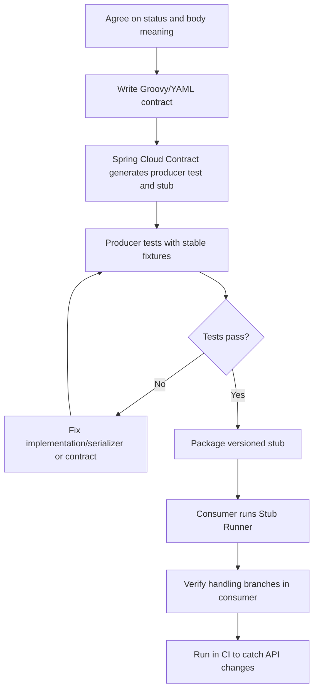

# Empty Responses, Bodyless Responses, and Null Values

## 1. Why Distinguish These Three Cases?

In a microservices architecture, a **consumer** receives HTTP responses produced by a **producer**. A response may return `204 No Content`, return `200 OK` with no data, or return JSON containing a field with a `null` value. If the consumer confuses these cases, the application can throw JSON decoding errors, misinterpret transaction state, or lose business-critical information.

When learning **Spring Cloud Contract**, we use the **Groovy DSL or YAML DSL** to describe the behavior the producer has committed to. Spring Cloud Contract Verifier generates tests on the producer; the producer can publish stubs so the consumer can use **Stub Runner**. CI runs tests on both sides to detect incompatible API changes. How the body is described in the contract therefore directly determines what the consumer is allowed to expect.

Consider a payment system:

- `DELETE /api/payments/PAY-1001/reservations`: reservation cancelled successfully, returns `204` with **no response content**.
- `GET /api/payments/PAY-1001`: returns transaction JSON in which `captureId` is `null` because funds have not been captured yet.
- `GET /api/payments/PAY-1001/events`: returns `200` with JSON list `[]` if there are no events yet.
- `GET /api/payments/PAY-1001/notes`: may return `200` with empty text if the API allows it, though this is a different decision from returning `204`.

These four results do not share the same meaning even though all of them are often inaccurately described as an "empty response".

**Lesson objectives:** distinguish an absent body, a zero-length body, empty JSON structures, JSON `null`, and a `null` JSON property; know how to write Groovy/YAML contracts matching the commitment, test for **no content** when needed, and verify producer/stub/consumer in CI.

## 2. "Empty" States Seen Over HTTP

| Response Form | Example Body on the Wire | Meaning |
| --- | --- | --- |
| **No body (no content)** | No content bytes | Typically paired with `204 No Content`; client must not expect JSON to decode. |
| **Empty body (zero-length body)** | 0 content bytes | Can happen with `200`. At the received data level, there are no characters to parse. |
| **JSON literal `null`** | `null` (4 ASCII/UTF-8 bytes) | A valid JSON document representing a null value at the root level; not the same as 0 bytes. |
| **Empty JSON string** | `""` (2 ASCII/UTF-8 bytes) | A valid JSON string of length 0. |
| **Empty JSON object** | `{}` (2 bytes) | A valid JSON object with no properties. |
| **Empty JSON array** | `[]` (2 bytes) | A valid JSON list with 0 elements. |
| **A JSON property equal to null** | `{"captureId":null}` | The object **has the key** `captureId`, whose value is null. |
| **Missing JSON property** | `{}` or object lacking `captureId` | The `captureId` key is **completely absent**. |

Note: the byte counts in the table apply only to the example strings with no whitespace and ASCII/UTF-8 encoding. A body containing only spaces or newlines is **not** zero-length, even if it looks empty on screen.

### Can an Empty Body and No Body Be Distinguished?

At the level of bytes read, both "sending no content" and "sending zero-length content" can result in the client reading an empty byte array. Distinguishing them precisely depends on **status, headers, and message framing** in HTTP/1.1 or HTTP/2. Do not design business logic around "whether `Content-Length: 0` is present" if the API does not commit to it.

What the consumer usually needs to know is: **does the API promise a JSON document to parse?** With `204`, the answer is no. With `200` plus `[]` or `{}`, the answer is yes, and the document's JSON type differs.

## 3. Choosing Semantically Correct Status Codes

### 3.1. `204 No Content`: Success with No Content

`204` indicates the producer processed the request successfully and **sends no content in the response**. Suitable cases include cancelling a reservation or a successful update where the client does not need a new representation back.

Example:

```http
DELETE /api/payments/PAY-1001/reservations HTTP/1.1
Host: payment-service

HTTP/1.1 204 No Content
```

The illustration after the `204` status line has no body. Do not attach `{}`, `[]`, or `null` to a `204` response just "to have valid JSON"; per HTTP semantics, a `204` response **has no content**. Usually do not declare `Content-Type: application/json` either when there is no actual JSON representation.

### 3.2. `200 OK` with an Empty Body

An API can still return `200` with a 0-byte body:

```http
HTTP/1.1 200 OK
Content-Length: 0

```

This outcome is **not automatically synonymous** with `204`. Both may cause the consumer to read 0 bytes, but the statuses carry different commitments. A client expecting JSON under a `200` contract can fail when trying to parse an empty body.

If an API needs to express "no data to return", the producer/consumer teams must agree explicitly: use `204`, or `200` with a meaningful JSON structure such as `[]`. Do not switch back and forth without verifying consumers.

### 3.3. Other Status Codes

- `201 Created` is typically used when creating a new resource; the response may contain a representation, and the `Location` header can help the client reach the resource, depending on the API commitment.
- `304 Not Modified` is a conditional response and carries no content in the message.
- Responses to a `HEAD` request carry no content, even when the corresponding `GET` returns a body.
- `205 Reset Content` also must not generate content per HTTP semantics.

Having **no response body** does not automatically mean success: meaning must be evaluated alongside status, HTTP method, and contract terms.

## 4. Groovy DSL: A `204` Contract Without a Body

Suppose Checkout cancels a payment reservation. The producer commits to returning `204` when the operation is valid:

```groovy
import org.springframework.cloud.contract.spec.Contract

Contract.make {
    name 'cancel_payment_reservation'
    description 'Cancel payment reservation successfully, return no content'

    request {
        method 'DELETE'
        urlPath '/api/payments/PAY-1001/reservations'
    }

    response {
        status 204
        // Do not declare a body.
    }
}
```

This is how to express the **intent of a response carrying no data**: the `response` block contains only `status`. A few points to distinguish:

1. Omitting `body` is **different from** `body('null')` and `body([:])`.
2. `204` must go together with an actual HTTP implementation that returns no content.
3. The contract can be used to generate producer verification and stubs, but **omitting the body field in the DSL does not automatically guarantee** the generated test code will always check strictly for a body length of 0. **Inspect the generated test** and add a dedicated assertion when "zero content bytes" is an important commitment.
4. For a `204` response with no JSON representation, there is no need to write `Content-Type: application/json` just because other endpoints on the service use JSON.

### Equivalent Configuration in the YAML DSL

```yaml
description: Cancel payment reservation successfully, return no content
name: cancel_payment_reservation
request:
  method: DELETE
  urlPath: /api/payments/PAY-1001/reservations
response:
  status: 204
```

In YAML, **there is no `body` key**. Writing `body: null` creates a null value in the **YAML structure**; that is not a reliable way to demand "return exactly the four bytes `null` as JSON". For a 204 contract, **omit the body field**.

Choose one of the two files (Groovy or YAML) as the primary definition for a scenario in a project to avoid generating duplicate contracts.

### Supplementary Testing When Zero Content Bytes Is Mandatory

A hand-written HTTP test using Spring MockMvc can check both status and body:

```java
import static org.springframework.test.web.servlet.request.MockMvcRequestBuilders.delete;
import static org.springframework.test.web.servlet.result.MockMvcResultMatchers.content;
import static org.springframework.test.web.servlet.result.MockMvcResultMatchers.status;

@Test
void cancelReservationReturnsNoContent() throws Exception {
    mockMvc.perform(delete("/api/payments/PAY-1001/reservations"))
        .andExpect(status().isNoContent())
        .andExpect(content().string(""));
}
```

This example assumes an injected `MockMvc` and a fixture with reservation `PAY-1001`; add the project's JUnit/Spring Test imports and configuration. The `content().string("")` assertion checks that the returned content is an empty string at the MockMvc layer. If the system has mandatory header requirements, add header checks **matching the contract**. With a real HTTP client, you can verify that the received `byte[]` has length 0.

## 5. Empty Body `''`: A Case Requiring Caution

The Groovy DSL can express an empty string like this:

```groovy
import org.springframework.cloud.contract.spec.Contract

Contract.make {
    name 'empty_notes_text'

    request {
        method 'GET'
        urlPath '/api/payments/PAY-1001/notes-text'
    }

    response {
        status 200
        body('')
    }
}
```

The intent here is an **empty plain-text body** with status `200`, distinct from an empty JSON object. However:

- An empty string contains 0 characters, so it may produce no observable difference in body bytes compared to not declaring a body.
- Depending on the version and the contract-to-test/stub converter, declaring `body('')` may need careful inspection in the **generated producer test** to confirm the test actually asserts empty content.
- If the system wants to commit strictly to `200` with 0 bytes, add an HTTP test asserting `status = 200` and `content().string("")`, similar to the previous example.
- Do not use `body('')` to represent an empty JSON string `""`: in bytes, that is **two quotation marks**, not a 0-length body string.

In YAML, an empty string is expressed as `body: ""`, yet check the generated test and stub output for your version before relying on it to guarantee a 0-length body. Also do not use a bare `body:` with no value as a casual shortcut: YAML typically interprets an empty value as `null`.

## 6. Empty JSON: `{}` and `[]` Still Contain Data

Two very common business scenarios:

**List with no elements:**

```http
HTTP/1.1 200 OK
Content-Type: application/json

[]
```

**Object with no properties:**

```http
HTTP/1.1 200 OK
Content-Type: application/json

{}
```

These are **not** bodyless responses. The consumer can parse `[]` into a 0-element list and `{}` into an object with no fields.

### Groovy DSL for an Empty List

```groovy
import org.springframework.cloud.contract.spec.Contract

Contract.make {
    name 'payment_events_empty'

    request {
        method 'GET'
        urlPath '/api/payments/PAY-1001/events'
    }

    response {
        status 200
        headers {
            contentType(applicationJson())
        }
        body([])
    }
}
```

Here `body([])` is an **empty Groovy list**, used as an empty JSON array. Do not confuse it with `body('')`, which is a **String**.

For an empty JSON object, use `body([:])` (**empty map** notation in Groovy), if the DSL version in use converts it properly to `{}`. Inspect the generated stub and producer test from your specific plugin, as differences between empty list/map can be affected by serialization if misconfigured.

### YAML DSL for an Empty Array

```yaml
description: Transaction has no events yet
name: payment_events_empty
request:
  method: GET
  urlPath: /api/payments/PAY-1001/events
response:
  status: 200
  headers:
    Content-Type: application/json
  body: []
```

In YAML, `body: []` is a **list**, `body: {}` is a **map**, and `body: ""` is an **empty string**. The three values differ in both data type and business meaning.

## 7. JSON Properties with a `null` Value

Suppose Payment returns transaction info that is **authorized but not yet captured**:

```http
HTTP/1.1 200 OK
Content-Type: application/json

{
  "paymentId": "PAY-1001",
  "status": "AUTHORIZED",
  "captureId": null
}
```

The business contract can stipulate that:

- `paymentId` identifies the transaction being queried.
- `status = AUTHORIZED` means the bank authorized it, but the transaction is not yet captured.
- `captureId = null` indicates **this field exists in the JSON, though no capture code exists yet**.

If the producer returns `"captureId": "null"` (a character string), that is the **wrong data type**. If the producer omits `captureId` altogether, that **differs from the contract** if the key's presence is a commitment to the consumer.

### 7.1. Groovy DSL: Map with a Null Field

```groovy
import org.springframework.cloud.contract.spec.Contract

Contract.make {
    name 'get_authorized_payment'

    request {
        method 'GET'
        urlPath '/api/payments/PAY-1001'
    }

    response {
        status 200
        headers {
            contentType(applicationJson())
        }
        body([
            paymentId: 'PAY-1001',
            status: 'AUTHORIZED',
            captureId: null
        ])
        bodyMatchers {
            jsonPath('$.captureId', byNull())
        }
    }
}
```

Spring Cloud Contract supports the `byNull()` matcher for response verification; this matcher helps verify that the value at the JSONPath is null. Crucially, **the sample data must also show `captureId: null`** so generated stubs provide information consistent with the contract.

When requiring **the `captureId` key to be present** is mandatory, do not rely solely on having the `byNull()` matcher: how JSONPath handles missing keys can differ across libraries/versions. Add an explicit assertion on **key existence**. Section 9 gives an example checking null vs. missing key with Jackson.

### 7.2. YAML DSL: Unquoted `null`

```yaml
description: Transaction is authorized but not yet captured
name: get_authorized_payment
request:
  method: GET
  urlPath: /api/payments/PAY-1001
response:
  status: 200
  headers:
    Content-Type: application/json
  body:
    paymentId: PAY-1001
    status: AUTHORIZED
    captureId: null
  matchers:
    body:
      - path: $.captureId
        type: by_null
        value: null
```

Three YAML forms commonly confused:

```yaml
captureId: null      # YAML null -> JSON null when inside an object body
captureId: "null"    # Four-character string n-u-l-l
captureId: ""        # Empty string, still DIFFERENT from null
```

A null value in an **object body property** means something different from declaring `body: null` at the response root. At the root level, YAML null can be interpreted by the DSL as a missing body; if you want to return a **root-level JSON literal null**, carefully inspect how your specific version's generator converts the payload, or verify directly with an HTTP test.

### 7.3. Watch Out for Serializer Configuration

A producer might use Jackson configured to omit null properties, such as `JsonInclude.Include.NON_NULL`. In that case, a Java object with `captureId = null` gets serialized as:

```json
{
  "paymentId": "PAY-1001",
  "status": "AUTHORIZED"
}
```

This is **different JSON** from the declared sample containing `"captureId": null`. If the contract requires the null field to appear, configure the serializer to fulfill that commitment and write tests capable of catching its absence. If both sides agree to omit the key when absent, adjust the contract accordingly instead of trying to force `captureId: null` on every response.

## 8. Root-Level JSON Literal `null`

A response can contain literally the four bytes `null`:

```http
HTTP/1.1 200 OK
Content-Type: application/json

null
```

That is **a valid JSON document whose root value is null**. It differs from:

- Response with no content: **0 bytes**.
- JSON string `"null"`: six bytes including quotation marks and four letters.
- JSON object `{"value":null}`: an object with a null property.

APIs returning root-level JSON null are generally harder to consume than a well-documented structure, especially when clients use decoders with differing null/empty handling. So before using it, producer and consumer must agree on the return type and decoding behavior.

**Note for the contract DSL:** do not treat `body(null)` or `body: null` as syntax guaranteed to produce four `null` bytes. At Groovy/YAML-to-contract-model conversion points, `null` may signify "no body configured". When requiring root-level JSON null, inspect generated mappings/tests for your exact Spring Cloud Contract version and add an HTTP test verifying actual content:

```java
@Test
void rootNullIsAJsonLiteral() throws Exception {
    mockMvc.perform(get("/api/payments/PAY-1001/nullable-result"))
        .andExpect(status().isOk())
        .andExpect(content().contentTypeCompatibleWith(
            MediaType.APPLICATION_JSON))
        .andExpect(content().string("null"));
}
```

This is a hand-written assertion example; it requires importing `get`, `status`, `content`, and `MediaType`, as well as a real endpoint returning the JSON literal `null`. This test is **different** from checking `content().string("")`, which verifies 0 characters. With configurations/generators able to express root JSON literal null, maintain a single verified source contract and do not equate it with a missing body.

## 9. Distinguishing Absent Key, Null Key, and Empty String Key in Producer Tests

The three JSON payloads below are not equivalent:

```json
{"paymentId":"PAY-1001"}
```

```json
{"paymentId":"PAY-1001","captureId":null}
```

```json
{"paymentId":"PAY-1001","captureId":""}
```

If the consumer relies on a model like:

```text
captureId absent    -> producer does not support this field yet / older contract
captureId = null    -> field supported, no capture yet
captureId = ""      -> invalid value if ID is required to be non-empty
```

then a serializer change silently dropping null fields can rob the consumer of the ability to distinguish these states.

### Checking Explicitly with Jackson

In producer tests, you can inspect JSON content directly with `JsonNode`:

```java
import com.fasterxml.jackson.databind.JsonNode;
import com.fasterxml.jackson.databind.ObjectMapper;
import org.junit.jupiter.api.Test;
import static org.assertj.core.api.Assertions.assertThat;

class PaymentResponseShapeTest {

    private final ObjectMapper mapper = new ObjectMapper();

    @Test
    void captureIdExistsButIsNull() throws Exception {
        String json = """
            {"paymentId":"PAY-1001","captureId":null}
            """;

        JsonNode root = mapper.readTree(json);

        assertThat(root.has("captureId")).isTrue();
        assertThat(root.get("captureId").isNull()).isTrue();
        assertThat(root.get("captureId").isTextual()).isFalse();
    }
}
```

This is an **illustrative test showing how to inspect JSON**. In real producer verification, `json` must come from the actual HTTP response, such as the content returned by MockMvc, rather than a hardcoded string as shown above. The key points are:

- `root.has("captureId")` checks that the key **is truly present**; Jackson considers a key with JSON null as present.
- `root.get("captureId").isNull()` checks that the value is strictly JSON null.
- `root.get("captureId").isTextual()` helps avoid confusing `"null"` or `""` with null.

For an absent field, `root.has("captureId")` is `false` and `root.get("captureId")` usually returns Java `null`. Do not call `root.get("captureId").isNull()` before checking key existence, as it can throw a `NullPointerException`.

If the requirement that "the field **must not appear**" is an important commitment, add `assertThat(root.has("captureId")).isFalse()` against the real HTTP response. A contract that merely omits `captureId` from the sample body may not be enough to forbid the producer from returning extra fields, because matching mechanisms may allow additional properties.

## 10. What Will Producer Verification, Stubs, and Consumers See?

The scenarios above can flow through the same Spring Cloud Contract pipeline:



| Contract | What Producer Must Satisfy | What Consumer Must Handle |
| --- | --- | --- |
| `DELETE /reservations` → `204` | Return the right status and produce no content per HTTP; add 0-byte test when needed. | Do not invoke a JSON deserializer on a non-existent body. |
| `GET /events` → `200`, `[]` | Return a valid, empty JSON array. | Use a 0-element list; do not treat as a parse error. |
| `GET /payment` → `200`, `captureId: null` | Keep the key with a JSON null value if that is the commitment. | Interpret as not yet captured; do not mistake for string `"null"`. |
| `GET /notes-text` → `200`, empty body | Keep status and 0-byte content if committed. | Do not try to parse JSON from 0 bytes. |
| `GET /nullable-result` → `200`, literal `null` | Return the exact JSON literal when genuinely part of API design. | Distinguish JSON null from a response with no content. |

### 10.1. Consumer Using `ResponseEntity<Void>` for `204`

In Spring, a client can handle a successful bodyless outcome using `Void` instead of forcing a DTO:

```java
ResponseEntity<Void> result = restTemplate.exchange(
    "/api/payments/PAY-1001/reservations",
    HttpMethod.DELETE,
    HttpEntity.EMPTY,
    Void.class
);

if (result.getStatusCode().value() == 204) {
    // Reservation was cancelled as committed.
}
```

This snippet assumes `restTemplate` has been created and configured with an appropriate base URL/host; in Spring WebClient or other HTTP clients, equivalent ways exist to consume a bodyless response. For HTTP error codes, the client must still handle the corresponding error branch. Do not run a DTO JSON deserializer on a `204` response and blame the parse error on the producer.

### 10.2. Stub Runner and Different Outcomes

Stub Runner can launch stubs generated from contracts, allowing the consumer to test response branches without running the real producer. Prepare separate contracts for:

- Successful cancellation returning `204`.
- Fetching an empty list returning `200` with `[]`.
- Fetching payment details returning `200` with property `captureId: null`.

Stubs help test consumer behavior with **described data**, yet do not prove by themselves that the producer behaves properly in a real environment. Producer verification must run on producer code; consumer tests must exercise the real client and business logic. For example, a consumer receiving `captureId: null` must disallow the "complete capture" action, not just assert "stub returned status 200".

### 10.3. CI Integration

Recommended workflow:

1. Review contracts to agree on **status and body shape** for each scenario, even when the body is absent.
2. Generate and run producer verification tests; confirm CI actually discovers and executes the generated tests.
3. If the commitment requires a 0-byte body, root JSON `null`, or absent/present keys, add assertions that generated tests do not cover.
4. Publish **versioned** stub artifacts after producer verification passes.
5. Consumer loads the right stub version via Stub Runner, verifying both `204` and `200` with JSON null/empty array handling branches.
6. When changing responses, run compatibility checks against still-supported consumers before publishing the new API.

Do not change from `204` to `200` + `{}`, from `[]` to an empty body, or from `null` to an omitted key without assessing impact. All three can break clients even while the new producer pipeline stays green if only the new contract is tested.

## 11. Common Mistakes

| Mistake | Why It Is Wrong | How to Fix |
| --- | --- | --- |
| Using `204` while controller returns `{}` | `204` carries no content per HTTP. | Return no body; test status and body length when needed. |
| Thinking `body: null` in YAML always creates JSON literal `null` | YAML null can indicate no configured value. | Inspect generated mapping/test; test raw HTTP `null` if required by business logic. |
| Thinking `body('')` equals `body([])` | One is an empty string, the other an empty list. | Use the right body type: 0 bytes, `[]`, or `{}`. |
| Returning `"captureId": "null"` | This is a string, not JSON null. | Return `"captureId": null` when that is the contract. |
| Using a serializer that silently drops null | Consumer may distinguish missing key from null key. | Agree on JSON rules and test field presence. |
| Omitting body from contract and claiming 0 bytes was tested | Generated test might check status only. | Inspect generated test code and add a dedicated empty-body assertion. |
| Stubbing `204` while client always calls `.getBody()` as a DTO | Body is not guaranteed to exist. | Use a bodyless response consumption style, such as `Void`. |
| Testing only `200` with populated JSON | Does not cover `204`, `[]`, `null` branches. | Create separate contracts for branches the consumer really depends on. |
| Changing status/body and updating only the new contract | Fails to detect broken legacy consumers. | Re-run supported consumer tests against appropriate stub versions. |

## 12. Practice Exercise

An `inventory-service` supports two endpoints for `checkout-service`:

```text
DELETE /api/reservations/RES-1001
GET    /api/reservations/RES-1001
```

The team agrees:

- Successful `DELETE` returns `204` with **zero content bytes**.
- `GET` when a reservation is awaiting confirmation returns `200` and JSON with `reservationId: "RES-1001"`, `status: "PENDING"`, `confirmedAt: null`.
- If the reservation no longer exists, the API returns `404` with the agreed error JSON; do not assume `404` must have no body.

**Requirements:**

1. Write a Groovy `DELETE` contract with `status 204` and no body declared.
2. Write the equivalent YAML version; explain why omitting `body` altogether is better than `body: null` in this scenario.
3. Write a Groovy `GET` contract with a body map having `confirmedAt: null` and matcher `jsonPath('$.confirmedAt', byNull())`.
4. Write a YAML `GET` contract with `confirmedAt: null` and matcher `type: by_null`.
5. Create another sample response omitting `confirmedAt` completely; explain why it can violate the contract, and use `JsonNode.has()` to prove the difference.
6. Suppose a producer returns `200` and `[]` to indicate no records. Explain how that differs from `204` and why the consumer must parse a JSON array instead of treating it as bodyless.
7. In CI, inspect the generated producer test, add `content().string("")` assertion for `204`, publish stubs, and use Stub Runner on the consumer to verify it does not decode JSON from a 204 response.

**Self-check hint:** your solution is right when it distinguishes **HTTP status**, **body byte count**, **JSON type**, **field existence**, and **null value**. A good contract must protect the behavior the consumer actually uses, not just the status code.

## 13. Takeaways

- **No body**: no content in the response; `204 No Content` is the classic case and must not carry JSON `{}`, `[]`, or `null`.
- **Empty body**: content length is 0; do not confuse with a two-byte empty JSON string `""` or four-byte JSON literal `null`.
- **JSON `{}` and `[]`**: both are valid JSON documents, yet differ in type, business meaning, and from having no body.
- **Field `"field": null`**: key exists, value is JSON null; differs from `"field": "null"` and from the key not existing.
- **Groovy DSL**: omit `body` when describing no body; use `body([field: null])` and `byNull()` to describe a null value inside a JSON object when needed.
- **YAML DSL**: `body: []`, `body: {}`, `body: ""`, and `body: { field: null }` are distinct data types; do not treat `body: null` as a guaranteed way to emit root-level JSON literal null.
- **Contract testing**: inspect generated producer tests, add assertions if you need certainty about 0 bytes/key presence, then publish versioned stubs and verify consumers via Stub Runner in CI.

### References

- [Spring Cloud Contract — HTTP Contracts](https://docs.spring.io/spring-cloud-contract/reference/project-features-contract/http.html): HTTP responses have a mandatory status and an optional body.
- [Spring Cloud Contract — Contract DSL](https://docs.spring.io/spring-cloud-contract/reference/project-features-contract.html): Groovy/YAML syntax, response body, and `by_null` matcher.
- [Spring Cloud Contract — Dynamic Properties](https://docs.spring.io/spring-cloud-contract/reference/project-features-contract/dsl-dynamic-properties.html): `jsonPath(..., byNull())` and producer-side matchers.
- [Spring Cloud Contract — Stub Runner](https://docs.spring.io/spring-cloud-contract/reference/project-features-stubrunner.html): running stubs in consumer tests.
- [RFC 9110 — HTTP Semantics](https://www.rfc-editor.org/rfc/rfc9110.html): meaning of `204`, `205`, `304`, and HTTP response content.
