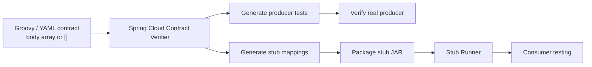

# Array Responses and Empty Lists

## 1. Why Must Array Responses Be Tested?

In **Spring Cloud Contract**, contracts describe the HTTP or messaging behaviors that a **producer** commits to providing to a **consumer**. One of the most easily overlooked behaviors is returning lists: populated lists, empty lists, elements with the wrong structure, or unexpected data types.

Consider an order search API:

```http
GET /api/orders?state=PAID
Accept: application/json
```

When data exists, the producer can return:

```json
[
  {"id": 42, "state": "PAID", "totalAmount": 120000},
  {"id": 43, "state": "PAID", "totalAmount": 80000}
]
```

When there are no matching orders, the API can commit to:

```http
HTTP/1.1 200 OK
Content-Type: application/json

[]
```

**Both responses above are valid JSON arrays**, yet tests must further verify element count, data types, element structure, and the meaning of the empty case. The consumer might use `[]` to display "No orders yet". If the producer switches to `null` or `{}`, the HTTP code is still `200`, yet the consumer may fail when iterating over the list.

This lesson belongs to the **Response HTTP** chapter of the Spring Cloud Contract module. The material uses both **Groovy DSL** and **YAML DSL**, demonstrating how to generate producer-side tests, publish **stubs**, use **Stub Runner**, and integrate compatibility checks into CI.

## 2. Distinguishing Arrays, Objects Containing Arrays, and No-Data Cases

### 2.1. Non-Equivalent Representations

| Response | Data Type | Possible Meaning | Compatibility Risk |
|---|---|---|---|
| `[]` | Empty JSON array at root | Valid search result with no records | Consumer must accept a list type |
| `[{"id":42}]` | Populated JSON array | A collection of records | Element schema must be verified |
| `{"items":[]}` | JSON object with `items` property as an empty array | List wrapped alongside metadata | Completely different from a root array |
| `{"items":null}` | Object with `items` equal to JSON null | No data yet, undefined, or special API handling | Code iterating over `items` may fail |
| `{}` | Object without `items` | Property omitted | Not the same as `items: []` |
| `null` | JSON null at root | No value object | Not an array |
| `204 No Content` | No response body | A different API choice | Consumer cannot read a JSON array from the body |

These representations **cannot be swapped arbitrarily** just because all of them could be described as "no results". The contract must verify the exact representation the consumer actually uses.

For instance, a search API might use `200 + []` for an empty list. Yet `GET /api/orders/9999` fetching **a single resource by ID** might use `404 Not Found` when the ID does not exist. Rules for querying a collection and rules for fetching a single resource are two different commitments.

### 2.2. Root Array vs. List Wrapper Object

**Root array:**

```json
[
  {"id": 42, "state": "PAID"}
]
```

**Object wrapping an array:**

```json
{
  "items": [
    {"id": 42, "state": "PAID"}
  ],
  "total": 1
}
```

If the consumer currently deserializes the response into `List<OrderDto>`, switching to `{"items": [...]}` is usually a **breaking change** even though the business information is still present. Conversely, a consumer using `Page<OrderDto>` or a list-wrapping DTO may require `items` and `total` to always exist, even when the array is empty.

### 2.3. The Meaning of "Empty" Must Be Published

Before writing a contract, answer:

1. Is an empty list considered a **successful result**?
2. Does the no-data case return **`200 + []`**, **`200 + {"items": []}`**, **`204`**, or an error code?
3. Is there a commitment that the array property **always appears**, even when empty?
4. If paginated, what values do `total`, `page`, and `hasNext` take when there are no results?
5. Is element order meaningful, or is it merely an unordered set?

These answers are part of the API contract. The DSL must accurately reflect these rules rather than checking only the `200` code.

## 3. Describing a Root JSON Array with the Groovy DSL

Suppose producer `order-service` exposes `GET /api/orders?state=PAID`. Test data prepares exactly two orders, returning a root array response:

```groovy
import org.springframework.cloud.contract.spec.Contract

Contract.make {
    description 'List of paid orders as root JSON array'

    request {
        method GET()
        url '/api/orders?state=PAID'
        headers {
            header 'Accept', 'application/json'
        }
    }

    response {
        status OK()
        headers {
            contentType(applicationJson())
        }
        body([
            [id: 42, state: 'PAID', totalAmount: 120000],
            [id: 43, state: 'PAID', totalAmount: 80000]
        ])
    }
}
```

In Groovy, `[...]` can represent a **List**. Each `[id: 42, ...]` inside is a **Map**, converted into a JSON object. Thus, `body([[id: 42], [id: 43]])` expresses an **array of two objects**, not an object with two keys.

When the Verifier plugin is properly configured, Spring Cloud Contract generates producer-side tests with the sample request and checks the response against DSL expectations. At the same time, the contract can generate stubs returning the sample body for consumer tests.

**Worth noting:** this is a prepared data scenario. It does not claim the real API **always has exactly two** `PAID` orders. If the result is dynamic data, consider appropriate matchers and keep dedicated tests for critical business rules.

### 3.1. Same Scenario in the YAML DSL

Example file `get-paid-orders.yml`:

```yaml
description: List of paid orders as root JSON array
request:
  method: GET
  url: /api/orders?state=PAID
  headers:
    Accept: application/json
response:
  status: 200
  headers:
    Content-Type: application/json
  body:
    - id: 42
      state: PAID
      totalAmount: 120000
    - id: 43
      state: PAID
      totalAmount: 80000
```

The `-` markers in YAML represent individual sequence items. When the sequence sits directly under `body`, the response is described as a **root JSON array**.

### 3.2. Common Mistakes with Arrays

- Writing `body(id: 42, state: 'PAID')` describes **one JSON object**, not an array containing that object.
- Writing `body([[id: 42]])` describes **an array with one object**.
- Writing `body([])` describes **an empty array**.
- Writing `body(items: [])` describes **an object with an `items` property that is an empty array**.
- Writing `body([[]])` describes **an array containing one element which is itself an empty array**; not equivalent to `[]`.

When using the Groovy DSL, placement of parentheses vs. square brackets directly affects the generated JSON. When reviewing contracts, read the body section as a data structure, not just as a text string.

## 4. Contract for an Empty List at the Root

### 4.1. Groovy DSL: Checking `200 + []`

When filtering `state=CANCELLED` and the fixture has no matching records, the producer must return an empty JSON array:

```groovy
import org.springframework.cloud.contract.spec.Contract

Contract.make {
    description 'Return an empty JSON array when no matching orders exist'

    request {
        method GET()
        url '/api/orders?state=CANCELLED'
        headers {
            header 'Accept', 'application/json'
        }
    }

    response {
        status OK()
        headers {
            contentType(applicationJson())
        }
        body([])
    }
}
```

This contract protects **three important things**:

1. The specific request is treated as valid and the producer returns HTTP `200`.
2. The body is a JSON array, and **contains zero elements**.
3. The response has an appropriate `Content-Type` so the consumer can decode JSON.

If the producer changes the body from `[]` to `null` or `{}`, verifying the response against the described content should flag a difference. If the producer switches to `204`, assertions on status code and body must also fail.

### 4.2. YAML DSL: `[]` Is a Valid Body

```yaml
description: Empty search result has status 200 and JSON array
request:
  method: GET
  url: /api/orders?state=CANCELLED
response:
  status: 200
  headers:
    Content-Type: application/json
  body: []
```

Here `body: []` is an **empty YAML sequence value**, representing an empty JSON array. Do not replace it with:

```yaml
# Wrong target if the API commits to []:
body: null
```

And do not delete `body` altogether either; omitting the body content in the contract is not equivalent to asserting that the body must be `[]`.

### 4.3. Do Not Use an Overly Broad Matcher to Test "Empty"

A matcher that only asserts a value has type **array** may permit both `[]` and `[{"id":42}]`. If the goal is to verify **zero elements**, keep a dedicated contract with `body([])` or `body: []` and inspect the generated tests. When strict size constraints are needed that the current DSL cannot express clearly, add direct producer tests rather than assuming a type matcher always verifies length zero.

## 5. Object Containing a List: `items: []` and Metadata

Many APIs return an object to make room for pagination metadata:

```json
{
  "items": [],
  "totalElements": 0,
  "page": 0,
  "pageSize": 20,
  "hasNext": false
}
```

In this case, the contract must preserve both **the `items` property** and the metadata the consumer relies on.

### 5.1. Groovy DSL

```groovy
import org.springframework.cloud.contract.spec.Contract

Contract.make {
    description 'Empty first page with consistent pagination metadata'

    request {
        method GET()
        url '/api/orders?state=CANCELLED&page=0&size=20'
    }

    response {
        status OK()
        headers {
            contentType(applicationJson())
        }
        body(
            items: [],
            totalElements: 0,
            page: 0,
            pageSize: 20,
            hasNext: false
        )
    }
}
```

### 5.2. YAML DSL

```yaml
description: Empty result page that still includes metadata
request:
  method: GET
  url: /api/orders?state=CANCELLED&page=0&size=20
response:
  status: 200
  headers:
    Content-Type: application/json
  body:
    items: []
    totalElements: 0
    page: 0
    pageSize: 20
    hasNext: false
```

Additional points to verify in the application:

- Does `totalElements = 0` genuinely match the current filter condition?
- Is `page` 0-based or 1-based? Does the consumer use that index?
- Is `pageSize` the requested page size or the actual element count on the page?
- Does `hasNext = false` when there are no results match the API definition?
- When `items` is empty, do metadata fields still retain the **right numeric/boolean types**?

This example illustrates one specific pagination convention. **Spring Cloud Contract does not decide** field names or metadata calculations; producer and consumer must agree beforehand.

## 6. Checking Populated Arrays: Exact vs. Flexible?

Not every list needs fixed element-by-element matching. Choose the verification strategy based on **commitments regarding order, count, and data types**.

| Contract Goal | Approach | When Suitable |
|---|---|---|
| Must return a fixed list of 2 records | Concrete sample body, checking expected values | Small fixture and deterministic data scenario |
| Must have at least 1 and at most 20 elements | `byType` with `minOccurrence`/`maxOccurrence` in `bodyMatchers` at the appropriate JSONPath | Count can vary within bounds |
| Each element must have a properly formatted ID | JSONPath to each element's ID and regex matcher | ID dynamically generated by producer |
| Must keep newest-first order | Ordering assertions/scenarios with controlled fixtures | Consumer actually relies on ordering |
| Only requires an empty list | Exact body `[]` or `items: []` | Verifying zero elements |
| Must have consistent schema across elements | Matchers for fields/types plus extra producer tests if needed | Dynamic list with many records |

### 6.1. Example `bodyMatchers` with List Size

Suppose the producer returns an object with an `items` property and the record count can range from 1 to 20. The Groovy DSL can express a type/length matcher:

```groovy
import org.springframework.cloud.contract.spec.Contract

Contract.make {
    description 'Result list has minimum 1 and maximum 20 elements'

    request {
        method GET()
        url '/api/orders?state=PAID&size=20'
    }

    response {
        status OK()
        headers {
            contentType(applicationJson())
        }
        body(
            items: [
                [id: 42, state: 'PAID'],
                [id: 43, state: 'PAID']
            ]
        )
        bodyMatchers {
            jsonPath('$.items', byType {
                minOccurrence(1)
                maxOccurrence(20)
            })
        }
    }
}
```

`$.items` is the **JSONPath** pointing to the list in the response. `byType` uses the sample in the body to verify data types; `minOccurrence` and `maxOccurrence` describe element count bounds when the test generator supports that collection context.

**Limitation:** element count matchers **do not by themselves guarantee every `state` is `PAID`, that IDs are unique, or that results are sorted properly**. Add constraints for fields the consumer truly uses or write supplementary producer tests. Handling of nested JSONPaths and generated assertions can vary across versions, so inspect the generated tests in your project's build.

### 6.2. Matchers for Dynamic Fields Inside Elements

Suppose the sample response body contains a reference code:

```groovy
response {
    status OK()
    headers {
        contentType(applicationJson())
    }
    body(
        items: [
            [id: 'ORD-42', state: 'PAID']
        ]
    )
    bodyMatchers {
        jsonPath('$.items[0].id', byRegex('ORD-[0-9]+'))
        jsonPath('$.items[0].state', byEquality())
    }
}
```

This example checks only **the first element** because the JSONPath is `$.items[0]`. If the producer can return multiple elements, do not infer that the remaining elements were verified. Pick appropriate JSONPaths, write multiple assertions, or implement extra tests matching the actual list structure.

In a **response**, matchers help **generated producer tests** accept dynamic values according to rules. However, **stubs still need concrete sample data** to return to the consumer; matchers do not make a stub read a database or synthesize a different list from live data.

### 6.3. Array Ordering: When Does It Need Checking?

In JSON, **arrays are ordered**. However, whether an API **commits** to a specific order is a separate matter.

- If an endpoint accepts `sort=createdAt,desc` and documentation commits to descending chronological order, write a test with fixtures having distinct timestamps to catch the producer returning the wrong order.
- If the API returns a collection with no ordering guarantee, avoid pinning individual record positions unnecessarily. Use suitable matchers and test value sets at the application layer.
- If a consumer wrongly relies on "the first element is always the newest" even though the API makes no such promise, clarify the contract explicitly before locking down tests.

Do not assume generated tests always compare array ordering as expected under **every configuration**: JSON assertion libraries and matching options in your version can affect behavior. When ordering is a business requirement, inspect the generated assertion or add meaningful assertions.

## 7. Distinguishing Empty Arrays, `null`, Missing Fields, and `204`

### 7.1. Why Can a Small Change Break the Consumer?

Suppose the consumer writes:

```java
List<OrderDto> orders = orderClient.getPaidOrders();
for (OrderDto order : orders) {
    renderOrder(order);
}
```

If `orderClient.getPaidOrders()` decodes `[]` into an empty list, the loop runs 0 times, as expected. If the producer switches to `null`, the client implementation may return `null` and the loop throws an exception. If the producer returns `{"items": []}`, a decoder expecting `List<OrderDto>` may report a structural mismatch.

Therefore, **the contract must clearly state the root data type** and only change format after a compatibility plan is in place.

### 7.2. Can `204 No Content` Be Used for an Empty List?

`204` is a valid HTTP code for a response **with no body**. If an API has already published that an empty query returns `200 + []`, switching to `204` can be a breaking change for consumers expecting to decode a JSON array.

Example contract describing an API **designed from the start** to use `204`:

```groovy
import org.springframework.cloud.contract.spec.Contract

Contract.make {
    description 'No content per this API convention'
    request {
        method GET()
        url '/api/legacy-orders?state=CANCELLED'
    }
    response {
        status NO_CONTENT()
        // Do not define a JSON body for a 204 response.
    }
}
```

Do not put `body([])` inside a `204` response: `204` must not contain a message body per HTTP semantics. If the consumer wants a list to use directly, `200 + []` is usually the simpler choice, though the deciding factor remains **the agreed API commitment**.

### 7.3. The `items` Field Disappearing During Serialization

In Spring Boot/Jackson, a serialization setting like `@JsonInclude(Include.NON_EMPTY)` can strip empty collections from JSON, resulting in:

```json
{}
```

instead of:

```json
{"items":[]}
```

That can break the contract even though the Java class still has the `items` property. If the API commits that the field always appears, configure serialization accordingly and keep **producer contract tests** checking real JSON, not just internal Java DTOs.

## 8. Test Data and Reproducible Responses

### 8.1. Preparing Fixtures for Both States

For list contracts to be meaningful, producer tests need known data:

| Scenario | Request | Fixture Data | Expected Response |
|---|---|---|---|
| Has results | `GET /api/orders?state=PAID` | 2 known `PAID` orders | Array of 2 objects |
| No results | `GET /api/orders?state=CANCELLED` | No `CANCELLED` orders | `[]` |
| Empty page | `GET /api/orders?state=CANCELLED&page=0&size=20` | No matching filter results | `{"items":[],"totalElements":0,...}` |
| Single missing resource | `GET /api/orders/9999` | No ID 9999 | `404` if committed by API |

Fixtures must be **isolated** so tests do not mutate each other's outcomes. Use a dedicated test database, rollbacks, deterministic seed data, or mocked dependencies at an appropriate boundary. Do not depend on a shared database that "happens" to have two `PAID` orders.

### 8.2. Do Not Make Tests Brittle Over Unrelated Values

Suppose a list response includes a server-generated `createdAt` at the current time. If the consumer only requires ISO-8601 format, pinning `createdAt = 2026-11-24T00:00:00Z` on the producer response can cause unnecessary test failures.

The solution is to use matchers for timestamps/UUIDs on the **producer response side**, while stubs retain valid sample values for the consumer. Conversely, important fields such as `state = PAID` or `totalElements = 0` in the empty scenario should be verified strictly.

**For an empty array, the most important rule is emptiness.** A matcher relaxed to accept any array defeats the purpose of the test.

## 9. From Contract to Generated Tests and Stubs



**Producer side:** from the DSL, the plugin generates tests that send requests to the application and verify status, headers, and body. If the contract specifies `[]` and the producer returns `null` or an object, that discrepancy must be caught before release.

**Stub side:** the stub generated from the empty scenario returns the sample `[]` response for matching requests. The consumer can test UI states or logic such as "show empty state", "iterate zero items", or "hide detail button". Stubs are published as versioned artifacts so teams share the same expectations.

**Limitation to remember:** a stub returning `[]` does not prove the real producer returns `[]`; you must run **generated producer tests**. Conversely, a green producer test does not prove the consumer decodes an empty array properly; you must run **consumer tests with Stub Runner**.

### 9.1. Illustrative Consumer Test Scenario

Suppose Stub Runner has started the `order-service` stub and the consumer's HTTP client is configured to call the stub port:

```java
@Test
void emptyResultShouldShowEmptyState() {
    List<OrderDto> orders = orderClient.findOrders("CANCELLED");

    assertThat(orders).isNotNull();
    assertThat(orders).isEmpty();
    assertThat(viewModel.fromOrders(orders).isEmptyStateVisible()).isTrue();
}
```

This is an **illustration of business assertions**, not a complete standalone test class: `orderClient`, `viewModel`, Stub Runner startup, and assertion library imports are configured in the consumer project. What matters is that the test runs real consumer logic rather than just checking that the WireMock endpoint returns `200`.

### 9.2. Integrating Into CI to Block Incompatible Changes

A sound workflow:

1. Update Groovy/YAML contracts when agreeing on new response requirements.
2. Run the producer build to generate and execute contract tests, covering both populated-array and empty-array scenarios.
3. Once producer tests pass, package and publish stubs with an explicit version.
4. Run consumer tests via Stub Runner against the exact stub version under test.
5. If one side changes `[]` to `null`, drops the `items` field, or turns an array into an object, CI must catch it through tests and the team must assess compatibility impact before deploying.

Merely generating stubs and leaving them in an artifact repository **does not guarantee breaking-change detection**. Tests must re-run whenever the producer or contract changes, and should link back to currently deployed consumers.

## 10. Common Errors and How to Analyze Them

| Symptom | Common Cause | How to Investigate and Fix |
|---|---|---|
| Contract expects `[]` but receives `null` | Controller/service returns null when there is no data | Agree on convention, return an empty list if committed by API |
| Contract expects `items: []` but response is `{}` | Serializer omits empty collections, DTO lacks getter/field | Inspect real JSON and Jackson configuration |
| Test fails due to element order | Data lacks stable sort or assertion enforces uncommitted order | Lock down sort rule; adjust scenario or matcher |
| Producer test passes but consumer fails deserialization | Only status checked, or consumer test uses wrong stub | Verify real body/types; run consumer test with new stub version |
| Empty test passes even though producer returns an element | Using an array type matcher without constraining zero elements | Use an explicit `[]` contract; inspect generated assertions |
| Root `[]` written as `{"items":[]}` | Confusing `body([])` and `body(items: [])` | Realign with the public API schema |
| Generated test lacks data expected by contract | Wrong fixture or shared test state | Create deterministic, isolated data and reset between tests |
| Stub returns a static list unlike production data | Stub intentionally uses sample data instead of live data | Tests should focus on consumer behavior; producer verification checks real app |
| Consumer treats `204` as empty JSON | API changed from `200 + []` or client ignores missing body | Pick one convention, write dedicated contract and compatibility plan |
| Array matcher checks only the first element | JSONPath `$.items[0]` does not cover all elements | Add matchers/tests for all elements requiring protection |

## 11. Practice Exercise: Protecting a Search API With and Without Results

**Context:** the checkout team uses `GET /api/orders?state=...` to render an order list and a message when no data exists. The producer is about to refactor serialization and pagination. The goal is to preserve the contract for both **populated arrays** and **empty arrays**.

**Public requirements:**

- The root response is a JSON array.
- When `PAID` orders exist, each element has numeric `id` and `state` equal to `PAID`.
- When no `CANCELLED` orders exist, return `200` with body `[]`.
- Do not switch to `null`, `{}`, or `204` without coordinating a version upgrade.

**Steps to perform:**

1. Write `get-paid-orders.groovy` for `GET /api/orders?state=PAID`. Use `body([[id: 42, state: 'PAID']])` or add sample elements matching your fixture.
2. Write `get-empty-cancelled-orders.yml` for `GET /api/orders?state=CANCELLED` and `body: []`.
3. Set up producer test data: at least one `PAID` order and zero `CANCELLED` orders.
4. Generate and run producer contract tests. Intentionally return `null` for the `CANCELLED` request; confirm the empty-list test catches the discrepancy.
5. Package and publish the versioned stub artifact. Run consumer tests via Stub Runner to confirm the consumer decodes `[]` as an empty list and displays the empty state.
6. If the producer changes the response to `{"items": []}`, record this as a structural change and create a compatibility plan before updating the contract.

**Self-check questions:**

1. Are `body([])` and `body([[]])` the same? — **No**. One is an empty array, the other is an array containing one empty array.
2. Are `[]` and `{"items": []}` compatible with the same client deserializing `List<OrderDto>`? — **Cannot assume so**; the root type changed.
3. Is using `byType` on `items` enough to prove zero elements? — **No** if the matcher only checks type or allows size greater than 0; protect the empty condition explicitly.
4. Does a passing producer test returning `[]` guarantee the checkout UI shows "No orders"? — **No**; consumer tests must run checkout code against Stub Runner.
5. Can changing from `200 + []` to `204` be a breaking change? — **Yes**, because the consumer may require a JSON array response even when empty.

## 12. Checklist for Reviewing an Array Response Contract

- [ ] Determined whether the response is a root array, an object containing an array, or bodyless.
- [ ] Included an empty-list scenario if the consumer can encounter zero records.
- [ ] Clearly distinguished `[]`, `null`, missing field, and `204`.
- [ ] Verified `Content-Type`, HTTP code, and actual JSON types.
- [ ] For populated lists, verified the fields and data types needed by the consumer.
- [ ] Only constrained fixed ordering or fixed element counts when the API truly commits to them.
- [ ] If using `byType`/JSONPath, reviewed element scope and generated assertions.
- [ ] Fixtures for populated and empty arrays are reproducible and independent of test order.
- [ ] Stubs have properly structured sample responses and versions; consumer tests decode the right list type.
- [ ] CI runs producer verification and consumer tests, catching shifts from array to object/null or bodyless responses.

**Takeaway:** A list with zero elements is still **a value with an explicit data type and clear semantics**. When Spring Cloud Contract verifies both **`[... ]`** and **`[]`** through producer tests, stubs, and CI, both sides can evolve internal implementations while catching consumer-impacting API changes promptly.
