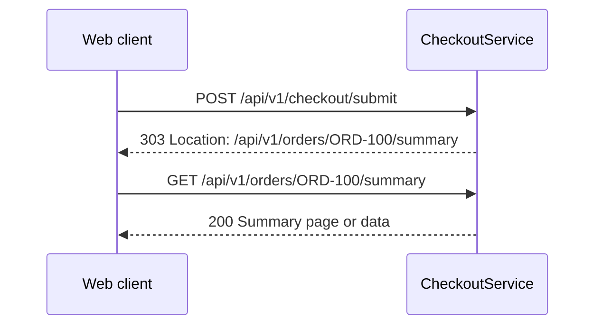
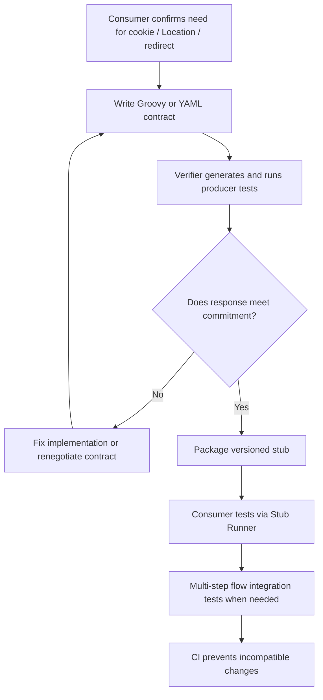

# Cookies, Location, and Redirects When in Test Scope

In HTTP contract testing, we typically start with **status codes**, **Content-Type**, and **JSON responses**. However, some integration flows only work properly when the producer also returns **cookies** or a **Location** header. For example, after creating a payment session, a consumer may need a cookie to maintain the session; after submitting a form, a web application may need to know which URL to navigate to; after creating a resource, another service may need the URI of the new resource.

This lesson belongs to the **Response HTTP** chapter of **Spring Cloud Contract**. We will determine when cookies, Location, and redirects are **observable commitments the consumer truly depends on**, then describe them using the Groovy/YAML DSL. Those contracts can be used to generate producer-side tests, package stubs for consumers running with **Stub Runner**, and check for incompatible changes in CI.

After this lesson, you will be able to:

- Distinguish cookies sent **from client to server** from cookies the server instructs the client to store via `Set-Cookie`.
- Identify when to test a cookie's value, cookie attributes, or response Location.
- Write contracts for `201 Created` with Location and for `303 See Other` redirect responses.
- Choose the right level of testing for `301`, `302`, `303`, `307`, `308`, avoiding the assumption that a contract test exercises the full browser flow.
- Handle dynamic Location values and recognize brittle assertions with `Set-Cookie`.
- Design producer tests, consumer tests, and supplementary integration tests.

## 1. When Are These Headers Within Contract Scope?

A contract should describe **behavior the consumer must rely on** to work correctly. Cookies, Location, and redirects do not belong in every HTTP contract. Include them when omitting or altering them causes the consumer to take the wrong flow.

Consider three examples:

| Flow | Producer Behavior | What Does the Consumer Depend On? |
| --- | --- | --- |
| Create inventory hold | `POST /api/v1/reservations` returns `201` with `Location` | `OrderService` uses the URI to look up or cancel the hold |
| Start payment session | `POST /api/v1/checkout/flows` returns a session cookie | Web application resends the cookie in subsequent requests |
| Submit order and open result page | `POST /checkout/submit` returns `303` with `Location` | Client navigates to the result page via a `GET` request |

Conversely, if an API returns JSON directly and the consumer only uses the JSON content, there is no reason to invent cookies or redirects in the contract.

**Principle:** `status`, `headers`, `cookies`, and `body` can all be described together in a response, yet only parts with clear integration significance should be constrained. The more a contract locks down unnecessary details, the more easily it breaks on producer changes that do not actually affect the consumer.

## 2. Distinguishing `Cookie` from `Set-Cookie`

In HTTP, cookies typically participate in at least two steps:

1. **Producer returns a response:** the server sends one or more `Set-Cookie` headers, instructing the user agent to store a cookie with specified attributes.
2. **Consumer sends the next request:** the user agent sends a `Cookie` header if the cookie matches domain, path, HTTPS, lifetime, and client policy.

```http
HTTP/1.1 200 OK
Set-Cookie: checkout_flow=FLOW-100; Path=/api/v1; HttpOnly; SameSite=Lax
```

And when matching storage/sending rules:

```http
GET /api/v1/checkout/flows/FLOW-100 HTTP/1.1
Cookie: checkout_flow=FLOW-100
```

**The two headers do not share the same structure:** `Set-Cookie` can carry `Path`, `Domain`, `Expires`, `Max-Age`, `Secure`, `HttpOnly`, and `SameSite`. Meanwhile, the `Cookie` header typically sends only `name=value` pairs. Clients do not echo back attributes like `HttpOnly` or `SameSite` in the Cookie header.

| Component | Sender | Purpose |
| --- | --- | --- |
| `Set-Cookie` | Server, in **response** | Create, update, or delete cookies on the client per HTTP rules |
| `Cookie` | Client, in **request** | Send matching cookies to the server |
| `Path` | Attribute of `Set-Cookie` | Restricts the path scope where the cookie may be sent |
| `Domain` | Optional attribute of `Set-Cookie` | Controls matching host scope |
| `Max-Age`/`Expires` | Attribute of `Set-Cookie` | Specifies cookie storage lifetime |
| `Secure` | Attribute of `Set-Cookie` | Send cookie only over secure connections per user agent policy |
| `HttpOnly` | Attribute of `Set-Cookie` | Prevents web page JavaScript from reading the cookie via standard cookie APIs |
| `SameSite` | Attribute of `Set-Cookie` | Restricts sending cookies in cross-site contexts |

For example, `Path=/api/v1` will not make the cookie appear automatically on `GET /admin`. In a real flow, check the paths the consumer will call next; if the cookie must be sent to another path, both sides must review the `Path` value.

### Do Not Treat Cookie Attributes as Complete Security Proof

A contract can verify that the producer **returns** `Secure`, `HttpOnly`, or `SameSite` as committed. It does not prove the browser stored the cookie, that the session cannot be hijacked, that the server validates CSRF, or that the cookie is properly protected across every cross-site scenario. These attributes are one part of a security design requiring proper integration and browser testing.

## 3. Describing Cookies in the Spring Cloud Contract DSL

Spring Cloud Contract supports a `cookies` block in HTTP contracts. When only checking **cookie name and value**, you can use concise syntax in the response:

```groovy
import org.springframework.cloud.contract.spec.Contract

Contract.make {
    name 'get_user_preferences_cookie'
    description 'Web consumer needs language cookie to retain display selection'

    request {
        method 'GET'
        url '/api/v1/preferences'
    }

    response {
        status 200
        cookies {
            cookie('ui_language', 'vi')
        }
    }
}
```

This contract focuses on the producer returning cookie `ui_language=vi`. In a real application, prepare state or fixtures so the request can produce such a response. This syntax is for **simple cookies** and does not express all attributes like `Path`, `HttpOnly`, or `SameSite`.

With the YAML DSL, the same scenario can be described as:

```yaml
name: get_user_preferences_cookie
description: Web consumer needs language cookie to retain display selection
request:
  method: GET
  url: /api/v1/preferences
response:
  status: 200
  cookies:
    ui_language: vi
```

The Groovy and YAML examples are **two ways of writing the same scenario**; placing both inside the contract set read by the plugin can generate duplicate tests/mappings. Choose the format used in your project or establish a clear management rule.

### When You Must Commit to Cookie Attributes, Use `Set-Cookie`

If the consumer needs to know the cookie has `Path=/api/v1` or `HttpOnly`, you can describe `Set-Cookie` directly as a response header:

```groovy
import org.springframework.cloud.contract.spec.Contract

Contract.make {
    name 'checkout_flow_cookie_attributes'
    description 'Web client needs session cookie for subsequent checkout requests'

    request {
        method 'POST'
        url '/api/v1/checkout/flows'
        headers {
            contentType(applicationJson())
        }
        body([
            orderId: 'ORD-100'
        ])
    }

    response {
        status 201
        headers {
            header('Set-Cookie',
                   'checkout_flow=FLOW-100; Path=/api/v1; HttpOnly; SameSite=Lax')
            header('Location', '/api/v1/checkout/flows/FLOW-100')
        }
    }
}
```

Here, `Location` points to the URI of **the newly created checkout flow**, while `Set-Cookie` instructs the user agent to store a cookie for use within the matching path scope. Because the status is `201`, this is **not a redirect instruction**; the client may choose to follow Location in a subsequent request when required by business logic.

**Limitation of this example:** comparing the entire `Set-Cookie` string can be brittle if the server reorders attributes, changes expiration, adds attributes that do not affect the consumer, or generates random cookie values. In real systems, consider specialized matchers or assertions tailored to the exact guarantee being verified, then inspect the test code generated by your Spring Cloud Contract version.

Do not declare the same cookie in both `cookies` and `headers { header('Set-Cookie', ...) }` within one contract without inspecting the output: duplicate configuration can cause unexpected stub mappings or assertions.

## 4. `Location` in `201 Created` Responses

When a producer creates a new resource, `201 Created` can include a `Location` header indicating the URI of the created resource. For example, a consumer places an inventory reservation:

```http
POST /api/v1/reservations HTTP/1.1
Content-Type: application/json

{"sku":"SKU-100","quantity":2}
```

Hypothetical response:

```http
HTTP/1.1 201 Created
Location: /api/v1/reservations/RES-100
Content-Type: application/json

{"reservationId":"RES-100","status":"HELD"}
```

A Groovy contract can express this:

```groovy
import org.springframework.cloud.contract.spec.Contract

Contract.make {
    name 'create_reservation_with_location'
    description '''
        OrderService creates a reservation and needs Location
        to access the newly created resource.
    '''

    request {
        method 'POST'
        url '/api/v1/reservations'
        headers {
            contentType(applicationJson())
        }
        body([
            sku     : 'SKU-100',
            quantity: 2
        ])
    }

    response {
        status 201
        headers {
            contentType(applicationJson())
            header('Location', '/api/v1/reservations/RES-100')
        }
        body([
            reservationId: 'RES-100',
            status       : 'HELD'
        ])
    }
}
```

This contract verifies all three meaningful commitments:

- The producer returns `201` when the reservation is actually created successfully.
- The producer returns `Location` pointing to a URI the consumer can use.
- The producer returns the minimal data `OrderService` needs, including `reservationId` and `status`.

Note: HTTP does not restrict `Location` strictly to `201`, though here it is designed to point to the new resource URI. A `201` response **does not automatically cause browsers to navigate** like `3xx` responses do.

### Absolute or Relative URI?

Depending on API conventions, `Location` can be an absolute URI (for example `https://api.example.test/api/v1/reservations/RES-100`) or a relative URI reference. The consumer must understand and handle the form committed by the producer.

Avoid binding contracts to `localhost`, CI ports, or temporary hostnames if the consumer does not depend on them. When running behind a reverse proxy, add tests for how the producer constructs URIs with public hosts and schemes, especially when transitioning between HTTP and HTTPS.

## 5. `Location` and HTTP Redirects Are Related Yet Distinct Matters

`Location` often appears in `3xx` responses to indicate the redirect target. However, the status code governs the semantics the client must apply.

| Status | Practical Meaning | What Matters When Testing |
| --- | --- | --- |
| `201 Created` | Resource created; `Location` may point to that resource | Do not assume this is a redirect |
| `301 Moved Permanently` | Resource permanently moved | Watch caching policy and method behavior when clients follow redirects |
| `302 Found` | Temporary redirect | Method-switching behavior in some clients is historical; avoid if preserving POST is required |
| `303 See Other` | Client fetches result at another URI | Ideal for Post/Redirect/Get: after POST, client usually accesses target via GET |
| `307 Temporary Redirect` | Temporary redirect, **preserves method and body** when following | Consumer must not turn POST into GET |
| `308 Permanent Redirect` | Permanent redirect, **preserves method and body** when following | Consider compatibility and client caching behavior |

For instance, a form submitting `POST` and receiving `303` directs the client to the result page using `GET`. If the producer changes this to `307`, a standards-compliant client may **re-send POST** to the new URI, completely altering the processing flow.

**Do not equate "both are 3xx" with "same behavior".** When the consumer depends on the follow-up method, status and Location must be agreed upon as critical components of the contract.

## 6. Groovy DSL Example: `303 See Other` After POST

Suppose `CheckoutService` handles order completion, and the web client must open a summary page after submitting confirmation. Both sides agree:

1. The client sends `POST /api/v1/checkout/submit` with the order ID.
2. The producer returns `303 See Other` with `Location: /api/v1/orders/ORD-100/summary`.
3. The client proactively follows the redirect with `GET`; the summary page is served by the corresponding endpoint.

Contract for the **initial response**:

```groovy
import org.springframework.cloud.contract.spec.Contract

Contract.make {
    name 'checkout_submit_redirect_to_summary'
    description '''
        Web client sends checkout completion request.
        Producer returns 303 so client fetches summary page via GET.
    '''

    request {
        method 'POST'
        url '/api/v1/checkout/submit'
        headers {
            contentType(applicationJson())
        }
        body([
            orderId: 'ORD-100'
        ])
    }

    response {
        status 303
        headers {
            header('Location', '/api/v1/orders/ORD-100/summary')
        }
    }
}
```

This contract proves the producer returns the agreed **redirect code** and **target address**. It does not by itself verify that the client will:

- read Location;
- send a `GET` request to the new URI;
- store and resend required cookies;
- avoid redirect loops;
- render the right summary page at the end.

That is the job of consumer tests and multi-step flow integration tests. If the real consumer **automatically follows redirects**, configure the test HTTP client to capture **the first response** when asserting `303` and `Location`; otherwise, the tool may only observe the final page's `200` status.

### Why Should There Be a Contract for the Redirect Target?

If the target `GET /api/v1/orders/ORD-100/summary` is also served by the producer and the consumer depends on its response, treat it as **a separate interaction** needing its own contract or test. A `303` contract only checks that the response includes Location; **it does not prove that URI returns a valid page**.

Flow diagram:



Both request arrows can be protected by two contracts or by supplementary integration tests when state across multiple requests needs verification.

## 7. Cookies and Redirects in the Same Response

A login or checkout flow can simultaneously **set a cookie** and **instruct a redirect**. When both are real dependencies of the consumer, both must be described.

Example of a producer issuing a mock session cookie after successfully creating a web session:

```groovy
import org.springframework.cloud.contract.spec.Contract

Contract.make {
    name 'web_session_redirect_with_cookie'
    description '''
        Web consumer receives session cookie and redirects to dashboard page.
        Session is prepared via test environment fixtures.
    '''

    request {
        method 'POST'
        url '/api/v1/web-sessions'
        headers {
            contentType(applicationJson())
        }
        body([
            loginTicket: 'LOGIN-TICKET-TEST'
        ])
    }

    response {
        status 303
        headers {
            header('Location', '/dashboard')
            header('Set-Cookie',
                   'web_session=SESSION-TEST; Path=/; HttpOnly; Secure; SameSite=Lax')
        }
    }
}
```

`SESSION-TEST` and `LOGIN-TICKET-TEST` are **mock values for learning purposes**; never put real tokens or secret keys into contracts. In production, session IDs typically must be generated dynamically; tests should verify the attributes the consumer needs and how the client sends cookies, rather than forcing real IDs to always equal `SESSION-TEST`.

An important distinction: cookies with `Secure` are typically **not sent by browsers over plain HTTP**. If a stub runs on a local HTTP port, a test reading only the response header might pass while a browser-based test fails to send the cookie on the next step as expected. For real web session flows, use an HTTPS environment and test realistic user agent behavior.

Additionally, `HttpOnly` prevents cookies from being accessed via standard JavaScript cookie APIs; this is desirable for many session cookies. If a consumer requires JavaScript to read a cookie, design a separate cookie rather than stripping `HttpOnly` from a session cookie just to make tests easier to write.

## 8. Testing Dynamic Location Without Hardcoding Random IDs

In real products, a new resource's URI often contains a server-generated ID: `/api/v1/reservations/RES-48127`, `/api/v1/reservations/RES-48128`, ... If a contract demands a single fixed ID in every response, tests can fail due to dynamic data even though the API fulfills its commitment.

With the Groovy DSL, you can supply different values for **consumer/stub** vs. **producer/test**:

```groovy
import org.springframework.cloud.contract.spec.Contract

Contract.make {
    name 'create_reservation_dynamic_location'

    request {
        method 'POST'
        url '/api/v1/reservations'
        headers {
            contentType(applicationJson())
        }
        body([
            sku     : 'SKU-100',
            quantity: 2
        ])
    }

    response {
        status 201
        headers {
            header('Location',
                   $(consumer('/api/v1/reservations/RES-100'),
                     producer(regex('/api/v1/reservations/RES-[0-9]+'))))
        }
    }
}
```

In the **response**:

| Side | Value in Example | Role |
| --- | --- | --- |
| `consumer(...)` | `/api/v1/reservations/RES-100` | Stub has a concrete, stable value to return to the consumer |
| `producer(regex(...))` | `/api/v1/reservations/RES-[0-9]+` | Generated test verifies the producer's real Location header against the pattern |

This is a **logical reversal** compared to requests: in requests, the consumer side typically needs a regex so the stub accepts many values, while the producer side needs a concrete example to send. In responses, the consumer side needs a concrete mock value to consume, while the producer side can be verified with a matcher for dynamic data.

A regex only checks **format**, not that the URI points to the exact newly created resource. If you need to guarantee "ID in Location matches ID in body" or "GET on Location returns the right resource", use matchers/data-linking expressions supported by your DSL version or add integration tests. Do not assume having two identical regexes verifies consistency.

## 9. `Set-Cookie` with Multiple Attributes: How Strict Should Constraints Be?

A `Set-Cookie` header can vary across environments and over time:

```http
Set-Cookie: web_session=SESSION-100; Path=/; Max-Age=1800; HttpOnly; Secure; SameSite=Lax
```

Tomorrow, the producer might add `Expires` or reorder attributes in the string while still honoring all real commitments to the consumer. If the contract uses **full-string** comparison, that change can break tests unnecessarily.

Identify **what actually matters**:

| Commitment the Consumer Needs | Appropriate Check |
| --- | --- |
| Cookie named `web_session` is returned | Cookie matcher or parsing `Set-Cookie` by name |
| Cookie value has valid format | Matcher for dynamic values or cookie response tests |
| Cookie is only sent over HTTPS | Verify `Secure` attribute and browser/integration tests |
| Scripts cannot read the session cookie | Verify `HttpOnly` and test with a real user agent |
| Cookie is sent to checkout paths | Verify `Path` and follow-up request flow |
| Cookie has the specified lifetime | Verify `Max-Age` or `Expires` per committed semantics |
| Session end clears the cookie | Verify logout response and that user agent stops sending the cookie |

Spring Cloud Contract can check response headers or cookies expressed in the DSL, yet **the ability to isolate individual attributes and matcher granularity must be verified for your exact version and test mode**. If the requirement is to test cookie properties that the default DSL does not express conveniently, add an integration test using an HTTP/cookie parser library rather than forcing one giant regex to do all the checking.

### Multiple Cookies in One Response

HTTP allows the server to return **multiple separate `Set-Cookie` headers**. Do not join multiple cookies into a single comma-separated string like ordinary headers: that representation can cause parsing errors, especially with `Expires` attributes containing commas.

When a producer emits multiple cookies, inspect how your tool generates and verifies **separate Set-Cookie lines**. You can use the `cookies` block for names/values and dedicated HTTP tests for complex attributes when needed. Avoid overly terse examples that mislead learners into thinking one single string suffices for every multi-cookie scenario.

## 10. YAML DSL: Redirect Responses and Simple Cookies

The YAML DSL can describe response status and headers directly:

```yaml
name: checkout_submit_redirect_yaml
description: Web consumer navigates to summary page after completing checkout
request:
  method: POST
  url: /api/v1/checkout/submit
  headers:
    Content-Type: application/json
  body:
    orderId: ORD-100
response:
  status: 303
  headers:
    Location: /api/v1/orders/ORD-100/summary
```

For simple cookies:

```yaml
name: ui_language_cookie_yaml
description: Web consumer receives language cookie
request:
  method: GET
  url: /api/v1/preferences
response:
  status: 200
  cookies:
    ui_language: vi
```

If you need to describe `Set-Cookie` with specific attributes in YAML, you can use a response header as in the Groovy example:

```yaml
response:
  status: 200
  headers:
    Set-Cookie: "ui_language=vi; Path=/; SameSite=Lax"
```

The last snippet is a **configuration fragment** illustrating the header field; combine it with a complete `request` and only use it if the application genuinely commits to those attributes.

The Groovy DSL uses `$(consumer(...), producer(...))` for dynamic data; YAML uses its own matcher mechanism and declaration structure. Do not copy Groovy syntax verbatim into a YAML string and assume matchers will work. For dynamic URIs or randomly generated cookies, consult the exact schema and documentation for your project's Spring Cloud Contract version, then inspect the generated tests and stubs.

## 11. Producer Verification and Consumer Testing with Stub Runner

A producer-side contract test primarily checks **one response for one request**. For the `303` and cookie examples, generated tests must verify whether the producer returns the status and headers specified by the contract.



On a Maven project configured with the Spring Cloud Contract Verifier plugin, you can run:

```bash
mvn -B -ntp clean verify
```

For producer tests, make sure:

1. Contracts are read by the plugin and actually generate tests; avoid builds passing simply because zero tests were generated.
2. The producer's real controller or endpoint receives the sample request described by the contract.
3. Status `201` or `303` is checked accurately; these two statuses are not interchangeable.
4. `Location` matches the agreed value or the designed matcher.
5. Response cookies/`Set-Cookie` are verified against the exact attributes within commitment scope.

On the consumer side, after loading the right stub version with Stub Runner, create at least two groups of tests:

- **Initial response handling tests:** the client observes `303` and Location; receives the cookie or detects missing-cookie cases; is not silently redirected by the HTTP library when the test needs to inspect the original response.
- **Follow-up flow tests:** when needed, the client sends `GET` to Location; the browser or cookie jar sends the cookie per Path/Domain/Secure; the target endpoint processes data properly.

Note: a stub simulating a response with `Set-Cookie` **does not store cookies on the application's behalf**. Storing and resending cookies is behavior of the browser, HTTP client, or cookie jar in use; meanwhile, having the subsequent endpoint return valid data is a separate commitment or integration test scope.

### Example: Checking the Raw Response with an HTTP Tool

When Stub Runner or a test application has opened an HTTP port, you can inspect the response directly (the port below is only an example):

```bash
curl -i -X POST 'http://localhost:8080/api/v1/checkout/submit' \
  -H 'Content-Type: application/json' \
  -d '{"orderId":"ORD-100"}'
```

With the `303` contract above, the expected observation is status `303` and the `Location` header. Do not add `-L` in this step because it tells `curl` to follow redirects and may cause the tester to only see the status of the subsequent response. When testing **the entire chain**, follow redirects in a controlled manner and observe each request/response; if cookies are part of the flow, enable a cookie jar and appropriate HTTP/HTTPS setup.

## 12. Situations That Often Cause "False Green" or Brittle Contracts

| Situation | Why Is It a Problem? | How to Fix |
| --- | --- | --- |
| Contract only checks `status 303` | Does not guarantee client receives the right target URI | Verify `Location` if consumer needs it |
| `201` has Location but test assumes auto-redirect | Violates HTTP semantics | Distinguish resource Location from `3xx` redirect |
| Replacing `303` with `307` because both are `3xx` | Client may re-send POST instead of GET | Commit explicitly to status per flow |
| Test uses an HTTP client that auto-follows redirects | May observe only the final `200` | Disable auto-follow when checking the initial response |
| Hardcoding random session cookies | Tests fail because values change | Appropriate matchers/fixtures, never bind to real tokens |
| Comparing full `Set-Cookie` string unnecessarily | Attribute order or `Expires` changes make tests brittle | Check only attributes meaningful to the consumer |
| Cookie has `Secure` while browser test runs on local HTTP | Browser does not send cookie as expected | Use HTTPS or inspect header directly depending on goal |
| Checking only cookie response and concluding sessions work | Does not verify cookie is resent or server accepts session | Add multi-step/browser tests |
| Stub returns Location pointing to non-existent endpoint | First contract passes yet client fails when following | Add contract/test for the redirect target |
| Using URL containing CI environment hostname | Tests fail when changing environments | Commit to appropriate URIs, use variants/matchers when needed |
| Returning multiple `Set-Cookie` in one comma-separated string | Client may misparse cookies | Emit and verify separate headers individually |
| Checking only `HttpOnly`, `Secure` and concluding system is secure | Does not verify TLS, CSRF, session fixation, or authorization | Add security/integration tests |

## 13. Pre-CI Checklist

- [ ] Know **which consumers** truly need cookies, Location, or redirect behavior.
- [ ] Distinguished `Location` on `201` from `Location` on `3xx` responses.
- [ ] Selected exact status `301`, `302`, `303`, `307`, or `308` matching the committed redirect semantics.
- [ ] URI in Location has the right relative/absolute form, with no unintended test-environment hostnames.
- [ ] Request cookies and response cookies are properly distinguished; important `Set-Cookie` attributes are explicitly listed.
- [ ] No real tokens, real session IDs, passwords, or sensitive data placed in fixtures.
- [ ] Dynamic IDs/URIs/cookies are checked with matchers or stable test data.
- [ ] If checking cookie attributes, considered attribute ordering, lifetimes, and multiple `Set-Cookie` headers.
- [ ] Contract tests check the initial response; clients do not accidentally skip `3xx` by auto-following redirects.
- [ ] Tests exist for the target URI or multi-step flow when the consumer actually has to follow redirects.
- [ ] Ran generated tests on the producer and verified they actually executed.
- [ ] Stubs published from a verified build, and consumer uses the right version via Stub Runner.
- [ ] Supplementary browser/integration/security tests exist for commitments beyond a single HTTP contract's reach.

### Practice Exercise

Suppose `OrderService` is a consumer of `CheckoutService`. When a user completes the payment step, the producer must:

1. Receive `POST /api/v1/checkout/submit` with body `{"orderId":"ORD-100"}`.
2. Return `303 See Other` with `Location: /api/v1/orders/ORD-100/summary`.
3. Return cookie `checkout_flow=FLOW-100` with `Path=/api/v1`, `HttpOnly`, and `SameSite=Lax`.

Perform the following:

1. Write a Groovy contract describing status, Location, and `Set-Cookie` in the same response.
2. Rewrite the `303` contract in the YAML DSL, noting differences when checking a dynamic cookie value.
3. Explain why `303` is better suited than `307` if the intent is to transition from POST to the result page via GET.
4. Create a contract or test for `GET /api/v1/orders/ORD-100/summary`; explain why the initial redirect contract alone does not prove the target URI exists.
5. Replace `Location` with a URI containing a dynamic ID and choose a matcher so producer tests do not depend on a fixed ID.
6. Create a consumer test running with Stub Runner to observe status `303`, read Location, read the cookie, and follow the redirect in a controlled manner.
7. Describe a browser/integration test verifying the cookie is stored and resent to the right Path; explain what differs when the cookie has `Secure` and the environment runs plain HTTP.
8. Intentionally change `303` to `307` or remove the Location header from the producer; re-run generated tests and identify which contract clause was violated.

**Expected outcome:** you identify **which parts of an HTTP response are commitments requiring protection**, accurately express cookies/Location/redirects in Spring Cloud Contract, understand the limits of producer contract tests, and build supplementary consumer or integration tests when flows span multiple requests.

## References

- [Spring Cloud Contract — HTTP Contracts](https://docs.spring.io/spring-cloud-contract/reference/project-features-contract/http.html): structure of `response`, `headers`, `cookies` in the HTTP DSL.
- [Spring Cloud Contract — Dynamic Properties](https://docs.spring.io/spring-cloud-contract/reference/project-features-contract/dsl-dynamic-properties.html): `consumer`, `producer`, and matchers for dynamic data.
- [MDN — Location header](https://developer.mozilla.org/en-US/docs/Web/HTTP/Reference/Headers/Location): meaning of Location with `201` and `3xx`.
- [MDN — Set-Cookie header](https://developer.mozilla.org/en-US/docs/Web/HTTP/Reference/Headers/Set-Cookie): cookie attributes and browser rules.
- [MDN — HTTP redirections](https://developer.mozilla.org/en-US/docs/Web/HTTP/Guides/Redirections): differences between redirect codes.
