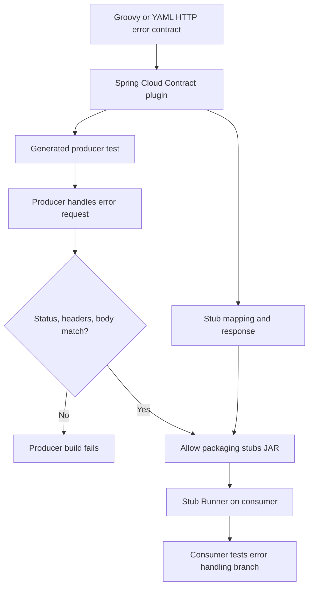

# Error Messages and Shared Error Structure

## 1. Why Are Error Responses Also Contracts?

In **Spring Cloud Contract**, a *contract* protects the communication behavior between a **producer** (the service providing the API) and a **consumer** (the service calling the API). When learning contract testing with Groovy/YAML DSL, we usually start with `200` or `201` success responses. However, the consumer also has to handle cases like resource not found, invalid data, state conflicts, and system errors. **These error responses are also part of the public interface that must be tested.**

Suppose the checkout screen wants to distinguish three scenarios:

- HTTP `404` with code `ORDER_NOT_FOUND`: inform the user the order does not exist.
- HTTP `409` with code `ORDER_ALREADY_PAID`: prompt to reload info instead of submitting payment again.
- HTTP `500` with code `INTERNAL_ERROR`: display a temporary error and optionally retry according to policy.

If a producer suddenly renames `code` to `errorCode`, the consumer can lose its handling branch even though the HTTP status is still right. If `404` is changed to `200` with an error body, many HTTP clients will treat the request as successful. Conversely, changing the Vietnamese display error text is not necessarily a breaking change if the consumer only uses it for display and branches on `code`.

**Lesson objectives:** design a shared error format, choose which parts require strict commitments, express error scenarios in Spring Cloud Contract, generate producer tests and stubs for independent consumer testing, and place those checks in CI to detect incompatible API changes.

## 2. Distinguishing Three Semantic Layers: HTTP Status, Error Code, Message

An error response has three complementary concepts:

| Component | Example | Role | What Should the Consumer Do? |
| --- | --- | --- | --- |
| **HTTP status** | `404` | Categorizes the outcome per HTTP semantics; affects clients, proxies, retries, caching | Use to recognize error classes and handle protocol behavior |
| **Business error code** (`code`) | `ORDER_NOT_FOUND` | Stable identifier for a specific business condition | Branch on committed codes |
| **Message** (`message`) | `Order not found` | Helps humans understand the issue | Display or log; do not parse strings to drive logic |

HTTP status does not replace `code`: the same `409` code can correspond to `ORDER_ALREADY_PAID`, `ORDER_CANCELLED`, or `INVENTORY_CHANGED`. Conversely, do not return `200` for every outcome and put `success: false` inside JSON if the consumer expects proper HTTP semantics.

A reference convention table:

| Scenario | Typically Appropriate HTTP Status | Example Error Code | Notes |
| --- | --- | --- | --- |
| Request data has syntax errors or fails input validation | `400 Bad Request` | `VALIDATION_ERROR` | Can include per-field details |
| Missing valid authentication credentials | `401 Unauthorized` | `AUTHENTICATION_REQUIRED` | Coordinate with `WWW-Authenticate` header when required by protocol |
| Authenticated but lacks permission | `403 Forbidden` | `ACCESS_DENIED` | Do not leak sensitive details |
| Resource not found | `404 Not Found` | `ORDER_NOT_FOUND` | Depending on policy, may conceal resource existence |
| Resource state conflicts with action | `409 Conflict` | `ORDER_ALREADY_PAID` | Distinguish from malformed requests |
| Rate limited | `429 Too Many Requests` | `RATE_LIMITED` | May provide an appropriate `Retry-After` |
| Unexpected server error | `500 Internal Server Error` | `INTERNAL_ERROR` | Never include stack traces in the response |

This table is only an example: rules for choosing `400`/`422`, `404`/`403`, or retry policies must align with HTTP semantics and real system needs. What matters is that **each scenario is defined consistently and has its own contract when the consumer relies on it**.

## 3. Proposing a Shared Error Structure

An easy-to-use JSON template across microservices:

```http
HTTP/1.1 404 Not Found
Content-Type: application/json
```

```json
{
  "code": "ORDER_NOT_FOUND",
  "message": "Order not found",
  "requestId": "req-7f2a9c",
  "details": []
}
```

Meaning of each field:

| Field | Format | What Should Be Committed? |
| --- | --- | --- |
| `code` | Identifier string, e.g. `ORDER_NOT_FOUND` | **Mandatory and stable** if the consumer uses it for decision making |
| `message` | Human-readable string | If displayed by consumer: ensure it is a meaningful string; exact wording may vary by language or phrasing |
| `requestId` | Request identifier string for tracing | If public and needed by consumer: ensure presence and valid format; do not hardcode a random ID |
| `details` | Detail array, may be empty | Define shape and presence rules per error type; do not force unrelated fields to exist |

An example validation error:

```json
{
  "code": "VALIDATION_ERROR",
  "message": "Invalid data",
  "requestId": "req-8e4b1f",
  "details": [
    {
      "field": "quantity",
      "code": "MUST_BE_POSITIVE",
      "message": "Quantity must be greater than 0"
    },
    {
      "field": "shippingAddress.postalCode",
      "code": "INVALID_FORMAT",
      "message": "Invalid postal code"
    }
  ]
}
```

In this example, the consumer can use `details[].field` to highlight input fields and `details[].code` to choose behavior. **Element order inside `details` should not be treated as a commitment** if the consumer merely maps errors by field name. Avoid echoing raw user inputs, private data, or internal descriptions in error details.

### A Uniform Structure Does Not Mean Every Field Is Always Mandatory

Define clearly which fields are mandatory across **all errors** and which appear only on certain error types. For example:

- On every error response: `code` and `message` are present.
- `requestId` is present when a tracing convention is agreed upon, treated as an *opaque* code containing no personal data.
- `details` may be an empty array or omitted, yet **a single rule must be agreed upon** if the consumer distinguishes the two states.
- For `VALIDATION_ERROR`: `details` can contain `field/code/message` objects; there is no need to force this structure onto `INTERNAL_ERROR`.

Minimize the contract to what the consumer actually uses. Do not pin timestamps, UUIDs, or frequently changing descriptive text just because they appear in sample JSON.

## 4. Choosing a Consistent Standard: Custom JSON or Problem Details?

The team can use the `code/message/requestId/details` structure above or use **Problem Details for HTTP APIs (RFC 9457)**. With Problem Details, the response typically uses media type `application/problem+json` and standard fields:

```http
HTTP/1.1 404 Not Found
Content-Type: application/problem+json
```

```json
{
  "type": "https://api.example.com/problems/order-not-found",
  "title": "Not Found",
  "status": 404,
  "detail": "Order not found",
  "instance": "/api/orders/42",
  "code": "ORDER_NOT_FOUND"
}
```

The fields `type`, `title`, `status`, `detail`, and `instance` belong to the Problem Details model; `code` is an extension if the system wants a stable business code. `type` should identify the problem category; the illustrative URI above is solely to explain the structure—real projects must choose appropriate URIs and publishing policies. In modern Spring Framework, `ProblemDetail` can help construct responses following this pattern.

| Option | Pros | What Must Be Guaranteed in the Contract |
| --- | --- | --- |
| Custom JSON `code/message/...` | Easy to tailor to domain and existing clients | Consistent shape, status/headers, error codes, null/optional rules |
| RFC 9457 Problem Details | Standard model for HTTP errors and extensible | `application/problem+json`, `type`/`status` semantics, stable extensions |

**Do not mix the two formats randomly within the same API.** Pick a maintainable convention; if migrating, define a compatibility strategy with consumers and test the transition period as well.

## 5. Defining a 404 Error Contract with the Groovy DSL

Suppose `order-service` returns the custom JSON structure from section 3. When calling `GET /api/orders/42` and order 42 does not exist, the producer must return `404`, `code = ORDER_NOT_FOUND`, and properly typed fields.

Producer file `src/test/resources/contracts/orders/order-not-found.groovy`:

```groovy
import org.springframework.cloud.contract.spec.Contract

Contract.make {
    description 'Order 42 not found'

    request {
        method GET()
        url '/api/orders/42'
        headers {
            accept(applicationJson())
        }
    }

    response {
        status NOT_FOUND()
        headers {
            contentType(applicationJson())
        }
        body([
            code     : 'ORDER_NOT_FOUND',
            message  : 'Order not found',
            requestId: 'req-demo-42'
        ])
        bodyMatchers {
            jsonPath('$.code', byEquality())
            jsonPath('$.message', byType())
            jsonPath('$.requestId', byRegex('req-[A-Za-z0-9-]+'))
        }
    }
}
```

Key points to understand:

1. `status NOT_FOUND()` constrains HTTP `404`, not just an error string in the body.
2. `contentType(applicationJson())` requires a JSON response.
3. `code` has an exact-value matcher: changing it to `RESOURCE_MISSING` is an interface change if the consumer relies on `ORDER_NOT_FOUND`.
4. `message` is matched by **type** so wording can change while remaining a string; if the client requires a server-supplied Vietnamese message, add locale and content rules tests at an appropriate level.
5. `requestId` is a concrete example for the stub; during producer verification, the matcher allows many valid IDs. The pattern only illustrates the `req-...` convention and should be changed if the system uses UUIDs or another format.

**Scenario design note:** Endpoint `/api/orders/42` and the "order 42 not found" test data must be consistent with the producer test environment. Do not simultaneously define another contract requiring that same request to return `200` in the same test state without a distinguishing mechanism (such as data state, headers, or setup conditions), because stubs may generate competing mappings. For a real API, use different IDs or explicit request conditions to separate scenarios.

## 6. Same Scenario with the YAML DSL

Replace the Groovy version above with `src/test/resources/contracts/orders/order-not-found.yml`:

```yaml
description: Order 42 not found
request:
  method: GET
  url: /api/orders/42
  headers:
    Accept: application/json
response:
  status: 404
  headers:
    Content-Type: application/json
  body:
    code: "ORDER_NOT_FOUND"
    message: "Order not found"
    requestId: "req-demo-42"
  matchers:
    body:
      - path: $.code
        type: by_equality
      - path: $.message
        type: by_type
      - path: $.requestId
        type: by_regex
        value: 'req-[A-Za-z0-9-]+'
```

These two DSL snippets are **two alternative representations of one scenario**, not two contracts to keep simultaneously for test generation. YAML expresses HTTP status with the number `404`, media type via the header value, and matchers via JSONPath expressions. Quotes in YAML help avoid unintended parser type inference on identifiers or strings with special characters.

Matcher type names and how the plugin generates tests can depend on the Spring Cloud Contract version. When converting Groovy to YAML, inspect generated producer tests and real stub responses to confirm `byEquality`, `byType`, and `byRegex` retain equivalent meaning; do not assume YAML parsing alone is enough.

## 7. Implementing a Unified Error Response on the Producer

In Spring Boot, you can use `@RestControllerAdvice` and `@ExceptionHandler` to map business exceptions to a shared HTTP response. The following example illustrates a minimal implementation for the `404` branch; imports and types are placed together to clarify the mechanism:

```java
import java.util.UUID;
import org.springframework.http.HttpStatus;
import org.springframework.http.ResponseEntity;
import org.springframework.web.bind.annotation.ExceptionHandler;
import org.springframework.web.bind.annotation.RestControllerAdvice;

record ApiError(String code, String message, String requestId) {}

class OrderNotFoundException extends RuntimeException {}

@RestControllerAdvice
class ApiErrorAdvice {

    @ExceptionHandler(OrderNotFoundException.class)
    ResponseEntity<ApiError> orderNotFound(OrderNotFoundException exception) {
        ApiError error = new ApiError(
            "ORDER_NOT_FOUND",
            "Order not found",
            "req-" + UUID.randomUUID()
        );
        return ResponseEntity.status(HttpStatus.NOT_FOUND).body(error);
    }
}
```

When the controller/service throws `OrderNotFoundException`, the advice returns HTTP `404` with JSON containing `code`, `message`, and `requestId`. The request ID is generated dynamically yet matches the contract pattern in section 5. In real systems, the request/trace ID is usually taken from middleware or tracing context to align with logs; generating it inside the handler here is purely illustrative.

This example intentionally omits `details` because section 3's convention treated it as an **optional** field for errors without details. If the organization decides `details` is always mandatory (even as an empty array), update the DTO, handler, and contracts accordingly to maintain a uniform interface.

Scope note: `@RestControllerAdvice` does not automatically cover responses generated by security layers, servlet filters, reverse proxies, or gateways. For `401`/`403` produced by Spring Security, or errors from an API gateway, configure corresponding handlers to guarantee the error structure matches what consumers were promised. Do not claim "all errors are standardized" just because one advice class exists.

### Do Not Expose Internal Details in Messages

For unexpected errors, never return stack traces, SQL queries, file paths, access tokens, or exception class names to the consumer. Log diagnostic details on the producer side with `requestId`/trace ID and return:

```json
{
  "code": "INTERNAL_ERROR",
  "message": "The system is temporarily unable to process the request",
  "requestId": "req-9d7c"
}
```

This allows the consumer to display a safe message and provide a lookup code for support. This error code must not be automatically used as a signal to "retry infinitely"; retry policies must depend on operation type, idempotency, HTTP status, timeouts, and system rules.

## 8. Designing Contracts for Different Error Categories

Do not use **a single 404 contract** to extrapolate all error responses. Every distinction the consumer actually handles must be described with an appropriate scenario.

### 8.1. Input Data Errors: HTTP 400

Example order creation endpoint rejecting quantity 0:

```yaml
description: Reject invalid quantity
request:
  method: POST
  url: /api/orders
  headers:
    Content-Type: application/json
  body:
    quantity: 0
response:
  status: 400
  headers:
    Content-Type: application/json
  body:
    code: "VALIDATION_ERROR"
    message: "Invalid data"
    details:
      - field: "quantity"
        code: "MUST_BE_POSITIVE"
        message: "Quantity must be greater than 0"
```

In this example, the contract checks a deterministic scenario: a request with `quantity = 0` receives `400` and corresponding error details. If the order of multiple validation errors is not significant, use matchers or suitable scenarios to avoid locking array ordering solely due to sample data. If the consumer does not depend on the exact Vietnamese sentence, use a type/format matcher for `message` rather than matching one exact string.

### 8.2. State Conflicts: HTTP 409

An already-paid order receiving another payment command may return:

```json
{
  "code": "ORDER_ALREADY_PAID",
  "message": "Order has already been paid",
  "requestId": "req-af19"
}
```

The consumer needs to know this is a business conflict, not "order does not exist". Thus `ORDER_ALREADY_PAID` and HTTP `409` must be protected as two distinct conditions in the contract. If the client shows a "View payment details" button instead of retrying, changing `code` alone can cause incorrect user behavior.

### 8.3. 401/403 and Responses Not Generated by Controllers

For `401`, authentication protocols sometimes require the `WWW-Authenticate` header; for `403`, the consumer may display an insufficient-permissions message. If these headers or statuses are part of the published contract, the producer must verify **the actual layer producing the response**. A generated test calling only a mocked controller that bypasses security filters will not prove the system returns the right `401`/`403` in the real HTTP pipeline.

### 8.4. 429 and Handling Overload

For `429 Too Many Requests`, if the consumer uses `Retry-After` to throttle request frequency, the contract must protect this header in the exact agreed format (seconds or HTTP-date per protocol rules). Do not test only `code = RATE_LIMITED` if the consumer's backoff mechanism depends on the header.

## 9. How Do Producer Tests and Stubs Together Protect the Error Format?



**Producer verification** must prove the implementation returns the right status, content type, error code, and committed fields. For handlers with random IDs, use appropriate matchers; do not force IDs to equal one sample value.

**Consumer verification** must prove the HTTP client does not mistake `404`/`409` for success, decodes the body properly, and selects the right handling branch. Stubs must be generated from the same verified contract, never hand-written as separate JSON and called a contract.

For a Maven project configured with `spring-cloud-contract-maven-plugin` and an appropriate test base class, you can run:

```bash
./mvnw clean verify
./mvnw install
```

`verify` checks the producer according to the configured build lifecycle; `install` places artifacts into the local Maven repository, **if** the plugin is configured to attach the stubs JAR properly. With Gradle, run the tasks that generate contract tests and package stubs provided by your plugin version, verifying they are actually wired into `check`/`build`. Never assume a green build command always means all generated tests executed.

### Consumer Running Stubs with Stub Runner

Example configuration for a Spring Boot test class on the consumer:

```java
import org.springframework.cloud.contract.stubrunner.StubRunnerProperties;
import org.springframework.cloud.contract.stubrunner.spring.AutoConfigureStubRunner;

@AutoConfigureStubRunner(
    ids = "com.example:order-service:1.5.0:stubs:9090",
    stubsMode = StubRunnerProperties.StubsMode.LOCAL
)
class OrderErrorConsumerTest {
    // Integrate the consumer's real HTTP client with http://localhost:9090.
    // Verify GET /api/orders/42 is handled as ORDER_NOT_FOUND.
}
```

This illustrates stub selection, not a complete executable test class. The project needs the Stub Runner dependency, a test framework, client base URL configuration, and assertions. `LOCAL` requires the stubs JAR to already exist in local Maven; if CI fetches artifacts from a remote repository, configure the appropriate repository/mode.

You can confirm responses directly in a lab using:

```bash
curl -i -H 'Accept: application/json' http://localhost:9090/api/orders/42
```

Then check status `404`, `Content-Type`, and body. Real consumer tests should call through **the application's client**, because `curl` receiving valid JSON does not prove the client handles exceptions and business branches properly.

### Changes Producer Tests Must Detect

| Change | Expectation | Reason |
| --- | --- | --- |
| Change HTTP `404` to `200` | **Must fail** | Consumer relies on HTTP error branch |
| Change `ORDER_NOT_FOUND` to `RESOURCE_MISSING` | **Must fail** | Error code is a stable interface |
| Change `message` to a different translated sentence, still a string | **Should be allowed** by type matcher | Consumer does not parse literal message text |
| Drop `code` | **Must fail** | Consumer loses business identifier |
| Change `requestId` to another string matching pattern | **Should be allowed** | ID is for tracing, need not match sample |
| Return `requestId` as an object | **Must fail** if schema commits to string | Client cannot read expected type |
| Add a new unrelated metadata field | **Should be allowed** if JSON matching permits | Contract should not constrain extra data |

"Should be allowed" is a **design requirement**, not a guarantee across every matcher mode or plugin version. Read the generated test code and test changes in the producer to confirm adding a field does not cause unnecessary failures while dropping a mandatory field still errors.

## 10. Managing an Error Code Catalog and Evolving the Structure

When multiple services share an error format, agreeing on field names alone is not enough. The team needs an **error code catalog** so producers do not accidentally emit identical codes with different meanings.

For example:

| Error Code | Common HTTP Status | Stable Meaning | Consumer Handling |
| --- | --- | --- | --- |
| `ORDER_NOT_FOUND` | `404` | Queried ID has no matching resource | Display not-found state |
| `ORDER_ALREADY_PAID` | `409` | Cannot retry payment in current state | Navigate to payment details |
| `VALIDATION_ERROR` | `400` | Invalid input data | Display per-field errors if `details` exists |
| `RATE_LIMITED` | `429` | Requests exceed allowed threshold | Wait per policy, check `Retry-After` if provided |
| `INTERNAL_ERROR` | `500` | Unexpected error without internal details | Notify and provide lookup code |

For each code, define an owner, expected HTTP status, mandatory fields, whether retries are allowed, and the level of stability consumers can expect. The catalog can be documentation or shared code, though **there is no need to force every microservice into a runtime dependency on a single library** just to share enum names; what matters is keeping contracts consistent and tested.

### Compatible vs. Incompatible Changes

Changes that can usually **remain compatible** with sufficiently flexible consumers:

- Adding new fields carrying extra info that consumers can ignore.
- Changing `message` wording by language or phrasing, if contracts protect type/meaning rather than literal text.
- Adding a new error code for **a new scenario** with safe fallback handling in consumers that do not yet recognize that code.

Changes that **risk breaking compatibility**:

- Renaming `code` to `errorCode` or changing its type from string to number.
- Changing `ORDER_NOT_FOUND` to another code for the same condition when consumers already branch on the old code.
- Replacing HTTP `409` with `200` in a conflict scenario where consumers rely on status.
- Removing `details[].field` when consumer forms use that field to show errors.
- Changing `message` from string to object or changing nullability rules of mandatory fields.

Adding new fields is not always safe: a consumer deserializing JSON configured to reject unknown fields can fail. Thus the producer must test against supported consumers, and consumers should consider deserialization configurations tolerant of non-business-breaking extensions.

### Multilingual Messages

If the system supports `Accept-Language`, the `message` string may vary by requested language. In that case, do not force all translations to match one sample value in the producer contract. `code` should remain stable; the consumer can use `code` to localize on its own or display the `message` provided by the producer per the agreed contract. If `message` is displayed directly to users, ensure the text contains no sensitive data and has a fallback for unsupported languages.

## 11. Putting Error Responses Into CI and Defining Protection Scope

Recommended workflow for a producer release:

1. **Review contracts:** verify HTTP status, error code, headers, mandatory fields, types, matchers, and business scenarios; confirm with relevant consumers.
2. **Generate and run producer tests:** the plugin reads Groovy/YAML DSL and executes tests against real endpoints/handlers in the configured environment. Inspect reports to ensure error scenarios actually ran.
3. **Package and publish stubs:** only publish stubs JARs from commits/versions that passed producer tests; log artifact coordinates and plugin version.
4. **Consumer runs Stub Runner:** verify how the client handles non-`2xx` statuses, reads `code`, displays `message`, and reacts to `details` or `Retry-After` if present.
5. **Mutation-check changes:** intentionally alter status, delete error codes, or change field types to ensure the pipeline fails; try changing message text and valid request IDs to avoid false positives.

For example, a CI job with full tests for the `200` success branch but no generated tests for `404` or `409` **does not fully protect** the paths consumers actually use. If an error response is produced by a gateway or security filter, producer tests must exercise that exact processing chain; standalone unit tests on an advice class do not completely replace protocol integration tests.

### Distinguishing Contract Errors from Environment Errors

| Symptom | Investigation Path |
| --- | --- |
| Producer test gets `200` instead of `404` | Check test data, exception mapping, and whether handler was invoked |
| Producer returns HTML instead of JSON | Check error handler, content negotiation, security/gateway, and `Content-Type` |
| Stub Runner returns `404` without `ORDER_NOT_FOUND` | Request may not match mapping or stub artifact is missing contract, not necessarily the expected error response |
| Consumer cannot read body of `4xx` | Check whether HTTP client throws an exception before parsing payload |
| Request ID makes tests flaky | Check if matcher pins the sample ID or only checks format |
| Green build but missing error tests | Check contract directory, test generation filters, plugin tasks, and executed test count |

When Stub Runner/WireMock returns an error because **no mapping was found**, that response differs from a **stub defined to return an HTTP 404 error**. A proper consumer test must check the business error code `ORDER_NOT_FOUND` (or required fields) as well, avoiding passing merely because an unconfigured stub happened to return HTTP `404`.

## 12. Practice Exercise: Designing a Duplicate Payment Error

A consumer calls `POST /api/orders/42/pay` for an already-paid order. The UI wants to display "Order has already been paid", not resend the transaction, and allow opening the details page. The producer currently returns:

```http
HTTP/1.1 409 Conflict
Content-Type: application/json
```

```json
{
  "code": "ORDER_ALREADY_PAID",
  "message": "Order has already been paid",
  "requestId": "req-e2a8"
}
```

**Practice requirements:**

1. Write a Groovy or YAML contract for request `POST /api/orders/42/pay` and response `409`. Assume the endpoint in this exercise needs no request body; if a real application requires an idempotency key, token, or payload, include it in the contract.
2. Keep `ORDER_ALREADY_PAID` checked by equality, while allowing `message` text to change as long as it remains a string, and `requestId` to vary within the agreed pattern.
3. Run producer tests; intentionally change status to `200` or code `ORDER_ALREADY_PAID` to `PAYMENT_ERROR` to confirm tests catch it.
4. Generate stubs and use Stub Runner; write a consumer test verifying the client takes the "already paid" branch and **does not automatically resend the payment command**.
5. Add a separate contract for `400 VALIDATION_ERROR` if the consumer has an input form and uses `details[].field`.

### Suggested YAML Contract

```yaml
description: Do not pay an already-paid order again
request:
  method: POST
  url: /api/orders/42/pay
response:
  status: 409
  headers:
    Content-Type: application/json
  body:
    code: "ORDER_ALREADY_PAID"
    message: "Order has already been paid"
    requestId: "req-demo-pay"
  matchers:
    body:
      - path: $.code
        type: by_equality
      - path: $.message
        type: by_type
      - path: $.requestId
        type: by_regex
        value: 'req-[A-Za-z0-9-]+'
```

Expected outcome: when the producer returns `409` with the right error code, generated tests pass; when the producer changes status or error code, tests fail. A consumer using the stub must handle the conflict branch based on status and `code`, not on the phrasing of `message`. If the application's client implementation automatically retries `POST` requests after any error, tests must detect and block that unsafe retry.

## 13. Checklist for Reviewing a Shared Error Structure

- [ ] Each error group has an HTTP status reflecting accurate semantics.
- [ ] A stable business error code exists; the consumer does not parse `message` to drive logic.
- [ ] Shared fields (`code`, `message`, `requestId`, `details` if any) have explicit data types and mandatory/optional rules.
- [ ] Validation errors provide sufficient details without exposing sensitive info or internal data.
- [ ] Agreed on custom JSON vs. RFC 9457 Problem Details and the corresponding `Content-Type`.
- [ ] Dynamic fields and localized text use appropriate matchers rather than hardcoding random values.
- [ ] Groovy/YAML contracts cover error branches the consumer actually uses; producer tests are generated and run.
- [ ] Stubs are generated from the same contract source, and consumer tests run via Stub Runner checking both status and error code.
- [ ] Responses generated by security/gateway/filters are tested if within commitment scope.
- [ ] CI detects incompatible status changes, code changes, dropped fields, or type changes before releasing artifacts.

**Takeaway:** A shared HTTP error structure helps multiple services communicate in a consistent language, yet it is only meaningful when **observable commitments** are written into contracts and verified on both producer and consumer. Spring Cloud Contract, stubs, and CI help protect those commitments; HTTP statuses and error codes must stay stable, while human-readable messages should be managed flexibly for display needs.
