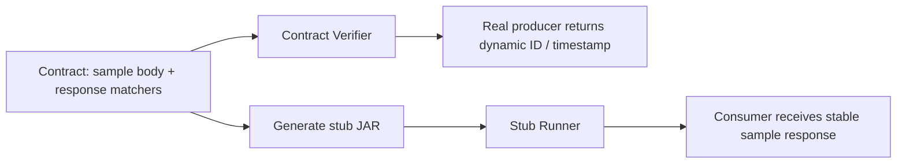
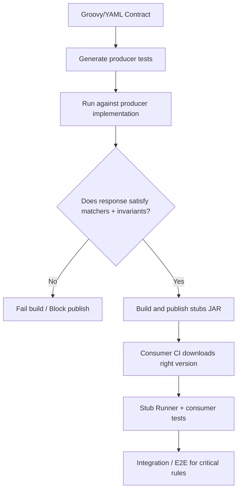

# Dynamic Values Such as Identifiers and Timestamps

> **Chapter:** Response HTTP  
> **Module:** Spring Cloud Contract (`SPRING_CLOUD_CONTRACT`) — producer–consumer contract testing with Groovy/YAML DSL, generating producer-side tests, publishing stubs, running Stub Runner, and CI integration.

## Learning Objectives

After this lesson, you will be able to:

1. Identify **dynamic response fields** such as UUIDs, transaction IDs, creation dates, timestamps, and correlation IDs, and understand why comparing fixed values easily causes unnecessary test failures.
2. Distinguish **sample values returned to the consumer from stubs** from **verification conditions on the producer's real response**.
3. Declare `response.bodyMatchers` in the **Groovy DSL** or `response.matchers.body` in the **YAML DSL**.
4. Choose `by_regex`, `by_type`, `by_date`, `by_time`, and `by_timestamp` matchers matching the data type and time format.
5. Write contracts preserving **business invariants** such as `status: CREATED`, quantities, field names, and HTTP codes, while allowing IDs/timestamps to be generated dynamically.
6. Understand Stub Runner's limitations and plan CI verification to detect incompatible API changes.

## 1. The Problem: Two Valid Responses Can Differ

Consider an order creation flow: `checkout-service` (consumer) sends a request to `orders-service` (producer):

```http
POST /api/orders HTTP/1.1
Content-Type: application/json
Accept: application/json

{"sku":"BOOK-001","quantity":2}
```

On the first call, the producer returns:

```http
HTTP/1.1 201 Created
Content-Type: application/json

{
  "orderId": "1d9541da-e454-4584-b45e-750b5bbb3104",
  "createdAt": "2025-01-12T08:30:45Z",
  "status": "CREATED",
  "sku": "BOOK-001",
  "quantity": 2
}
```

On the next call, the same valid request may receive:

```json
{
  "orderId": "cf1e4631-2d85-4287-99c9-55ded5f9d6ce",
  "createdAt": "2025-01-12T08:31:02Z",
  "status": "CREATED",
  "sku": "BOOK-001",
  "quantity": 2
}
```

The differences in `orderId` and `createdAt` are **expected**, because the application generates a new UUID and records the processing time. Meanwhile, `status`, `sku`, and `quantity` must still satisfy the conditions agreed upon by both sides.

If the contract compares the **entire JSON response** against an example with a fixed ID and timestamp, producer tests will fail even with a valid implementation. Conversely, if all assertions are removed so tests stay green, CI will fail to catch bugs that change `status` to `FAILED` or turn `quantity` into a string.

The solution is to **keep sample values for stub generation** and **declare matchers for dynamic fields requiring verification**.

## 2. Who Needs Sample Values and Who Needs Matching Conditions?

Spring Cloud Contract uses a single contract for two different purposes:

| Role | Need | Regarding `orderId` / `createdAt` |
| --- | --- | --- |
| **Producer verification test** | Send real request to producer and check real response | Accepts many values, yet must conform to the committed format |
| **Consumer test with Stub Runner** | Receive a predictable response to test HTTP client handling code | Can use **fixed sample** UUID and timestamp from `response.body` |
| **CI / stub release** | Ensure the contract was verified by the producer before consumers depend on it | Generate tests, run tests, package and publish versioned stubs |



The most important distinction is:

- **Request matchers** govern **which requests** the stub accepts. Producer tests need a concrete sample request to invoke real code.
- **Response matchers** govern how **the response produced by the producer is verified**. The sample response is also used as data for stubs.
- If you write only `response.body` without declaring matchers, dynamic values may be treated as **fixed** expectations.

Thus the two sides do not need to return **the same single UUID**, yet they must share **the same definition of UUID and invariant fields**. <https://docs.spring.io/spring-cloud-contract/reference/howto/how-to-provide-dynamic-values.html>

## 3. First Contract: What Problem Does a Fixed Response Cause?

Place the following YAML file in the producer at `src/test/resources/contracts/order_created.yml`:

```yaml
name: order_created

request:
  method: POST
  url: /api/orders
  headers:
    Content-Type: application/json
    Accept: application/json
  body:
    sku: BOOK-001
    quantity: 2

response:
  status: 201
  headers:
    Content-Type: application/json
  body:
    orderId: 1d9541da-e454-4584-b45e-750b5bbb3104
    createdAt: "2025-01-12T08:30:45Z"
    status: CREATED
    sku: BOOK-001
    quantity: 2
```

This contract is very readable, yet has a drawback: if the producer actually uses `UUID.randomUUID()` and the current clock, the next test run returns a different ID and timestamp. An assertion comparing exact literal values will not work.

Do not change production code to always return `orderId` and `createdAt` from the sample YAML. Doing so defeats the purpose of unique IDs and creation timestamps.

Different case: if business logic mandates a fixed ID because it is a **known reference code** (for example, looking up a seeded order), exact matching remains the right choice. The difference lies in the *business promise*, not whether a field name contains `id` or `date`.

## 4. YAML Solution: `response.matchers.body`

Keep `response.body` as sample data and **add `response.matchers.body`** for verification:

```yaml
name: order_created
description: "Producer creates order with dynamic ID and timestamp"

request:
  method: POST
  url: /api/orders
  headers:
    Content-Type: application/json
    Accept: application/json
  body:
    sku: BOOK-001
    quantity: 2

response:
  status: 201
  headers:
    Content-Type: application/json
  body:
    orderId: 1d9541da-e454-4584-b45e-750b5bbb3104
    createdAt: "2025-01-12T08:30:45Z"
    status: CREATED
    sku: BOOK-001
    quantity: 2
  matchers:
    body:
      - path: $.orderId
        type: by_regex
        predefined: uuid
      - path: $.createdAt
        type: by_regex
        value: '[0-9]{4}-[0-9]{2}-[0-9]{2}T[0-9]{2}:[0-9]{2}:[0-9]{2}Z'
```

**Meaning of each component:**

- `path: $.orderId` is a **JSONPath** pointing to a field in the response JSON.
- `type: by_regex` requires the value returned by the producer to match a regular expression.
- `predefined: uuid` uses Spring Cloud Contract's built-in UUID pattern.
- `createdAt` uses an explicit regex for strings shaped `YYYY-MM-DDTHH:mm:ssZ` (UTC, second-level precision).
- `status`, `sku`, and `quantity` **have no matcher**, so they keep exact-value expectations from the sample body.
- `response.status` must still be `201` and `Content-Type` must satisfy the contract.

**Regex only checks textual shape.** The simple expression above could accept strings like day 99 or month 99 if digit counts match; if business logic requires a valid calendar date/time or a timestamp after a certain cutoff, add checks via a time parser or business tests. This is the difference between "a well-shaped string" and "a valid timestamp".

The `createdAt` value in the YAML body must be quoted so it is unambiguously parsed as a **string**, avoiding differences across YAML parsers. UUID is also a string; the UUID example above is not turned into a number by the parser, though you can quote it for extra clarity.

### 4.1. Why Are Sample Values Still Required?

Inside `body`, sample IDs and timestamps serve at least two purposes:

1. **Stub Runner** has a concrete response to return to consumer tests.
2. **Readers and contract generators** see the structure, data types, and a valid example.

Thus, consumer tests by default may receive **the exact same sample UUID** on every call. That is completely acceptable when the test goal is: the client parses a valid UUID, reads the timestamp, and handles `status: CREATED`.

If the consumer must prove **two calls generate two distinct IDs**, a stub returning a fixed sample cannot prove that rule. Test that property on the producer using unit/integration tests with a controllable UUID generator or appropriate E2E tests. Never infer that "a producer value accepted by a matcher" means "the stub randomly generates a new value".

### 4.2. Impact of Matchers on Assertions

Suppose the producer returns:

```json
{
  "orderId": "e8c54344-bb81-4a90-9f92-b8ca991f2a60",
  "createdAt": "2025-01-12T10:15:30Z",
  "status": "CREATED",
  "sku": "BOOK-001",
  "quantity": 2
}
```

This response satisfies the example because the ID and timestamp match the patterns, while fixed fields match expectations.

Conversely:

```json
{
  "orderId": "not-an-id",
  "createdAt": "tomorrow",
  "status": "FAILED",
  "sku": "BOOK-001",
  "quantity": "2"
}
```

fails for multiple reasons: malformed UUID, malformed timestamp, status different from `CREATED`, and quantity turned into a **string**. A contract with well-placed matchers still catches communication-breaking changes.

## 5. Supported Time Matchers

Spring Cloud Contract provides specialized matchers for dates, times, and timestamps. They are useful when the producer uses formats matching the standard patterns supported by the DSL. <https://docs.spring.io/spring-cloud-contract/reference/project-features-contract/dsl-dynamic-properties.html>

| YAML Matcher | Groovy DSL Syntax | Primary Meaning | Illustrative Sample |
| --- | --- | --- | --- |
| `by_date` | `byDate()` | ISO date | `2025-01-12` |
| `by_time` | `byTime()` | ISO time | `08:30:45` |
| `by_timestamp` | `byTimestamp()` | Date + time in ISO pattern supported by the matcher | `2025-01-12T08:30:45` |
| `by_regex` | `byRegex(...)` | Custom-defined pattern | `2025-01-12T08:30:45Z` with regex including `Z` |
| `by_type` | `byType()` | Checks only JSON type of field | String / Number / Boolean / Array |
| `by_equality` | `byEquality()` | Exact value | `status: CREATED` |

Example with date, time, and timestamp **without offset**:

```yaml
response:
  status: 200
  headers:
    Content-Type: application/json
  body:
    publishedDate: "2025-01-12"
    publishedTime: "08:30:45"
    publishedAt: "2025-01-12T08:30:45"
  matchers:
    body:
      - path: $.publishedDate
        type: by_date
      - path: $.publishedTime
        type: by_time
      - path: $.publishedAt
        type: by_timestamp
```

The snippet above is **an alternative response example**, not a second `response` block added to the same contract in section 4.

**Timezone caution:** `2025-01-12T08:30:45` is a time without an offset, lacking enough information for all consumers to identify the same global instant. In distributed APIs, agree on ISO 8601 with an offset such as `Z` or `+07:00` and verify with a suitable regex, the predefined `iso_8601_with_offset` matcher when compatible, or timestamp parsing tests at the application layer. Do not blindly apply `by_timestamp` to every timezone variant without verifying the generator and actual pattern.

### 5.1. Using Predefined Patterns

YAML `by_regex` can use `predefined` instead of hand-writing regexes:

```yaml
response:
  status: 200
  body:
    orderId: 1d9541da-e454-4584-b45e-750b5bbb3104
  matchers:
    body:
      - path: $.orderId
        type: by_regex
        predefined: uuid
```

Besides `uuid`, the DSL provides predefined patterns such as `iso_date`, `iso_date_time`, `iso_time`, `iso_8601_with_offset`, `number`, and `non_blank`. However, each pattern addresses a specific format; verify it matches how your API serializes data.

For UUIDs, agree on whether the consumer needs a **canonical 36-character UUID**, ULID, auto-increment integer, or another string ID. Do not use a UUID matcher if the producer returns `ORD-00017`: that is a different contract, not a UUID generator bug.

## 6. Equivalent Groovy DSL Version

With the same request/response as `order_created.yml`, this can be written as `order_created.groovy`:

```groovy
org.springframework.cloud.contract.spec.Contract.make {
    name 'order_created'

    request {
        method 'POST'
        url '/api/orders'
        headers {
            contentType(applicationJson())
            header 'Accept': 'application/json'
        }
        body(
            sku: 'BOOK-001',
            quantity: 2
        )
    }

    response {
        status 201
        headers {
            contentType(applicationJson())
        }
        body(
            orderId: '1d9541da-e454-4584-b45e-750b5bbb3104',
            createdAt: '2025-01-12T08:30:45Z',
            status: 'CREATED',
            sku: 'BOOK-001',
            quantity: 2
        )
        bodyMatchers {
            jsonPath('$.orderId',
                byRegex('[0-9a-fA-F]{8}-[0-9a-fA-F]{4}-[0-9a-fA-F]{4}-[0-9a-fA-F]{4}-[0-9a-fA-F]{12}'))
            jsonPath('$.createdAt',
                byRegex('[0-9]{4}-[0-9]{2}-[0-9]{2}T[0-9]{2}:[0-9]{2}:[0-9]{2}Z'))
        }
    }
}
```

In Groovy:

- `body(...)` carries concrete values for stub generation.
- `bodyMatchers { jsonPath(..., byRegex(...)) }` specifies verification for **dynamic response fields**.
- The `$` in JSONPath denotes **the root of the JSON document**, not Groovy variable interpolation here.
- Keep **only one version** (YAML or Groovy) in the contract folder if both represent the same interaction; keeping both can generate duplicate tests/stubs.

Besides `bodyMatchers`, the Groovy DSL supports placing dynamic values directly inside `body` using `$(consumer(...), producer(...))`. The meaning is: in a **response**, the consumer/stub receives a fixed sample, while producer tests verify a condition such as a regex. The response body snippet below uses that **alternative style**, not combined simultaneously with a body matcher for the same field:

```groovy
response {
    status 201
    headers {
        contentType(applicationJson())
    }
    body(
        orderId: $(
            consumer('1d9541da-e454-4584-b45e-750b5bbb3104'),
            producer(regex('[0-9a-fA-F]{8}-[0-9a-fA-F]{4}-[0-9a-fA-F]{4}-[0-9a-fA-F]{4}-[0-9a-fA-F]{12}'))
        ),
        status: 'CREATED'
    )
}
```

**Only the Groovy/Java DSL supports inline dynamic values like `$(...)`.** In YAML, use `matchers`. Choosing between the two styles is a representation decision and does not affect the API's invariants.

## 7. Implementing a Producer with Truly Dynamic IDs and Timestamps

Minimal Spring MVC example for the order creation endpoint:

```java
package com.example.orders;

import java.time.Clock;
import java.time.OffsetDateTime;
import java.time.ZoneOffset;
import java.time.format.DateTimeFormatter;
import java.util.UUID;

import org.springframework.http.HttpStatus;
import org.springframework.http.MediaType;
import org.springframework.web.bind.annotation.PostMapping;
import org.springframework.web.bind.annotation.RequestBody;
import org.springframework.web.bind.annotation.ResponseStatus;
import org.springframework.web.bind.annotation.RestController;

@RestController
public class OrdersController {

    private static final DateTimeFormatter API_TIMESTAMP =
        DateTimeFormatter.ofPattern("yyyy-MM-dd'T'HH:mm:ss'Z'");

    private final Clock clock;

    public OrdersController() {
        this(Clock.systemUTC());
    }

    public OrdersController(Clock clock) {
        this.clock = clock;
    }

    @PostMapping(
        path = "/api/orders",
        consumes = MediaType.APPLICATION_JSON_VALUE,
        produces = MediaType.APPLICATION_JSON_VALUE
    )
    @ResponseStatus(HttpStatus.CREATED)
    public CreatedOrder create(@RequestBody CreateOrder request) {
        String id = UUID.randomUUID().toString();
        String timestamp = OffsetDateTime.now(clock).withOffsetSameInstant(ZoneOffset.UTC)
            .format(API_TIMESTAMP);

        return new CreatedOrder(
            id, timestamp, "CREATED", request.sku(), request.quantity()
        );
    }

    public record CreateOrder(String sku, int quantity) {}

    public record CreatedOrder(
        String orderId,
        String createdAt,
        String status,
        String sku,
        int quantity
    ) {}
}
```

Assumptions in this example:

- `UUID.randomUUID()` generates a new ID on every call. The contract verifies UUID format, without requiring equality to the sample value.
- `Clock` can be swapped for a fixed clock in **unit tests** when specific time-handling behavior needs verification.
- The timestamp is formatted in UTC, ending with `Z` and precise to the second; the regex in the contract must agree with this format.
- The controller illustrates only the response; it does not persist orders to a DB, validate negative quantities, or handle duplicate orders. Those behaviors require separate tests.

### 7.1. Base Class for Contract-Generated Producer Tests

In a producer project using Contract Verifier and JUnit 5, you can configure a base class:

```java
package com.example.orders;

import io.restassured.module.mockmvc.RestAssuredMockMvc;
import org.junit.jupiter.api.BeforeEach;

public abstract class ContractTestBase {

    @BeforeEach
    void setup() {
        RestAssuredMockMvc.standaloneSetup(new OrdersController());
    }
}
```

The Maven/Gradle plugin must be configured so generated tests **extend this class**, along with the Contract Verifier dependency matching the Spring Cloud version. Do not run this class standalone; it provides setup for generated tests.

The producer test generated from the contract will send `POST /api/orders` with the sample request, receive `201`, and verify the response. An `orderId` and `createdAt` differing from the sample values will still pass if they satisfy the matchers; `status`, `sku`, and `quantity` must still match.

When the real producer changes `status` to `PENDING`, turns `quantity` into a string, or omits `orderId`, the test must signal a corresponding failure. That is the goal of contract verification.

## 8. Dynamic Values in Response Headers

Not only the body—responses can also contain dynamic headers: `Location` pointing to the newly created resource, `ETag` describing resource version, `X-Correlation-Id` for tracing, or headers added by a gateway.

Example API returning a sample correlation ID in a response header:

```http
HTTP/1.1 201 Created
Content-Type: application/json
X-Correlation-Id: corr-0042
```

If the producer is required to return a code shaped `corr-` plus four digits, YAML can use a **header matcher**:

```yaml
response:
  status: 201
  headers:
    Content-Type: application/json
    X-Correlation-Id: corr-0042
  body:
    status: CREATED
  matchers:
    headers:
      - key: X-Correlation-Id
        regex: 'corr-[0-9]{4}'
```

This is an **alternative response example**: add the header to the producer implementation before running tests. `response.matchers.headers` uses a list of `key` and `regex`, unlike body matchers which use `path` and `type`.

A producer test that only checks the format of `X-Correlation-Id` **does not prove** that header equals the exact value from the request. If the requirement is to "echo back X-Correlation-Id", verify the request–response relationship, not just a regex.

### 8.1. Echoing Back a Value from the Request

A practical scenario: the client sends `clientReference` and the producer must return that exact `clientReference`, which can differ on every request.

When writing the Groovy DSL, you can use `fromRequest().body(...)`. In YAML, Spring Cloud Contract supports response templating using Handlebars syntax; abbreviated response body example:

```yaml
request:
  method: POST
  url: /api/echo
  headers:
    Content-Type: application/json
  body:
    clientReference: CLIENT-001

response:
  status: 200
  headers:
    Content-Type: application/json
  body:
    clientReference: "{{{ jsonpath this '$.clientReference' }}}"
```

Here the JSONPath expression is evaluated against the request when Stub Runner renders the sample response; the template is not a fixed literal string that the consumer receives verbatim. Inspect the **generated stub mapping**, the corresponding response templating configuration, and actual producer tests for your Spring Cloud Contract version. Template syntax helps express data dependencies; it does not automatically guarantee business properties like unique IDs or monotonic timestamps.

## 9. When to Use `by_type`, `by_regex`, or Exact Matching?

| Response Field | Consumer's Real Expectation | Recommended Matcher | Avoid |
| --- | --- | --- | --- |
| `orderId` is a UUID | UUID format, parseable | `by_regex` with `predefined: uuid` | Forcing a fixed ID |
| `createdAt` has `Z` suffix | Agreed UTC string format | `by_regex` (or verified offset pattern) | Assuming every timestamp matches `by_timestamp` |
| `createdDate` without time | ISO date | `by_date` | Using regex `.*` |
| `publishedAt` without offset | ISO date-time matching DSL format | `by_timestamp` | Comparing against test machine's exact wall time |
| `amount` is a number | Just a JSON Number | `by_type` with numeric sample body | Accepting strings if consumer requires a number |
| `amount` must be > 0 | Business rule | Dedicated assertion/test or `by_command` with helper | Using only `by_type` and assuming positivity was checked |
| `status` must be `CREATED` | Stable value | Exact match, optionally `by_equality` | Relaxing to any string |
| `correlationId` must exist and be non-empty | Non-blank string | `by_regex` with `predefined: non_blank` | Dropping assertion completely |
| `error` field must be null | JSON null is committed | `by_null` with matching sample data | Using string `"null"` |

A `by_type` matcher cares only about **JSON type**—for example, if the sample body has `amount: 1000` (a number), the producer can return `-42` and still pass the type check. If the consumer requires `amount > 0`, add an assertion expressing that rule.

A regex like `[0-9a-fA-F-]+` checks only a character set, **not that the string is a valid UUID**. Use the predefined `uuid` matcher or an expression describing UUID structure to avoid letting bugs slip through.

### 9.1. Relationships Across Multiple Dynamic Fields

A response may contain:

```json
{
  "orderId": "1d9541da-e454-4584-b45e-750b5bbb3104",
  "resourceUrl": "/api/orders/1d9541da-e454-4584-b45e-750b5bbb3104"
}
```

Two separate regexes may deem both fields "well-formatted" even when the ID values **differ**. If the commitment requires `resourceUrl` to contain the exact same `orderId`, verify **cross-field relationships** via custom assertions in producer tests or an appropriate DSL mechanism. This is a different rule from checking each field's individual shape.

Similarly, `createdAt <= updatedAt` or `expiresAt > createdAt` are time-based business constraints; the `by_timestamp` matcher does not compare the ordering of two values on its own.

## 10. Consumer Testing with Stub Runner

Once producer contract verification passes, the build can produce a stub artifact, for example:

```text
com.example:orders-service:1.0.0:stubs
```

The consumer uses Stub Runner to load the published stub and exercise its HTTP client. JUnit/Spring example:

```java
@SpringBootTest(properties = {
    "orders.base-url=http://localhost:8090"
})
@AutoConfigureStubRunner(
    ids = "com.example:orders-service:1.0.0:stubs:8090",
    stubsMode = StubRunnerProperties.StubsMode.LOCAL
)
class OrdersClientContractTest {

    @Autowired
    OrdersClient client; // Assumed client existing in the consumer project

    @Test
    void parseDuocIdVaTimestampTuProducerStub() {
        CreatedOrder order = client.create("BOOK-001", 2);

        UUID.fromString(order.orderId());
        OffsetDateTime.parse(order.createdAt());

        assertEquals("CREATED", order.status());
        assertEquals(2, order.quantity());
    }
}
```

This snippet illustrates **the idea of calling a real client** with `OrdersClient` and `CreatedOrder` classes omitted; to run it, implement the client and add appropriate imports and dependencies. The `orders.base-url` property is also an illustrative application setting. `LOCAL` works only when the stub has been installed into the local Maven repository.

What this consumer test proves:

- The consumer sends a request matching the stub mapping.
- The consumer parses `orderId` and `createdAt` from a contract-compliant JSON response.
- The consumer handles the committed `status` and `quantity`.

What this consumer test **does not prove**: that IDs on each call are unique, that timestamps reflect the real clock, or that the latest producer currently obeys the contract. For those guarantees, you need producer verification and appropriate unit/integration/E2E tests.

### 10.1. Why Do Stubs Usually Return the Same Sample ID?

A default stub generated from YAML may return:

```json
{
  "orderId": "1d9541da-e454-4584-b45e-750b5bbb3104",
  "createdAt": "2025-01-12T08:30:45Z",
  "status": "CREATED",
  "sku": "BOOK-001",
  "quantity": 2
}
```

whenever the request matches. This keeps consumer tests repeatable and independent of real wall-clock time. However, if consumer code needs IDs to change per request, build a stub/template scenario with an input–output relationship, or write integration tests against a producer test environment. Avoid inventing arbitrary "dynamic stubs" without a mechanism to verify consistency with the producer.

## 11. Integrating Tests Into CI and Catching Breaking API Changes

A reference CI workflow:



From the producer directory, learners can run:

```bash
mvn clean verify
```

With the Maven plugin configured, contracts in `src/test/resources/contracts` are used to generate producer verification tests. Once tests pass, run `mvn install` or `mvn deploy` per the project workflow to install/publish the stub artifact; never use `-DskipTests` for the compatibility verification step.

### 11.1. Which Changes Are Caught?

| Change on Producer | Expected Outcome with Section 4 Contract | Reason |
| --- | --- | --- |
| Return a new valid UUID every time | **PASS** | Matches `uuid` pattern |
| UTC timestamp advances over time, still `...Z` | **PASS** | Matches committed regex |
| Return `"orderId": "abc"` | **FAIL** | Invalid UUID format |
| Return `createdAt: "ngay mai"` | **FAIL** | Invalid time format |
| Return `status: "FAILED"` | **FAIL** | Violates invariant value |
| Omit `quantity` field | **FAIL** | Missing expected field |
| Change `quantity` from `2` to `"2"` | **FAIL** | Wrong body type and value |
| Change `201` to `200` | **FAIL** | Wrong HTTP status |
| Return well-formatted time absurdly far in the past | **May PASS** | Regex does not validate temporal plausibility |

If CI shows producer contract tests staying green after breaking an invariant that should be protected, check whether **a matcher was relaxed too far**, a field was omitted from the contract, or tests were disabled. Always force a test to fail intentionally before trusting it as a compatibility gate.

### 11.2. Managing Stub Versions

Consumer tests against an old stub can keep passing even when a new producer implementation produces the wrong format. You must:

1. Run producer contract verification **before publishing** new artifacts.
2. Version stubs so consumers know which API version they are testing against.
3. Check consumers still depending on older contracts/versions when changing formats.
4. Only allow consumers to bump stub versions if they understand the new response.
5. Maintain unit/integration tests for ID uniqueness, timezones, monotonic timestamps, and persistence logic.

Do not treat changing `createdAt` from ISO 8601 to epoch milliseconds as a "minor change" if the consumer parses a string. That is a **breaking change** even though both represent timestamps.

## 12. Common Issues and Fixes

| Issue | Symptom | How to Fix |
| --- | --- | --- |
| Hardcoding IDs | Producer test fails when UUID changes | Add `uuid` response matcher |
| Overly loose ID regex | `orderId: abc` still accepted | Use predefined `uuid` or structurally sound regex |
| Using `by_type` for everything | Wrong business values still pass | Keep equality for fixed fields, dedicated assertions for relationships |
| Pairing `Z` with `by_timestamp` casually | Test fails despite valid offset timestamp | Choose verified regex/ISO offset pattern |
| Timestamp lacks timezone | Two consumers interpret times differently | Standardize `Z`/offset in API and tests |
| Forgetting quotes around dates in YAML | String interpreted differently by parser | Put `createdAt: "..."`, verify type |
| Wrong matcher placement | Putting `matchers` at root or mixing request/response | Place under `response.matchers.body` |
| Wrong JSONPath | Matcher points to wrong field | Use `$.orderId`, `$.items[0].id` matching JSON structure |
| Stub returns fixed sample ID | Consumer test does not see IDs change | That is normal stub behavior; test uniqueness on producer |
| Consumer uses stale stub | Consumer passes while new producer breaks | Check build, artifacts, and stub version |
| Producer tests bypassed | Stub published despite violating implementation | Never skip `verify` and block publish on red builds |

## 13. Practice Exercises

**Exercise 1 — Fixing a brittle contract.** In `order_created.yml` from section 3, add two response matchers so the producer can generate new UUIDs and UTC timestamps while tests still pass. Explain why `status` does not need a matcher.

**Exercise 2 — Choosing matcher types.** Classify `requestId` (UUID), `createdDate` (`YYYY-MM-DD`), `createdAt` (ISO with offset), `quantity` (integer that must equal 2), and `price` (positive number) by appropriate verification type. Which case requires a business assertion rather than `by_type` alone?

**Exercise 3 — Catching a breaking change.** Temporarily change the producer to return `orderId: ORD-9` while the contract uses `predefined: uuid`. Predict which assertion fails and explain why consumer tests against an old stub might still pass.

**Exercise 4 — Relationship between two fields.** The producer returns `orderId` and `resourceUrl`. Write a test ensuring `resourceUrl` contains **the exact** `orderId` from the same response. Why are two separate valid regexes not enough?

**Exercise 5 — Time and timezones.** Switch `createdAt` from an ISO UTC string to epoch milliseconds. Identify the changes required across the contract, consumer DTO, stub version, and CI so both sides migrate safely.

**Exercise 6 — Stub Runner.** Write a consumer test parsing `orderId` into a `UUID` and `createdAt` into an `OffsetDateTime`. Explain why repeating the test multiple times against the same stub response does not verify ID uniqueness.

## 14. Takeaways

Dynamic values such as **identifiers, correlation IDs, and timestamps** should not be accidentally hardcoded in producer verification tests. In Spring Cloud Contract, the **response body** provides samples usable for stubs, while **response matchers** define the real values the producer is permitted to return. The Groovy DSL uses `bodyMatchers` or `consumer/producer` pairs for dynamic values; the YAML DSL uses `response.matchers.body`.

A useful contract is both **flexible** on IDs/timestamps and **strict** on status, HTTP codes, data types, and business invariants. Producer tests running in CI protect the API promise; stubs are published after producer verification passes and consumed via Stub Runner. When verifying **ID uniqueness, cross-field relationships, or chronological ordering**, add unit/integration tests instead of assuming format matchers guarantee everything.

## References

- [Spring Cloud Contract — Dynamic Properties](https://docs.spring.io/spring-cloud-contract/reference/project-features-contract/dsl-dynamic-properties.html) — `bodyMatchers`, `byRegex`, `byTimestamp`, `byType`, and YAML matchers.
- [Spring Cloud Contract — How Can I Provide Dynamic Values to a Contract?](https://docs.spring.io/spring-cloud-contract/reference/howto/how-to-provide-dynamic-values.html) — why sample data and dynamic value verification must be separated.
- [Spring Cloud Contract — Contract DSL](https://docs.spring.io/spring-cloud-contract/reference/project-features-contract.html) — expressing producer/consumer contracts.
- [Spring Cloud Contract — YML Schema](https://docs.spring.io/spring-cloud-contract/reference/yml-schema.html) — structure of response matchers in YAML.
- [Spring Cloud Contract — Stub Runner Core](https://docs.spring.io/spring-cloud-contract/reference/project-features-stubrunner/stub-runner-core.html) — running stubs with consumer tests.
