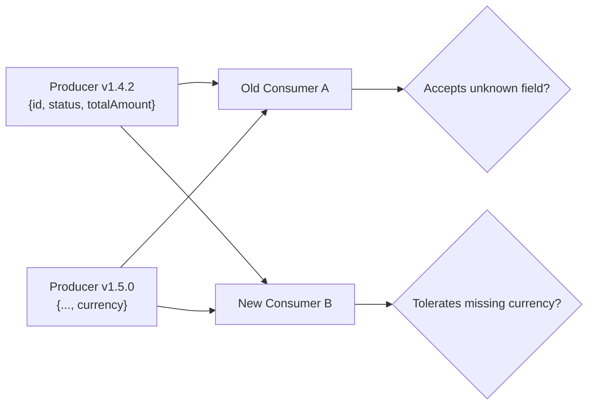
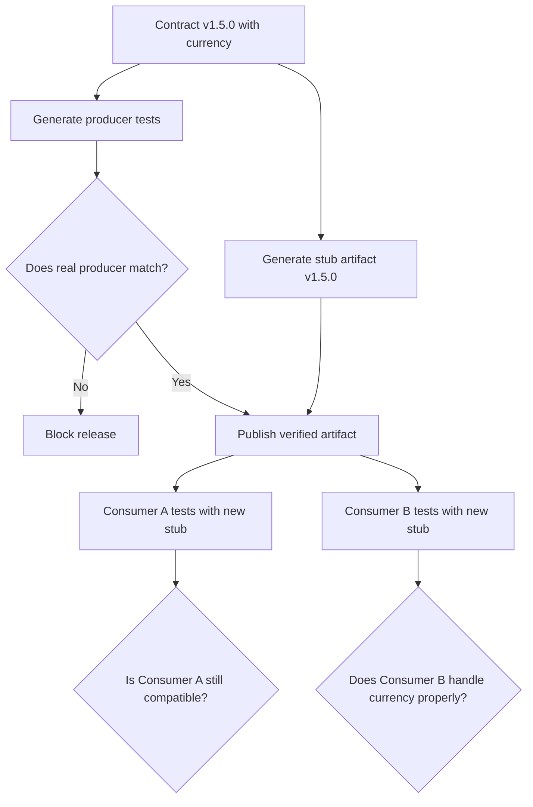
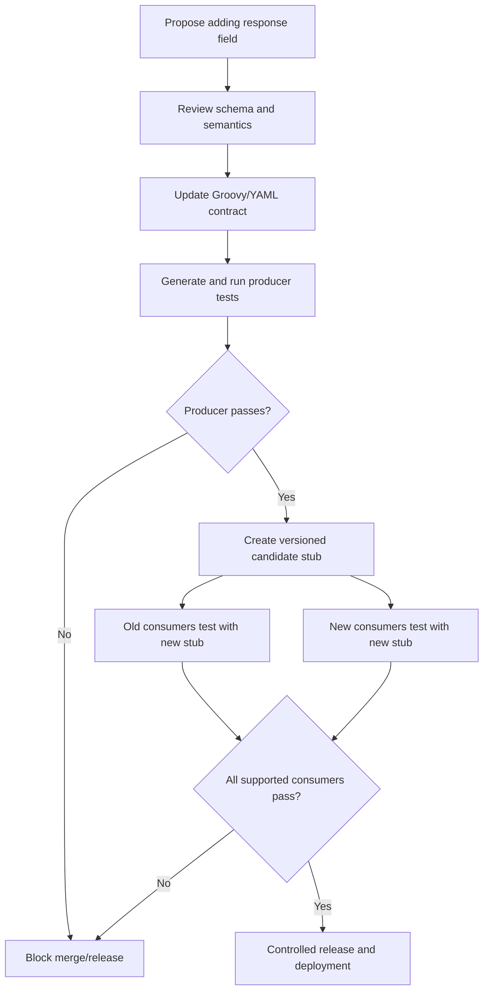

# New Fields in Responses and Compatibility Testing

## 1. Is Adding a JSON Field Always a Compatible Change?

In the **SPRING_CLOUD_CONTRACT** module, Spring Cloud Contract helps producers and consumers agree on HTTP or messaging behavior using the **Groovy/YAML DSL**. From contracts, the tool can generate producer-side tests, package stubs for consumers to use via **Stub Runner**, and integrate into CI to detect incompatible API changes.

For **HTTP responses**, a common situation is the producer adding a JSON field without changing the method, URL, or status code. For example, an order service originally returns:

```http
HTTP/1.1 200 OK
Content-Type: application/json

{
  "id": "ord-1001",
  "status": "CREATED",
  "totalAmount": 125000
}
```

A later version adds `currency`:

```http
HTTP/1.1 200 OK
Content-Type: application/json

{
  "id": "ord-1001",
  "status": "CREATED",
  "totalAmount": 125000,
  "currency": "VND"
}
```

This is an **additive change**. However, you cannot conclude "backward compatible" solely from not removing old fields. The outcome depends on **how the consumer reads JSON**, how strictly the contract/schema constrains the payload, and whether the application relies on assumptions about structure, data types, or value semantics.

After this lesson, you will know how to:

- Distinguish adding fields from removing, renaming, changing types, or changing field semantics.
- Evaluate consumers that **ignore unknown fields** vs. consumers that **reject unknown fields**.
- Describe the new response with Groovy/YAML DSL while keeping prior commitments clear.
- Use producer tests and stubs across two versions to verify compatibility.
- Design a CI matrix for old consumers, new consumers, old producers, and new producers.
- Recognize cases where a contract test passes yet the system still risks failing upon deployment.

## 2. Compatibility Must Be Evaluated From Each Side

### 2.1. Two Different Questions

**Backward compatibility of a new producer with an old consumer:** can a consumer already working with the old response continue processing the new response?

**Ability of a new consumer to run against an old producer:** does a consumer aware of the new field still work when that field is not yet present in responses from an old producer?

These are two different questions, especially when microservices deploy in stages, multiple versions run in parallel, or consumers do not upgrade immediately.

| Component | Example State | Risk to Evaluate |
| --- | --- | --- |
| Producer v1.4.2 | Returns `id`, `status`, `totalAmount` | This is the response current consumers expect |
| Producer v1.5.0 | Also returns `currency` | Do old consumers ignore the new field? |
| Consumer A (old) | DTO has only three fields; strict parser | May fail upon receiving `currency` |
| Consumer B (new) | Displays `currency` | Can it handle responses lacking `currency` from the old producer? |

A change can only be called **compatible with a specific consumer** when that consumer can handle the new response under its real assumptions. Testing one consumer does not guarantee all other consumers share the same tolerance.

### 2.2. Deployment Flow



If consumer A is configured to accept only known fields, **the new producer can cause failures immediately upon deployment**. If consumer B treats `currency` as mandatory while still talking to an old producer, **the new consumer can fail during the upgrade window**.

## 3. Classifying Response Changes

| Change | Example | Initial Assessment | What to Verify |
| --- | --- | --- | --- |
| Add new optional field | Add `currency` while preserving the three old fields | Usually easy to keep compatible | Unknown-property handling, schema, how consumers use the field |
| Add field and require consumers to read it | New consumer always needs `currency` | Can break running against old producer | Is there a valid fallback/transition value? |
| Remove field | Drop `totalAmount` | Usually breaks consumers reading that field | Does any consumer still access the field? |
| Rename | `totalAmount` to `amount` | Effectively remove + add | Are aliases/old fields kept during transition? |
| Change type | `totalAmount: 125000` to `"125000"` | Risks breaking parsers, calculations | Schema, deserializer, numeric type |
| Change meaning | `totalAmount` from VND to USD while still a number | Very high risk even though JSON is valid | Semantic contract and business rules |
| Add value to existing enum field | `status = PARTIALLY_SHIPPED` | Can break consumers using exhaustive switch/when | Does consumer have a default branch and safe behavior? |
| Add field to nested object | `items[].discount` | Still an additive change, may be rejected | Parser/schema of each item |
| Change status or Content-Type | `200` to `204`, JSON to text | Larger change than adding a field | Client branching, parser, and headers |

**Do not confuse structural changes with semantic changes.** A response that remains valid JSON is not necessarily business-compatible. For example, adding `currency` while switching `totalAmount` to the smallest unit of another currency can cause old consumers to miscalculate without throwing any parse error.

## 4. Why Can Consumers Fail When a New Field Appears?

### 4.1. Consumers Accepting Unknown Fields

Suppose a Java consumer needs only `id` and `status`. With Jackson, a DTO can explicitly opt into ignoring unknown properties:

```java
import com.fasterxml.jackson.annotation.JsonIgnoreProperties;

@JsonIgnoreProperties(ignoreUnknown = true)
public record OrderView(String id, String status, long totalAmount) {}
```

With a new response containing `currency`, this setting allows the deserializer to ignore that field when instantiating `OrderView`. The consumer still reads the three existing fields. This snippet uses Java supporting `record` and corresponding Jackson; in real projects, DTOs may be regular classes.

**Limitation:** ignoring unknown fields only avoids parse errors. It does not guarantee `totalAmount` keeps the same business meaning or `status` remains within values the consumer handles.

### 4.2. Consumers Rejecting Unknown Fields

A consumer can explicitly enable strict mode:

```java
import com.fasterxml.jackson.databind.DeserializationFeature;
import com.fasterxml.jackson.databind.ObjectMapper;

// Strict DTO: no @JsonIgnoreProperties(ignoreUnknown = true).
record StrictOrderView(String id, String status, long totalAmount) {}

ObjectMapper mapper = new ObjectMapper()
    .configure(DeserializationFeature.FAIL_ON_UNKNOWN_PROPERTIES, true);

String responseJson = """
    {
      "id": "ord-1001",
      "status": "CREATED",
      "totalAmount": 125000,
      "currency": "VND"
    }
    """;

StrictOrderView order = mapper.readValue(responseJson, StrictOrderView.class);
```

Because `StrictOrderView` does not declare `currency` **and has no config/annotation to ignore unknown properties**, this call can throw `UnrecognizedPropertyException`. These are illustrative code fragments; place mapper creation and deserialization inside a method/test when practicing.

Do not assume every Spring Boot, Jackson, Gson, or TypeScript client is either strict or tolerant of unknown fields by default. **Specific configuration, generated clients, validation schemas, and application logic** determine the outcome.

### 4.3. JSON Schema Can Block New Properties

Even if the JSON parser succeeds, a consumer may validate the response against a JSON Schema:

```json
{
  "type": "object",
  "properties": {
    "id": { "type": "string" },
    "status": { "type": "string" },
    "totalAmount": { "type": "integer" }
  },
  "required": ["id", "status", "totalAmount"],
  "additionalProperties": false
}
```

With `additionalProperties: false`, JSON containing `currency` fails the old schema. Therefore, "adding fields never breaks the API" **is false** when a consumer has published or enforced a closed schema. If the organization wants extensible responses, agree on how unknown properties are handled from the design stage.

### 4.4. Full JSON String Comparison Can Also Break Tests

A consumer test like the following is sensitive to new fields:

```java
assertThat(actualJson).isEqualTo("""
    {"id":"ord-1001","status":"CREATED","totalAmount":125000}
    """);
```

Exact string matching is also sensitive to property order and whitespace. If the consumer only uses `id` and `status`, check those properties via a JSON parser or the consumer's own API while validating the appropriate schema. However, when the response shape **is a committed closed contract**, strict checks remain meaningful; changing that policy requires agreement between both sides.

## 5. Designing Contracts for Responses Before and After Adding Fields

### 5.1. Old Version Contract

Suppose producer version `1.4.2` published a Groovy contract:

```groovy
import org.springframework.cloud.contract.spec.Contract

Contract.make {
    name 'get_order_success'
    description 'Retrieve an existing order'

    request {
        method GET()
        url '/api/orders/ord-1001'
    }

    response {
        status 200
        headers {
            contentType(applicationJson())
        }
        body([
            id         : 'ord-1001',
            status     : 'CREATED',
            totalAmount: 125000
        ])
    }
}
```

This contract protects the three properties the consumer knew at release time. Depending on the version and assertion configuration of generated producer tests, having the producer return extra fields may be tolerated or flagged as differing from the expected body. Do not guess matcher behavior: **run generated tests and inspect the exact matching conditions**.

### 5.2. New Version Contract Adding `currency`

With producer `1.5.0`, the API defines `currency` as the currency code of `totalAmount`. New contract:

```groovy
import org.springframework.cloud.contract.spec.Contract

Contract.make {
    name 'get_order_success'
    description 'Retrieve order and currency unit'

    request {
        method GET()
        url '/api/orders/ord-1001'
    }

    response {
        status 200
        headers {
            contentType(applicationJson())
        }
        body([
            id         : 'ord-1001',
            status     : 'CREATED',
            totalAmount: 125000,
            currency   : 'VND'
        ])
    }
}
```

What must be preserved:

- **Method and URL unchanged:** the consumer still calls `GET /api/orders/ord-1001`.
- **HTTP status and Content-Type unchanged:** response remains `200` and JSON.
- **The three old fields keep their names, types, and meanings** in this scenario.
- **The new field has clear semantics:** `currency = VND` indicates the unit of `totalAmount`.

When generating producer tests from the new contract, missing or wrong `currency` must be detected if the contract asserts that exact value. This **verifies the producer satisfies the new contract**, and does not by itself prove older consumers accept a body with an added field.

### 5.3. Equivalent YAML DSL

The same new response behavior can also be written in the YAML DSL:

```yaml
name: get_order_success
description: Retrieve order and currency unit
request:
  method: GET
  url: /api/orders/ord-1001
response:
  status: 200
  headers:
    Content-Type: application/json
  body:
    id: ord-1001
    status: CREATED
    totalAmount: 125000
    currency: VND
```

Choose Groovy or YAML per project convention; do not put two duplicate contracts in the same plugin-scanned location for the same scenario.

## 6. Distinguishing "Field Present", "Field Absent", and "Field Is Null"

Suppose the new producer lacks currency info for some older orders. The following three responses are not fully equivalent:

**Field absent:**

```json
{
  "id": "ord-1001",
  "totalAmount": 125000
}
```

**Field present with null value:**

```json
{
  "id": "ord-1001",
  "totalAmount": 125000,
  "currency": null
}
```

**Field present with explicit value:**

```json
{
  "id": "ord-1001",
  "totalAmount": 125000,
  "currency": "VND"
}
```

A consumer using `root.get("currency")`, `root.path("currency")`, or a nullable DTO can distinguish these cases differently. JSON Schema also distinguishes a `required` property from one that permits `null`.

| Field Design | Meaning | Compatibility Check |
| --- | --- | --- |
| Optional, may be absent | Old producer or a branch lacking the info | New consumer must handle missing field |
| Mandatory but may be `null` | Field always appears, data undetermined | How does consumer handle `null`? |
| Mandatory and non-`null` | Every response of this kind must provide a value | Producer must supply data; old consumers might still reject unknown properties |

Do not default `currency = "VND"` for every missing-field response if the system supports multiple currencies. **Fallback values must follow sound business rules**, not just avoid parse errors.

### 6.1. Adding Fields Inside Lists or Nested Objects

Example:

```json
{
  "id": "ord-1001",
  "items": [
    {
      "productId": "SKU-001",
      "quantity": 2,
      "discountAmount": 10000
    }
  ]
}
```

`discountAmount` is added to each object inside the `items` array. A consumer with a strict schema on **array elements** can still fail, even if the top-level object's schema allows new fields. Therefore, when reviewing responses, pinpoint the exact **location** of added properties.

## 7. Deliberately Checking Dynamic Values with Matchers

If the new response adds `updatedAt` as a producer-generated timestamp, forcing an exact string match can cause false failures:

```groovy
response {
    status 200
    headers {
        contentType(applicationJson())
    }
    body([
        id       : 'ord-1001',
        currency : 'VND',
        updatedAt: '2026-11-01T10:15:30Z'
    ])
    bodyMatchers {
        jsonPath('$.updatedAt',
                 byRegex('\\d{4}-\\d{2}-\\d{2}T\\d{2}:\\d{2}:\\d{2}Z'))
    }
}
```

This is an example matcher for UTC time without fractional seconds; if the API supports offsets or milliseconds, adjust the expression. Matchers only check **string shape**, which is not enough to prove the timestamp is a valid calendar instant in every case.

How to read it:

- Stubs for consumers have a stable sample `updatedAt`.
- Generated producer tests check the `updatedAt` value in the real response against the declared matcher rule.
- Fields `id` and `currency` in the example remain checked against committed values.

Do not use `byRegex('.*')` for the entire body or every field because it ignores meaningful changes. If the goal is to accept multiple date-time formats, describe accurately the types and rules the consumer accepts.

**Compatibility testing note:** a proper matcher does not automatically make every field addition compatible. It only defines how to check the value of the field currently described by the contract.

## 8. What Do Producer Tests, Stubs, and Consumer Tests Verify?



| Step | Question Answered | What Is Not Guaranteed |
| --- | --- | --- |
| Parse/convert Groovy/YAML | Can the tool read and convert the contract? | Whether real producer or real consumer is compatible |
| Generated producer tests | Does producer return the status/headers/body described by the new contract? | Whether old clients tolerate added properties |
| Stub artifact | Can it simulate responses per the published contract version? | Stubs do not prove the real producer stays valid if producer verification is skipped |
| Consumer integration test with Stub Runner | Does consumer code handle responses from the selected stub? | Other consumer versions that have not run tests |
| Integration/end-to-end tests | Do real components interact properly in the test environment? | Non-participating consumers or every production scenario |

Spring Cloud Contract connects contracts to automated testing, yet **compatibility requires both sides to participate**. A passing producer test is not a "certificate of compatibility with every consumer".

## 9. Using Stub Runner to Test Old Consumers with New Responses

Suppose the old release already has a stub:

```text
com.example:orders-producer:1.4.2:stubs
```

The new version is published independently:

```text
com.example:orders-producer:1.5.0:stubs
```

The consumer should specify which stub version to use. Spring Boot test example:

```java
import org.junit.jupiter.api.Test;
import org.springframework.beans.factory.annotation.Autowired;
import org.springframework.boot.test.context.SpringBootTest;
import org.springframework.cloud.contract.stubrunner.StubRunnerProperties;
import org.springframework.cloud.contract.stubrunner.spring.AutoConfigureStubRunner;

import static org.assertj.core.api.Assertions.assertThat;

@SpringBootTest(properties = {
    "orders.api.base-url=http://localhost:8090"
})
@AutoConfigureStubRunner(
    ids = "com.example:orders-producer:1.5.0:stubs:8090",
    stubsMode = StubRunnerProperties.StubsMode.REMOTE,
    repositoryRoot = "https://artifacts.example.test/repository/maven-releases"
)
class OrderResponseCompatibilityTest {

    @Autowired
    private OrdersClient ordersClient;

    @Test
    void readsOrderReturnedByNewProducerStub() {
        OrderView order = ordersClient.getOrder("ord-1001");

        assertThat(order.status()).isEqualTo("CREATED");
    }
}
```

**Assumptions to run the example:** `OrdersClient` and `OrderView` are types defined by the consumer application; the client must read its base URL from `orders.api.base-url` and configure test dependencies and Spring context properly. The repository URL is illustrative; replace with real artifacts, credentials, library versions, and environment.

If `OrdersClient` uses a strict JSON deserializer and the DTO lacks `currency`, the test can fail right when parsing the response from stub `1.5.0`. That is a valuable signal: **adding the field impacted a specific consumer**.

Conversely, a consumer might parse cleanly yet ignore `currency` in monetary calculations now required by the product. Therefore, new consumers must assert on **behavior** when using the new field, not merely assert that JSON decoded without error.

### 9.1. Pinning Versions Instead of Always Pulling Latest

In release-gating tests, pin versions like `1.5.0` so results are reproducible. If tests always fetch "latest" or a constantly changing `SNAPSHOT`, a failure does not tell you whether the consumer commit broke things or the stub was overwritten.

Pinning versions **does not mean** forever testing against old versions. You can create a separate job proactively running consumers against candidate new stub versions and open PRs to bump versions once compatibility is verified.

## 10. Pre-Deployment Test Matrix

Suppose two producer versions `P-old`/`P-new` and two consumer versions `C-old`/`C-new`:

| Consumer / Producer | P-old: without `currency` | P-new: with `currency` |
| --- | --- | --- |
| C-old ignores unknown properties | Usually works if three old fields remain valid | May work; must run consumer tests |
| C-old rejects unknown properties | Works with old response | May fail when deserializing `currency` |
| C-new treats `currency` as optional | May work with a business-valid fallback | Works when value and type are valid |
| C-new requires `currency` mandatory | May fail due to missing field | Works if field is always present with valid value |

Do not treat "usually works" cells as passing test results: data type changes, client configuration, or other logic may still differ. **Cells must be backed by actual test runs or equivalent evidence.**

### 10.1. Deployment Ordering to Reduce Risk

One rollout sequence when all services cannot upgrade simultaneously:

1. **Agree on new field semantics.** `currency` is the unit of `totalAmount`; ISO 4217 or another convention must be decided explicitly.
2. **Test old consumers.** Run them against the new producer stub; relax overly strict parsers/schemas if API policy permits response extensions.
3. **Make new consumers tolerant of the transition period.** If they may encounter an old producer, handle the missing new field; only use defaults when valid per business rules.
4. **Producer releases the new response** with passing contracts and producer tests; un-upgraded consumers must continue working.
5. **New consumers begin using the new field** once guaranteed the producer/route supplies it or an accepted fallback mechanism is in place.
6. **Close the transition window** once all relevant consumers are confirmed on compatible versions.

If no safe fallback exists, adding a field that new consumers need immediately may require **coordinated releases**, endpoint versioning, or capability negotiation instead of assuming all versions are interchangeable.

## 11. Establishing Contract Policies to Avoid "Compatibility on Paper"

A development team should agree before accepting a new field:

| Decision | Question to Settle | Example |
| --- | --- | --- |
| Unknown-fields rule | Are consumers allowed to reject unknown properties? | API publishes extensible responses, consumers ignore unused fields |
| Data type | Is the field string, number, boolean, or object? | `currency` is a string |
| Presence requirement | Must the field always exist or may it be absent? | New producer always sends it, old producer does not |
| Nullability | Is `null` allowed? | `currency` must not be null on new orders |
| Semantics | Which logic does the value affect? | Currency code applies to `totalAmount` |
| Order and structure | Do consumers depend on field ordering or exact JSON? | Should not depend on JSON object key order |
| Version scope | When is the field released? | Stub `1.5.0` and corresponding API deployment |
| Verification | Who confirms the change does not break consumers? | Producer verification + consumer compatibility suite |

If the organization uses OpenAPI/JSON Schema, update schema documentation alongside the DSL. **Schemas describe types and constraints**; Spring Cloud Contract protects concrete scenarios via tests/stubs. The two layers complement each other rather than automatically replacing each other's responsibilities.

## 12. Common Mistakes When Adding Fields

| Symptom | Common Cause | How to Address |
| --- | --- | --- |
| Old consumer throws `UnrecognizedPropertyException` | DTO/mapper rejects unknown properties | Check compatibility policy; adjust DTO/parser when permitted |
| Consumer using JSON Schema reports extra property | `additionalProperties: false` | Assess whether to allow schema extension or require a new version |
| Producer test fails after adding `currency` | Contract/test assertions not updated or producer returns different value | Compare DSL, generated tests, and actual response |
| Producer test passes yet consumer still fails | Producer verification does not run consumer code | Run consumer against new stub and check real parser |
| New consumer fails when calling old producer | New field is absent | Handle missing field or coordinate deployment order |
| Old stub lacks new field | Consumer pins old artifact | Pick the right new stub version, never overwrite old artifacts |
| New field is always `null` in production | Data source unprepared or wrong mapping | Strengthen business/fixture tests, verify nullability |
| Adding field also alters old field's meaning | Change not reflected in JSON shape tests | Review semantics and test consumption logic |
| Full-string JSON comparison test fails | Sensitive to ordering/whitespace or exact shape | Check meaningful fields and behavior, or keep strict if committed |
| CI passes because zero contracts were read | Wrong file scan config or generator did not run | Check contracts/generated tests list and artifacts |

### 12.1. When Facing Failures, Identify the Failing Layer First

```text
Contract parse/convert?
    -> Does producer return the response matching the new contract?
        -> Does stub v1.5.0 contain the new field?
            -> Does consumer parse the new response?
                -> Does consumer logic use the field properly?
                    -> Are parallel deployed versions safe?
```

If producer tests fail, inspect the contract, fixtures, and real response first. If producer tests pass while consumer tests fail, check the deserializer, JSON Schema, and consumer logic. If all tests pass against the new stub yet production fails, investigate wrong stub version usage, real environment, routing, or behaviors absent from the contract.

## 13. Integrating Compatibility Checks Into CI

Reference workflow:



**Producer CI** must confirm contracts are scanned, generated tests run on the real producer, and the stub artifact contains the new response. **Consumer CI** must select the right stub version, invoke real client logic, and assert response-handling behavior.

You can add a compatibility trial job when a producer prepares a release: build a candidate stub `1.5.0-rc1` (if the organization uses that convention), run critical consumers, and only release `1.5.0` once green. Ensure the candidate artifact tested truly matches the official artifact—not just a hand-typed JSON file that the producer never actually emits.

There is no need to publish a new stub release for every wording edit in a contract if no version decision has been made. However, once published, **never overwrite an existing stub under the same coordinates**: consumers need to be able to re-run tests against the exact previous artifact.

## 14. Practice Exercise: Adding Delivery Information

### Problem Statement

Producer `shipping-producer` currently exposes `GET /api/shipments/shp-1001`:

```json
{
  "id": "shp-1001",
  "status": "IN_TRANSIT"
}
```

The team wants to add a field:

```json
{
  "id": "shp-1001",
  "status": "IN_TRANSIT",
  "estimatedDeliveryDate": "2026-12-01"
}
```

Consumer A uses a DTO containing only `id` and `status` and rejects unknown properties. Consumer B wants to display the estimated delivery date, yet may call an older producer that does not send this field.

**Practice requirements:**

1. Write a Groovy or YAML contract for the new response; preserve `200`, `Content-Type`, and the two old fields.
2. Add an example consumer test for A using the new stub. Predict the failure and propose a compatibility solution after confirming the extensible-response policy.
3. Design how B handles the absent field: display "Not yet scheduled" or another business-approved representation; do not fabricate a delivery date.
4. Explain why `"2026-12-01"` is a **date string** in JSON rather than an automatic date-time type; if constraints are needed, verify format and parsing.
5. Build the `P-old/P-new` × `C-A/C-B` matrix and determine the deployment order.
6. Name two supplementary tests that generated producer tests cannot replace on their own, such as consumer DTO compatibility and estimated delivery calculation/display.

### Reference Solution: YAML DSL

```yaml
name: get_shipment_with_estimated_date
request:
  method: GET
  url: /api/shipments/shp-1001
response:
  status: 200
  headers:
    Content-Type: application/json
  body:
    id: shp-1001
    status: IN_TRANSIT
    estimatedDeliveryDate: "2026-12-01"
```

This contract verifies the producer returns the illustrated date string; in a real application, a sufficiently specific date matcher and integration tests verifying date calculation logic may be needed. Consumer A must test deserialization against the new response; consumer B must test both present **and** absent field cases if it can still encounter an old producer during transition.

### Checklist Before Concluding a New Field Is Compatible

- [ ] New field name, type, and meaning are agreed upon.
- [ ] HTTP status, Content-Type, and existing fields retain their commitments.
- [ ] Determined whether the field can be absent, null, or mandatory per version.
- [ ] Checked unknown-fields handling across relevant consumers.
- [ ] Checked whether schemas permit the new property.
- [ ] New Groovy/YAML DSL successfully generates and runs producer tests.
- [ ] New stub artifact has the right response and version.
- [ ] Consumer tests call real clients against the new stub, covering unknown or missing fields.
- [ ] Parallel producer/consumer rollout plan exists if needed.
- [ ] CI uses traceable artifacts without overwriting previously released versions.

**Takeaway:** adding a field to a response is a change that can usually be rolled out safely **when** contracts preserve old commitments and consumers tolerate additional properties. Spring Cloud Contract verifies the producer and provides versioned stubs; consumer tests and deployment matrices are what prove the level of compatibility an application truly needs.
