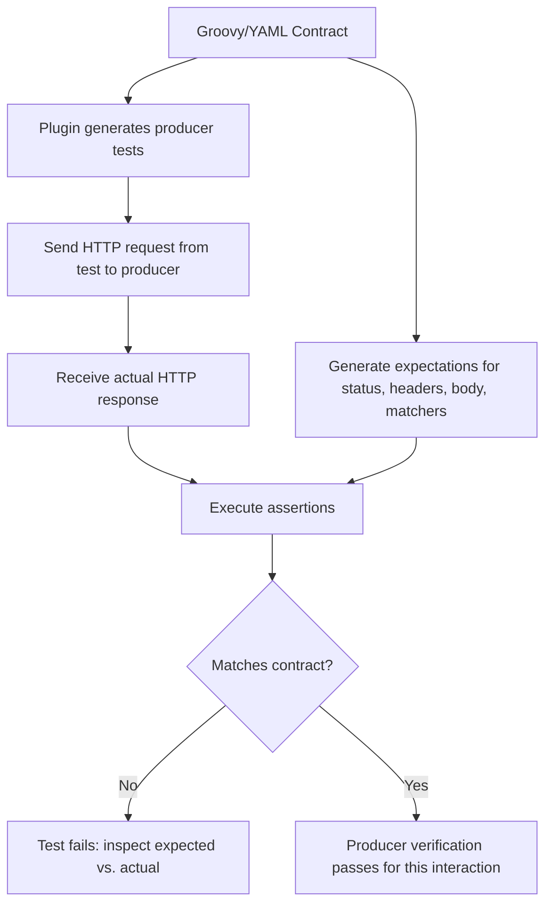
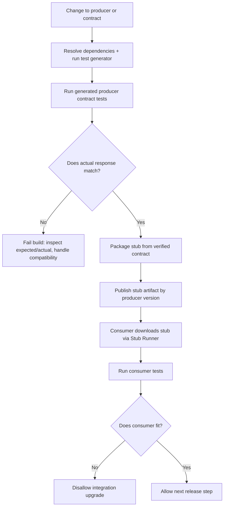

# Comparing Actual Responses Against Generated Expectations

## 1. Why Compare Responses on the Producer Side?

In a multi-service system, the **producer** provides an HTTP API or emits messages, while the **consumer** depends on specific producer behaviors. For HTTP, the consumer does not care only whether an endpoint is reachable; it also needs the right status code, headers, and data structure.

Suppose `Order Service` calls `GET /api/payments/42` on `Payment Service`. Both sides agreed on the response:

```http
HTTP/1.1 200 OK
Content-Type: application/json

{"paymentId":42,"status":"PAID","currency":"VND"}
```

The Payment Service team changes the implementation to return `"paymentState":"PAID"` instead of `"status":"PAID"`. Unit tests using internal mocks may still pass, yet Order Service can no longer read the `status` field. If contract tests run against the real implementation before release, that change can be caught right in the producer's pipeline.

**Spring Cloud Contract** helps turn expectations written in Groovy/YAML DSL into **automated producer-side tests**. The tests send the described request, capture the actual response, and verify that response against the contract. From the same contract source, the build can generate stubs for consumers to test via **Stub Runner** and integrate steps into CI.

After this lesson, you will be able to:

1. Explain the flow from contract to producer test and actual HTTP response.
2. Distinguish verification of **status**, **headers**, **body**, and **matchers** in responses.
3. Understand when exact value comparisons are needed vs. flexible constraints.
4. Diagnose test mismatch results and adjust the contract or implementation appropriately.
5. Set up CI conditions to protect producers and consumers against incompatible API changes.

## 2. How Do Generated Expectations Differ from Actual Responses?

An HTTP interaction has at least three layers to distinguish:

| Component | Where Does It Come From? | Example |
| --- | --- | --- |
| **Contract** | Groovy/YAML file agreed upon by teams | `GET /api/payments/42` must return `200`, JSON with `status` |
| **Generated test expectations** | Spring Cloud Contract Verifier interprets the contract into test assertions | Assert code `200`, `Content-Type`, JSONPath `$.status` |
| **Actual response** | Producer controller/service running in the test environment | Status code, headers, body produced by the real application |

**Comparison** means matching the actual response against contract expectations when tests execute. It is not merely comparing two JSON strings: a test can verify status, headers, data types, fixed values, regexes, or other rules.

High-level diagram:



In real environments, each contract usually maps to one or more scenarios executed per plugin configuration. A **passing** test confirms only the conditions that were described and actually executed; it does not prove all endpoints, all data, and all consumers are compatible.

## 3. Writing an HTTP Contract with Expected Responses

The following Groovy DSL example records a successful payment lookup case:

```groovy
import org.springframework.cloud.contract.spec.Contract

Contract.make {
    description 'Look up a completed payment'

    request {
        method GET()
        url '/api/payments/42'
    }

    response {
        status OK()
        headers {
            contentType(applicationJson())
        }
        body(
            paymentId: 42,
            status: 'PAID',
            currency: 'VND'
        )
    }
}
```

Explanation:

- `request.method GET()` and `request.url` identify the HTTP request sent to the producer.
- `response.status OK()` requires HTTP status `200`.
- `response.headers.contentType(applicationJson())` describes the advertised JSON media type.
- `response.body` describes the response structure and values the consumer needs.

Equivalent YAML contract:

```yaml
description: Look up a completed payment
request:
  method: GET
  url: /api/payments/42
response:
  status: 200
  headers:
    Content-Type: application/json
  body:
    paymentId: 42
    status: PAID
    currency: VND
```

Both DSL formats serve the same purpose: **describing a testable interface**. Do not think `status: PAID` in the body is the HTTP status; the HTTP status at `response.status` is the number `200`, whereas `body.status` is a JSON field carrying business state.

### 3.1. Why Is Reproducible Data Needed?

In the example, the producer test calls `/api/payments/42`. The test environment must have data or configuration so this request returns the agreed outcome. If the test database is empty, the API might return `404`, failing the contract test even though controller logic did not change.

The producer team needs to set up fixtures before tests, use appropriate test repositories/services, or use reproducible data mechanisms. However, **never mock the exact behavior under verification to the point where tests stop exercising real implementation**. The goal is to test the HTTP surface that the consumer relies on.

## 4. What Do Generated Tests Check?

The Spring Cloud Contract Maven/Gradle plugin reads contracts and generates tests matching the configured test framework/test mode (for example MockMvc). Generated code **depends on plugin version, configuration, and framework**, so class names, packages, and assertion statements may vary.

To understand the intent of generated tests, consider a hand-written Spring MVC test with an **equivalent goal**:

```java
@SpringBootTest
@AutoConfigureMockMvc
class PaymentHttpExampleTest {
    @Autowired
    MockMvc mockMvc;

    @Test
    void paymentResponseMatchesContract() throws Exception {
        mockMvc.perform(get("/api/payments/42"))
            .andExpect(status().isOk())
            .andExpect(content()
                .contentTypeCompatibleWith(MediaType.APPLICATION_JSON))
            .andExpect(jsonPath("$.paymentId").value(42))
            .andExpect(jsonPath("$.status").value("PAID"))
            .andExpect(jsonPath("$.currency").value("VND"));
    }
}
```

This is **illustrative code equivalent in testing goal**, not a guarantee of the verbatim Java code Spring Cloud Contract will generate. The example assumes JUnit, Spring Test, `MockMvc` imports, and the application booted in a test context.

When running producer verification, verify in practice that these conditions hold:

1. The **HTTP request** is sent with the exact method, URL, query, headers, and body described by the contract.
2. The **HTTP status** of the actual response matches expectations.
3. Required **HTTP headers**, such as `Content-Type`, have values/formats satisfying the contract.
4. The **response body** contains the committed fields and values or matcher conditions.
5. **Generated tests actually ran** and results were recorded, rather than skipped.

If a contract does not describe a condition, do not assume the test generator automatically knows that condition matters to the consumer.

## 5. Comparing Each Layer of an HTTP Response

### 5.1. HTTP Status: Outcome of the Request

The status code is usually the first condition checked:

| Contract Expectation | Actual Response | Result | Why |
| --- | --- | --- | --- |
| `200 OK` | `200 OK` | PASS at status layer | Same status code |
| `201 Created` | `200 OK` | FAIL | Consumer may distinguish resource creation success |
| `404 Not Found` | `200 OK` | FAIL | Consumer may mishandle missing data |
| `204 No Content` | `200 OK` with body | FAIL | Status and body contract differ |

Passing at the status layer alone **does not mean** the response matched: `200` with invalid JSON schema can still break the consumer.

### 5.2. HTTP Headers: How the Consumer Decodes or Processes

Some headers are especially important:

- `Content-Type`: determines whether the consumer reads the response as JSON, text, or binary.
- `Location`: may be needed when an API creates a resource and returns `201 Created`.
- Version, cache, or correlation headers: constrain only if the consumer has concrete requirements.

Suppose the consumer requires `application/json`; the producer returns `text/plain` containing a valid JSON string. Even though the body looks like JSON, the client may fail to handle it as expected due to the wrong media type. Therefore, contracts should check relevant headers.

**Do not accidentally over-constrain variable parts.** For instance, a response header with a `charset` parameter or a dynamically generated `X-Request-Id` may need flexible matchers. Header comparison strictness depends on declarations and test generation; inspect generated assertions instead of assuming the tool always uses media-type matching.

### 5.3. Response Body: Values, Structure, and Types

JSON responses involve multiple verification levels:

| Level | Example | Risk If Checking Only a Lower Level |
| --- | --- | --- |
| Field existence | `$.paymentId` exists | Field may exist with the wrong type |
| Data type | `paymentId` is a number, `status` is a string | Value may fall outside valid business domain |
| Value or valid domain | `status = PAID` or in allowed set | Consumer may misinterpret status |
| Cross-field relationships | `status=FAILED` implies `failureReason` is present | Structure is valid yet business logic is inconsistent |

For nested objects, JSONPaths pinpoint fields to check; for arrays, determine whether the consumer depends on count, ordering, or element types. Do not assume a contract with a two-element array example automatically tests all length and ordering cases.

## 6. Matchers: When Actual Values May Differ from Sample Data

In real systems, a producer can generate different `paymentId`, `receiptId`, timestamps, or tokens on every run. Matching every response strictly against sample values easily causes **false failures**: the application remains compatible, yet tests fail over valid changing data.

Spring Cloud Contract supports matchers to check **types**, **regexes**, and other conditions instead of fixing every value. Groovy DSL example:

```groovy
import org.springframework.cloud.contract.spec.Contract

Contract.make {
    description 'Look up payment with dynamic code'
    request {
        method GET()
        url '/api/payments/42'
    }
    response {
        status OK()
        headers {
            contentType(applicationJson())
        }
        body(
            paymentId: 42,
            status: 'PAID',
            receiptId: 'RC-1234'
        )
        bodyMatchers {
            jsonPath('$.paymentId', byType())
            jsonPath('$.receiptId', byRegex('RC-[0-9]+'))
        }
    }
}
```

In this example:

- `paymentId` has numeric sample data; `byType()` requires matching the type supported by the matcher instead of always requiring `42`.
- `receiptId` must fit the `RC-` followed by digits pattern; `RC-5678` is accepted, whereas `RECEIPT-A` fails the regex.
- `status` has no matcher, so the contract still constrains value `PAID` according to how the generator interprets the body.

Equivalent YAML DSL for `response`:

```yaml
response:
  status: 200
  headers:
    Content-Type: application/json
  body:
    paymentId: 42
    status: PAID
    receiptId: "RC-1234"
  matchers:
    body:
      - path: '$.paymentId'
        type: by_type
      - path: '$.receiptId'
        type: by_regex
        value: 'RC-[0-9]+'
```

**Two principles to remember:**

1. Matchers explain **what values are valid**; they do not automatically make a required field optional. If `receiptId` is allowed to be absent, design additional scenarios/test conditions accordingly.
2. Matchers must be just strong enough to protect the consumer. `byType()` on a string can pass many meaningless business values; if the consumer only understands `PAID`, `PENDING`, `FAILED`, protect that domain with an explicit condition.

### 6.1. Distinguishing Stub Sample Data from Producer Constraints

A contract can hold a **sample response** for generating stubs and **matchers** for checking producer responses. The two are related yet not identical:

- Stubs return a response matching the sample/contract data for consumer tests to handle.
- Producer verification checks the actual response against generated expectations/matchers.

Having the producer test accept `RC-5678` does not mean the stub must return that new value; the stub can keep returning the sample value `RC-1234`. Consumers must independently test handling other valid values when required by business logic.

Do not take a working stub as proof that the producer implementation is always right. **Stubs must be tied to contracts verified by the producer.**

## 7. When Is a Response Change Truly Incompatible?

Compare producer responses against the expectations consumers rely on.

| Change in Actual Response | Risk | How Contracts Can Protect |
| --- | --- | --- |
| Remove `status` | High if Order Service reads this field | Require JSONPath check |
| Change `paymentId` from number to string | High if consumer DTO expects number | Type matcher |
| Change `200` to `204` | High if consumer expects JSON body | Check status and body |
| Change `Content-Type` to `text/plain` | Can break deserializer | Check media type |
| Add `traceId` | Usually non-breaking if consumer ignores unknown fields | Do not pin unrelated fields; test consumer decoder |
| Change `receiptId` from `RC-1234` to `RC-5678` | Usually safe if matching the same format | Regex matcher instead of hardcoding one value |
| Change `PAID` to `COMPLETED` | Can break business logic | Check allowed value domain and version agreement |
| Change array element order | Depends on consumer | Test ordering only when interface commits to order |

A practical rule: **put into the contract what the consumer needs, not every detail of the response into a byte-for-byte comparison**.

However, omitting a field from the sample body **does not automatically guarantee** JSON matching in every version ignores extra fields; strictness depends on matcher type, configuration, and generated tests. Inspect generated assertions and run scenarios where the producer actually returns extra fields.

## 8. Special Response Cases

### 8.1. `204 No Content`

If an API deletes a resource and commits to `204`, the contract may only need:

```groovy
import org.springframework.cloud.contract.spec.Contract

Contract.make {
    request {
        method DELETE()
        url '/api/payments/42'
    }
    response {
        status NO_CONTENT()
    }
}
```

With code `204`, per HTTP semantics the response **has no content body**. Do not write a `204` contract while also demanding a JSON body like `{"deleted":true}`. If the client needs confirmation payload, design a different, more suitable response.

### 8.2. `404 Not Found` and Error Responses

A contract for when a payment is not found:

```groovy
import org.springframework.cloud.contract.spec.Contract

Contract.make {
    description 'Payment does not exist'
    request {
        method GET()
        url '/api/payments/999'
    }
    response {
        status NOT_FOUND()
        headers {
            contentType(applicationJson())
        }
        body(
            code: 'PAYMENT_NOT_FOUND',
            message: 'Payment not found'
        )
    }
}
```

In real APIs, human-facing `message` text may vary by language and context; if the consumer uses only `code`, avoid constraining `message` wording too tightly. However, the `PAYMENT_NOT_FOUND` error code must be protected if the consumer uses it to decide behavior.

### 8.3. `201 Created` and `Location`

If the producer returns a `Location` header so the consumer knows the new resource's URI, record that expectation in the contract. URIs often contain dynamic IDs, so conditions should check an appropriate format/path rather than hardcoding one test-environment ID. For headers with dynamic values, choose matchers following the syntax of your DSL version.

### 8.4. Arrays, `null`, and Optional Fields

Three responses can carry different semantics:

```json
{"items":[]}
```

```json
{"items":null}
```

```json
{}
```

- Empty array: field exists with zero elements.
- `null`: field exists, value is not an array.
- Absent: no `items` key.

If the consumer requires a collection, changing `[]` to `null` can break deserialization or handling logic. If a field is **optional**, separately test responses with and without the field, and agree on whether `null` is valid. Never rely on one data sample to assume all variants were verified.

## 9. Configuring Producer Tests to Compare Actual Responses

Suppose the producer uses Spring Boot and Spring MVC. Beyond contract files, the project needs:

1. BOM and Spring Cloud Contract Verifier libraries compatible with Spring Boot.
2. Spring Cloud Contract Maven/Gradle plugin configured for test generation and contract sources.
3. **Test base class** providing the Spring test context and request execution setup.
4. Data/fixtures for interactions such as `GET /api/payments/42`.

Example test base class using MockMvc:

```java
@SpringBootTest(webEnvironment = SpringBootTest.WebEnvironment.MOCK)
@AutoConfigureMockMvc
public abstract class ContractTestBase {

    @Autowired
    private MockMvc mockMvc;

    @BeforeEach
    protected void setUp() {
        RestAssuredMockMvc.mockMvc(mockMvc);
    }
}
```

This is an **illustrative template** using JUnit Jupiter, Spring Boot Test, and a compatible `RestAssuredMockMvc` library; add imports, fixtures, and align real library versions. Depending on test generation mode, the plugin may require a different setup (such as `RestAssuredMockMvc.standaloneSetup(...)`, web test mode, or separate base classes). Pick an approach matching **the test code generated by the plugin**, rather than copying a base class from an arbitrary version.

Illustrative Maven plugin configuration snippet:

```xml
<plugin>
    <groupId>org.springframework.cloud</groupId>
    <artifactId>spring-cloud-contract-maven-plugin</artifactId>
    <version>${spring-cloud-contract.version}</version>
    <extensions>true</extensions>
    <configuration>
        <testFramework>JUNIT5</testFramework>
        <testMode>MOCKMVC</testMode>
        <baseClassForTests>com.example.payment.ContractTestBase</baseClassForTests>
    </configuration>
</plugin>
```

This snippet assumes the project defines property `spring-cloud-contract.version` and selects a plugin version **matching the Spring Cloud Contract dependencies managed by the BOM**. Do not confuse the plugin version with a microservice's stub artifact version.

Generated tests must exercise the real application in the test context (relevant controllers/serialization/filters) for comparison to be meaningful. When data fixtures are complex, use test repositories or service fixtures; keep data consistent across runs and avoid depending on production environments.

## 10. Running and Reading Producer Verification Results

A Maven project can run these commands after configuring dependencies, plugin, and contracts:

```bash
./mvnw clean verify
./mvnw help:effective-pom
./mvnw dependency:tree -Dincludes=org.springframework.cloud
```

Gradle projects can use commands matching the configured plugin:

```bash
./gradlew clean test
./gradlew tasks --all
./gradlew dependencyInsight --dependency spring-cloud-contract-verifier --configuration testRuntimeClasspath
```

These commands are **practice guidance**, not commands executed while authoring this lesson. Task/goal names for test generation may vary by Spring Cloud Contract version and configuration; check your project's task list or build logs.

When a test fails, read information in order:

1. **Which test failed?** Identify the corresponding contract/scenario rather than stopping at a generic `BUILD FAILURE`.
2. **Which request was sent?** Check whether method, URL, query, headers, and body truly match the contract.
3. **What was the actual HTTP status?** If `404` instead of `200`, inspect fixtures and routing.
4. **How did actual headers differ?** For example `text/plain` instead of `application/json`.
5. **Where did the actual body fail?** Inspect the JSONPath, value, type, and related matchers.
6. **Did the error come from the contract or implementation?** Compare against real consumer requirements before fixing.

Illustrative failure report example:

```text
Contract: payment-paid
Request: GET /api/payments/42
Expected HTTP status: 200
Actual HTTP status:   200
Expected JSONPath $.status: "PAID"
Actual JSONPath $.status:   <missing>
Actual body: {"paymentId":42,"paymentState":"PAID","currency":"VND"}
```

This error has nothing to do with HTTP status; **the committed JSON path disappeared**. If Order Service still reads `status`, the proper fix is usually preserving compatibility (for example continuing to return the old field during transition), not deleting the `$.status` assertion to turn the test green.

### Distinguishing Assertion Errors from Test Setup Errors

| Symptom | Possible Issue Category | Check |
| --- | --- | --- |
| Test class not generated | Build/plugin did not read contracts or misconfigured | DSL location, plugin goals/tasks, generated test output |
| Failed to start Spring context | Invalid test environment | Boot config, beans, profiles, database/testcontainers |
| Response `404` instead of `200` | Wrong route or missing `paymentId=42` fixture | Controller mapping and test data |
| Response `500` | Producer execution error | Exception logs, dependencies, and test state |
| `Content-Type` mismatch | Producer serialization or header differs from expectation | Controller `produces`, converters, and actual headers |
| `$.status` not found | Missing/renamed field | Actual JSON and DTO serialization |
| `$.receiptId` fails regex | ID format changed or unsuitable matcher | Communication contract and actual value |
| Tests did not run yet CI is green | Goal/task skipped or tests skipped | Executed test count report, generator logs |

**Never mechanically edit contracts to match actual responses.** If the implementation breaks consumer expectations, updating the contract only removes a safety net. Agree on API changes, producer–consumer rollout order, and versioning policy before modifying contracts.

## 11. How Does Producer Comparison Differ from Consumer Stub Testing?

Both testing approaches are often generated or supported from the same contract, yet prove **different** things:

| Criterion | Producer Verification | Consumer Test with Stub Runner |
| --- | --- | --- |
| Subject under test | Real producer application in test environment | Consumer application calling stub |
| Request | From generated producer test | From consumer's real HTTP client |
| Response | **Actual response** produced by producer | Sample response returned by stub |
| Purpose | Prove producer fulfills commitment | Prove consumer calls and handles the described interface properly |
| Cannot conclude | All consumers work | Current producer implements it properly if unverified |

For instance, Order Service can use Stub Runner to load Payment Service's stub and handle `{"status":"PAID"}` successfully. Yet if Payment Service already changed to `{"paymentState":"PAID"}`, consumer tests stay green against **the old stub**. Only producer verification running against the current implementation, with the contract still requiring `status`, directly catches this drift.

Conversely, passing producer verification while the consumer mis-decodes JSON or hits a different endpoint can still break the system. Hence both sides are needed along with careful stub version management.

## 12. CI Integration: Fail Fast Before Publishing Stubs

A sample CI/CD workflow:



Explicit conditions should be enforced:

- **Builds must not publish stubs as verified commitments if producer tests fail.** Technically being able to generate a stub file does not mean the producer complies.
- **Check the count of generated tests and executed tests.** A green pipeline when all contract tests were skipped offers zero protection.
- **Pin and record Contract dependencies/plugin versions.** Version drift can alter generated tests or matcher behavior.
- **Tie stubs to the producer artifact version.** Consumers need to know which version's interface they are testing against.
- **Review contract changes with relevant consumers.** When an incompatible change is unavoidable, prefer a safe migration path or explicit API versioning.
- **Retain necessary integration/E2E tests.** Contract tests do not fully verify networking, deployment-environment security, cross-service authorization, databases, or end-to-end business flows.

Not every organization runs producer and consumer pipelines simultaneously; jobs/repositories may be separate, yet still require mechanisms to share stub versions, report outcomes, and block releases when contract breaks are detected.

## 13. Practice Exercise: Finding Expected–Actual Mismatches

Suppose an HTTP contract for `GET /api/invoices/900` expects:

```yaml
description: Look up a paid invoice
request:
  method: GET
  url: /api/invoices/900
response:
  status: 200
  headers:
    Content-Type: application/json
  body:
    invoiceId: 900
    status: PAID
    total:
      currency: VND
      amount: 150000
  matchers:
    body:
      - path: '$.invoiceId'
        type: by_type
      - path: '$.total.amount'
        type: by_type
```

Consider the following actual responses:

| Case | Actual Response | Observations Needed |
| --- | --- | --- |
| A | `200`, JSON with `invoiceId: 901`, `status: PAID`, `total.amount: 150000` | `invoiceId` has a type matcher, yet consider ID consistency with the request |
| B | `200`, JSON with `invoiceId: "900"`, `status: PAID` | ID changed from number to string, possible type mismatch |
| C | `200`, JSON with `invoiceId: 900`, `state: PAID` | `status` was renamed, risking breaking consumers |
| D | `200`, `Content-Type: text/plain` header despite JSON-like body | Header no longer meets commitment |
| E | `404` with JSON error | Wrong status for the described case; possible missing fixture |

**Questions:**

1. Which cases are likely to fail producer contract tests? Which case requires inspecting **generated test code** to understand matcher scope?
2. Why might case A pass some assertions yet still warrant scrutiny from a business perspective?
3. If you want the producer to accept multiple meaningful `status` values, which matcher would you choose? Why not use overly broad `byType()`?
4. For `404`, would you check fixtures first or immediately change `response.status` to `404`?
5. Why can consumer tests using an old stub not replace producer verification on a new release?

**Answer hints:** B, C, D, and E should normally be caught by the described type/field/header/status conditions. A illustrates the boundary between flexible matchers and business logic: `byType()` allows a numeric ID differing from the sample, yet an API returning an ID unrelated to the requested resource can still be a business bug; test corresponding constraints if the consumer depends on them. When multiple valid statuses exist, use a value-set-constraining condition such as regex `PAID|PENDING|FAILED`, not merely a string type check. For `404`, inspect routing/fixtures and verify interface requirements before deciding whether to fix the implementation or contract. Consumer tests with stubs do not observe responses from the current producer.

## 14. Checklist for Reviewing Producer Contract Tests

- Does the contract describe the right HTTP method, URL, and request data needed to produce the actual response?
- Do `response.status`, critical headers, and JSON body reflect **consumer expectations**?
- Do matchers protect truly important **types, formats, and value domains** without unnecessarily locking dynamic data?
- Are required, optional, `null`, empty array, and extra fields distinguished per compatibility policy?
- Do producer tests run against a sufficiently realistic test context with reproducible data fixtures?
- Are generated tests generated and executed completely in the build, rather than partially skipped?
- When failing, did you clearly inspect **expected–actual** across status, headers, and JSONPath before editing?
- Does CI block stub releases when producer verification fails, and do consumers use the right stub version via Stub Runner?

**Takeaway:** Groovy/YAML contracts are the source describing **expected behavior**; Spring Cloud Contract generates tests to send requests and compare the producer's **actual HTTP response** against those expectations. An incompatible API change must fail tests at the committed condition rather than only surfacing once services are deployed together. Stub Runner complements consumer-side testing, yet does not replace producer verification on the real implementation.
