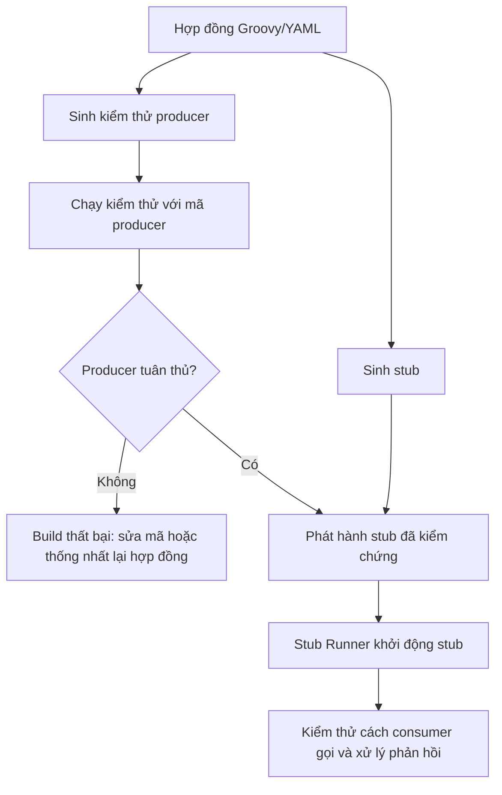

# Kiểm thử hợp đồng là gì và vì sao cần trong hệ thống nhiều dịch vụ?

## 1. Bối cảnh: các dịch vụ có thể chạy tốt riêng lẻ nhưng lỗi khi kết nối

Trong kiến trúc nhiều dịch vụ (microservices), mỗi dịch vụ thường có mã nguồn, nhóm phát triển và lịch phát hành riêng. Độc lập khi triển khai giúp hệ thống thay đổi nhanh hơn, nhưng tạo ra một câu hỏi quan trọng: **làm thế nào biết thay đổi của một dịch vụ có làm hỏng dịch vụ đang gọi nó hay không?**

Giả sử hệ thống bán hàng có hai dịch vụ:

- **Order Service** (consumer, bên tiêu thụ) gọi API của **Payment Service** (producer/provider, bên cung cấp) để tra cứu trạng thái thanh toán.
- Payment Service trả về `GET /api/payments/42` với HTTP `200` và JSON `{"id":42,"status":"PAID"}`.
- Order Service đọc trường `status` để quyết định có thể chuyển đơn hàng sang bước giao vận hay chưa.

Một ngày, nhóm Payment Service đổi tên trường `status` thành `paymentState` mà không thông báo cho nhóm Order Service. Các unit test trong từng dịch vụ vẫn có thể xanh: Payment Service kiểm thử cấu trúc phản hồi mới; Order Service dùng mock cũ vẫn nhận `status`. Tuy nhiên, khi hai dịch vụ giao tiếp thật, Order Service không còn tìm thấy dữ liệu mong đợi và xử lý sai.

Đây là **lỗi không tương thích tại ranh giới tích hợp**. Nó khác với lỗi bên trong một hàm: mỗi thành phần có thể đúng theo kiểm thử riêng nhưng **thỏa thuận giữa các thành phần đã bị phá vỡ**.

## 2. Kiểm thử hợp đồng (contract testing) là gì?

**Kiểm thử hợp đồng** là cách xác minh một bên cung cấp và một bên tiêu thụ cùng tuân thủ một tập hợp kỳ vọng đã được ghi thành hợp đồng có thể kiểm thử tự động. Hợp đồng mô tả phần giao tiếp mà hai bên cần thống nhất, thay vì kiểm tra toàn bộ luồng nghiệp vụ đầu cuối.

Với giao tiếp HTTP, hợp đồng có thể quy định:

| Thành phần | Ví dụ điều cần thống nhất |
| --- | --- |
| Yêu cầu (request) | Phương thức `GET`, đường dẫn `/api/payments/42`, tham số truy vấn, header, định dạng body |
| Phản hồi (response) | Mã trạng thái `200` hoặc `404`, header `Content-Type: application/json`, cấu trúc JSON |
| Dữ liệu | Có trường `id` kiểu số, `status` mang giá trị hợp lệ như `PAID` |
| Trường hợp lỗi | Thanh toán không tồn tại trả `404` cùng cấu trúc lỗi đã thống nhất |
| Quy tắc xử lý | Ví dụ `404` có nghĩa là không tìm thấy tài nguyên, không phải lỗi máy chủ |

Với hệ thống giao tiếp bằng thông điệp (Kafka, RabbitMQ hoặc broker tương tự), hợp đồng có thể mô tả tên sự kiện, header, payload, kiểu dữ liệu và thông điệp phát ra khi một sự kiện đầu vào được xử lý.

Một hợp đồng **không cần mô tả toàn bộ API**. Nó nên ghi đúng những tương tác có giá trị đối với consumer. Ví dụ, Order Service chỉ cần `id` và `status`, nên hai trường đó là phần cốt lõi phải bảo vệ. Nếu Payment Service thêm trường `processedAt` mà consumer có thể bỏ qua, thay đổi đó thường không cần làm thất bại kiểm thử.

### Khác biệt giữa đặc tả API và hợp đồng được kiểm thử

Tài liệu API như OpenAPI giúp con người và công cụ hiểu giao diện, nhưng tài liệu tự nó không chứng minh rằng mã chạy thực tế tuân theo giao diện đó. Contract testing bổ sung **bước thực thi kiểm chứng**: khi producer thay đổi, bộ kiểm thử dùng hợp đồng để kiểm tra phản hồi thực của producer. Một nhóm cũng có thể kết hợp OpenAPI với kiểm thử hợp đồng; hai cách tiếp cận có vai trò bổ sung cho nhau.

## 3. Producer, consumer và kỳ vọng hai chiều

- **Producer (provider):** dịch vụ cung cấp API hoặc phát thông điệp; chịu trách nhiệm đáp ứng hành vi đã cam kết.
- **Consumer:** dịch vụ gọi API hoặc nhận thông điệp; có kỳ vọng cụ thể về dữ liệu và hành vi nhận được.
- **Contract:** mô tả tương tác mà producer cần đáp ứng để consumer hoạt động đúng.
- **Verified stub:** bản mô phỏng có thể chạy, được sinh từ hợp đồng đã kiểm chứng, giúp consumer kiểm thử mà không phải khởi chạy producer thật.

Có hai cách phối hợp phổ biến:

**Consumer-driven contract testing:** Consumer đề xuất các tương tác thực sự cần dùng; producer phải xác minh rằng mình đáp ứng những hợp đồng đó. Cách này đặc biệt hữu ích khi một API có nhiều consumer với nhu cầu khác nhau.

**Producer-defined contract testing:** Nhóm producer quản lý đặc tả các tương tác được cung cấp, rồi chia sẻ hợp đồng/stub để consumer sử dụng. Cách này phù hợp khi producer chủ động công bố giao diện và duy trì thỏa thuận với các nhóm sử dụng.

Spring Cloud Contract có thể hỗ trợ luồng làm việc mà hợp đồng được duy trì cùng producer hoặc được chia sẻ giữa các nhóm. Điểm mấu chốt không phải hợp đồng được lưu ở đâu, mà là **producer phải được kiểm tra với hợp đồng và consumer phải dùng stub đúng phiên bản của hợp đồng đã kiểm chứng**.

## 4. Vì sao chỉ unit test hoặc end-to-end test là chưa đủ?

| Loại kiểm thử | Trả lời câu hỏi gì? | Điểm cần lưu ý |
| --- | --- | --- |
| Unit test | Hàm/lớp riêng lẻ có xử lý đúng không? | Mock thường phản ánh giả định của người viết test, có thể khác API thực |
| Contract test | Hai dịch vụ có tuân thủ các tương tác đã thỏa thuận không? | Tập trung vào ranh giới và những trường hợp đã được mô tả |
| Integration test | Các thành phần cụ thể có hoạt động khi tích hợp thật không? | Có thể cần cơ sở dữ liệu, broker hoặc hạ tầng phụ trợ |
| End-to-end (E2E) test | Luồng người dùng xuyên suốt hệ thống có chạy thành công không? | Tốn thời gian, nhiều phụ thuộc, đôi khi khó xác định nguyên nhân thất bại |

Contract test **bổ sung** cho các lớp kiểm thử còn lại. Nhờ phạm vi tương tác nhỏ, chúng thường chạy nhanh và chỉ rõ thay đổi nào phá vỡ giao diện. E2E vẫn cần để phát hiện lỗi liên quan đến cấu hình triển khai, luồng nghiệp vụ đầy đủ, phân quyền thực tế hoặc tương tác giữa nhiều dịch vụ.

Ví dụ đổi `status` thành `paymentState` ở phần mở đầu: unit test có thể bỏ sót; E2E có thể phát hiện muộn khi đã dựng cả hệ thống; contract test ở producer có thể phát hiện ngay trong pipeline của Payment Service nếu hợp đồng vẫn yêu cầu `status`.

## 5. Spring Cloud Contract đóng vai trò gì?

**Spring Cloud Contract** là bộ công cụ trong hệ sinh thái Spring giúp định nghĩa và xác minh hợp đồng giao tiếp giữa các ứng dụng. Trọng tâm của nó là biến mô tả tương tác thành các thành phần kiểm thử có thể thực thi:

1. **Định nghĩa hợp đồng** bằng DSL Groovy hoặc YAML cho HTTP; công cụ cũng hỗ trợ các hợp đồng dựa trên thông điệp.
2. **Sinh kiểm thử phía producer** từ hợp đồng. Khi build/test, kiểm thử xác minh ứng dụng cung cấp phản hồi phù hợp.
3. **Sinh và đóng gói stub** từ cùng nguồn hợp đồng để mô phỏng các tương tác đã mô tả.
4. **Dùng Stub Runner ở phía consumer** để khởi động stub, gửi yêu cầu từ ứng dụng consumer và kiểm tra cách consumer xử lý phản hồi.
5. **Tích hợp CI/CD** để chạy kiểm chứng trước khi phát hành, phân phối stub theo phiên bản và phát hiện thay đổi không tương thích.

Sơ đồ tổng quát:



Trong ứng dụng Spring, các kiểm thử sinh ra thường được kết nối với test base class và môi trường test do nhóm producer cấu hình, chẳng hạn thông qua MockMvc. Vì vậy, không phải chỉ thêm một tệp DSL là tự động kiểm thử được mọi endpoint: **phải cấu hình plugin và môi trường kiểm thử phù hợp**.

## 6. Ví dụ hợp đồng HTTP bằng Groovy DSL

Tiếp tục ví dụ Payment Service, giả sử consumer cần truy vấn một thanh toán đã hoàn tất. Một hợp đồng minh họa có thể viết như sau:

```groovy
import org.springframework.cloud.contract.spec.Contract

Contract.make {
    description "Tra cứu thanh toán đã hoàn tất"

    request {
        method GET()
        url "/api/payments/42"
    }

    response {
        status OK()
        headers {
            contentType(applicationJson())
        }
        body(
            id: 42,
            status: "PAID"
        )
    }
}
```

Đọc hợp đồng từ trên xuống:

1. Gửi `GET /api/payments/42` đến producer.
2. Producer phải trả mã `200 OK`.
3. Phản hồi phải là JSON với `id: 42` và `status: "PAID"`.
4. Công cụ có thể sinh kiểm thử kiểm tra producer và stub trả phản hồi mô tả ở trên.

Nếu producer đổi thành:

```json
{
  "id": 42,
  "paymentState": "PAID"
}
```

thì phản hồi không còn đáp ứng hợp đồng đang yêu cầu trường `status`; kiểm thử producer cần báo lỗi. Nhóm phát triển sẽ quyết định giữ tương thích, tạo phiên bản API mới hoặc phối hợp cập nhật consumer và hợp đồng.

Ví dụ này cố ý dùng giá trị cố định để thấy rõ ý nghĩa. Trong bài toán thực tế, DSL hỗ trợ **matcher** và biểu thức linh hoạt để mô tả kiểu dữ liệu, định dạng hoặc một tập giá trị chấp nhận được, tránh bắt mọi phản hồi phải có cùng ID hay timestamp. Điều quan trọng là matcher phải đủ chặt để phát hiện thay đổi gây hại và đủ linh hoạt để không khóa các dữ liệu ngẫu nhiên.

### Hợp đồng cho trường hợp lỗi

Hợp đồng thành công là chưa đủ. Consumer thường phụ thuộc vào cách producer xử lý lỗi, ví dụ `GET /api/payments/999` trả `404` cùng mã lỗi `PAYMENT_NOT_FOUND`. Nếu Payment Service bất ngờ đổi sang `200` với body rỗng, logic xử lý của Order Service có thể thay đổi hoàn toàn.

Vì thế, với mỗi tương tác quan trọng, hãy cân nhắc các nhóm trường hợp: thành công, không tìm thấy dữ liệu, dữ liệu yêu cầu không hợp lệ và không đủ quyền. Chỉ thêm trường hợp có liên quan tới hành vi mà consumer thực sự sử dụng.

## 7. Thông điệp bất đồng bộ cũng có hợp đồng

Trong một hệ thống dùng sự kiện, producer có thể công bố thông điệp như:

```json
{
  "eventType": "PaymentCompleted",
  "paymentId": 42,
  "orderId": 301,
  "amount": 125000
}
```

Consumer của sự kiện phụ thuộc vào tên sự kiện và ý nghĩa các trường. Nếu producer đổi `orderId` thành `purchaseId` mà không có kế hoạch tương thích, consumer vẫn có thể nhận thông điệp nhưng không ánh xạ được đơn hàng.

Hợp đồng cho thông điệp giúp xác minh payload, header và hành vi phát/nhận được mô tả. Tuy nhiên, một hợp đồng về cấu trúc thông điệp **không tự bảo đảm** broker không mất tin, thứ tự sự kiện được giữ, hệ thống xử lý đúng khi gửi trùng hoặc toàn bộ luồng eventually consistent hoàn thành đúng hạn. Những yêu cầu đó cần thêm integration test, kiểm thử độ tin cậy hoặc E2E phù hợp.

## 8. Hợp đồng giúp đánh giá tính tương thích khi API thay đổi

Không phải thay đổi API nào cũng phá vỡ consumer. Cần đối chiếu thay đổi với **những kỳ vọng mà consumer đã cam kết sử dụng**.

| Thay đổi phía producer | Rủi ro | Điều hợp đồng nên giúp phát hiện |
| --- | --- | --- |
| Đổi `status` thành `paymentState` | Cao nếu consumer đọc `status` | Trường bắt buộc không còn được trả về |
| Đổi kiểu `id` từ số thành chuỗi | Cao nếu consumer ánh xạ sang số | Không khớp kiểu/định dạng đã thống nhất |
| Đổi `200` thành `204` | Cao nếu consumer chờ body JSON | Không khớp status và body |
| Thêm trường JSON mới | Thường thấp nếu consumer bỏ qua trường lạ | Không cần báo lỗi khi matcher/consumer cho phép mở rộng |
| Thêm endpoint mới | Thường không ảnh hưởng endpoint cũ | Các hợp đồng hiện có vẫn chạy |
| Đổi nghĩa `PAID` nhưng giữ nguyên chuỗi | Rủi ro nghiệp vụ cao | Chỉ phát hiện nếu ý nghĩa/quy tắc đó được kiểm thử rõ ràng |

**Tính tương thích phụ thuộc vào cách consumer sử dụng API.** Một thay đổi được gọi là “không phá vỡ” trong tài liệu có thể vẫn làm hỏng consumer có bộ giải mã quá nghiêm ngặt, chẳng hạn từ chối mọi trường JSON chưa biết. Nên thống nhất cả chính sách mở rộng dữ liệu và kỳ vọng về các trường bắt buộc.

Khi cần thay đổi phá vỡ hợp đồng, nhóm có thể triển khai theo hướng: bổ sung hành vi mới trong khi giữ hành vi cũ, cập nhật và triển khai consumer, sau đó mới loại bỏ hành vi cũ. Việc phát hành phiên bản API mới cũng là một lựa chọn tùy theo chính sách phiên bản của hệ thống.

## 9. Kiểm thử producer, stub cho consumer và luồng CI thực tế

Một quy trình áp dụng Spring Cloud Contract có thể diễn ra như sau:

**Bước 1 — Hai bên thống nhất tương tác.** Consumer nêu nhu cầu cần `GET /api/payments/{id}` và phản hồi có `id`, `status`; producer xác nhận có thể cung cấp. Các trường hợp lỗi quan trọng cũng được ghi thành hợp đồng.

**Bước 2 — Đưa hợp đồng vào kho mã nguồn.** Hợp đồng được lưu bằng Groovy hoặc YAML DSL, có quản lý phiên bản và được review như mã nguồn. Cách tổ chức repository có thể khác nhau; cần bảo đảm cả hai bên biết hợp đồng nào đang được sử dụng.

**Bước 3 — Producer chạy kiểm thử sinh tự động.** Plugin Spring Cloud Contract sinh kiểm thử từ hợp đồng. Pipeline của Payment Service chạy chúng với mã mới; build thất bại nếu endpoint không còn trả kết quả đã cam kết.

**Bước 4 — Producer phát hành stub đã kiểm chứng.** Sau khi kiểm thử pass, build tạo và công bố stub artifact vào kho artifact nội bộ. Stub là dữ liệu dùng cho consumer test, không thay thế ứng dụng thật khi triển khai production.

**Bước 5 — Consumer kiểm thử qua Stub Runner.** Order Service khởi động stub tương ứng, thực hiện lời gọi HTTP bằng client code của mình và kiểm tra rằng logic xử lý phản hồi chạy đúng. Nhờ đó, consumer test không cần một instance Payment Service thật.

**Bước 6 — CI bảo vệ việc nâng cấp.** Khi producer thay đổi API hoặc consumer cập nhật phiên bản phụ thuộc, pipeline chạy các kiểm thử liên quan. Nếu hợp đồng mới không tương thích, đội ngũ nhận phản hồi trước khi triển khai. Với hệ thống nhiều consumer, nên xác minh những hợp đồng liên quan trước khi loại bỏ hành vi cũ.

Ví dụ cấu hình Stub Runner mang tính minh họa trong một test của consumer:

```java
@SpringBootTest
@AutoConfigureStubRunner(
    ids = "com.example:payment-service:1.2.0:stubs:8085",
    stubsMode = StubRunnerProperties.StubsMode.LOCAL
)
class PaymentClientContractTest {
    // Gọi PaymentClient tới stub ở localhost:8085,
    // rồi kiểm tra Order Service xử lý trạng thái PAID đúng.
}
```

`ids` xác định artifact stub và cổng dùng để chạy; `LOCAL` phù hợp khi artifact đã có trong kho Maven cục bộ. Trong CI, nhóm có thể cấu hình tải stub từ kho artifact từ xa và gắn phiên bản cụ thể. Mã ví dụ lược bớt import, cấu hình client và phần assertion để nhấn mạnh vai trò của Stub Runner; dự án thật cần cấu hình các thành phần đó.

### Điều cần chú ý khi thiết kế pipeline

- **Chỉ phát hành stub sau khi producer verification thành công.** Một stub được tạo từ hợp đồng chưa được kiểm chứng có thể trả lời “đúng” trong consumer test dù producer thực tế chưa đáp ứng.
- **Quản lý phiên bản hợp đồng và stub.** Consumer test cần biết mình đang kiểm tra phiên bản nào; dùng stub quá cũ có thể tạo cảm giác an toàn sai.
- **Chạy kiểm thử ở đúng phía.** Producer test chứng minh producer tuân thủ hợp đồng; consumer test chứng minh consumer hoạt động với phản hồi trong stub. Một phía pass không có nghĩa phía kia đã pass.
- **Đưa thay đổi hợp đồng vào code review.** Việc cập nhật đồng thời hợp đồng và implementation không đủ để kết luận tương thích với các consumer chưa nâng cấp.
- **Giữ một số kiểm thử tích hợp thực.** Contract test không kiểm tra được mọi khác biệt về mạng, TLS, broker, database, cấu hình runtime hay chuỗi nghiệp vụ xuyên dịch vụ.

## 10. Khi nào nên dùng và cần tránh hiểu nhầm gì?

Contract testing đặc biệt có giá trị khi hệ thống có nhiều API/sự kiện được chia sẻ, các nhóm phát hành độc lập và lỗi không tương thích thường xuất hiện muộn. Nó phù hợp với API ổn định về mặt chức năng nhưng thường xuyên thay đổi phiên bản hoặc mở rộng dữ liệu.

Một số hiểu nhầm cần tránh:

1. **“Đã có contract test thì không cần E2E.”** Sai: contract test bảo vệ tương tác đã định nghĩa, còn E2E xác minh hành trình nghiệp vụ và môi trường tích hợp rộng hơn.
2. **“Stub chạy xanh nghĩa là producer chạy đúng.”** Chưa đủ: phải có producer verification tương ứng và stub được xây dựng từ phiên bản đã kiểm chứng.
3. **“Hợp đồng phải đóng băng mọi byte của JSON.”** Không cần: tập trung vào trường và ràng buộc consumer dùng; matcher phù hợp giúp giảm kiểm thử thất bại vì dữ liệu không quan trọng.
4. **“Tự động phát hiện mọi thay đổi sai về nghiệp vụ.”** Không thể: nếu cả schema và status code đều giữ nguyên nhưng ý nghĩa thay đổi, hợp đồng chỉ phát hiện được khi có điều kiện kiểm thử mô tả ý nghĩa đó.
5. **“Chỉ cần kiểm thử happy path.”** Không đủ với consumer phụ thuộc vào `400`, `401`, `404`, timeout hoặc trạng thái nghiệp vụ; cần xác định rõ trường hợp nào nên được biểu diễn trong hợp đồng và trường hợp nào kiểm thử bằng cơ chế khác.

## 11. Cách áp dụng cho một hệ thống đang vận hành

Nên bắt đầu bằng một ranh giới tích hợp có nhiều thay đổi hoặc từng phát sinh lỗi:

1. Chọn một consumer và một producer; liệt kê endpoint/sự kiện mà consumer thực sự sử dụng.
2. Ghi nhận các request, response, status code, header và trường dữ liệu bắt buộc; thêm các tình huống lỗi mà consumer xử lý.
3. Mã hóa các tương tác thành hợp đồng Groovy/YAML và thiết lập kiểm thử sinh tự động ở producer.
4. Tạo stub từ hợp đồng đã kiểm chứng, chạy consumer test bằng Stub Runner.
5. Đưa hai nhóm kiểm thử vào CI; quản lý phiên bản stub và quy trình duyệt thay đổi hợp đồng.
6. Khi phát sinh thay đổi API, xem kết quả kiểm thử để quyết định giữ tương thích, mở rộng hợp đồng hay phối hợp nâng cấp consumer.

**Kết luận:** Kiểm thử hợp đồng biến kỳ vọng ngầm giữa các dịch vụ thành những điều kiện có thể kiểm chứng trong quá trình phát triển. Với Spring Cloud Contract, cùng một mô tả Groovy/YAML có thể giúp kiểm tra producer và cung cấp stub cho consumer. Giá trị lớn nhất là phát hiện sớm thay đổi không tương thích trong khi các đội vẫn phát triển và triển khai dịch vụ độc lập.
