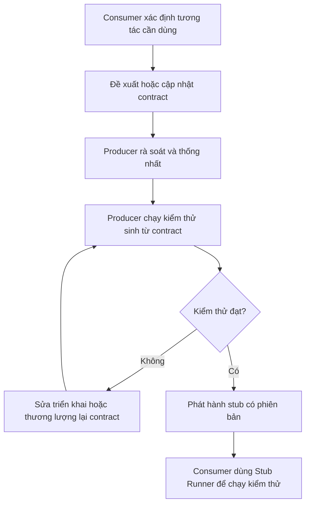

# Consumer-driven contract và producer-driven contract

## 1. Vì sao cần phân biệt hai cách tiếp cận?

Trong kiến trúc microservices, một dịch vụ **consumer** gọi HTTP API hoặc nhận thông điệp do dịch vụ **producer** cung cấp. Hai nhóm có thể triển khai và phát hành độc lập, nhưng một thay đổi nhỏ ở producer vẫn có thể làm consumer hỏng: đổi tên trường JSON, bỏ một mã trạng thái, thay định dạng ngày giờ hoặc đổi cấu trúc sự kiện.

**Contract testing (kiểm thử hợp đồng)** xác minh những tương tác mà hai bên đã thỏa thuận. Với Spring Cloud Contract, hợp đồng có thể được mô tả bằng **Groovy DSL hoặc YAML DSL**; công cụ có thể sinh kiểm thử để xác minh producer và tạo **stub** cho consumer kiểm thử mà không cần chạy producer thật.

Có hai cách tổ chức việc xây dựng hợp đồng:

- **Consumer-driven contract (CDC):** nhu cầu thực tế của consumer là điểm khởi đầu; consumer tham gia đề xuất những tương tác mà mình cần, producer duyệt và đáp ứng chúng.
- **Producer-driven contract (PDC), còn gọi là provider contract testing trong nhiều tài liệu:** producer chủ động định nghĩa và công bố những tương tác mà mình cam kết hỗ trợ; consumer tích hợp theo hợp đồng đã công bố.

Điểm khác nhau cốt lõi là **ai dẫn dắt việc xác định cam kết và cách hai nhóm thống nhất thay đổi**, không phải định dạng file hay công cụ kiểm thử. Cả hai đều có thể sử dụng Spring Cloud Contract, hợp đồng lưu trong repository của producer và cùng quy trình sinh test/stub.

Sau bài này, bạn cần phân biệt được vai trò của mỗi bên, đọc một hợp đồng HTTP cơ bản, hình dung luồng test/stub trong CI và chọn chiến lược phù hợp cho một hệ thống nhiều dịch vụ.

## 2. Các khái niệm nền tảng

Giả sử dịch vụ `checkout-service` cần biết một sản phẩm có còn hàng trước khi tạo đơn. Nó gọi `inventory-service`:

```http
GET /api/products/SKU-123/availability HTTP/1.1
Accept: application/json
```

Producer trả về:

```http
HTTP/1.1 200 OK
Content-Type: application/json

{"sku":"SKU-123","available":true}
```

Trong ví dụ này:

| Khái niệm | Vai trò |
| --- | --- |
| **Consumer** | `checkout-service`, bên cần kết quả kiểm tra tồn kho để quyết định có cho đặt hàng không. |
| **Producer / provider** | `inventory-service`, bên triển khai endpoint và trả dữ liệu. |
| **Contract** | Cam kết về request, response hoặc thông điệp: method, URL, header, status, trường dữ liệu và điều kiện khớp. |
| **Producer verification** | Kiểm thử chạy trên ứng dụng producer để xác nhận cách triển khai thực tế đáp ứng contract. |
| **Stub** | Mô phỏng hành vi producer theo contract, chẳng hạn trả JSON mẫu khi nhận request phù hợp. |
| **Stub Runner** | Thành phần lấy và chạy stub để test consumer có thể gọi một phiên bản mô phỏng của producer. |

Một contract không phải bản mô tả mọi khả năng của API. Nó thường ghi lại **những tương tác tiêu biểu, quan trọng hoặc có nguy cơ không tương thích**. Contract test cũng không thay thế unit test, integration test toàn hệ thống, kiểm thử bảo mật hay kiểm thử hiệu năng.

## 3. Consumer-driven contract (CDC)

### 3.1. Ai quyết định nội dung hợp đồng?

Trong CDC, **consumer nêu nhu cầu quan sát được**. Ví dụ, nhóm Checkout nói: “Để tiếp tục đặt hàng, chúng tôi cần `GET /api/products/{sku}/availability` trả `available` kiểu boolean khi sản phẩm tồn tại”. Nhóm Inventory xem xét yêu cầu, thương lượng các trường hợp lỗi rồi đồng ý với contract.

Đặc điểm của CDC:

1. Consumer xác định các request và response mà mã của mình thật sự dựa vào.
2. Producer có quyền phản biện hoặc thương lượng; CDC **không** có nghĩa consumer tự ý ép producer hỗ trợ mọi yêu cầu.
3. Các contract được thống nhất sẽ được dùng để sinh kiểm thử cho producer và stub cho consumer.
4. Khi producer thay đổi API, những contract còn được duy trì giúp phát hiện hành vi làm hỏng nhu cầu đã cam kết.

### 3.2. Một vòng phát triển CDC điển hình



Ví dụ: Checkout gửi pull request bổ sung trường `available`. Inventory duyệt contract, triển khai API, chạy kiểm thử producer, phát hành stub. Checkout tải stub trong CI và chạy các kịch bản đặt hàng qua `InventoryClient`.

**Vị trí lưu contract không quyết định đó có phải CDC hay không.** Contract có thể nằm ngay trong repository của producer (consumer gửi pull request vào đó), hoặc ở một repository hợp đồng độc lập. Điều quyết định là consumer đóng vai trò thiết yếu trong việc đề xuất và xác nhận cam kết.

### 3.3. CDC có lợi khi nào?

CDC đặc biệt hữu ích khi một số nhóm consumer nội bộ có thể trao đổi trực tiếp với producer, mỗi consumer chỉ cần một phần API và hệ thống muốn bảo vệ các nhu cầu sử dụng đã biết. Nếu producer phục vụ nhiều consumer, mỗi nhóm có thể góp hợp đồng cho những tương tác mình phụ thuộc.

Tuy nhiên, CDC đòi hỏi phối hợp: producer cần quản lý các yêu cầu xung đột, vòng đời hợp đồng và trường hợp consumer ngừng sử dụng API. Không nên coi mọi ví dụ trong contract là một lời hứa bất biến vĩnh viễn; hợp đồng cần được quản trị cùng chính sách tương thích và loại bỏ API.

## 4. Producer-driven contract (PDC)

### 4.1. Producer công bố cam kết trước

Với PDC, nhóm Inventory thiết kế và định nghĩa endpoint, payload và quy tắc lỗi dựa trên khả năng sản phẩm của mình. Nhóm này công bố contract/stub như một phần của phiên bản dịch vụ. Checkout đọc hợp đồng, triển khai client và kiểm thử tích hợp dựa trên stub được phát hành.

Luồng điển hình:

1. Producer thiết kế API hoặc thông điệp, xác định hành vi sẽ hỗ trợ.
2. Producer viết contract (chẳng hạn bằng Groovy/YAML DSL của Spring Cloud Contract), thực thi kiểm thử sinh tự động và phát hành stub.
3. Consumer chọn phiên bản hợp đồng/stub phù hợp, triển khai client và xác minh bằng Stub Runner.
4. Khi producer công bố thay đổi, consumer kiểm tra tác động và cập nhật theo quy trình phiên bản hóa, thông báo hoặc deprecation đã thống nhất.

PDC phù hợp hơn khi producer sở hữu một API công khai, có rất nhiều consumer, consumer là đối tác ngoài tổ chức hoặc việc thương lượng riêng từng hợp đồng không khả thi. Producer có thể cần thêm tài liệu API, chính sách phiên bản và cơ chế phản hồi để biết các consumer đang thực sự sử dụng hành vi nào.

**Giới hạn quan trọng:** test sinh từ contract do producer tự viết chỉ chứng minh producer thực hiện đúng **cam kết đã viết**. Nếu producer bỏ một trường mà consumer thật sự dùng nhưng không được thể hiện trong contract, test phía producer có thể vẫn xanh trong khi consumer bị lỗi. Vì vậy PDC cần kết hợp kiểm thử phía consumer và quản lý tính tương thích của API đã công bố.

## 5. So sánh CDC và PDC

| Tiêu chí | Consumer-driven contract | Producer-driven contract |
| --- | --- | --- |
| Điểm xuất phát | Nhu cầu tích hợp cụ thể của consumer. | Cam kết và thiết kế API do producer công bố. |
| Người khởi xướng thay đổi | Thường là consumer khi cần tương tác mới hoặc thay đổi hành vi. | Thường là producer khi thiết kế hoặc phát hành API. |
| Vai trò bên còn lại | Producer rà soát, đồng ý và triển khai. | Consumer tiếp nhận, phản hồi và kiểm thử việc tích hợp. |
| Độ bao phủ tự nhiên | Tập trung vào hành vi các consumer đã nêu. | Tập trung vào hành vi producer quyết định cung cấp. |
| Điểm mạnh | Phát hiện thay đổi phá vỡ những nhu cầu consumer đã ghi rõ. | Quản lý cam kết tập trung, thuận tiện khi có nhiều consumer độc lập. |
| Rủi ro | Nhiều yêu cầu trùng lặp, xung đột hoặc thiếu chủ sở hữu. | Thiếu góc nhìn sử dụng thực tế nếu không có phản hồi từ consumer. |
| Phù hợp | Các nhóm dịch vụ nội bộ cộng tác thường xuyên. | API công khai, nền tảng dùng chung, hệ sinh thái lớn. |

Hai cách tiếp cận **không loại trừ nhau**. Một producer có thể công bố bộ contract cơ sở, đồng thời tiếp nhận contract bổ sung do các consumer nội bộ đề xuất. Điều cần minh bạch là ai có trách nhiệm duyệt, duy trì và thông báo thay đổi.

## 6. Áp dụng với Spring Cloud Contract

Spring Cloud Contract hỗ trợ định nghĩa hành vi HTTP và messaging, sinh test xác minh producer, tạo stub và chạy stub ở phía consumer. **Cùng một nội dung contract có thể được sử dụng trong CDC hoặc PDC**; cách tổ chức nhóm và quy trình review quyết định tên chiến lược.

### 6.1. Định nghĩa HTTP contract bằng YAML DSL

Ví dụ file `product_available.yml` trong thư mục contract của `inventory-service`:

```yaml
description: Trả về trạng thái còn hàng cho một mã sản phẩm
name: product_available
request:
  method: GET
  url: /api/products/SKU-123/availability
response:
  status: 200
  headers:
    Content-Type: application/json
  body:
    sku: SKU-123
    available: true
```

Contract trên quy định: khi nhận `GET` đúng đường dẫn, producer phải trả trạng thái `200` với JSON chứa `sku` và `available`. Stub tạo từ hợp đồng có thể trả phản hồi mẫu đó cho consumer.

Đây là trường hợp **thành công** duy nhất. Hợp đồng thực tế nên bổ sung các hành vi có ý nghĩa đối với consumer, chẳng hạn `404` khi SKU không tồn tại, nhưng chỉ khi producer thật sự cam kết các hành vi ấy.

### 6.2. Cùng hành vi bằng Groovy DSL

```groovy
import org.springframework.cloud.contract.spec.Contract

Contract.make {
    name 'product_available'
    description 'Trả về trạng thái còn hàng cho một mã sản phẩm'

    request {
        method 'GET'
        url '/api/products/SKU-123/availability'
    }

    response {
        status 200
        headers {
            contentType(applicationJson())
        }
        body([
            sku: 'SKU-123',
            available: true
        ])
    }
}
```

Hai đoạn YAML và Groovy minh họa **hai cách biểu diễn cho cùng một hợp đồng**. Khi làm dự án, chọn một bản làm nguồn sự thật cho kịch bản này, không cần lưu cả hai thành hai contract trùng nhau. Groovy DSL có các matcher và khả năng biểu đạt phức tạp hơn; YAML DSL thuận tiện khi muốn cấu trúc khai báo dễ đọc.

Đừng nhầm một giá trị ví dụ như `SKU-123` với toàn bộ miền đầu vào hợp lệ. Đối với nhiều mã sản phẩm, có thể dùng matcher/biểu thức chính quy để khái quát request và dùng giá trị mẫu cụ thể khi sinh stub. Matcher cần đủ chặt để tránh biến một stub thành bộ giả lập chấp nhận mọi request.

### 6.3. Producer kiểm tra gì?

Trong cấu hình điển hình, Spring Cloud Contract Verifier đọc contract (thường ở `src/test/resources/contracts`, trừ khi được cấu hình khác) rồi sinh kiểm thử. Bộ kiểm thử gọi endpoint hoặc kiểm tra thông điệp theo cấu hình kiểm thử của producer và đối chiếu phản hồi thực tế với yêu cầu trong contract.

Với ví dụ trên, bài test sinh ra cần xác minh rằng `inventory-service` có thể xử lý `GET /api/products/SKU-123/availability` và trả phản hồi phù hợp. Nếu triển khai đổi `available` thành `inStock` nhưng contract vẫn yêu cầu `available`, việc xác minh phải thất bại và pipeline của producer nên chặn phát hành.

Producer cần cấu hình Spring Cloud Contract plugin, dependency kiểm thử và **base test class** phù hợp với cách khởi tạo ứng dụng. Chi tiết khai báo Maven/Gradle và chế độ kiểm thử phụ thuộc phiên bản Spring Boot / Spring Cloud Contract của dự án; không nên sao chép tùy tiện version từ một bài viết khác.

### 6.4. Consumer kiểm tra gì với Stub Runner?

Sau khi producer tạo và phát hành artifact stub (thường là JAR classifier `stubs`), consumer có thể tải chúng từ local Maven repository hoặc artifact repository. Spring Cloud Contract Stub Runner khởi chạy một HTTP stub server (thường dựa trên WireMock) và cung cấp phản hồi theo contract.

Ví dụ minh họa kiểm thử của `checkout-service` (giả sử đã có `CheckoutService`, cấu hình `inventory.base-url` và các dependency test cần thiết):

```java
@SpringBootTest(properties = "inventory.base-url=http://localhost:6565")
@AutoConfigureStubRunner(
    ids = "com.example:inventory-service:+:stubs:6565",
    stubsMode = StubRunnerProperties.StubsMode.LOCAL
)
class CheckoutContractTest {

    @Autowired
    CheckoutService checkoutService;

    @Test
    void allowsCheckoutWhenProductIsAvailable() {
        assertThat(checkoutService.canOrder("SKU-123")).isTrue();
    }
}
```

Đây là đoạn minh họa, không phải lớp test tự chạy độc lập: dự án phải có các import và bean tương ứng; `CheckoutService` phải thật sự gọi inventory client được trỏ đến stub. Tùy nguồn tải, chế độ stub là `LOCAL` hoặc `REMOTE`; trong CI thực tế nên dùng **phiên bản stub xác định** để kết quả có thể tái hiện, thay vì tùy tiện chọn `+` như ví dụ ngắn trên.

Lưu ý: một test chỉ gọi trực tiếp URL stub và kiểm tra `200` xác minh việc stub hoạt động, nhưng chưa chứng minh mã nghiệp vụ consumer xử lý phản hồi đúng. Test có giá trị hơn khi đi qua **client và logic thật của consumer**.

### 6.5. Hợp đồng cho messaging

Với hệ thống dùng Kafka, RabbitMQ hoặc hạ tầng sự kiện khác, consumer có thể là dịch vụ **nhận event** còn producer là dịch vụ **phát event**. Contract mô tả những đặc tính được cam kết như message destination/trigger, header, payload, loại trường và giá trị kỳ vọng. Cách phân biệt CDC và PDC vẫn như HTTP: consumer chủ động đưa ra nhu cầu xử lý sự kiện, hoặc producer chủ động công bố schema/hành vi phát sự kiện.

Ví dụ: `checkout-service` cần event `InventoryReserved` chứa `orderId`, `sku` và `quantity`. Nếu producer bỏ `orderId` trong khi contract vẫn yêu cầu, producer verification cần phát hiện bất tương thích. Việc sinh/kiểm thử messaging stub còn phụ thuộc cấu hình Spring Cloud Contract và tích hợp messaging của dự án; không thể mặc nhiên coi một WireMock HTTP stub là mô phỏng đầy đủ Kafka/RabbitMQ.

## 7. Ghép contract testing vào CI/CD

Một pipeline hợp lý cần khiến các bên cùng dùng **cùng một định nghĩa hợp đồng đã duyệt**:

| Bước | Kiểm soát cần có |
| --- | --- |
| 1. Đề xuất | Consumer đề xuất hoặc producer công bố contract; review semantics, request, response và trường hợp lỗi. |
| 2. Xác minh producer | Sinh test từ contract, chạy trên code producer; lỗi test phải làm pipeline thất bại. |
| 3. Phát hành | Đóng gói và lưu stub/contract kèm version của producer để truy xuất lại. |
| 4. Kiểm thử consumer | Stub Runner lấy đúng artifact và chạy các bài test qua client thật của consumer. |
| 5. Đánh giá tương thích | Khi đổi contract, chạy kiểm tra các consumer liên quan, thông báo deprecation hoặc nâng version theo quy ước. |

Trong CDC, bước đề xuất thường bắt đầu bằng pull request của consumer; trong PDC, thường bắt đầu ở nhánh phát triển của producer. Các bước xác minh producer và tiêu thụ stub có thể giống nhau. Tránh phát hành stub như một cam kết “đã triển khai” trước khi producer verification đạt: Spring Cloud Contract có cơ chế đánh dấu contract **in progress** để sinh stub mà chưa sinh test producer, nhưng stub loại này chỉ phù hợp khi hai nhóm hiểu rõ tính tạm thời của nó.

## 8. Khi API thay đổi: tương thích được quyết định thế nào?

Xét consumer đang sử dụng JSON `{"sku":"SKU-123","available":true}`:

| Thay đổi từ producer | Nguy cơ đối với consumer | Cách xử lý |
| --- | --- | --- |
| Thêm trường tùy chọn `warehouse` | Thường tương thích nếu consumer bỏ qua trường lạ. | Bổ sung hợp đồng nếu consumer mới cần trường đó; kiểm tra parser. |
| Đổi `available` thành `inStock` | Consumer tìm `available` có thể không hoạt động. | Giữ trường cũ trong thời gian chuyển đổi hoặc phát hành phiên bản API mới. |
| Đổi `available: true` thành `available: "yes"` | Thay đổi kiểu dữ liệu, có nguy cơ lỗi deserialize/logic. | Duy trì boolean hoặc thương lượng contract và nâng version. |
| Đổi status của trường hợp hết hàng từ `200` sang `404` | Consumer có thể đi nhánh xử lý lỗi thay vì xử lý trạng thái hết hàng. | Thống nhất lại ý nghĩa mã trạng thái và bổ sung test cho tình huống này. |
| Xóa một endpoint không còn dùng | An toàn **chỉ khi** thực tế không còn consumer phụ thuộc. | Kiểm tra sử dụng thực tế, các contract đang duy trì và chính sách ngừng hỗ trợ. |

“Backward compatible” luôn phải xét theo **những client, parser và hành vi được hỗ trợ**, không thể kết luận chỉ từ việc producer tự chạy xanh contract mới. Nếu consumer dùng một trường chưa được mô tả trong contract, công cụ không thể tự suy ra sự phụ thuộc đó.

Một cách quản trị thực dụng là ghi rõ chủ sở hữu contract, consumer đang dùng, trạng thái hỗ trợ, lịch thông báo thay đổi và chính sách chấp nhận phiên bản cũ. Với nhiều consumer, có thể tổ chức contract theo consumer và dùng chế độ *stubs per consumer* của Stub Runner khi cần chạy riêng những stub phù hợp.

## 9. Các nhầm lẫn thường gặp

1. **“Contract nằm trong repo producer thì phải là PDC.”** Sai: consumer có thể đề xuất contract bằng pull request vào repo producer; đây vẫn là CDC.
2. **“CDC nghĩa là consumer sở hữu triển khai API.”** Sai: producer chịu trách nhiệm triển khai; consumer chỉ đưa ra và xác nhận nhu cầu hợp tác.
3. **“Producer test xanh thì chắc chắn mọi consumer đều an toàn.”** Sai: chỉ các hành vi được contract bao phủ mới được xác minh; cần kiểm thử consumer và kiểm soát tương thích.
4. **“Stub giống hệt production.”** Sai: stub đại diện cho những trường hợp đã được mô tả, không tự thể hiện đầy đủ timeout, dữ liệu, bảo mật, độ trễ hay hành vi phân tán thực tế.
5. **“Mọi trường hợp phải hard-code đúng một giá trị.”** Sai: matcher giúp mô tả lớp đầu vào/đầu ra hợp lệ; nhưng matcher quá rộng có thể che giấu lỗi.
6. **“Chỉ cần đổi file contract là xong.”** Sai: phải duyệt với bên liên quan, cập nhật triển khai producer, phát hành stub và chạy test consumer trong CI.

## 10. Bài tập tình huống

Một hệ thống có `payment-service` cung cấp HTTP API cho `checkout-service` và `subscription-service`. Checkout cần nhận `paymentId` khi tạo thanh toán; Subscription cần trạng thái thanh toán và mã lỗi khi gia hạn thất bại.

**Yêu cầu:**

1. Nếu hai consumer thuộc cùng tổ chức và có thể hợp tác trực tiếp, hãy thử cách CDC: mỗi nhóm mô tả request/response mình thực sự cần, cùng Payment review các contract và tạo bài test producer.
2. Nếu Payment là nền tảng công khai phục vụ hàng trăm đối tác, hãy thử PDC: Payment công bố contract và quy ước phiên bản; các consumer chạy test bằng stub rồi phản hồi những thiếu sót của hợp đồng.
3. Giả sử Payment thay trường `paymentId` thành `id`. Xác định bên nào bị ảnh hưởng, contract nào phải được xem xét, test nào cần thất bại và phương án chuyển đổi tương thích.

**Gợi ý tự kiểm:** Một lời giải tốt phải chỉ ra được ai khởi xướng hợp đồng, ai phê duyệt, kiểm thử nào chạy trên producer, kiểm thử nào chạy trên consumer và stub được lấy từ phiên bản nào. Chỉ nói “CDC tốt hơn PDC” hoặc ngược lại là chưa đủ: quyết định phụ thuộc vào mức độ cộng tác, số lượng consumer và chính sách quản trị API.

## 11. Ghi nhớ

- **Consumer-driven contract:** bắt đầu từ nhu cầu sử dụng thật của consumer và được producer đồng ý hỗ trợ.
- **Producer-driven contract:** bắt đầu từ cam kết do producer định nghĩa và công bố để các consumer tích hợp.
- **Spring Cloud Contract:** giúp chuyển contract HTTP/messaging thành producer verification và stub; **Stub Runner** giúp consumer kiểm thử với stub đã phát hành.
- **CI đáng tin cậy:** review contract, chạy test producer, phát hành stub có version, chạy test consumer và xem xét tác động khi thay đổi API.

### Tài liệu tham khảo

- [Spring Cloud Contract — Documentation Overview](https://docs.spring.io/spring-cloud-contract/reference/documentation-overview.html): định nghĩa provider contract testing và consumer-driven contract testing.
- [Spring Cloud Contract — Developing Your First Application](https://docs.spring.io/spring-cloud-contract/reference/getting-started/first-application.html): ví dụ Groovy/YAML và luồng sinh test/stub.
- [Spring Cloud Contract — Stub Runner Core](https://docs.spring.io/spring-cloud-contract/reference/project-features-stubrunner/stub-runner-core.html): tải và chạy HTTP/messaging stubs.
- [Spring Cloud Contract — Stubs Per Consumer](https://docs.spring.io/spring-cloud-contract/reference/project-features-stubrunner/stub-runner-stubs-per-consumer.html): phân nhóm stub theo consumer.
