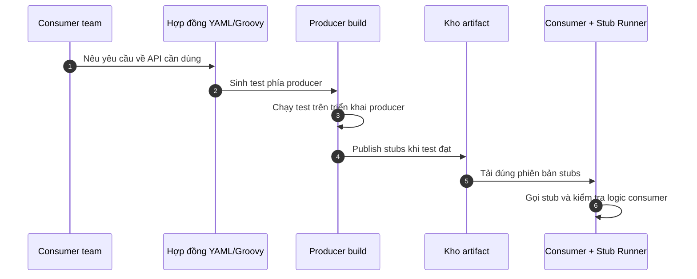

# Phân biệt contract test, unit test, integration test và end-to-end test

> **Chương:** Tổng quan  
> **Phạm vi:** Spring Cloud Contract (`SPRING_CLOUD_CONTRACT`) — kiểm thử hợp đồng giữa dịch vụ cung cấp (*producer*) và dịch vụ sử dụng (*consumer*).

## Mục tiêu học tập

Sau bài này, bạn có thể:

- Phân biệt **bốn loại kiểm thử** theo câu hỏi cần trả lời, phạm vi chạy và loại lỗi phát hiện.
- Giải thích vì sao unit test hoặc integration test chạy xanh vẫn có thể bỏ sót việc hai dịch vụ hiểu API khác nhau.
- Mô tả cách **Spring Cloud Contract** dùng Groovy/YAML DSL để định nghĩa hợp đồng HTTP hoặc thông điệp, sinh test phía producer, đóng gói stub và chạy stub phía consumer.
- Lựa chọn bộ kiểm thử phù hợp khi API thay đổi, đồng thời thiết kế cổng kiểm tra trên CI để phát hiện thay đổi không tương thích.

## 1. Bối cảnh: một API, nhiều loại rủi ro

Giả sử hệ thống bán hàng có hai dịch vụ:

- **`checkout-service` (consumer):** quyết định có cho phép đặt hàng hay không.
- **`inventory-service` (producer):** cung cấp thông tin tồn kho.

`checkout-service` gọi:

```http
GET /api/stock/SKU-001 HTTP/1.1
Host: inventory-service
Accept: application/json
```

Producer trả về:

```http
HTTP/1.1 200 OK
Content-Type: application/json

{
  "sku": "SKU-001",
  "available": true,
  "quantity": 4
}
```

Consumer cần ít nhất hai điều để xử lý đúng: `available` là **boolean**, còn `quantity` là **số nguyên**. Nếu producer lỡ đổi `available` thành chuỗi `"yes"`, cả hai dịch vụ có thể vẫn biên dịch và vượt qua unit test riêng, nhưng khi giao tiếp thật consumer có thể giải mã sai hoặc ra quyết định sai.

Bốn loại kiểm thử tiếp cận rủi ro này theo những góc độ khác nhau:

1. **Unit test:** logic bên trong một đơn vị mã có đúng không?
2. **Integration test:** các thành phần được ghép với nhau có hoạt động đúng không?
3. **Contract test:** producer và consumer có tuân thủ **cùng một thỏa thuận giao tiếp** không?
4. **End-to-end (E2E) test:** một hành trình nghiệp vụ hoàn chỉnh có chạy được từ đầu đến cuối không?

Đây là bốn **mục đích kiểm thử**; chúng không luôn là bốn tầng tách biệt về kỹ thuật. Chẳng hạn, test phía consumer chạy cùng Stub Runner thường cũng là một integration test, nhưng mục tiêu riêng của nó là xác nhận giao tiếp với hợp đồng của producer.

## 2. So sánh tổng quan

| Tiêu chí | Unit test | Integration test | Contract test | End-to-end test |
| --- | --- | --- | --- | --- |
| **Câu hỏi chính** | Một hàm/lớp xử lý đúng không? | Những thành phần được kết nối có chạy đúng không? | Hai bên có thống nhất cách gửi/nhận dữ liệu không? | Luồng nghiệp vụ thực tế có thành công không? |
| **Đối tượng** | Hàm, lớp, logic nhỏ | Controller, service, repository, DB, HTTP client hoặc một nhóm module | Ranh giới API HTTP hoặc thông điệp giữa producer–consumer | Giao diện, gateway, nhiều service, DB, hàng đợi và hạ tầng cần thiết cho kịch bản |
| **Phụ thuộc** | Thường dùng mock/fake | Dùng một số thành phần thật, có thể thay số khác bằng test double | Producer test hành vi API thật trong phạm vi test; consumer dùng stub sinh từ contract | Ưu tiên tích hợp các thành phần thật trên môi trường kiểm thử |
| **Phát hiện tốt** | Sai thuật toán, nhánh điều kiện, quy tắc cục bộ | Sai cấu hình, mapping, serialization, truy vấn, wiring | Sai method/path/status/header/body, kiểu/trường dữ liệu, cấu trúc message đã cam kết | Sai phối hợp toàn hệ thống, cấu hình triển khai, điều hướng luồng người dùng |
| **Chi phí thường gặp** | Thấp, chạy nhanh | Trung bình, tùy hạ tầng | Thường thấp hơn E2E; thêm chi phí quản trị contract/stub | Cao hơn, chạy chậm và dễ chịu ảnh hưởng môi trường |
| **Giới hạn** | Không chứng minh API hai dịch vụ tương thích | Một bài test chỉ chứng minh các tích hợp thực sự tham gia bài test | Không chứng minh toàn bộ nghiệp vụ, tính sẵn sàng hay cấu hình production | Khó khoanh vùng lỗi; khó bao phủ hết các tổ hợp |

**Không dùng bảng như một thứ hạng tuyệt đối về tốc độ.** Một contract test chạy qua ứng dụng thật có thể đắt hơn một integration test đơn giản; một E2E được tối ưu có thể chạy nhanh hơn integration test phải khởi tạo nhiều hạ tầng. Yếu tố quyết định là **phạm vi thực thi**.

## 3. Unit test: xác minh logic trong một đơn vị mã

Ví dụ, `CheckoutService` dựa vào một `InventoryClient` để hỏi tồn kho, rồi áp dụng quy tắc: chỉ cho phép mua nếu `available = true` và số lượng tồn kho đủ.

```java
// Minh họa JUnit 5 + Mockito; các class nghiệp vụ giả định đã tồn tại.
@Test
void choPhepMuaKhiDuHang() {
    InventoryClient inventory = mock(InventoryClient.class);
    when(inventory.getStock("SKU-001"))
        .thenReturn(new Stock("SKU-001", true, 4));

    CheckoutService checkout = new CheckoutService(inventory);

    assertTrue(checkout.canCheckout("SKU-001", 2));
}
```

Test này rất hữu ích: nó nhanh, chỉ rõ quy tắc và khi sai thường dễ tìm nguyên nhân. Nhưng đối tượng `Stock` do test tự tạo; chưa có request HTTP hay JSON từ `inventory-service`. Nếu producer đổi tên trường `quantity` thành `stockCount`, test trên vẫn có thể xanh.

**Dùng unit test khi:** kiểm tra tính toán, validation, nhánh điều kiện, ngoại lệ, chuyển trạng thái và những quy tắc có thể kiểm tra độc lập.

**Không suy ra từ unit test:** endpoint bên kia tồn tại, JSON có đúng kiểu hay network hoạt động.

## 4. Integration test: xác minh những thành phần đã ghép nối

Integration test kiểm tra tương tác thực giữa những thành phần được đưa vào phạm vi test. Ví dụ:

- Gọi endpoint qua Spring MVC để kiểm tra request mapping, validation và JSON serialization.
- Gọi repository với database kiểm thử (có thể qua Testcontainers) để kiểm tra truy vấn và transaction.
- Kiểm tra HTTP client gọi một mock server hoặc stub server để xác nhận xử lý request/response.

Một ví dụ trong `inventory-service` dùng `MockMvc` để kiểm tra endpoint (giả sử ứng dụng và dữ liệu kiểm thử đã được cấu hình):

```java
// Trích đoạn minh họa trong một @SpringBootTest + @AutoConfigureMockMvc.
@Autowired
MockMvc mvc;

@Test
void traVeTonKhoDungDinhDang() throws Exception {
    mvc.perform(get("/api/stock/SKU-001"))
       .andExpect(status().isOk())
       .andExpect(jsonPath("$.available").value(true))
       .andExpect(jsonPath("$.quantity").value(4));
}
```

Bài test này bắt được sai sót serialization hoặc routing trong `inventory-service`. Tuy nhiên, **việc nó kiểm tra đúng điều consumer cần hay không phụ thuộc vào bộ assertion do đội producer viết**. Nếu producer chủ động sửa đồng thời implementation và assertion sang `stockCount`, integration test của họ có thể tiếp tục xanh trong khi consumer chưa được cập nhật.

Cũng cần phân biệt: một test chỉ dựng web layer bằng `@WebMvcTest` là kiểm tra tích hợp trong **lát cắt web**, chưa chứng minh việc kết nối tới DB thật. Gọi chung mọi test có Spring context là "integration test toàn hệ thống" dễ dẫn đến đánh giá quá mức độ bao phủ.

**Dùng integration test khi:** cần xác minh wiring, Spring configuration, serialization, kết nối với DB/broker hoặc hành vi của HTTP client trong một phạm vi tích hợp xác định.

## 5. Contract test: xác minh lời hứa ở ranh giới dịch vụ

**Contract** là thỏa thuận có thể kiểm chứng về cách hai hệ thống giao tiếp. Với HTTP, nó có thể mô tả:

- Request: method, URL, query, path variable, header, body và quy tắc khớp.
- Response: status, header, body, trường bắt buộc, giá trị hoặc kiểu dữ liệu.
- Các trường hợp tiêu biểu: thành công, input không hợp lệ, không tìm thấy, trạng thái nghiệp vụ khác nhau.

Với giao tiếp bất đồng bộ, contract có thể mô tả **message destination, header, payload, sự kiện đầu vào/đầu ra hoặc trigger**. Nó không đòi hỏi tất cả microservice phải khởi động cùng lúc.

Trong Spring Cloud Contract, contract có thể được mô tả bằng **Groovy DSL hoặc YAML DSL**. Công cụ phối hợp hai cơ chế:

- **Producer-side contract verification:** từ contract, plugin sinh test để kiểm tra triển khai HTTP/message của producer thỏa thỏa thuận đã định.
- **Consumer-side stub testing:** từ cùng nguồn contract, sinh stub cho consumer test; **Stub Runner** tải và khởi chạy stub (HTTP thường dựa vào WireMock), rồi consumer gửi request tới stub như gọi một dịch vụ phụ thuộc.

Đây là cách tránh tình huống consumer tự viết mock `available = true` nhưng producer thực tế trả `"yes"`. Stub được sinh từ nguồn đã thống nhất và producer phải vượt qua phần kiểm chứng tương ứng trước khi phát hành stub được coi là đã xác minh.

### 5.1. Ví dụ YAML DSL cho HTTP contract

Giả sử lưu contract tại `src/test/resources/contracts/stock_available.yml` **trong dự án producer**:

```yaml
description: "Ton kho du cho checkout"
name: stock_available_for_checkout
request:
  method: GET
  url: /api/stock/SKU-001
  headers:
    Accept: application/json
response:
  status: 200
  headers:
    Content-Type: application/json
  body:
    sku: SKU-001
    available: true
    quantity: 4
```

Hợp đồng này chỉ nói về **một ví dụ giao tiếp đã cam kết**, không tuyên bố mọi SKU đều tồn kho bằng 4. Trong dự án thực tế, hãy thêm những contract cần thiết cho các tình huống consumer thực sự dùng, chẳng hạn hết hàng hoặc mã SKU không tồn tại.

### 5.2. Biểu diễn tương đương bằng Groovy DSL

Có thể viết cùng hành vi thành `stock_available.groovy`:

```groovy
org.springframework.cloud.contract.spec.Contract.make {
    name 'stock_available_for_checkout'

    request {
        method 'GET'
        url '/api/stock/SKU-001'
        headers {
            header 'Accept': 'application/json'
        }
    }

    response {
        status 200
        headers {
            contentType('application/json')
        }
        body(
            sku: 'SKU-001',
            available: true,
            quantity: 4
        )
    }
}
```

Hai đoạn trên là **hai cách biểu diễn cùng một contract** để học cách đọc DSL; khi áp dụng, chỉ chọn một phiên bản cho cùng tình huống để tránh test/stub trùng lặp. DSL cũng hỗ trợ các matcher cho trường có giá trị động (ví dụ ID, timestamp); không nên khóa toàn bộ trường dữ liệu vào giá trị mẫu khi consumer chỉ quan tâm đến định dạng hoặc điều kiện.

### 5.3. Producer và consumer kiểm tra những gì?



- **Producer kiểm tra:** với request theo hợp đồng, triển khai có trả đúng status, header và body đã cam kết không? Test thường chạy qua cấu hình kiểm thử của producer, không nhất thiết khởi động cả hệ thống.
- **Consumer kiểm tra:** HTTP client có tạo request đúng và xử lý phản hồi đã cam kết không? Dịch vụ producer thật không phải chạy trong suite này.
- **Cả hai cùng phụ thuộc vào việc contract phản ánh nhu cầu đã thống nhất.** Nếu hai đội tự ý thay contract cùng lúc để hợp thức hóa một thay đổi phá vỡ tương thích, các bài test mới vẫn có thể xanh. Cần review/versioning contract và kiểm tra các consumer còn phụ thuộc hành vi cũ.

### 5.4. Stub Runner trong consumer test

Một cấu hình minh họa cho consumer dùng stub JAR của `inventory-service` đã cài trong local Maven repository:

```java
@SpringBootTest(properties = {
    "inventory.base-url=http://localhost:8090"
})
@AutoConfigureStubRunner(
    ids = "com.example:inventory-service:1.4.0:stubs:8090",
    stubsMode = StubRunnerProperties.StubsMode.LOCAL
)
class CheckoutInventoryContractIT {

    @Autowired CheckoutService checkout;

    @Test
    void hieuPhanHoiTonKhoTuProducerStub() {
        assertThat(checkout.canCheckout("SKU-001", 2)).isTrue();
    }
}
```

Các import và class ứng dụng được lược bỏ để làm rõ ý tưởng. `inventory.base-url` là **property giả định của ứng dụng ví dụ** và phải được cấu hình sao cho HTTP client của consumer gọi đúng cổng stub. Tọa độ `com.example:inventory-service:1.4.0:stubs:8090` là ví dụ về `groupId:artifactId:version:classifier:port`; thay bằng artifact thật của dự án.

- `LOCAL` lấy stub đã có trong kho local (thường `.m2`). `REMOTE` dùng kho artifact từ xa với cấu hình repository tương ứng; `CLASSPATH` dùng stub trên classpath.
- Có thể dùng cổng cố định như `8090` cho ví dụ nhỏ, nhưng trong suite chạy song song nên dùng cổng động và lấy cổng do Stub Runner cung cấp.
- Consumer test với stub chỉ có giá trị bảo vệ khi artifact stub tương ứng với **contract đã được producer kiểm chứng**. Stub tự chế hoặc stub sinh trước khi triển khai producer vượt qua test chỉ mang tính mô phỏng.
- Để CI tái lập kết quả, nên chọn phiên bản stub cụ thể hoặc có chiến lược kiểm thử rõ ràng cho phiên bản mới nhất; không mặc nhiên coi ký hiệu `+` là một phiên bản cố định.

## 6. End-to-end test: kiểm tra hành trình nghiệp vụ

Một bài E2E có thể thực hiện chuỗi:

1. Người dùng chọn `SKU-001` trên giao diện.
2. Frontend gọi `checkout-service`.
3. `checkout-service` hỏi tồn kho của `inventory-service`.
4. Hệ thống ghi đơn hàng, xử lý thanh toán giả lập hoặc hệ thống test tương ứng.
5. Giao diện hiện xác nhận đặt hàng.

E2E kiểm tra các vấn đề mà contract test riêng lẻ không thể khẳng định: URL triển khai sai, credential không hợp lệ, gateway định tuyến nhầm, cấu hình broker lỗi, quá trình thanh toán hoặc orchestration gặp sự cố.

Đổi lại, nếu kịch bản thất bại ở bước cuối, nguyên nhân có thể nằm tại nhiều thành phần. Vì thế E2E thích hợp cho **ít luồng nghiệp vụ quan trọng**, không phải nơi đặt tất cả tổ hợp dữ liệu và từng quy tắc tính toán.

Nếu một suite gọi hệ thống bên ngoài nhưng phần lớn phụ thuộc là giả lập, hãy mô tả chính xác phạm vi của suite thay vì xem nó đã kiểm chứng production end-to-end.

## 7. Một thay đổi API sẽ bị phát hiện ở đâu?

Giả sử producer đổi:

```diff
 {
   "sku": "SKU-001",
-  "available": true,
+  "available": "yes",
   "quantity": 4
 }
```

Trong khi consumer vẫn kỳ vọng boolean:

| Loại kiểm thử | Kết quả có thể xảy ra | Vì sao |
| --- | --- | --- |
| **Unit test của consumer** | **Vẫn xanh** | Mock `InventoryClient` trả đối tượng Java với `available = true`; không giải mã JSON thật. |
| **Integration test riêng của producer** | **Có thể xanh hoặc đỏ** | Chỉ đỏ nếu assertion đang kiểm tra kiểu boolean; nếu assertion đổi cùng implementation thì vẫn xanh. |
| **Producer contract test** | **Đỏ**, nếu contract được giữ nguyên và có assertion cho `available` là boolean | Triển khai đã vi phạm response mà hai bên cam kết. |
| **Consumer test với stub hợp đồng cũ** | **Có thể vẫn xanh** | Nó chứng minh consumer hoạt động với contract/stub đã được chọn; tự nó không phát hiện producer mới đã phá contract cũ. |
| **E2E dùng producer mới** | **Có thể đỏ** | Consumer có thể gặp lỗi deserialize hoặc nhánh nghiệp vụ, nhưng thường phát hiện muộn hơn và khó chẩn đoán hơn. |

**Điểm mấu chốt:** contract test hiệu quả khi **được chạy ở producer** trên phiên bản triển khai sắp phát hành và hợp đồng cần giữ ổn định cho consumer đang sử dụng. Consumer-side stub test giúp consumer phát triển và xác nhận kỳ vọng, nhưng không thay thế việc kiểm chứng producer.

Một thay đổi khác như bổ sung trường JSON mới (ví dụ `warehouse`) thường **có thể** tương thích ngược nếu consumer bỏ qua trường chưa biết. Tuy nhiên, vẫn phải xác minh cấu hình deserializer của consumer và chính sách tương thích của hệ thống. Tính tương thích không chỉ phụ thuộc vào việc thay đổi "thêm" hay "xóa" trên văn bản JSON.

## 8. Contract test khác integration test ở điểm nào?

Đây là cặp khái niệm hay bị nhầm nhất.

**Integration test** được phân loại chủ yếu theo **ranh giới thành phần được chạy cùng nhau**. Ví dụ test `InventoryController` + `StockService` + database; hoặc test `CheckoutService` + HTTP client + WireMock.

**Contract test** được phân loại theo **đích kiểm chứng**: khẳng định giao diện giữa hai phía tuân thủ hợp đồng chung. Một provider contract test sinh bởi Spring Cloud Contract thường là integration test ở lớp HTTP; một consumer test dùng Stub Runner cũng có thể là integration test. Điều làm chúng thành *contract test* là hợp đồng được chia sẻ/đối chiếu với bên còn lại, chứ không phải chỉ vì dùng WireMock.

Vì vậy:

- **WireMock do consumer tự viết mapping**: có ích cho integration test nhưng chưa tự động là consumer-driven contract test đáng tin cậy.
- **WireMock từ stub do producer công bố sau khi vượt contract verification**: có thể làm cơ sở cho consumer contract testing.
- **Gọi producer thật từ consumer trong CI**: là kiểm tra tích hợp giữa hai dịch vụ; có thể kiểm tra tính tương thích, nhưng thường bị ràng buộc vào môi trường triển khai hơn cách dùng contract/stub.

Một câu hỏi tự kiểm tra rất hữu ích là: **"Ai bảo đảm giả lập mà consumer đang dùng phản ánh những gì producer hứa sẽ cung cấp?"** Nếu chưa có cơ chế trả lời, test dùng mock/stub có nguy cơ lệch khỏi thực tế.

## 9. HTTP contract và messaging contract

Spring Cloud Contract hỗ trợ cả **HTTP request/response** và **giao tiếp thông điệp**. Ví dụ consumer nhận sự kiện `StockReserved` khi tồn kho đã được giữ:

```json
{
  "eventType": "StockReserved",
  "orderId": "ORDER-123",
  "sku": "SKU-001",
  "reservedQuantity": 2
}
```

Với message contract, thay vì tập trung vào `GET`, URL và HTTP status, ta cần kiểm tra:

- **Đích gửi/nhận** (topic, queue hoặc channel) theo cơ chế tích hợp đang dùng.
- **Payload**: tên trường, kiểu dữ liệu, giá trị hoặc matcher.
- **Header**: ví dụ content type, event type, correlation ID nếu đó là một phần giao kèo.
- **Trigger/đầu vào** khiến producer phát ra thông điệp hay phản hồi được mong đợi.

Producer-side test có thể xác nhận thông điệp được tạo đúng cấu trúc trong cấu hình test; consumer-side stub/messaging test giúp xác minh phía nhận diễn giải đúng. Nhưng **việc broker thật chạy ổn định, consumer group được cấu hình chính xác, thứ tự xử lý hoặc retry hoạt động ra sao** còn cần integration/E2E test theo phạm vi thích hợp.

Hợp đồng thông điệp và HTTP đều không bao phủ mọi chi tiết nghiệp vụ hay mọi trường hợp vận hành; cần kết hợp với những loại kiểm thử khác.

## 10. Phối hợp bốn loại test trong CI

Một hướng triển khai thực tế cho hai service:

| Cổng kiểm tra | Chạy ở đâu? | Bài kiểm tra | Điều kiện cần giữ |
| --- | --- | --- | --- |
| **Unit** | Mỗi pull request của từng service | Quy tắc nghiệp vụ, logic xử lý lỗi, chuyển đổi dữ liệu | Chạy nhanh; độc lập với mạng |
| **Integration** | Pull request / CI service | Controller + serialization, repository + DB test, HTTP client + stub | Có cấu hình và dữ liệu test có thể tái lập |
| **Producer contract verification** | Pull request và trước khi phát hành `inventory-service` | Sinh test từ YAML/Groovy và chạy trên producer | Nếu không thỏa contract đang cam kết, chặn phát hành |
| **Publish stub** | Sau khi producer verification đạt | Đóng gói và lưu artifact `stubs` kèm phiên bản | Truy xuất được contract/stub tương ứng phiên bản producer |
| **Consumer contract/integration** | Pull request và trước khi phát hành `checkout-service` | Stub Runner lấy đúng artifact, consumer gọi stub | Chặn consumer nếu không đáp ứng contract mục tiêu |
| **E2E smoke / regression trọng yếu** | Môi trường kiểm thử trước khi phát hành hoặc sau triển khai phù hợp | Checkout thực hiện luồng hoàn chỉnh | Xác nhận wiring, cấu hình và luồng toàn hệ thống |

Trật tự trên là **một chính sách CI tham khảo**, không phải thứ tự bắt buộc tuyệt đối của mọi repository. Với thay đổi ảnh hưởng nhiều consumer, nên chạy thêm ma trận kiểm tra các consumer đang phụ thuộc phiên bản API cũ; với triển khai độc lập, cần định nghĩa rõ phiên bản contract/stub được coi là tương thích.

Ví dụ thay đổi response từ `available: true` sang `available: "yes"`:

1. Producer sửa code nhưng **không sửa contract đã thống nhất** ⇒ producer contract test phải thất bại, ngăn publish stub/artifact không tương thích.
2. Nếu thật sự cần đổi API ⇒ trao đổi với consumer, dùng phiên bản API mới hoặc kế hoạch chuyển tiếp, cập nhật hợp đồng theo chính sách tương thích.
3. Sau khi producer xác minh được hợp đồng mới ⇒ phát hành stub phiên bản mới; consumer thử với Stub Runner trước khi đổi code/cấu hình phụ thuộc.
4. Chạy một số E2E trọng yếu để bảo đảm toàn bộ luồng và cấu hình triển khai hoạt động.

Không nên có bước tự động "cập nhật expected response cho mọi test" chỉ để CI xanh sau một thay đổi API; cách đó đánh mất tín hiệu về tương thích.

## 11. Khi nào dùng loại nào? Các lỗi thường gặp

| Tình huống | Nên ưu tiên | Lý do |
| --- | --- | --- |
| Hàm tính phí vận chuyển trả sai tổng tiền | Unit test | Khoanh vùng chính xác quy tắc cục bộ |
| Repository lưu sai dữ liệu hoặc transaction rollback không đúng | Integration test với DB kiểm thử | Cần tương tác persistence thật |
| Consumer đọc `available` boolean nhưng producer đổi thành string | Contract test ở producer, cộng consumer test với stub | Ranh giới API bị phá vỡ |
| Client Java gửi nhầm HTTP header hoặc path | Consumer test với Stub Runner; integration test client | Cần kiểm tra request consumer phát ra |
| Kafka/RabbitMQ message mất trường `orderId` đã cam kết | Messaging contract test | Producer/consumer bất đồng cấu trúc sự kiện |
| Người dùng thanh toán xong nhưng màn hình không hiện đơn | E2E + integration phù hợp | Cần quan sát toàn luồng và cấu hình vận hành |

**Các ngộ nhận nên tránh:**

- **"Có nhiều unit test thì API an toàn."** Không: mock do từng đội tự định nghĩa có thể không khớp giao tiếp thực.
- **"Contract test thay thế integration test."** Không: contract chỉ bao phủ phần giao diện được mô tả và những trường hợp có trong contract.
- **"Đã có E2E thì khỏi cần contract."** Không: E2E thường tốn kém, khó chỉ ra chính xác lời hứa API nào bị phá.
- **"Chỉ cần chạy Stub Runner là producer chắc chắn tương thích."** Không: còn cần producer verification trên triển khai thích hợp và quản lý artifact/phiên bản đã xác minh.
- **"Contract càng chứa nhiều chi tiết nghiệp vụ càng tốt."** Không: nên tập trung vào thông tin thực sự cần cho giao tiếp; chi tiết nội bộ dễ làm contract giòn và gây false alarm.
- **"Contract là OpenAPI/JSON Schema thì tự động có contract test."** Không: tài liệu/schema giúp mô tả giao diện, còn kiểm chứng producer và consumer cần test hoặc công cụ thực thi tương ứng.

## 12. Bài tập tự kiểm tra

**Bài 1 — Phân loại.** Với mỗi trường hợp sau, hãy xác định loại test nên giữ vai trò chính và giải thích:

1. `CheckoutService` tính sai chiết khấu với đơn có 3 mặt hàng.
2. Controller trả mã HTTP `200` thay vì `404` khi SKU không tồn tại.
3. `inventory-service` bỏ trường `quantity` mà `checkout-service` đang dùng.
4. Cấu hình API gateway trên staging chuyển request tới service sai.
5. Event `StockReserved` có `reservedQuantity` kiểu chuỗi thay vì số.

**Gợi ý đáp án:** (1) unit; (2) integration lớp HTTP và contract nếu `404` là cam kết; (3) producer contract test và kiểm tra consumer; (4) integration ở môi trường tích hợp hoặc E2E; (5) messaging contract test.

**Bài 2 — Thiết kế hợp đồng.** Mở rộng ví dụ `stock_available.yml` bằng một trường hợp `GET /api/stock/UNKNOWN` trả `404` với body lỗi đã thống nhất. Xác định rõ consumer xử lý `404` ra sao và cần unit test nào cho nhánh này. Đây là bài thực hành thiết kế; không nên sửa cùng một contract thành hai phản hồi cho một request hoàn toàn giống nhau.

**Bài 3 — Tư duy CI.** Nếu producer test đã xanh với contract phiên bản mới nhưng consumer đang chạy bản cũ trên production, bạn cần thêm bằng chứng gì trước khi deploy? Hãy kiểm tra contract cũ còn được hỗ trợ hay không, danh sách consumer phụ thuộc, kế hoạch versioning và ít nhất một kịch bản giao tiếp tương thích.

## Tài liệu tham khảo

- [Spring Cloud Contract — Giới thiệu và mục đích](https://docs.spring.io/spring-cloud-contract/reference/getting-started/introducing-spring-cloud-contract.html).
- [Spring Cloud Contract — Ứng dụng đầu tiên (Groovy/YAML, producer và consumer)](https://docs.spring.io/spring-cloud-contract/reference/getting-started/first-application.html).
- [Spring Cloud Contract — Contract DSL](https://docs.spring.io/spring-cloud-contract/reference/project-features-contract.html).
- [Spring Cloud Contract — Stub Runner Core](https://docs.spring.io/spring-cloud-contract/reference/project-features-stubrunner/stub-runner-core.html).
- [Spring Cloud Contract — Messaging](https://docs.spring.io/spring-cloud-contract/reference/project-features-messaging.html).
