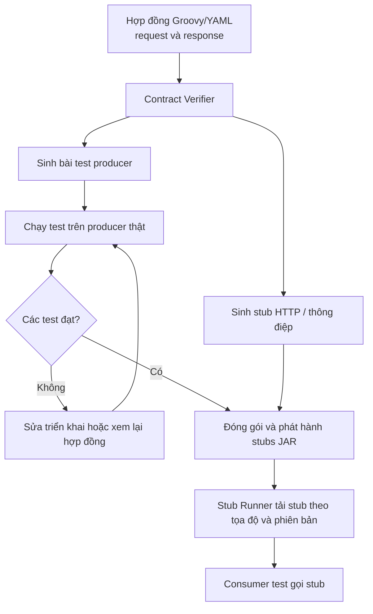

# Spring Cloud Contract Verifier và Stub Runner

## 1. Hai thành phần giải quyết vấn đề gì?

Trong hệ thống nhiều dịch vụ, **producer** (bên cung cấp API hoặc phát thông điệp) và **consumer** (bên gọi API hoặc nhận thông điệp) thường được phát triển, triển khai độc lập. Producer có thể đổi tên trường JSON, mã trạng thái hoặc cấu trúc thông điệp mà không nhận ra consumer đang phụ thuộc vào hành vi cũ. Chạy toàn bộ hệ thống để phát hiện lỗi vừa chậm vừa khó tái hiện.

**Spring Cloud Contract** hỗ trợ *contract testing*: mô tả các tương tác đã thỏa thuận bằng **Groovy DSL** hoặc **YAML DSL**, sau đó dùng mô tả ấy để kiểm chứng producer và tạo phản hồi giả lập cho consumer. Trong quy trình đó, hai thành phần có nhiệm vụ khác nhau:

| Thành phần | Chạy ở đâu? | Nhiệm vụ chính | Tín hiệu nhận được |
| --- | --- | --- | --- |
| **Spring Cloud Contract Verifier** | Phía producer, thường trong quá trình build/CI | Đọc hợp đồng, sinh kiểm thử và thực thi chúng trên ứng dụng producer; tạo định nghĩa stub từ hợp đồng | Producer còn đáp ứng hành vi đã cam kết hay không |
| **Spring Cloud Contract Stub Runner** | Phía consumer, thường khi chạy integration test | Tìm, tải/đọc và khởi chạy các stub tương ứng với phiên bản producer; cung cấp endpoint hoặc tích hợp thông điệp giả lập | Consumer có tương tác đúng với hành vi được mô tả trong hợp đồng hay không |

**Verifier kiểm chứng triển khai thật của producer; Stub Runner cho consumer một đối tác giả lập dựa trên cùng hợp đồng.** Hai phía dùng chung một định nghĩa hành vi, vì vậy giảm nguy cơ viết mock tùy ý, khác với API thực tế.

Đây là kiểm thử **hành vi có trong hợp đồng**, không phải phép chứng minh rằng mọi chức năng đều đúng. Nếu không có hợp đồng cho một trường hợp lỗi hoặc một endpoint, hai công cụ sẽ không tự kiểm tra trường hợp đó.

## 2. Quy trình phối hợp từ hợp đồng đến kiểm thử



Một vòng triển khai thường diễn ra như sau:

1. Producer và consumer thống nhất hành vi của một trường hợp sử dụng: phương thức, đường dẫn, header, dữ liệu gửi đi, mã trạng thái và dữ liệu trả về; với thông điệp là điều kiện kích hoạt, đích gửi, header và payload.
2. Nhóm ghi hành vi thành hợp đồng trong nguồn quản lý phiên bản. Hợp đồng nên được cả hai bên xem xét khi thay đổi, dù có thể được lưu trong repository của producer hoặc một repository hợp đồng riêng.
3. Trong build producer, Verifier sinh test từ hợp đồng. Các test gọi vào **triển khai producer thật** theo cách được cấu hình (chẳng hạn MockMvc) và xác minh phản hồi.
4. Khi producer qua kiểm thử, build tạo **stubs JAR**, thường mang classifier `stubs`, và phát hành vào Maven repository mà consumer truy cập được.
5. Trong build consumer, Stub Runner lấy đúng stubs JAR và bật máy chủ stub HTTP (thường dựa trên WireMock); consumer test gọi máy chủ này thay cho producer đang chạy thật.
6. CI báo lỗi nếu producer không còn tuân thủ hợp đồng hoặc consumer xử lý sai phản hồi hợp đồng. Hai pipeline có thể chạy độc lập, miễn là kiểm soát được phiên bản stub sử dụng.

Trong luồng HTTP, test sinh bởi Verifier và mapping dùng bởi WireMock là hai sản phẩm của **cùng một contract**. Đây là mối liên kết quan trọng nhất giữa Verifier và Stub Runner.

## 3. Định nghĩa hợp đồng HTTP bằng Groovy hoặc YAML

Giả sử `order-provider` cung cấp endpoint `GET /api/orders/42`. Consumer mong đợi `200 OK` và JSON có `id` cùng `status`. Hợp đồng Groovy có thể đặt trong `src/test/resources/contracts/shouldReturnOrder.groovy` của producer:

```groovy
import org.springframework.cloud.contract.spec.Contract

Contract.make {
    description 'Trả về đơn hàng đã xác nhận'

    request {
        method GET()
        url '/api/orders/42'
        headers {
            accept(applicationJson())
        }
    }

    response {
        status OK()
        headers {
            contentType(applicationJson())
        }
        body([
            id: 42,
            status: 'CONFIRMED'
        ])
    }
}
```

Cùng hành vi đó có thể mô tả bằng YAML, ví dụ `src/test/resources/contracts/shouldReturnOrder.yml`:

```yaml
description: Trả về đơn hàng đã xác nhận
request:
  method: GET
  url: /api/orders/42
  headers:
    Accept: application/json
response:
  status: 200
  headers:
    Content-Type: application/json
  body:
    id: 42
    status: CONFIRMED
```

**Chỉ chọn một trong hai file trên** cho ví dụ này; để cả hai sẽ tạo hai hợp đồng tương đương. Dù viết bằng DSL nào, contract phải thể hiện rõ dữ liệu nào consumer thật sự dựa vào. Khi cần chấp nhận ID, thời điểm hoặc giá trị biến thiên, Spring Cloud Contract hỗ trợ **matcher** và phân biệt giá trị/mẫu phía consumer với phía producer. Không nên cố định các dữ liệu vốn ngẫu nhiên chỉ để làm test qua được.

Một hợp đồng có thể mô tả các trường hợp khác như `POST` có request body, `404` khi không tìm thấy bản ghi, `400` khi dữ liệu sai, hoặc header bắt buộc. Mỗi hành vi quan trọng nên có hợp đồng riêng và tên đủ rõ để truy vết khi test thất bại.

## 4. Contract Verifier ở phía producer

### 4.1. Verifier tạo ra những gì?

Với hợp đồng `shouldReturnOrder`, Verifier có thể sinh một test có ý nghĩa tương đương:

```java
// Mã minh họa ý nghĩa của test sinh ra, không phải bản sao chính xác
// của mã generator ở mọi phiên bản Spring Cloud Contract.
given()
    .header("Accept", "application/json")
.when()
    .get("/api/orders/42")
.then()
    .statusCode(200)
    .header("Content-Type", containsString("application/json"))
    .body("id", equalTo(42))
    .body("status", equalTo("CONFIRMED"));
```

Generator chuyển các điều kiện trong contract thành phép kiểm tra HTTP. Test chạy trên producer phải có ứng dụng và dữ liệu phù hợp: ví dụ đơn hàng `42` được chuẩn bị sẵn trong test fixture hoặc tầng truy cập dữ liệu được thay bằng mock xác định. Nếu API đổi từ `status` sang `state` mà chưa thống nhất sửa contract, test producer sẽ thất bại.

### 4.2. Cấu hình nền tảng kiểm thử

Với dự án Spring Boot dùng Gradle/Groovy DSL, producer có thể áp dụng plugin Contract Verifier và chỉ định base class chung cho test được sinh:

```groovy
// Trích đoạn build.gradle; chọn phiên bản plugin tương thích
// với Spring Boot và Spring Cloud của dự án.
plugins {
    id 'org.springframework.cloud.contract' version '<SCC_VERSION>'
}

contracts {
    baseClassForTests = 'com.example.order.contract.BaseContractTest'
}
```

Ví dụ base class cho kiểm thử HTTP qua MockMvc:

```java
package com.example.order.contract;

import io.restassured.module.mockmvc.RestAssuredMockMvc;
import org.junit.jupiter.api.BeforeEach;
import org.springframework.beans.factory.annotation.Autowired;
import org.springframework.boot.test.autoconfigure.web.servlet.AutoConfigureMockMvc;
import org.springframework.boot.test.context.SpringBootTest;
import org.springframework.test.web.servlet.MockMvc;

@SpringBootTest
@AutoConfigureMockMvc
public abstract class BaseContractTest {

    @Autowired
    MockMvc mockMvc;

    @BeforeEach
    void setup() {
        RestAssuredMockMvc.mockMvc(mockMvc);
        // Thiết lập dữ liệu ổn định cho đơn hàng 42 nếu cần.
    }
}
```

`BaseContractTest` là lớp do đội producer viết để khởi tạo môi trường; các lớp test riêng cho từng hợp đồng được Verifier sinh. Cách khởi động test khác nhau tùy **test mode**, framework, kiến trúc controller và phiên bản Spring Cloud Contract. Chẳng hạn khi không dùng MockMvc, phải chọn cấu hình phù hợp thay vì dùng nguyên base class trên.

Các task Gradle thường gặp là `generateContractTests`, `contractTest` và `verifierStubsJar`. Có thể kiểm tra tên task thực tế theo phiên bản plugin được dùng. Trong pipeline, cần chạy các test hợp đồng **trước khi** công bố stubs JAR; một artifact stub được đóng gói thành công chưa chứng minh producer đáp ứng hợp đồng.

### 4.3. Khi test producer không đạt

Ví dụ hợp đồng kỳ vọng HTTP `200` và `status = "CONFIRMED"`, trong khi API trả `404` hoặc `status = "APPROVED"`. Đây là lỗi phù hợp với mục tiêu Verifier: producer đã khác điều mà consumer được phép trông đợi. Cách xử lý là xác định xem thay đổi ở API là lỗi triển khai hay một thay đổi hợp đồng được thống nhất. Nếu là thay đổi có chủ đích, cập nhật hợp đồng, kiểm thử và kế hoạch tương thích cùng nhau; không chỉ xóa assertion để làm CI xanh.

## 5. Stub Runner ở phía consumer

### 5.1. Stub Runner sử dụng sản phẩm nào?

Sau khi Verifier sinh định nghĩa stub và producer đóng gói, một artifact có tọa độ Maven dạng:

```text
com.example:order-provider:1.0.0:stubs
```

Ở đây `com.example` là group ID, `order-provider` là artifact ID, `1.0.0` là version và `stubs` là **classifier**. Đây là artifact stub, không phải bản ứng dụng producer để chạy production. Bên trong thường có các mapping HTTP và response body phục vụ máy chủ stub.

Stub Runner nhận tọa độ này, tìm artifact theo chế độ được cấu hình rồi khởi chạy stub. Một định danh stub dùng trong annotation thường có dạng:

```text
groupId:artifactId:version:classifier:port
com.example:order-provider:1.0.0:stubs:8089
```

Consumer gọi `http://localhost:8089/api/orders/42` sẽ nhận kết quả giả lập theo contract, dù `order-provider` thật không được khởi động. Khi cần nhiều producer, có thể cấu hình nhiều stub ID và địa chỉ tương ứng.

### 5.2. Ví dụ kiểm thử consumer

Consumer có thể dùng dependency test `spring-cloud-starter-contract-stub-runner`, cấu hình địa chỉ HTTP client và kích hoạt Stub Runner bằng annotation:

```java
import org.junit.jupiter.api.Test;
import org.springframework.beans.factory.annotation.Autowired;
import org.springframework.boot.test.context.SpringBootTest;
import org.springframework.cloud.contract.stubrunner.spring.AutoConfigureStubRunner;
import org.springframework.cloud.contract.stubrunner.spring.StubRunnerProperties;

import static org.assertj.core.api.Assertions.assertThat;

@SpringBootTest(properties = {
    "order.client.base-url=http://localhost:8089"
})
@AutoConfigureStubRunner(
    ids = "com.example:order-provider:1.0.0:stubs:8089",
    stubsMode = StubRunnerProperties.StubsMode.LOCAL
)
class OrderConsumerContractTest {

    @Autowired
    OrderClient orderClient;

    @Test
    void readsConfirmedOrderFromProviderContract() {
        OrderResponse order = orderClient.getOrder(42);
        assertThat(order.getId()).isEqualTo(42);
        assertThat(order.getStatus()).isEqualTo("CONFIRMED");
    }
}
```

`OrderClient`, `OrderResponse` và property `order.client.base-url` là các thành phần **minh họa** phải ánh xạ sang HTTP client/DTO/cấu hình thực tế của consumer. Điểm cần kiểm chứng là code consumer gọi đúng đường dẫn, parse đúng dữ liệu và xử lý kết quả theo hợp đồng; không chỉ kiểm tra riêng WireMock bằng một HTTP request thủ công. Cổng `8089` phải sẵn sàng trên môi trường test; trong suite lớn nên ưu tiên cấu hình cổng linh hoạt để tránh đụng cổng.

Stub Runner có các chế độ tìm stub thường gặp:

| Chế độ | Nguồn stub | Tình huống phù hợp |
| --- | --- | --- |
| `CLASSPATH` | Stub đã có trên classpath của bài test | Ví dụ đơn giản hoặc dự án cung cấp trực tiếp test fixture |
| `LOCAL` | Maven repository cục bộ, thường ở `~/.m2/repository` | Phát triển trên máy cá nhân sau khi producer publish local |
| `REMOTE` | Repository từ xa được cấu hình, ví dụ Maven artifact repository nội bộ | CI và nhiều nhóm dùng chung stubs đã phát hành |

Với `LOCAL`, producer cần phát hành artifact stub vào repository cục bộ mà consumer sẽ tra cứu. Với `REMOTE`, cần cấu hình `repositoryRoot` và quyền truy cập phù hợp; không ghi mật khẩu trực tiếp vào source. **Khóa version trong CI** giúp tái hiện lỗi. Ký hiệu version động như `+` tiện để thử bản mới nhưng dễ khiến kết quả test thay đổi giữa hai lần chạy.

### 5.3. Stub Runner phát hiện và không phát hiện điều gì?

Nếu consumer gửi `GET /api/orders/42` nhưng code lại parse trường `state` trong khi stub trả `status`, test sẽ thất bại. Nếu consumer gửi sai URL hoặc HTTP method, stub có thể không tìm thấy mapping phù hợp, cho thấy tương tác chưa đúng hợp đồng.

Ngược lại, một test consumer chạy qua Stub Runner **không chứng minh** producer thật hiện vẫn hoạt động: điều đó là trách nhiệm của Verifier trong pipeline producer. Stub cũng không mô phỏng toàn bộ hành vi hệ thống như hiệu năng, transaction, cơ sở dữ liệu, authorization thật hay lỗi mạng. Vì vậy vẫn cần một lượng kiểm thử tích hợp và end-to-end có chủ đích cho các rủi ro ngoài hợp đồng.

## 6. Phân biệt kiểm thử HTTP và hợp đồng thông điệp

Ví dụ trên minh họa **HTTP request–response**. Spring Cloud Contract cũng có thể mô tả **message contract**: một điều kiện kích hoạt hoặc thông điệp đầu vào dẫn đến thông điệp đầu ra với destination, headers và payload được kỳ vọng. Verifier có thể sinh test để kiểm tra việc producer phát thông điệp đúng hợp đồng; Stub Runner có khả năng hỗ trợ stub thông điệp khi có tích hợp messaging thích hợp.

Khác biệt quan trọng: stub HTTP thường được phục vụ qua một cổng WireMock, còn message stub cần cấu hình binder/broker và các thư viện tương ứng với stack messaging của hệ thống. Không thể dùng nguyên annotation và URL HTTP ở ví dụ trên để kết luận message contract đã được kiểm thử. Khi triển khai message contract, phải xác định rõ đâu là producer, consumer, kênh nhận/gửi và cách trigger trong môi trường test.

## 7. Đưa Verifier và Stub Runner vào CI

Một pipeline dễ kiểm soát có thể tách thành hai pha:

| Pipeline | Bước | Điều kiện để qua |
| --- | --- | --- |
| **Producer** | Checkout code và hợp đồng; sinh test bằng Verifier; chuẩn bị test fixture; chạy test hợp đồng | Tất cả tương tác đã cam kết đều được ứng dụng producer đáp ứng |
| **Producer** | Tạo stubs JAR có classifier `stubs`; publish cùng phiên bản phát hành | Artifact chỉ được công bố sau khi test producer qua |
| **Consumer** | Chọn phiên bản artifact stub đã được phát hành; Stub Runner tải và chạy stub | Consumer tìm được đúng stub, đúng URL/cổng và không bị lỗi cấu hình repository |
| **Consumer** | Chạy test trên HTTP client hoặc lớp ứng dụng thật của consumer | Consumer tạo request và xử lý response theo hợp đồng |

Khi sửa API có nguy cơ **breaking change**, quy trình an toàn là thỏa thuận cập nhật hợp đồng, triển khai giai đoạn tương thích nếu cần, chạy Verifier và consumer test với stub phiên bản dự kiến, rồi mới triển khai. Ví dụ đổi hẳn `status` thành `state` sẽ ảnh hưởng consumer cũ; có thể hỗ trợ đồng thời hai trường trong giai đoạn chuyển đổi nếu đó là cách tương thích được thống nhất. Việc cập nhật contract mà không chạy lại consumer test không đủ để đánh giá tác động.

### Các lỗi cấu hình thường gặp

| Triệu chứng | Nguyên nhân cần kiểm tra | Hướng xử lý |
| --- | --- | --- |
| Không có test sinh ra | Sai thư mục `contracts`, plugin chưa bật hoặc contract không hợp lệ | Kiểm tra vị trí DSL, cấu hình plugin và output sinh test |
| Test producer trả mã hoặc body khác contract | Triển khai đổi hành vi; thiếu test fixture hoặc mock chưa ổn định | Đối chiếu từng request/response và chuẩn bị dữ liệu test xác định |
| Stub Runner không tìm thấy artifact | Sai group/artifact/version/classifier, chưa publish hoặc repository chưa cấu hình | Kiểm tra tọa độ `...:stubs`, nguồn `LOCAL`/`REMOTE` và quyền đọc artifact |
| Consumer nhận `404` từ stub | Request không khớp mapping: method, URL, query, header hoặc body | So request thực tế với matcher trong contract và mapping sinh ra |
| Test chạy local nhưng lỗi trên CI | Phụ thuộc cache `~/.m2`, version động, credential hoặc cổng bị chiếm | Publish stub ở repository dùng chung, pin version và cấu hình cổng rõ ràng |
| Test đều xanh nhưng lỗi sau triển khai | Hợp đồng chưa bao phủ tình huống quan trọng hoặc stub cũ hơn producer | Bổ sung trường hợp lỗi, đồng bộ version, giữ kiểm thử tích hợp thiết yếu |

## 8. Bài thực hành nhỏ: phát hiện thay đổi API không tương thích

**Bối cảnh:** `order-provider` trả chi tiết đơn hàng; `checkout-consumer` cần đọc trường `status` để quyết định hiển thị trạng thái.

1. Trong producer, tạo một hợp đồng cho `GET /api/orders/42`, yêu cầu HTTP `200` và `status: CONFIRMED` như ví dụ ở mục 3.
2. Cấu hình Verifier và base class để test sinh ra gọi được endpoint producer, có dữ liệu đơn hàng `42` ổn định. Chạy nhóm test hợp đồng; kỳ vọng **PASS**.
3. Sinh stubs JAR và publish vào Maven repository cục bộ hoặc kho dùng trong CI, với phiên bản cố định như `1.0.0`.
4. Trong consumer, dùng Stub Runner khởi chạy `com.example:order-provider:1.0.0:stubs:8089`; trỏ HTTP client thực tế của consumer đến cổng stub. Kiểm tra consumer đọc được `id = 42`, `status = CONFIRMED`; kỳ vọng **PASS**.
5. Trong triển khai producer, thử đổi response từ `status` thành `state` nhưng **giữ nguyên hợp đồng**. Chạy lại Verifier; kỳ vọng **FAIL**, vì producer đã phá vỡ hành vi cam kết.
6. Khôi phục response producer, sau đó thử sửa consumer để chỉ đọc `state`. Chạy lại consumer test với stub cũ; kỳ vọng **FAIL**, vì consumer đã lệch khỏi hợp đồng đang được phát hành.

Kết quả cần giải thích được: Verifier là lưới bảo vệ từ phía **triển khai producer**, còn Stub Runner đưa chính hợp đồng ấy vào test của **consumer**. Hai tín hiệu bổ sung cho nhau, hỗ trợ phát hiện thay đổi API không tương thích ngay trong CI trước khi các dịch vụ được triển khai cùng nhau.

## 9. Ghi nhớ khi áp dụng vào dự án thực tế

- Viết hợp đồng quanh **hành vi consumer thực sự cần**, gồm cả mã lỗi và header quan trọng; tránh mô tả chi tiết nội bộ không thuộc giao diện công khai.
- Cho producer chạy test sinh bởi Verifier trước khi publish stubs; dùng **cùng nguồn contract** cho cả test producer và stub consumer.
- Xem stubs JAR là artifact có **version**; liên kết version ấy với commit/release của producer để truy vết lỗi.
- Đảm bảo test consumer thực sự gọi qua client của ứng dụng, không chỉ kiểm tra stub đã khởi động.
- Thay đổi hợp đồng cần được hai phía xem xét; chỉ cập nhật DSL để vượt qua test có thể che đi breaking change.
- Kết hợp contract test với unit, integration và một số end-to-end test cho trường hợp nằm ngoài mô tả của hợp đồng.

Khi nắm rõ ranh giới trách nhiệm của **Verifier** và **Stub Runner**, nhóm có thể kiểm thử hợp đồng producer–consumer ngay trong vòng phát triển thường ngày, thay vì phải đợi một môi trường tích hợp đầy đủ mới biết các dịch vụ không còn hiểu nhau.
