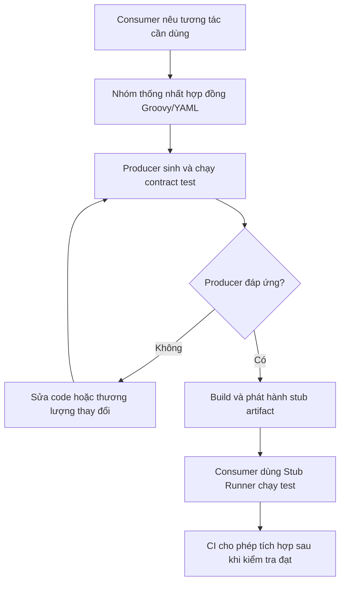

# Phân biệt hợp đồng kiểm thử với OpenAPI và tài liệu API

Trong hệ thống nhiều dịch vụ, hai nhóm có thể cùng hiểu rằng API `GET /orders/{id}` trả về thông tin đơn hàng nhưng lại hiểu khác nhau về **mã trạng thái HTTP, tên trường JSON hoặc ý nghĩa của trường dữ liệu**. Tài liệu được cập nhật vẫn chưa bảo đảm dịch vụ đang chạy thực sự làm đúng; một bài kiểm thử đơn vị của từng dịch vụ cũng chưa chắc phát hiện được consumer bị ảnh hưởng.

Với **Spring Cloud Contract**, nhóm phát triển có thể mô tả những tương tác mà producer (bên cung cấp API) phải đáp ứng, sinh kiểm thử để xác minh producer và tạo stub cho consumer (bên gọi API) kiểm thử trước khi tích hợp thật. Để áp dụng đúng, cần phân biệt ba khái niệm có quan hệ với nhau: **tài liệu API**, **OpenAPI** và **hợp đồng kiểm thử (contract testing)**.

## 1. Ba khái niệm giải quyết ba nhu cầu khác nhau

### 1.1. Tài liệu API: giúp con người hiểu và sử dụng

Tài liệu API thường giải thích API dùng để làm gì, cách xác thực, tham số, cấu trúc yêu cầu/phản hồi, quy tắc nghiệp vụ, lỗi thường gặp và ví dụ tích hợp. Tài liệu có thể viết bằng Markdown, trang web, wiki, cổng dành cho developer hoặc sinh từ một đặc tả có cấu trúc.

Ví dụ tài liệu cho người dùng API:

> **Lấy đơn hàng:** Gọi `GET /orders/{id}` với mã đơn hàng hợp lệ. Nếu tìm thấy, dịch vụ trả `200 OK` cùng JSON có `id` và `status`. Trường `status` cho biết trạng thái xử lý đơn. Nếu không tìm thấy, dịch vụ trả `404 Not Found`.

Tài liệu giúp người đọc hiểu **ý định và cách sử dụng**. Tuy nhiên, một đoạn mô tả bằng lời không tự gửi HTTP request, kiểm tra JSON hay phát hiện khi code triển khai lệch khỏi tài liệu. Ngay cả tài liệu sinh tự động từ code cũng chỉ phản ánh những gì công cụ lấy được, không mặc nhiên chứng minh hành vi thực tế đúng với nhu cầu của consumer.

### 1.2. OpenAPI: đặc tả API có cấu trúc, máy có thể xử lý

**OpenAPI Specification (OAS)** là cách chuẩn hóa mô tả giao diện HTTP API dưới dạng tài liệu có cấu trúc, thường viết bằng YAML hoặc JSON. Một đặc tả OpenAPI có thể khai báo đường dẫn, phương thức, tham số, mã phản hồi, header, media type, schema, ràng buộc dữ liệu, cơ chế bảo mật, ví dụ và phần giải thích.

Nhờ cấu trúc thống nhất, nhiều công cụ có thể dùng OpenAPI để hiển thị tài liệu, kiểm tra định dạng đặc tả, sinh SDK/server skeleton, kiểm tra request/response theo schema, hoặc tạo bài kiểm thử. **OpenAPI có thể đóng vai trò một dạng hợp đồng API**; nhưng bản thân file OpenAPI **không tự chạy** để xác minh implementation hay sự tương thích với một consumer cụ thể.

Ví dụ OpenAPI diễn tả một phần API lấy đơn hàng:

```yaml
openapi: 3.0.3
info:
  title: Order API
  version: 1.0.0
paths:
  /orders/{id}:
    get:
      summary: Lấy thông tin đơn hàng
      parameters:
        - in: path
          name: id
          required: true
          schema:
            type: integer
      responses:
        '200':
          description: Tìm thấy đơn hàng
          content:
            application/json:
              schema:
                type: object
                required: [id, status]
                properties:
                  id:
                    type: integer
                  status:
                    type: string
                    enum: [PROCESSING, SHIPPED]
              example:
                id: 42
                status: SHIPPED
        '404':
          description: Không tìm thấy đơn hàng
```

Đặc tả này nói rằng phản hồi thành công có các trường `id`, `status` và các giá trị trạng thái cho phép. Nhưng chỉ từ file đặc tả không thể khẳng định implementation **thực sự** trả đúng `200`, `Content-Type: application/json` và `status: SHIPPED` cho đơn hàng số 42. Muốn khẳng định, cần một công cụ kiểm thử thực thi yêu cầu và so sánh với kỳ vọng.

### 1.3. Hợp đồng kiểm thử: xác minh một tương tác có thể thực thi

Trong **contract testing**, hợp đồng ghi lại kỳ vọng giữa bên gọi và bên cung cấp tại ranh giới giao tiếp: với yêu cầu hoặc thông điệp đầu vào nhất định, bên cung cấp phải trả về phản hồi hoặc phát ra thông điệp phù hợp. Hợp đồng được công cụ dùng để **sinh hoặc chạy kiểm thử**, qua đó phát hiện thay đổi hành vi không tương thích.

**Consumer-driven contract testing (CDC)** nhấn mạnh việc bắt đầu từ những gì consumer thật sự cần. Producer chạy kiểm thử đối với các kỳ vọng đã thống nhất. Spring Cloud Contract hỗ trợ định nghĩa hợp đồng bằng **Groovy DSL hoặc YAML DSL**, sinh kiểm thử phía producer và tạo **stub** để consumer kiểm thử độc lập với một phiên bản producer đang chạy.

Ví dụ hợp đồng Groovy DSL cho đúng tương tác `GET /orders/42`:

```groovy
import org.springframework.cloud.contract.spec.Contract

Contract.make {
    description 'Lấy đơn hàng 42 với trường status mà consumer sử dụng'

    request {
        method GET()
        url '/orders/42'
        headers {
            header 'Accept', 'application/json'
        }
    }

    response {
        status OK()
        headers {
            contentType(applicationJson())
        }
        body(
            id: 42,
            status: 'SHIPPED'
        )
    }
}
```

Khi được tích hợp vào quy trình build, Spring Cloud Contract có thể tạo kiểm thử phía producer từ hợp đồng này. Kiểm thử sẽ gửi yêu cầu tương ứng tới ứng dụng hoặc lớp HTTP được cấu hình và xác minh phản hồi theo các điều kiện trong hợp đồng. Công cụ cũng có thể sinh stub mô phỏng tương tác ấy để consumer gọi thử. **Stub là mô phỏng một hợp đồng đã công bố**, không phải bằng chứng độc lập rằng mã producer đang chạy đúng: bằng chứng đó đến từ việc producer thực thi và vượt qua kiểm thử hợp đồng.

Lưu ý: ví dụ cố định đơn hàng `42` để dễ thấy mối liên hệ giữa request và response. Trong dự án thực, nên chuẩn bị dữ liệu kiểm thử có thể lặp lại và dùng matcher của DSL khi giá trị thực tế là động (chẳng hạn mã định danh hoặc thời điểm). Không nên buộc mọi chi tiết của phản hồi phải cố định nếu consumer không phụ thuộc vào chúng.

## 2. Bảng so sánh nhanh

| Tiêu chí | Tài liệu API | OpenAPI | Hợp đồng kiểm thử với Spring Cloud Contract |
|---|---|---|---|
| Câu hỏi chính | “Tôi dùng API thế nào?” | “Giao diện HTTP API được định nghĩa ra sao?” | “Producer có đáp ứng tương tác mà consumer cần không?” |
| Đối tượng chính | Developer, người tích hợp, người vận hành | Developer và công cụ tự động | Nhóm producer, consumer và pipeline CI |
| Hình thức | Văn bản, ví dụ, hướng dẫn, trang tham khảo | Đặc tả YAML/JSON theo chuẩn OAS | Groovy/YAML DSL thể hiện request–response hoặc message |
| Phạm vi thường gặp | Cách sử dụng, ngữ cảnh, quy tắc nghiệp vụ | Các endpoint và schema của API HTTP | Các kịch bản giao tiếp đã thỏa thuận |
| Có thể đọc bằng máy? | Tùy định dạng | Có | Có |
| Tự xác minh code khi chỉ lưu file? | Không | Không | Không; cần cấu hình sinh/chạy test đối với producer |
| Khi tích hợp công cụ | Tra cứu, hướng dẫn, ví dụ | Render tài liệu, lint, codegen, kiểm tra schema, test từ spec | Sinh producer test, sinh/publish stub, chạy Stub Runner, chặn build khi sai hợp đồng |
| Điểm mạnh | Giải thích **vì sao, khi nào, cách dùng** | Thống nhất giao diện và hỗ trợ hệ sinh thái công cụ | Phát hiện sai lệch hành vi ở ranh giới producer–consumer |
| Giới hạn điển hình | Có thể lỗi thời và khó kiểm chứng tự động | Schema không diễn tả hết mọi quy tắc nghiệp vụ hay hành vi theo trạng thái | Chỉ bảo vệ những tương tác được viết thành hợp đồng; cần quản lý dữ liệu và phạm vi kiểm thử |

**Điểm cần nhớ:** “contract” là một khái niệm rộng. OpenAPI là **đặc tả hợp đồng giao diện**; Spring Cloud Contract cung cấp cơ chế **kiểm thử hợp đồng có thể thực thi**. Không nên hiểu rằng chỉ một trong hai mới là “hợp đồng” hoặc OpenAPI hoàn toàn không thể dùng cho kiểm thử: các công cụ khác có thể sinh kiểm thử từ OpenAPI. Sự khác biệt nằm ở **mức độ mô tả, trọng tâm và cách xác minh hành vi**.

## 3. Cùng một thay đổi API, mỗi lớp phát hiện điều gì?

Giả sử consumer đang đọc `status` để hiển thị tiến độ giao hàng. Producer đổi phản hồi từ:

```json
{
  "id": 42,
  "status": "SHIPPED"
}
```

thành:

```json
{
  "id": 42,
  "state": "SHIPPED"
}
```

- **Tài liệu API** có thể được cập nhật để hướng dẫn dùng `state`. Tuy nhiên, consumer đã triển khai theo `status` vẫn có thể bị lỗi, dù tài liệu mới đúng với phiên bản mới của producer.
- **OpenAPI** có thể ghi nhận schema mới và công cụ so sánh phiên bản đặc tả có thể cảnh báo việc xóa/đổi tên trường bắt buộc. Nếu chỉ kiểm tra **tính hợp lệ của đặc tả mới**, file OpenAPI vẫn có thể hợp lệ về mặt cú pháp mà không phát hiện được consumer cũ đang phụ thuộc vào `status`.
- **Spring Cloud Contract** có thể phát hiện ngay trong build của producer: hợp đồng vẫn yêu cầu `status`, nhưng phản hồi thực tế chỉ có `state`, nên kiểm thử hợp đồng thất bại. Nhóm phát triển phải giữ tương thích hoặc cùng consumer thương lượng, cập nhật và triển khai thay đổi có kiểm soát.

Một số thay đổi khác cũng cần xem xét theo kỳ vọng của consumer:

| Thay đổi từ producer | Rủi ro với consumer | Điều nên xác minh |
|---|---|---|
| `200 OK` thành `204 No Content` | Consumer chờ JSON sẽ không nhận body | Mã trạng thái và sự tồn tại của body |
| `status` từ chuỗi thành số | Code parse/so sánh trạng thái có thể lỗi | Kiểu dữ liệu và miền giá trị |
| Bỏ header mà consumer sử dụng | Mất thông tin phiên bản, caching hoặc tương quan yêu cầu | Header liên quan trong contract |
| Thêm trường JSON tùy chọn | Thường có thể tương thích, nhưng client parse quá nghiêm có thể lỗi | Khả năng bỏ qua trường lạ và độ chặt matcher |
| Đổi ý nghĩa của `SHIPPED` dù schema không đổi | Logic nghiệp vụ của consumer sai | Kịch bản nghiệp vụ và quy tắc chuyển trạng thái |

Không phải mọi khác biệt JSON đều là lỗi hợp đồng. Một hợp đồng tốt nêu rõ **điều consumer thực sự dựa vào**. Ví dụ, nếu consumer chỉ cần `id` là số và `status` thuộc các giá trị hợp lệ, hãy dùng matcher phù hợp thay vì ràng buộc những trường, thứ tự hoặc giá trị không quan trọng. Ngược lại, khi giá trị chính xác là điều kiện nghiệp vụ, phải kiểm tra đúng giá trị đó.

## 4. Spring Cloud Contract đặt ở đâu trong luồng phát triển?

Luồng phổ biến cho một HTTP API có thể mô tả như sau:



Các bước có vai trò riêng:

1. **Thống nhất kỳ vọng.** Consumer và producer lựa chọn các tình huống quan trọng, chẳng hạn thành công `200`, không tìm thấy `404`, dữ liệu đầu vào sai `400`. File hợp đồng có thể được quản lý trong kho của producer hoặc một kho hợp đồng chung, tùy quy trình nhóm.
2. **Kiểm tra producer.** Plugin Spring Cloud Contract sinh kiểm thử từ DSL. Producer cần cấu hình test base và trạng thái dữ liệu phù hợp để bài kiểm thử thực sự đi qua phần triển khai cần xác minh. Nếu triển khai trả sai, build/test phải thất bại.
3. **Đóng gói và phát hành stub.** Sau khi kiểm thử producer thành công, build tạo stub từ hợp đồng và có thể publish artifact với classifier `stubs` lên kho Maven tương ứng. Cần gắn stub với phiên bản producer đã được xác minh để tránh dùng nhầm bản cũ.
4. **Kiểm tra consumer.** Consumer dùng **Stub Runner** để tải/chạy stub của producer, rồi thử logic gọi API của mình. Stub Runner có thể chạy các HTTP stub trên cổng cục bộ, giúp consumer kiểm thử mà không phải khởi động toàn bộ hệ thống phụ thuộc.
5. **Tích hợp CI.** CI của producer chạy contract test trước khi publish; CI của consumer chạy bài kiểm thử tích hợp với stub phù hợp. Thay đổi không tương thích được phát hiện sớm, trước khi triển khai hai dịch vụ cùng môi trường.

Ví dụ khai báo Stub Runner ở bài kiểm thử Spring Boot của consumer (giả sử artifact stub đã được cài trong kho Maven cục bộ):

```java
import org.springframework.cloud.contract.stubrunner.spring.AutoConfigureStubRunner;
import org.springframework.cloud.contract.stubrunner.spring.StubRunnerProperties;

@AutoConfigureStubRunner(
    ids = "com.example:order-service:+:stubs:8085",
    stubsMode = StubRunnerProperties.StubsMode.LOCAL
)
class OrderClientContractIntegrationTest {
    // Cấu hình HTTP client gọi localhost:8085 và kiểm tra cách xử lý phản hồi.
}
```

Đoạn mã minh họa cách khai báo, không phải một lớp kiểm thử hoàn chỉnh: ứng dụng thực tế cần dependency tương thích, cấu hình client trỏ đúng cổng stub và các phương thức test. Khi dùng kho artifact từ xa, nhóm cấu hình repository và chế độ lấy stub tương ứng. Cú pháp `+` ở vị trí version thường được dùng để chọn phiên bản phù hợp trong quá trình test; với pipeline phát hành cần tính tái lập cao, nên kiểm soát phiên bản stub một cách rõ ràng.

**Hai phía kiểm tra hai điều khác nhau:** Producer test chứng minh implementation hiện tại đáp ứng hợp đồng; consumer test với stub chứng minh mã consumer xử lý được tương tác đã thống nhất. Chỉ chạy consumer test với stub mà bỏ qua producer test có thể khiến cả nhóm tin vào một phản hồi mô phỏng không còn đúng với dịch vụ thật.

## 5. Kết hợp OpenAPI, tài liệu và contract test trong cùng dự án

Không cần chọn một công cụ để thay thế hoàn toàn hai công cụ còn lại. Một quy trình hữu ích là:

| Nhu cầu | Đầu ra phù hợp | Cách kiểm soát trong CI |
|---|---|---|
| Công bố API để đối tác hiểu và tích hợp | Tài liệu hướng dẫn, ví dụ, mã lỗi, quy tắc nghiệp vụ | Rà soát tài liệu và ví dụ khi thay đổi API |
| Chuẩn hóa bề mặt HTTP API | `openapi.yaml` với paths, schemas, responses, security | Lint/validate OpenAPI; so sánh thay đổi phá vỡ tương thích khi cần |
| Giữ tương thích với consumer cụ thể | Spring Cloud Contract DSL cho các tình huống then chốt | Sinh và chạy producer contract tests |
| Consumer phát triển song song | Stub artifact đã kiểm chứng | Chạy consumer tests qua Stub Runner |
| Kiểm chứng hệ thống hoàn chỉnh | Integration/end-to-end tests | Kiểm tra luồng có database, network, authentication và các thành phần thật |

Có thể tạo trang tài liệu từ OpenAPI và bổ sung phần giải thích nghiệp vụ bằng văn bản. Cũng có thể dùng OpenAPI làm nguồn tạo các phép kiểm tra schema hoặc hợp đồng với công cụ thích hợp. Điều quan trọng là nhóm phải **quy định nguồn sự thật, cách đồng bộ và cổng kiểm tra tự động**: nếu OpenAPI, code và hợp đồng DSL thay đổi riêng rẽ, chúng vẫn có thể bất đồng.

**Những giới hạn không nên nhầm lẫn:**

- **OpenAPI không chỉ là tài liệu dành cho con người.** Nó là một đặc tả có cấu trúc, có thể được công cụ dùng để sinh mã và kiểm thử. Các phiên bản và công cụ khác nhau có khả năng khác nhau, nên cần đánh giá công cụ cụ thể.
- **Spring Cloud Contract không thay thế toàn bộ OpenAPI.** Một bộ hợp đồng chọn lọc có thể kiểm tra đúng những kịch bản consumer cần nhưng không nhất thiết liệt kê hết endpoint, schema hoặc cơ chế xác thực của API.
- **Contract test không thay thế integration hay end-to-end test.** Contract test tập trung vào ranh giới trao đổi. Lỗi dữ liệu, phân quyền, sự cố liên mạng hay hành vi phối hợp nhiều dịch vụ vẫn cần các cấp kiểm thử khác.
- **Thông điệp bất đồng bộ là một phạm vi khác.** Spring Cloud Contract cũng hỗ trợ hợp đồng cho trao đổi message với hạ tầng phù hợp; OpenAPI chủ yếu mô tả HTTP API, còn các giao thức/event-driven API có thể dùng đặc tả chuyên biệt như AsyncAPI.

## 6. Cách lựa chọn mức kiểm tra phù hợp

Khi thiết kế contract test, hãy xuất phát từ hành vi có thể gây lỗi cho consumer:

- **Phản hồi thành công:** endpoint, HTTP method, status, media type, các trường và kiểu dữ liệu mà consumer sử dụng.
- **Phản hồi lỗi:** mã HTTP, cấu trúc mã lỗi, thông điệp hoặc trường cần cho xử lý ngoại lệ; ví dụ `404` và `400` có thể dẫn đến hai cách xử lý khác nhau.
- **Quy tắc nghiệp vụ:** trạng thái đơn hàng, giá trị có ý nghĩa, điều kiện hợp lệ và bất hợp lệ, tương quan giữa request với response.
- **Khả năng mở rộng:** dùng matcher cho dữ liệu biến đổi; tránh kiểm tra những chi tiết không nằm trong cam kết tương thích.
- **Kỷ luật phiên bản:** producer chỉ phát hành stub sau khi test đạt; consumer kiểm thử với phiên bản stub có thể truy vết; review hợp đồng khi thay đổi API.

Ví dụ, consumer chỉ cần `status` để điều hướng màn hình thì hợp đồng nên ưu tiên bảo vệ tính hiện diện, kiểu dữ liệu và giá trị hợp lệ của `status`. Đừng bắt contract test kiểm tra các trường nội bộ như `lastUpdatedBy` nếu consumer không sử dụng. Ngược lại, nếu consumer dựa vào `ETag` để cache, header đó thuộc kỳ vọng cần bảo vệ.

## 7. Các ngộ nhận thường gặp

**“Có OpenAPI hợp lệ thì API chắc chắn tương thích.”** Sai. File có thể hợp lệ nhưng code chạy khác mô tả, hoặc schema mới đã xóa trường mà consumer cũ cần. Cần kết hợp so sánh thay đổi, kiểm thử triển khai và các kỳ vọng thực tế.

**“Có Swagger UI là đã có contract testing.”** Chưa đủ. Swagger UI chủ yếu hiển thị và hỗ trợ thử API dựa trên OpenAPI; việc tự động xác minh producer theo các kịch bản consumer cần phải được cấu hình thêm.

**“Stub chạy đúng nghĩa là producer thật chạy đúng.”** Chưa đủ. Stub Runner phát phản hồi đã định nghĩa trong stub. Phải chạy producer contract test với triển khai thực và chỉ sử dụng stub tương ứng với build đã vượt kiểm tra.

**“Contract test phải so sánh toàn bộ JSON từng ký tự.”** Không. Sự so khớp quá chặt gây báo lỗi giả khi thêm trường không ảnh hưởng consumer. Ngược lại, so khớp quá lỏng có thể bỏ qua đổi kiểu hoặc mất trường quan trọng. Hãy diễn đạt chính xác mức cam kết của tương tác.

**“Một contract test đủ bảo đảm mọi thứ.”** Không. Cần lựa chọn đủ các kịch bản quan trọng, đặc biệt lỗi và trường hợp biên, đồng thời bổ sung unit, integration và end-to-end test theo mức rủi ro.

## 8. Tự kiểm tra hiểu biết

1. Nếu OpenAPI khai báo `status` là `string` nhưng producer thực tế trả `42`, file OpenAPI tự phát hiện lỗi chưa? **Chưa**; cần công cụ xác minh phản hồi thật theo schema hoặc bài contract test phù hợp.
2. Nếu developer đổi `status` thành `state` và cập nhật tài liệu API, consumer cũ có tự tương thích không? **Không**; cần đánh giá thay đổi phá vỡ và giữ/hỗ trợ cam kết mà consumer đang sử dụng.
3. Vì sao phải chạy contract test ở producer **trước khi phát hành stub**? Để stub đại diện cho hành vi đã được producer chứng minh, tránh consumer kiểm thử với kỳ vọng không khớp implementation.
4. Nếu muốn giải thích cách xác thực, giới hạn tần suất và ý nghĩa lỗi cho đối tác, nên dùng gì? **Tài liệu API**, có thể dựa trên OpenAPI và bổ sung hướng dẫn bằng lời.
5. Nếu muốn kiểm tra consumer hoạt động với một phản hồi đã thống nhất mà không khởi chạy producer thật, nên dùng gì? **Stub sinh từ hợp đồng kết hợp Stub Runner**, rồi vẫn cần producer contract test để bảo đảm phía cung cấp tuân thủ.

## Kết luận

**Tài liệu API** làm rõ cách sử dụng; **OpenAPI** chuẩn hóa và công bố giao diện HTTP để con người và công cụ cùng hiểu; **Spring Cloud Contract** biến các kỳ vọng trao đổi cụ thể thành kiểm thử producer và stub cho consumer. Ba lớp bổ sung cho nhau. Khi duy trì chúng đồng bộ và đưa producer test, phát hành stub, Stub Runner cùng kiểm tra tương thích vào CI, nhóm có thể phát hiện sớm những thay đổi API làm hỏng consumer trước khi thay đổi ấy đến môi trường vận hành.
