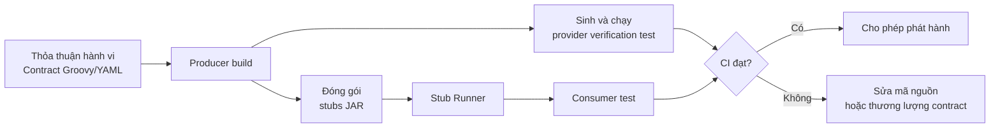
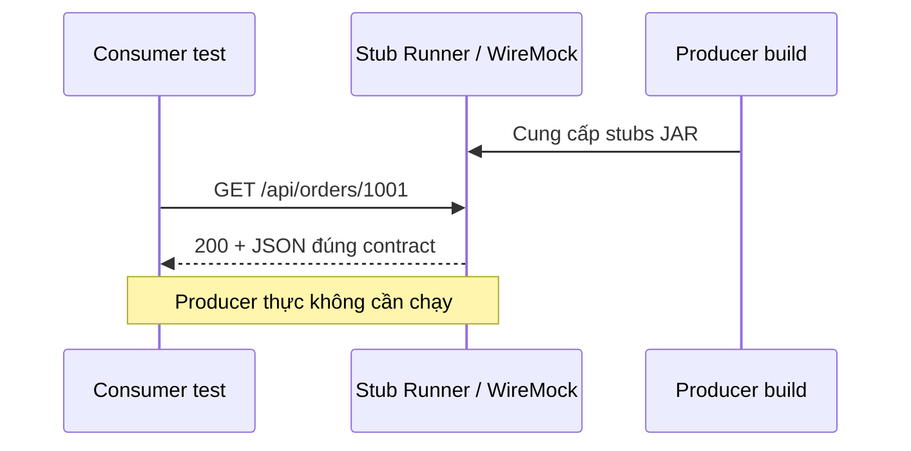

# Lộ trình học Spring Cloud Contract với ví dụ HTTP và thông điệp

Spring Cloud Contract (SCC) giúp hai dịch vụ thỏa thuận **hành vi có thể kiểm thử** tại ranh giới giao tiếp. Với API HTTP, hợp đồng mô tả phương thức, đường dẫn, dữ liệu yêu cầu, mã trạng thái và phản hồi. Với giao tiếp bất đồng bộ, hợp đồng mô tả thông điệp gửi hoặc nhận, kênh đích, header và payload. Từ hợp đồng viết bằng **Groovy DSL hoặc YAML DSL**, SCC có thể sinh bài kiểm thử cho **producer** (bên cung cấp) và tạo **stub** để **consumer** (bên sử dụng) kiểm thử mà không cần khởi động producer thực.

Bài này xây dựng một lộ trình học từ cơ bản đến tích hợp CI qua cùng một miền nghiệp vụ: dịch vụ `order-producer` cung cấp API đọc đơn hàng và phát sự kiện đơn hàng được tạo; dịch vụ `order-consumer` gọi API hoặc nhận sự kiện. Đích đến là nhận ra thay đổi giao diện không tương thích **trước khi triển khai**.

## 1. Xác định mục tiêu và bức tranh tổng thể

Sau khi hoàn thành, người học cần có thể:

1. Phân biệt **hợp đồng**, **test được sinh ở producer**, **stub cho consumer** và **kiểm thử tích hợp đầu cuối**.
2. Viết một hợp đồng HTTP bằng Groovy hoặc YAML, hiểu mỗi phần ràng buộc điều gì.
3. Chạy test được sinh trên producer để xác nhận ứng dụng thực đáp ứng hợp đồng.
4. Đóng gói và tiêu thụ stub qua **Spring Cloud Contract Stub Runner**.
5. Viết hợp đồng sự kiện, kích hoạt thông điệp trong test và kiểm tra nội dung gửi đi.
6. Thiết kế cổng kiểm tra trên CI để thay đổi phá vỡ hợp đồng bị phát hiện sớm.

Luồng điển hình:



Điểm cần hiểu: **cùng một hợp đồng phục vụ hai phía**, nhưng kiểm tra khác nhau. Producer chứng minh mã nguồn thực đáp ứng hợp đồng; consumer chứng minh mã nguồn của mình xử lý được phản hồi hoặc sự kiện mô phỏng từ hợp đồng. Hai nhóm test bổ sung cho nhau; chúng không khẳng định toàn bộ hệ thống chạy đúng khi có mạng, dữ liệu thật và hạ tầng thật.

## 2. Lộ trình đề xuất

| Chặng | Nội dung chính | Sản phẩm thực hành | Tiêu chí hoàn thành |
| --- | --- | --- | --- |
| 1. Nền tảng | Producer, consumer, contract, stub và trường hợp phá vỡ tương thích | Sơ đồ luồng giao tiếp và bảng hành vi cần cam kết | Nêu được mỗi bên kiểm thử điều gì |
| 2. HTTP cơ bản | Viết hợp đồng GET bằng Groovy, đối chiếu YAML | `get_order.groovy` hoặc `get_order.yml` | Hợp đồng chỉ rõ request và response |
| 3. Kiểm chứng producer | Tích hợp Contract Verifier, sinh và chạy test | Build producer có generated tests | Đổi status/body sai khiến build thất bại |
| 4. Kiểm thử consumer | Tạo `-stubs.jar`, chạy Stub Runner, kiểm tra client | Consumer test gọi stub qua HTTP | Test chạy được khi producer tắt |
| 5. Thông điệp | Hợp đồng sự kiện, trigger và kiểm tra payload | Contract `order_created.groovy` | Producer phát đúng message; consumer nhận được sự kiện giả lập |
| 6. CI và tiến hóa API | Pipeline kiểm chứng, phiên bản stub, kiểm tra thay đổi không tương thích | Pipeline thử cả producer và consumer | Một thay đổi phá vỡ contract bị chặn trước release |

Có thể học từng chặng độc lập, nhưng nên đi theo thứ tự trên: **chỉ chuyển sang thông điệp sau khi đã làm chủ vòng đời HTTP contract → test → stub**.

## 3. Chặng 1 — Xây dựng mô hình giao tiếp

Giả sử producer có endpoint:

```http
GET /api/orders/1001 HTTP/1.1
Accept: application/json
```

Phản hồi đã thống nhất:

```http
HTTP/1.1 200 OK
Content-Type: application/json

{"id":1001,"status":"CREATED"}
```

Consumer cần `id` để định danh đơn hàng và `status` để hiển thị trạng thái. Nếu producer âm thầm đổi `status` thành `state`, hoặc đổi `200` thành `204`, consumer có thể hỏng dù code producer vẫn biên dịch và unit test nội bộ vẫn xanh.

Từ ví dụ này, thiết lập phạm vi của hợp đồng:

- **Đầu vào:** HTTP `GET`, đường dẫn `/api/orders/1001`; khi có tham số hoặc header bắt buộc, cũng phải khai báo trong contract.
- **Đầu ra:** status `200`, kiểu dữ liệu JSON, trường `id` kiểu số và `status` có giá trị được mong đợi.
- **Trường hợp lỗi cần bổ sung:** đơn hàng không tồn tại (`404`) và truy cập bị từ chối nếu API có xác thực.
- **Phi chức năng:** độ trễ, retry, phân quyền thực tế, kết nối broker và tính nhất quán dữ liệu vẫn cần các bài test khác.

Không cần mô tả mọi chi tiết triển khai nội bộ. Hợp đồng nên cố định các hành vi mà consumer thực sự dựa vào.

## 4. Chặng 2 — Viết hợp đồng HTTP

### 4.1. Groovy DSL

Trong dự án `order-producer`, tạo tệp `src/test/resources/contracts/http/get_order.groovy`:

```groovy
import org.springframework.cloud.contract.spec.Contract

Contract.make {
    description 'Lay thong tin don hang theo id'

    request {
        method GET()
        url '/api/orders/1001'
    }

    response {
        status OK()
        headers {
            contentType(applicationJson())
        }
        body(
            id: 1001,
            status: 'CREATED'
        )
    }
}
```

Đọc contract theo hai nửa:

| Thành phần | Ý nghĩa | Lỗi có thể bị phát hiện |
| --- | --- | --- |
| `request.method` | API nhận HTTP GET | Producer bỏ GET hoặc chỉ hỗ trợ POST |
| `request.url` | Đường dẫn consumer sẽ gọi | Producer đổi tên endpoint |
| `response.status` | Phải trả `200 OK` | Producer trả `204`, `404` |
| `headers.contentType` | Phản hồi khai báo JSON | Producer trả kiểu nội dung khác |
| `response.body` | Có `id`, `status` đúng như cam kết | Trường bị đổi tên, biến mất, giá trị sai |

Đây là ví dụ cố định để học dễ kiểm tra. Trong hệ thống thực, cần dùng **matcher** cho dữ liệu thay đổi như UUID, timestamp hoặc ID do server cấp, để test không bị ràng buộc vô ích vào một giá trị mẫu. Matcher phải bảo toàn quy tắc mà consumer cần, ví dụ UUID hợp lệ hay `status` thuộc tập trạng thái được cho phép.

### 4.2. YAML DSL tương đương

Nếu nhóm không muốn viết Groovy, có thể diễn đạt cùng hành vi bằng `src/test/resources/contracts/http/get_order.yml`:

```yaml
description: Lay thong tin don hang theo id
request:
  method: GET
  url: /api/orders/1001
response:
  status: 200
  headers:
    Content-Type: application/json
  body:
    id: 1001
    status: CREATED
```

Groovy DSL linh hoạt cho matcher và logic khai báo phong phú; YAML DSL dễ đọc và dễ review khi các hợp đồng chủ yếu mô tả request/response. **Chỉ chọn một trong hai tệp cho cùng tình huống thực hành**; giữ cả hai có thể khiến công cụ sinh hai test/stub trùng ý nghĩa.

### 4.3. Đối chiếu với hiện thực của producer

Controller tối giản có thể trả về đúng ví dụ:

```java
@RestController
@RequestMapping("/api/orders")
class OrderController {

    @GetMapping("/{id}")
    ResponseEntity<Map<String, Object>> findById(@PathVariable long id) {
        if (id != 1001L) {
            return ResponseEntity.notFound().build();
        }

        return ResponseEntity.ok(
            Map.of("id", id, "status", "CREATED")
        );
    }
}
```

Đoạn Java chỉ minh họa để chạy bài học; ứng dụng thật sẽ truy vấn service/database và xử lý xác thực, phân quyền. Nếu dùng Spring Boot 3+, import phù hợp từ `org.springframework.http`, `org.springframework.web.bind.annotation` và `java.util`.

**Bài tập:** đổi response của controller thành `Map.of("id", id, "state", "CREATED")`. Khi có test contract được sinh ở chặng sau, thay đổi này phải làm test thất bại.

## 5. Chặng 3 — Sinh test và xác minh producer

Một dự án Maven thường cần:

- Dependency test `org.springframework.cloud:spring-cloud-starter-contract-verifier`.
- Plugin `org.springframework.cloud:spring-cloud-contract-maven-plugin` để đọc contract và sinh test.
- Quản lý **phiên bản Spring Boot / Spring Cloud Contract tương thích** trong dependency management và build plugin. Phiên bản cụ thể phụ thuộc dự án; không lấy một số phiên bản bất kỳ từ ví dụ.

Ví dụ phần cấu hình plugin; giả sử phiên bản của plugin đã được quản lý bởi cấu hình build:

```xml
<plugin>
    <groupId>org.springframework.cloud</groupId>
    <artifactId>spring-cloud-contract-maven-plugin</artifactId>
    <extensions>true</extensions>
    <configuration>
        <baseClassForTests>com.example.order.ContractVerifierBase</baseClassForTests>
    </configuration>
</plugin>
```

Lớp nền phục vụ test HTTP sinh tự động:

```java
package com.example.order;

import org.springframework.boot.test.context.SpringBootTest;
import org.springframework.boot.test.autoconfigure.web.servlet.AutoConfigureMockMvc;

@SpringBootTest
@AutoConfigureMockMvc
public abstract class ContractVerifierBase {
}
```

Khi dự án được thiết lập đúng, chạy:

```bash
mvn clean verify
```

Contract Verifier đọc các contract, sinh test trong quá trình build và chạy chúng với ứng dụng producer. Đối với chế độ MockMvc của ví dụ, test tạo request đến controller và so sánh mã trạng thái, header, body với contract. Nếu provider đổi JSON `status` thành `state`, **test sinh ra sẽ báo sai khác**, tạo tín hiệu sửa lỗi trước khi publish API.

Nếu producer có nhiều kiểu contract (HTTP và message), có thể dùng một base class hỗ trợ cả hai hoặc cấu hình **base class mapping** theo đường dẫn contract; cần thiết lập đúng test mode và adapter cho từng kiểu. Không nên mặc định rằng lớp base HTTP thuần túy đã đủ để kiểm chứng thông điệp.

**Điều kiện qua chặng:** xem log build thấy test sinh từ contract được chạy; sửa có chủ đích `status` thành `state` khiến build đỏ; khôi phục mã khiến build xanh.

## 6. Chặng 4 — Đóng gói stub và kiểm thử consumer

### 6.1. Vai trò của stub

Từ contract HTTP, Spring Cloud Contract tạo mapping cho **WireMock**. Khi đóng gói theo cấu hình Spring Cloud Contract, các mapping này được phát hành trong artifact có classifier `stubs`, thường có tên dạng `order-producer-1.0.0-stubs.jar`.

Consumer không cần khởi động controller hay database thật của producer. **Stub Runner** tải hoặc tìm stubs JAR, khởi động HTTP stub server và phục vụ các phản hồi đúng theo contract.



### 6.2. Ví dụ consumer test

Thêm dependency test `org.springframework.cloud:spring-cloud-starter-contract-stub-runner` vào dự án consumer. Với producer đã `mvn install` và artifact stubs có trong Maven local repository, có thể dùng:

```java
import static org.junit.jupiter.api.Assertions.assertEquals;

import java.util.Map;
import org.junit.jupiter.api.Test;
import org.springframework.boot.test.context.SpringBootTest;
import org.springframework.cloud.contract.stubrunner.spring.AutoConfigureStubRunner;
import org.springframework.cloud.contract.stubrunner.spring.StubRunnerProperties;
import org.springframework.web.client.RestTemplate;

@SpringBootTest
@AutoConfigureStubRunner(
    ids = "com.example:order-producer:1.0.0:stubs:8085",
    stubsMode = StubRunnerProperties.StubsMode.LOCAL
)
class OrderConsumerContractTest {

    @Test
    void readsOrderFromStub() {
        RestTemplate rest = new RestTemplate();

        Map<?, ?> response = rest.getForObject(
            "http://localhost:8085/api/orders/1001",
            Map.class
        );

        assertEquals(1001, response.get("id"));
        assertEquals("CREATED", response.get("status"));
    }
}
```

Chuỗi `com.example:order-producer:1.0.0:stubs:8085` có các phần **groupId : artifactId : version : classifier : port**. Điều chỉnh tọa độ Maven theo producer thực tế. `LOCAL` đọc artifact từ Maven local; trong CI, dùng repository artifact đã cấu hình và `REMOTE` nếu lấy stub qua mạng. Bản mẫu này gọi trực tiếp Stub Runner để nhìn rõ luồng; khi xây ứng dụng thật, nên cấu hình HTTP client qua property/base URL thay vì hardcode `localhost:8085`.

**Bài tập:** tắt hẳn producer, chạy test consumer. Test vẫn phải đi qua Stub Runner. Sau đó sửa parser của consumer để đọc `state` thay vì `status` và quan sát test thất bại.

### 6.3. Cần phối hợp phiên bản thế nào?

Nên pin phiên bản stubs hoặc một phiên bản candidate cụ thể khi chạy CI để cùng một commit luôn kiểm thử cùng bộ contract. Một số ví dụ trên mạng dùng `+` để lấy phiên bản mới nhất; cách đó tiện thử nghiệm nhưng có thể khiến pipeline nhận một artifact mới ngoài dự kiến. Phải bảo đảm producer xuất bản stubs và consumer thật sự dùng phiên bản vừa kiểm thử.

## 7. Chặng 5 — Hợp đồng thông điệp

Giao tiếp bất đồng bộ đổi câu hỏi từ “API trả JSON gì?” thành “**khi sự kiện xảy ra, producer phát thông điệp gì và tới đâu?**”. Giả sử khi tạo đơn hàng, producer phát lên destination logic `orders.created`:

```json
{
  "orderId": 1001,
  "status": "CREATED"
}
```

Thêm contract `src/test/resources/contracts/messaging/order_created.groovy`:

```groovy
import org.springframework.cloud.contract.spec.Contract

Contract.make {
    description 'Phat su kien khi don hang duoc tao'
    label 'order_created'

    input {
        triggeredBy('publishOrderCreated()')
    }

    outputMessage {
        sentTo('orders.created')
        headers {
            messagingContentType(applicationJson())
        }
        body(
            orderId: 1001,
            status: 'CREATED'
        )
    }
}
```

Ý nghĩa từng phần:

- `label`: nhãn dùng để consumer kích hoạt stub message theo kịch bản đã đặt tên.
- `input.triggeredBy`: phương thức test phía producer gọi để kích hoạt việc phát sự kiện. Đây là **hook của test**, không phải endpoint HTTP.
- `outputMessage.sentTo`: destination logic mà producer phải gửi tới.
- `headers` và `body`: quy tắc định dạng và payload của thông điệp.

Khi kiểm chứng producer, lớp base cho contract messaging cần cung cấp phương thức `publishOrderCreated()` và kết nối với publisher thực của ứng dụng. Ví dụ phần thân phương thức:

```java
public void publishOrderCreated() {
    orderEventPublisher.publishCreated(1001L);
}
```

Test messaging sinh ra sẽ kích hoạt phương thức này và kiểm tra thông điệp đầu ra thông qua cơ chế **message verifier** được tích hợp với hệ thống gửi nhận của ứng dụng. Tùy dự án sử dụng Spring Cloud Stream, Spring Integration, AMQP hay transport khác, cần cấu hình adapter/test binder phù hợp; `sentTo('orders.created')` là tên destination theo cấu hình, không tự động tạo một broker đang chạy.

Ở consumer, Stub Runner có thể phát thông điệp mẫu theo label để test listener:

```java
@Autowired
private StubTrigger stubTrigger;

@Test
void handlesOrderCreatedEvent() {
    stubTrigger.trigger("order_created");

    // Xác nhận listener đã xử lý orderId=1001 và status=CREATED.
    // Cách chờ/đọc message phụ thuộc test binder, queue hoặc listener của dự án.
}
```

`StubTrigger` thuộc API của Spring Cloud Contract Stub Runner. Để ví dụ trở thành test hoàn chỉnh, consumer phải có message transport được cấu hình, cơ chế bắt payload và assertion thực sự cho kết quả xử lý. Với xử lý bất đồng bộ, dùng thời hạn chờ hữu hạn thay vì sleep cố định.

### 7.1. Một contract thông điệp còn có thể mô tả đầu vào

Trong hệ thống consumer phát command rồi chờ producer phát event, contract có thể khai báo **`input.messageFrom` và `input.messageBody`** thay cho `triggeredBy`, kết hợp `outputMessage`. Chọn kiểu khai báo dựa trên luồng nghiệp vụ: producer tự phát sự kiện sau một thao tác, hay producer nhận một message rồi phản hồi. Đừng viết cả hai kiểu đầu vào chỉ vì có đủ cú pháp.

### 7.2. Vì sao hợp đồng thông điệp khác HTTP?

| Khía cạnh | HTTP contract | Message contract |
| --- | --- | --- |
| Tác nhân kích hoạt | Request của consumer | Hook hoặc message đầu vào |
| Điểm quan sát | HTTP status, headers, body | Destination, headers, payload |
| Stub phía consumer | HTTP WireMock stub | Message được Stub Runner kích hoạt |
| Rủi ro thường gặp | Đổi URL, method, JSON field | Đổi topic, field của event, kiểu dữ liệu |
| Điều cần test thêm | Timeout, auth, retry, lỗi mạng | Giao hàng lặp, thứ tự, retry, idempotency |

Nếu consumer xử lý cùng một sự kiện nhiều lần do at-least-once delivery, tính **idempotent** là trách nhiệm của logic nghiệp vụ và kiểm thử tích hợp; contract về hình dạng message chưa chứng minh được điều đó.

## 8. Chặng 6 — Đưa contract vào CI

Pipeline tối thiểu có thể chia thành các cổng kiểm chứng nối tiếp nhau:

1. **Khi thay đổi contract hoặc producer:** chạy build producer và các provider verification tests; không publish nếu test sinh từ contract thất bại.
2. **Sau khi producer pass:** đóng gói và phát hành stubs JAR lên Maven artifact repository với phiên bản rõ ràng (hoặc dùng artifact trong cùng pipeline).
3. **Khi thay đổi consumer hoặc contract dùng chung:** chạy consumer test với Stub Runner trỏ đến đúng stubs JAR; không cho phép merge/release nếu consumer xử lý response/message mẫu sai.
4. **Trước khi phát hành:** đối chiếu phiên bản contract/stub mà producer và consumer đã kiểm thử; ghi lại artifact version trong log hoặc metadata build.

Đây là sơ đồ trách nhiệm, không phải cú pháp pipeline của một CI cụ thể:

```text
Pull request producer
  -> validate contracts
  -> generate provider tests
  -> run producer tests
  -> package candidate stubs
  -> run consumer verification against candidate stubs
  -> merge/release only when checks pass

Pull request consumer
  -> obtain approved/pinned stubs artifact
  -> run consumer tests using Stub Runner
  -> merge only when checks pass
```

Có thể tổ chức contract trong repository producer hoặc repository hợp đồng riêng, tùy quy trình của nhóm. Dù ở đâu, thay đổi contract cần được cả người sở hữu producer và consumer xem xét. Khi dùng nhiều repository, cần cấu hình pipeline liên kết hoặc trigger kiểm thử chéo; chỉ xây producer và xuất bản stub **chưa tự động** đảm bảo consumer được kiểm thử.

### 8.1. Mô phỏng ba thay đổi API

| Thay đổi | Tương thích? | Contract có thể phát hiện ra sao? |
| --- | --- | --- |
| Producer xóa `status` khỏi JSON | Thường phá vỡ consumer đang đọc `status` | Provider test yêu cầu trường này sẽ fail |
| Producer đổi `GET /api/orders/{id}` sang `POST` | Phá vỡ các lời gọi GET hiện tại | Provider test của hợp đồng GET sẽ fail |
| Producer thêm trường tùy chọn `currency` | Thường tương thích, tùy parser/contract | Contract hiện tại có thể vẫn pass; cần test với parser nghiêm ngặt |
| Event đổi destination `orders.created` | Phá vỡ consumer đang lắng nghe destination cũ | Messaging contract/test sẽ phát hiện nếu kiểm chứng đúng binding |
| Consumer kỳ vọng `status=PAID` nhưng contract chỉ cam kết `CREATED` | Kỳ vọng chưa được thỏa thuận | Consumer test phải thêm tình huống/contract phản ánh kỳ vọng mới |

Chữ “tương thích” phụ thuộc vào **những gì consumer thực sự phụ thuộc**; test contract chỉ kiểm tra những trường hợp và quy tắc đã khai báo. Không nên xem toàn bộ API là tương thích chỉ vì một contract happy path còn xanh.

## 9. Các lỗi thường gặp khi thực hành

**Test producer không được sinh.** Kiểm tra plugin có được kích hoạt trong build, nơi đặt `src/test/resources/contracts`, tên file/đuôi DSL và cấu hình test generation. Đừng xem một lệnh `mvn verify` xanh là bằng chứng khi thực tế không có generated test nào được chạy.

**Provider test fail dù stub consumer chạy được.** Stub được sinh từ kỳ vọng contract, nên tự phục vụ phản hồi đúng là điều dễ hiểu. Cần test producer với **mã thật** mới phát hiện controller không đáp ứng hợp đồng.

**Stub Runner không tìm thấy artifact.** Kiểm tra chính xác groupId, artifactId, version, classifier `stubs`, repositoryRoot hoặc local Maven repo. Với `LOCAL`, cần bảo đảm JAR đã được install; với `REMOTE`, bảo đảm registry/repository và quyền truy cập chính xác.

**Hợp đồng quá cứng.** Timestamp, ID hoặc field phụ có thể biến động. Dùng matcher, ví dụ cho định dạng hay loại giá trị, thay vì khóa cứng tất cả. Không bỏ điều kiện có ý nghĩa với consumer chỉ để test dễ pass.

**Messaging test không bắt được message.** Kiểm tra `triggeredBy`, message verifier, destination và binding/test binder. Đảm bảo đã kích hoạt đúng hành vi phát sự kiện; chỉ gọi hook không đủ nếu producer không thực sự publish.

**CI xanh nhưng production vẫn lỗi.** Contract test không thay thế test bảo mật, deployment, schema evolution tổng thể, message ordering, timeout, migration hoặc khả năng tương tác với dịch vụ thật. Duy trì các tầng test thích hợp theo rủi ro.

## 10. Bài thực hành tổng hợp và tiêu chí tự đánh giá

Tạo hai ứng dụng nhỏ: `order-producer` và `order-consumer`. Lần lượt hoàn thành các yêu cầu sau:

1. Viết một HTTP contract cho `GET /api/orders/1001`, phản hồi `200` với `id`, `status`, và một contract khác cho `404` khi không tìm thấy đơn hàng.
2. Cấu hình Contract Verifier, chạy test producer và chụp lại ví dụ một lỗi cố ý: đổi `status` thành `state`.
3. Xuất bản `-stubs.jar` vào local repository và chạy consumer test với Stub Runner khi producer đang tắt.
4. Viết contract cho `orders.created` và test producer phát message `{"orderId":1001,"status":"CREATED"}`.
5. Dùng `StubTrigger` để mô phỏng sự kiện trong consumer test; bổ sung assertion chứng minh listener xử lý dữ liệu đúng.
6. Đưa các bước này vào CI, pin phiên bản artifact, cố ý sửa đường dẫn hoặc message field để xem pipeline báo đỏ tại cổng nào.

Đánh giá hoàn thành theo **bằng chứng chạy được**, không chỉ theo việc có các tệp contract:

| Minh chứng | Kết quả mong đợi |
| --- | --- |
| Producer generated tests chạy cùng build | Khớp HTTP response và thông điệp như contract |
| Cố ý phá vỡ producer | Build producer thất bại với sai khác cụ thể |
| Consumer test dùng Stub Runner | Chạy độc lập với producer thực |
| Consumer xử lý stub message | Có assertion về payload và hành vi listener |
| CI kiểm tra artifact đúng phiên bản | Kết quả lặp lại được, fail khi contract bị phá vỡ |

Khi các minh chứng trên đạt, người học đã đi hết vòng lặp quan trọng của **Spring Cloud Contract: định nghĩa hành vi → kiểm chứng producer → phân phối stub → kiểm chứng consumer → phát hiện thay đổi không tương thích trên CI**. Bước mở rộng tiếp theo là matcher nâng cao, versioning của nhiều consumer, contract repository dùng chung và chiến lược migration API/event giữa các phiên bản.
